# LAB บทที่ 2: Kubernetes Pod — จาก Pod แรกสู่ร้านอาหารแมวน้องส้ม

> **รายวิชา:** Software Development Tools and Environments (DevTools)
> **หัวข้อ:** ปฏิบัติการ Kubernetes Pod — `kubectl run`, YAML manifest, exec/logs/port-forward, labels, lifecycle, env/resources, probes และแอป Next.js + PostgreSQL ใน Pod เดียว
> **ผลลัพธ์การเรียนรู้ที่เกี่ยวข้อง:** CLO-5, CLO-6
> **ทฤษฎีประกอบ:** [01_Theory/README.md](../01_Theory/README.md)

---

## บทนำ

ทุก LAB ทำ **ใน container `k8s-lab`** (image `tuchsanai/devtools-kind:2569_1` มี kubectl, kind, helm, k9s และ Docker ข้างในครบ) โดยทำตามน้องส้มตั้งแต่สร้างคลัสเตอร์ สร้าง Pod แรก ดีบัก Pod ที่พัง จนถึงเปิด **"ร้านอาหารแมวน้องส้ม"** (Next.js + PostgreSQL) ใน Pod เดียว

> บล็อก **Expected output** คือผลที่ควรเห็นหลังรันคำสั่ง (ไม่ต้องพิมพ์ตาม) มาจากการทดลองจริงเมื่อ 5 ต.ค. 2569 (kind v0.33.0, kubectl v1.37.1, Kubernetes v1.37.0) ค่า AGE, IP, ชื่อ Pod ที่สุ่ม และ Node ในเครื่องนักศึกษาอาจต่างไป เป็นเรื่องปกติ

| สัญลักษณ์ | รันที่ไหน |
|---|---|
| 🖥️ | Terminal/PowerShell บนเครื่องนักศึกษา |
| 🐧 | SSH session ใน k8s-lab (prompt `root@k8s-lab`) |
| 🌐 | browser บนเครื่องนักศึกษา |

### กติกา

- ทำงานในโฟลเดอร์ `/workspace/DevTools/05_kubernetes/002_kubernetes_pod/02_LAB` และ **ลบ Pod ของตัวเองทุกครั้งที่จบ LAB**
- ใช้ **Pod เดี่ยว ๆ เท่านั้น** เข้าถึงแอปด้วย `kubectl exec`, `logs` และ `port-forward` + แท็บ PORTS ของ VS Code
- รหัส `passwd` (SSH) และ `meow1234` (ฐานข้อมูล) เป็นค่าตัวอย่างเพื่อการเรียนเท่านั้น

## สารบัญ LAB

| LAB | ชื่อ | เวลาโดยประมาณ | ความยาก |
|:---:|---|:---:|:---:|
| 0 | [เตรียมสภาพแวดล้อม (Setup)](#lab-0-เตรียมสภาพแวดล้อม-setup) (container `k8s-lab` + คลัสเตอร์ + git clone) | 20–30 นาที | ⭐ |
| 1 | [Pod แรกด้วย kubectl run](#lab-1-pod-แรกด้วย-kubectl-run) | 10 นาที | ⭐ |
| 2 | [Pod YAML แรก](#lab-2-pod-yaml-แรก) | 15 นาที | ⭐⭐ |
| 3 | [เข้าไปใน Pod: exec, logs, port-forward](#lab-3-เข้าไปใน-pod-exec-logs-port-forward) | 20 นาที | ⭐⭐ |
| 4 | [Labels และ Selectors](#lab-4-labels-และ-selectors) | 15 นาที | ⭐⭐ |
| 5 | [Lifecycle และการดีบัก Pod ที่พัง](#lab-5-lifecycle-และการดีบัก-pod-ที่พัง) | 25 นาที | ⭐⭐⭐ |
| 6 | [env, command และ resources](#lab-6-env-command-และ-resources) | 20 นาที | ⭐⭐⭐ |
| 7 | [Probes ตรวจสุขภาพ](#lab-7-probes-ตรวจสุขภาพ) | 15 นาที | ⭐⭐⭐ |
| 8 | [LAB สุดท้าย: ร้านอาหารแมวน้องส้ม](#lab-8-lab-สุดท้าย-ร้านอาหารแมวน้องส้ม) | 45–60 นาที | ⭐⭐⭐⭐⭐ |
| – | [เก็บกวาดหลังจบบท](#เก็บกวาดหลังจบบท) · [สรุปคำสั่ง kubectl ในบทนี้](#สรุปคำสั่ง-kubectl-ในบทนี้) | | |

รวมประมาณ 3.5–4 ชั่วโมง (เครื่องช้าหรือเน็ตช้าอาจนานกว่านี้ เพราะต้องดึง image จาก Docker Hub)

### สารบัญรูปภาพ

| รูปที่ | เรื่อง | รูปที่ | เรื่อง |
|:---:|---|:---:|---|
| 1 | [LAB 0 Setup container และคลัสเตอร์](#fig-1) | 10 | [LAB 5 lifecycle และดีบัก](#fig-10) |
| 2 | [LAB 0 git clone](#fig-2) | 11 | [LAB 6 env/command/resources](#fig-11) |
| 3 | [LAB 1 kubectl run](#fig-3) | 12 | [LAB 7 probes](#fig-12) |
| 4 | [LAB 2 YAML แรก](#fig-4) | 13 | [LAB 8 ร้านอาหารแมวน้องส้ม](#fig-13) |
| 5 | [LAB 3 exec/logs/port-forward](#fig-5) | 14 | [สถาปัตยกรรม Pod som-shop](#fig-14) |
| 6 | [LAB 3 attach VS Code เข้า k8s-lab](#fig-6) | 15 | [build และ kind load](#fig-15) |
| 7 | [LAB 3 เปิดเว็บผ่าน VS Code PORTS](#fig-7) | 16 | [ลำดับการเริ่ม Pod som-shop](#fig-16) |
| 8 | [ภาพหน้าจอจริง: หน้าเว็บ nginx ของ LAB 3](#fig-8) | 17 | [ภาพหน้าจอจริง: หน้าร้านเริ่มต้น](#fig-17) |
| 9 | [LAB 4 labels](#fig-9) | 18 | [ภาพหน้าจอจริง: หลังสั่งซื้อ 3 ครั้ง](#fig-18) |

### โครงสร้างไฟล์ LAB

```text
02_LAB/
├── README.md                     ← เอกสารนี้
├── images/                       ← ภาพประกอบ + screenshots/ ภาพหน้าจอจริงของร้าน
├── labs/
│   ├── lab02-first-yaml/nginx-pod.yaml
│   ├── lab04-labels/shop-pods.yaml
│   ├── lab05-lifecycle/{completed-pod,crash-pod,onfailure-pod,bad-image-pod}.yaml
│   ├── lab06-env-resources/{env-command-pod,oom-pod,pending-pod}.yaml
│   ├── lab07-probes/{liveness-exec-pod,readiness-http-pod}.yaml
└── som-shop/
    ├── app/                      ← แอป Next.js 16 + pg (Dockerfile, scripts/seed.mjs, ...)
    └── k8s/som-shop-pod.yaml     ← manifest ของ Pod ร้านน้องส้ม
```

---

## LAB 0: เตรียมสภาพแวดล้อม (Setup)

**เป้าหมาย:** สร้าง container `k8s-lab` และคลัสเตอร์ kind ชื่อ `lab` (1 control-plane + 2 worker) แล้วดึงไฟล์ LAB มาไว้ใน container (รายละเอียดของแต่ละคำสั่งดูได้จาก [LAB บทที่ 1](../../001_kubernetes-introduction/02_LAB/readme.md))

**ต้องมี:** Docker Desktop (Linux containers, RAM อย่างน้อย 4 GB) และ SSH client

### ขั้นที่ 1: Setup container และคลัสเตอร์

<p align="center" id="fig-1">
  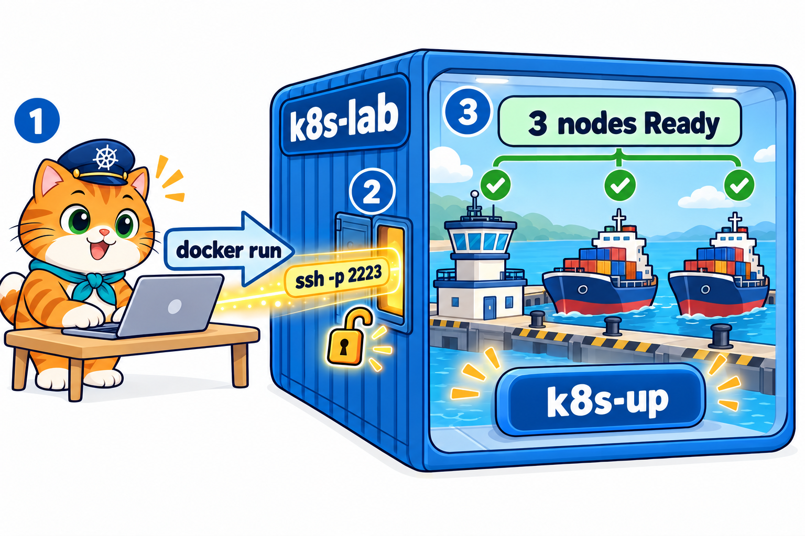<br>
  <em><b>รูปที่ 1</b> LAB0 ขั้นที่ 1: (1) docker run สร้าง container k8s-lab (2) ssh -p 2223 เข้าไปข้างใน (3) รัน k8s-up สร้าง kind cluster ชื่อ lab ได้ 3 node Ready (control-plane 1 ตัว + worker 2 ตัว)</em>
</p>

**1) สร้าง container** 🖥️ **บนเครื่องนักศึกษา** (image ประมาณ 1.5 GB ครั้งแรกใช้เวลาหลายนาที)

```bash
docker pull tuchsanai/devtools-kind:2569_1
docker run -dit --name k8s-lab --hostname k8s-lab --privileged -p 2223:22 -p 8889:8888 tuchsanai/devtools-kind:2569_1
```

- `--privileged` ให้รัน Docker ซ้อนใน container ได้ (kind ต้องใช้) **ขาดไม่ได้**
- `-p 2223:22` เปิดทาง SSH เข้า container ผ่าน port `2223`
- `-p 8889:8888` เปิด JupyterLab ที่ `http://localhost:8889/lab` ไว้เปิดดูไฟล์/terminal ข้างใน container เวลาดีบัก (ทางเลือก)

หลัง `docker run` **รอสัก 5–10 วินาที** ให้ container เริ่ม sshd และ dockerd ข้างในให้เสร็จก่อน (ตรวจได้ด้วย `docker ps --filter name=k8s-lab` ต้องเห็น `Up`) ถ้ามี `k8s-lab` จากบทที่ 1 อยู่แล้วใช้ `docker start k8s-lab` แทนได้

**2) SSH เข้า container** 🖥️ ครั้งแรกพิมพ์ `yes` แล้วใส่รหัสผ่าน `passwd`

```bash
ssh -p 2223 root@localhost
```

**3) สร้างและตรวจคลัสเตอร์** 🐧 **ใน SSH session ของ k8s-lab** (prompt `root@k8s-lab:~#`)

```bash
time k8s-up            # สร้างคลัสเตอร์ kind ชื่อ lab ใช้เวลาราว 1 นาที
kubectl get nodes      # ต้องเห็น 3 node Ready
kubectl get pods -A    # Pod ระบบใน kube-system ต้อง Running
```

**Expected output**

<pre>
...
[k8s-up] cluster 'lab' พร้อมใช้งาน (kubectl context: kind-lab)
...
real	0m48.440s

NAME                STATUS   ROLES           AGE   VERSION
lab-control-plane   Ready    control-plane   23s   v1.37.0
lab-worker          Ready    &lt;none&gt;          13s   v1.37.0
lab-worker2         Ready    &lt;none&gt;          13s   v1.37.0
</pre>

> **✅ ผ่านเมื่อ:** node 3 ตัว `Ready` และ Pod ใน `kube-system` เป็น `Running` ทุกตัว (ช่วงแรกอาจยัง `0/1` รอสักครู่) ข้อความเรื่อง NodePort ท้าย `k8s-up` ข้ามได้

### ขั้นที่ 2: git clone ไฟล์ LAB

<p align="center" id="fig-2">
  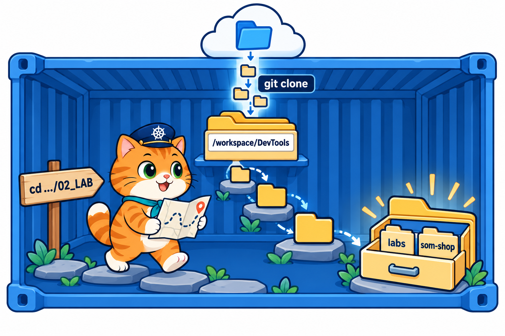<br>
  <em><b>รูปที่ 2</b> LAB0 ขั้นที่ 2: git clone ดึง repo DevTools มาไว้ที่ /workspace/DevTools ใน k8s-lab แล้ว cd ลงไปจนถึงโฟลเดอร์ 02_LAB ที่มี labs และ som-shop</em>
</p>

🐧 **ใน SSH session ของ k8s-lab**

```bash
cd /workspace
git clone https://github.com/Tuchsanai/DevTools.git     # เคย clone แล้ว: cd DevTools && git pull
cd DevTools/05_kubernetes/002_kubernetes_pod/02_LAB
```

> **✅ ผ่านเมื่อ:** prompt เป็น `root@k8s-lab:/workspace/DevTools/05_kubernetes/002_kubernetes_pod/02_LAB#` ทุกคำสั่งที่อ้าง `labs/...` หรือ `som-shop/...` ต้องรันจากโฟลเดอร์นี้

---

## LAB 1: Pod แรกด้วย kubectl run

<p align="center" id="fig-3">
  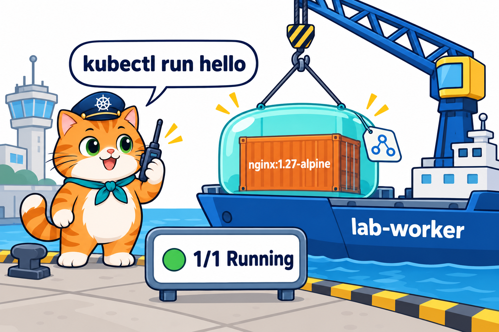<br>
  <em><b>รูปที่ 3</b> LAB1: สร้าง Pod แรกด้วย kubectl run แล้วดูสถานะด้วย kubectl get pods -o wide</em>
</p>

**เป้าหมาย:** สร้าง ดู อธิบาย และลบ Pod แบบ imperative (สั่งตรง ๆ ไม่ใช้ไฟล์)

🐧 **ใน SSH session ของ k8s-lab** (ทุกขั้นใน LAB นี้)

### ขั้นที่ 1: สร้าง Pod แล้วดูสถานะ

**1.1 สร้าง Pod ชื่อ `hello` จาก image nginx**

```bash
kubectl run hello --image=nginx:1.27-alpine
```

**Expected output**

<pre>
pod/hello created
</pre>

**1.2 ดูรายการ Pod ทันที**

```bash
kubectl get pods
```

**Expected output**

<pre>
NAME    READY   STATUS              RESTARTS   AGE
hello   0/1     ContainerCreating   0          0s
</pre>

STATUS ยังเป็น `ContainerCreating` และ READY `0/1` เพราะ Pod **ยังสร้างไม่เสร็จ** node กำลังดึง image จาก Docker Hub

**1.3 รอสัก 10 วินาที แล้วสั่ง `kubectl get pods` อีกครั้ง** (ถ้ายังไม่ `Running` ก็รอแล้วสั่งซ้ำ)

```bash
kubectl get pods
```

**Expected output**

<pre>
NAME    READY   STATUS    RESTARTS   AGE
hello   1/1     Running   0          10s
</pre>

เมื่อเห็น `1/1` และ `Running` แปลว่า Pod พร้อมใช้งานแล้ว

### ขั้นที่ 2: ดูแบบละเอียดด้วย `-o wide`

```bash
kubectl get pods -o wide
```

**Expected output**

<pre>
NAME    READY   STATUS    RESTARTS   AGE   IP           NODE          NOMINATED NODE   READINESS GATES
hello   1/1     Running   0          10s   10.244.2.3   lab-worker2   &lt;none&gt;           &lt;none&gt;
</pre>

เทียบกับผลของ `kubectl get pods` ในขั้นที่ 1.3 จะเห็นว่า `-o wide` แสดง **คอลัมน์เพิ่ม** ขึ้นมา

| คำสั่ง | คอลัมน์ที่เห็น | ใช้เมื่อ |
|---|---|---|
| `kubectl get pods` | `NAME`, `READY`, `STATUS`, `RESTARTS`, `AGE` | อยากรู้แค่ว่า Pod พร้อมหรือยัง |
| `kubectl get pods -o wide` | ทุกคอลัมน์ข้างบน **+** `IP` (IP ของ Pod) และ `NODE` (Pod ไปอยู่บน node ไหน) | อยากรู้ว่า Pod อยู่ที่ไหน มี IP อะไร |

(IP และ NODE ของนักศึกษาอาจต่างจากนี้ เช่นได้ `lab-worker` แทน `lab-worker2`)

### ขั้นที่ 3: อ่านรายละเอียดด้วย describe

```bash
kubectl describe pod hello
```

**Expected output** (ตัดเฉพาะส่วนสำคัญ)

<pre>
Name:             hello
Namespace:        default
Node:             lab-worker2/172.19.0.3
Labels:           run=hello
Status:           Running
IP:               10.244.2.3
Containers:
  hello:
    Image:          nginx:1.27-alpine
    State:          Running
    Ready:          True
    Restart Count:  0
...
QoS Class:                   BestEffort
...
Events:
  Type    Reason     Age   From               Message
  ----    ------     ----  ----               -------
  Normal  Scheduled  10s   default-scheduler  Successfully assigned default/hello to lab-worker2
  Normal  Pulling    10s   kubelet            spec.containers{hello}: Pulling image "nginx:1.27-alpine"
  Normal  Pulled     2s    kubelet            spec.containers{hello}: Successfully pulled image "nginx:1.27-alpine" in 7.852s (7.852s including waiting). Image size: 20984244 bytes.
  Normal  Created    2s    kubelet            spec.containers{hello}: Container created
  Normal  Started    2s    kubelet            spec.containers{hello}: Container started
</pre>

### ขั้นที่ 4: ลบ Pod แล้วตรวจ

```bash
kubectl delete pod hello
kubectl get pods
```

**Expected output**

<pre>
pod "hello" deleted from default namespace
No resources found in default namespace.
</pre>

`No resources found` = ไม่มี Pod เหลือใน namespace `default` แล้ว

Pod `hello` สร้างด้วย `kubectl run` จึง **ไม่มีไฟล์ YAML เลย** ลบได้ด้วย **ชนิด + ชื่อ** (`pod` + `hello`) ไม่ต้องมีไฟล์ ([ทฤษฎีหัวข้อ 6.5](../01_Theory/README.md#65-ลบโดยไม่ต้องมีไฟล์-yaml)) ไม่รู้ชื่อให้ดูจาก `kubectl get pods` ก่อนเสมอ

### สิ่งที่เห็น

- `kubectl run` สร้าง **Pod** (ไม่ใช่ container เดี่ยว) STATUS เปลี่ยนจาก `ContainerCreating` เป็น `Running` ภายในไม่กี่วินาที
- `get pods -o wide` บอกว่า Pod ได้ IP ช่วง `10.244.x.x` และถูกวางบน worker ตัวใดตัวหนึ่ง (ของนักศึกษาอาจเป็น `lab-worker`)
- Events เรียงตามเส้นทางการเกิดของ Pod: `Scheduled` → `Pulling` → `Pulled` → `Created` → `Started`
- `kubectl run` ติด label `run=hello` ให้อัตโนมัติ และ Pod ที่ไม่กำหนด resources มี QoS เป็น `BestEffort`
- เมื่อลบแล้ว **ไม่มีใครสร้างคืน** Pod หายถาวร

> **🤔 คำถามชวนคิด:** สร้าง `hello` ใหม่อีกครั้งแล้วดู IP และ NODE ได้ค่าเดิมหรือไม่ เพราะอะไร (อย่าลืมลบหลังทดลอง)

---

## LAB 2: Pod YAML แรก

<p align="center" id="fig-4">
  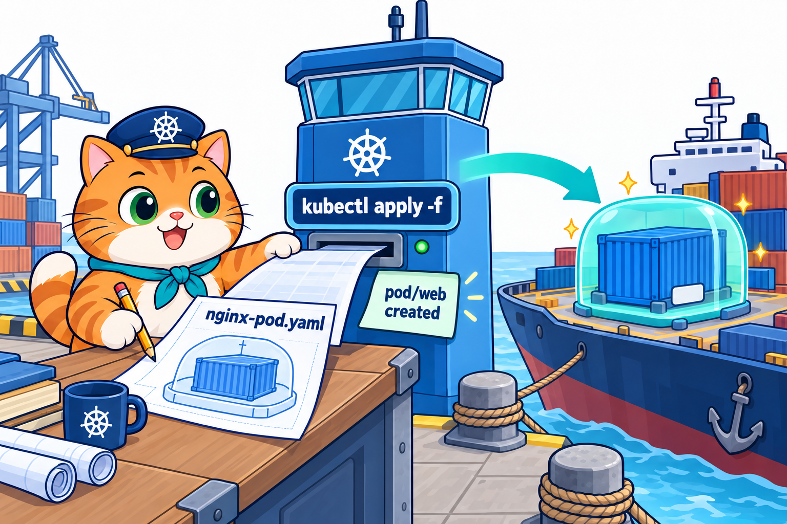<br>
  <em><b>รูปที่ 4</b> LAB2: อ่านไฟล์ nginx-pod.yaml ที่เตรียมไว้ แล้ว kubectl apply -f สร้าง Pod web</em>
</p>

**เป้าหมาย:** สร้าง Pod จากไฟล์ YAML (แบบ declarative = เขียนสิ่งที่อยากได้ไว้ในไฟล์ แล้วให้ Kubernetes ทำตาม)

🐧 **ใน SSH session ของ k8s-lab** (อยู่ที่ `/workspace/DevTools/05_kubernetes/002_kubernetes_pod/02_LAB`)

### ขั้นที่ 1: เปิดดูไฟล์ YAML

```bash
cat labs/lab02-first-yaml/nginx-pod.yaml
```

**Expected output**

<pre>
# LAB 2: Pod YAML แรก — เว็บเซิร์ฟเวอร์ nginx 1 container
apiVersion: v1            # กลุ่ม/เวอร์ชันของ API ที่ใช้ (Pod อยู่ในกลุ่ม core = v1)
kind: Pod                 # ชนิดของ object ที่ต้องการสร้าง
metadata:                 # ข้อมูลระบุตัวตนของ object
  name: web               # ชื่อ Pod (ต้องไม่ซ้ำใน namespace เดียวกัน)
  labels:                 # ป้ายแท็ก key: value ไว้ค้นหา/จัดกลุ่ม
    app: web
    owner: nong-som
spec:                     # สิ่งที่เราอยากได้ (desired state)
  containers:             # รายการ container ใน Pod (เป็น list จึงขึ้นต้นด้วย -)
    - name: nginx         # ชื่อ container ภายใน Pod
      image: nginx:1.27-alpine   # image + tag (ระบุ tag เสมอ ไม่ใช้ latest)
      ports:
        - containerPort: 80      # บอกว่าแอปฟัง port 80 (เป็นข้อมูลประกอบ ไม่ได้เปิด port ให้ภายนอก)
</pre>

อ่านความหมายของแต่ละบรรทัดได้จาก comment (`# ...`) ในไฟล์ สรุปสั้น ๆ คือ "ขอ Pod ชื่อ `web` ที่มี container `nginx` 1 ตัว"

### ขั้นที่ 2: สร้าง Pod จากไฟล์

```bash
kubectl apply -f labs/lab02-first-yaml/nginx-pod.yaml
```

**Expected output**

<pre>
pod/web created
</pre>

`kubectl apply -f <ไฟล์>` = ส่งไฟล์ให้ Kubernetes สร้าง Pod ตามที่เขียนไว้ จากนั้นรอสัก 10 วินาทีแล้วดูสถานะ

```bash
kubectl get pods
```

**Expected output**

<pre>
NAME   READY   STATUS    RESTARTS   AGE
web    1/1     Running   0          11s
</pre>

(ถ้ายังเป็น `ContainerCreating` ให้รอแล้วสั่งซ้ำ)

### ขั้นที่ 3: ดู Pod ในรูป YAML ที่ Kubernetes เก็บไว้

```bash
kubectl get pod web -o yaml
```

**Expected output** (ยาวกว่า 150 บรรทัด ตัดมาเฉพาะส่วนสำคัญ)

<pre>
apiVersion: v1
kind: Pod
metadata:
  labels:
    app: web
    owner: nong-som
  name: web
  namespace: default
...
spec:
  containers:
  - image: nginx:1.27-alpine
    imagePullPolicy: IfNotPresent
    name: nginx
    ports:
    - containerPort: 80
      protocol: TCP
...
  nodeName: lab-worker2
  restartPolicy: Always
...
status:
...
  phase: Running
  podIP: 10.244.2.4
...
</pre>

- ส่วน `spec` คือ **สิ่งที่เราขอ** (จากไฟล์) และมีค่าที่ระบบเติมให้เอง เช่น `restartPolicy: Always`
- ส่วน `status` คือ **สถานะจริงตอนนี้** ที่ระบบเขียนให้ เช่น `phase: Running` และ IP ของ Pod

### ขั้นที่ 4: apply ซ้ำ เทียบกับ create ซ้ำ

```bash
kubectl apply -f labs/lab02-first-yaml/nginx-pod.yaml
```

**Expected output**

<pre>
pod/web unchanged
</pre>

```bash
kubectl create -f labs/lab02-first-yaml/nginx-pod.yaml
```

**Expected output**

<pre>
Error from server (AlreadyExists): error when creating "labs/lab02-first-yaml/nginx-pod.yaml": pods "web" already exists
</pre>

**`create` กับ `apply` ต่างกันอย่างไร**

| | `kubectl create -f` | `kubectl apply -f` |
|---|---|---|
| ยังไม่มี Pod นี้ | สร้างให้ (`created`) | สร้างให้ (`created`) |
| มีแล้ว ไฟล์ไม่เปลี่ยน | error `AlreadyExists` | ไม่ทำอะไร (`unchanged`) |
| มีแล้ว ไฟล์ถูกแก้ | error `AlreadyExists` | อัปเดตตามไฟล์ (`configured`) |

**ควรใช้อันไหน**

- ใช้ **`apply` เป็นหลัก** เพราะสั่งซ้ำกี่ครั้งก็ได้ แก้ไฟล์แล้ว apply ใหม่ได้เลย (แบบ declarative = "ทำให้ตรงกับไฟล์")
- ใช้ **`create`** เมื่ออยากให้ "สร้างใหม่เท่านั้น" ถ้ามีอยู่แล้วให้ error เตือน จะได้ไม่ไปทับของเดิมโดยไม่ตั้งใจ
- อย่าใช้สลับกันกับ object เดียวกัน: ถ้าสร้างด้วย `create` แล้วมา `apply` ทีหลัง จะได้คำเตือน `missing the kubectl.kubernetes.io/last-applied-configuration annotation` (ยังทำงานได้ แต่ควรเลือกใช้แบบเดียวตั้งแต่ต้น)
- Pod แก้ได้แค่บาง field (เช่น label, image) ถ้าแก้ field อื่นใน spec เช่น port ต้องลบแล้วสร้างใหม่

### ขั้นที่ 5: ลบ Pod

```bash
kubectl delete -f labs/lab02-first-yaml/nginx-pod.yaml
```

**Expected output**

<pre>
pod "web" deleted from default namespace
</pre>

```bash
kubectl get pods
```

**Expected output**

<pre>
No resources found in default namespace.
</pre>

### สิ่งที่เห็น

- ไฟล์ YAML บอก "สิ่งที่อยากได้" แล้ว `kubectl apply -f` ให้ Kubernetes สร้างตาม
- `get pod web -o yaml` มีทั้ง `spec` (สิ่งที่ขอ) และ `status` (สถานะจริง)
- `apply` สั่งซ้ำได้ (`unchanged`) แต่ `create` ซ้ำไม่ได้ (`AlreadyExists`)
- ลบด้วยไฟล์เดิมได้ด้วย `kubectl delete -f` หรือลบด้วยชนิด + ชื่อ `kubectl delete pod web` ก็ได้ผลเหมือนกัน เพราะ `-f` แค่อ่าน `kind` กับ `metadata.name` จากไฟล์ (ทฤษฎีหัวข้อ 6.5)

> **🏆 ท้าทาย:** คัดลอก `nginx-pod.yaml` เป็น `/tmp/my-pod.yaml` แก้ชื่อ Pod เป็น `my-web` แล้ว `kubectl apply -f /tmp/my-pod.yaml` ดูด้วย `kubectl get pods` แล้วลบทิ้ง

---

## LAB 3: เข้าไปใน Pod: exec, logs, port-forward

<p align="center" id="fig-5">
  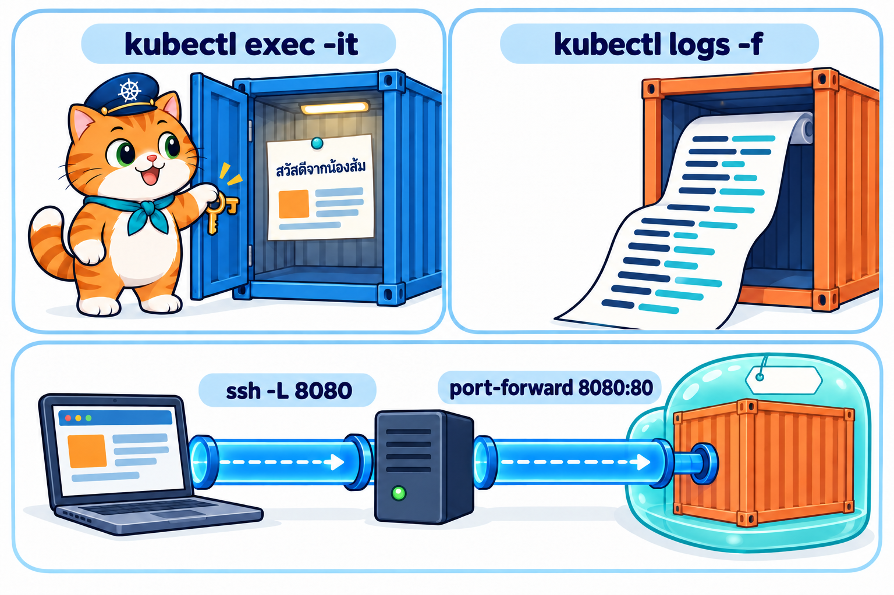<br>
  <em><b>รูปที่ 5</b> LAB3: เข้าไปใน Pod ด้วย exec แก้หน้าเว็บ ดู access log และเปิดเว็บผ่าน port-forward + แท็บ PORTS ของ VS Code</em>
</p>

**เป้าหมาย:** เข้าไปใน Pod แก้หน้าเว็บ แล้ว **เปิดเว็บใน Pod จาก browser บนเครื่องนักศึกษา** ผ่าน VS Code และดู log

**ต้องมี:** VS Code + extension **Container Tools** (หรือ Docker) และ **Dev Containers** ติดตั้งบนเครื่องนักศึกษา ทุกคำสั่งใน LAB นี้พิมพ์ใน **Terminal ของ VS Code** ที่ attach เข้า container k8s-lab

### ขั้นที่ 0: เปิด VS Code แล้ว attach เข้า container k8s-lab

<p align="center" id="fig-6">
  <br>
  <em><b>รูปที่ 6</b> LAB3 ขั้นที่ 0 (ภาพจำลองหน้าจอ VS Code): ในแท็บ Containers คลิกขวาที่ k8s-lab แล้วเลือก Attach Visual Studio Code</em>
</p>

1. เปิด VS Code บนเครื่องนักศึกษา กดไอคอน **Containers** ที่แถบซ้าย
2. **คลิกขวา** ที่ container `k8s-lab` (image `tuchsanai/devtools-kind:2569_1`) แล้วเลือก **Attach Visual Studio Code**
3. VS Code จะเปิดหน้าต่างใหม่ มุมล่างซ้ายขึ้น `Container tuchsanai/devtools-kind:2569_1 (k8s-lab)` = ตอนนี้ทำงานอยู่ **ใน container** แล้ว
4. เมนู **File → Open Folder** เลือก `/workspace/DevTools/05_kubernetes/002_kubernetes_pod/02_LAB`
5. เมนู **Terminal → New Terminal** แล้วตรวจว่าใช้ kubectl ได้

```bash
kubectl get nodes
```

**Expected output**

<pre>
NAME                STATUS   ROLES           AGE   VERSION
lab-control-plane   Ready    control-plane   21m   v1.37.0
lab-worker          Ready    &lt;none&gt;          20m   v1.37.0
lab-worker2         Ready    &lt;none&gt;          20m   v1.37.0
</pre>

### ขั้นที่ 1: สร้าง Pod web

```bash
kubectl apply -f labs/lab02-first-yaml/nginx-pod.yaml
```

**Expected output**

<pre>
pod/web created
</pre>

รอสัก 10 วินาทีแล้วตรวจว่า `Running`

```bash
kubectl get pods
```

**Expected output**

<pre>
NAME   READY   STATUS    RESTARTS   AGE
web    1/1     Running   0          11s
</pre>

### ขั้นที่ 2: เข้าไปใน Pod แล้วแก้หน้าเว็บ

```bash
kubectl exec -it web -- sh
```

prompt จะเปลี่ยนเป็น `/ #` แปลว่าตอนนี้อยู่ **ใน container ของ Pod** แล้ว (image นี้เป็น Alpine จึงใช้ `sh` ไม่มี `bash`) พิมพ์ทีละบรรทัด

```bash
ls /usr/share/nginx/html
echo '<meta charset=utf-8><h1>สวัสดีจากน้องส้ม 🐱</h1>' > /usr/share/nginx/html/index.html
cat /usr/share/nginx/html/index.html
exit
```

**Expected output**

<pre>
50x.html
index.html
&lt;meta charset=utf-8&gt;&lt;h1&gt;สวัสดีจากน้องส้ม 🐱&lt;/h1&gt;
</pre>

- `ls` เห็นไฟล์หน้าเว็บของ nginx ส่วน `echo ... >` เขียนทับ `index.html` ด้วยข้อความของเรา
- `<meta charset=utf-8>` ช่วยให้ภาษาไทยแสดงถูกใน browser
- `exit` ออกจาก Pod กลับมาที่ prompt `root@k8s-lab`

### ขั้นที่ 3: เปิดทางเข้าเว็บด้วย port-forward

```bash
kubectl port-forward pod/web 8080:80
```

**Expected output**

<pre>
Forwarding from 127.0.0.1:8080 -> 80
Forwarding from [::1]:8080 -> 80
</pre>

คำสั่งนี้ **ค้างไว้** (อย่าปิด) มันส่งต่อ port `8080` ของ k8s-lab เข้าไปที่ port `80` ของ Pod `web`

### ขั้นที่ 4: เปิดเว็บจาก VS Code

<p align="center" id="fig-7">
  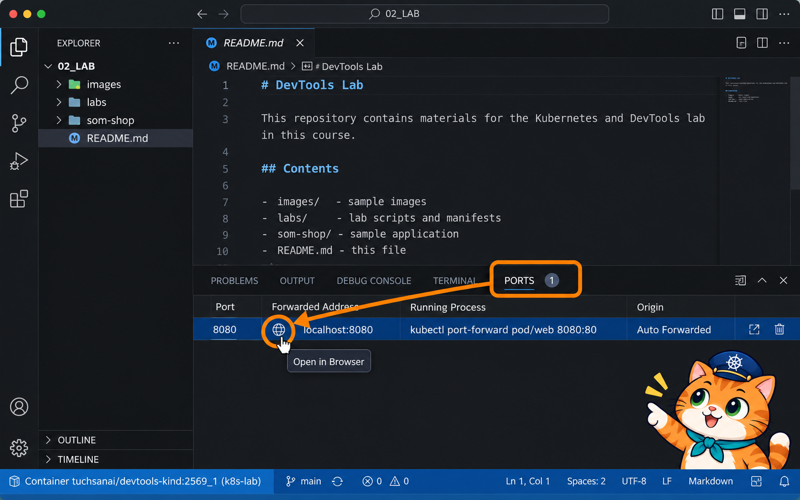<br>
  <em><b>รูปที่ 7</b> LAB3 ขั้นที่ 4 (ภาพจำลองหน้าจอ VS Code ที่ attach เข้า k8s-lab แล้ว): แท็บ PORTS แสดง port 8080 ที่ VS Code ส่งต่อมาให้อัตโนมัติ (Auto Forwarded) ชี้ที่แถวนั้นแล้วกดไอคอนลูกโลก Open in Browser</em>
</p>

1. ใน VS Code เปิดแท็บ **PORTS** (แถบเดียวกับ TERMINAL ด้านล่าง)
2. จะเห็นแถว port **8080** ที่ VS Code ส่งต่อมาให้อัตโนมัติ (ถ้าไม่เห็น กด **Forward a Port** แล้วพิมพ์ `8080`)
3. ชี้ที่แถวนั้นแล้วกดไอคอน **ลูกโลก (Open in Browser)**

🌐 browser จะเปิด `http://localhost:8080` และเห็นหัวข้อ "สวัสดีจากน้องส้ม 🐱"

<p align="center" id="fig-8">
  <br>
  <em><b>รูปที่ 8</b> ภาพหน้าจอจริงจากการทดลอง: หน้าเว็บของ Pod web หลังแก้ index.html แสดงหัวข้อ "สวัสดีจากน้องส้ม 🐱" (ทดสอบ 18 ต.ค. 2569 ด้วย browser จริงบนเครื่อง host ตอนถ่ายเข้าผ่าน NodePort ชั่วคราวแทน port-forward หน้าเว็บที่เห็นเหมือนกัน)</em>
</p>

ทุกครั้งที่เปิดหรือ refresh หน้าเว็บ หน้าต่าง port-forward จะพิมพ์ `Handling connection for 8080`

### ขั้นที่ 5: ดู log ของ Pod

เปิด **Terminal ใหม่** ใน VS Code (กด `+` ที่แท็บ TERMINAL) เพราะ terminal แรกยังรัน port-forward อยู่

```bash
kubectl logs web
```

**Expected output** (บรรทัดท้าย ๆ)

<pre>
...
2026/10/18 00:20:45 [notice] 1#1: start worker process 65
127.0.0.1 - - [18/Oct/2026:02:20:09 +0000] "GET / HTTP/1.1" 200 83 "-" "Mozilla/5.0 (Windows NT 10.0; Win64; x64) ... Chrome/152.0 ..." "-"
</pre>

บรรทัด `GET / ... 200` คือการเปิดหน้าเว็บจาก browser เมื่อสักครู่ (refresh browser แล้วสั่งซ้ำจะเห็นบรรทัดเพิ่ม)

### ขั้นที่ 6: ปิดและลบ Pod

กลับไปที่ terminal แรกแล้วกด **Ctrl+C** เพื่อหยุด port-forward จากนั้น

```bash
kubectl delete -f labs/lab02-first-yaml/nginx-pod.yaml
```

**Expected output**

<pre>
pod "web" deleted from default namespace
</pre>

### สิ่งที่เห็น

- `kubectl exec -it <pod> -- sh` พาเข้าไปใน container เหมือนอยู่ในเครื่องนั้น การแก้ไฟล์แบบนี้ **ชั่วคราว** ถ้าลบ Pod ไฟล์จะหาย
- `kubectl port-forward` เปิดทางจาก k8s-lab เข้า Pod แล้ว VS Code (ที่ attach เข้า container) ส่งต่อ port นั้นมาที่เครื่องนักศึกษาให้เอง
- `kubectl logs` ดูสิ่งที่แอปใน Pod พิมพ์ออกมา (สำหรับ nginx คือ log ของทุก request)

> **🤔 คำถามชวนคิด:** ถ้ากด Ctrl+C หยุด port-forward แล้ว refresh browser จะเกิดอะไรขึ้น เพราะอะไร

---

## LAB 4: Labels และ Selectors

<p align="center" id="fig-9">
  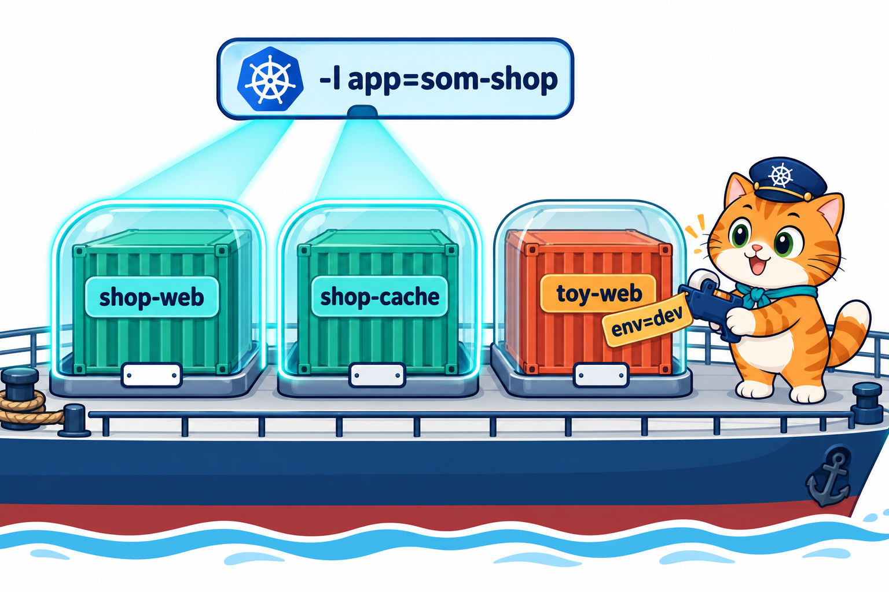<br>
  <em><b>รูปที่ 9</b> LAB4: ติดป้าย label ให้ Pod 3 ตัวและใช้ -l เลือกเฉพาะกลุ่มที่ต้องการ</em>
</p>

**เป้าหมาย:** ติดป้าย (label) ให้ Pod แล้วใช้ป้ายนั้นเลือกเฉพาะ Pod ที่ต้องการ

**label** คือป้าย `key=value` ที่แปะไว้กับ Pod เช่น `app=som-shop` เอาไว้จัดกลุ่มและค้นหา ไฟล์ `labs/lab04-labels/shop-pods.yaml` มี 3 Pod (คั่นแต่ละตัวด้วย `---`)

| Pod | labels |
|---|---|
| `shop-web` | `app=som-shop`, `tier=web` |
| `shop-cache` | `app=som-shop`, `tier=cache` |
| `toy-web` | `app=toy-shop`, `tier=web` |

🐧 **ใน SSH session ของ k8s-lab**

### ขั้นที่ 1: สร้าง Pod ทั้ง 3 ตัว แล้วดู label

```bash
kubectl apply -f labs/lab04-labels/shop-pods.yaml
```

**Expected output**

<pre>
pod/shop-web created
pod/shop-cache created
pod/toy-web created
</pre>

ไฟล์เดียวสร้างได้ 3 Pod รอสัก 10 วินาทีแล้วดู label ด้วย `--show-labels`

```bash
kubectl get pods --show-labels
```

**Expected output**

<pre>
NAME         READY   STATUS    RESTARTS   AGE   LABELS
shop-cache   1/1     Running   0          11s   app=som-shop,tier=cache
shop-web     1/1     Running   0          11s   app=som-shop,tier=web
toy-web      1/1     Running   0          11s   app=toy-shop,tier=web
</pre>

### ขั้นที่ 2: เลือก Pod ด้วย label (`-l`)

**2.1 เฉพาะร้านน้องส้ม**

```bash
kubectl get pods -l app=som-shop
```

**Expected output**

<pre>
NAME         READY   STATUS    RESTARTS   AGE
shop-cache   1/1     Running   0          11s
shop-web     1/1     Running   0          11s
</pre>

**2.2 เฉพาะ Pod ที่เป็นหน้าเว็บ (ทุกร้าน)**

```bash
kubectl get pods -l tier=web
```

**Expected output**

<pre>
NAME       READY   STATUS    RESTARTS   AGE
shop-web   1/1     Running   0          11s
toy-web    1/1     Running   0          11s
</pre>

**2.3 ต้องตรงทั้งสองป้าย (ร้านน้องส้ม **และ** หน้าเว็บ)**

```bash
kubectl get pods -l app=som-shop,tier=web
```

**Expected output**

<pre>
NAME       READY   STATUS    RESTARTS   AGE
shop-web   1/1     Running   0          11s
</pre>

เครื่องหมาย `,` แปลว่า "และ" จึงเหลือ Pod เดียว

### ขั้นที่ 3: ติดป้ายเพิ่ม แล้วถอดออก

```bash
kubectl label pod toy-web env=dev
```

**Expected output**

<pre>
pod/toy-web labeled
</pre>

```bash
kubectl get pods --show-labels
```

**Expected output**

<pre>
NAME         READY   STATUS    RESTARTS   AGE   LABELS
shop-cache   1/1     Running   0          11s   app=som-shop,tier=cache
shop-web     1/1     Running   0          11s   app=som-shop,tier=web
toy-web      1/1     Running   0          11s   app=toy-shop,env=dev,tier=web
</pre>

`toy-web` มีป้าย `env=dev` เพิ่มขึ้นมา ถอดป้ายออกด้วยการใส่ `-` ต่อท้ายชื่อ key

```bash
kubectl label pod toy-web env-
```

**Expected output**

<pre>
pod/toy-web unlabeled
</pre>

### ขั้นที่ 4: ลบเป็นกลุ่มด้วย label

```bash
kubectl delete pod -l app=som-shop
```

**Expected output**

<pre>
pod "shop-cache" deleted from default namespace
pod "shop-web" deleted from default namespace
</pre>

```bash
kubectl get pods
```

**Expected output**

<pre>
NAME      READY   STATUS    RESTARTS   AGE
toy-web   1/1     Running   0          42s
</pre>

Pod ของร้านน้องส้มหายไปทั้งคู่ในคำสั่งเดียว เหลือแค่ `toy-web` (ใช้อย่างระวัง!) ลบตัวที่เหลือ

```bash
kubectl delete pod toy-web
```

**Expected output**

<pre>
pod "toy-web" deleted from default namespace
</pre>

### สิ่งที่เห็น

- label คือป้าย `key=value` บน Pod ดูได้ด้วย `--show-labels`
- `-l key=value` เลือกเฉพาะ Pod ที่มีป้ายนั้น ใส่หลายป้ายคั่นด้วย `,` = ต้องตรงทุกป้าย
- `kubectl label pod <ชื่อ> key=value` ติดป้าย, `key-` ถอดป้าย
- `kubectl delete pod -l ...` ลบทุก Pod ที่ตรงป้ายในครั้งเดียว

> **🏆 ท้าทาย:** ลอง `kubectl get pods -A -l k8s-app` ดู Pod ระบบที่มีป้าย key `k8s-app` แล้วอธิบายว่าเป็น Pod อะไร

---

## LAB 5: Lifecycle และการดีบัก Pod ที่พัง

<p align="center" id="fig-10">
  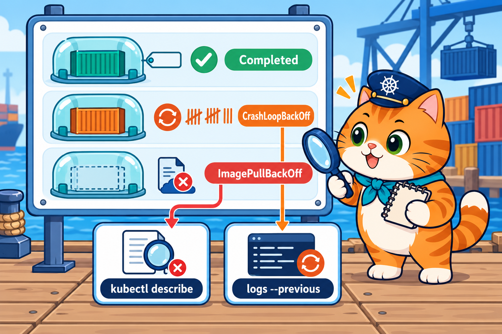<br>
  <em><b>รูปที่ 10</b> LAB5: สังเกต Completed, CrashLoopBackOff และ ImagePullBackOff แล้วใช้ describe กับ logs หาสาเหตุ</em>
</p>

**เป้าหมาย:** ดู STATUS ของ Pod แบบต่าง ๆ แล้วหาสาเหตุ Pod ที่พังด้วยคำสั่งพื้นฐาน 2 ตัว คือ `kubectl describe` กับ `kubectl logs`

ในโฟลเดอร์ `labs/lab05-lifecycle/` มี 4 Pod แต่ละตัวจงใจให้จบต่างกัน

- `completed-pod` ทำงานเสร็จแล้วจบ
- `crash-pod` ล้มทุกครั้ง
- `onfailure-pod` ล้มรอบแรก สำเร็จรอบสอง
- `bad-image-pod` ระบุ image ผิด

🐧 **ใน SSH session ของ k8s-lab**

### ขั้นที่ 1: สร้าง Pod ทั้ง 4 ตัว

ใส่ชื่อ **โฟลเดอร์** แทนชื่อไฟล์ kubectl จะ apply ทุกไฟล์ในโฟลเดอร์ให้

```bash
kubectl apply -f labs/lab05-lifecycle/
```

**Expected output**

<pre>
pod/bad-image-pod created
pod/completed-pod created
pod/crash-pod created
pod/onfailure-pod created
</pre>

### ขั้นที่ 2: รอ 20 วินาที แล้วดูสถานะ

```bash
kubectl get pods
```

**Expected output**

<pre>
NAME            READY   STATUS             RESTARTS      AGE
bad-image-pod   0/1     ImagePullBackOff   0             20s
completed-pod   0/1     Completed          0             20s
crash-pod       0/1     Error              1 (7s ago)    20s
onfailure-pod   0/1     Completed          1 (11s ago)   20s
</pre>

แต่ละ Pod จบไม่เหมือนกัน ขั้นต่อไปจะดูทีละตัวว่าเพราะอะไร (STATUS ของ `crash-pod` อาจเป็น `Error`, `CrashLoopBackOff` หรือ `Running` สลับกันไป และ `bad-image-pod` อาจเป็น `ErrImagePull` ก็ได้ ขึ้นกับจังหวะที่สั่ง)

### ขั้นที่ 3: completed-pod — งานเสร็จแล้วจบ

```yaml
# completed-pod.yaml (ส่วนสำคัญ)
spec:
  restartPolicy: Never    # จบแล้วไม่ต้องเริ่มใหม่
  containers:
    - name: job
      image: busybox:1.36
      command: ["sh", "-c", "echo 'น้องส้มนับสต็อกเสร็จแล้ว'; exit 0"]
```

```bash
kubectl logs completed-pod
```

**Expected output**

<pre>
น้องส้มนับสต็อกเสร็จแล้ว
</pre>

พิมพ์ข้อความแล้วจบด้วย `exit 0` (สำเร็จ) และ `restartPolicy: Never` จึงไม่เริ่มใหม่ STATUS เป็น `Completed`

### ขั้นที่ 4: crash-pod — ล้มวนไม่จบ

```yaml
# crash-pod.yaml (ส่วนสำคัญ)
spec:
  restartPolicy: Always   # ล้มเมื่อไรก็เริ่มใหม่
  containers:
    - name: app
      image: busybox:1.36
      command: ["sh", "-c", "echo 'กำลังเปิดร้าน...'; sleep 3; echo 'ERROR: หาไฟล์เมนูไม่เจอ' >&2; exit 1"]
```

**4.1 ดู log ว่าแอปพูดอะไรก่อนล้ม**

```bash
kubectl logs crash-pod
```

**Expected output**

<pre>
กำลังเปิดร้าน...
ERROR: หาไฟล์เมนูไม่เจอ
</pre>

**4.2 ดูรายละเอียดด้วย describe**

```bash
kubectl describe pod crash-pod
```

**Expected output** (ตัดเฉพาะส่วนสำคัญ)

<pre>
...
    State:          Terminated
      Reason:       Error
      Exit Code:    1
...
    Restart Count:  2
...
Events:
  Type     Reason     Age                From               Message
  ----     ------     ----               ----               -------
...
  Normal   Started    15s (x3 over 35s)  kubelet            spec.containers{app}: Container started
  Warning  BackOff    11s (x2 over 27s)  kubelet            spec.containers{app}: Back-off restarting failed container app in pod crash-pod_default(...)
</pre>

- log บอกสาเหตุ: แอปหาไฟล์เมนูไม่เจอ แล้วจบด้วย `Exit Code: 1` (ล้ม)
- `restartPolicy: Always` ทำให้ Kubernetes เริ่มใหม่เรื่อย ๆ `Restart Count` จึงเพิ่มขึ้น และรอนานขึ้นทุกรอบ (`Back-off`) อาการนี้เรียกว่า **CrashLoopBackOff**
- สั่ง `kubectl get pods` ซ้ำอีกสักพัก จะเห็น RESTARTS ของ `crash-pod` เพิ่มขึ้นเรื่อย ๆ

### ขั้นที่ 5: onfailure-pod — ล้มรอบแรก สำเร็จรอบสอง

```yaml
# onfailure-pod.yaml (ส่วนสำคัญ)
spec:
  restartPolicy: OnFailure   # เริ่มใหม่เฉพาะตอนล้ม (exit ไม่ใช่ 0)
  containers:
    - name: app
      image: busybox:1.36
      # รอบแรกยังไม่มีไฟล์ /work/tried → สร้างไฟล์แล้ว exit 1 / รอบสองเจอไฟล์ → exit 0
      command: ["sh", "-c", "if [ -f /work/tried ]; then echo 'รอบสองสำเร็จ'; exit 0; else touch /work/tried; echo 'รอบแรกล้ม'; exit 1; fi"]
```

(ไฟล์จริงมี `volumes` ชื่อ `work` เพิ่ม เพื่อให้ไฟล์ `/work/tried` อยู่รอดข้ามการเริ่มใหม่)

```bash
kubectl logs onfailure-pod
```

**Expected output**

<pre>
รอบสองสำเร็จ
</pre>

ในขั้นที่ 2 เห็น RESTARTS = `1` และ STATUS `Completed` = ล้ม 1 ครั้ง เริ่มใหม่ แล้วสำเร็จจึงหยุด

### ขั้นที่ 6: bad-image-pod — image ผิด แล้วแก้

```yaml
# bad-image-pod.yaml (ส่วนสำคัญ)
spec:
  containers:
    - name: web
      image: nginx:9.99-doesnotexist   # tag ผิด! ไม่มีอยู่จริง
```

**6.1 หาสาเหตุจาก Events**

```bash
kubectl describe pod bad-image-pod
```

**Expected output** (ส่วน Events ท้ายสุด)

<pre>
Events:
  Type     Reason     Age                From               Message
  ----     ------     ----               ----               -------
...
  Warning  Failed     1s (x3 over 43s)   kubelet            spec.containers{web}: Failed to pull image "nginx:9.99-doesnotexist": ... docker.io/library/nginx:9.99-doesnotexist: not found
  Warning  Failed     1s (x3 over 43s)   kubelet            spec.containers{web}: Error: ErrImagePull
</pre>

คำว่า `not found` บอกว่าหา image `nginx:9.99-doesnotexist` ไม่เจอ (tag ผิด)

**6.2 แก้ image เป็นตัวที่ถูก**

```bash
kubectl set image pod/bad-image-pod web=nginx:1.27-alpine
```

**Expected output**

<pre>
pod/bad-image-pod image updated
</pre>

`web=` คือชื่อ container ใน Pod รอสัก 10 วินาทีแล้วดูอีกครั้ง

```bash
kubectl get pods
```

**Expected output**

<pre>
NAME            READY   STATUS      RESTARTS      AGE
bad-image-pod   1/1     Running     0             55s
completed-pod   0/1     Completed   0             55s
crash-pod       1/1     Running     3 (22s ago)   55s
onfailure-pod   0/1     Completed   1 (46s ago)   55s
</pre>

`bad-image-pod` เป็น `Running` แล้ว ส่วน `crash-pod` ยังล้มวนอยู่ (RESTARTS เพิ่มเป็น 3)

### ขั้นที่ 7: ลบทั้งหมด

```bash
kubectl delete -f labs/lab05-lifecycle/
```

**Expected output**

<pre>
pod "bad-image-pod" deleted from default namespace
pod "completed-pod" deleted from default namespace
pod "crash-pod" deleted from default namespace
pod "onfailure-pod" deleted from default namespace
</pre>

### สิ่งที่เห็น

- `Completed` = ทำงานเสร็จ (exit 0) / `Error`, `CrashLoopBackOff` = ล้มแล้วถูกเริ่มใหม่วนไป / `ErrImagePull`, `ImagePullBackOff` = ดึง image ไม่ได้
- `restartPolicy` กำหนดว่าจะเริ่มใหม่เมื่อไร: `Always` ทุกครั้ง, `OnFailure` เฉพาะตอนล้ม, `Never` ไม่เริ่มใหม่
- Pod พัง ให้เริ่มจาก 2 คำสั่งนี้: `kubectl logs <pod>` (แอปพูดอะไร) และ `kubectl describe pod <pod>` (ดู `State`, `Exit Code` และ `Events`)

> **🤔 คำถามชวนคิด:** ถ้าเปลี่ยน `crash-pod` เป็น `restartPolicy: Never` คาดว่า STATUS และ RESTARTS จะเป็นอย่างไร (ลองทำแล้วตรวจคำตอบ อย่าลืมลบ Pod)

---

## LAB 6: env, command และ resources

<p align="center" id="fig-11">
  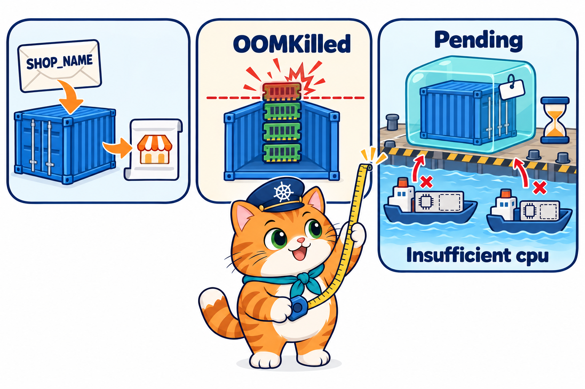<br>
  <em><b>รูปที่ 11</b> LAB6: ส่ง env และ command เข้า container ทดลอง memory limit จนเกิด OOMKilled และ request CPU เกินจน Pending</em>
</p>

**เป้าหมาย:** ส่งค่าเข้า container ด้วย `env` และดูว่าเกิดอะไรเมื่อใช้ memory เกินเพดาน (OOMKilled) หรือขอ CPU มากเกินไป (Pending)

🐧 **ใน SSH session ของ k8s-lab**

### ขั้นที่ 1: ส่งค่าเข้า container ด้วย env

```yaml
# env-command-pod.yaml (ส่วนสำคัญ)
      env:                              # ตัวแปรที่ส่งเข้า container
        - name: SHOP_NAME
          value: "ร้านอาหารแมวน้องส้ม"
        - name: OPEN_HOUR
          value: "9"                    # ตัวเลขต้องใส่ "" เสมอ
      command: ["sh", "-c"]             # คำสั่งที่ใช้แทนคำสั่งเดิมของ image
      args:
        - echo "SHOP_NAME=$SHOP_NAME"; echo "OPEN_HOUR=$OPEN_HOUR"; sleep 3600
      resources:
        requests:                       # ขอจองไว้ (scheduler ใช้เลือก node)
          cpu: "50m"                    # 50m = 0.05 core
          memory: "32Mi"
        limits:                         # เพดานสูงสุดที่ใช้ได้
          cpu: "100m"
          memory: "64Mi"
```

```bash
kubectl apply -f labs/lab06-env-resources/env-command-pod.yaml
```

**Expected output**

<pre>
pod/env-command-pod created
</pre>

รอสัก 10 วินาทีแล้วดูว่าแอปพิมพ์อะไรออกมา

```bash
kubectl logs env-command-pod
```

**Expected output**

<pre>
SHOP_NAME=ร้านอาหารแมวน้องส้ม
OPEN_HOUR=9
</pre>

ค่าใน `env` ถูกส่งเข้าไปให้แอปใช้ได้จริง ลองดูตัวแปรทั้งหมดใน container

```bash
kubectl exec env-command-pod -- env
```

**Expected output** (ตัดบางบรรทัด)

<pre>
PATH=/usr/local/sbin:/usr/local/bin:/usr/sbin:/usr/bin:/sbin:/bin
HOSTNAME=env-command-pod
SHOP_NAME=ร้านอาหารแมวน้องส้ม
OPEN_HOUR=9
...
</pre>

นอกจากค่าที่เราใส่ ยังมี `HOSTNAME` ซึ่ง Kubernetes ตั้งให้เป็นชื่อ Pod อัตโนมัติ

### ขั้นที่ 2: ดู requests และ limits

```bash
kubectl describe pod env-command-pod
```

**Expected output** (ตัดเฉพาะส่วนสำคัญ)

<pre>
...
    Limits:
      cpu:     100m
      memory:  64Mi
    Requests:
      cpu:     50m
      memory:  32Mi
...
QoS Class:                   Burstable
...
</pre>

- **Requests** = ปริมาณที่ขอจองไว้ **Limits** = เพดานที่ใช้ได้สูงสุด
- requests น้อยกว่า limits จึงได้ QoS Class `Burstable`

### ขั้นที่ 3: ใช้ memory เกินเพดาน → OOMKilled

```yaml
# oom-pod.yaml (ส่วนสำคัญ)
      command: ["sh", "-c", "echo 'กินแรมไม่หยุด...'; tail /dev/zero"]   # กิน RAM ไปเรื่อย ๆ
      resources:
        limits:
          memory: "32Mi"                # เกิน 32Mi เมื่อไร โดนฆ่า
```

```bash
kubectl apply -f labs/lab06-env-resources/oom-pod.yaml
```

**Expected output**

<pre>
pod/oom-pod created
</pre>

รอสัก 10 วินาที

```bash
kubectl get pods
```

**Expected output**

<pre>
NAME              READY   STATUS             RESTARTS     AGE
env-command-pod   1/1     Running            0            20s
oom-pod           0/1     CrashLoopBackOff   1 (8s ago)   10s
</pre>

STATUS ของ `oom-pod` จะสลับระหว่าง `OOMKilled` กับ `CrashLoopBackOff` ดูสาเหตุด้วย describe

```bash
kubectl describe pod oom-pod
```

**Expected output** (ตัดเฉพาะส่วนสำคัญ)

<pre>
...
    Last State:     Terminated
      Reason:       OOMKilled
      Exit Code:    137
...
    Restart Count:  1
...
</pre>

`OOMKilled` = ใช้ memory เกิน limit จึงถูกระบบฆ่าทิ้ง (Exit Code `137`) แล้วถูกเริ่มใหม่วนไป

### ขั้นที่ 4: ขอ CPU มากเกินไป → Pending

```yaml
# pending-pod.yaml (ส่วนสำคัญ)
      resources:
        requests:
          cpu: "64"                     # ขอ 64 core! ไม่มี node ไหนมีพอ
```

```bash
kubectl apply -f labs/lab06-env-resources/pending-pod.yaml
```

**Expected output**

<pre>
pod/pending-pod created
</pre>

```bash
kubectl get pods
```

**Expected output**

<pre>
NAME              READY   STATUS      RESTARTS      AGE
env-command-pod   1/1     Running     0             25s
oom-pod           0/1     OOMKilled   2 (13s ago)   15s
pending-pod       0/1     Pending     0             5s
</pre>

`pending-pod` ค้างที่ `Pending` ไม่ว่ารอนานแค่ไหน ดูเหตุผลใน Events

```bash
kubectl describe pod pending-pod
```

**Expected output** (ส่วน Events ท้ายสุด)

<pre>
Events:
  Type     Reason            Age   From               Message
  ----     ------            ----  ----               -------
  Warning  FailedScheduling  5s    default-scheduler  0/3 nodes are available: 1 node(s) had untolerated taint(s), 2 Insufficient cpu. ...
</pre>

`Insufficient cpu` = ไม่มี worker ตัวไหนมี CPU พอ ส่วน `untolerated taint` คือ control-plane ที่ห้ามวาง Pod ทั่วไป Pod จึงไม่ได้ไปอยู่ node ไหนเลย

### ขั้นที่ 5: ลบทั้งหมด

```bash
kubectl delete -f labs/lab06-env-resources/
```

**Expected output**

<pre>
pod "env-command-pod" deleted from default namespace
pod "oom-pod" deleted from default namespace
pod "pending-pod" deleted from default namespace
</pre>

### สิ่งที่เห็น

- `env` ส่งค่า (ภาษาไทยได้) เข้า container ตัวเลขต้องใส่ `""` เสมอ
- **requests** = ขอจอง (ใช้ตอนเลือก node) / **limits** = เพดานขณะรัน
- memory เกิน limit → `OOMKilled` (Exit Code 137) แล้วถูกเริ่มใหม่วนไป
- ขอ CPU เกินที่ node มี → `Pending` ตลอด ดูเหตุผลที่ Events ของ `describe`

> **🏆 ท้าทาย:** คัดลอก `env-command-pod.yaml` แล้วแก้ requests ให้เท่ากับ limits (`cpu: 100m`, `memory: 64Mi`) apply แล้วดูด้วย `kubectl describe` ว่า QoS Class เปลี่ยนเป็นอะไร

---

## LAB 7: Probes ตรวจสุขภาพ

<p align="center" id="fig-12">
  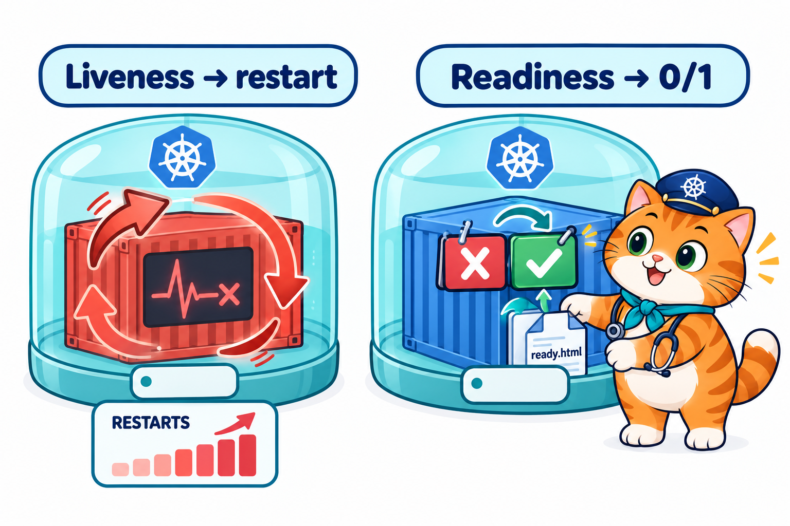<br>
  <em><b>รูปที่ 12</b> LAB7: liveness ล้มแล้ว container ถูก restart ส่วน readiness ล้มแล้ว Pod เป็น READY 0/1 โดยไม่ถูก restart</em>
</p>

**เป้าหมาย:** เห็นความต่างของ probe 2 แบบด้วยตาตัวเอง

- **readiness** ไม่ผ่าน → Pod แค่ "ยังไม่พร้อม" (READY `0/1`) **ไม่ถูกเริ่มใหม่**
- **liveness** ไม่ผ่าน → container ถูก **ฆ่าแล้วเริ่มใหม่** (RESTARTS เพิ่ม)

🐧 **ใน SSH session ของ k8s-lab**

### ขั้นที่ 1: readiness — พร้อมหรือยัง

```yaml
# readiness-http-pod.yaml (ส่วนสำคัญ)
      readinessProbe:
        httpGet:                 # เปิดหน้าเว็บนี้ ได้ 200 = พร้อม, 404 = ไม่พร้อม
          path: /ready.html      # ตอนแรกยังไม่มีไฟล์นี้
          port: 80
        periodSeconds: 3         # ตรวจทุก 3 วินาที
```

**1.1 สร้าง Pod**

```bash
kubectl apply -f labs/lab07-probes/readiness-http-pod.yaml
```

**Expected output**

<pre>
pod/readiness-http-pod created
</pre>

รอสัก 10 วินาที

```bash
kubectl get pods
```

**Expected output**

<pre>
NAME                 READY   STATUS    RESTARTS   AGE
readiness-http-pod   0/1     Running   0          10s
</pre>

STATUS เป็น `Running` แต่ READY `0/1` = container ทำงานอยู่ แต่ **ยังไม่พร้อม** ดูเหตุผล

```bash
kubectl describe pod readiness-http-pod
```

**Expected output** (ส่วน Events ท้ายสุด)

<pre>
Events:
...
  Warning  Unhealthy  0s (x4 over 9s)  kubelet            spec.containers{web}: Readiness probe failed: HTTP probe failed with statuscode: 404
</pre>

probe เปิด `/ready.html` แล้วได้ `404` (ไม่มีไฟล์) จึงถือว่ายังไม่พร้อม

**1.2 สร้างไฟล์ให้ probe ผ่าน**

```bash
kubectl exec readiness-http-pod -- touch /usr/share/nginx/html/ready.html
```

คำสั่งนี้ไม่มี output รอสัก 5 วินาที

```bash
kubectl get pods
```

**Expected output**

<pre>
NAME                 READY   STATUS    RESTARTS   AGE
readiness-http-pod   1/1     Running   0          15s
</pre>

**1.3 ลบไฟล์ทิ้ง**

```bash
kubectl exec readiness-http-pod -- rm /usr/share/nginx/html/ready.html
```

รอสัก 5 วินาที

```bash
kubectl get pods
```

**Expected output**

<pre>
NAME                 READY   STATUS    RESTARTS   AGE
readiness-http-pod   0/1     Running   0          20s
</pre>

READY กลับเป็น `0/1` แต่ RESTARTS ยังเป็น `0` = readiness ไม่เคยทำให้ container ถูกเริ่มใหม่

### ขั้นที่ 2: liveness — ยังมีชีวิตอยู่ไหม

```yaml
# liveness-exec-pod.yaml (ส่วนสำคัญ)
      # สร้างไฟล์ /tmp/healthy → ผ่านไป 30 วินาทีลบทิ้ง (จำลองแอปค้าง)
      command: ["sh", "-c", "touch /tmp/healthy; echo 'สบายดี'; sleep 30; rm -f /tmp/healthy; echo 'ไม่สบายแล้ว'; sleep 600"]
      livenessProbe:
        exec:
          command: ["cat", "/tmp/healthy"]   # อ่านไฟล์ได้ = ยังมีชีวิต
        initialDelaySeconds: 5               # รอ 5 วินาทีก่อนตรวจครั้งแรก
        periodSeconds: 5                     # ตรวจทุก 5 วินาที
        failureThreshold: 3                  # ไม่ผ่าน 3 ครั้งติด → เริ่มใหม่
```

**2.1 สร้าง Pod**

```bash
kubectl apply -f labs/lab07-probes/liveness-exec-pod.yaml
```

**Expected output**

<pre>
pod/liveness-exec-pod created
</pre>

รอสัก 10 วินาที

```bash
kubectl get pods
```

**Expected output**

<pre>
NAME                 READY   STATUS    RESTARTS   AGE
liveness-exec-pod    1/1     Running   0          10s
readiness-http-pod   0/1     Running   0          30s
</pre>

ตอนนี้ `liveness-exec-pod` ยังสบายดี (มีไฟล์ `/tmp/healthy`)

**2.2 รอประมาณ 1 นาทีครึ่ง แล้วดูอีกครั้ง**

ไฟล์จะถูกลบที่วินาทีที่ 30 → probe ไม่ผ่าน 3 ครั้ง → container ถูกฆ่าแล้วเริ่มใหม่ (รวมเวลาปิด container ราว 75–90 วินาที)

```bash
kubectl get pods
```

**Expected output**

<pre>
NAME                 READY   STATUS    RESTARTS      AGE
liveness-exec-pod    1/1     Running   1 (15s ago)   90s
readiness-http-pod   0/1     Running   0             110s
</pre>

RESTARTS ของ `liveness-exec-pod` เพิ่มเป็น `1` ส่วน `readiness-http-pod` ยังเป็น `0` ดูเหตุผล

```bash
kubectl describe pod liveness-exec-pod
```

**Expected output** (ส่วน Events ท้ายสุด)

<pre>
Events:
...
  Warning  Unhealthy  45s (x3 over 55s)  kubelet            spec.containers{app}: Liveness probe failed: cat: can't open '/tmp/healthy': No such file or directory
  Normal   Killing    45s                kubelet            spec.containers{app}: Container app failed liveness probe, will be restarted
...
</pre>

`Unhealthy (x3)` = probe ไม่ผ่าน 3 ครั้ง แล้ว `Killing` = ฆ่า container เพื่อเริ่มใหม่

### ขั้นที่ 3: ลบทั้งหมด

```bash
kubectl delete -f labs/lab07-probes/
```

**Expected output** (รอราว 30 วินาที)

<pre>
pod "liveness-exec-pod" deleted from default namespace
pod "readiness-http-pod" deleted from default namespace
</pre>

### สิ่งที่เห็น

- **readiness** ไม่ผ่าน → READY `0/1` แต่ไม่ restart และกลับมา `1/1` ได้เองเมื่อผ่าน
- **liveness** ไม่ผ่านครบ `failureThreshold` → `Killing` แล้ว RESTARTS เพิ่ม
- ดูผลของ probe ได้จาก Events ใน `kubectl describe pod`

> **🤔 คำถามชวนคิด:** ถ้าเปลี่ยน readinessProbe ของ `readiness-http-pod` เป็น livenessProbe (ค่าเดิม) จะเกิดอะไรกับ RESTARTS เมื่อไม่มีไฟล์ `/ready.html`

---

## LAB 8: LAB สุดท้าย: ร้านอาหารแมวน้องส้ม

<p align="center" id="fig-13">
  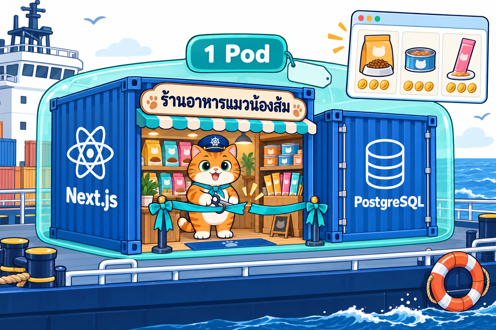<br>
  <em><b>รูปที่ 13</b> LAB สุดท้าย: เปิดร้านอาหารแมวน้องส้มด้วย Next.js + PostgreSQL ใน Pod เดียว</em>
</p>

**เป้าหมาย:** เปิดร้านเว็บ (Next.js) + ฐานข้อมูล (PostgreSQL) ใน Pod เดียว สั่งซื้อจาก browser แล้วดูว่าออเดอร์ถูกบันทึกลงฐานข้อมูลจริง

> ⚠️ **ออกแบบเพื่อการเรียนรู้เท่านั้น** งานจริงไม่ควรใส่เว็บกับฐานข้อมูลไว้ใน Pod เดียว และรหัสผ่าน `meow1234` ใน YAML ก็ใช้เพื่อการเรียนเท่านั้น บทถัดไปจะแยกให้ถูกต้อง

ทุกคำสั่งใน LAB นี้พิมพ์ใน **Terminal ของ VS Code ที่ attach เข้า k8s-lab** (เหมือน [LAB 3 ขั้นที่ 0](#ขั้นที่-0-เปิด-vs-code-แล้ว-attach-เข้า-container-k8s-lab)) ที่โฟลเดอร์ `02_LAB`

### ขั้นที่ 1: รู้จัก Pod ร้านน้องส้ม

<p align="center" id="fig-14">
  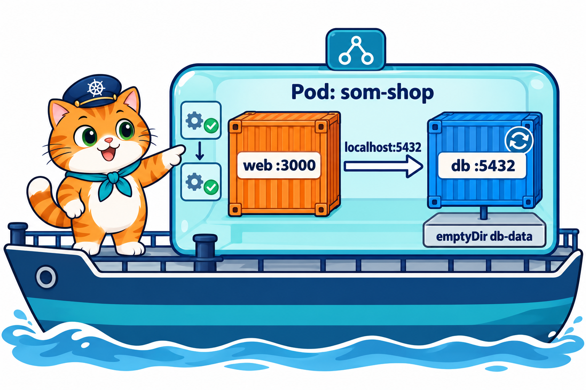<br>
  <em><b>รูปที่ 14</b> สถาปัตยกรรม Pod som-shop: web (Next.js :3000) คุยกับ db (PostgreSQL :5432) ผ่าน localhost ภายใน Pod เดียว และเก็บข้อมูล DB บน emptyDir</em>
</p>

ไฟล์ `som-shop/k8s/som-shop-pod.yaml` สร้าง Pod ชื่อ `som-shop` ที่มี container 4 ตัว ทำงานตามลำดับ

1. **`db`** — ฐานข้อมูล PostgreSQL เริ่มก่อนและทำงานตลอด (port 5432)
2. **`wait-for-db`** — รอจนฐานข้อมูลพร้อม แล้วจบ
3. **`db-seed`** — สร้างตารางและใส่สินค้า 6 รายการ แล้วจบ
4. **`web`** — หน้าร้าน Next.js (port 3000) คุยกับ `db` ผ่าน `localhost`

เปิดอ่านไฟล์เต็มได้ใน VS Code ทุกบรรทัดมี comment อธิบายไว้

### ขั้นที่ 2: build image ของเว็บ

```bash
cd som-shop/app
```

```bash
docker build -t som-shop-web:1.0 .
```

**Expected output** (บรรทัดท้าย ๆ ครั้งแรกใช้เวลาหลายนาที)

<pre>
...
#16 naming to docker.io/library/som-shop-web:1.0 done
#16 unpacking to docker.io/library/som-shop-web:1.0 1.3s done
#16 DONE 2.4s
</pre>

กลับไปที่โฟลเดอร์ `02_LAB`

```bash
cd ../..
```

### ขั้นที่ 3: นำ image เข้าคลัสเตอร์

node ของ kind มองไม่เห็น image ที่เรา build ไว้ ต้องส่งเข้าไปให้ทุก node ก่อน

```bash
kind load docker-image som-shop-web:1.0 --name lab
```

**Expected output**

<pre>
Image: "som-shop-web:1.0" with ID "sha256:b2ea02..." not yet present on node "lab-control-plane", loading...
Image: "som-shop-web:1.0" with ID "sha256:b2ea02..." not yet present on node "lab-worker", loading...
Image: "som-shop-web:1.0" with ID "sha256:b2ea02..." not yet present on node "lab-worker2", loading...
</pre>

<p align="center" id="fig-15">
  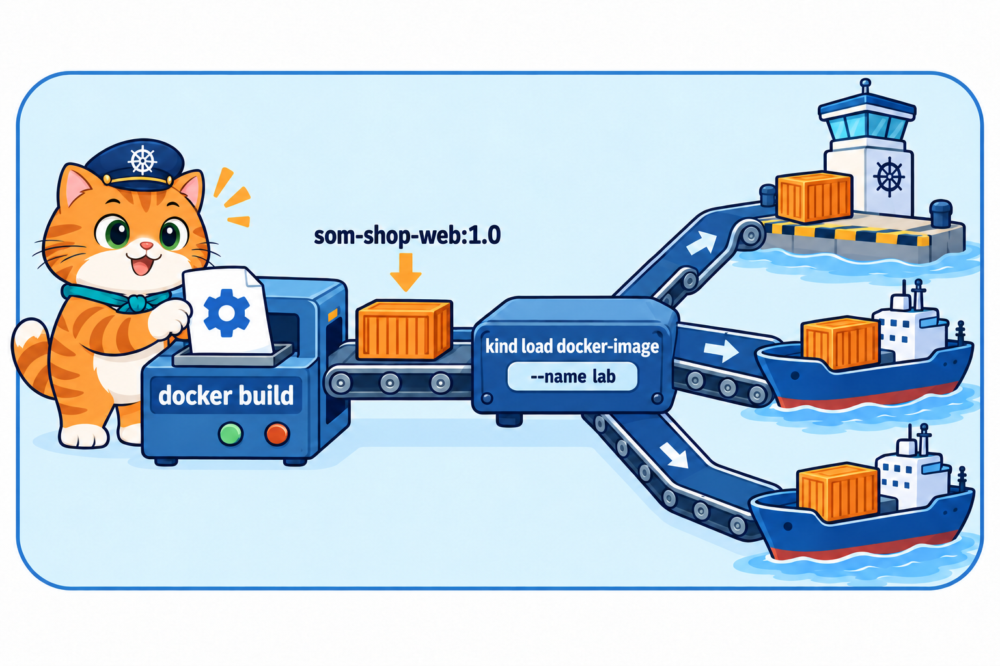<br>
  <em><b>รูปที่ 15</b> build image som-shop-web:1.0 ใน k8s-lab แล้วใช้ kind load docker-image นำ image เข้าไปในทุก node ของคลัสเตอร์</em>
</p>

### ขั้นที่ 4: เปิดร้าน (สร้าง Pod)

```bash
kubectl apply -f som-shop/k8s/som-shop-pod.yaml
```

**Expected output**

<pre>
pod/som-shop created
</pre>

สั่ง `kubectl get pods` ซ้ำทุก ~5 วินาที จะเห็น STATUS เปลี่ยนตามลำดับ (ครั้งแรกรอราว 20 วินาที เพราะต้องดึง image PostgreSQL)

```bash
kubectl get pods
```

**Expected output** (ระหว่างรอ → เมื่อพร้อม)

<pre>
NAME       READY   STATUS     RESTARTS   AGE
som-shop   0/2     Init:0/3   0          9s

NAME       READY   STATUS     RESTARTS   AGE
som-shop   1/2     Init:2/3   0          19s

NAME       READY   STATUS    RESTARTS   AGE
som-shop   2/2     Running   0          21s
</pre>

<p align="center" id="fig-16">
  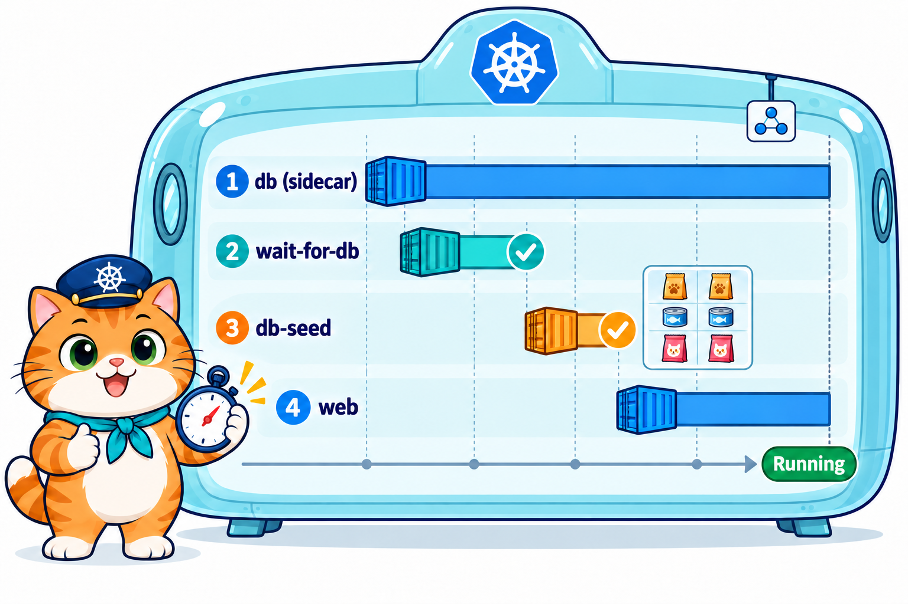<br>
  <em><b>รูปที่ 16</b> ลำดับเริ่ม Pod: db เริ่มก่อน → wait-for-db รอฐานข้อมูล → db-seed ใส่สินค้า → web เริ่มทำงาน</em>
</p>

- `Init:0/3` → `Init:2/3` = container ลำดับ 1–3 กำลังทำงานทีละตัว
- `2/2 Running` = ร้านเปิดแล้ว (READY นับ `db` กับ `web` ที่ทำงานตลอด ส่วน 2 ตัวที่จบแล้วไม่นับ)

### ขั้นที่ 5: ดู log ของแต่ละ container

Pod นี้มีหลาย container จึงต้องบอกด้วย `-c <ชื่อ container>`

```bash
kubectl logs som-shop -c db-seed
```

**Expected output**

<pre>
connected to database
tables ready: products, orders
seeded 6 products (new: 6)
</pre>

```bash
kubectl logs som-shop -c web
```

**Expected output**

<pre>
▲ Next.js 16.3.8
- Local:         http://localhost:3000
- Network:       http://0.0.0.0:3000
✓ Ready in 0ms
</pre>

### ขั้นที่ 6: เข้าไปดูฐานข้อมูล

```bash
kubectl exec -it som-shop -c db -- psql -U som -d catshop
```

prompt จะเปลี่ยนเป็น `catshop=#` แปลว่าอยู่ในฐานข้อมูลแล้ว พิมพ์

```sql
SELECT name_th, price_baht, stock FROM products;
```

**Expected output**

<pre>
           name_th            | price_baht | stock 
------------------------------+------------+-------
 อาหารเม็ดสูตรปลาทูน่า 1.5 กก.    |     459.00 |    20
 อาหารเม็ดลูกแมว สูตรนมแพะ 1 กก. |     389.00 |    15
 อาหารเม็ดแมวสูงวัย 1.2 กก.      |     499.00 |    10
 อาหารเปียกปลาซาบะ 85 ก.       |      35.00 |    60
 ขนมแมวเลียรสไก่ (แพ็ก 4)        |      59.00 |    40
 ขนมฟรีซดรายแซลมอน 40 ก.       |     129.00 |    25
(6 rows)
</pre>

พิมพ์ `\q` เพื่อออกจากฐานข้อมูล

### ขั้นที่ 7: เปิดร้านใน browser แล้วสั่งซื้อ

```bash
kubectl port-forward pod/som-shop 3000:3000
```

**Expected output**

<pre>
Forwarding from 127.0.0.1:3000 -> 3000
Forwarding from [::1]:3000 -> 3000
</pre>

ปล่อยค้างไว้ แล้วไปที่แท็บ **PORTS** ของ VS Code กดไอคอน **ลูกโลก** ที่แถว port `3000` (เหมือน LAB 3 ขั้นที่ 4) browser จะเปิด `http://localhost:3000`

<p align="center" id="fig-17">
  <br>
  <em><b>รูปที่ 17</b> ภาพหน้าจอจริงจากการทดลอง: หน้าร้านอาหารแมวน้องส้มเมื่อเปิดครั้งแรก มีสินค้า 6 รายการ ออเดอร์ทั้งหมด 0 (ทดสอบ 18 ต.ค. 2569 ด้วย browser จริงบนเครื่อง host ตอนถ่ายเข้าผ่าน NodePort ชั่วคราวแทน port-forward หน้าเว็บที่เห็นเหมือนกัน)</em>
</p>

กดปุ่ม **🛒 สั่งซื้อ** 3 ครั้ง จำนวนสินค้าที่เหลือจะลดลง และ "ออเดอร์ทั้งหมด" เป็น 3

<p align="center" id="fig-18">
  <br>
  <em><b>รูปที่ 18</b> ภาพหน้าจอจริงจากการทดลอง: หลังกดสั่งซื้อ 3 ครั้ง ออเดอร์ทั้งหมดเป็น 3 และ stock ของสินค้าที่สั่งลดลง (ทดสอบ 18 ต.ค. 2569 ด้วย browser จริงบนเครื่อง host ตอนถ่ายเข้าผ่าน NodePort ชั่วคราวแทน port-forward หน้าเว็บที่เห็นเหมือนกัน)</em>
</p>

### ขั้นที่ 8: ตรวจออเดอร์ในฐานข้อมูล

เปิด **Terminal ใหม่** ใน VS Code (terminal แรกยังรัน port-forward อยู่) แล้วเข้าฐานข้อมูล

```bash
kubectl exec -it som-shop -c db -- psql -U som -d catshop
```

```sql
SELECT count(*) FROM orders;
```

**Expected output**

<pre>
 count 
-------
     3
(1 row)
</pre>

ออเดอร์ 3 รายการที่กดจาก browser ถูกบันทึกลงฐานข้อมูลจริง พิมพ์ `\q` เพื่อออก

### ขั้นที่ 9: เก็บกวาด

กลับไปที่ terminal แรกแล้วกด **Ctrl+C** หยุด port-forward จากนั้น

```bash
kubectl delete -f som-shop/k8s/som-shop-pod.yaml
```

**Expected output**

<pre>
pod "som-shop" deleted from default namespace
</pre>

### สิ่งที่เห็น

- build image เอง แล้วใช้ `kind load` ส่งเข้าคลัสเตอร์ก่อนสร้าง Pod
- Pod เดียวมีได้หลาย container คุยกันผ่าน `localhost` และดู log ทีละตัวด้วย `-c`
- `kubectl exec -it ... psql` เข้าไปดูข้อมูลในฐานข้อมูลได้ เห็นออเดอร์ที่สั่งจากหน้าเว็บจริง

### คำถามท้าย LAB 8

1. ทำไม `kubectl get pods` แสดง READY `2/2` ทั้งที่ Pod มี container ทั้งหมด 4 ตัว
2. ถ้าแก้โค้ดเว็บแล้ว build เป็น `som-shop-web:1.1` ต้องทำขั้นตอนใดบ้างจึงจะเห็นเวอร์ชันใหม่

---

## เก็บกวาดหลังจบบท

🐧 **ใน SSH session ของ k8s-lab** ตรวจว่าไม่มี Pod ค้างและไม่มี port-forward ค้าง

```bash
kubectl get pods
pgrep -af "kubectl port-forward" || echo "ไม่มี port-forward ค้าง"
```

```text
No resources found in default namespace.
ไม่มี port-forward ค้าง
```

คลัสเตอร์ `lab` เก็บไว้ใช้ต่อได้ ถ้าต้องการคืนทรัพยากรเครื่อง ให้ลบคลัสเตอร์ด้วย `k8s-down` (image ที่ `kind load` ไว้จะหายไปด้วย ครั้งหน้าต้อง `k8s-up` และ `kind load` ใหม่) จากนั้นออกจาก SSH ด้วย `exit`

🖥️ **บนเครื่องนักศึกษา** (ทางเลือก) หยุด container เพื่อคืน RAM/CPU แล้วเปิดใหม่ครั้งหน้าด้วย `docker start k8s-lab` (คลัสเตอร์และไฟล์ใน `/workspace` ยังอยู่) หรือลบทิ้งทั้งหมดถ้าไม่ใช้แล้ว (ครั้งหน้าต้องเริ่มจาก LAB 0 ขั้นที่ 1 ใหม่ แต่ไม่ต้อง pull image ซ้ำ)

```bash
docker stop k8s-lab      # หยุดชั่วคราว ข้อมูลยังอยู่
docker rm -f k8s-lab     # ลบ container รวมคลัสเตอร์และไฟล์ข้างในทั้งหมด (image ยังอยู่)
```

> **บทถัดไป:** น้องส้มจะแยกเว็บกับฐานข้อมูลออกจากกัน ให้ Deployment ดูแลการสร้าง Pod ใหม่ ใช้ Service ให้ที่อยู่คงที่ (และเปิดร้านผ่าน port 30080–30082 ได้โดยไม่ต้อง port-forward) เก็บข้อมูลบนที่เก็บถาวร และย้ายรหัสผ่านไปไว้ใน Secret

---

## สรุปคำสั่ง kubectl ในบทนี้

**สร้าง / ลบ Pod**

| คำสั่ง | ใช้ทำอะไร |
|---|---|
| `kubectl run hello --image=nginx:1.27-alpine` | สร้าง Pod ด้วยคำสั่งเดียว (ไม่ใช้ไฟล์) |
| `kubectl apply -f <ไฟล์ หรือ โฟลเดอร์>` | สร้าง/อัปเดต Pod ตามไฟล์ YAML (สั่งซ้ำได้) |
| `kubectl create -f <ไฟล์>` | สร้างใหม่อย่างเดียว ถ้ามีอยู่แล้วจะ error (ใช้ `apply` เป็นหลัก) |
| `kubectl delete pod <ชื่อ>` | ลบ Pod ตามชื่อ |
| `kubectl delete -f <ไฟล์ หรือ โฟลเดอร์>` | ลบทุก Pod ที่อยู่ในไฟล์ |
| `kubectl delete pod -l <key=value>` | ลบทุก Pod ที่มี label นี้ |

**ดูสถานะ**

| คำสั่ง | ใช้ทำอะไร |
|---|---|
| `kubectl get pods` | รายการ Pod: READY, STATUS, RESTARTS |
| `kubectl get pods -o wide` | เพิ่ม IP และ NODE ของ Pod |
| `kubectl get pods --show-labels` | เพิ่มคอลัมน์ label |
| `kubectl get pods -l <key=value>` | เลือกเฉพาะ Pod ที่มี label นี้ |
| `kubectl get pod <ชื่อ> -o yaml` | ดู Pod เต็ม ๆ ทั้ง `spec` และ `status` |
| `kubectl describe pod <ชื่อ>` | รายละเอียด + **Events** (ใช้หาสาเหตุเวลา Pod พัง) |

**เข้าไปใน Pod / ดู log**

| คำสั่ง | ใช้ทำอะไร |
|---|---|
| `kubectl logs <ชื่อ>` | ดูสิ่งที่แอปพิมพ์ออกมา |
| `kubectl logs <ชื่อ> -c <container>` | ดู log ของ container ที่ระบุ (Pod ที่มีหลาย container) |
| `kubectl exec <ชื่อ> -- <คำสั่ง>` | รันคำสั่งหนึ่งคำสั่งใน container |
| `kubectl exec -it <ชื่อ> -- sh` | เข้า shell ใน container (พิมพ์ `exit` เพื่อออก) |
| `kubectl port-forward pod/<ชื่อ> <port เครื่อง>:<port ใน Pod>` | เปิดทางเข้าเว็บใน Pod (ค้างไว้, Ctrl+C เพื่อหยุด) |

**แก้ Pod ที่รันอยู่**

| คำสั่ง | ใช้ทำอะไร |
|---|---|
| `kubectl label pod <ชื่อ> key=value` | ติด label |
| `kubectl label pod <ชื่อ> key-` | ถอด label |
| `kubectl set image pod/<ชื่อ> <container>=<image>` | เปลี่ยน image ของ container |

**คลัสเตอร์และ image**

| คำสั่ง | ใช้ทำอะไร |
|---|---|
| `k8s-up` / `k8s-down` | สร้าง / ลบคลัสเตอร์ kind ชื่อ `lab` |
| `kubectl get nodes` | ดู node ในคลัสเตอร์ |
| `docker build -t <ชื่อ:tag> .` | build image จาก Dockerfile |
| `kind load docker-image <ชื่อ:tag> --name lab` | ส่ง image เข้าทุก node ของคลัสเตอร์ |
