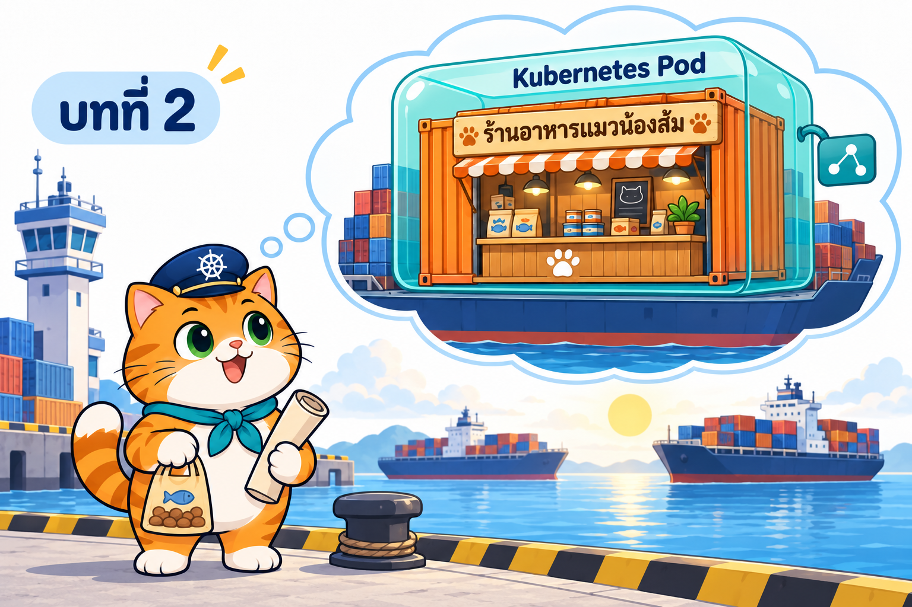

# บทที่ 2: Kubernetes Pod — Pod แรกของน้องส้ม

> **รายวิชา:** Software Development Tools and Environments (DevTools)
> **หัวข้อ:** Kubernetes Pod, การเขียน Kubernetes YAML, วงจรชีวิต, probes, emptyDir และ Pod หลาย container
> **ผลลัพธ์การเรียนรู้ที่เกี่ยวข้อง:** CLO-5, CLO-6

<p align="center">
  <br>
  <em>น้องส้ม ผู้ช่วยกัปตันท่าเรือ Kubernetes ฝันอยากเปิดร้านอาหารแมวบนเรือ จึงต้องเรียนรู้การจัดกล่อง Pod</em>
</p>

## บทนี้เรียนอะไร

ต่อจากบทที่ 1 ที่เรารู้จักท่าเรือ Kubernetes ทั้งระบบ บทนี้ซูมเข้าไปที่ **Pod** หรือ "กล่อง" ที่ห่อตู้สินค้า (container) ก่อนขึ้นเรือ (Node) เราจะเดินทางไปกับน้องส้มตั้งแต่ "Pod คืออะไร" ไปจนถึงเขียนใบสั่งงาน YAML เอง ดีบัก Pod ที่พัง และปิดท้ายด้วยการเปิด **ร้านอาหารแมวน้องส้ม** (Next.js + PostgreSQL) ใน Pod เดียวบนคลัสเตอร์ kind ของตัวเอง

| ส่วน | เนื้อหา | ลิงก์ |
|---|---|---|
| 📖 **ทฤษฎี** | Pod, Node, เครือข่ายของ Pod, เส้นทางการเกิดของ Pod, YAML พื้นฐาน, manifest, container spec (image/env/command/resources), labels, lifecycle และข้อผิดพลาดยอดฮิต, probes, emptyDir, init container/sidecar, การดีบัก และเปิดเว็บด้วย port-forward + แท็บ PORTS ของ VS Code (มีหัวข้ออ่าน YAML ทีละบรรทัดแบบละเอียด + คำถามทบทวนพร้อมแนวคำตอบ) | [01_Theory/README.md](01_Theory/README.md) |
| 🧪 **ปฏิบัติการ** | LAB 0–8 จากง่ายไปยาก: สร้างคลัสเตอร์ → `kubectl run` → YAML แรก → exec/logs/port-forward → labels → lifecycle/debug → env/resources → probes → **LAB สุดท้าย: ร้านอาหารแมวน้องส้ม** พร้อมสรุปคำสั่ง kubectl ท้ายบท | [02_LAB/README.md](02_LAB/README.md) |

## คำแนะนำในการเรียน

1. **อ่านทฤษฎีก่อน** อย่างน้อยหัวข้อ 1–8 (Pod และการอ่าน YAML) แล้วเริ่ม LAB 0–4 ได้เลย
2. ก่อนทำ LAB 5–8 ให้อ่านหัวข้อ 9–14 (lifecycle, probes, emptyDir, init/sidecar, การดีบัก)
3. ทำ LAB **ตามลำดับ** เพราะ LAB หลังใช้ความรู้และคลัสเตอร์จาก LAB ก่อนหน้า ใช้เวลารวมประมาณ 3.5–4 ชั่วโมง
4. สังเกตสัญลักษณ์ในเอกสาร LAB ว่าคำสั่งรันที่ไหน: 🖥️ บนเครื่องนักศึกษา / 🐧 ใน SSH session ของ k8s-lab / 🌐 browser
5. ผลลัพธ์ในเอกสารมาจากการทดลองจริง (Kubernetes v1.37.0) แต่ **เวลา, IP, ชื่อ Node อาจต่างจากเครื่องของนักศึกษา**
6. ลองตอบคำถามทบทวนด้วยตัวเองก่อนเปิดดูแนวคำตอบ

> **ขอบเขตของบทนี้:** ใช้ **Pod เดี่ยว ๆ เท่านั้น** การเปิดเว็บใช้ `kubectl port-forward` ร่วมกับแท็บ PORTS ของ VS Code ส่วน Deployment, Service (รวมถึง NodePort ผ่าน port 30080–30082), PersistentVolumeClaim และ Secret เป็น **เนื้อหาของบทถัดไป**

## สิ่งที่ต้องมีก่อนเริ่ม

- ผ่าน [บทที่ 1: Kubernetes และสถาปัตยกรรม](../001_kubernetes-introduction/01_Theory/README.md) แล้ว เข้าใจบทบาทของ Control Plane, Worker Node, kubelet และ kube-scheduler
- ทำ [LAB บทที่ 1](../001_kubernetes-introduction/02_LAB/readme.md) แล้ว คือมี container **`k8s-lab`** ที่รันอยู่บน Docker Desktop และล็อกอินได้ด้วย `ssh -p 2223 root@localhost` (รหัส `passwd` ใช้เพื่อการเรียนเท่านั้น)
- ยังไม่ต้องมีคลัสเตอร์ LAB 0 จะสร้างด้วย `k8s-up`
- เครื่องต่ออินเทอร์เน็ตได้ (ดึง image จาก Docker Hub) และมีพื้นที่ดิสก์ว่างพอสำหรับ image ราว 1–2 GB
- พื้นฐาน Docker (image, container, Dockerfile, `docker build`) จากหัวข้อ Docker ก่อนหน้า

## โครงสร้างโฟลเดอร์

```text
002_kubernetes_pod/
├── README.md                         ← หน้านี้
├── 01_Theory/
│   ├── README.md                     ← เอกสารทฤษฎี
│   └── images/                       ← ภาพประกอบ 00–35 (+ imagegen-prompts.md)
└── 02_LAB/
    ├── README.md                     ← คู่มือ LAB 0–8
    ├── images/                       ← ภาพประกอบ LAB + screenshots/ ภาพหน้าจอจริง
    ├── labs/                         ← YAML ของ LAB 2–7
    │   ├── lab02-first-yaml/
    │   ├── lab04-labels/
    │   ├── lab05-lifecycle/
    │   ├── lab06-env-resources/
    │   └── lab07-probes/
    └── som-shop/                     ← LAB 8 ร้านอาหารแมวน้องส้ม
        ├── app/                      ← แอป Next.js + Dockerfile + scripts/seed.mjs
        └── k8s/som-shop-pod.yaml     ← manifest ของ Pod
```

ใน LAB 0 จะ `git clone` repo เข้า container แล้วทำงานที่ `/workspace/DevTools/05_kubernetes/002_kubernetes_pod/02_LAB` ภายใน k8s-lab

## เริ่มเลย

👉 [อ่านทฤษฎี](01_Theory/README.md) → [ลงมือทำ LAB](02_LAB/README.md)
