# บทที่ 3: Kubernetes ReplicaSet — ร้านน้องส้มไม่มีวันปิด

> **รายวิชา:** Software Development Tools and Environments (DevTools) · **CLO-5, CLO-6**
> **บทก่อนหน้า:** [บทที่ 2 Kubernetes Pod](../../002_kubernetes_pod/01_Theory/README.md) · **LAB ของบทนี้:** [02_LAB](../02_LAB/README.md)

อ่านบทนี้จบแล้วควรทำได้ 4 อย่าง

1. อธิบายได้ว่า **ReplicaSet** คืออะไร และทำไม Pod ของมันถูกลบแล้วเกิดใหม่ได้
2. **อ่านไฟล์ YAML ของ ReplicaSet ออกทุกบรรทัด** โดยเฉพาะ `replicas`, `selector` และ `template`
3. เพิ่ม-ลดจำนวน Pod และอธิบายได้ว่า ReplicaSet **นับ Pod จาก label** อย่างไร
4. บอกได้ว่า ReplicaSet ทำอะไร **ไม่ได้** (เปลี่ยนเวอร์ชันเอง, ให้ที่อยู่คงที่) ก่อนไปบท Deployment และ Service

## สารบัญ

1. [เริ่มเรื่อง: Pod หาย ร้านก็ปิด](#1-เริ่มเรื่อง-pod-หาย-ร้านก็ปิด)
2. [ReplicaSet คืออะไร](#2-replicaset-คืออะไร)
3. [ReplicaSet ทำงานอย่างไร](#3-replicaset-ทำงานอย่างไร)
4. [อ่าน YAML ของ ReplicaSet ทีละบรรทัด](#4-อ่าน-yaml-ของ-replicaset-ทีละบรรทัด)
5. [selector, ชื่อ Pod และเจ้าของ](#5-selector-ชื่อ-pod-และเจ้าของ)
6. [Self-healing: ใครซ่อมอะไร](#6-self-healing-ใครซ่อมอะไร)
7. [Scale: เพิ่ม-ลดจำนวน Pod](#7-scale-เพิ่ม-ลดจำนวน-pod)
8. [Labels: ReplicaSet นับ Pod จากป้าย](#8-labels-replicaset-นับ-pod-จากป้าย)
9. [Pod กระจายบนหลายเรือ](#9-pod-กระจายบนหลายเรือ)
10. [แก้แม่พิมพ์ แล้ว Pod เดิมเปลี่ยนไหม](#10-แก้แม่พิมพ์-แล้ว-pod-เดิมเปลี่ยนไหม)
11. [อ่าน YAML ร้านน้องส้มหลายสาขาทั้งไฟล์](#11-อ่าน-yaml-ร้านน้องส้มหลายสาขาทั้งไฟล์)
12. [เปิดเว็บของ ReplicaSet และบทถัดไป](#12-เปิดเว็บของ-replicaset-และบทถัดไป)
13. [สรุปและคำถามทบทวน](#13-สรุปและคำถามทบทวน)

---

## 1. เริ่มเรื่อง: Pod หาย ร้านก็ปิด

<p align="center">
  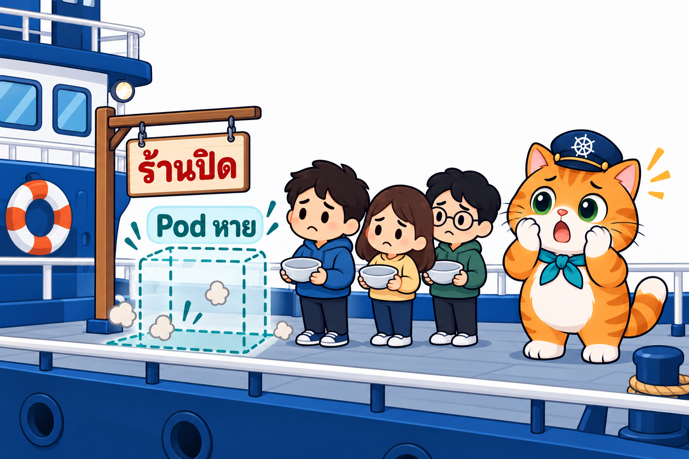
</p>

ร้านอาหารแมวน้องส้มจากบทที่ 2 ขายดีมาก แต่วันหนึ่ง Pod ของร้านถูกลบไป **ร้านปิดทันที** ไม่มีใครเปิดร้านคืนให้ ลูกค้ายืนรอหน้าร้านเต็มไปหมด

> "Pod เดี่ยวก็เหมือนกล่องที่ไม่มีใครเฝ้า ส้มต้องมี **หัวหน้าลูกเรือ** คอยนับกล่องให้ครบทุกวัน" — กัปตันบอก

หัวหน้าลูกเรือคนนี้คือ **ReplicaSet** ทบทวนอุปมาท่าเรือ แล้วเพิ่มตัวละครใหม่

<p align="center">
  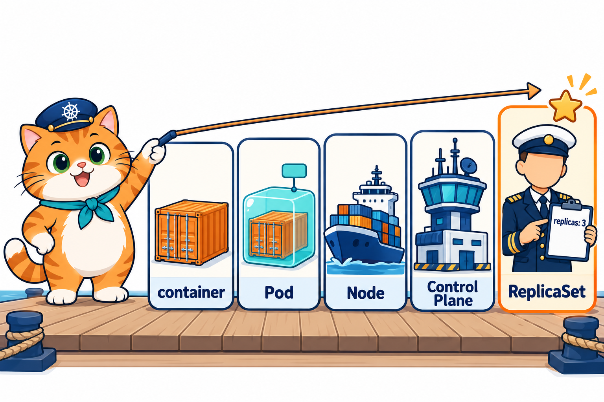
</p>

- **container** = ตู้สินค้า / **Pod** = กล่องห่อตู้ มีป้าย IP 1 อัน
- **Node** = เรือ (`lab-worker`, `lab-worker2`) / **Control Plane** = หอบังคับการ
- **ReplicaSet** = **หัวหน้าลูกเรือ** ถือกระดานจดว่า "ต้องมีกล่องแบบนี้ 3 กล่อง"
- **template** = **แม่พิมพ์กล่อง** ทุกกล่องที่หัวหน้าสร้างออกมาจากแม่พิมพ์นี้
- **selector** = **ป้ายที่หัวหน้าใช้นับ** กล่องไหนติดป้ายนี้ นับเป็นของหัวหน้า

> **ขอบเขตบทนี้:** ใช้ ReplicaSet กับ Pod เท่านั้น เรื่อง Deployment และ Service เป็นของบทถัดไป

---

## 2. ReplicaSet คืออะไร

<p align="center">
  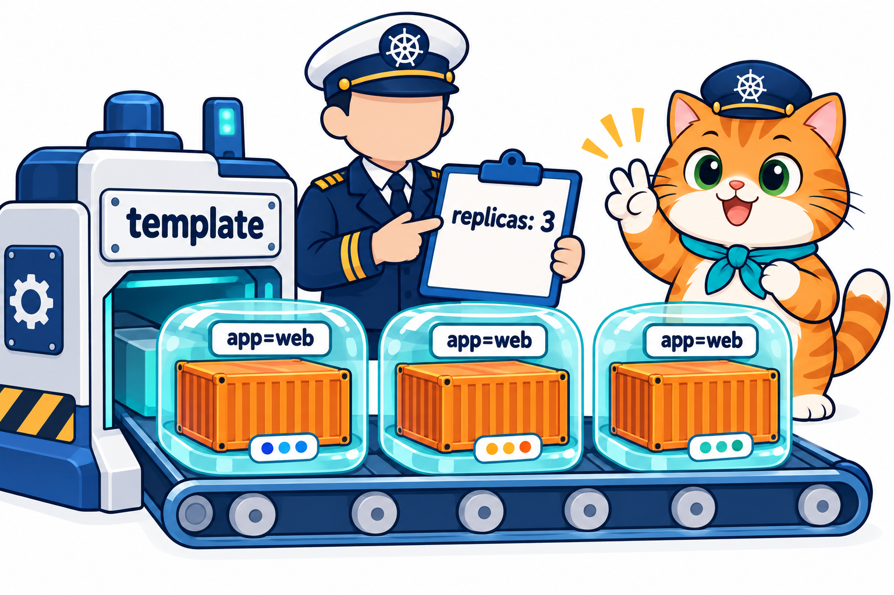
</p>

**ReplicaSet คือ object ที่คอยดูแลให้มี Pod หน้าตาเหมือนกันอยู่ครบตามจำนวนที่ขอ ตลอดเวลา**

- เราบอกแค่ **"อยากได้กี่ตัว"** (`replicas`) กับ **"หน้าตาแบบไหน"** (`template`)
- ReplicaSet สร้าง Pod ให้ครบ ขาดก็สร้างเพิ่ม เกินก็ลบออก
- Pod ทุกตัวออกมาจาก **แม่พิมพ์เดียวกัน** จึงเหมือนกันทุกอย่าง ต่างกันแค่ชื่อ IP และเรือที่อยู่

ตัวอย่างจริงจาก LAB 1: สั่งไฟล์เดียว ได้ Pod 3 ตัว

```text
$ kubectl get rs
NAME   DESIRED   CURRENT   READY   AGE
web    3         3         3       14s

$ kubectl get pods -o wide
NAME        READY   STATUS    RESTARTS   AGE   IP           NODE
web-l96sh   1/1     Running   0          13s   10.244.2.2   lab-worker
web-mr95m   1/1     Running   0          13s   10.244.2.3   lab-worker
web-vfd2r   1/1     Running   0          13s   10.244.1.2   lab-worker2
```

- `DESIRED` = จำนวนที่ขอ / `CURRENT` = จำนวนที่มีอยู่จริง / `READY` = จำนวนที่พร้อมรับงาน
- ทั้งสามเท่ากัน = **ครบตามที่ขอแล้ว**

เทียบกับ Pod เดี่ยวในบทที่ 2

| | Pod เดี่ยว | Pod ของ ReplicaSet |
|---|---|---|
| ใครสร้าง | เรา (`kubectl run` / `apply` ไฟล์ Pod) | ReplicaSet สร้างให้จากแม่พิมพ์ |
| ชื่อ | ชื่อที่เราตั้ง เช่น `web` | ชื่อ ReplicaSet + สุ่ม เช่น `web-l96sh` |
| ถูกลบแล้ว | หายถาวร | มี Pod ใหม่มาแทนทันที |
| อยากได้ 5 ตัว | เขียน 5 ไฟล์ | แก้ `replicas: 5` |

---

## 3. ReplicaSet ทำงานอย่างไร

<p align="center">
  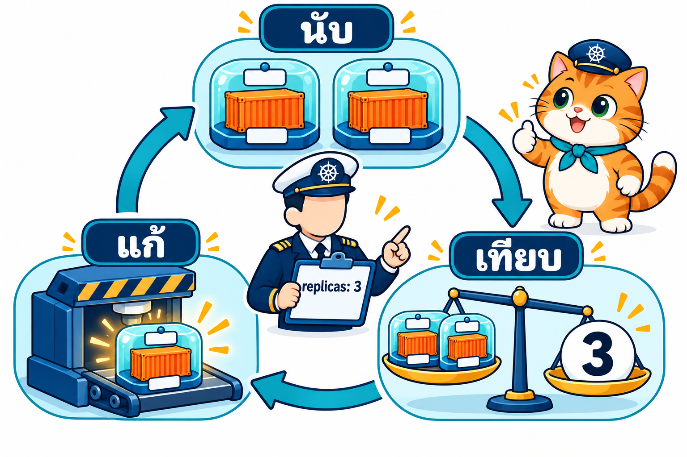
</p>

หัวหน้าลูกเรือทำงานวนซ้ำไม่มีวันหยุด 3 ขั้น

1. **นับ** — มี Pod ที่ติดป้ายตรงกับ `selector` อยู่กี่ตัว
2. **เทียบ** — กับ `replicas` ที่ขอไว้
3. **แก้** — ขาดก็สร้างจากแม่พิมพ์ เกินก็ลบ เท่ากันก็ไม่ทำอะไร

วงจรนี้เรียกว่า **control loop** (ทำให้ "ของจริง" เท่ากับ "ที่ขอ" เสมอ) คนที่ทำงานนี้คือ **replicaset-controller** ซึ่งอยู่ใน **kube-controller-manager** บนหอบังคับการ (บทที่ 1)

### ตั้งแต่ apply จนได้ Pod

<p align="center">
  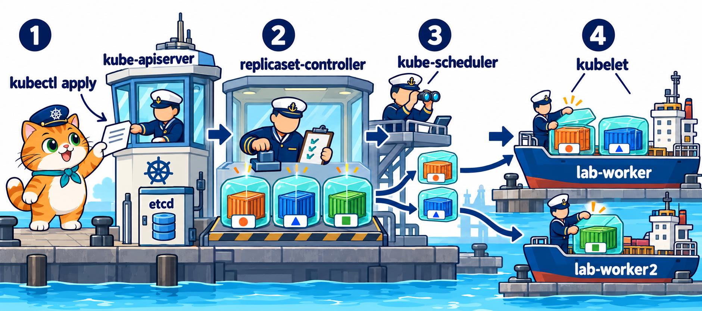
</p>

1. `kubectl apply` ส่ง ReplicaSet ไปให้ **kube-apiserver** แล้วบันทึกลง **etcd**
2. **replicaset-controller** เห็น ReplicaSet ใหม่ นับ Pod ได้ 0 จึงสร้าง Pod 3 ตัวจากแม่พิมพ์
3. **kube-scheduler** เลือกเรือให้ Pod แต่ละตัว
4. **kubelet** บนเรือแต่ละลำดึง image แล้วเริ่ม container (เหมือนบทที่ 2 ทุกอย่าง)

เห็นขั้นที่ 2 ได้ใน Events ของ `kubectl describe rs web` (LAB 1)

```text
Events:
  Type    Reason            Age   From                   Message
  Normal  SuccessfulCreate  14s   replicaset-controller  Created pod: web-l96sh
  Normal  SuccessfulCreate  14s   replicaset-controller  Created pod: web-vfd2r
  Normal  SuccessfulCreate  14s   replicaset-controller  Created pod: web-mr95m
```

> **ประโยคเดียวที่ต้องจำ:** ReplicaSet **สร้าง/ลบ Pod** แต่ไม่ได้เลือกเรือและไม่ได้รัน container เอง งานนั้นยังเป็นของ kube-scheduler กับ kubelet เหมือนเดิม

---

## 4. อ่าน YAML ของ ReplicaSet ทีละบรรทัด

YAML ของบทนี้ใช้กฎเดิมจาก [บทที่ 2 หัวข้อ 5](../../002_kubernetes_pod/01_Theory/README.md#5-yaml-ฉบับเข้าใจง่าย) ทบทวนสั้น ๆ

- `key: value` = ค่าเดี่ยว / เยื้องเข้า = **เป็นลูก** / เยื้องเท่ากัน = **เป็นพี่น้อง**
- `- ` (ขีด + เว้นวรรค) = **เริ่มรายการใหม่ 1 ชิ้น**

สิ่งใหม่มีเรื่องเดียว: **มี Pod ทั้งตัวซ้อนอยู่ข้างใน** จึงเยื้องลึกกว่าเดิม

### 4.1 ReplicaSet = กล่องที่มีแม่พิมพ์ Pod อยู่ข้างใน

<p align="center">
  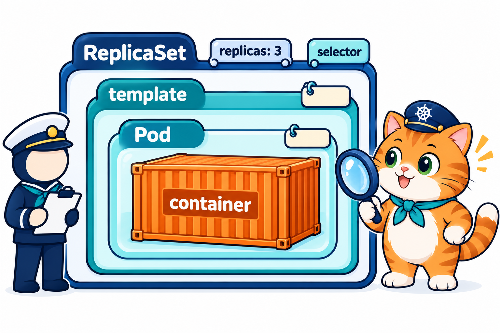
</p>

เอาไฟล์ Pod จากบทที่ 2 (ย่อ ตัดป้าย `owner` ออก) มาวางคู่กับ `web-rs.yaml` ของ LAB 1 จะเห็นว่า **ส่วน `template` คือ Pod เดิมที่ถูกพับเข้าไป** แค่ตัด `apiVersion`, `kind` และ `name` ออก **วงสีเดียวกัน = ส่วนที่คู่กัน** ลูกศรบอกว่าส่วนนั้นเปลี่ยน ย้ายเข้า `template` หรือเพิ่มใหม่

<p align="center">
  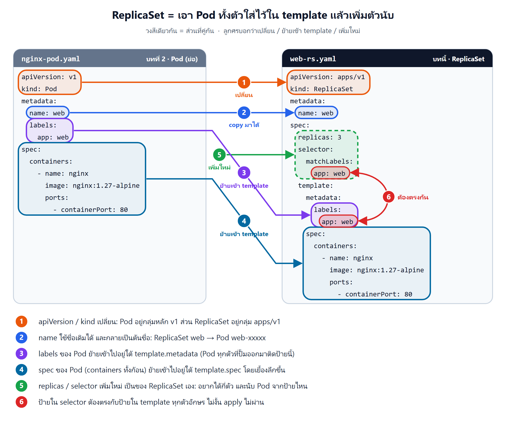
</p>

อ่านตามเลขในภาพ

- **① `apiVersion` / `kind` เปลี่ยน** Pod อยู่กลุ่มหลัก `v1` ส่วน ReplicaSet อยู่กลุ่ม `apps/v1`
- **② `name` copy มาได้** ReplicaSet ชื่อ `web` แล้ว Pod ที่มันสร้างจะชื่อ `web-xxxxx` (หัวข้อ 5.2)
- **③ `labels` ของ Pod ย้ายเข้าไปอยู่ใต้ `template.metadata`** Pod ทุกตัวที่ปั๊มออกมาจะติดป้ายนี้
- **④ `spec` ของ Pod (containers ทั้งก้อน) ย้ายเข้าไปอยู่ใต้ `template.spec`** เนื้อหาเหมือนเดิมทุกบรรทัด แค่เยื้องลึกขึ้น
- **⑤ `replicas` / `selector` เพิ่มใหม่** เป็นของ ReplicaSet เอง บอกว่าอยากได้กี่ตัว และนับ Pod จากป้ายไหน
- **⑥ ป้ายต้องตรงกัน** `app: web` ใต้ `selector` กับใต้ `template.metadata.labels` ต้องเหมือนกันทุกตัวอักษร ไม่งั้น apply ไม่ผ่าน (หัวข้อ 4.4 และ 5.1)

ในไฟล์ ReplicaSet จึงมี `metadata` กับ `spec` **อย่างละ 2 ชุด** อ่านให้ดีว่าอยู่ระดับไหน

- `metadata` / `spec` **ระดับบนสุด** = ของ ReplicaSet
- `template.metadata` / `template.spec` (เยื้องลึกกว่า) = ของ **Pod** ที่จะถูกสร้าง

### 4.2 หลักการเขียน: โครง 3 ชั้น

<p align="center">
  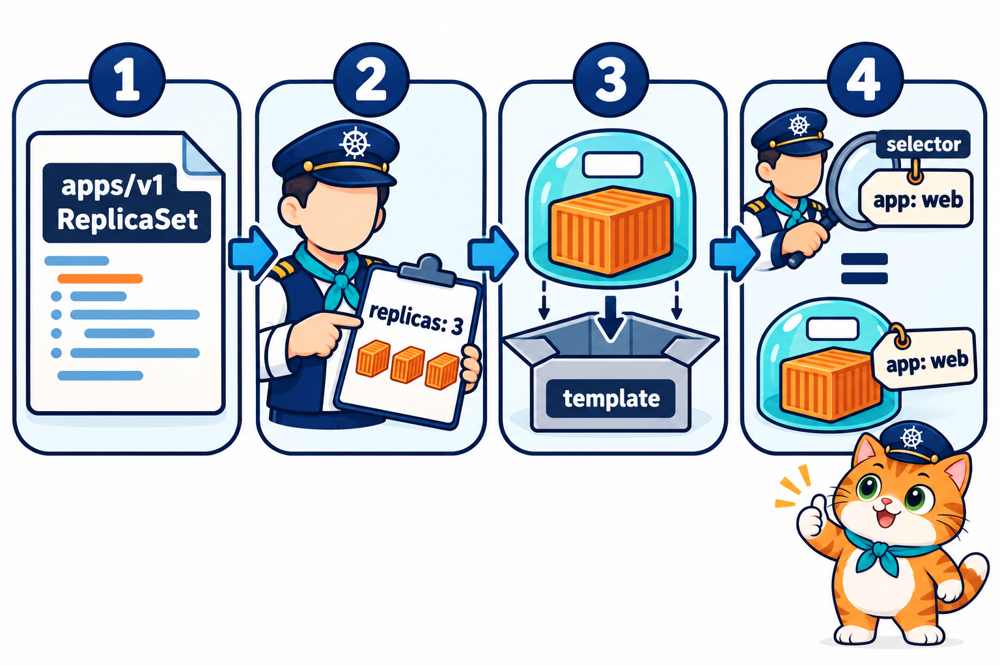
</p>

ไฟล์ ReplicaSet ทุกไฟล์มีโครงเดียวกัน ต่างกันแค่ค่าในวงเล็บ `<...>` จำโครงนี้ได้ก็เขียนเองได้ทุกไฟล์

```yaml
# ── ชั้น 1: หัวไฟล์ (ของ ReplicaSet) ─────────────────────
apiVersion: apps/v1
kind: ReplicaSet
metadata:
  name: <ชื่อ ReplicaSet>
spec:
  # ── ชั้น 2: ReplicaSet ต้องรู้ 3 เรื่อง ──────────────────
  replicas: <จำนวน>              # ① อยากได้กี่ตัว
  selector:                      # ② นับ Pod ตัวไหนเป็นของเรา
    matchLabels:
      <key>: <value>
  template:                      # ③ Pod หน้าตาแบบไหน
    # ── ชั้น 3: Pod ทั้งตัว (ของ Pod ที่จะถูกสร้าง) ───────
    metadata:
      labels:
        <key>: <value>           # ต้องมีป้ายทุกคู่ที่อยู่ใน ②
    spec:
      containers:
        - name: <ชื่อ container>
          image: <image>
```

หลักการ 4 ข้อ

1. **ชั้น 1** มี 4 key เหมือน object ทุกตัวใน Kubernetes: `apiVersion`, `kind`, `metadata`, `spec`
2. **ชั้น 2** `spec` ของ ReplicaSet มีลูก 3 ตัวที่เป็นพี่น้องกัน (เยื้อง 2 ช่องเท่ากัน) ตอบ 3 คำถาม: **กี่ตัว** (`replicas`) / **นับตัวไหน** (`selector`) / **หน้าตาแบบไหน** (`template`)
3. **ชั้น 3** `template` มีลูกแค่ 2 ตัวคือ `metadata` กับ `spec` = Pod จากบทที่ 2 ที่ตัด `apiVersion`, `kind` และ `name` ออก (ไม่ต้องตั้งชื่อ Pod เพราะระบบตั้งให้ หัวข้อ 5.2)
4. **ป้ายต้องเชื่อมกัน** ทุกคู่ใน `selector.matchLabels` ต้องมีอยู่ใน `template.metadata.labels` ด้วย (หัวข้อ 4.4 และ 5.1)

เวลาอ่านเอกสารหรือ error มักเขียนตำแหน่งเป็น **path แบบจุด** ไล่จากชั้นนอกเข้าใน เช่น error ในหัวข้อ 5.1 ชี้ไปที่ `spec.template.metadata.labels`

- `spec.replicas` → จำนวน (ของ ReplicaSet)
- `spec.selector.matchLabels` → ป้ายที่ใช้นับ (ของ ReplicaSet)
- `spec.template.metadata.labels` → ป้ายที่ติดให้ Pod ทุกตัว (ของ Pod)
- `spec.template.spec.containers` → container ข้างใน Pod (ของ Pod)

**สูตรเขียนจากไฟล์ Pod เดิม 4 ขั้น** (ตรงกับ 4 การ์ดในภาพ)

1. เปลี่ยนหัวไฟล์เป็น `apiVersion: apps/v1` และ `kind: ReplicaSet` ตั้ง `metadata.name`
2. ใต้ `spec` ใส่ `replicas: 3`
3. ยก `metadata` (เหลือแค่ `labels`) กับ `spec` ของ Pod เดิมไปไว้ใต้ `template:` แล้ว **เยื้องเข้าไปอีก 4 ช่อง**
4. ก๊อปป้ายจาก `template.metadata.labels` มาใส่ `selector.matchLabels`

นับช่องว่างของ `web-rs.yaml` (หัวข้อ 4.3) ดูได้ว่าแต่ละชั้นลึกเท่าไร

```text
spec:                          ← 0 ช่อง  ชั้น 1
  replicas: 3                  ← 2 ช่อง  ชั้น 2
  selector:                    ← 2 ช่อง
    matchLabels:               ← 4 ช่อง
      app: web                 ← 6 ช่อง
  template:                    ← 2 ช่อง
    metadata:                  ← 4 ช่อง  ชั้น 3 เริ่มที่นี่ (เดิมในไฟล์ Pod อยู่ที่ 0 ช่อง)
      labels:                  ← 6 ช่อง
        app: web               ← 8 ช่อง
    spec:                      ← 4 ช่อง
      containers:              ← 6 ช่อง
        - name: nginx          ← 8 ช่อง
```

> YAML ใช้ **space เท่านั้น ห้ามใช้ Tab** และเยื้องทีละ 2 ช่องทั้งไฟล์ ถ้าเยื้องคลาดไปช่องเดียว key จะไปเป็นลูกของคนอื่นทันที

### 4.3 ไล่ไฟล์จริงจาก LAB 1

<p align="center">
  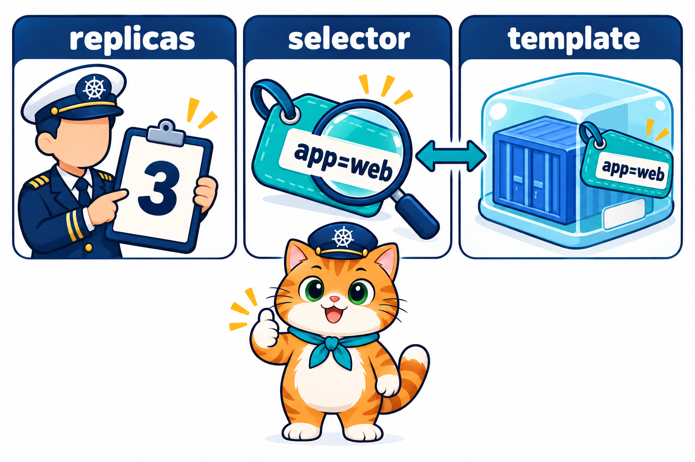
</p>

ไฟล์ `02_LAB/labs/lab01-first-rs/web-rs.yaml`

```yaml
# LAB 1, 2, 3: ReplicaSet แรก — ขอ Pod nginx 3 ตัว แล้วให้ ReplicaSet คอยดูแลให้ครบเสมอ
apiVersion: apps/v1          # ReplicaSet อยู่กลุ่ม apps รุ่น v1 (Pod ใช้แค่ v1)
kind: ReplicaSet
metadata:
  name: web                  # ชื่อ ReplicaSet → Pod ที่สร้างจะชื่อ web-xxxxx
spec:
  replicas: 3                # อยากได้ Pod 3 ตัวตลอดเวลา
  selector:                  # วิธีนับว่า Pod ตัวไหนเป็นของเรา: ดูจากป้าย label
    matchLabels:
      app: web
  template:                  # แม่พิมพ์ Pod — ข้างในคือ Pod จากบทที่ 2 (ไม่มี apiVersion/kind)
    metadata:
      labels:
        app: web             # ต้องตรงกับ selector ไม่งั้น apply ไม่ผ่าน
    spec:
      containers:
        - name: nginx
          image: nginx:1.27-alpine
          ports:
            - containerPort: 80
```

ไฟล์นี้ใช้ซ้ำใน LAB 1, LAB 2 และ LAB 3

อ่านทีละบรรทัด

| บรรทัด | ความหมาย |
|---|---|
| `apiVersion: apps/v1` | ReplicaSet อยู่กลุ่ม `apps` รุ่น `v1` (Pod ใช้แค่ `v1`) |
| `kind: ReplicaSet` | ขอสร้าง **ReplicaSet** |
| `metadata:` → `name: web` | ReplicaSet ชื่อ `web` (Pod ที่สร้างจะขึ้นต้นด้วย `web-`) |
| `spec:` | เริ่มส่วน "อยากได้อะไร" ของ ReplicaSet |
| `  replicas: 3` | อยากได้ Pod **3 ตัว** ตลอดเวลา |
| `  selector:` → `matchLabels:` | วิธีนับว่า Pod ตัวไหนเป็นของเรา: ต้องมีป้ายตรงทุกอัน |
| `      app: web` | ป้ายที่ใช้นับ คือ `app=web` |
| `  template:` | เริ่ม **แม่พิมพ์ Pod** |
| `    metadata:` → `labels:` → `app: web` | Pod ทุกตัวที่สร้างจะติดป้าย `app=web` (**ต้องตรงกับ selector**) |
| `    spec:` → `containers:` | ข้างใน Pod มี container อะไร (เหมือนบทที่ 2) |
| `      - name: nginx` / `image: nginx:1.27-alpine` | container ตัวที่ 1 ชื่อ `nginx` ใช้ image `nginx:1.27-alpine` |
| `          - containerPort: 80` | แอปฟัง port 80 |

แปลทั้งไฟล์เป็นประโยคเดียว: **"ขอ ReplicaSet ชื่อ `web` ดูแล Pod ที่ติดป้าย `app=web` ให้มี 3 ตัวเสมอ ถ้าต้องสร้างใหม่ ให้สร้างจากแม่พิมพ์ที่มี container `nginx` ใช้ image `nginx:1.27-alpine` ฟัง port 80"**

### 4.4 selector.matchLabels จับคู่กับป้ายอย่างไร

<p align="center">
  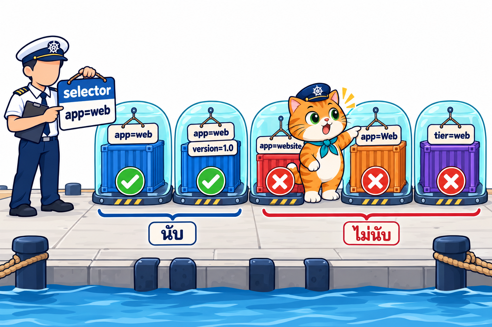
</p>

`matchLabels` คือรายการป้ายแบบ `key: value` ที่หัวหน้าลูกเรือถือไว้ ทุกรอบที่นับ หัวหน้าเดินดูป้ายของ Pod ทุกตัวใน namespace แล้วใช้กติกา 3 ข้อ

1. **ต้องมีครบทุกคู่** ถ้า `matchLabels` มี 2 ป้าย Pod ต้องมีทั้ง 2 ป้าย (ขาดป้ายเดียวก็ไม่นับ)
2. **ต้องตรงทุกตัวอักษร** ทั้ง key และ value ตัวพิมพ์เล็ก-ใหญ่ต่างกันก็ไม่ตรง (`Web` ≠ `web`)
3. **ป้ายเกินได้** Pod มีป้ายอื่นเพิ่มนอกจากที่ selector ขอ ก็ยังนับ

ทดลองจริงใน namespace ทดสอบ: สร้าง Pod เดี่ยว 5 ตัวที่ติดป้ายต่างกัน แล้วถามว่า selector `app: web` จะนับตัวไหน

| Pod | ป้าย | นับไหม | เพราะ |
|---|---|:---:|---|
| `p-web` | `app=web` | ✅ | ตรงพอดี |
| `p-web-v1` | `app=web`, `version=1.0` | ✅ | มี `app=web` ครบ ป้าย `version` เกินมาไม่เป็นไร |
| `p-website` | `app=website` | ❌ | value ไม่ตรง (`website` ≠ `web`) |
| `p-web-upper` | `app=Web` | ❌ | ตัวพิมพ์ใหญ่ไม่ตรง |
| `p-tier` | `tier=web` | ❌ | key ไม่ตรง (`tier` ≠ `app`) แม้ value จะเป็น `web` |

`kubectl get pods -l` ใช้กติกาเดียวกับ selector จึงใช้ **ตรวจล่วงหน้า** ได้ว่า ReplicaSet จะนับ Pod ตัวไหน (`-l` เขียนป้ายแบบ `key=value` หลายป้ายคั่นด้วย `,` = ต้องมีครบทุกป้าย)

```text
$ kubectl get pods --show-labels
NAME          READY   STATUS    RESTARTS   AGE   LABELS
p-tier        1/1     Running   0          21s   tier=web
p-web         1/1     Running   0          21s   app=web
p-web-upper   1/1     Running   0          5s    app=Web
p-web-v1      1/1     Running   0          21s   app=web,version=1.0
p-website     1/1     Running   0          21s   app=website

$ kubectl get pods -l app=web --show-labels
NAME       READY   STATUS    RESTARTS   AGE   LABELS
p-web      1/1     Running   0          21s   app=web
p-web-v1   1/1     Running   0          21s   app=web,version=1.0

$ kubectl get pods -l app=web,version=1.0
NAME       READY   STATUS    RESTARTS   AGE
p-web-v1   1/1     Running   0          21s
```

แล้ว apply `web-rs.yaml` (`replicas: 3`) ลงใน namespace เดียวกัน หัวหน้านับได้ 2 ตัวอยู่แล้ว (`p-web`, `p-web-v1`) จึง **สร้างเพิ่มแค่ 1 ตัว** และรับ 2 ตัวนั้นเป็นลูกด้วย

```text
$ kubectl get rs
NAME   DESIRED   CURRENT   READY   AGE
web    3         3         3       6s

$ kubectl describe rs web
...
  Normal  SuccessfulCreate  6s    replicaset-controller  Created pod: web-fw2bl

$ kubectl get pods -o custom-columns=NAME:.metadata.name,OWNER:.metadata.ownerReferences[0].name
NAME          OWNER
p-tier        <none>
p-web         web
p-web-upper   <none>
p-web-v1      web
p-website     <none>
web-fw2bl     web
```

selector ไม่สนว่าใครสร้าง Pod ขอแค่ป้ายตรงก็นับ (ผลที่ตามมาดูหัวข้อ 8)

**selector ที่มีหลายป้าย** แม่พิมพ์ต้องติดป้ายให้ครบทุกคู่ด้วย ไม่งั้นแม่พิมพ์จะปั๊ม Pod ที่ตัวเองนับไม่ได้ ตัวอย่างนี้ selector ขอ `version: "2.0"` แต่แม่พิมพ์ติด `"1.0"`

```yaml
  selector:
    matchLabels:
      app: som-menu
      version: "2.0"       # selector ขอ 2 ป้าย
  template:
    metadata:
      labels:
        app: som-menu      # ✅ ตรง
        version: "1.0"     # ❌ ไม่ตรง → ไม่ครบทุกคู่
```

```text
The ReplicaSet "som-menu" is invalid: spec.template.metadata.labels: Invalid value: {"app":"som-menu","version":"1.0"}: `selector` does not match template `labels`
```

ในไฟล์ของบทนี้จึงใช้ selector แค่ป้ายเดียว (`app`) แล้วใส่ป้ายเสริมอย่าง `version` ไว้ในแม่พิมพ์อย่างเดียว (LAB 4)

**ค่าป้ายเป็นข้อความเสมอ** ค่าที่หน้าตาเหมือนตัวเลขต้องใส่ `""` ถ้าเขียน `version: 1.0` YAML จะอ่านเป็นตัวเลข แล้ว apply ไม่ผ่าน

```text
Error from server (BadRequest): error when creating "<ไฟล์>": ReplicaSet in version "v1" cannot be handled as a ReplicaSet: json: cannot unmarshal number into Go struct field ObjectMeta.spec.template.metadata.labels of type string
```

> นอกจาก `matchLabels` ยังมี `matchExpressions` ที่เขียนเงื่อนไขได้ซับซ้อนกว่า (เช่น "version เป็น 1.0 หรือ 2.0") แต่บทนี้และบทถัด ๆ ไปใช้แค่ `matchLabels`

### 4.5 ผิดบ่อย แก้ง่าย

| ผิด | ถูก | เพราะ |
|---|---|---|
| `apiVersion: v1` | `apiVersion: apps/v1` | ReplicaSet อยู่กลุ่ม `apps` |
| `kind: Replicaset` | `kind: ReplicaSet` | ตัว S ต้องใหญ่ |
| `replicas: "3"` | `replicas: 3` | จำนวนต้องเป็นตัวเลข ไม่ใส่ `""` |
| ป้าย `version: 1.0` | `version: "1.0"` | ค่าป้ายต้องเป็นข้อความ (หัวข้อ 4.4) |
| `selector: app: web` (ไม่มี `matchLabels`) | `selector:` → `matchLabels:` → `app: web` | ป้ายต้องอยู่ใต้ `matchLabels` ไม่งั้นได้ `unknown field "spec.selector.app"` |
| ลืม `selector` | ใส่ `selector.matchLabels` | `apps/v1` บังคับต้องมี |
| ป้ายใน `template` ไม่ตรง selector | ทำให้ตรงกัน | Kubernetes ปฏิเสธ (หัวข้อ 5.1) |
| `containers` อยู่ใต้ `spec` ระดับบน | อยู่ใต้ `template.spec` | container เป็นของ Pod ไม่ใช่ของ ReplicaSet |

---

## 5. selector, ชื่อ Pod และเจ้าของ

### 5.1 selector ต้องตรงกับป้ายในแม่พิมพ์

<p align="center">
  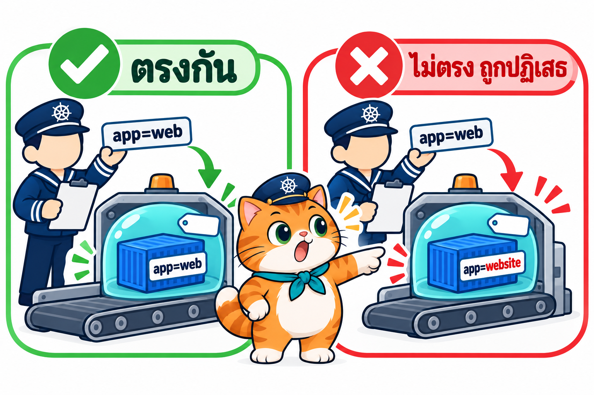
</p>

ถ้าแม่พิมพ์ติดป้าย `app=website` แต่ selector นับ `app=web` หัวหน้าจะสร้างกล่องที่ตัวเอง **นับไม่เจอ** แล้วสร้างใหม่ไม่รู้จบ Kubernetes จึง **ปฏิเสธตั้งแต่ apply**

ไฟล์ทั้งไฟล์ด้านล่างคือ `web-rs.yaml` (หัวข้อ 4.3) ที่เปลี่ยนแค่ 2 บรรทัดที่มี `←`

```yaml
apiVersion: apps/v1
kind: ReplicaSet
metadata:
  name: bad-web              # ← ตั้งชื่อใหม่ ไม่ให้ชนกับ web
spec:
  replicas: 3
  selector:
    matchLabels:
      app: web               # หัวหน้านับป้าย app=web
  template:
    metadata:
      labels:
        app: website         # ← แม่พิมพ์ติดป้าย app=website → ไม่ตรงกับ selector
    spec:
      containers:
        - name: nginx
          image: nginx:1.27-alpine
          ports:
            - containerPort: 80
```

ไล่ดูทีละจุด

- `spec.selector.matchLabels` ขอป้าย `app=web`
- `spec.template.metadata.labels` ติดป้าย `app=website` → value ไม่ตรง (กติกาข้อ 2 ในหัวข้อ 4.4)
- ส่วนอื่นถูกทุกบรรทัด แต่ทั้งไฟล์ใช้ไม่ได้เพราะป้าย 2 จุดนี้ไม่เชื่อมกัน

ลอง apply จะได้ error นี้ และไม่มี ReplicaSet ถูกสร้างเลย

```text
$ kubectl apply -f bad-web-rs.yaml
The ReplicaSet "bad-web" is invalid: spec.template.metadata.labels: Invalid value: {"app":"website"}: `selector` does not match template `labels`

$ kubectl get rs
No resources found in default namespace.
```

อ่าน error ตาม path แบบจุด: ปัญหาอยู่ที่ `spec.template.metadata.labels` ค่าที่เห็นคือ `{"app":"website"}` และเหตุผลคือ selector ไม่ตรงกับป้ายของแม่พิมพ์ แก้โดยเปลี่ยน `app: website` เป็น `app: web` ให้ตรงกับ selector

- ป้ายใน template **มีมากกว่า** selector ได้ เช่น `som-menu-rs.yaml` (LAB 4) ติดป้าย `app: som-menu` + `version: "1.0"` แต่ selector ใช้แค่ `app`
- `selector` **แก้ไม่ได้** หลังสร้างแล้ว อยากเปลี่ยนต้องลบแล้วสร้างใหม่

### 5.2 ชื่อ Pod และป้ายบอกเจ้าของ

<p align="center">
  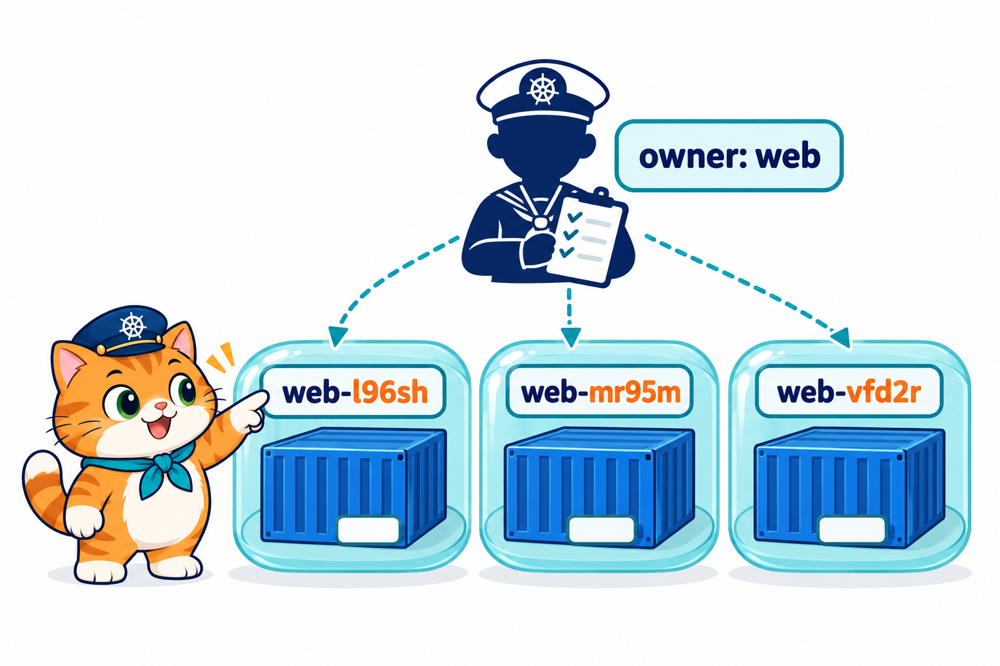
</p>

Pod ที่ ReplicaSet สร้างมีชื่อแบบ `<ชื่อ ReplicaSet>-<สุ่ม 5 ตัว>` และมี **ป้ายบอกเจ้าของ** อยู่ใน metadata ดูได้จาก `kubectl get pod <ชื่อ Pod> -o yaml` (LAB 1 ขั้นที่ 5)

ด้านล่างคือ **Pod ทั้งตัว** จากการรัน `web-rs.yaml` อีกรอบ (ชื่อสุ่มใหม่จึงเป็น `web-4ttw5` ไม่ใช่ `web-l96sh` แบบใน LAB) ของจริงยาวราว 140 บรรทัด ส่วนที่ไม่เกี่ยวกับบทนี้ตัดเหลือ `...` ไว้ ให้ดูว่าแต่ละบรรทัด **มาจากไหน**

```yaml
apiVersion: v1
kind: Pod
metadata:
  creationTimestamp: "2026-10-19T03:07:32Z"   # ← ระบบเติม: เวลาที่เกิด
  generateName: web-                          # ← ReplicaSet: ชื่อขึ้นต้นด้วย web- แล้วให้ระบบสุ่มต่อท้าย
  generation: 1
  labels:
    app: web                                  # ← แม่พิมพ์ (template.metadata.labels)
  name: web-4ttw5                             # ← ระบบสุ่มให้: web- + 5 ตัว
  namespace: default
  ownerReferences:                            # ← ReplicaSet: เจ้าของของ Pod นี้
  - apiVersion: apps/v1
    blockOwnerDeletion: true
    controller: true
    kind: ReplicaSet
    name: web
    uid: c5182bb1-f176-4b06-ba7e-8bf373a5b71b
  resourceVersion: "81765"
  uid: 99aacb80-589f-4b27-9fb7-c455c634d819
spec:
  containers:
  - image: nginx:1.27-alpine                  # ← แม่พิมพ์ (template.spec.containers)
    imagePullPolicy: IfNotPresent             # ← ระบบเติมค่าเริ่มต้น
    name: nginx                               # ← แม่พิมพ์
    ports:
    - containerPort: 80                       # ← แม่พิมพ์
      protocol: TCP                           # ← ระบบเติมค่าเริ่มต้น
    resources: {}
    ...                                       #   (volumeMounts ฯลฯ ระบบเติม)
  dnsPolicy: ClusterFirst
  nodeName: lab-worker                        # ← kube-scheduler เลือกเรือให้
  restartPolicy: Always                       # ← ระบบเติมค่าเริ่มต้น (บทที่ 2)
  schedulerName: default-scheduler
  ...                                         #   (tolerations, volumes ฯลฯ ระบบเติม)
status:                                       # ← kubelet รายงานสถานะจริง
  ...
  phase: Running
  podIP: 10.244.2.24
  qosClass: BestEffort
  startTime: "2026-10-19T03:07:32Z"
```

อ่านภาพรวมได้ 3 กลุ่ม

- **มาจากแม่พิมพ์** = `labels` และ `containers` (`name`, `image`, `containerPort`) ตรงกับที่เราเขียนใน `template` ทุกตัวอักษร Pod ทุกตัวของ ReplicaSet นี้จึงมีส่วนนี้เหมือนกันหมด
- **ReplicaSet เติม** = `generateName` และ `ownerReferences` สองบรรทัดนี้คือสิ่งที่ Pod เดี่ยวในบทที่ 2 **ไม่มี**
- **ระบบเติม/รายงาน** = ชื่อสุ่ม, `uid`, ค่าเริ่มต้นต่าง ๆ, `nodeName` จาก kube-scheduler และ `status` จาก kubelet ส่วนนี้ต่างกันในแต่ละ Pod

- ชื่อสุ่มทำให้ Pod **ไม่ซ้ำกัน** แม้จะออกมาจากแม่พิมพ์เดียวกัน
- `ownerReferences` ทำให้ **ลบ ReplicaSet แล้ว Pod ลูกถูกลบตาม** (LAB 1 ตอนท้าย: `kubectl delete -f` แล้ว Pod ขึ้น `Terminating` ทั้ง 3 ตัว)
- ถ้าอยากลบแค่ ReplicaSet แต่เก็บ Pod ไว้ ใช้ `kubectl delete rs web --cascade=orphan` (LAB ไม่ได้ใช้)

### 5.3 ลบโดยไม่ต้องมีไฟล์ YAML

`kubectl delete -f <ไฟล์>` ไม่ได้ใช้ไฟล์ทั้งไฟล์ kubectl แค่อ่าน **ชนิด (`kind`) กับชื่อ (`metadata.name`)** จากไฟล์ แล้วลบ object ที่ชื่อนั้น ถ้ารู้ 2 อย่างนี้ก็ **ลบได้เลยโดยไม่ต้องมีไฟล์**

| วิธี | ตัวอย่าง | ใช้เมื่อ |
|---|---|---|
| ตามไฟล์ | `kubectl delete -f labs/lab01-first-rs/web-rs.yaml` | มีไฟล์ที่ใช้สร้างอยู่ในมือ |
| ตามชนิด + ชื่อ | `kubectl delete rs web` (หรือ `replicaset web`, `rs/web`) | ไม่มีไฟล์ หรือไม่รู้ว่าสร้างจากไฟล์ไหน ดูชื่อก่อนด้วย `kubectl get rs` |
| ตามป้าย | `kubectl delete pod -l app=web` | ลบหลาย Pod ที่ติดป้ายเดียวกันในคำสั่งเดียว (LAB 1 ใช้ลบ Pod ทุกตัว) |

ผลจริงจาก LAB 2: ลบ ReplicaSet ด้วยชื่ออย่างเดียว Pod ลูกถูกลบตามเหมือนลบด้วยไฟล์

```text
$ kubectl delete rs web
replicaset.apps "web" deleted from default namespace
$ kubectl get pods
No resources found in default namespace.
```

> **⚠️ กับดัก:** `kubectl delete rs -l app=web` ได้ **`No resources found`** ทั้งที่ ReplicaSet `web` ยังอยู่ เพราะ `-l` หาจากป้าย **บนตัว object เอง** (`metadata.labels`) ซึ่ง `web-rs.yaml` ไม่ได้เขียนไว้ (`kubectl get rs --show-labels` ขึ้น `<none>`) ป้าย `app=web` อยู่ใน `template` = ป้ายบน **Pod** ส่วน `kubectl delete pod -l app=web` ลบได้แค่ Pod แล้ว ReplicaSet สร้างคืนทันที (LAB 1 ขั้นที่ 7) จะลบให้หมดต้องลบที่ ReplicaSet

---

## 6. Self-healing: ใครซ่อมอะไร

<p align="center">
  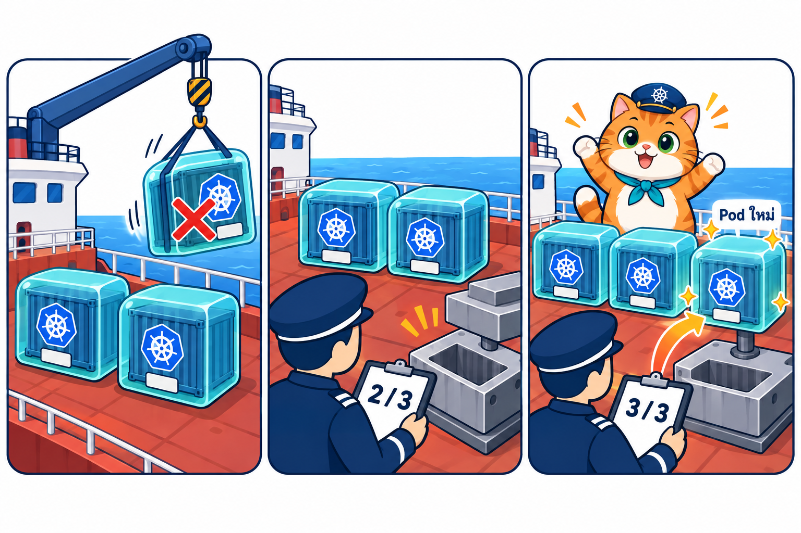
</p>

ลบ Pod ของ ReplicaSet 1 ตัว หัวหน้านับได้ 2 ซึ่งน้อยกว่า 3 จึงสร้างตัวใหม่ทันที (LAB 1)

```text
$ kubectl delete pod web-l96sh
pod "web-l96sh" deleted from default namespace

$ kubectl get pods -o wide
NAME        READY   STATUS    RESTARTS   AGE   IP           NODE
web-fkf8z   1/1     Running   0          2s    10.244.2.4   lab-worker
web-mr95m   1/1     Running   0          21s   10.244.2.3   lab-worker
web-vfd2r   1/1     Running   0          21s   10.244.1.2   lab-worker2
```

ตัวที่มาแทน (`web-fkf8z`) เป็น **Pod ใหม่** ชื่อใหม่ IP ใหม่ ไม่ใช่ตัวเดิมฟื้นกลับมา ใน Events ของ `kubectl describe rs web` จะมีบรรทัด `Created pod: web-fkf8z` เพิ่มขึ้นมา

### kubelet กับ ReplicaSet ซ่อมคนละระดับ

<p align="center">
  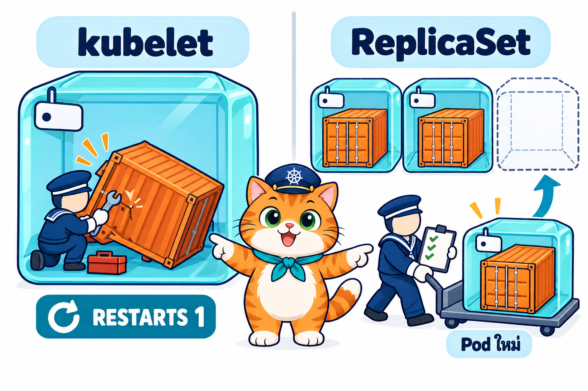
</p>

| เกิดอะไรขึ้น | ใครซ่อม | ผลลัพธ์ |
|---|---|---|
| container ใน Pod ล้ม | **kubelet** (บทที่ 2) | เริ่ม container ใหม่ **ใน Pod เดิม** → RESTARTS เพิ่ม |
| Pod ถูกลบ | **ReplicaSet** | สร้าง **Pod ใหม่** จากแม่พิมพ์ → ชื่อใหม่ IP ใหม่ |
| เรือล่ม (Node ตาย) | **ReplicaSet** | Pod บนเรือลำนั้นถูกนับว่าหายไป (รอราว 5 นาที) แล้วสร้างใหม่บนเรือลำอื่น |
| Pod เดี่ยวถูกลบ | **ไม่มีใคร** | หายถาวร |

> **⚠️ กับดัก:** ReplicaSet ไม่ได้ซ่อมแอปที่เขียนผิด ถ้าแอปพังทุกครั้งที่เริ่ม Pod จะค้าง `CrashLoopBackOff` ไปเรื่อย ๆ เพราะ Pod ยัง "อยู่" ครบจำนวน ReplicaSet จึงไม่ทำอะไร

---

## 7. Scale: เพิ่ม-ลดจำนวน Pod

<p align="center">
  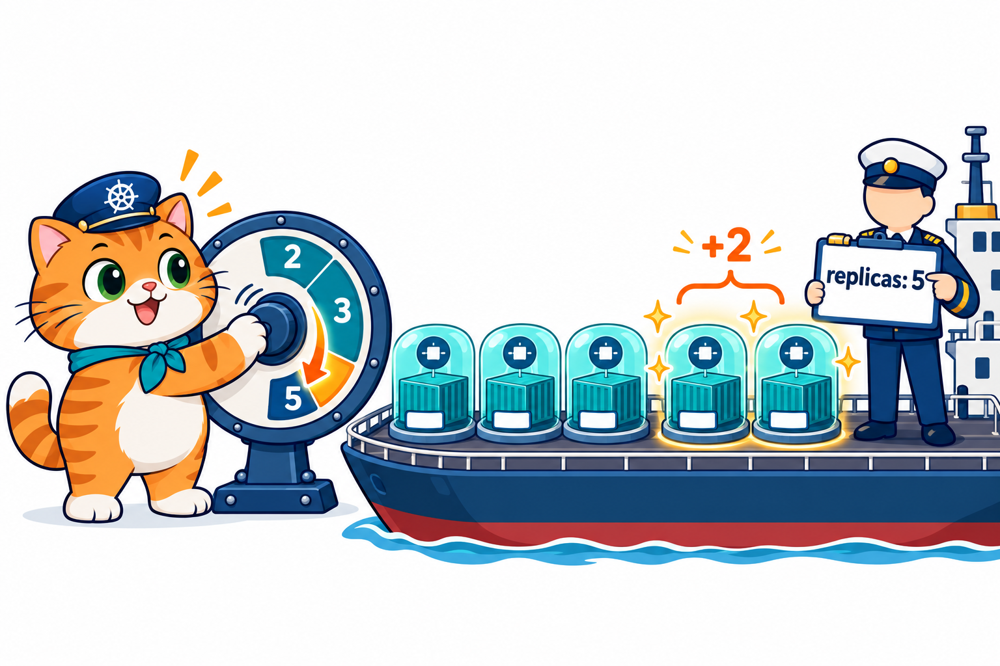
</p>

เปลี่ยนจำนวนได้ 2 วิธี

- **สั่งตรง:** `kubectl scale rs web --replicas=5` (LAB 2 ใช้วิธีนี้)
- **แก้ไฟล์:** เปลี่ยนเลข `replicas:` ในไฟล์แล้ว `kubectl apply -f` อีกครั้ง (ชื่อเดิม = แก้ตัวเดิม ได้ `configured`) วิธีนี้ตัวเลขในไฟล์กับในคลัสเตอร์ตรงกันเสมอ

ReplicaSet ทำแค่ส่วนต่าง

- **เพิ่ม** 3 → 5: Pod เดิมอยู่ครบ สร้างเพิ่มแค่ 2 ตัว
- **ลด** 5 → 2: ลบ 3 ตัวที่เกิน โดยเลือก **Pod ที่ยังไม่พร้อม และ Pod ที่อายุน้อยกว่า ก่อน**
- **ลดเหลือ 0**: Pod หายหมด แต่ ReplicaSet และแม่พิมพ์ยังอยู่ scale ขึ้นเมื่อไรก็ได้ Pod คืน

ตัวอย่างจาก LAB 2: scale 5 → 2

```text
$ kubectl scale rs web --replicas=2
replicaset.apps/web scaled

$ kubectl get pods
NAME        READY   STATUS      RESTARTS   AGE
web-2hpf5   0/1     Completed   0          6s     ← อายุน้อย ถูกลบก่อน
web-4jvnp   1/1     Running     0          15s
web-cq4b6   0/1     Completed   0          6s     ← อายุน้อย ถูกลบก่อน
web-lfsgc   1/1     Running     0          15s
web-m96xl   0/1     Completed   0          15s
```

`Completed` (หรือ `Terminating`) คือ Pod ที่กำลังถูกลบ รอสักครู่จะเหลือ 2 ตัว

> **⚠️ กับดัก: ไฟล์ชนะ** ถ้า `kubectl scale` ไปแล้ว มีคน `apply` ไฟล์ที่เขียน `replicas: 3` จำนวนจะกลับเป็น 3 ทันที (เจอใน LAB 2 และ LAB 4) ทีมจึงควรแก้ตัวเลขในไฟล์เป็นหลัก

---

## 8. Labels: ReplicaSet นับ Pod จากป้าย

<p align="center">
  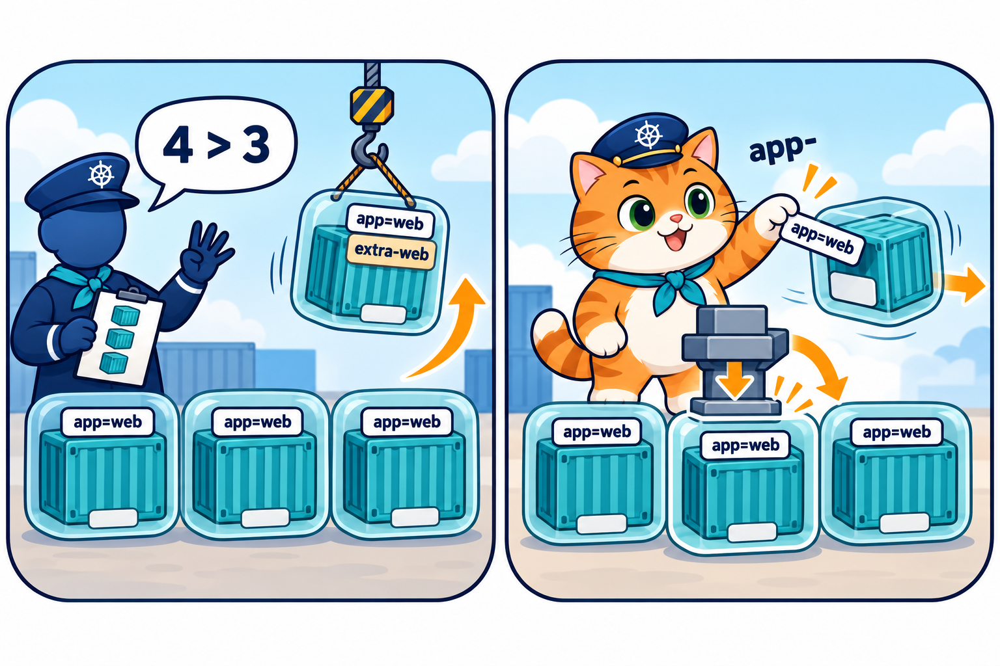
</p>

หัวหน้าลูกเรือ **ไม่ได้จำชื่อกล่อง** แต่นับจากป้าย ทุกรอบที่นับ ใครติดป้ายตรงกับ `selector` ก็นับหมด ผลที่ตามมามี 2 แบบ (LAB 2)

**1) Pod แปลกหน้าติดป้ายเดียวกัน → ถูกนับรวม**

ไฟล์ `labs/lab02-labels/extra-pod.yaml` เป็น Pod เดี่ยวชื่อ `extra-web` ที่ติดป้าย `app: web` apply ตอนที่มีอยู่แล้ว 3 ตัว หัวหน้านับได้ 4 เกินไป 1 จึงลบทิ้ง

```text
$ kubectl apply -f labs/lab02-labels/extra-pod.yaml
pod/extra-web created

$ kubectl get pods --show-labels
NAME        READY   STATUS        RESTARTS   AGE   LABELS
extra-web   0/1     Terminating   0          0s    app=web
web-4jvnp   1/1     Running       0          35s   app=web
web-7997h   1/1     Running       0          13s   app=web
web-lfsgc   1/1     Running       0          35s   app=web

$ kubectl describe rs web
...
  Normal  SuccessfulDelete  0s    replicaset-controller  Deleted pod: extra-web
```

**2) ถอดป้ายออก → Pod หลุดจากการดูแล**

`kubectl label pod web-4jvnp app-` (ขีด `-` ท้ายชื่อป้าย = ถอดป้าย) ทำให้หัวหน้านับได้ 2 จึงสร้างตัวใหม่มาเติม ส่วน `web-4jvnp` ยังรันอยู่ แต่ไม่มีเจ้าของแล้ว (ไม่มี `ownerReferences`)

```text
$ kubectl get pods --show-labels
NAME        READY   STATUS              RESTARTS   AGE   LABELS
web-4jvnp   1/1     Running             0          40s   <none>    ← หลุดจากการดูแล
web-7997h   1/1     Running             0          18s   app=web
web-lfsgc   1/1     Running             0          40s   app=web
web-sf5r5   0/1     ContainerCreating   0          0s    app=web   ← ตัวใหม่มาเติม
```

> **เคล็ดลับ:** การถอดป้ายใช้ **แยก Pod ที่มีปัญหาออกมาตรวจ** ได้ ร้านยังมีหน้าร้านครบ ส่วนตัวที่แยกออกมาเข้าไป `exec` / `logs` ได้สบาย ตรวจเสร็จแล้วลบเอง

**อย่าตั้งป้ายซ้ำกับคนอื่น** ถ้ามี ReplicaSet 2 ตัวใช้ selector เดียวกัน หรือมี Pod เดี่ยวติดป้ายซ้ำ จะนับ Pod ปนกันจนลบของกันและกัน ตั้งป้ายให้เฉพาะเจาะจง เช่น `app: som-menu` ไม่ใช่แค่ `app: web`

---

## 9. Pod กระจายบนหลายเรือ

<p align="center">
  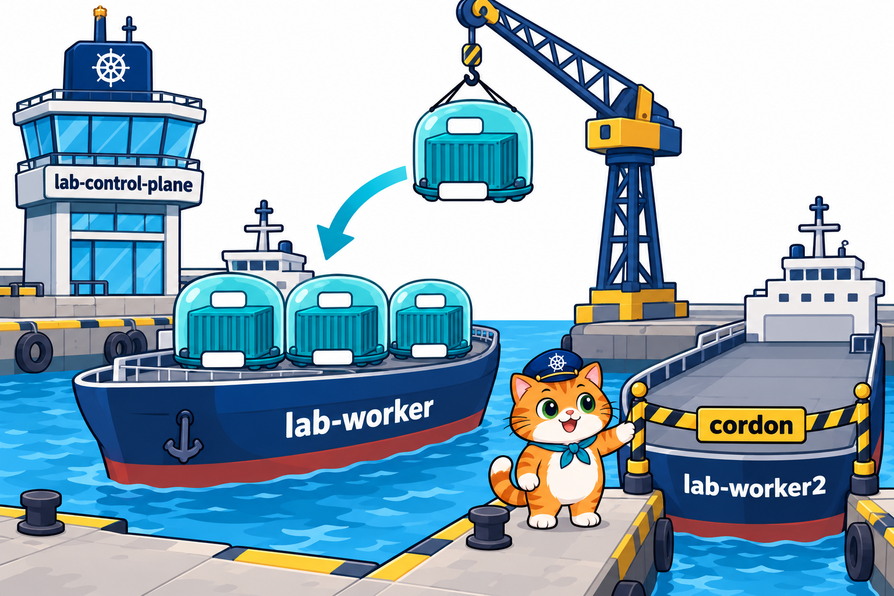
</p>

ReplicaSet บอกแค่ "ต้องมีกี่ตัว" ส่วน **kube-scheduler** เลือกเรือให้ทีละ Pod และพยายาม **กระจาย** ไปเรือที่ว่างกว่า (LAB 3)

```text
$ kubectl get pods -o wide
NAME        READY   STATUS    RESTARTS   AGE   IP            NODE
web-qrbzp   1/1     Running   0          8s    10.244.2.12   lab-worker
web-rjggc   1/1     Running   0          8s    10.244.1.7    lab-worker2
web-tft49   1/1     Running   0          8s    10.244.2.11   lab-worker
```

การกระจายช่วยให้ **เรือล่ม 1 ลำ ร้านยังเปิดอยู่** เพราะมีสาขาบนเรืออีกลำ

ถ้าเรือต้องเข้าอู่ซ่อม ติดป้าย "ห้ามรับกล่องใหม่" ได้

- `kubectl cordon lab-worker2` → node ขึ้น `Ready,SchedulingDisabled` Pod เดิมยังอยู่ แต่ Pod ใหม่ไปลงเรือลำอื่นหมด
- `kubectl uncordon lab-worker2` → กลับมารับ Pod ใหม่ได้

ใน LAB 3 cordon `lab-worker2` แล้วลบ Pod ทั้งหมด ตัวใหม่ 3 ตัวไปลง `lab-worker` หมด

```text
$ kubectl get pods -o wide
NAME        READY   STATUS    RESTARTS   AGE   IP            NODE
web-bf558   1/1     Running   0          6s    10.244.2.13   lab-worker
web-rxz6b   1/1     Running   0          6s    10.244.2.14   lab-worker
web-sfgcc   1/1     Running   0          6s    10.244.2.15   lab-worker
```

พอ uncordon แล้ว scale เป็น 5 มีแค่ 2 ตัวที่เกิดใหม่ (`web-5xqd6`, `web-tjt8g`) ที่ไปลง `lab-worker2` ส่วน 3 ตัวเดิมยังอยู่ `lab-worker`

> **ประโยคเดียวที่ต้องจำ:** **Pod ไม่ย้ายเรือเอง** เอาป้ายห้ามออกแล้ว Pod เดิมก็ยังอยู่ที่เดิม มีแค่ Pod ที่เกิดใหม่เท่านั้นที่จะไปลงเรือที่ว่าง

---

## 10. แก้แม่พิมพ์ แล้ว Pod เดิมเปลี่ยนไหม

<p align="center">
  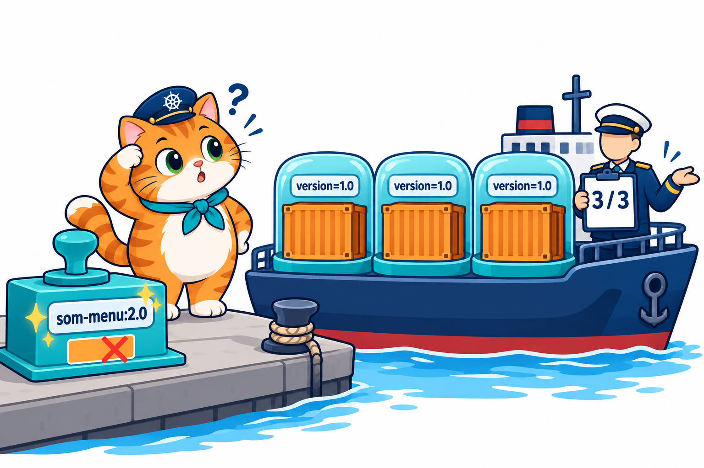
</p>

คำตอบคือ **ไม่เปลี่ยน** (LAB 4) ร้านน้องส้มเปิดอยู่ 5 สาขาด้วย `som-menu:1.0` แล้ว apply `som-menu-rs-v2.yaml` ที่เปลี่ยนแม่พิมพ์เป็น `som-menu:2.0` ได้ `configured`

```text
$ kubectl apply -f som-menu/k8s/som-menu-rs-v2.yaml
replicaset.apps/som-menu configured

$ kubectl get rs -o wide
NAME       DESIRED   CURRENT   READY   AGE   CONTAINERS   IMAGES         SELECTOR
som-menu   3         3         3       42s   web          som-menu:2.0   app=som-menu

$ kubectl get pods --show-labels
NAME             READY   STATUS    RESTARTS   AGE   LABELS
som-menu-fdfc4   1/1     Running   0          47s   app=som-menu,version=1.0
som-menu-pskr4   1/1     Running   0          25s   app=som-menu,version=1.0
som-menu-q8z8h   1/1     Running   0          47s   app=som-menu,version=1.0
```

เห็น 2 เรื่องพร้อมกัน

- แม่พิมพ์เป็น `som-menu:2.0` แล้ว แต่ Pod ที่เหลือ **ยังเป็น `version=1.0` ทุกตัว** เพราะหัวหน้าดูแค่ **จำนวน** นับได้ครบก็ไม่ทำอะไร แม่พิมพ์ใหม่ใช้ **ตอนสร้าง Pod ใหม่เท่านั้น**
- จาก 5 สาขาเหลือ 3 เพราะไฟล์เขียน `replicas: 3` (**ไฟล์ชนะ** หัวข้อ 7)

ถ้าอยากได้รุ่นใหม่ต้องลบ Pod เก่าเอง ใน LAB 4 ใช้ `kubectl delete pod -l version=1.0` แล้ว ReplicaSet สร้างตัวใหม่จากแม่พิมพ์ใหม่

```text
$ kubectl get pods --show-labels
NAME             READY   STATUS    RESTARTS   AGE   LABELS
som-menu-j2mk8   1/1     Running   0          7s    app=som-menu,version=2.0
som-menu-lc2vr   1/1     Running   0          7s    app=som-menu,version=2.0
som-menu-t7j2c   1/1     Running   0          7s    app=som-menu,version=2.0
```

แต่วิธีนี้มีปัญหา

- ลบทีละตัว → ร้านมี **สองรุ่นปนกัน** ระหว่างเปลี่ยน
- ลบพร้อมกันทุกตัวแบบ LAB 4 → มีช่วงที่ Pod **ไม่พร้อมสักตัว** (`0/1 ContainerCreating`) ร้านปิดชั่วขณะ
- ร้านมี 50 Pod ต้องลบ 50 ครั้งเอง และถ้ารุ่นใหม่พังก็ต้องแก้กลับเอง

> **ประโยคเดียวที่ต้องจำ:** ReplicaSet ดูแล **จำนวน** ไม่ได้ดูแล **เวอร์ชัน** งานเปลี่ยนเวอร์ชันทีละตัวอัตโนมัติเป็นของ **Deployment** ในบทถัดไป

---

## 11. อ่าน YAML ร้านน้องส้มหลายสาขาทั้งไฟล์

<p align="center">
  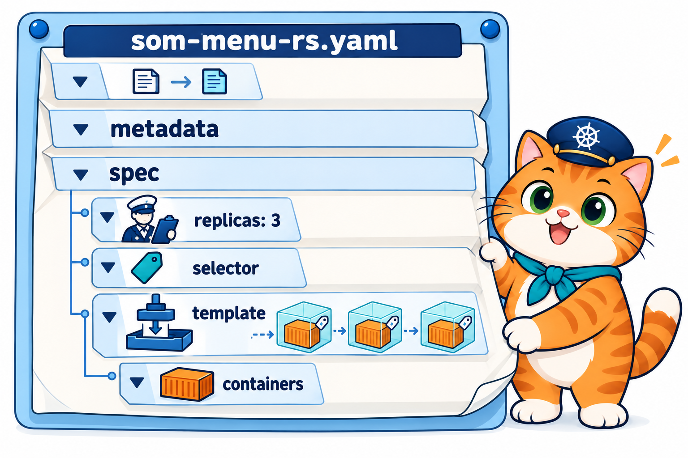
</p>

ไฟล์ `02_LAB/som-menu/k8s/som-menu-rs.yaml` (LAB 4) ยาวราว 40 บรรทัด ถ้าพับเหลือแค่โครงจะเหลือแค่นี้

```yaml
apiVersion: apps/v1
kind: ReplicaSet
metadata:
  name: som-menu            # ชื่อ ReplicaSet → Pod ชื่อ som-menu-xxxxx
  labels:                   # ป้ายของตัว ReplicaSet เอง (ไม่ใช่ป้ายที่ใช้นับ)
spec:
  replicas: 3               # 3 สาขา
  selector:                 # นับ Pod ที่มีป้าย app=som-menu
  template:                 # แม่พิมพ์ของทุกสาขา
    metadata:               # ป้ายของ Pod
    spec:
      containers:
        - name: web         # หน้าร้าน Node.js port 3000
```

แล้วค่อย ๆ เปิดดูทีละส่วน ส่วนที่อยู่ใน `containers` คือของที่เรียนในบทที่ 2 ทั้งหมด

```yaml
  template:
    metadata:
      labels:
        app: som-menu                # ← หัวข้อ 5.1: ต้องตรงกับ selector
        version: "1.0"               # ← หัวข้อ 10: ป้ายเสริมไว้ดูรุ่น (selector ไม่ได้ใช้)
    spec:
      containers:
        - name: web
          image: som-menu:1.0
          imagePullPolicy: IfNotPresent   # ← บทที่ 2: ใช้ image ที่ kind load ไว้
          env:                            # ← บทที่ 2 หัวข้อ 7.2
            - name: SHOP_NAME
              value: "ร้านอาหารแมวน้องส้ม"
          ports:
            - containerPort: 3000
          readinessProbe:                 # ← บทที่ 2 หัวข้อ 10: พร้อมรับลูกค้าเมื่อไร
            httpGet:
              path: /api/health
              port: 3000
            periodSeconds: 5
          livenessProbe:                  # ← บทที่ 2 หัวข้อ 10: ค้างนานเกิน → restart
            ...
          resources:                      # ← บทที่ 2 หัวข้อ 7.4: ทุกสาขาจองเท่ากัน
            requests: { cpu: 50m, memory: 64Mi }
            limits:   { cpu: 200m, memory: 128Mi }
```

ผลของ `readinessProbe` เห็นในคอลัมน์ `READY` ของ `kubectl get rs` ด้วย: ReplicaSet นับ READY เฉพาะสาขาที่ probe ผ่านแล้ว

ไฟล์ `som-menu-rs-v2.yaml` ต่างจากไฟล์นี้แค่ 2 บรรทัด คือ `version: "2.0"` และ `image: som-menu:2.0`

แปลทั้งไฟล์เป็นประโยคเดียว: **"ขอ ReplicaSet `som-menu` ดูแลหน้าร้าน 3 สาขาที่ติดป้าย `app=som-menu` ทุกสาขาใช้ image `som-menu:1.0` ฟัง port 3000 มี probe ตรวจ `/api/health` และจอง CPU 50m / memory 64Mi"**

---

## 12. เปิดเว็บของ ReplicaSet และบทถัดไป

<p align="center">
  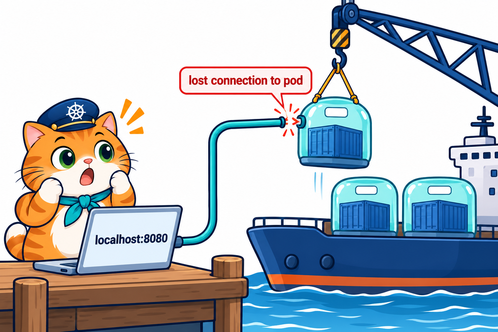
</p>

`kubectl port-forward rs/som-menu 8080:3000` ดูเหมือนต่อเข้า ReplicaSet แต่จริง ๆ kubectl **เลือก Pod มา 1 ตัว** แล้วต่อท่อเข้าตัวนั้น (LAB 4)

- ลูกค้าทุกคนที่เข้าผ่าน `localhost:8080` ไปที่ **สาขาเดียว** แม้จะมีหลายสาขา (ดูชื่อสาขาบนหน้าเว็บหรือ `kubectl logs` ได้)
- ลบ Pod ตัวนั้น → ReplicaSet สร้างตัวใหม่ แต่ **ท่อขาด** ต้องรัน port-forward ใหม่เอง

ผลจริงใน LAB 4 หลังลบ Pod `som-menu-7vhqr` ที่กำลังเปิดดูอยู่ (ตัดบรรทัด error ยาวออก)

```text
Forwarding from 127.0.0.1:8080 -> 3000
Handling connection for 8080
...
error: lost connection to pod
```

<p align="center">
  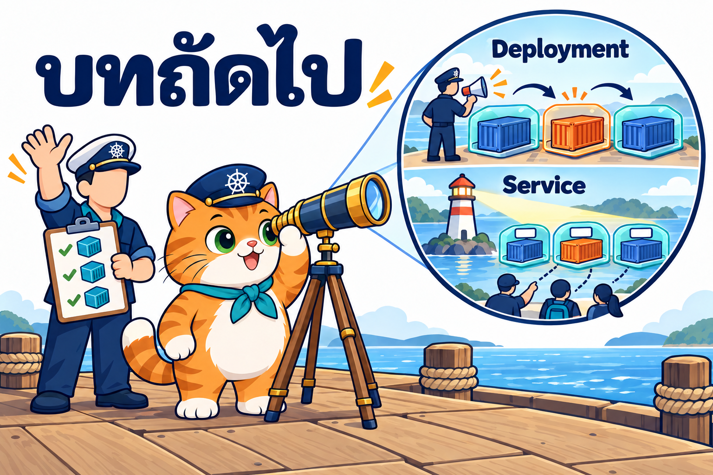
</p>

ปัญหาที่น้องส้มเจอในบทนี้ บทถัดไปมีทางแก้

- แก้แม่พิมพ์แล้วต้องลบ Pod เก่าเองทีละตัว → **Deployment** เปลี่ยนเวอร์ชันทีละ Pod อัตโนมัติ (rolling update) และย้อนกลับได้
- port-forward ไปสาขาเดียว และหลุดเมื่อ Pod หาย → **Service** ให้ที่อยู่เดียวที่คงที่ กระจายลูกค้าไปทุกสาขา
- ในงานจริงแทบไม่สร้าง ReplicaSet เอง แต่สร้าง **Deployment** ซึ่งจะสร้าง ReplicaSet ให้อีกที ความรู้บทนี้จึงใช้อ่านสิ่งที่ Deployment ทำเบื้องหลัง

---

## 13. สรุปและคำถามทบทวน

<p align="center">
  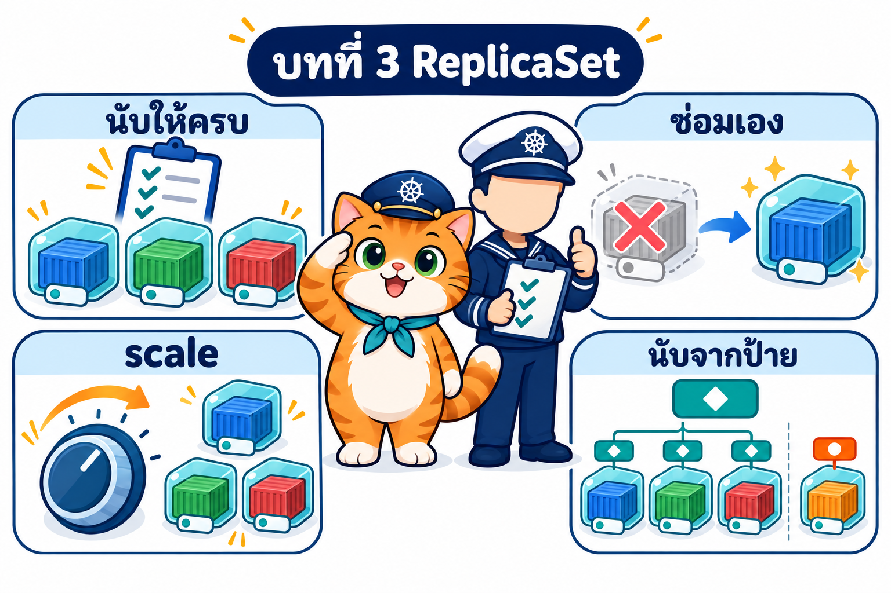
</p>

### สรุป

1. **ReplicaSet** ดูแลให้มี Pod หน้าตาเหมือนกันครบ `replicas` ตัวตลอดเวลา
2. ทำงานด้วยวงจร **นับ → เทียบ → แก้** โดย replicaset-controller ใน kube-controller-manager
3. YAML ใช้ `apiVersion: apps/v1` มี 3 ส่วนสำคัญ: `replicas`, `selector`, `template` (template = Pod ที่ซ้อนอยู่ข้างใน)
4. ป้ายใน `template.metadata.labels` **ต้องตรงกับ** `selector` และ selector แก้ไม่ได้หลังสร้าง
5. Pod ชื่อ `<ชื่อ ReplicaSet>-<สุ่ม>` มี `ownerReferences` ชี้กลับ ลบ ReplicaSet แล้ว Pod ลูกหายตาม
6. Pod ถูกลบ → ReplicaSet สร้าง **Pod ใหม่** (ชื่อใหม่ IP ใหม่) / container ล้ม → kubelet restart ใน Pod เดิม
7. `kubectl scale` หรือแก้ `replicas` ในไฟล์ ลดจำนวนจะลบตัวที่อายุน้อยก่อน และ **ไฟล์ชนะ** ถ้า apply ทีหลัง
8. ReplicaSet **นับจากป้าย** Pod แปลกหน้าที่ติดป้ายตรงถูกนับรวม ถอดป้ายแล้ว Pod หลุดจากการดูแล
9. kube-scheduler กระจาย Pod ไปหลายเรือ `cordon` / `uncordon` ปิด-เปิดรับ Pod ใหม่ และ Pod ไม่ย้ายเรือเอง
10. แก้แม่พิมพ์แล้ว Pod เดิม **ไม่เปลี่ยน** และ port-forward ต่อได้แค่ Pod เดียว → บทหน้า **Deployment** และ **Service**

### คำถามทบทวน

**1. ใน LAB 1 ลบ Pod `web-l96sh` แล้วได้ `web-fkf8z` มาแทน Pod ตัวใหม่เป็นตัวเดิมที่ฟื้นขึ้นมาหรือไม่ ดูจากอะไร**

<details>
<summary>แนวคำตอบ</summary>

ไม่ใช่ เป็น Pod ใหม่ที่ ReplicaSet สร้างจากแม่พิมพ์ ดูจากชื่อที่ต่างกัน, AGE ที่เพิ่งเริ่ม (`2s`) และ IP ใหม่ (`10.244.2.4`)
</details>

**2. ในไฟล์ ReplicaSet นี้ `spec` บรรทัดไหนเป็นของ ReplicaSet บรรทัดไหนเป็นของ Pod และ container ชื่ออะไร**

```yaml
spec:
  replicas: 2
  selector:
    matchLabels:
      app: cat
  template:
    metadata:
      labels:
        app: cat
    spec:
      containers:
        - name: meow
          image: nginx:1.27-alpine
```

<details>
<summary>แนวคำตอบ</summary>

`spec:` บรรทัดแรก (ไม่เยื้อง) เป็นของ ReplicaSet ส่วน `spec:` ที่อยู่ใต้ `template:` เป็นของ Pod มี container 1 ตัวชื่อ `meow`
</details>

**3. YAML ต่อไปนี้ผิดกี่จุด อะไรบ้าง**

```text
apiVersion: v1
kind: Replicaset
metadata:
  name: som-menu
spec:
  replicas: "3"
  selector:
    matchLabels:
      app: som-menu
  template:
    metadata:
      labels:
        app: menu
  containers:
    - name: web
      image: som-menu:1.0
```

<details>
<summary>แนวคำตอบ</summary>

1. `apiVersion: v1` ต้องเป็น `apps/v1`
2. `kind: Replicaset` ต้องเป็น `ReplicaSet`
3. `replicas: "3"` ต้องเป็นตัวเลข `replicas: 3`
4. ป้ายในแม่พิมพ์ `app: menu` ไม่ตรงกับ selector `app: som-menu`
5. `containers` ต้องอยู่ใต้ `template.spec` ไม่ใช่ใต้ `spec` ของ ReplicaSet
</details>

**4. `kubectl get rs` แสดงผลแบบนี้ แปลว่าอะไร ควรตรวจอะไรต่อ**

```text
NAME       DESIRED   CURRENT   READY   AGE
som-menu   3         3         1       2m
```

<details>
<summary>แนวคำตอบ</summary>

ReplicaSet สร้าง Pod ครบ 3 ตัวแล้ว (CURRENT = 3) แต่พร้อมแค่ 1 ตัว อีก 2 ตัวยังไม่ผ่าน readinessProbe หรือกำลังพัง ให้ `kubectl get pods` ดู STATUS (เช่น `ImagePullBackOff`, `CrashLoopBackOff`) แล้ว `kubectl describe pod` / `kubectl logs` ตัวที่ไม่พร้อม
</details>

**5. ถ้าแอปใน Pod ของ ReplicaSet ค้าง `CrashLoopBackOff` ReplicaSet จะลบแล้วสร้าง Pod ใหม่ให้หรือไม่**

<details>
<summary>แนวคำตอบ</summary>

ไม่ เพราะ Pod ยังอยู่ครบจำนวน ReplicaSet นับได้ครบแล้วจึงไม่ทำอะไร ส่วน kubelet จะ restart container ใน Pod เดิมไปเรื่อย ๆ ต้องแก้ที่ตัวแอปหรือ image
</details>

**6. มี ReplicaSet `web` (replicas: 3) รันอยู่ แล้วสร้าง Pod เดี่ยวที่ติดป้าย `app: web` เพิ่ม จะเกิดอะไรขึ้น**

<details>
<summary>แนวคำตอบ</summary>

ReplicaSet นับได้ 4 ตัว เกิน 1 จึงลบทิ้ง 1 ตัว (ใน LAB 2 คือ `extra-web` ที่เพิ่งเกิด) ดูได้จาก Event `SuccessfulDelete`
</details>

**7. `kubectl scale rs web --replicas=5` แล้วมีคน `kubectl apply -f web-rs.yaml` (replicas: 3) ผลคืออะไร**

<details>
<summary>แนวคำตอบ</summary>

จำนวนกลับเป็น 3 เพราะ apply ส่งค่า `replicas: 3` จากไฟล์ทับไป ReplicaSet ลบ 2 ตัวที่อายุน้อยที่สุด ไฟล์ชนะเสมอถ้า apply ทีหลัง
</details>

**8. `kubectl cordon lab-worker2` แล้วลบ Pod ทั้งหมด จากนั้น `uncordon` Pod จะย้ายกลับมาที่ `lab-worker2` หรือไม่**

<details>
<summary>แนวคำตอบ</summary>

ไม่ย้าย Pod ที่สร้างตอน cordon อยู่ `lab-worker` หมดและอยู่ที่นั่นต่อไป Pod ไม่ย้ายเรือเอง มีแค่ Pod ที่เกิดใหม่หลัง uncordon (เช่นตอน scale เพิ่ม) ที่อาจไปลง `lab-worker2`
</details>

**9. แก้ `image` ในแม่พิมพ์เป็นรุ่นใหม่แล้ว apply ได้ `configured` ทำไม Pod ยังเป็นรุ่นเก่า ต้องทำอย่างไร**

<details>
<summary>แนวคำตอบ</summary>

ReplicaSet ดูแค่จำนวน นับได้ครบแล้วจึงไม่สร้างใหม่ แม่พิมพ์ใหม่ใช้กับ Pod ที่เกิดใหม่เท่านั้น ต้องลบ Pod เก่าเอง (ใน LAB 4 ใช้ `kubectl delete pod -l version=1.0`) แล้ว ReplicaSet จะสร้างตัวใหม่จากแม่พิมพ์ใหม่
</details>

**10. ใน LAB 4 ทำไมลบ Pod ที่กำลังเปิดดูอยู่แล้ว browser เปิดร้านไม่ได้ ทั้งที่ ReplicaSet สร้าง Pod ใหม่ทันที**

<details>
<summary>แนวคำตอบ</summary>

`port-forward rs/som-menu` เลือก Pod มาแค่ 1 ตัวแล้วต่อท่อเข้าตัวนั้น Pod หายท่อก็ขาด (`lost connection to pod`) ไม่ได้ย้ายไป Pod ใหม่ให้ ต้องรัน port-forward ใหม่ บทหน้าใช้ Service แก้
</details>

---

## เอกสารอ้างอิง

- Kubernetes Docs: [ReplicaSet](https://kubernetes.io/docs/concepts/workloads/controllers/replicaset/) · [Controllers](https://kubernetes.io/docs/concepts/architecture/controller/) · [Owners and Dependents](https://kubernetes.io/docs/concepts/overview/working-with-objects/owners-dependents/)
- Kubernetes Docs: [Labels and Selectors](https://kubernetes.io/docs/concepts/overview/working-with-objects/labels/) · [Safely Drain a Node (cordon)](https://kubernetes.io/docs/tasks/administer-cluster/safely-drain-node/) · [Deployments](https://kubernetes.io/docs/concepts/workloads/controllers/deployment/)
- [kubectl scale](https://kubernetes.io/docs/reference/kubectl/generated/kubectl_scale/) · [kind: Loading an Image Into Your Cluster](https://kind.sigs.k8s.io/docs/user/quick-start/#loading-an-image-into-your-cluster)

> ภาพประกอบในโฟลเดอร์ [`images/`](images/) สร้างด้วย AI เพื่อการเรียนการสอน (prompt อยู่ใน [`images/imagegen-prompts.md`](images/imagegen-prompts.md)) ผลลัพธ์คำสั่งมาจาก LAB จริงบน kind v0.33.0 / Kubernetes v1.37.0 ค่า IP, AGE, ชื่อ Pod และชื่อ Node ในเครื่องผู้เรียนอาจต่างกัน
