# LAB บทที่ 3: Kubernetes ReplicaSet — ร้านน้องส้มเปิดหลายสาขา

> **รายวิชา:** Software Development Tools and Environments (DevTools)
> **หัวข้อ:** ปฏิบัติการ Kubernetes ReplicaSet — replicas, selector, template, self-healing, scale, labels, การกระจาย Pod บนหลาย Node และร้านหลายสาขาด้วย ReplicaSet
> **ผลลัพธ์การเรียนรู้ที่เกี่ยวข้อง:** CLO-5, CLO-6
> **ทฤษฎีประกอบ:** [01_Theory/README.md](../01_Theory/README.md)

---

## บทนำ

ทุก LAB ทำ **ใน container `k8s-lab`** (image `tuchsanai/devtools-kind:2569_1` มี kubectl, kind, helm, k9s และ Docker ข้างในครบ) บทที่แล้วเราสร้าง Pod ทีละตัว ลบแล้วก็หายไปเลย บทนี้ให้ **ReplicaSet** ช่วยดูแลจำนวน Pod ให้ครบเสมอ ตั้งแต่ ReplicaSet แรก ลอง "ฆ่า" Pod ดูว่าเกิดอะไร เพิ่ม-ลดจำนวน ดูว่ามันนับ Pod จากป้ายอย่างไร จนถึงเปิด **"ร้านอาหารแมวน้องส้มหลายสาขา"** ที่มีหน้าร้านหลาย Pod

> บล็อก **Expected output** คือผลที่ควรเห็นหลังรันคำสั่ง (ไม่ต้องพิมพ์ตาม) มาจากการทดลองจริงเมื่อ 18 ต.ค. 2569 (kind v0.33.0, kubectl v1.37.1, Kubernetes v1.37.0) **ชื่อ Pod ถูกสุ่มท้ายชื่อทุกครั้ง** (เช่น `web-l96sh`) ค่า AGE, IP และ Node ในเครื่องนักศึกษาจะต่างไป เป็นเรื่องปกติ

| สัญลักษณ์ | รันที่ไหน |
|---|---|
| 🖥️ | Terminal/PowerShell บนเครื่องนักศึกษา |
| 🐧 | SSH session ใน k8s-lab (prompt `root@k8s-lab`) |
| 🌐 | browser บนเครื่องนักศึกษา |

ทุก LAB มี **ภาพแผนการทดลอง** บอกว่า LAB นั้นมีกี่การทดลอง และทุกขั้นเริ่มด้วย 2 บรรทัดนี้ อ่านก่อนพิมพ์คำสั่ง

- 🎯 **เป้าหมายขั้นนี้** = ขั้นนี้ทดลองเพื่อพิสูจน์หลักการอะไร (มีลิงก์ไปหัวข้อทฤษฎีที่เกี่ยวข้อง)
- 🔍 **สังเกต** = ตอนดูผลลัพธ์ให้มองหาอะไร ถ้าเห็นตามนี้ แปลว่าหลักการนั้นเป็นจริง

### กติกา

- ทำงานในโฟลเดอร์ `/workspace/DevTools/05_kubernetes/003_kubernetes_Replicaset/02_LAB` และ **ลบ ReplicaSet ของตัวเองทุกครั้งที่จบ LAB**
- **ชื่อ Pod ในเครื่องแต่ละคนไม่เหมือนกัน** คำสั่งที่มี `# ← เปลี่ยนเป็นชื่อ Pod ของตัวเอง` ให้แทนชื่อ Pod ด้วยชื่อที่เห็นจาก `kubectl get pods` ในเครื่องตัวเอง
- ใช้แค่ ReplicaSet กับ Pod เข้าถึงแอปด้วย `kubectl port-forward` + แท็บ PORTS ของ VS Code (Deployment และ Service เป็นของบทถัดไป)

## สารบัญ LAB

| LAB | ชื่อ | เวลาโดยประมาณ | ความยาก |
|:---:|---|:---:|:---:|
| 0 | [เตรียมสภาพแวดล้อม (Setup)](#lab-0-เตรียมสภาพแวดล้อม-setup) (container `k8s-lab` + คลัสเตอร์ + git clone) | 20–30 นาที | ⭐ |
| 1 | [ReplicaSet แรก + self-healing](#lab-1-replicaset-แรก--self-healing) | 25 นาที | ⭐⭐ |
| 2 | [Scale และ Labels/Selector](#lab-2-scale-และ-labelsselector) | 25 นาที | ⭐⭐⭐ |
| 3 | [Pod กระจายบนหลาย Node](#lab-3-pod-กระจายบนหลาย-node) | 15 นาที | ⭐⭐⭐ |
| 4 | [LAB สุดท้าย: ร้านอาหารแมวน้องส้มหลายสาขา](#lab-4-lab-สุดท้าย-ร้านอาหารแมวน้องส้มหลายสาขา) | 45–60 นาที | ⭐⭐⭐⭐⭐ |
| – | [เก็บกวาดหลังจบบท](#เก็บกวาดหลังจบบท) · [สรุปคำสั่ง kubectl ในบทนี้](#สรุปคำสั่ง-kubectl-ในบทนี้) | | |

รวมประมาณ 2.5–3 ชั่วโมง (เครื่องช้าหรือเน็ตช้าอาจนานกว่านี้ เพราะต้องดึง image จาก Docker Hub)

### สารบัญรูปภาพ

| รูปที่ | เรื่อง | รูปที่ | เรื่อง |
|:---:|---|:---:|---|
| 1 | [LAB 0 Setup container และคลัสเตอร์](#fig-1) | 9 | [LAB 4 ร้านน้องส้มหลายสาขา](#fig-9) |
| 2 | [LAB 0 git clone](#fig-2) | 10 | [แผนการทดลอง LAB 4](#fig-10) |
| 3 | [LAB 1 ReplicaSet แรก + self-healing](#fig-3) | 11 | [LAB 4 attach VS Code เข้า k8s-lab](#fig-11) |
| 4 | [แผนการทดลอง LAB 1](#fig-4) | 12 | [LAB 4 เปิดเว็บผ่าน VS Code PORTS](#fig-12) |
| 5 | [LAB 2 scale และ selector นับ Pod จากป้าย](#fig-5) | 13 | [ภาพหน้าจอจริง: หน้าร้านเวอร์ชัน 1.0](#fig-13) |
| 6 | [แผนการทดลอง LAB 2](#fig-6) | 14 | [port-forward หลุดเมื่อ Pod ถูกลบ](#fig-14) |
| 7 | [LAB 3 cordon เรือ lab-worker2](#fig-7) | 15 | [ภาพหน้าจอจริง: หน้าร้านเวอร์ชัน 2.0](#fig-15) |
| 8 | [แผนการทดลอง LAB 3](#fig-8) | | |

### โครงสร้างไฟล์ LAB

```text
02_LAB/
├── README.md                     ← เอกสารนี้
├── images/                       ← ภาพประกอบ + screenshots/ ภาพหน้าจอจริงของร้าน
├── labs/
│   ├── lab01-first-rs/web-rs.yaml   ← ใช้ใน LAB 1, 2, 3
│   └── lab02-labels/extra-pod.yaml  ← ใช้ใน LAB 2
└── som-menu/
    ├── app/                      ← เว็บหน้าร้าน Node.js (server.js + Dockerfile)
    └── k8s/{som-menu-rs,som-menu-rs-v2}.yaml
```

---

## LAB 0: เตรียมสภาพแวดล้อม (Setup)

**เป้าหมาย:** สร้าง container `k8s-lab` และคลัสเตอร์ kind ชื่อ `lab` (1 control-plane + 2 worker) แล้วดึงไฟล์ LAB มาไว้ใน container (รายละเอียดของแต่ละคำสั่งดูได้จาก [LAB บทที่ 1](../../001_kubernetes-introduction/02_LAB/readme.md))

**ต้องมี:** Docker Desktop (Linux containers, RAM อย่างน้อย 4 GB) และ SSH client

> ถ้ายังมี container `k8s-lab` จากบทที่ 2 อยู่ ใช้ต่อได้เลย: 🖥️ `docker start k8s-lab` → SSH เข้าไป (ข้อ 2) → `k8s-up` (ถ้าคลัสเตอร์ยังอยู่จะข้ามการสร้าง) แล้วไปขั้นที่ 2

### ขั้นที่ 1: Setup container และคลัสเตอร์

<p align="center" id="fig-1">
  <br>
  <em><b>รูปที่ 1</b> LAB0 ขั้นที่ 1: (1) docker run สร้าง container k8s-lab (2) ssh -p 2223 เข้าไปข้างใน (3) รัน k8s-up สร้าง kind cluster ชื่อ lab ได้ 3 node Ready (control-plane 1 ตัว + worker 2 ตัว)</em>
</p>

**1) สร้าง container** 🖥️ **บนเครื่องนักศึกษา** (image ประมาณ 1.5 GB ครั้งแรกใช้เวลาหลายนาที)

```bash
docker pull tuchsanai/devtools-kind:2569_1
```

```bash
docker run -dit --name k8s-lab --hostname k8s-lab --privileged -p 2223:22 -p 8889:8888 tuchsanai/devtools-kind:2569_1
```

- `--privileged` ให้รัน Docker ซ้อนใน container ได้ (kind ต้องใช้) **ขาดไม่ได้**
- `-p 2223:22` เปิดทาง SSH เข้า container ผ่าน port `2223`
- `-p 8889:8888` เปิด JupyterLab ที่ `http://localhost:8889/lab` (ทางเลือก)

หลัง `docker run` **รอสัก 5–10 วินาที** ให้ container เริ่ม sshd และ dockerd ข้างในให้เสร็จก่อน

**2) SSH เข้า container** 🖥️ ครั้งแรกพิมพ์ `yes` แล้วใส่รหัสผ่าน `passwd`

```bash
ssh -p 2223 root@localhost
```

**3) สร้างและตรวจคลัสเตอร์** 🐧 **ใน SSH session ของ k8s-lab** (prompt `root@k8s-lab:~#`)

```bash
time k8s-up
```

**Expected output** (ตัดเฉพาะส่วนสำคัญ)

<pre>
...
[k8s-up] cluster 'lab' พร้อมใช้งาน (kubectl context: kind-lab)
...
real	0m33.723s
</pre>

`k8s-up` สร้างคลัสเตอร์ใช้เวลาราว 30 วินาที – 1 นาที ข้อความเรื่อง NodePort ท้าย `k8s-up` ข้ามได้

```bash
kubectl get nodes
```

**Expected output**

<pre>
NAME                STATUS   ROLES           AGE   VERSION
lab-control-plane   Ready    control-plane   27s   v1.37.0
lab-worker          Ready    &lt;none&gt;          12s   v1.37.0
lab-worker2         Ready    &lt;none&gt;          12s   v1.37.0
</pre>

```bash
kubectl get pods -A
```

**Expected output**

<pre>
NAMESPACE            NAME                                        READY   STATUS    RESTARTS   AGE
kube-system          coredns-559f6c778d-8n2pp                    1/1     Running   0          17s
kube-system          coredns-559f6c778d-9wcnv                    1/1     Running   0          17s
kube-system          etcd-lab-control-plane                      1/1     Running   0          26s
kube-system          kindnet-2m5d7                               1/1     Running   0          12s
kube-system          kindnet-hbkzc                               1/1     Running   0          12s
kube-system          kindnet-jdjhz                               1/1     Running   0          17s
kube-system          kube-apiserver-lab-control-plane            1/1     Running   0          25s
kube-system          kube-controller-manager-lab-control-plane   1/1     Running   0          25s
kube-system          kube-proxy-2s4xc                            1/1     Running   0          17s
kube-system          kube-proxy-b7xhl                            1/1     Running   0          12s
kube-system          kube-proxy-pp5kw                            1/1     Running   0          12s
kube-system          kube-scheduler-lab-control-plane            1/1     Running   0          25s
local-path-storage   local-path-provisioner-75f7fc7dc5-f8d7b     1/1     Running   0          17s
</pre>

`kube-controller-manager` คือตัวที่มี **ReplicaSet controller** อยู่ข้างใน เป็นคนคอยนับและสร้าง Pod ให้ในบทนี้ (ถ้าบาง Pod ยัง `0/1` ให้รอสักครู่แล้วสั่งซ้ำ)

> **✅ ผ่านเมื่อ:** node 3 ตัว `Ready` และ Pod ระบบทุกตัวเป็น `Running`

### ขั้นที่ 2: git clone ไฟล์ LAB

<p align="center" id="fig-2">
  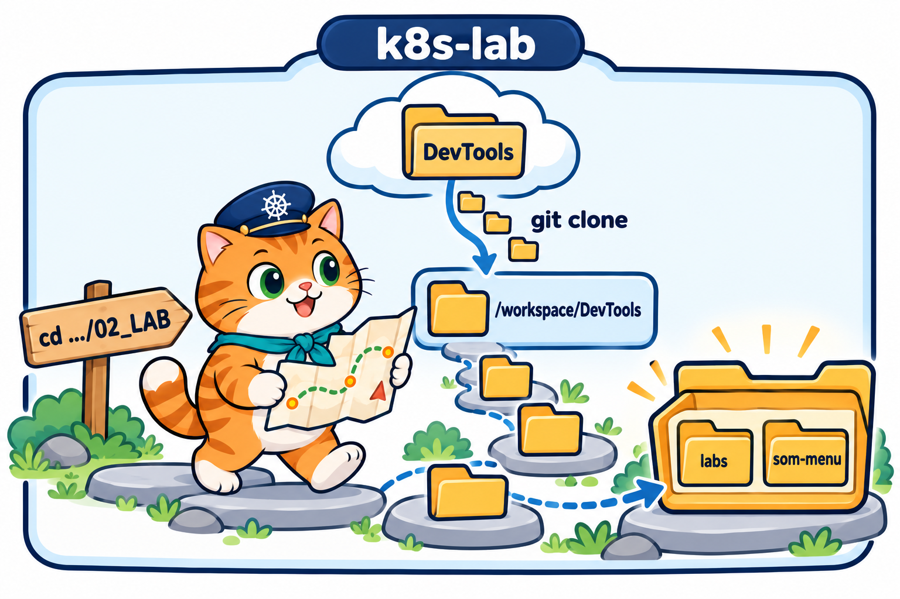<br>
  <em><b>รูปที่ 2</b> LAB0 ขั้นที่ 2: git clone ดึง repo DevTools มาไว้ที่ /workspace/DevTools ใน k8s-lab แล้ว cd ลงไปจนถึงโฟลเดอร์ 02_LAB ของบทที่ 3 ที่มี labs และ som-menu</em>
</p>

🐧 **ใน SSH session ของ k8s-lab**

```bash
cd /workspace
```

```bash
git clone https://github.com/Tuchsanai/DevTools.git
```

ถ้าเคย clone ไว้แล้วในบทที่ 2 จะขึ้นว่า `already exists` ให้ `cd DevTools` แล้ว `git pull` แทน จากนั้น `cd /workspace`

```bash
cd DevTools/05_kubernetes/003_kubernetes_Replicaset/02_LAB
```

> **✅ ผ่านเมื่อ:** prompt เป็น `root@k8s-lab:/workspace/DevTools/05_kubernetes/003_kubernetes_Replicaset/02_LAB#` ทุกคำสั่งที่อ้าง `labs/...` หรือ `som-menu/...` ต้องรันจากโฟลเดอร์นี้

---

## LAB 1: ReplicaSet แรก + self-healing

<p align="center" id="fig-3">
  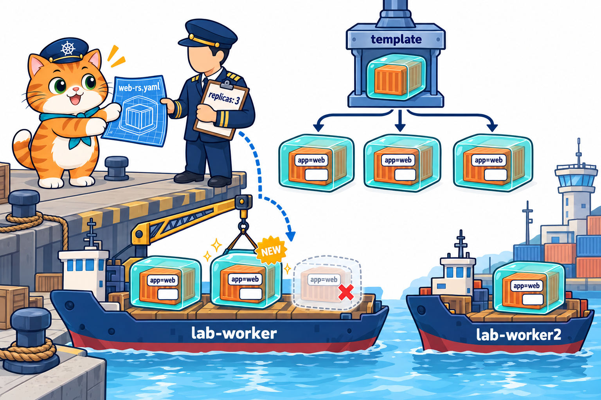<br>
  <em><b>รูปที่ 3</b> LAB1: ส่งไฟล์ web-rs.yaml ให้ ReplicaSet web (replicas: 3) สร้าง Pod จากแม่พิมพ์ (template) ให้ครบ 3 ตัว เมื่อ Pod ตัวหนึ่งถูกลบ ReplicaSet สร้างตัวใหม่แทนทันที</em>
</p>

**เป้าหมาย:** สร้าง ReplicaSet จากไฟล์ YAML ดูว่ามันสร้าง Pod ให้กี่ตัว ชื่ออะไร Pod รู้ได้อย่างไรว่าใครเป็นเจ้าของ แล้วลองลบ Pod ดูว่าเกิดอะไร (self-healing)

<p align="center" id="fig-4">
  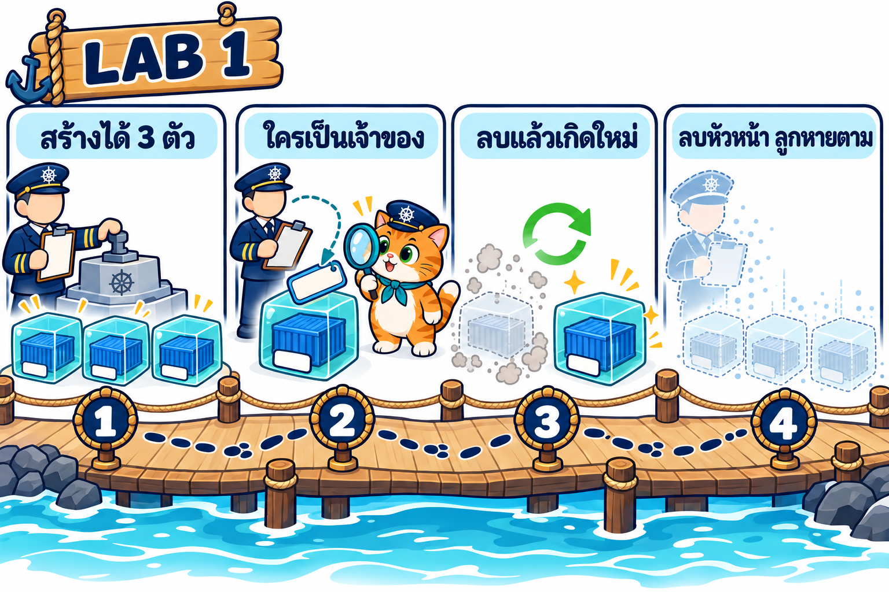<br>
  <em><b>รูปที่ 4</b> แผนการทดลอง LAB1 มี 4 การทดลอง: (1) ขั้นที่ 1–4 ส่งไฟล์เดียวได้ Pod 3 ตัว (2) ขั้นที่ 5 Pod รู้ว่าใครเป็นเจ้าของ (3) ขั้นที่ 6–7 ลบ Pod แล้วเกิดตัวใหม่แทน (4) ขั้นที่ 8 ลบ ReplicaSet แล้ว Pod ลูกหายตาม</em>
</p>

🐧 **ใน SSH session ของ k8s-lab** (ทุกขั้นใน LAB 1–3)

### ขั้นที่ 1: ไฟล์ ReplicaSet แรก

> 🎯 **เป้าหมายขั้นนี้:** รู้จัก 3 ส่วนของ ReplicaSet (`replicas` / `selector` / `template`) ก่อนลงมือ จะได้รู้ว่าผลแต่ละขั้นมาจากบรรทัดไหน ([ทฤษฎีหัวข้อ 4](../01_Theory/README.md#4-อ่าน-yaml-ของ-replicaset-ทีละบรรทัด))
>
> 🔍 **สังเกต:** ป้าย `app: web` ใน `template` ตรงกับ `selector` ทุกตัวอักษร

ไฟล์ `labs/lab01-first-rs/web-rs.yaml` (เปิดดูได้ใน VS Code หรือ JupyterLab)

```yaml
# LAB 1, 2, 3: ReplicaSet แรก — ขอ Pod nginx 3 ตัว แล้วให้ ReplicaSet คอยดูแลให้ครบเสมอ
apiVersion: apps/v1          # ReplicaSet อยู่กลุ่ม apps รุ่น v1 (Pod ใช้แค่ v1)
kind: ReplicaSet
metadata:
  name: web                  # ชื่อ ReplicaSet → Pod ที่สร้างจะชื่อ web-xxxxx
spec:
  replicas: 3                # อยากได้ Pod 3 ตัวตลอดเวลา
  selector:                  # วิธีนับว่า Pod ตัวไหนเป็นของเรา: ดูจากป้าย label
    matchLabels:
      app: web
  template:                  # แม่พิมพ์ Pod — ข้างในคือ Pod จากบทที่ 2 (ไม่มี apiVersion/kind)
    metadata:
      labels:
        app: web             # ต้องตรงกับ selector ไม่งั้น apply ไม่ผ่าน
    spec:
      containers:
        - name: nginx
          image: nginx:1.27-alpine
          ports:
            - containerPort: 80
```

ทำงานอย่างไร

- `kind: ReplicaSet` ใน `apiVersion: apps/v1` = ขอ "คนคุมจำนวน Pod" ไม่ใช่ขอ Pod ตรง ๆ
- `replicas: 3` = **จำนวน** Pod ที่อยากได้ตลอดเวลา
- `selector` = **ป้ายที่ใช้นับ** ReplicaSet นับว่ามี Pod ที่ติดป้าย `app: web` อยู่กี่ตัว
- `template` = **แม่พิมพ์ Pod** ข้างในหน้าตาเหมือน Pod YAML ของบทที่ 2 (แค่ไม่มี `apiVersion`/`kind`/`name`) ขาดเมื่อไรก็ปั๊ม Pod ใหม่จากแม่พิมพ์นี้
- ป้ายใน `template` (`app: web`) **ต้องตรงกับ selector** ไม่งั้น Pod ที่ปั๊มออกมาจะไม่ถูกนับ และ apply ไม่ผ่าน

### ขั้นที่ 2: สร้าง ReplicaSet

> 🎯 **เป้าหมายขั้นนี้:** ทดสอบว่า **ส่งไฟล์ ReplicaSet ไฟล์เดียว ได้ Pod ตามจำนวน `replicas`** โดยไม่ต้องเขียน Pod เอง ([ทฤษฎีหัวข้อ 2](../01_Theory/README.md#2-replicaset-คืออะไร) · [ทฤษฎีหัวข้อ 3](../01_Theory/README.md#3-replicaset-ทำงานอย่างไร))
>
> 🔍 **สังเกต:** `DESIRED` เป็น 3 และมี Pod 3 ตัวชื่อ `web-xxxxx` ทั้งที่เราไม่ได้ตั้งชื่อ

```bash
kubectl apply -f labs/lab01-first-rs/web-rs.yaml
```

**Expected output**

<pre>
replicaset.apps/web created
</pre>

ดู ReplicaSet ทันที (`rs` คือชื่อย่อของ `replicaset`)

```bash
kubectl get rs
```

**Expected output**

<pre>
NAME   DESIRED   CURRENT   READY   AGE
web    3         3         0       1s
</pre>

- `DESIRED` = จำนวนที่ขอในไฟล์ (`replicas: 3`)
- `CURRENT` = จำนวน Pod ที่สร้างแล้ว
- `READY` = จำนวน Pod ที่พร้อมใช้งาน ตอนนี้ยัง `0` เพราะกำลังดึง image

```bash
kubectl get pods
```

**Expected output**

<pre>
NAME        READY   STATUS              RESTARTS   AGE
web-l96sh   0/1     ContainerCreating   0          1s
web-mr95m   0/1     ContainerCreating   0          1s
web-vfd2r   0/1     ContainerCreating   0          1s
</pre>

เราไม่ได้เขียน Pod เลยสักตัว แต่ได้ Pod 3 ตัว ชื่อเป็น **ชื่อ ReplicaSet + ตัวอักษรสุ่ม 5 ตัว** (`web-xxxxx`)

### ขั้นที่ 3: ดู Pod และ ReplicaSet เมื่อพร้อม

> 🎯 **เป้าหมายขั้นนี้:** ยืนยันว่า **สถานะจริงตรงกับที่ขอ** แล้ว (วงจรนับ-เทียบ-แก้ทำงานจบ) ([ทฤษฎีหัวข้อ 3](../01_Theory/README.md#3-replicaset-ทำงานอย่างไร))
>
> 🔍 **สังเกต:** `DESIRED = CURRENT = READY = 3`, คอลัมน์ `SELECTOR` และ Node ของแต่ละ Pod

รอสัก 12 วินาที แล้วดู Pod แบบละเอียด

```bash
kubectl get pods -o wide
```

**Expected output**

<pre>
NAME        READY   STATUS    RESTARTS   AGE   IP           NODE          NOMINATED NODE   READINESS GATES
web-l96sh   1/1     Running   0          13s   10.244.2.2   lab-worker    &lt;none&gt;           &lt;none&gt;
web-mr95m   1/1     Running   0          13s   10.244.2.3   lab-worker    &lt;none&gt;           &lt;none&gt;
web-vfd2r   1/1     Running   0          13s   10.244.1.2   lab-worker2   &lt;none&gt;           &lt;none&gt;
</pre>

ทั้ง 3 ตัว `Running` แต่ละตัวได้ IP ของตัวเอง และกระจายอยู่บน worker ทั้ง 2 ลำ

```bash
kubectl get rs
```

**Expected output**

<pre>
NAME   DESIRED   CURRENT   READY   AGE
web    3         3         3       14s
</pre>

`DESIRED = CURRENT = READY = 3` แปลว่าสถานะจริงตรงกับที่ขอแล้ว

```bash
kubectl get rs -o wide
```

**Expected output**

<pre>
NAME   DESIRED   CURRENT   READY   AGE   CONTAINERS   IMAGES              SELECTOR
web    3         3         3       14s   nginx        nginx:1.27-alpine   app=web
</pre>

`-o wide` เพิ่มคอลัมน์ image ของแม่พิมพ์ และ `SELECTOR` = ป้ายที่ใช้นับ (`app=web`)

### ขั้นที่ 4: อ่านรายละเอียดด้วย describe

> 🎯 **เป้าหมายขั้นนี้:** หา **หลักฐานว่าใครเป็นคนสร้าง Pod** ([ทฤษฎีหัวข้อ 3](../01_Theory/README.md#3-replicaset-ทำงานอย่างไร))
>
> 🔍 **สังเกต:** Events `SuccessfulCreate` จาก `replicaset-controller` 3 บรรทัด และ `Pod Template` ที่ตรงกับไฟล์

```bash
kubectl describe rs web
```

**Expected output**

<pre>
Name:         web
Namespace:    default
Selector:     app=web
Labels:       &lt;none&gt;
Annotations:  &lt;none&gt;
Replicas:     3 current / 3 desired
Pods Status:  3 Running / 0 Waiting / 0 Succeeded / 0 Failed
Pod Template:
  Labels:  app=web
  Containers:
   nginx:
    Image:         nginx:1.27-alpine
    Port:          80/TCP
    Host Port:     0/TCP
    Environment:   &lt;none&gt;
    Mounts:        &lt;none&gt;
  Volumes:         &lt;none&gt;
  Node-Selectors:  &lt;none&gt;
  Tolerations:     &lt;none&gt;
Events:
  Type    Reason            Age   From                   Message
  ----    ------            ----  ----                   -------
  Normal  SuccessfulCreate  14s   replicaset-controller  Created pod: web-l96sh
  Normal  SuccessfulCreate  14s   replicaset-controller  Created pod: web-vfd2r
  Normal  SuccessfulCreate  14s   replicaset-controller  Created pod: web-mr95m
</pre>

- `Pod Template` คือแม่พิมพ์จากไฟล์
- Events `SuccessfulCreate` จาก `replicaset-controller` 3 บรรทัด = หลักฐานว่า **ReplicaSet เป็นคนสร้าง Pod** ทั้ง 3 ตัว

### ขั้นที่ 5: Pod รู้ได้อย่างไรว่าใครเป็นเจ้าของ

> 🎯 **เป้าหมายขั้นนี้:** ดูว่า **Pod รู้ได้อย่างไรว่าใครเป็นเจ้าของ** (สิ่งที่ Pod เดี่ยวในบทที่ 2 ไม่มี) ([ทฤษฎีหัวข้อ 5](../01_Theory/README.md#5-selector-ชื่อ-pod-และเจ้าของ))
>
> 🔍 **สังเกต:** `generateName: web-` และ `ownerReferences` ที่ชี้ไป `kind: ReplicaSet` ชื่อ `web`

เลือก Pod มา 1 ตัวจาก `kubectl get pods`

```bash
kubectl get pod web-l96sh -o yaml    # ← เปลี่ยนเป็นชื่อ Pod ของตัวเอง
```

**Expected output** (ตัดเฉพาะส่วนสำคัญ)

<pre>
apiVersion: v1
kind: Pod
metadata:
  creationTimestamp: "2026-10-18T06:15:40Z"
  generateName: web-
  generation: 1
  labels:
    app: web
  name: web-l96sh
  namespace: default
  ownerReferences:
  - apiVersion: apps/v1
    blockOwnerDeletion: true
    controller: true
    kind: ReplicaSet
    name: web
    uid: 7bd0d4b9-702a-4e0e-980d-e5dc83f29b75
  resourceVersion: "651"
...
</pre>

- `generateName: web-` = ให้ระบบเติมตัวอักษรสุ่มต่อท้ายเอง ชื่อ Pod จึงไม่ซ้ำกัน
- `ownerReferences` บอกว่า Pod นี้มีเจ้าของคือ `kind: ReplicaSet` ชื่อ `web` (Pod จากบทที่ 2 ไม่มีส่วนนี้)

### ขั้นที่ 6: Self-healing — ลบ Pod 1 ตัว

> 🎯 **เป้าหมายขั้นนี้:** ทดสอบ **self-healing**: Pod หายไป 1 ตัว ReplicaSet จะเติมให้ไหม และตัวที่มาแทนคือตัวเดิมหรือตัวใหม่ ([ทฤษฎีหัวข้อ 6](../01_Theory/README.md#6-self-healing-ใครซ่อมอะไร))
>
> 🔍 **สังเกต:** จำนวนยังเป็น 3 ตัวที่มาแทนมี **ชื่อใหม่ IP ใหม่ AGE น้อย** และมี Event `SuccessfulCreate` บรรทัดใหม่

```bash
kubectl delete pod web-l96sh    # ← เปลี่ยนเป็นชื่อ Pod ของตัวเอง
```

**Expected output**

<pre>
pod "web-l96sh" deleted from default namespace
</pre>

```bash
kubectl get pods -o wide
```

**Expected output**

<pre>
NAME        READY   STATUS    RESTARTS   AGE   IP           NODE          NOMINATED NODE   READINESS GATES
web-fkf8z   1/1     Running   0          2s    10.244.2.4   lab-worker    &lt;none&gt;           &lt;none&gt;
web-mr95m   1/1     Running   0          21s   10.244.2.3   lab-worker    &lt;none&gt;           &lt;none&gt;
web-vfd2r   1/1     Running   0          21s   10.244.1.2   lab-worker2   &lt;none&gt;           &lt;none&gt;
</pre>

`web-l96sh` หายไป แต่มี **`web-fkf8z` อายุ 2 วินาที** มาแทน ยังครบ 3 ตัว Pod ใหม่ได้ **ชื่อใหม่และ IP ใหม่** (`10.244.2.4`) ไม่ใช่ตัวเดิมฟื้นกลับมา

ดูหลักฐานใน Events

```bash
kubectl describe rs web
```

**Expected output** (ตัดเฉพาะส่วน Events)

<pre>
...
  Type    Reason            Age   From                   Message
  ----    ------            ----  ----                   -------
  Normal  SuccessfulCreate  21s   replicaset-controller  Created pod: web-l96sh
  Normal  SuccessfulCreate  21s   replicaset-controller  Created pod: web-vfd2r
  Normal  SuccessfulCreate  21s   replicaset-controller  Created pod: web-mr95m
  Normal  SuccessfulCreate  2s    replicaset-controller  Created pod: web-fkf8z
</pre>

บรรทัดสุดท้ายคือ ReplicaSet เห็นว่าเหลือ 2 ตัว (น้อยกว่า 3) จึงสร้าง `web-fkf8z` ให้ทันที

### ขั้นที่ 7: ลบทุกตัวพร้อมกัน

> 🎯 **เป้าหมายขั้นนี้:** ทดสอบกรณีหนักสุด: **ลบหมดทุกตัวพร้อมกัน** ReplicaSet ยังซ่อมได้ไหม ([ทฤษฎีหัวข้อ 6](../01_Theory/README.md#6-self-healing-ใครซ่อมอะไร))
>
> 🔍 **สังเกต:** Pod ใหม่ครบ 3 ตัว ชื่อใหม่ทั้งหมด

ใช้ `-l` ลบทุก Pod ที่มีป้าย `app=web`

```bash
kubectl delete pod -l app=web
```

**Expected output**

<pre>
pod "web-fkf8z" deleted from default namespace
pod "web-mr95m" deleted from default namespace
pod "web-vfd2r" deleted from default namespace
</pre>

```bash
kubectl get pods
```

**Expected output**

<pre>
NAME        READY   STATUS    RESTARTS   AGE
web-298vv   1/1     Running   0          1s
web-6z5xk   1/1     Running   0          1s
web-mh4dg   1/1     Running   0          1s
</pre>

ลบหมดก็ยังได้ Pod ใหม่ครบ 3 ตัว (ชื่อใหม่ทั้งหมด) ตราบใดที่ ReplicaSet ยังอยู่

### ขั้นที่ 8: ลบ ReplicaSet

> 🎯 **เป้าหมายขั้นนี้:** ทดสอบว่า **ลบเจ้าของ (ReplicaSet) แล้ว Pod ลูกเป็นอย่างไร** ([ทฤษฎีหัวข้อ 5](../01_Theory/README.md#5-selector-ชื่อ-pod-และเจ้าของ))
>
> 🔍 **สังเกต:** Pod ทั้ง 3 ตัวขึ้น `Terminating` แล้วหายไป และไม่มีใครสร้างคืน

```bash
kubectl delete -f labs/lab01-first-rs/web-rs.yaml
```

**Expected output**

<pre>
replicaset.apps "web" deleted from default namespace
</pre>

```bash
kubectl get pods
```

**Expected output**

<pre>
NAME        READY   STATUS        RESTARTS   AGE
web-298vv   1/1     Terminating   0          2s
web-6z5xk   1/1     Terminating   0          2s
web-mh4dg   1/1     Terminating   0          2s
</pre>

Pod ทั้ง 3 ตัวกำลังปิดตัว (`Terminating`) รอสัก 8 วินาที แล้วสั่ง `kubectl get pods` อีกครั้ง

```bash
kubectl get pods
```

**Expected output**

<pre>
No resources found in default namespace.
</pre>

ลบ ReplicaSet แล้ว Pod ลูกถูกลบตามทั้งหมด และไม่มีใครสร้างคืน

### สิ่งที่เห็น

- ReplicaSet สร้าง Pod ให้ครบตาม `replicas` โดยปั๊มจาก `template` ชื่อ Pod เป็น `web-` + ตัวอักษรสุ่ม
- `kubectl get rs` เทียบ `DESIRED` (ที่ขอ) กับ `CURRENT`/`READY` (ที่มีจริง) และ Pod ลูกมี `ownerReferences` ชี้กลับไปที่ ReplicaSet
- ลบ Pod กี่ตัวก็ได้ตัวใหม่มาแทน (self-healing) แต่เป็น **Pod ใหม่** ชื่อใหม่ IP ใหม่ เห็นได้จาก Events `SuccessfulCreate`
- ลบ ReplicaSet แล้ว Pod ลูกหายตาม

> **🤔 คำถามชวนคิด:** ถ้าเปลี่ยน `replicas: 3` เป็น `replicas: 0` แล้ว apply จะได้ Pod กี่ตัว และ ReplicaSet ยังอยู่หรือไม่

---

## LAB 2: Scale และ Labels/Selector

<p align="center" id="fig-5">
  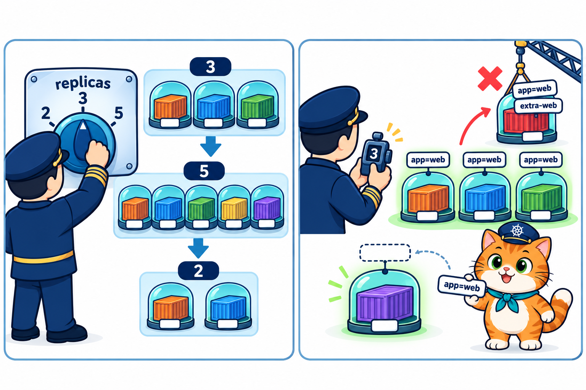<br>
  <em><b>รูปที่ 5</b> LAB2: (ซ้าย) หมุน replicas จาก 3 เป็น 5 แล้วลดเหลือ 2 (ขวา) ReplicaSet นับ Pod จากป้าย app=web — Pod แปลกหน้าที่ติดป้ายเดียวกัน (extra-web) ถูกลบทิ้ง ส่วน Pod ที่ถูกถอดป้ายหลุดออกไปเป็น Pod เดี่ยว</em>
</p>

**เป้าหมาย:** เพิ่ม-ลดจำนวน Pod ด้วย `kubectl scale` รู้จักกับดัก "ไฟล์ชนะ" และทดลองให้เห็นว่า ReplicaSet **นับ Pod จากป้าย (label)** ไม่ได้นับจากชื่อ

<p align="center" id="fig-6">
  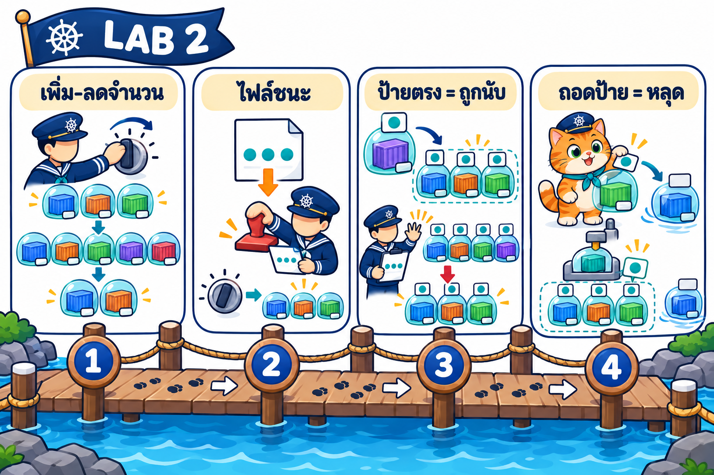<br>
  <em><b>รูปที่ 6</b> แผนการทดลอง LAB2 มี 4 การทดลอง: (1) ขั้นที่ 1–3 เพิ่ม-ลดจำนวนด้วย scale (2) ขั้นที่ 4 apply ไฟล์เดิมแล้วไฟล์ชนะ (3) ขั้นที่ 5 Pod แปลกหน้าที่ป้ายตรงถูกนับ (4) ขั้นที่ 6–7 ถอดป้ายแล้ว Pod หลุดจากการดูแล</em>
</p>

ใช้ไฟล์ `labs/lab01-first-rs/web-rs.yaml` ตัวเดิมจาก LAB 1 (`replicas: 3`, selector `app: web`)

### ขั้นที่ 1: สร้าง ReplicaSet

> 🎯 **เป้าหมายขั้นนี้:** เตรียม **จุดเริ่มต้น 3 ตัว** ไว้เทียบกับตอน scale
>
> 🔍 **สังเกต:** จดชื่อ Pod 3 ตัวนี้ไว้ ขั้นต่อไปจะดูว่าตัวไหนอยู่ ตัวไหนหาย

```bash
kubectl apply -f labs/lab01-first-rs/web-rs.yaml
```

**Expected output**

<pre>
replicaset.apps/web created
</pre>

รอสัก 8 วินาที แล้วดู Pod

```bash
kubectl get pods
```

**Expected output**

<pre>
NAME        READY   STATUS    RESTARTS   AGE
web-4jvnp   1/1     Running   0          8s
web-lfsgc   1/1     Running   0          8s
web-m96xl   1/1     Running   0          8s
</pre>

### ขั้นที่ 2: เพิ่มเป็น 5 ตัว

> 🎯 **เป้าหมายขั้นนี้:** ทดสอบ **scale เพิ่ม**: ReplicaSet สร้างใหม่ทั้งหมด หรือเติมเฉพาะที่ขาด ([ทฤษฎีหัวข้อ 7](../01_Theory/README.md#7-scale-เพิ่ม-ลดจำนวน-pod))
>
> 🔍 **สังเกต:** 3 ตัวเดิม **ชื่อเดิม** ยังอยู่ มีตัวใหม่เพิ่มแค่ 2 ตัว (`AGE 0s`)

```bash
kubectl scale rs web --replicas=5
```

**Expected output**

<pre>
replicaset.apps/web scaled
</pre>

```bash
kubectl get pods
```

**Expected output**

<pre>
NAME        READY   STATUS              RESTARTS   AGE
web-2hpf5   0/1     ContainerCreating   0          0s
web-4jvnp   1/1     Running             0          9s
web-cq4b6   0/1     ContainerCreating   0          0s
web-lfsgc   1/1     Running             0          9s
web-m96xl   1/1     Running             0          9s
</pre>

3 ตัวเดิมยังอยู่ ReplicaSet สร้างเพิ่มแค่ **2 ตัวที่ขาด** รอสัก 5 วินาที แล้วดู ReplicaSet

```bash
kubectl get rs
```

**Expected output**

<pre>
NAME   DESIRED   CURRENT   READY   AGE
web    5         5         5       15s
</pre>

### ขั้นที่ 3: ลดเหลือ 2 ตัว

> 🎯 **เป้าหมายขั้นนี้:** ทดสอบ **scale ลด**: ReplicaSet ลบเฉพาะส่วนเกินหรือไม่ ([ทฤษฎีหัวข้อ 7](../01_Theory/README.md#7-scale-เพิ่ม-ลดจำนวน-pod))
>
> 🔍 **สังเกต:** เหลือ 2 ตัว ตัวที่ถูกลบขึ้น `Completed` / `Terminating` ก่อนหายไป

```bash
kubectl scale rs web --replicas=2
```

**Expected output**

<pre>
replicaset.apps/web scaled
</pre>

```bash
kubectl get pods
```

**Expected output**

<pre>
NAME        READY   STATUS      RESTARTS   AGE
web-2hpf5   0/1     Completed   0          6s
web-4jvnp   1/1     Running     0          15s
web-cq4b6   0/1     Completed   0          6s
web-lfsgc   1/1     Running     0          15s
web-m96xl   0/1     Completed   0          15s
</pre>

ReplicaSet ลบ Pod ส่วนเกิน 3 ตัว ระหว่างปิดตัว Pod ที่ถูกลบอาจขึ้น `Completed` หรือ `Terminating` (ขึ้นกับจังหวะที่สั่ง) รอสัก 6 วินาที แล้วสั่ง `kubectl get pods` อีกครั้ง

```bash
kubectl get pods
```

**Expected output**

<pre>
NAME        READY   STATUS    RESTARTS   AGE
web-4jvnp   1/1     Running   0          22s
web-lfsgc   1/1     Running   0          22s
</pre>

### ขั้นที่ 4: กับดัก — apply ไฟล์เดิมอีกครั้ง

> 🎯 **เป้าหมายขั้นนี้:** ทดสอบว่า **ค่าจาก `scale` กับค่าในไฟล์ อะไรชนะ** เมื่อ apply ไฟล์เดิมซ้ำ ([ทฤษฎีหัวข้อ 7](../01_Theory/README.md#7-scale-เพิ่ม-ลดจำนวน-pod))
>
> 🔍 **สังเกต:** `DESIRED` เด้งจาก 2 กลับเป็น 3 ตามไฟล์

ตอนนี้ ReplicaSet มี 2 ตัว แต่ในไฟล์ยังเขียน `replicas: 3` ลอง apply ไฟล์เดิม

```bash
kubectl apply -f labs/lab01-first-rs/web-rs.yaml
```

**Expected output**

<pre>
replicaset.apps/web configured
</pre>

รอสัก 6 วินาที แล้วดู ReplicaSet

```bash
kubectl get rs
```

**Expected output**

<pre>
NAME   DESIRED   CURRENT   READY   AGE
web    3         3         3       28s
</pre>

กลับเป็น **3** ทันที เพราะ `apply` = "ทำให้ตรงกับไฟล์" ค่าที่ `scale` ไว้จึงถูกทับ (**ไฟล์ชนะ**) ถ้าอยากให้จำนวนใหม่อยู่ถาวร ให้แก้ `replicas` ในไฟล์แล้ว apply

### ขั้นที่ 5: ReplicaSet นับ Pod จากป้าย

> 🎯 **เป้าหมายขั้นนี้:** ทดสอบว่า ReplicaSet **นับ Pod จากป้าย ไม่ได้นับจากชื่อหรือผู้สร้าง** โดยส่ง Pod แปลกหน้าที่ติดป้ายเดียวกันเข้าไป ([ทฤษฎีหัวข้อ 8](../01_Theory/README.md#8-labels-replicaset-นับ-pod-จากป้าย) · [ทฤษฎีหัวข้อ 4](../01_Theory/README.md#4-อ่าน-yaml-ของ-replicaset-ทีละบรรทัด))
>
> 🔍 **สังเกต:** `extra-web` ขึ้น `Terminating` ทันทีที่เกิด และ Event `Deleted pod: extra-web`

```bash
kubectl get pods --show-labels
```

**Expected output**

<pre>
NAME        READY   STATUS    RESTARTS   AGE   LABELS
web-4jvnp   1/1     Running   0          34s   app=web
web-7997h   1/1     Running   0          12s   app=web
web-lfsgc   1/1     Running   0          34s   app=web
</pre>

ทุกตัวมีป้าย `app=web` ตรงกับ selector ถ้ามี Pod **ที่ไม่ได้มาจาก ReplicaSet** แต่ติดป้ายเดียวกันจะเกิดอะไร ไฟล์ `labs/lab02-labels/extra-pod.yaml` คือ Pod เดี่ยวแบบบทที่ 2

```yaml
# LAB 2: Pod เดี่ยวที่ติดป้าย app: web เหมือน Pod ของ ReplicaSet web
# ReplicaSet นับ Pod จากป้าย → เห็นว่ามีเกิน 3 ตัว จึงลบทิ้ง 1 ตัว
apiVersion: v1
kind: Pod
metadata:
  name: extra-web
  labels:
    app: web                 # ป้ายตรงกับ selector ของ ReplicaSet web
spec:
  containers:
    - name: nginx
      image: nginx:1.27-alpine
```

- เป็น `kind: Pod` ธรรมดาชื่อ `extra-web` ไม่มี ReplicaSet เป็นเจ้าของ
- แต่ติดป้าย `app: web` **ตรงกับ selector** ของ ReplicaSet `web`

```bash
kubectl apply -f labs/lab02-labels/extra-pod.yaml
```

**Expected output**

<pre>
pod/extra-web created
</pre>

```bash
kubectl get pods --show-labels
```

**Expected output**

<pre>
NAME        READY   STATUS        RESTARTS   AGE   LABELS
extra-web   0/1     Terminating   0          0s    app=web
web-4jvnp   1/1     Running       0          35s   app=web
web-7997h   1/1     Running       0          13s   app=web
web-lfsgc   1/1     Running       0          35s   app=web
</pre>

`extra-web` ถูกสั่งปิด (`Terminating`) **ทันทีที่เกิด** เพราะ ReplicaSet นับป้าย `app=web` ได้ 4 ตัว เกินที่ขอ 1 ตัว จึงลบทิ้ง 1 ตัว ดูหลักฐาน

```bash
kubectl describe rs web
```

**Expected output** (ตัดเฉพาะส่วน Events)

<pre>
...
  Type    Reason            Age   From                   Message
  ----    ------            ----  ----                   -------
  Normal  SuccessfulCreate  39s   replicaset-controller  Created pod: web-lfsgc
  Normal  SuccessfulCreate  39s   replicaset-controller  Created pod: web-m96xl
  Normal  SuccessfulCreate  39s   replicaset-controller  Created pod: web-4jvnp
  Normal  SuccessfulCreate  30s   replicaset-controller  Created pod: web-cq4b6
  Normal  SuccessfulCreate  30s   replicaset-controller  Created pod: web-2hpf5
  Normal  SuccessfulDelete  24s   replicaset-controller  Deleted pod: web-2hpf5
  Normal  SuccessfulDelete  24s   replicaset-controller  Deleted pod: web-m96xl
  Normal  SuccessfulDelete  24s   replicaset-controller  Deleted pod: web-cq4b6
  Normal  SuccessfulCreate  17s   replicaset-controller  Created pod: web-7997h
  Normal  SuccessfulDelete  4s    replicaset-controller  Deleted pod: extra-web
</pre>

Events เล่าเรื่องทั้ง LAB นี้: สร้าง 3 → scale เป็น 5 (สร้าง 2) → scale เหลือ 2 (ลบ 3) → apply ไฟล์ (สร้าง 1) และบรรทัดสุดท้าย `Deleted pod: extra-web` = ReplicaSet ลบ Pod ที่ **ไม่ได้สร้างเอง** เพียงเพราะป้ายตรงกัน

### ขั้นที่ 6: ถอดป้ายออกจาก Pod 1 ตัว

> 🎯 **เป้าหมายขั้นนี้:** ทดสอบกลับด้าน: **Pod ที่ถอดป้ายออก ยังถูกนับไหม** ([ทฤษฎีหัวข้อ 8](../01_Theory/README.md#8-labels-replicaset-นับ-pod-จากป้าย))
>
> 🔍 **สังเกต:** Pod ที่ถอดป้ายยัง `Running` อยู่ แต่ ReplicaSet สร้างตัวใหม่มาเติม และ `-l app=web` เห็นแค่ 3 ตัว

ใส่ `-` ต่อท้ายชื่อ key = ถอดป้าย `app` ออก

```bash
kubectl label pod web-4jvnp app-    # ← เปลี่ยนเป็นชื่อ Pod ของตัวเอง
```

**Expected output**

<pre>
pod/web-4jvnp unlabeled
</pre>

```bash
kubectl get pods --show-labels
```

**Expected output**

<pre>
NAME        READY   STATUS              RESTARTS   AGE   LABELS
web-4jvnp   1/1     Running             0          40s   &lt;none&gt;
web-7997h   1/1     Running             0          18s   app=web
web-lfsgc   1/1     Running             0          40s   app=web
web-sf5r5   0/1     ContainerCreating   0          0s    app=web
</pre>

- `web-4jvnp` ไม่มีป้ายแล้ว (`<none>`) แต่ **ยัง Running อยู่** ไม่ถูกลบ
- ReplicaSet นับป้าย `app=web` ได้แค่ 2 จึงสร้าง `web-sf5r5` เพิ่มให้ครบ 3

รอสัก 5 วินาที แล้วดูเฉพาะ Pod ที่ ReplicaSet นับ

```bash
kubectl get pods -l app=web
```

**Expected output**

<pre>
NAME        READY   STATUS    RESTARTS   AGE
web-7997h   1/1     Running   0          24s
web-lfsgc   1/1     Running   0          46s
web-sf5r5   1/1     Running   0          6s
</pre>

### ขั้นที่ 7: Pod ที่ถอดป้ายกลายเป็น Pod เดี่ยว

> 🎯 **เป้าหมายขั้นนี้:** ยืนยันว่า Pod ที่ถอดป้าย **หลุดจากเจ้าของจริง** กลายเป็น Pod เดี่ยว ([ทฤษฎีหัวข้อ 5](../01_Theory/README.md#5-selector-ชื่อ-pod-และเจ้าของ) · [ทฤษฎีหัวข้อ 8](../01_Theory/README.md#8-labels-replicaset-นับ-pod-จากป้าย))
>
> 🔍 **สังเกต:** ไม่มีทั้ง `labels` และ `ownerReferences` ใน YAML ของ Pod

```bash
kubectl get pod web-4jvnp -o yaml    # ← เปลี่ยนเป็นชื่อ Pod ของตัวเอง
```

**Expected output** (ตัดเฉพาะส่วนสำคัญ)

<pre>
apiVersion: v1
kind: Pod
metadata:
  creationTimestamp: "2026-10-18T06:16:18Z"
  generateName: web-
  generation: 1
  name: web-4jvnp
  namespace: default
  resourceVersion: "988"
  uid: 0b1687c3-83dc-451e-abb0-7649e0458acb
spec:
  containers:
...
</pre>

ไม่มีทั้ง `labels` และ `ownerReferences` แล้ว Pod นี้ **หลุดจาก ReplicaSet** กลายเป็น Pod เดี่ยว ถ้าลบ ReplicaSet มันจะไม่ถูกลบตาม ต้องลบเอง

```bash
kubectl delete pod web-4jvnp    # ← เปลี่ยนเป็นชื่อ Pod ของตัวเอง
```

**Expected output**

<pre>
pod "web-4jvnp" deleted from default namespace
</pre>

### ขั้นที่ 8: ลบ ReplicaSet

> 🎯 **เป้าหมายขั้นนี้:** เก็บกวาด ReplicaSet ของ LAB นี้ ก่อนเริ่ม LAB ถัดไปด้วยไฟล์เดิม
>
> 🔍 **สังเกต:** ได้ `deleted` (Pod ลูกถูกลบตาม)

```bash
kubectl delete -f labs/lab01-first-rs/web-rs.yaml
```

**Expected output**

<pre>
replicaset.apps "web" deleted from default namespace
</pre>

### สิ่งที่เห็น

- `kubectl scale rs <ชื่อ> --replicas=N` เพิ่ม-ลดจำนวนได้ทันที เพิ่มก็สร้างเฉพาะที่ขาด ลดก็ลบเฉพาะส่วนเกิน
- `apply` ไฟล์เดิมทับค่าที่ `scale` ไว้ (ไฟล์ชนะ) จำนวนถาวรต้องแก้ในไฟล์
- ReplicaSet **นับ Pod จากป้าย** ตาม selector: Pod แปลกหน้าที่ป้ายตรงถูกลบ (`Deleted pod: extra-web`) ส่วน Pod ที่ถอดป้ายหลุดออกไปเป็น Pod เดี่ยวและถูกสร้างตัวใหม่แทน
- Pod ที่หลุดออกไปไม่มี `ownerReferences` ต้องลบเอง

> **🤔 คำถามชวนคิด:** ถ้าติดป้าย `app=web` กลับคืนให้ `web-4jvnp` (ก่อนลบมัน) ตอนที่ ReplicaSet มีครบ 3 ตัวแล้ว จะเกิดอะไรขึ้น

---

## LAB 3: Pod กระจายบนหลาย Node

<p align="center" id="fig-7">
  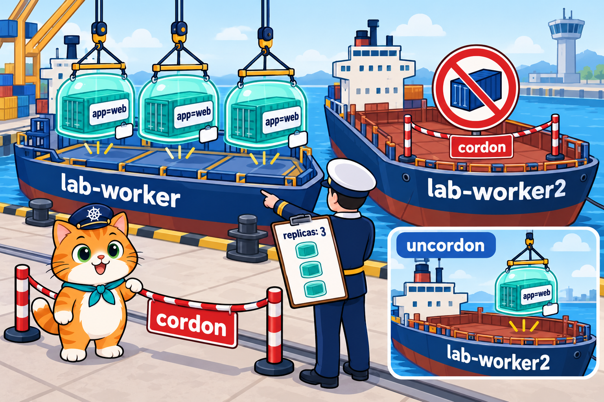<br>
  <em><b>รูปที่ 7</b> LAB3: kubectl cordon ติดป้ายห้ามรับ Pod ใหม่ที่เรือ lab-worker2 Pod ที่สร้างใหม่ทั้งหมดจึงไปลงเรือ lab-worker เมื่อ uncordon แล้ว Pod ใหม่กลับไปลง lab-worker2 ได้อีก</em>
</p>

**เป้าหมาย:** ดูว่า Pod ของ ReplicaSet ถูกวางบน Node ไหน และถ้าปิดรับ Pod ใหม่ที่ Node หนึ่ง (cordon) Pod ที่เกิดใหม่จะไปอยู่ที่ไหน

<p align="center" id="fig-8">
  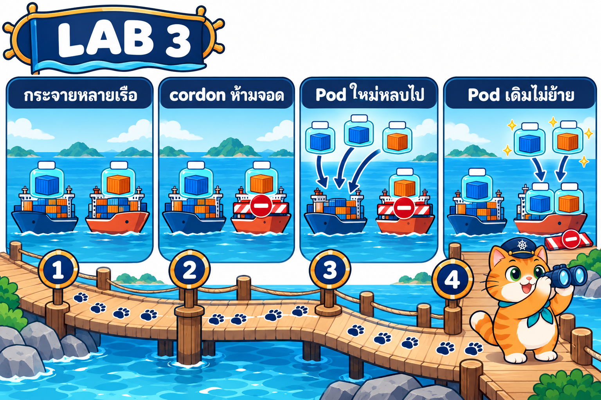<br>
  <em><b>รูปที่ 8</b> แผนการทดลอง LAB3 มี 4 การทดลอง: (1) ขั้นที่ 1 Pod กระจายบนหลายเรือ (2) ขั้นที่ 2 cordon ห้ามรับ Pod ใหม่ (3) ขั้นที่ 3 Pod ใหม่หลบไปเรืออีกลำ (4) ขั้นที่ 4–5 uncordon แล้ว Pod เดิมไม่ย้าย มีแค่ Pod ใหม่ที่ไปเรือว่าง</em>
</p>

### ขั้นที่ 1: สร้าง ReplicaSet แล้วดู Node

> 🎯 **เป้าหมายขั้นนี้:** ดูว่า **ใครเลือก Node ให้ Pod** และ Pod ถูกวางกระจายหรือกองอยู่ลำเดียว ([ทฤษฎีหัวข้อ 9](../01_Theory/README.md#9-pod-กระจายบนหลายเรือ))
>
> 🔍 **สังเกต:** คอลัมน์ `NODE` มีทั้ง `lab-worker` และ `lab-worker2`

```bash
kubectl apply -f labs/lab01-first-rs/web-rs.yaml
```

**Expected output**

<pre>
replicaset.apps/web created
</pre>

รอสัก 8 วินาที

```bash
kubectl get pods -o wide
```

**Expected output**

<pre>
NAME        READY   STATUS    RESTARTS   AGE   IP            NODE          NOMINATED NODE   READINESS GATES
web-qrbzp   1/1     Running   0          8s    10.244.2.12   lab-worker    &lt;none&gt;           &lt;none&gt;
web-rjggc   1/1     Running   0          8s    10.244.1.7    lab-worker2   &lt;none&gt;           &lt;none&gt;
web-tft49   1/1     Running   0          8s    10.244.2.11   lab-worker    &lt;none&gt;           &lt;none&gt;
</pre>

scheduler กระจาย Pod ไปทั้ง `lab-worker` และ `lab-worker2` ถ้าเรือลำหนึ่งล่ม ร้านยังมีสาขาเหลืออยู่บนอีกลำ

### ขั้นที่ 2: ปิดรับ Pod ใหม่ที่ lab-worker2 (cordon)

> 🎯 **เป้าหมายขั้นนี้:** จำลอง **เรือเข้าอู่**: ติดป้ายห้ามรับ Pod ใหม่ที่ `lab-worker2` ([ทฤษฎีหัวข้อ 9](../01_Theory/README.md#9-pod-กระจายบนหลายเรือ))
>
> 🔍 **สังเกต:** `lab-worker2` ขึ้น `Ready,SchedulingDisabled` (ยัง Ready อยู่ แค่ไม่รับ Pod ใหม่)

```bash
kubectl cordon lab-worker2
```

**Expected output**

<pre>
node/lab-worker2 cordoned
</pre>

```bash
kubectl get nodes
```

**Expected output**

<pre>
NAME                STATUS                     ROLES           AGE     VERSION
lab-control-plane   Ready                      control-plane   2m19s   v1.37.0
lab-worker          Ready                      &lt;none&gt;          2m4s    v1.37.0
lab-worker2         Ready,SchedulingDisabled   &lt;none&gt;          2m4s    v1.37.0
</pre>

`SchedulingDisabled` = ห้ามวาง Pod **ใหม่** บน `lab-worker2` (Pod เดิมที่อยู่แล้วยังทำงานต่อ)

### ขั้นที่ 3: ลบ Pod ทั้งหมด แล้วดูว่า Pod ใหม่ไปไหน

> 🎯 **เป้าหมายขั้นนี้:** ทดสอบว่า **Pod ที่เกิดใหม่หลบ Node ที่ cordon** ไว้ ([ทฤษฎีหัวข้อ 9](../01_Theory/README.md#9-pod-กระจายบนหลายเรือ))
>
> 🔍 **สังเกต:** Pod ใหม่ทั้ง 3 ตัวไปอยู่ `lab-worker` หมด

```bash
kubectl delete pod -l app=web
```

**Expected output**

<pre>
pod "web-qrbzp" deleted from default namespace
pod "web-rjggc" deleted from default namespace
pod "web-tft49" deleted from default namespace
</pre>

รอสัก 4 วินาที

```bash
kubectl get pods -o wide
```

**Expected output**

<pre>
NAME        READY   STATUS    RESTARTS   AGE   IP            NODE         NOMINATED NODE   READINESS GATES
web-bf558   1/1     Running   0          6s    10.244.2.13   lab-worker   &lt;none&gt;           &lt;none&gt;
web-rxz6b   1/1     Running   0          6s    10.244.2.14   lab-worker   &lt;none&gt;           &lt;none&gt;
web-sfgcc   1/1     Running   0          6s    10.244.2.15   lab-worker   &lt;none&gt;           &lt;none&gt;
</pre>

Pod ใหม่ทั้ง 3 ตัวไปอยู่ที่ `lab-worker` หมด เพราะ `lab-worker2` ปิดรับอยู่

### ขั้นที่ 4: เปิดรับ Pod ใหม่อีกครั้ง (uncordon)

> 🎯 **เป้าหมายขั้นนี้:** ทดสอบว่าเอาป้ายห้ามออกแล้ว **Pod เดิมย้ายกลับเองไหม** ([ทฤษฎีหัวข้อ 9](../01_Theory/README.md#9-pod-กระจายบนหลายเรือ))
>
> 🔍 **สังเกต:** `SchedulingDisabled` หายไป แต่ Pod 3 ตัวยังอยู่ที่ `lab-worker` เหมือนเดิม

```bash
kubectl uncordon lab-worker2
```

**Expected output**

<pre>
node/lab-worker2 uncordoned
</pre>

```bash
kubectl get nodes
```

**Expected output**

<pre>
NAME                STATUS   ROLES           AGE     VERSION
lab-control-plane   Ready    control-plane   2m26s   v1.37.0
lab-worker          Ready    &lt;none&gt;          2m11s   v1.37.0
lab-worker2         Ready    &lt;none&gt;          2m11s   v1.37.0
</pre>

`SchedulingDisabled` หายไปแล้ว แต่ Pod 3 ตัวเดิม **ไม่ย้ายกลับ** เอง (Kubernetes ไม่ย้าย Pod ที่ทำงานอยู่)

### ขั้นที่ 5: เพิ่ม Pod แล้วดูว่าไปอยู่ไหน

> 🎯 **เป้าหมายขั้นนี้:** ทดสอบว่า **Pod ที่เกิดใหม่** ไปลง Node ที่ว่างกว่า ([ทฤษฎีหัวข้อ 9](../01_Theory/README.md#9-pod-กระจายบนหลายเรือ) · [ทฤษฎีหัวข้อ 7](../01_Theory/README.md#7-scale-เพิ่ม-ลดจำนวน-pod))
>
> 🔍 **สังเกต:** Pod ใหม่ 2 ตัว (`AGE 6s`) ไปลง `lab-worker2`

```bash
kubectl scale rs web --replicas=5
```

**Expected output**

<pre>
replicaset.apps/web scaled
</pre>

รอสัก 5 วินาที

```bash
kubectl get pods -o wide
```

**Expected output**

<pre>
NAME        READY   STATUS    RESTARTS   AGE   IP            NODE          NOMINATED NODE   READINESS GATES
web-5xqd6   1/1     Running   0          6s    10.244.1.9    lab-worker2   &lt;none&gt;           &lt;none&gt;
web-bf558   1/1     Running   0          13s   10.244.2.13   lab-worker    &lt;none&gt;           &lt;none&gt;
web-rxz6b   1/1     Running   0          13s   10.244.2.14   lab-worker    &lt;none&gt;           &lt;none&gt;
web-sfgcc   1/1     Running   0          13s   10.244.2.15   lab-worker    &lt;none&gt;           &lt;none&gt;
web-tjt8g   1/1     Running   0          6s    10.244.1.8    lab-worker2   &lt;none&gt;           &lt;none&gt;
</pre>

Pod ใหม่ 2 ตัว (`AGE 6s`) ไปลง `lab-worker2` ทั้งคู่ เพราะ scheduler เลือก Node ที่ว่างกว่า

### ขั้นที่ 6: ลบ ReplicaSet

> 🎯 **เป้าหมายขั้นนี้:** เก็บกวาด ReplicaSet ของ LAB นี้
>
> 🔍 **สังเกต:** ได้ `deleted` และไม่มี Node ไหนค้าง `SchedulingDisabled`

```bash
kubectl delete -f labs/lab01-first-rs/web-rs.yaml
```

**Expected output**

<pre>
replicaset.apps "web" deleted from default namespace
</pre>

### สิ่งที่เห็น

- ReplicaSet บอกแค่ "จำนวน" ส่วน **scheduler** เป็นคนเลือกว่า Pod ไปอยู่ Node ไหน ปกติจะกระจายหลาย Node
- `kubectl cordon <node>` ปิดรับ Pod ใหม่ (STATUS `SchedulingDisabled`) Pod ที่เกิดใหม่จึงไป Node อื่นหมด
- `kubectl uncordon <node>` เปิดรับอีกครั้ง Pod เดิมไม่ย้ายกลับ แต่ Pod ที่เกิดใหม่จะไปลง Node ที่ว่างกว่า

> **🤔 คำถามชวนคิด:** ถ้า cordon ทั้ง `lab-worker` และ `lab-worker2` แล้วลบ Pod ทิ้ง Pod ใหม่จะมี STATUS อะไร (ลองแล้วอย่าลืม uncordon ทั้ง 2 ลำ)

---

## LAB 4: LAB สุดท้าย: ร้านอาหารแมวน้องส้มหลายสาขา

<p align="center" id="fig-9">
  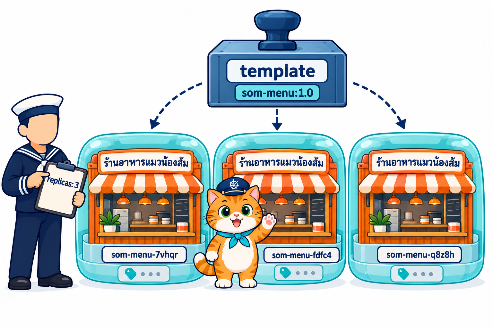<br>
  <em><b>รูปที่ 9</b> LAB สุดท้าย: ReplicaSet som-menu ดูแลหน้าร้าน 3 สาขา (3 Pod) ที่ปั๊มจากแม่พิมพ์เดียวกัน แต่ละสาขาบอกชื่อ Pod ของตัวเองบนหน้าเว็บ</em>
</p>

**เป้าหมาย:** เปิดหน้าร้านน้องส้ม 3 สาขาด้วย ReplicaSet แล้วลองทุกอย่างที่เรียนมา: ลบสาขา เพิ่มสาขาช่วงลูกค้าเยอะ และเปลี่ยนเมนูเป็นเวอร์ชัน 2.0

<p align="center" id="fig-10">
  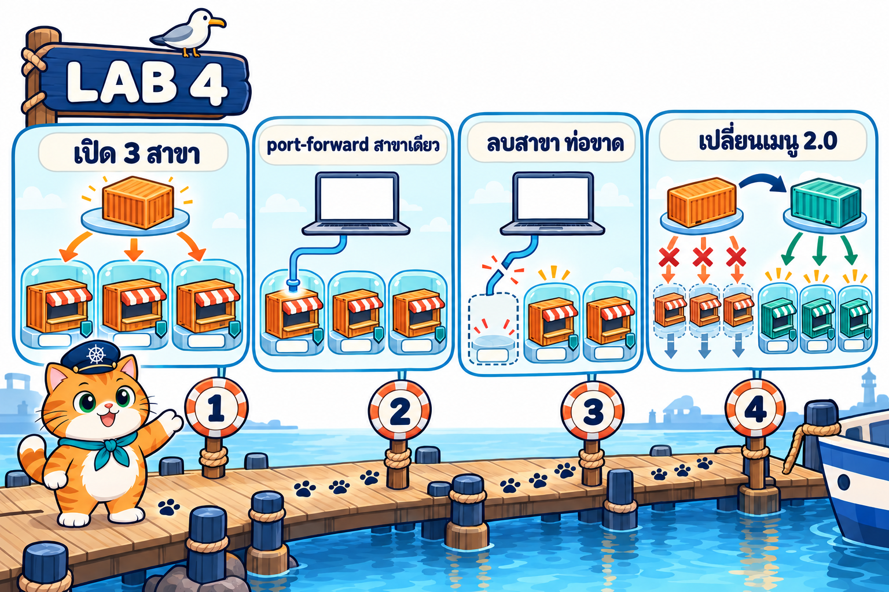<br>
  <em><b>รูปที่ 10</b> แผนการทดลอง LAB4 มี 4 การทดลอง: (1) ขั้นที่ 0–3 เปิดร้าน 3 สาขา (2) ขั้นที่ 4–5 port-forward ไปสาขาเดียว (3) ขั้นที่ 6–7 ลบสาขาแล้วท่อขาด เพิ่มสาขาลูกค้าก็ไม่กระจาย (4) ขั้นที่ 8–9 เปลี่ยนแม่พิมพ์เป็นเมนู 2.0</em>
</p>

หน้าร้าน (`som-menu/app/server.js`) เป็นเว็บ Node.js เล็ก ๆ ที่บอก **ชื่อ Pod ที่เสิร์ฟหน้านี้** และเวอร์ชันของร้าน แต่ละ Pod = 1 สาขา

**ต้องมี:** VS Code + extension **Container Tools** และ **Dev Containers** (แบบบทที่ 2 LAB 3) ทุกคำสั่งใน LAB นี้พิมพ์ใน **Terminal ของ VS Code** ที่ attach เข้า container k8s-lab

### ขั้นที่ 0: เปิด VS Code แล้ว attach เข้า container k8s-lab

> 🎯 **เป้าหมายขั้นนี้:** เตรียมที่ทำงานที่มีทั้ง Terminal และแท็บ **PORTS** ไว้เปิดเว็บใน browser
>
> 🔍 **สังเกต:** มุมล่างซ้ายของ VS Code ขึ้นชื่อ container `k8s-lab`

<p align="center" id="fig-11">
  <br>
  <em><b>รูปที่ 11</b> LAB4 ขั้นที่ 0 (ภาพจำลองหน้าจอ VS Code): ในแท็บ Containers คลิกขวาที่ k8s-lab แล้วเลือก Attach Visual Studio Code</em>
</p>

1. เปิด VS Code บนเครื่องนักศึกษา กดไอคอน **Containers** ที่แถบซ้าย
2. **คลิกขวา** ที่ container `k8s-lab` (image `tuchsanai/devtools-kind:2569_1`) แล้วเลือก **Attach Visual Studio Code**
3. VS Code จะเปิดหน้าต่างใหม่ มุมล่างซ้ายขึ้น `Container tuchsanai/devtools-kind:2569_1 (k8s-lab)` = ตอนนี้ทำงานอยู่ **ใน container** แล้ว
4. เมนู **File → Open Folder** เลือก `/workspace/DevTools/05_kubernetes/003_kubernetes_Replicaset/02_LAB`
5. เมนู **Terminal → New Terminal**

### ขั้นที่ 1: build image ของหน้าร้าน 2 เวอร์ชัน

> 🎯 **เป้าหมายขั้นนี้:** เตรียม **เมนู 2 รุ่น** (1.0 กับ 2.0) จากโค้ดชุดเดียวกัน ไว้ทดลองเปลี่ยนแม่พิมพ์ในขั้นที่ 8
>
> 🔍 **สังเกต:** ได้ image 2 tag คือ `som-menu:1.0` และ `som-menu:2.0`

```bash
cd som-menu/app
```

```bash
docker build -t som-menu:1.0 .
```

**Expected output** (บรรทัดท้าย ๆ ครั้งแรกต้องดึง `node:22-alpine` อาจใช้เวลาหลายสิบวินาที)

<pre>
...
#9 naming to docker.io/library/som-menu:1.0 done
#9 unpacking to docker.io/library/som-menu:1.0
#9 unpacking to docker.io/library/som-menu:1.0 1.1s done
#9 DONE 1.3s
</pre>

เวอร์ชัน 2.0 ใช้โค้ดเดียวกัน แต่ส่งค่า `APP_VERSION=2.0` ตอน build (หน้าร้านจะเปลี่ยนสีและมีเมนูใหม่)

```bash
docker build -t som-menu:2.0 --build-arg APP_VERSION=2.0 .
```

**Expected output** (บรรทัดท้าย ๆ)

<pre>
...
#9 naming to docker.io/library/som-menu:2.0 done
#9 unpacking to docker.io/library/som-menu:2.0 0.0s done
#9 DONE 0.2s
</pre>

กลับไปที่โฟลเดอร์ `02_LAB`

```bash
cd ../..
```

### ขั้นที่ 2: นำ image เข้าคลัสเตอร์

> 🎯 **เป้าหมายขั้นนี้:** ให้ **ทุกเรือมี image** เพราะ Pod อาจไปเกิดบนเรือลำไหนก็ได้ ([ทฤษฎีหัวข้อ 9](../01_Theory/README.md#9-pod-กระจายบนหลายเรือ))
>
> 🔍 **สังเกต:** ข้อความ `loading...` ครบทั้ง 3 node สำหรับทั้ง 2 เวอร์ชัน

```bash
kind load docker-image som-menu:1.0 som-menu:2.0 --name lab
```

**Expected output**

<pre>
Image: "som-menu:1.0" with ID "sha256:100edeb2e10878fdfcbaa028e6e755d5cf722c3bdb344cb267d74c931f7ef97e" not yet present on node "lab-worker2", loading...
Image: "som-menu:1.0" with ID "sha256:100edeb2e10878fdfcbaa028e6e755d5cf722c3bdb344cb267d74c931f7ef97e" not yet present on node "lab-control-plane", loading...
Image: "som-menu:1.0" with ID "sha256:100edeb2e10878fdfcbaa028e6e755d5cf722c3bdb344cb267d74c931f7ef97e" not yet present on node "lab-worker", loading...
Image: "som-menu:2.0" with ID "sha256:34fb2936aa8588dbcc8d4d5f4ca1723526a7f207682759feb9800fcbdf490aab" not yet present on node "lab-worker2", loading...
Image: "som-menu:2.0" with ID "sha256:34fb2936aa8588dbcc8d4d5f4ca1723526a7f207682759feb9800fcbdf490aab" not yet present on node "lab-control-plane", loading...
Image: "som-menu:2.0" with ID "sha256:34fb2936aa8588dbcc8d4d5f4ca1723526a7f207682759feb9800fcbdf490aab" not yet present on node "lab-worker", loading...
</pre>

ส่งทั้ง 2 เวอร์ชันเข้าทุก node ไว้ก่อน เพราะ Pod ไปเกิดบนเรือลำไหนก็ได้

### ขั้นที่ 3: เปิดร้าน 3 สาขา

> 🎯 **เป้าหมายขั้นนี้:** ใช้ทุกอย่างจาก LAB 1 กับ **แอปจริงที่มี probe**: ReplicaSet เดียวเปิดร้าน 3 สาขา ([ทฤษฎีหัวข้อ 11](../01_Theory/README.md#11-อ่าน-yaml-ร้านน้องส้มหลายสาขาทั้งไฟล์))
>
> 🔍 **สังเกต:** `READY 3` ของ ReplicaSet = readinessProbe ของทุกสาขาผ่านแล้ว

ไฟล์ `som-menu/k8s/som-menu-rs.yaml`

```yaml
# LAB 4: ร้านอาหารแมวน้องส้มหลายสาขา — ReplicaSet ดูแลหน้าร้าน 3 Pod (เวอร์ชัน 1.0)
apiVersion: apps/v1
kind: ReplicaSet
metadata:
  name: som-menu
  labels:
    app: som-menu
spec:
  replicas: 3                    # เปิด 3 สาขา = Pod 3 ตัว
  selector:
    matchLabels:
      app: som-menu              # นับเฉพาะ Pod ที่มีป้ายนี้
  template:                      # แม่พิมพ์ของทุกสาขา
    metadata:
      labels:
        app: som-menu            # ต้องตรงกับ selector
        version: "1.0"           # ป้ายเสริมไว้ดูรุ่น (selector ไม่ได้ใช้)
    spec:
      containers:
        - name: web
          image: som-menu:1.0
          imagePullPolicy: IfNotPresent   # ใช้ image ที่ kind load ไว้บน node
          env:
            - name: SHOP_NAME
              value: "ร้านอาหารแมวน้องส้ม"
          ports:
            - containerPort: 3000      # port ที่ port-forward 8080:3000 ส่งเข้ามา
          readinessProbe:              # ตอบ /api/health ได้ = สาขาพร้อมรับลูกค้า
            httpGet:
              path: /api/health
              port: 3000
            periodSeconds: 5
          livenessProbe:               # ค้างนานเกินไป → kubelet restart container
            httpGet:
              path: /api/health
              port: 3000
            initialDelaySeconds: 5
            periodSeconds: 10
          resources:                   # ทุกสาขาจองเท่ากัน เพราะมาจากแม่พิมพ์เดียวกัน
            requests: { cpu: 50m, memory: 64Mi }
            limits:   { cpu: 200m, memory: 128Mi }
```

ทำงานอย่างไร

- โครงเหมือน `web-rs.yaml` ใน LAB 1: `replicas: 3` = 3 สาขา, selector `app: som-menu` = ป้ายที่ใช้นับ, `template` = แม่พิมพ์ของทุกสาขา
- แม่พิมพ์มีป้ายเสริม `version: "1.0"` ไว้ดูว่าสาขาไหนรุ่นอะไร (selector ไม่ได้ใช้ป้ายนี้นับ)
- ข้างในแม่พิมพ์คือของจากบทที่ 2 ทั้งหมด: `env`, `readinessProbe`/`livenessProbe` และ `resources` ทุกสาขาจึงได้ค่าเหมือนกันหมด
- `imagePullPolicy: IfNotPresent` = ใช้ image ที่ `kind load` ไว้บน node ไม่ต้องไปดึงจาก Docker Hub

```bash
kubectl apply -f som-menu/k8s/som-menu-rs.yaml
```

**Expected output**

<pre>
replicaset.apps/som-menu created
</pre>

รอสัก 6 วินาที

```bash
kubectl get pods -o wide
```

**Expected output**

<pre>
NAME             READY   STATUS    RESTARTS   AGE   IP            NODE          NOMINATED NODE   READINESS GATES
som-menu-7vhqr   1/1     Running   0          6s    10.244.2.16   lab-worker    &lt;none&gt;           &lt;none&gt;
som-menu-fdfc4   1/1     Running   0          6s    10.244.2.17   lab-worker    &lt;none&gt;           &lt;none&gt;
som-menu-q8z8h   1/1     Running   0          6s    10.244.1.10   lab-worker2   &lt;none&gt;           &lt;none&gt;
</pre>

```bash
kubectl get rs
```

**Expected output**

<pre>
NAME       DESIRED   CURRENT   READY   AGE
som-menu   3         3         3       6s
</pre>

ร้านเปิดครบ 3 สาขา (READY `3` = readinessProbe ของทุกสาขาผ่านแล้ว)

### ขั้นที่ 4: เปิดหน้าร้านใน browser

> 🎯 **เป้าหมายขั้นนี้:** ทดสอบว่า `port-forward rs/...` **ต่อเข้ากี่สาขา** ([ทฤษฎีหัวข้อ 12](../01_Theory/README.md#12-เปิดเว็บของ-replicaset-และบทถัดไป))
>
> 🔍 **สังเกต:** ชื่อ Pod บนหน้าเว็บ (จดไว้ใช้ขั้นถัดไป)

`port-forward` ใส่ชื่อ ReplicaSet ได้ (`rs/som-menu`) kubectl จะ **เลือก Pod มา 1 ตัว** แล้วต่อท่อเข้าตัวนั้น

```bash
kubectl port-forward rs/som-menu 8080:3000
```

**Expected output**

<pre>
Forwarding from 127.0.0.1:8080 -&gt; 3000
Forwarding from [::1]:8080 -&gt; 3000
</pre>

คำสั่งนี้ **ค้างไว้** (อย่าปิด) แล้วไปที่แท็บ **PORTS** ของ VS Code ชี้ที่แถว port `8080` แล้วกดไอคอน **ลูกโลก (Open in Browser)** (ถ้าไม่เห็นแถว กด **Forward a Port** แล้วพิมพ์ `8080`)

<p align="center" id="fig-12">
  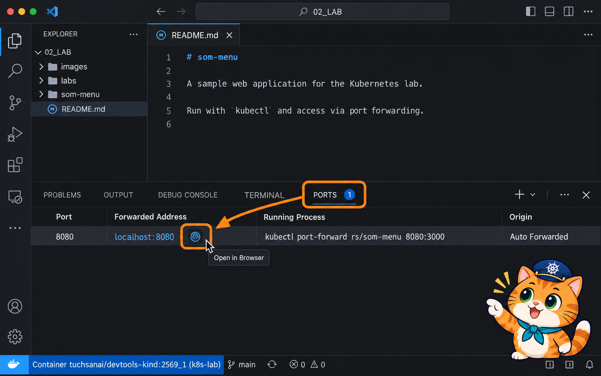<br>
  <em><b>รูปที่ 12</b> LAB4 ขั้นที่ 4 (ภาพจำลองหน้าจอ VS Code ที่ attach เข้า k8s-lab แล้ว): แท็บ PORTS แสดง port 8080 ที่มาจาก kubectl port-forward rs/som-menu 8080:3000 ชี้ที่แถวนั้นแล้วกดไอคอนลูกโลก Open in Browser</em>
</p>

🌐 browser จะเปิด `http://localhost:8080` เห็นหน้าร้านเวอร์ชัน 1.0 และชื่อ Pod ที่เสิร์ฟหน้านี้

<p align="center" id="fig-13">
  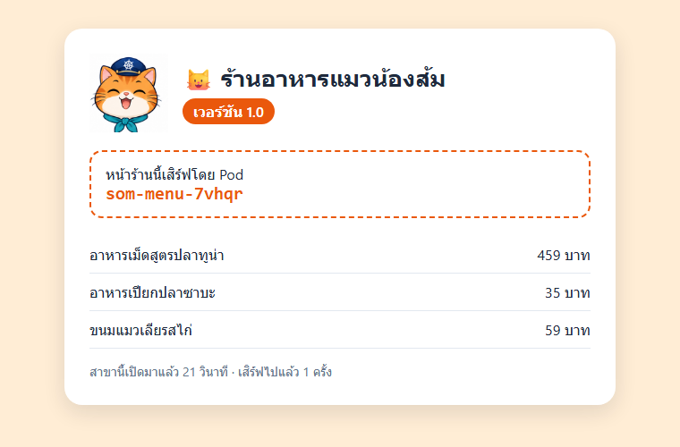<br>
  <em><b>รูปที่ 13</b> ภาพหน้าจอจริงจากการทดลอง: หน้าร้านเวอร์ชัน 1.0 เสิร์ฟโดย Pod som-menu-7vhqr (ทดสอบ 18 ต.ค. 2569 ด้วย browser จริงบนเครื่อง host ผ่าน kubectl port-forward rs/som-menu 8080:3000 ตอนถ่ายต่อท่อออกมาด้วย SSH tunnel แทนแท็บ PORTS ของ VS Code หน้าเว็บที่เห็นเหมือนกัน)</em>
</p>

**จดชื่อ Pod ที่เห็นบนหน้าเว็บไว้** (ตัวอย่างนี้คือ `som-menu-7vhqr` ของนักศึกษาจะต่างไป)

### ขั้นที่ 5: ดู log ของสาขานั้น

> 🎯 **เป้าหมายขั้นนี้:** ยืนยันว่า **ลูกค้าทุกคนไปสาขาเดียว** แม้ร้านจะมี 3 สาขา ([ทฤษฎีหัวข้อ 12](../01_Theory/README.md#12-เปิดเว็บของ-replicaset-และบทถัดไป))
>
> 🔍 **สังเกต:** บรรทัด "เสิร์ฟหน้าร้าน" เพิ่มเฉพาะใน log ของสาขาที่อยู่บนหน้าเว็บ

เปิด **Terminal ใหม่** ใน VS Code (กด `+` ที่แท็บ TERMINAL) เพราะ terminal แรกยังรัน port-forward อยู่

```bash
kubectl logs som-menu-7vhqr    # ← เปลี่ยนเป็นชื่อ Pod ของตัวเอง (ชื่อที่เห็นบนหน้าเว็บ)
```

**Expected output**

<pre>
ร้านอาหารแมวน้องส้ม v1.0 เปิดสาขา som-menu-7vhqr ที่ port 3000
[v1.0] som-menu-7vhqr เสิร์ฟหน้าร้านครั้งที่ 1
</pre>

ทุกครั้งที่ refresh browser จะมีบรรทัด "เสิร์ฟหน้าร้าน" เพิ่ม **เฉพาะสาขานี้** สาขาอื่นไม่ได้รับลูกค้าเลย

### ขั้นที่ 6: ปิดสาขาที่กำลังเสิร์ฟอยู่

> 🎯 **เป้าหมายขั้นนี้:** ทดสอบ self-healing คู่กับการเชื่อมต่อ: **ปิดสาขาที่กำลังเสิร์ฟ ร้านกลับมาเองไหม** ([ทฤษฎีหัวข้อ 6](../01_Theory/README.md#6-self-healing-ใครซ่อมอะไร) · [ทฤษฎีหัวข้อ 12](../01_Theory/README.md#12-เปิดเว็บของ-replicaset-และบทถัดไป))
>
> 🔍 **สังเกต:** Pod ใหม่มาแทนทันที แต่ port-forward ขึ้น `lost connection to pod` ต้องต่อใหม่เอง

```bash
kubectl delete pod som-menu-7vhqr    # ← เปลี่ยนเป็นชื่อ Pod ของตัวเอง (ชื่อที่เห็นบนหน้าเว็บ)
```

**Expected output**

<pre>
pod "som-menu-7vhqr" deleted from default namespace
</pre>

```bash
kubectl get pods
```

**Expected output**

<pre>
NAME             READY   STATUS    RESTARTS   AGE
som-menu-fdfc4   1/1     Running   0          24s
som-menu-pskr4   1/1     Running   0          2s
som-menu-q8z8h   1/1     Running   0          24s
</pre>

ReplicaSet เปิดสาขาใหม่ `som-menu-pskr4` แทนทันที แต่ลอง **refresh browser** จะเปิดไม่ได้ และ terminal แรกที่รัน port-forward จะขึ้น

<pre>
Forwarding from 127.0.0.1:8080 -&gt; 3000
Forwarding from [::1]:8080 -&gt; 3000
Handling connection for 8080
Handling connection for 8080
Handling connection for 8080
Handling connection for 8080
E1018 13:18:21.848586   37558 portforward.go:549] "An error occurred forwarding" err="error forwarding port 3000 to pod 6b4fb7d3cdf62c439c865702ff3a7a93c3e1cdcb32ac49a1358d3be4d321f9e2, uid : network namespace for sandbox \"6b4fb7d3cdf62c439c865702ff3a7a93c3e1cdcb32ac49a1358d3be4d321f9e2\" is closed" localPort=8080 remotePort=3000
error: lost connection to pod
</pre>

<p align="center" id="fig-14">
  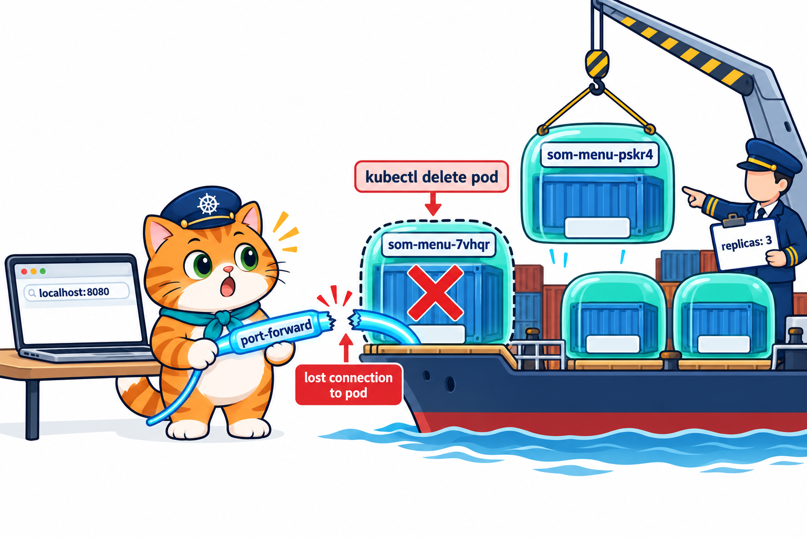<br>
  <em><b>รูปที่ 14</b> port-forward ต่อท่อเข้า Pod ตัวเดียว เมื่อ Pod นั้นถูกลบ ท่อก็ขาด (lost connection to pod) แม้ ReplicaSet จะสร้าง Pod ใหม่แทนแล้ว ต้องต่อท่อใหม่เอง</em>
</p>

port-forward ผูกกับ **Pod ตัวเดียว** ไม่ได้ผูกกับ ReplicaSet Pod นั้นหาย ท่อก็ขาด ต่อท่อใหม่ใน terminal แรก

```bash
kubectl port-forward rs/som-menu 8080:3000
```

**Expected output**

<pre>
Forwarding from 127.0.0.1:8080 -&gt; 3000
Forwarding from [::1]:8080 -&gt; 3000
</pre>

refresh browser จะเห็นร้านกลับมา โดย **ชื่อ Pod บนหน้าเว็บเปลี่ยนไป** เป็นสาขาอื่น

### ขั้นที่ 7: ลูกค้าเยอะ เพิ่มเป็น 5 สาขา

> 🎯 **เป้าหมายขั้นนี้:** ทดสอบว่า **เพิ่มสาขาแล้วลูกค้ากระจายไปสาขาใหม่ไหม** ([ทฤษฎีหัวข้อ 7](../01_Theory/README.md#7-scale-เพิ่ม-ลดจำนวน-pod) · [ทฤษฎีหัวข้อ 12](../01_Theory/README.md#12-เปิดเว็บของ-replicaset-และบทถัดไป))
>
> 🔍 **สังเกต:** มี Pod 5 ตัว แต่ browser ยังคุยกับสาขาเดียวเหมือนเดิม

ใน terminal ที่ 2

```bash
kubectl scale rs som-menu --replicas=5
```

**Expected output**

<pre>
replicaset.apps/som-menu scaled
</pre>

รอสัก 5 วินาที

```bash
kubectl get pods -o wide
```

**Expected output**

<pre>
NAME             READY   STATUS    RESTARTS   AGE   IP            NODE          NOMINATED NODE   READINESS GATES
som-menu-6fgkv   1/1     Running   0          5s    10.244.2.19   lab-worker    &lt;none&gt;           &lt;none&gt;
som-menu-fdfc4   1/1     Running   0          41s   10.244.2.17   lab-worker    &lt;none&gt;           &lt;none&gt;
som-menu-pskr4   1/1     Running   0          19s   10.244.1.11   lab-worker2   &lt;none&gt;           &lt;none&gt;
som-menu-q8z8h   1/1     Running   0          41s   10.244.1.10   lab-worker2   &lt;none&gt;           &lt;none&gt;
som-menu-qcchv   1/1     Running   0          5s    10.244.2.18   lab-worker    &lt;none&gt;           &lt;none&gt;
</pre>

มี 5 สาขาแล้ว แต่ browser ของเรายังคุยกับสาขาเดียวผ่าน port-forward อยู่ดี

### ขั้นที่ 8: เปลี่ยนเป็นเมนูเวอร์ชัน 2.0

> 🎯 **เป้าหมายขั้นนี้:** ทดสอบว่า **แก้แม่พิมพ์แล้ว Pod ที่มีอยู่เปลี่ยนตามไหม** (และไฟล์ทับค่า scale อีกครั้ง) ([ทฤษฎีหัวข้อ 10](../01_Theory/README.md#10-แก้แม่พิมพ์-แล้ว-pod-เดิมเปลี่ยนไหม) · [ทฤษฎีหัวข้อ 7](../01_Theory/README.md#7-scale-เพิ่ม-ลดจำนวน-pod))
>
> 🔍 **สังเกต:** `IMAGES` ของ ReplicaSet เป็น `som-menu:2.0` แต่ Pod ยังเป็น `version=1.0` จนกว่าจะลบทิ้ง และจำนวนกลับเป็น 3

ไฟล์ `som-menu/k8s/som-menu-rs-v2.yaml`

```yaml
# LAB 4: ร้านอาหารแมวน้องส้มหลายสาขา — ReplicaSet ดูแลหน้าร้าน 3 Pod (เวอร์ชัน 2.0)
# ต่างจาก som-menu-rs.yaml แค่ 2 บรรทัดที่มี ← เท่านั้น
apiVersion: apps/v1
kind: ReplicaSet
metadata:
  name: som-menu
  labels:
    app: som-menu
spec:
  replicas: 3                    # เปิด 3 สาขา = Pod 3 ตัว
  selector:
    matchLabels:
      app: som-menu              # นับเฉพาะ Pod ที่มีป้ายนี้
  template:                      # แม่พิมพ์ของทุกสาขา
    metadata:
      labels:
        app: som-menu            # ต้องตรงกับ selector
        version: "2.0"           # ← เปลี่ยน
    spec:
      containers:
        - name: web
          image: som-menu:2.0           # ← เปลี่ยน
          imagePullPolicy: IfNotPresent   # ใช้ image ที่ kind load ไว้บน node
          env:
            - name: SHOP_NAME
              value: "ร้านอาหารแมวน้องส้ม"
          ports:
            - containerPort: 3000      # port ที่ port-forward 8080:3000 ส่งเข้ามา
          readinessProbe:              # ตอบ /api/health ได้ = สาขาพร้อมรับลูกค้า
            httpGet:
              path: /api/health
              port: 3000
            periodSeconds: 5
          livenessProbe:               # ค้างนานเกินไป → kubelet restart container
            httpGet:
              path: /api/health
              port: 3000
            initialDelaySeconds: 5
            periodSeconds: 10
          resources:                   # ทุกสาขาจองเท่ากัน เพราะมาจากแม่พิมพ์เดียวกัน
            requests: { cpu: 50m, memory: 64Mi }
            limits:   { cpu: 200m, memory: 128Mi }
```

ต่างจาก `som-menu-rs.yaml` แค่ **2 บรรทัดที่มี `← เปลี่ยน`**

- ป้ายในแม่พิมพ์ `version: "2.0"` (เดิม `"1.0"`)
- `image: som-menu:2.0` (เดิม `som-menu:1.0`)

ชื่อ ReplicaSet ยังเป็น `som-menu` เหมือนเดิม การ apply จึงเป็นการ **แก้ ReplicaSet ตัวเดิม** และไฟล์ยังเขียน `replicas: 3`

```bash
kubectl apply -f som-menu/k8s/som-menu-rs-v2.yaml
```

**Expected output**

<pre>
replicaset.apps/som-menu configured
</pre>

```bash
kubectl get rs -o wide
```

**Expected output**

<pre>
NAME       DESIRED   CURRENT   READY   AGE   CONTAINERS   IMAGES         SELECTOR
som-menu   3         3         3       42s   web          som-menu:2.0   app=som-menu
</pre>

แม่พิมพ์เปลี่ยนเป็น `som-menu:2.0` แล้ว และ `DESIRED` กลับเป็น 3 รอสัก 5 วินาที แล้วดูป้ายของ Pod

```bash
kubectl get pods --show-labels
```

**Expected output**

<pre>
NAME             READY   STATUS    RESTARTS   AGE   LABELS
som-menu-fdfc4   1/1     Running   0          47s   app=som-menu,version=1.0
som-menu-pskr4   1/1     Running   0          25s   app=som-menu,version=1.0
som-menu-q8z8h   1/1     Running   0          47s   app=som-menu,version=1.0
</pre>

เห็น 2 เรื่องที่เรียนมาในภาพเดียว

- จำนวนกลับเป็น **3** เพราะไฟล์เขียน `replicas: 3` (ไฟล์ชนะ แบบ LAB 2) ตัวที่ถูกลบคือ 2 ตัวที่อายุน้อยที่สุด
- ทุกตัวยังเป็น **`version=1.0`** เพราะแม่พิมพ์ใหม่ใช้กับ **Pod ที่เกิดใหม่เท่านั้น** ReplicaSet ไม่แก้ Pod ที่มีอยู่แล้ว (นับป้าย `app=som-menu` ได้ครบ 3 ก็พอใจแล้ว)

ลบสาขาเวอร์ชันเก่าทั้งหมดด้วยป้าย `version=1.0`

```bash
kubectl delete pod -l version=1.0
```

**Expected output**

<pre>
pod "som-menu-fdfc4" deleted from default namespace
pod "som-menu-pskr4" deleted from default namespace
pod "som-menu-q8z8h" deleted from default namespace
</pre>

รอสัก 6 วินาที

```bash
kubectl get pods --show-labels
```

**Expected output**

<pre>
NAME             READY   STATUS    RESTARTS   AGE   LABELS
som-menu-j2mk8   1/1     Running   0          7s    app=som-menu,version=2.0
som-menu-lc2vr   1/1     Running   0          7s    app=som-menu,version=2.0
som-menu-t7j2c   1/1     Running   0          7s    app=som-menu,version=2.0
</pre>

Pod ใหม่ทั้ง 3 ตัวปั๊มจากแม่พิมพ์ใหม่ เป็น `version=2.0` ทั้งหมด

### ขั้นที่ 9: เปิดร้านเวอร์ชัน 2.0

> 🎯 **เป้าหมายขั้นนี้:** ยืนยันว่า **Pod ที่ปั๊มจากแม่พิมพ์ใหม่เป็นรุ่นใหม่จริง** ([ทฤษฎีหัวข้อ 10](../01_Theory/README.md#10-แก้แม่พิมพ์-แล้ว-pod-เดิมเปลี่ยนไหม))
>
> 🔍 **สังเกต:** หน้าร้านสีเขียวอมฟ้า ป้าย `เวอร์ชัน 2.0` และมีเมนูไอศกรีมแมว

port-forward ใน terminal แรกหลุดอีกแล้ว (Pod ที่ต่ออยู่ถูกลบ) กด **Ctrl+C** ถ้ายังค้าง แล้วต่อท่อใหม่

```bash
kubectl port-forward rs/som-menu 8080:3000
```

**Expected output**

<pre>
Forwarding from 127.0.0.1:8080 -&gt; 3000
Forwarding from [::1]:8080 -&gt; 3000
</pre>

refresh browser จะเห็นหน้าร้านสีเขียวอมฟ้า **เวอร์ชัน 2.0** มีเมนูใหม่ "ไอศกรีมแมว"

<p align="center" id="fig-15">
  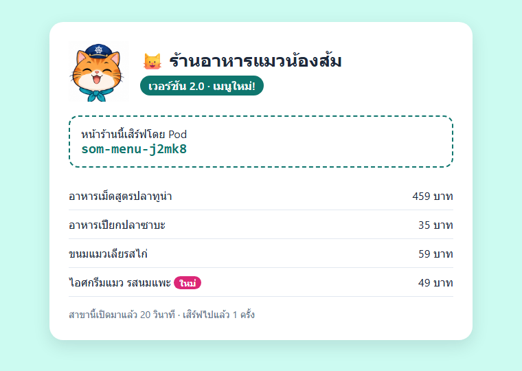<br>
  <em><b>รูปที่ 15</b> ภาพหน้าจอจริงจากการทดลอง: หน้าร้านเวอร์ชัน 2.0 เสิร์ฟโดย Pod som-menu-j2mk8 มีเมนูใหม่ไอศกรีมแมว (ทดสอบ 18 ต.ค. 2569 ด้วย browser จริงบนเครื่อง host ผ่าน kubectl port-forward rs/som-menu 8080:3000 ตอนถ่ายต่อท่อออกมาด้วย SSH tunnel แทนแท็บ PORTS ของ VS Code หน้าเว็บที่เห็นเหมือนกัน)</em>
</p>

ใน terminal ที่ 2 ดู log ของสาขาที่เห็นบนหน้าเว็บ

```bash
kubectl logs som-menu-j2mk8    # ← เปลี่ยนเป็นชื่อ Pod ของตัวเอง (ชื่อที่เห็นบนหน้าเว็บ)
```

**Expected output**

<pre>
ร้านอาหารแมวน้องส้ม v2.0 เปิดสาขา som-menu-j2mk8 ที่ port 3000
[v2.0] som-menu-j2mk8 เสิร์ฟหน้าร้านครั้งที่ 1
</pre>

### ขั้นที่ 10: เก็บกวาด

> 🎯 **เป้าหมายขั้นนี้:** เก็บกวาดร้านทั้งหมด
>
> 🔍 **สังเกต:** ได้ `deleted` และ Pod หายตามทั้งหมด

กลับไปที่ terminal แรกแล้วกด **Ctrl+C** หยุด port-forward จากนั้น

```bash
kubectl delete -f som-menu/k8s/som-menu-rs-v2.yaml
```

**Expected output**

<pre>
replicaset.apps "som-menu" deleted from default namespace
</pre>

### สิ่งที่เห็น

- ReplicaSet ตัวเดียวดูแลหน้าร้านหลายสาขา ลบสาขาไหนก็มีสาขาใหม่มาแทน เพิ่ม-ลดสาขาได้ด้วย `scale`
- `port-forward rs/<ชื่อ>` เลือก Pod มาแค่ 1 ตัว ลูกค้าทุกคนจึงไปสาขาเดียว และ Pod นั้นหายเมื่อไร ท่อก็ขาด (`lost connection to pod`)
- แก้แม่พิมพ์แล้ว apply ใช้กับ **Pod ที่เกิดใหม่เท่านั้น** ต้องลบ Pod เก่าเอง และไฟล์ทับค่า `replicas` ที่ scale ไว้
- ป้ายเสริมอย่าง `version` ช่วยเลือก Pod รุ่นเก่ามาลบได้ในคำสั่งเดียว (`-l version=1.0`)

### คำถามท้าย LAB 4

1. เพิ่มเป็น 5 สาขาแล้ว ทำไมลูกค้าที่เข้าผ่าน `http://localhost:8080` ยังถูกเสิร์ฟโดยสาขาเดียว
2. ตอนลบ Pod `version=1.0` ทั้ง 3 ตัวพร้อมกัน ร้านปิดไปชั่วครู่ ถ้าอยากเปลี่ยนเป็น `som-menu:3.0` โดยร้าน **ไม่ปิดเลย** ด้วย ReplicaSet อย่างเดียว ต้องลบ Pod เก่าอย่างไร

---

## เก็บกวาดหลังจบบท

🐧 **ใน SSH session ของ k8s-lab** ตรวจว่าไม่มี ReplicaSet และ Pod ค้าง

```bash
kubectl get rs
```

**Expected output**

<pre>
No resources found in default namespace.
</pre>

```bash
kubectl get pods
```

**Expected output**

<pre>
No resources found in default namespace.
</pre>

ถ้ายังเห็นอยู่ ให้ลบด้วย `kubectl delete rs <ชื่อ>` (ลบ ReplicaSet แล้ว Pod ลูกหายตาม) และสั่ง `kubectl get nodes` ตรวจว่าไม่มี node ไหนค้าง `SchedulingDisabled` จาก LAB 3 (ถ้ามีให้ `kubectl uncordon <ชื่อ node>`)

คลัสเตอร์ `lab` เก็บไว้ใช้ต่อในบทถัดไปได้ ถ้าต้องการคืนทรัพยากรเครื่อง ให้ลบคลัสเตอร์ด้วย `k8s-down` (ทางเลือก, image ที่ `kind load` ไว้จะหายไปด้วย) จากนั้นออกจาก SSH ด้วย `exit`

🖥️ **บนเครื่องนักศึกษา** (ทางเลือก) หยุด container เพื่อคืน RAM/CPU แล้วเปิดใหม่ครั้งหน้าด้วย `docker start k8s-lab` (คลัสเตอร์และไฟล์ใน `/workspace` ยังอยู่)

```bash
docker stop k8s-lab
```

> **บทถัดไป:** น้องส้มจะให้ **Deployment** คุม ReplicaSet อีกชั้น เพื่อเปลี่ยนเวอร์ชันทีละ Pod อัตโนมัติโดยร้านไม่ปิด และใช้ **Service** เป็นที่อยู่เดียวที่กระจายลูกค้าไปทุกสาขา ไม่หลุดแม้ Pod ถูกลบ

---

## สรุปคำสั่ง kubectl ในบทนี้

**สร้าง / ลบ**

| คำสั่ง | ใช้ทำอะไร |
|---|---|
| `kubectl apply -f <ไฟล์>` | สร้าง ReplicaSet หรือแก้ตัวเดิม (ชื่อเดิม = `configured`) |
| `kubectl delete -f <ไฟล์>` | ลบตามไฟล์ (ลบ ReplicaSet แล้ว Pod ลูกถูกลบตาม) |
| `kubectl delete rs <ชื่อ>` | ลบ ReplicaSet ตามชื่อ (Pod ลูกถูกลบตาม) |
| `kubectl delete pod <ชื่อ>` | ลบ Pod (ถ้ามี ReplicaSet ดูแล จะสร้างตัวใหม่แทน) |
| `kubectl delete pod -l <key=value>` | ลบทุก Pod ที่มีป้ายนี้ (เช่น Pod รุ่นเก่า) |

**ดูสถานะ**

| คำสั่ง | ใช้ทำอะไร |
|---|---|
| `kubectl get rs` | รายการ ReplicaSet: DESIRED, CURRENT, READY |
| `kubectl get rs -o wide` | เพิ่ม image ของแม่พิมพ์และ SELECTOR |
| `kubectl describe rs <ชื่อ>` | รายละเอียด + Events (`SuccessfulCreate` / `SuccessfulDelete`) |
| `kubectl get pods` | รายการ Pod |
| `kubectl get pods -o wide` | เพิ่ม IP และ Node ของ Pod |
| `kubectl get pods --show-labels` | ดูป้ายของ Pod |
| `kubectl get pods -l <key=value>` | ดูเฉพาะ Pod ที่มีป้ายนี้ (Pod ที่ ReplicaSet นับ) |
| `kubectl get pod <ชื่อ> -o yaml` | ดู `ownerReferences` ว่าใครเป็นเจ้าของ |

**เพิ่ม-ลด และแก้ป้าย**

| คำสั่ง | ใช้ทำอะไร |
|---|---|
| `kubectl scale rs <ชื่อ> --replicas=<N>` | เปลี่ยนจำนวน Pod ทันที (apply ไฟล์ทีหลังจะทับค่านี้) |
| `kubectl label pod <ชื่อ> <key>-` | ถอดป้าย → Pod หลุดจาก ReplicaSet |

**Node**

| คำสั่ง | ใช้ทำอะไร |
|---|---|
| `kubectl get nodes` | ดู node และสถานะ `SchedulingDisabled` |
| `kubectl cordon <node>` | ห้ามรับ Pod ใหม่ (Pod เดิมยังอยู่) |
| `kubectl uncordon <node>` | กลับมารับ Pod ใหม่ |

**เข้าถึงแอป / ดู log**

| คำสั่ง | ใช้ทำอะไร |
|---|---|
| `kubectl port-forward rs/<ชื่อ> <port เครื่อง>:<port ใน Pod>` | ต่อท่อเข้า Pod 1 ตัวของ ReplicaSet (Pod หาย = ท่อขาด, Ctrl+C เพื่อหยุด) |
| `kubectl logs <ชื่อ Pod>` | ดูสิ่งที่แอปใน Pod พิมพ์ออกมา |

**คลัสเตอร์และ image**

| คำสั่ง | ใช้ทำอะไร |
|---|---|
| `k8s-up` / `k8s-down` | สร้าง / ลบคลัสเตอร์ kind ชื่อ `lab` |
| `docker build -t <ชื่อ:tag> --build-arg <KEY=VALUE> .` | build image และส่งค่าเข้าไปตอน build |
| `kind load docker-image <image...> --name lab` | ส่ง image เข้าทุก node ของคลัสเตอร์ |
