# บทที่ 4: Kubernetes Deployment — เปลี่ยนเมนูโดยร้านไม่ปิด

> **รายวิชา:** Software Development Tools and Environments (DevTools) · **CLO-5, CLO-6**
> **บทก่อนหน้า:** [บทที่ 3 Kubernetes ReplicaSet](../../003_kubernetes_Replicaset/01_Theory/README.md) · **LAB ของบทนี้:** [02_LAB](../02_LAB/README.md)

อ่านบทนี้จบแล้วควรทำได้ 4 อย่าง

1. อธิบายได้ว่า **Deployment** คืออะไร และทำไมมันสร้าง **ReplicaSet** ขึ้นมาอีกชั้นก่อนจะได้ Pod
2. **อ่านไฟล์ YAML ของ Deployment ออกทุกบรรทัด** รวมถึง `strategy`, `maxSurge`, `maxUnavailable` และ `minReadySeconds`
3. เปลี่ยนเวอร์ชันแบบ **rolling update** แล้วติดตามและย้อนกลับด้วย `kubectl rollout status / history / undo`
4. บอกได้ว่า Deployment ยังทำอะไร **ไม่ได้** (ให้ที่อยู่คงที่ที่กระจายลูกค้าไปทุก Pod) ก่อนไปบท Service

## สารบัญ

1. [เริ่มเรื่อง: เปลี่ยนเมนูทีไร ร้านปิด](#1-เริ่มเรื่อง-เปลี่ยนเมนูทีไร-ร้านปิด)
2. [Deployment คืออะไร](#2-deployment-คืออะไร)
3. [Deployment ทำงานอย่างไร](#3-deployment-ทำงานอย่างไร)
4. [อ่าน YAML ของ Deployment ทีละบรรทัด](#4-อ่าน-yaml-ของ-deployment-ทีละบรรทัด)
5. [ชื่อ Pod 3 ท่อน และเจ้าของ 2 ชั้น](#5-ชื่อ-pod-3-ท่อน-และเจ้าของ-2-ชั้น)
6. [ใครดูแลอะไร: Deployment หรือ ReplicaSet](#6-ใครดูแลอะไร-deployment-หรือ-replicaset)
7. [Rolling update: ทยอยเปลี่ยนทีละ Pod](#7-rolling-update-ทยอยเปลี่ยนทีละ-pod)
8. [maxSurge, maxUnavailable และ minReadySeconds](#8-maxsurge-maxunavailable-และ-minreadyseconds)
9. [ติดตามการเปลี่ยนรุ่น: rollout status และ history](#9-ติดตามการเปลี่ยนรุ่น-rollout-status-และ-history)
10. [ย้อนกลับด้วย rollout undo](#10-ย้อนกลับด้วย-rollout-undo)
11. [อัปเดตพัง แต่ร้านไม่ปิด](#11-อัปเดตพัง-แต่ร้านไม่ปิด)
12. [อ่าน YAML ร้านน้องส้มทั้งไฟล์](#12-อ่าน-yaml-ร้านน้องส้มทั้งไฟล์)
13. [port-forward ระหว่างเปลี่ยนรุ่น และบทถัดไป](#13-port-forward-ระหว่างเปลี่ยนรุ่น-และบทถัดไป)
14. [สรุปและคำถามทบทวน](#14-สรุปและคำถามทบทวน)

ทุกหัวข้อมี 2 บรรทัดนี้ช่วยให้รู้ว่ากำลังเรียนไปเพื่ออะไร

- 🎯 **หัวข้อนี้เรียนเพื่อ** (ต้นหัวข้อ) = อ่านหัวข้อนี้แล้วจะตอบคำถามอะไรได้ และเอาไปใช้ตอนไหน
- 🧪 **พิสูจน์ใน LAB** (ท้ายหัวข้อ) = LAB ขั้นไหนทดลองให้เห็นจริง และผลที่เห็นพิสูจน์อะไร กดลิงก์ไปที่ขั้นนั้นได้ทันที

---

## 1. เริ่มเรื่อง: เปลี่ยนเมนูทีไร ร้านปิด

> 🎯 **หัวข้อนี้เรียนเพื่อ:** เห็น **ปัญหา** ที่บทนี้มาแก้ก่อน: ใช้ ReplicaSet เปลี่ยนเวอร์ชันทีไร ร้านปิดทุกที ถ้าไม่เห็นปัญหานี้ จะไม่เห็นว่า Deployment มีไว้ทำไม

<p align="center">
  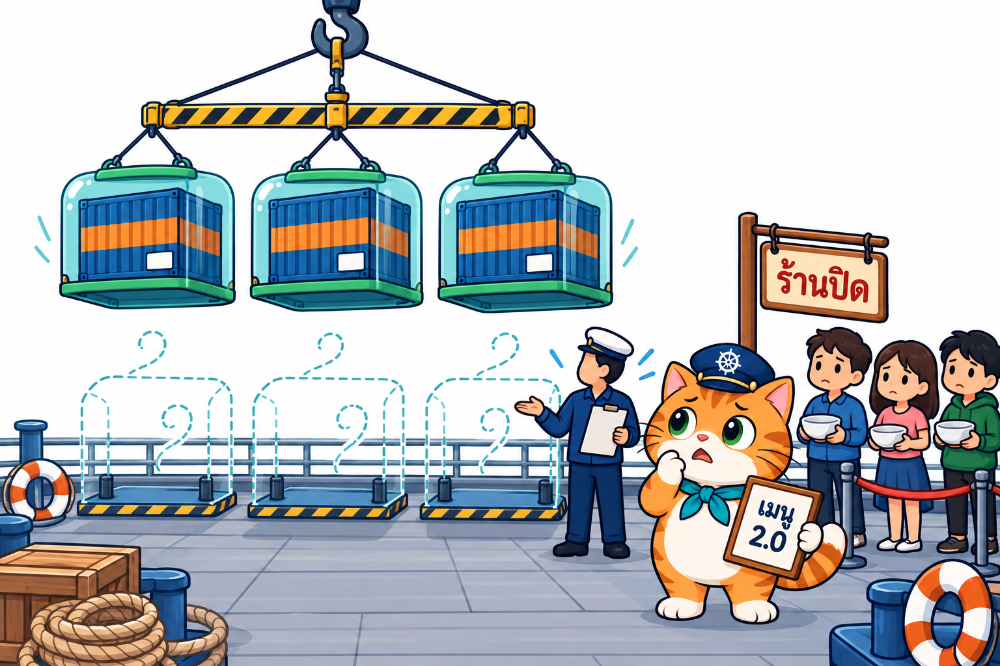
</p>

ในบทที่ 3 ร้านอาหารแมวน้องส้มมีหัวหน้าลูกเรือ (ReplicaSet) คอยนับกล่องให้ครบ แต่พอน้องส้มอยากเปลี่ยนเป็น **เมนู 2.0**

- แก้แม่พิมพ์แล้ว **Pod เดิมไม่เปลี่ยน** (บทที่ 3 หัวข้อ 10) ต้องลบ Pod เก่าเอง
- ลบพร้อมกันทุกตัว → มีช่วงที่ไม่มี Pod พร้อมสักตัว **ร้านปิดชั่วครู่**
- ถ้าเมนูใหม่พัง ก็ต้องแก้กลับเองทีละขั้น

> "หัวหน้าลูกเรือเก่งเรื่องนับ แต่ไม่ได้มีหน้าที่เปลี่ยนรุ่น ส้มต้องมี **ผู้จัดการลูกเรือ** ที่จดทุกรุ่นไว้ และสั่งเปลี่ยนกล่องทีละใบ" — กัปตันบอก

ผู้จัดการลูกเรือคนนี้คือ **Deployment** ทบทวนอุปมาท่าเรือ แล้วเพิ่มตัวละครใหม่

<p align="center">
  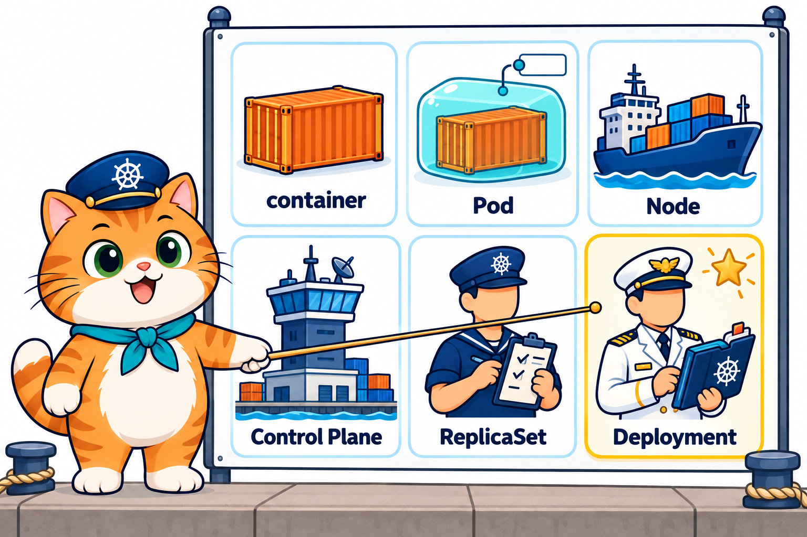
</p>

- **container** = ตู้สินค้า / **Pod** = กล่องห่อตู้ มีป้าย IP 1 อัน
- **Node** = เรือ (`lab-worker`, `lab-worker2`) / **Control Plane** = หอบังคับการ
- **template** = แม่พิมพ์กล่อง / **ReplicaSet** = **หัวหน้าลูกเรือ** ถือกระดาน `replicas: 3`
- **Deployment** = **ผู้จัดการลูกเรือ** (ชุดขาว หมวกแก๊ป) ถือ **สมุดบันทึกรุ่น** (revision) และสั่งหัวหน้าลูกเรือได้หลายคน
- ในภาพ: กล่อง **แถบส้ม** = รุ่นเก่า (ทีมเก่า) / กล่อง **แถบเขียว** = รุ่นใหม่ (ทีมใหม่)

> **ขอบเขตบทนี้:** ใช้ Deployment, ReplicaSet และ Pod เท่านั้น เปิดเว็บยังใช้ `kubectl port-forward` ส่วน Service เป็นของบทถัดไป

---

## 2. Deployment คืออะไร

> 🎯 **หัวข้อนี้เรียนเพื่อ:** รู้ว่า Deployment คืออะไร และ **ต่างจาก ReplicaSet ตรงไหน** จะได้ตอบได้ว่าทำไมงานจริงสร้าง Deployment แทบไม่เคยสร้าง ReplicaSet เอง

<p align="center">
  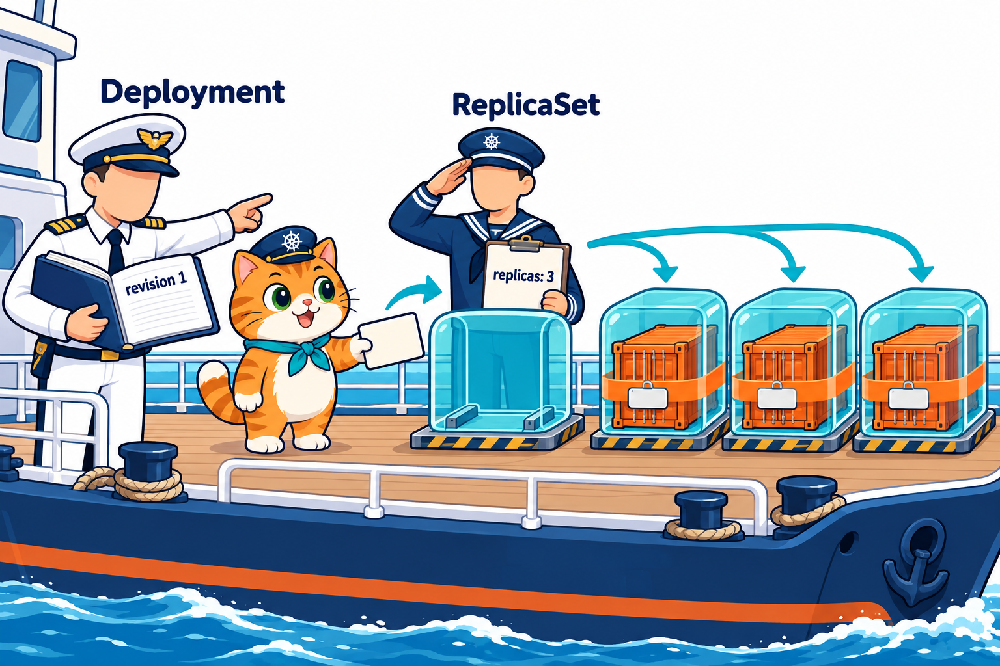
</p>

**Deployment คือ object ที่ดูแล ReplicaSet ให้อีกชั้น เพื่อให้เปลี่ยนเวอร์ชันของ Pod ได้ทีละตัวโดยร้านไม่ปิด และย้อนกลับได้**

- เราบอกแค่ **"อยากได้กี่ตัว"** (`replicas`) กับ **"หน้าตาแบบไหน"** (`template`) เหมือน ReplicaSet ทุกอย่าง
- Deployment **สร้าง ReplicaSet** ให้ แล้ว ReplicaSet สร้าง Pod ต่ออีกที
- แก้แม่พิมพ์เมื่อไร Deployment สร้าง **ReplicaSet ใหม่** แล้วทยอยย้าย Pod จากทีมเก่าไปทีมใหม่ให้เอง

ตัวอย่างจริงจาก LAB 1: apply ไฟล์เดียว ได้ของ 3 ชั้น

```text
$ kubectl get deploy
NAME   READY   UP-TO-DATE   AVAILABLE   AGE
web    3/3     3            3           11s

$ kubectl get rs
NAME             DESIRED   CURRENT   READY   AGE
web-6bd858c6f9   3         3         3       10s
```

และ Pod อีก 3 ตัวชื่อ `web-6bd858c6f9-86xzl`, `web-6bd858c6f9-kmn4v`, `web-6bd858c6f9-xj2vm` (ชื่อยาวขึ้นเป็น 3 ท่อน หัวข้อ 5)

คอลัมน์ของ `kubectl get deploy`

- `READY` = Pod ที่พร้อม / Pod ที่ขอ (`3/3` = ครบ)
- `UP-TO-DATE` = Pod ที่ใช้ **แม่พิมพ์ล่าสุด** แล้วกี่ตัว (สำคัญตอนเปลี่ยนรุ่น)
- `AVAILABLE` = Pod ที่พร้อมให้ลูกค้าใช้จริงกี่ตัว

เทียบกับ ReplicaSet ในบทที่ 3

| | ReplicaSet (บทที่ 3) | Deployment (บทนี้) |
|---|---|---|
| ดูแลอะไร | Pod โดยตรง | ReplicaSet (ซึ่งดูแล Pod อีกที) |
| ชื่อ Pod | `web-l96sh` (2 ท่อน) | `web-6bd858c6f9-86xzl` (3 ท่อน) |
| แก้แม่พิมพ์ | Pod เดิมไม่เปลี่ยน ต้องลบเอง | ทยอยเปลี่ยน Pod ให้ทีละตัว |
| จดประวัติรุ่น | ไม่มี | มี (`rollout history`) |
| ย้อนกลับ | แก้ไฟล์กลับ แล้วลบ Pod เอง | `kubectl rollout undo` คำสั่งเดียว |
| ใช้ในงานจริง | แทบไม่สร้างเอง | ใช้เป็นหลัก |

> 🧪 **พิสูจน์ใน LAB:** ส่งไฟล์ Deployment ไฟล์เดียว แล้วได้ของครบ 3 ชั้น Deployment → ReplicaSet → Pod → **LAB 1** ขั้นที่ [2](../02_LAB/README.md#ขั้นที่-2-สร้าง-deployment-แล้วดูทั้ง-3-ชั้น)

---

## 3. Deployment ทำงานอย่างไร

> 🎯 **หัวข้อนี้เรียนเพื่อ:** รู้ว่า **ใครในคลัสเตอร์ทำงานอะไร** ตั้งแต่ apply จนได้ Pod เวลาอ่าน Events หรือหาสาเหตุตอนระบบพัง จะรู้ว่าต้องไปดูที่ชั้นไหน

<p align="center">
  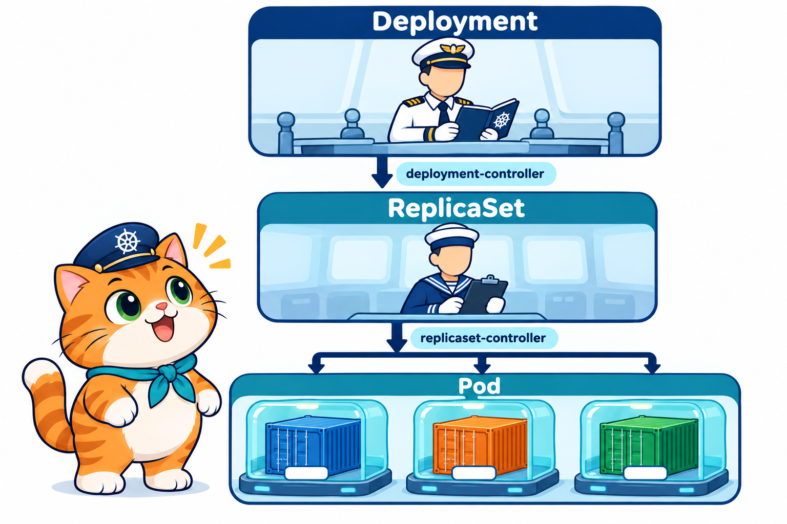
</p>

ผู้จัดการไม่ได้ปั๊มกล่องเอง แต่ **สั่งหัวหน้าลูกเรือ** อีกที งานจึงแบ่งเป็น 2 controller ใน **kube-controller-manager** บนหอบังคับการ

- **deployment-controller** ดูแล Deployment → สร้าง / ปรับจำนวน **ReplicaSet**
- **replicaset-controller** ดูแล ReplicaSet → สร้าง / ลบ **Pod** (ตัวเดิมจากบทที่ 3)

ทั้งสองทำงานวงจรเดิม **นับ → เทียบ → แก้** (control loop) แค่คนละชั้น

### ตั้งแต่ apply จนได้ Pod

<p align="center">
  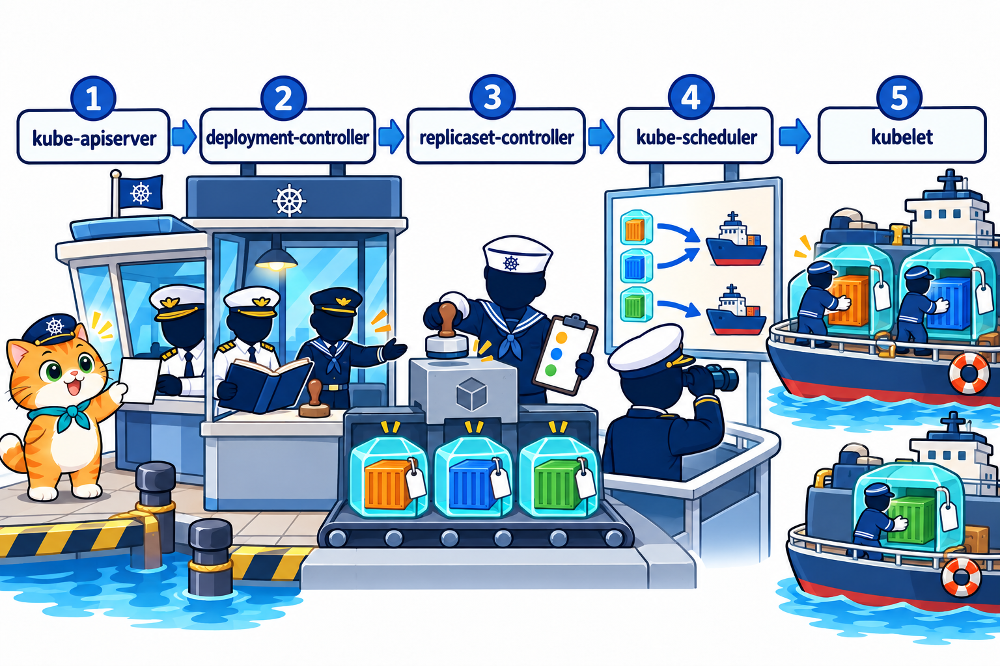
</p>

1. `kubectl apply` ส่ง Deployment ไปให้ **kube-apiserver** บันทึกลง **etcd**
2. **deployment-controller** เห็น Deployment ใหม่ สร้าง ReplicaSet `web-6bd858c6f9` ตั้ง `replicas: 3`
3. **replicaset-controller** เห็น ReplicaSet ที่มี Pod 0 ตัว จึงสร้าง Pod 3 ตัวจากแม่พิมพ์ (เหมือนบทที่ 3)
4. **kube-scheduler** เลือกเรือ แล้ว **kubelet** บนเรือดึง image และเริ่ม container (เหมือนบทที่ 2)

เห็นขั้นที่ 2 ได้ใน Events ของ `kubectl describe deploy web` (LAB 1)

```text
Events:
  Type    Reason             Age   From                   Message
  Normal  ScalingReplicaSet  10s   deployment-controller  Scaled up replica set web-6bd858c6f9 from 0 to 3
```

สังเกตว่า Events ของ Deployment พูดถึง **replica set** ไม่ได้พูดถึง Pod เลย เพราะ Deployment สั่งแค่ "ReplicaSet ตัวนี้ ต้องมีกี่ Pod" ส่วนการสร้าง Pod จริงเป็นงานของ ReplicaSet

> **ประโยคเดียวที่ต้องจำ:** Deployment **ปรับตัวเลข replicas ของ ReplicaSet** ส่วน ReplicaSet **สร้าง/ลบ Pod** ตามตัวเลขนั้น

> 🧪 **พิสูจน์ใน LAB:** Events ของ Deployment พูดถึงแค่ ReplicaSet แสดงว่า Deployment ไม่ได้สร้าง Pod เอง → **LAB 1** ขั้นที่ [2](../02_LAB/README.md#ขั้นที่-2-สร้าง-deployment-แล้วดูทั้ง-3-ชั้น), [3](../02_LAB/README.md#ขั้นที่-3-อ่านรายละเอียดด้วย-describe)

---

## 4. อ่าน YAML ของ Deployment ทีละบรรทัด

> 🎯 **หัวข้อนี้เรียนเพื่อ:** อ่านไฟล์ที่ใช้ใน LAB 1–3 ให้ออกทุกบรรทัด รู้ว่า **บรรทัดไหนเป็นของใคร** (Deployment / ReplicaSet / Pod) และ **แก้บรรทัดไหนแล้วจะเกิดอะไร** จะได้รู้ว่าผลที่เห็นในแต่ละขั้นของ LAB มาจากบรรทัดไหน

YAML ของบทนี้ใช้กฎเดิมจาก [บทที่ 2 หัวข้อ 5](../../002_kubernetes_pod/01_Theory/README.md#5-yaml-ฉบับเข้าใจง่าย) ทบทวนสั้น ๆ

- `key: value` = ค่าเดี่ยว / เยื้องเข้า = **เป็นลูก** / เยื้องเท่ากัน = **เป็นพี่น้อง**
- `- ` (ขีด + เว้นวรรค) = **เริ่มรายการใหม่ 1 ชิ้น**
- object ที่ห่อ Pod มี `metadata` / `spec` **2 ชุด** (บทที่ 3 หัวข้อ 4.1)

สิ่งใหม่ของ YAML บทนี้ **แทบไม่มี**: ไฟล์ Deployment หน้าตาเหมือน ReplicaSet เกือบทุกบรรทัด

### 4.1 วาง ReplicaSet คู่กับ Deployment

<p align="center">
  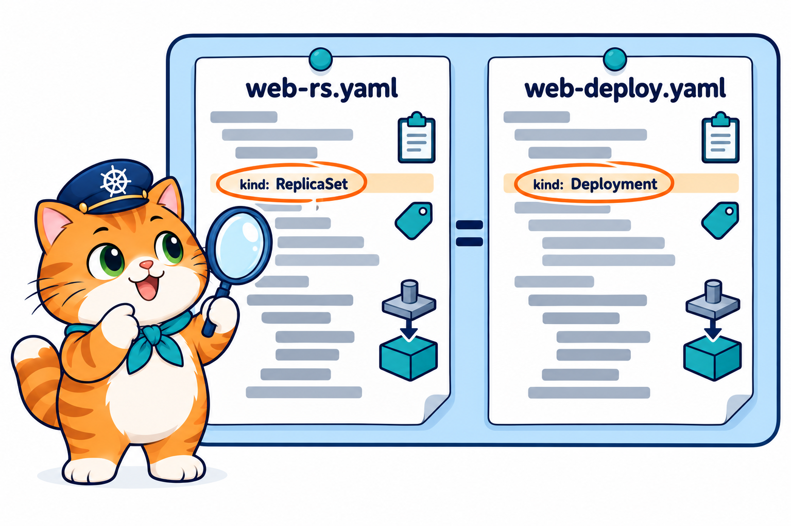
</p>

เอา `web-rs.yaml` จากบทที่ 3 มาวางคู่กับ `web-deploy.yaml` ของบทนี้ (ตัด comment ออก) **วงสีเดียวกัน = ส่วนที่คู่กัน** ลูกศรบอกว่าส่วนนั้นเปลี่ยน เพิ่มใหม่ หรือ copy มาจากไฟล์ ReplicaSet

<p align="center">
  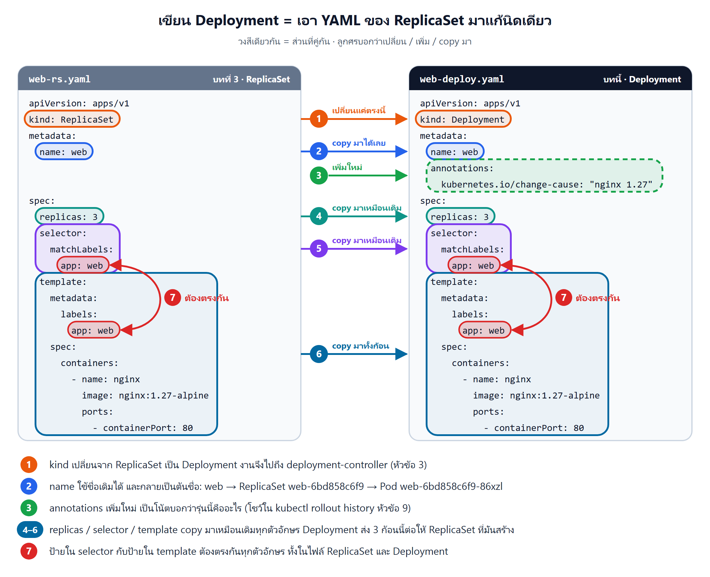
</p>

อ่านตามเลขในภาพ

- **① `kind` เปลี่ยนแค่ตรงนี้** จาก `ReplicaSet` เป็น `Deployment` (`apiVersion: apps/v1` เหมือนเดิม) งานจึงไปถึง deployment-controller แทน replicaset-controller
- **② `name` copy มาได้เลย** ชื่อนี้กลายเป็นต้นชื่อของทุกอย่างที่ Deployment สร้าง: `web` → ReplicaSet `web-6bd858c6f9` → Pod `web-6bd858c6f9-86xzl`
- **③ `annotations` เพิ่มใหม่** มีเฉพาะฝั่ง Deployment เป็นโน้ตบอกว่ารุ่นนี้คืออะไร ไม่บังคับ แต่ทำให้ประวัติรุ่นอ่านง่าย (หัวข้อ 9)
- **④ ⑤ ⑥ `replicas` / `selector` / `template` copy มาเหมือนเดิมทุกตัวอักษร** 3 ก้อนนี้คือสิ่งที่ ReplicaSet ต้องใช้ Deployment จึงรับไว้แล้ว **ส่งต่อให้ ReplicaSet ที่มันสร้าง** เราจึงไม่ต้องเขียน ReplicaSet เองเลย
- **⑦ ป้ายต้องตรงกัน** `app: web` ใต้ `selector` กับ `app: web` ใต้ `template.metadata.labels` ต้องเหมือนกันทุกตัวอักษร กฎนี้ใช้ทั้งไฟล์ ReplicaSet และ Deployment (ไม่ตรง = apply ไม่ผ่าน)
- `metadata` / `spec` ระดับบนสุด = ของ **Deployment** ส่วน `template.metadata` / `template.spec` = ของ **Pod** เหมือนบทที่ 3

### 4.2 ไล่ไฟล์จริงจาก LAB 1

ไฟล์ `02_LAB/labs/lab01-first-deploy/web-deploy.yaml`

```yaml
# LAB 1, 2, 3: Deployment แรก — ขอ Pod nginx 3 ตัว โดย Deployment สร้าง ReplicaSet มาดูแล Pod ให้อีกชั้น
apiVersion: apps/v1          # กลุ่มเดียวกับ ReplicaSet
kind: Deployment             # ← เทียบกับ web-rs.yaml ในบทที่ 3 เปลี่ยนแค่ตรงนี้ (กับ annotations)
metadata:
  name: web                  # ชื่อ Deployment → ReplicaSet ชื่อ web-<hash> → Pod ชื่อ web-<hash>-<สุ่ม>
  annotations:
    kubernetes.io/change-cause: "nginx 1.27"   # บันทึกว่ารุ่นนี้คืออะไร โชว์ใน kubectl rollout history
spec:
  replicas: 3                # อยากได้ Pod 3 ตัวตลอดเวลา
  selector:                  # นับ Pod จากป้าย app=web (เหมือน ReplicaSet)
    matchLabels:
      app: web
  template:                  # แม่พิมพ์ Pod — เปลี่ยนแม่พิมพ์เมื่อไร Deployment จะทยอยเปลี่ยน Pod ให้
    metadata:
      labels:
        app: web             # ต้องตรงกับ selector
    spec:
      containers:
        - name: nginx
          image: nginx:1.27-alpine
          ports:
            - containerPort: 80
```

ไฟล์นี้ใช้ใน LAB 1, LAB 2 และ LAB 3 อ่านง่ายที่สุดถ้าแบ่งเป็น **4 ก้อน** แล้วถามทีละก้อนว่า "ก้อนนี้เป็นของใคร และมีไว้ทำอะไร"

**ก้อนที่ 1: `apiVersion` + `kind` — บอกว่านี่คือ object อะไร**

```yaml
apiVersion: apps/v1
kind: Deployment
```

- `kind: Deployment` บอก kube-apiserver ว่าไฟล์นี้คือ Deployment งานจึงไปถึง **deployment-controller** (หัวข้อ 3) ถ้าเขียน `kind: ReplicaSet` งานจะไปที่ replicaset-controller แทน และจะไม่มีการทยอยเปลี่ยนรุ่นให้
- `apps/v1` = กลุ่ม `apps` รุ่น `v1` กลุ่มเดียวกับ ReplicaSet (ส่วน Pod อยู่กลุ่มหลัก จึงเขียนแค่ `v1`)

**ก้อนที่ 2: `metadata` — ชื่อและโน้ตของตัว Deployment**

```yaml
metadata:
  name: web
  annotations:
    kubernetes.io/change-cause: "nginx 1.27"
```

- `name: web` คือ **ตัวตน** ของ Deployment apply ไฟล์ที่ใช้ชื่อเดิมซ้ำ = แก้ตัวเดิม (ขึ้น `configured` แบบ LAB 2) ชื่อนี้ยังเป็น **ต้นชื่อ** ของ ReplicaSet (`web-6bd858c6f9`) และ Pod (`web-6bd858c6f9-86xzl`) ด้วย
- `annotations` = โน้ตที่แปะไว้ให้คนอ่าน Kubernetes ไม่ได้ใช้ตัดสินอะไร ส่วน `kubernetes.io/change-cause` จะไปโผล่ในคอลัมน์ `CHANGE-CAUSE` ของ `rollout history` (หัวข้อ 9)
- โน้ตนี้ **ไม่ทำให้เกิดการเปลี่ยนรุ่น** ตอนเตรียม LAB ลองแก้แค่ข้อความ change-cause แล้ว apply ได้ `configured` แต่ยังเป็น revision 1, ReplicaSet ตัวเดิม และไม่มี Pod ไหนถูกแตะ เปลี่ยนแค่ข้อความในประวัติของรุ่นปัจจุบัน จึงต้องแก้โน้ต **พร้อมกับ** แม่พิมพ์ทุกครั้ง (แบบไฟล์ของ LAB 2)

**ก้อนที่ 3: `spec` ระดับบน — Deployment อยากได้อะไร**

```yaml
spec:
  replicas: 3
  selector:
    matchLabels:
      app: web
```

- `replicas: 3` = อยากได้ Pod 3 ตัว Deployment **ส่งเลขนี้ต่อให้ ReplicaSet** (LAB 1 เห็น `DESIRED 3`) แก้เลขนี้ = scale ReplicaSet ตัวเดิม ไม่ใช่การเปลี่ยนรุ่น
- `selector` = นับ Pod ที่ติดป้าย `app=web` ReplicaSet ที่ Deployment สร้างจะได้ selector นี้ **บวก `pod-template-hash`** ที่เติมให้เอง (หัวข้อ 5.1) ทีมเก่ากับทีมใหม่จึงไม่นับ Pod ของกันและกัน
- `selector` ต้องตรงกับป้ายใน `template` ทุกตัวอักษร ไม่งั้น Kubernetes ปฏิเสธตั้งแต่ apply (เหมือนบทที่ 3)

ไฟล์นี้ไม่ได้เขียนวิธีเปลี่ยนรุ่นไว้ Deployment จึง **เติมค่าเริ่มต้นให้เอง** ดูได้จาก `kubectl get deploy web -o yaml` (ทดลองตอนเตรียม LAB ตัดมาเฉพาะบรรทัดที่เกี่ยวข้อง)

```text
spec:
  progressDeadlineSeconds: 600     ← เปลี่ยนรุ่นค้างเกิน 600 วินาที = ล้มเหลว (หัวข้อ 11)
  ...
  strategy:
    rollingUpdate:
      maxSurge: 25%                ← มี Pod เกิน replicas ได้ 25% (หัวข้อ 8)
      maxUnavailable: 25%          ← Pod ที่พร้อมขาดจาก replicas ได้ 25% (หัวข้อ 8)
    type: RollingUpdate            ← เปลี่ยนรุ่นแบบทยอย (หัวข้อ 7)
```

ค่าเหล่านี้เป็นของ **Deployment เท่านั้น** (ReplicaSet ไม่มี) จึงอยู่ใต้ `spec` ระดับบน ไม่ได้อยู่ใต้ `template` LAB 3 และ LAB 4 จะเขียนค่าเหล่านี้เองในไฟล์

**ก้อนที่ 4: `template` — แม่พิมพ์ของ Pod**

```yaml
  template:
    metadata:
      labels:
        app: web
    spec:
      containers:
        - name: nginx
          image: nginx:1.27-alpine
          ports:
            - containerPort: 80
```

- ทุกบรรทัดใต้ `template` เป็นของ **Pod** (หน้าตาเหมือนไฟล์ Pod ในบทที่ 2 ที่ตัด `apiVersion` / `kind` ออก) Deployment ไม่ได้ใช้เอง แต่ส่งต่อให้ ReplicaSet ใช้ปั๊ม Pod
- `labels` ต้องตรงกับ `selector` ในก้อนที่ 3 Pod ที่ปั๊มออกมาจึงถูกนับ
- `containers` = ข้างใน Pod มี container ชื่อ `nginx` ใช้ image `nginx:1.27-alpine` และแอปฟัง port 80
- **ก้อนนี้สำคัญที่สุดของบท** Deployment คำนวณ `pod-template-hash` จากก้อนนี้ แก้บรรทัดไหนก็ได้ในก้อนนี้ (เช่น `image`) → hash ใหม่ → ReplicaSet ใหม่ → rolling update → revision ใหม่ (หัวข้อ 7)

**แก้บรรทัดไหน แล้วเกิดอะไร** สรุปจากการทดลองจริง

| แก้อะไรแล้ว apply | สิ่งที่เกิด | revision ใหม่? | เห็นที่ |
|---|---|:---:|---|
| `replicas` | ReplicaSet ตัวเดิมเพิ่ม/ลด Pod | ไม่ | LAB 1 ขั้นที่ 9 |
| `image` (หรือบรรทัดใดก็ได้ใน `template`) | ได้ ReplicaSet ใหม่ ทยอยเปลี่ยน Pod ทีละตัว | ใช่ | LAB 2 ขั้นที่ 3–4 |
| แค่ `change-cause` | ข้อความในประวัติรุ่นปัจจุบันเปลี่ยน Pod ไม่ถูกแตะ | ไม่ | ทดลองตอนเตรียม LAB |

แปลทั้งไฟล์เป็นประโยคเดียว: **"ขอ Deployment ชื่อ `web` (รุ่น "nginx 1.27") ดูแล Pod ที่ติดป้าย `app=web` ให้มี 3 ตัวเสมอ โดยสร้างจากแม่พิมพ์ที่มี container `nginx` ใช้ image `nginx:1.27-alpine` ฟัง port 80"**

> 🧪 **พิสูจน์ใน LAB:** อ่านไฟล์แรกเทียบกับ `web-rs.yaml` ของบทที่ 3 ก่อน apply → **LAB 1** ขั้นที่ [1](../02_LAB/README.md#ขั้นที่-1-ไฟล์-deployment-แรก)

---

## 5. ชื่อ Pod 3 ท่อน และเจ้าของ 2 ชั้น

> 🎯 **หัวข้อนี้เรียนเพื่อ:** อ่าน **ชื่อ Pod และป้าย** ให้ออกว่ามาจาก Deployment ไหน แม่พิมพ์รุ่นไหน เพราะตอนเปลี่ยนรุ่นใน LAB 2–4 ต้องแยกให้ได้ว่า Pod ตัวไหนรุ่นเก่า ตัวไหนรุ่นใหม่

<p align="center">
  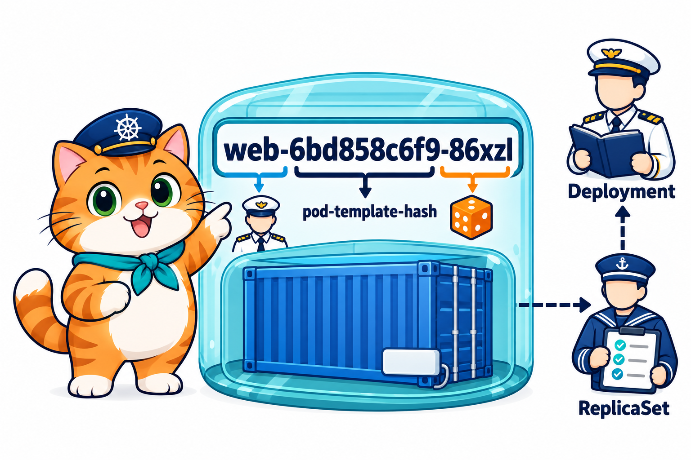
</p>

### 5.1 ชื่อ 3 ท่อน และ pod-template-hash

ชื่อ Pod ของ Deployment มี 3 ท่อน เช่น `web-6bd858c6f9-86xzl`

- `web` = ชื่อ **Deployment**
- `6bd858c6f9` = **pod-template-hash** ตัวเลขที่คำนวณจากแม่พิมพ์ (`template`) → ใช้เป็นชื่อท้ายของ **ReplicaSet** `web-6bd858c6f9`
- `86xzl` = สุ่ม 5 ตัว ให้ Pod ไม่ซ้ำกัน (เหมือนบทที่ 3)

Deployment ติดป้าย `pod-template-hash` ให้ Pod ทุกตัวเพิ่มเอง (LAB 1)

```text
$ kubectl get pods --show-labels
NAME                   READY   STATUS    RESTARTS   AGE   LABELS
web-6bd858c6f9-86xzl   1/1     Running   0          10s   app=web,pod-template-hash=6bd858c6f9
web-6bd858c6f9-kmn4v   1/1     Running   0          10s   app=web,pod-template-hash=6bd858c6f9
web-6bd858c6f9-xj2vm   1/1     Running   0          10s   app=web,pod-template-hash=6bd858c6f9
```

- **แม่พิมพ์เดิม = hash เดิม** ใน LAB 1 ลบ ReplicaSet แล้วตัวที่เกิดใหม่ก็ยังชื่อ `web-6bd858c6f9`
- **แม่พิมพ์ใหม่ = hash ใหม่** ใน LAB 2 เปลี่ยนเป็น nginx 1.28 ได้ ReplicaSet `web-5b86859d48`
- selector ของ ReplicaSet มี `pod-template-hash` ด้วย (`app=web,pod-template-hash=6bd858c6f9`) ทีมเก่ากับทีมใหม่จึง **ไม่นับ Pod ของกันและกัน** แม้ทุกตัวจะติด `app=web` เหมือนกัน (บทที่ 3 หัวข้อ 8 เตือนเรื่องป้ายซ้ำ ข้อนี้ Deployment จัดการให้)

### 5.2 เจ้าของ 2 ชั้น

ดู `ownerReferences` จาก LAB 1 (ตัดมาบางบรรทัด)

```yaml
# kubectl get pod web-6bd858c6f9-86xzl -o yaml
metadata:
  name: web-6bd858c6f9-86xzl
  ownerReferences:
  - kind: ReplicaSet           # ← เจ้าของของ Pod คือ ReplicaSet
    name: web-6bd858c6f9

# kubectl get rs web-6bd858c6f9 -o yaml
metadata:
  name: web-6bd858c6f9
  ownerReferences:
  - kind: Deployment           # ← เจ้าของของ ReplicaSet คือ Deployment
    name: web
```

- Pod → ReplicaSet → Deployment เป็น **สายเจ้าของ 2 ชั้น**
- ลบ Deployment แล้ว ReplicaSet และ Pod หายตามทั้งสาย (LAB 1 ตอนท้าย: `kubectl delete -f` แล้ว `get deploy`, `get rs`, `get pods` ขึ้น `No resources found` ทั้งหมด)

> 🧪 **พิสูจน์ใน LAB:** `ownerReferences` 2 ชั้น และลบ Deployment ตัวเดียว ทั้งสายหายตาม → **LAB 1** ขั้นที่ [4](../02_LAB/README.md#ขั้นที่-4-เจ้าของ-2-ชั้น), [10](../02_LAB/README.md#ขั้นที่-10-ลบ-deployment)

---

## 6. ใครดูแลอะไร: Deployment หรือ ReplicaSet

> 🎯 **หัวข้อนี้เรียนเพื่อ:** รู้ว่า **ต้องสั่งงานที่ชั้นไหน** เพราะถ้าสั่งผิดชั้น (เช่น scale ที่ ReplicaSet) คำสั่งจะดูเหมือนสำเร็จ แต่ถูกแก้กลับโดยไม่บอก

<p align="center">
  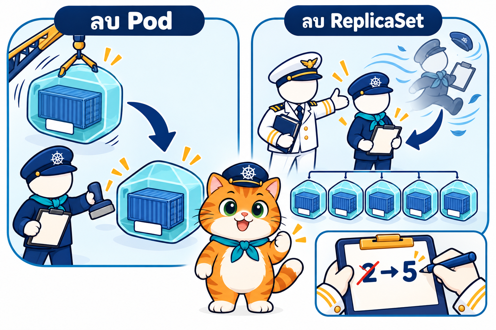
</p>

ใน LAB 1 ลองรบกวนทุกชั้น แล้วดูว่าใครแก้ให้

| เกิดอะไรขึ้น | ใครจัดการ | ผลลัพธ์ |
|---|---|---|
| ลบ Pod 1 ตัว | **ReplicaSet** | สร้าง Pod ใหม่มาแทน (`web-6bd858c6f9-mcvkz`) เหมือนบทที่ 3 |
| ลบ ReplicaSet | **Deployment** | สร้าง ReplicaSet ใหม่ชื่อเดิม แต่ Pod เดิมถูกลบตามไปด้วย |
| `kubectl scale deployment web --replicas=5` | **Deployment** | ปรับ ReplicaSet เป็น 5 → ได้ 5 Pod |
| `kubectl scale rs ... --replicas=2` | **Deployment แก้กลับ** | ReplicaSet เด้งกลับเป็น 5 |
| `apply` ไฟล์ที่เขียน `replicas: 3` | **ไฟล์ชนะ** | กลับเป็น 3 |

### ลบ ReplicaSet: ได้คืน แต่ร้านปิดชั่วครู่

```text
$ kubectl delete rs web-6bd858c6f9
replicaset.apps "web-6bd858c6f9" deleted from default namespace

$ kubectl get rs
NAME             DESIRED   CURRENT   READY   AGE
web-6bd858c6f9   3         3         0       0s       ← ReplicaSet ใหม่ ชื่อเดิม (แม่พิมพ์เดิม)

$ kubectl get pods
NAME                   READY   STATUS              RESTARTS   AGE
web-6bd858c6f9-7n5g4   0/1     ContainerCreating   0          0s
web-6bd858c6f9-kmn4v   1/1     Terminating         0          16s
web-6bd858c6f9-mcvkz   1/1     Terminating         0          6s
web-6bd858c6f9-mmqqd   0/1     ContainerCreating   0          0s
web-6bd858c6f9-ntpv4   0/1     ContainerCreating   0          0s
web-6bd858c6f9-xj2vm   1/1     Terminating         0          16s
```

Pod เก่า 3 ตัวถูกลบตามเจ้าของ (หัวข้อ 5.2) ส่วน Pod ใหม่ยังไม่พร้อม (`READY 0`) ระยะสั้น ๆ นี้ **ไม่มีสาขาไหนเปิด** จึงไม่ควรลบ ReplicaSet เล่น ๆ

### กับดัก: scale ที่ ReplicaSet แล้วเด้งกลับ

```text
$ kubectl scale rs web-6bd858c6f9 --replicas=2
replicaset.apps/web-6bd858c6f9 scaled

$ kubectl get rs
NAME             DESIRED   CURRENT   READY   AGE
web-6bd858c6f9   5         5         5       13s      ← กลับเป็น 5 แล้ว

$ kubectl get pods
NAME                   READY   STATUS    RESTARTS   AGE
web-6bd858c6f9-5xlvp   1/1     Running   0          8s
web-6bd858c6f9-d7725   1/1     Running   0          3s   ← เกิดใหม่
web-6bd858c6f9-gr4jq   1/1     Running   0          3s   ← เกิดใหม่
web-6bd858c6f9-ntpv4   1/1     Running   0          13s
web-6bd858c6f9-w2gqx   1/1     Running   0          3s   ← เกิดใหม่
```

คำสั่งได้ `scaled` จริง ReplicaSet ลบไป 3 ตัวจริง แต่ deployment-controller เห็นว่า ReplicaSet มี 2 ไม่ตรงกับ Deployment ที่ขอ 5 จึง **ตั้งกลับเป็น 5** แล้ว ReplicaSet สร้างใหม่ 3 ตัว (AGE `3s`)

> **⚠️ กับดัก:** เมื่อมี Deployment แล้ว **สั่งงานที่ Deployment หรือไฟล์ของ Deployment เท่านั้น** อย่าไปแก้ ReplicaSet ตรง ๆ ผู้จัดการจะแก้กลับทุกครั้ง และสุดท้าย `apply` ไฟล์ก็ชนะทุกคำสั่ง (ใน LAB 1 apply แล้วกลับเป็น `3/3`)

> 🧪 **พิสูจน์ใน LAB:** ลบ Pod / ลบ ReplicaSet แล้วได้คืน, scale ที่ ReplicaSet แล้วเด้งกลับ และ apply ไฟล์แล้วไฟล์ชนะ → **LAB 1** ขั้นที่ [5](../02_LAB/README.md#ขั้นที่-5-ลบ-pod-1-ตัว), [6](../02_LAB/README.md#ขั้นที่-6-ลบ-replicaset-ทั้งตัว), [7](../02_LAB/README.md#ขั้นที่-7-scale-ที่-deployment), [8](../02_LAB/README.md#ขั้นที่-8-กับดัก--scale-ที่-replicaset), [9](../02_LAB/README.md#ขั้นที่-9-apply-ไฟล์เดิมอีกครั้ง)

---

## 7. Rolling update: ทยอยเปลี่ยนทีละ Pod

> 🎯 **หัวข้อนี้เรียนเพื่อ:** เข้าใจ **หัวใจของบท**: Deployment เปลี่ยนเวอร์ชันโดยร้านไม่ปิดได้อย่างไร และทำไมแก้แม่พิมพ์แล้วได้ ReplicaSet ตัวใหม่

<p align="center">
  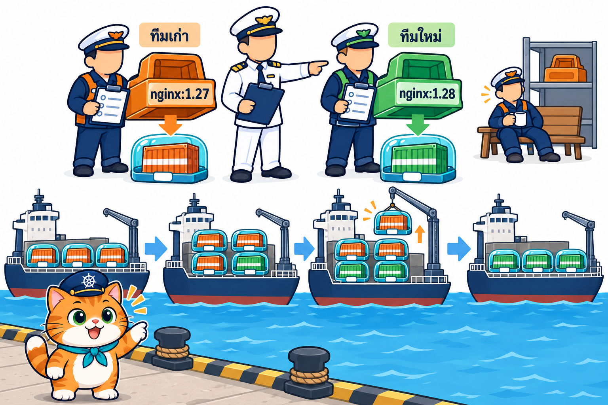
</p>

**Rolling update** = เปลี่ยนรุ่นแบบ **ทยอยเพิ่ม Pod รุ่นใหม่ แล้วลด Pod รุ่นเก่า** ทีละนิด จนครบ ร้านจึงมีสาขาเปิดอยู่ตลอด

ใน LAB 2 ไฟล์ `labs/lab02-rolling-update/web-deploy-v2.yaml` ต่างจากไฟล์เดิมแค่ 2 บรรทัด

```yaml
  annotations:
    kubernetes.io/change-cause: "nginx 1.28"   # ← เปลี่ยน
...
        - name: nginx
          image: nginx:1.28-alpine   # ← เปลี่ยน: แม่พิมพ์เปลี่ยน → Deployment ทยอยเปลี่ยน Pod ทีละตัว
```

apply แล้วได้ `configured` (ชื่อเดิม = แก้ตัวเดิม) เพราะแม่พิมพ์เปลี่ยน hash จึงเปลี่ยน Deployment จึงสร้าง **ReplicaSet ใหม่** แล้วสลับตัวเลขของสองทีม ดูได้จาก Events ของ `kubectl describe deploy web` (LAB 2)

```text
Events:
  Type    Reason             Age   From                   Message
  Normal  ScalingReplicaSet  27s   deployment-controller  Scaled up replica set web-6bd858c6f9 from 0 to 3
  Normal  ScalingReplicaSet  17s   deployment-controller  Scaled up replica set web-5b86859d48 from 0 to 1
  Normal  ScalingReplicaSet  8s    deployment-controller  Scaled down replica set web-6bd858c6f9 from 3 to 2
  Normal  ScalingReplicaSet  8s    deployment-controller  Scaled up replica set web-5b86859d48 from 1 to 2
  Normal  ScalingReplicaSet  1s    deployment-controller  Scaled down replica set web-6bd858c6f9 from 2 to 1
  Normal  ScalingReplicaSet  1s    deployment-controller  Scaled up replica set web-5b86859d48 from 2 to 3
  Normal  ScalingReplicaSet  0s    deployment-controller  Scaled down replica set web-6bd858c6f9 from 1 to 0
```

อ่านเป็นจังหวะ (เก่า + ใหม่ นับตอนที่มี Pod มากที่สุด): **3+0 → 3+1 → 2+2 → 1+3 → 0+3** ทุกครั้งที่ตัวใหม่พร้อม 1 ตัว ทีมเก่าจึงลดลง 1 แล้วทีมใหม่เพิ่มอีก 1 (เห็นคู่ `Scaled down` / `Scaled up` ที่ Age เดียวกัน)

หลังเปลี่ยนเสร็จ

```text
$ kubectl get rs -o wide
NAME             DESIRED   CURRENT   READY   AGE   CONTAINERS   IMAGES              SELECTOR
web-5b86859d48   3         3         3       17s   nginx        nginx:1.28-alpine   app=web,pod-template-hash=5b86859d48
web-6bd858c6f9   0         0         0       27s   nginx        nginx:1.27-alpine   app=web,pod-template-hash=6bd858c6f9
```

- ReplicaSet ใหม่ (`nginx:1.28-alpine`) มี 3 ตัว
- ReplicaSet เก่า (`nginx:1.27-alpine`) **เหลือ 0 แต่ยังไม่ถูกลบ** เหมือนแม่พิมพ์เก่าเก็บไว้บนชั้น หัวหน้าทีมเก่านั่งพัก พร้อมถูกปลุกตอนย้อนกลับ (หัวข้อ 10)

> **ประโยคเดียวที่ต้องจำ:** เปลี่ยน `template` = ได้ **ReplicaSet ใหม่** 1 ตัว ส่วนเปลี่ยนแค่ `replicas` (scale) **ไม่** สร้าง ReplicaSet ใหม่ แค่ปรับตัวเลขของตัวเดิม

> 🧪 **พิสูจน์ใน LAB:** แก้ `image` แล้วได้ ReplicaSet ใหม่ Pod ถูกทยอยเปลี่ยนทีละตัว → **LAB 2** ขั้นที่ [2](../02_LAB/README.md#ขั้นที่-2-ไฟล์รุ่นใหม่), [3](../02_LAB/README.md#ขั้นที่-3-เปลี่ยนรุ่น), [4](../02_LAB/README.md#ขั้นที่-4-replicaset-เก่ากับใหม่) · **LAB 4** ขั้นที่ [6](../02_LAB/README.md#ขั้นที่-6-เปลี่ยนเป็นเมนูเวอร์ชัน-20)

---

## 8. maxSurge, maxUnavailable และ minReadySeconds

> 🎯 **หัวข้อนี้เรียนเพื่อ:** รู้ว่า **ตัวเลขไหนคุมจังหวะการเปลี่ยนรุ่น** และตั้งค่าอย่างไรให้ร้านไม่ปิดแม้แต่วินาทีเดียว (LAB 4 ตั้งค่าเหล่านี้เอง)

<p align="center">
  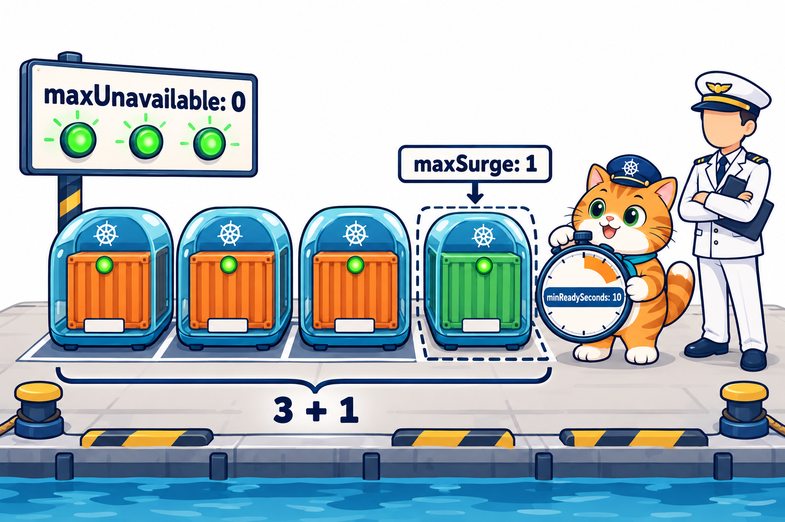
</p>

ระหว่าง rolling update Deployment ใช้ 2 ตัวเลขคุมจังหวะ

- **`maxSurge`** = มี Pod **เกิน** `replicas` ได้กี่ตัว (ช่องจอดสำรอง)
- **`maxUnavailable`** = Pod ที่พร้อม **ขาด** จาก `replicas` ได้กี่ตัว

### ค่าเริ่มต้น 25% / 25%

ถ้าไม่ได้เขียน Deployment ใช้ 25% ทั้งคู่ เห็นใน `kubectl describe deploy web` (LAB 1)

```text
StrategyType:           RollingUpdate
MinReadySeconds:        0
RollingUpdateStrategy:  25% max unavailable, 25% max surge
```

กับ `replicas: 3` → 25% ของ 3 = 0.75

- `maxSurge` **ปัดขึ้น** → **1** (มีได้สูงสุด 3 + 1 = 4 Pod) ตรงกับ annotation `deployment.kubernetes.io/max-replicas: "4"` บน ReplicaSet ใน LAB 1
- `maxUnavailable` **ปัดลง** → **0** (ห้ามมี Pod พร้อมน้อยกว่า 3)

นี่คือเหตุผลที่ LAB 2 เดินเป็น 3+1 → 2+2 → 1+3 → 0+3: เพิ่มใหม่ได้ทีละ 1 และต้องรอตัวใหม่พร้อมก่อนลบตัวเก่า

### ตั้งเองในร้านน้องส้ม (LAB 4)

```yaml
spec:
  replicas: 3                    # เปิด 3 สาขา = Pod 3 ตัว
  minReadySeconds: 10            # สาขาใหม่ต้องพร้อมต่อเนื่อง 10 วินาที จึงนับว่าเปิดแล้ว (ช้าลงพอให้เห็นการเปลี่ยนรุ่น)
  strategy:
    type: RollingUpdate          # เปลี่ยนรุ่นแบบทยอยทีละสาขา (ค่าเริ่มต้นของ Deployment)
    rollingUpdate:
      maxSurge: 1                # เปิดสาขาใหม่เกิน 3 ได้ทีละ 1 สาขา
      maxUnavailable: 0          # สาขาที่พร้อมต้องไม่ต่ำกว่า 3 เลย → ร้านไม่ปิดระหว่างเปลี่ยนรุ่น
```

- ผลลัพธ์เหมือนค่าเริ่มต้นของ 3 Pod แต่ **เขียนชัด ๆ** คนอ่านไฟล์รู้ทันทีว่าร้านจะไม่ปิด
- **`minReadySeconds: 10`** = Pod ใหม่ต้อง READY ต่อเนื่อง 10 วินาทีก่อนนับว่า "available" ทำให้แต่ละจังหวะช้าลงจนมองทัน และกันกรณีแอปพร้อมแป๊บเดียวแล้วล้ม

ผลจริงหลัง apply `som-menu-deploy-v2.yaml` 3 วินาที (LAB 4): ทีมเก่า 3 + ทีมใหม่ 1 = 4 Pod พอดี

```text
$ kubectl get rs
NAME                  DESIRED   CURRENT   READY   AGE
som-menu-5f5c95db8f   3         3         3       44s
som-menu-6bf6c9f6c5   1         1         1       3s

$ kubectl get pods --show-labels
NAME                        READY   STATUS    RESTARTS   AGE   LABELS
som-menu-5f5c95db8f-7zv4t   1/1     Running   0          44s   app=som-menu,pod-template-hash=5f5c95db8f,version=1.0
som-menu-5f5c95db8f-ml4l4   1/1     Running   0          44s   app=som-menu,pod-template-hash=5f5c95db8f,version=1.0
som-menu-5f5c95db8f-xlmhm   1/1     Running   0          44s   app=som-menu,pod-template-hash=5f5c95db8f,version=1.0
som-menu-6bf6c9f6c5-dfxqw   1/1     Running   0          3s    app=som-menu,pod-template-hash=6bf6c9f6c5,version=2.0
```

ตัวใหม่ READY แล้วก็จริง แต่ตัวเก่ายังไม่ถูกลบ เพราะต้องรอครบ `minReadySeconds` ก่อน ช่วงนี้ร้านมี **สองรุ่นปนกัน** (v1.0 และ v2.0) ลูกค้าแต่ละคนอาจเจอคนละรุ่น

> **เคล็ดลับ:** Deployment ยังมีอีกแบบคือ `type: Recreate` = ลบ Pod เก่าทั้งหมดก่อนแล้วค่อยสร้างใหม่ (ร้านปิดชั่วครู่ แต่ไม่มีสองรุ่นปนกัน) LAB ไม่ได้ใช้

> 🧪 **พิสูจน์ใน LAB:** จังหวะเพิ่มใหม่-ลดเก่าใน Events และสาขาที่พร้อมไม่ต่ำกว่า 3 ตลอดการเปลี่ยนรุ่น → **LAB 2** ขั้นที่ [5](../02_LAB/README.md#ขั้นที่-5-ดูจังหวะการเปลี่ยนรุ่นใน-events) · **LAB 3** ขั้นที่ [4](../02_LAB/README.md#ขั้นที่-4-ร้านยังเปิดอยู่ไหม) · **LAB 4** ขั้นที่ [3](../02_LAB/README.md#ขั้นที่-3-เปิดร้าน-3-สาขาด้วย-deployment), [6](../02_LAB/README.md#ขั้นที่-6-เปลี่ยนเป็นเมนูเวอร์ชัน-20), [7](../02_LAB/README.md#ขั้นที่-7-รอให้เปลี่ยนรุ่นเสร็จ)

---

## 9. ติดตามการเปลี่ยนรุ่น: rollout status และ history

> 🎯 **หัวข้อนี้เรียนเพื่อ:** รู้วิธี **ติดตามว่าการเปลี่ยนรุ่นเสร็จหรือยัง** และดูว่าเคยมีรุ่นอะไรบ้าง ก่อนตัดสินใจย้อนกลับ

<p align="center">
  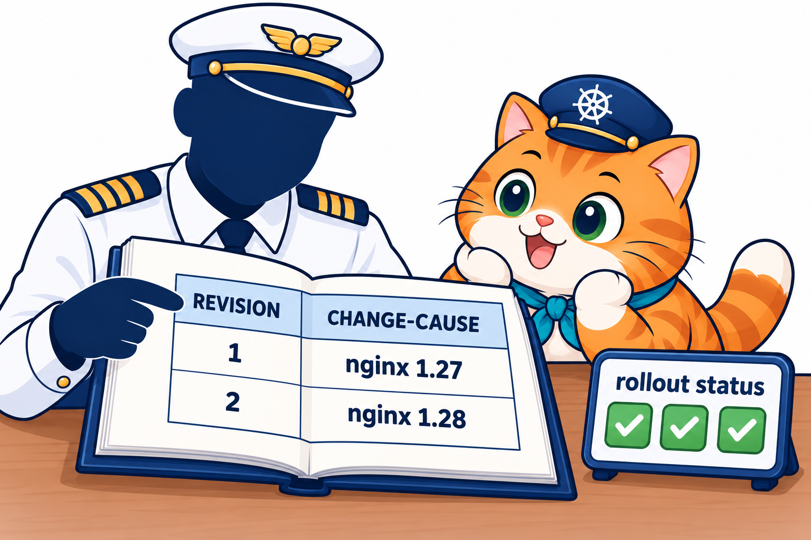
</p>

คำสั่งกลุ่ม `kubectl rollout` ใช้กับ Deployment (ผู้จัดการ) โดยตรง

**`kubectl rollout status`** = เฝ้าดูจนเปลี่ยนรุ่นเสร็จ (LAB 2 ตัดบรรทัดซ้ำออก)

```text
$ kubectl rollout status deployment/web
Waiting for deployment "web" rollout to finish: 0 out of 3 new replicas have been updated...
Waiting for deployment "web" rollout to finish: 1 out of 3 new replicas have been updated...
Waiting for deployment "web" rollout to finish: 2 out of 3 new replicas have been updated...
Waiting for deployment "web" rollout to finish: 1 old replicas are pending termination...
deployment "web" successfully rolled out
```

- คำสั่งนี้ **ค้างรอ** จนเสร็จ (หรือจนล้มเหลว หัวข้อ 11) เหมาะใช้ต่อท้ายทุกครั้งที่ apply รุ่นใหม่
- `old replicas are pending termination` = ทีมใหม่ครบแล้ว รอตัวเก่าตัวสุดท้ายปิด

**`kubectl rollout history`** = เปิดสมุดบันทึกรุ่น

```text
$ kubectl rollout history deployment/web
deployment.apps/web
REVISION  CHANGE-CAUSE
1         nginx 1.27
2         nginx 1.28
```

- **REVISION** = เลขรุ่น เพิ่มขึ้นทุกครั้งที่ **แม่พิมพ์เปลี่ยน** (scale ไม่นับ) 1 revision = 1 ReplicaSet
- **CHANGE-CAUSE** = ข้อความจาก annotation `kubernetes.io/change-cause` ในไฟล์ ถ้าไม่ได้เขียนจะขึ้น `<none>` จนแยกไม่ออกว่ารุ่นไหนคืออะไร
- เลขรุ่นปัจจุบันดูได้จาก `deployment.kubernetes.io/revision: 2` ใน `kubectl describe deploy web`

> 🧪 **พิสูจน์ใน LAB:** `rollout status` รอจนเสร็จหรือจนล้มเหลว และ `rollout history` แสดงรุ่นพร้อม `CHANGE-CAUSE` → **LAB 2** ขั้นที่ [1](../02_LAB/README.md#ขั้นที่-1-สร้าง-deployment-รุ่นแรก), [3](../02_LAB/README.md#ขั้นที่-3-เปลี่ยนรุ่น), [6](../02_LAB/README.md#ขั้นที่-6-ดูประวัติรุ่น) · **LAB 3** ขั้นที่ [3](../02_LAB/README.md#ขั้นที่-3-apply-แล้วรอดู) · **LAB 4** ขั้นที่ [7](../02_LAB/README.md#ขั้นที่-7-รอให้เปลี่ยนรุ่นเสร็จ)

---

## 10. ย้อนกลับด้วย rollout undo

> 🎯 **หัวข้อนี้เรียนเพื่อ:** รู้วิธี **ย้อนกลับเมื่อรุ่นใหม่มีปัญหา** ด้วยคำสั่งเดียว และกับดักที่ตามมาหลังย้อน (ไฟล์ในมือกับคลัสเตอร์ไม่ตรงกัน)

<p align="center">
  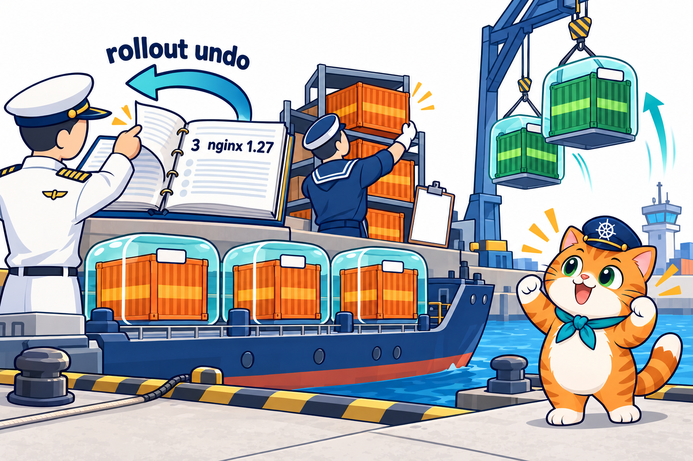
</p>

`kubectl rollout undo` = ผู้จัดการพลิกสมุดกลับไปหน้าก่อน แล้ว **ปลุก ReplicaSet เก่า** ที่นั่งพักอยู่ให้กลับมาทำงาน (LAB 2)

```text
$ kubectl rollout undo deployment/web
Warning: resource deployments/web was previously managed with 'kubectl apply'. Rolling back will not update the kubectl.kubernetes.io/last-applied-configuration annotation, which may cause unexpected behavior on future 'kubectl apply' operations. Consider using 'kubectl apply' with your previous configuration file instead.
deployment.apps/web rolled back

$ kubectl get rs -o wide
NAME             DESIRED   CURRENT   READY   AGE   CONTAINERS   IMAGES              SELECTOR
web-5b86859d48   0         0         0       19s   nginx        nginx:1.28-alpine   app=web,pod-template-hash=5b86859d48
web-6bd858c6f9   3         3         3       29s   nginx        nginx:1.27-alpine   app=web,pod-template-hash=6bd858c6f9

$ kubectl rollout history deployment/web
REVISION  CHANGE-CAUSE
2         nginx 1.28
3         nginx 1.27
```

- ย้อนกลับก็เป็น **rolling update อีกรอบ** (ทยอยทีละตัวเหมือนเดิม) แค่ใช้ ReplicaSet เก่าที่มีอยู่แล้ว ไม่ต้องสร้างใหม่
- **revision 1 หายไป กลายเป็น 3** เพราะแม่พิมพ์ 1.27 ถูกนำกลับมาใช้เป็นรุ่นล่าสุด (ReplicaSet เดิม เลขรุ่นใหม่)
- อยากย้อนไปรุ่นที่เจาะจง ใช้ `--to-revision=<เลข>` ได้ (LAB ไม่ได้ใช้)

### Warning นั้นบอกอะไร

> **⚠️ กับดัก:** `undo` เปลี่ยนแค่ในคลัสเตอร์ **ไฟล์ในมือยังเป็นรุ่นใหม่** ถ้าวันหลังมีคน `apply` ไฟล์ v2 เดิมซ้ำ ร้านจะเปลี่ยนกลับเป็นรุ่นที่เพิ่งหนีมาทันที (**ไฟล์ชนะ** เหมือนบทที่ 3) หลัง undo จึงต้อง **แก้ไฟล์ หรือ apply ไฟล์รุ่นเก่า** ให้คลัสเตอร์กับไฟล์ตรงกัน

ขั้นสุดท้ายของ LAB 4 ทำแบบนี้พอดี: undo กลับเป็นเมนู 1.0 แล้ว apply ไฟล์ v1

```text
$ kubectl apply -f som-menu/k8s/som-menu-deploy.yaml
deployment.apps/som-menu configured
```

ได้ `configured` แต่ `rollout history` ยังเป็น 2 กับ 3 เหมือนเดิม **ไม่มี revision ใหม่** และ Pod 3 ตัวเดิมไม่ถูกเปลี่ยน เพราะแม่พิมพ์ในไฟล์ตรงกับที่รันอยู่แล้ว การ apply นี้แค่บันทึกว่า "ไฟล์ที่ใช้ล่าสุดคือ v1" ให้ตรงกัน

> 🧪 **พิสูจน์ใน LAB:** undo ปลุก ReplicaSet เก่า เลข revision ขยับใหม่ แล้ว apply ไฟล์ให้ตรงกับคลัสเตอร์ → **LAB 2** ขั้นที่ [7](../02_LAB/README.md#ขั้นที่-7-ย้อนกลับ-rollback) · **LAB 3** ขั้นที่ [6](../02_LAB/README.md#ขั้นที่-6-ย้อนกลับ) · **LAB 4** ขั้นที่ [9](../02_LAB/README.md#ขั้นที่-9-ลูกค้าไม่ชอบเมนูใหม่-ย้อนกลับ), [11](../02_LAB/README.md#ขั้นที่-11-ทำให้ไฟล์ตรงกับคลัสเตอร์)

---

## 11. อัปเดตพัง แต่ร้านไม่ปิด

> 🎯 **หัวข้อนี้เรียนเพื่อ:** เห็นว่า **อัปเดตพังแล้วร้านไม่ปิดได้อย่างไร** และรู้วิธีหาสาเหตุ ซึ่งเป็นเหตุผลหลักที่งานจริงใช้ rolling update

<p align="center">
  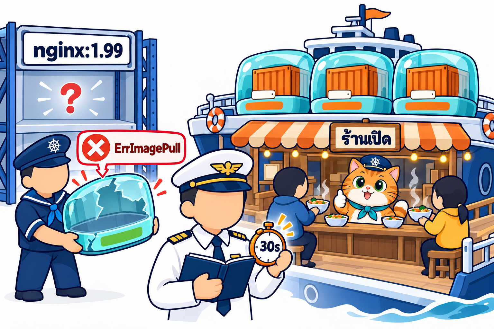
</p>

ใน LAB 3 ไฟล์ `labs/lab03-bad-update/web-deploy-bad.yaml` พิมพ์เลขรุ่นผิดเป็น `nginx:1.99-alpine` (ไม่มีอยู่จริง) และเพิ่ม field ใหม่ 1 ตัว

```yaml
spec:
  replicas: 3
  progressDeadlineSeconds: 30   # ← ใหม่: เปลี่ยนรุ่นไม่คืบหน้าเกิน 30 วินาที = ถือว่าล้มเหลว (ค่าเริ่มต้น 600)
...
        - name: nginx
          image: nginx:1.99-alpine   # ← พิมพ์ผิด: ไม่มีรุ่นนี้ใน Docker Hub → Pod ใหม่ดึง image ไม่ได้
```

ผลจริง: `rollout status` รอราว 30 วินาทีแล้วยอมแพ้

```text
$ time kubectl rollout status deployment/web
Waiting for deployment "web" rollout to finish: 1 out of 3 new replicas have been updated...
error: deployment "web" exceeded its progress deadline

real	0m30.846s
```

ดูสถานะทุกชั้น

```text
$ kubectl get deploy
NAME   READY   UP-TO-DATE   AVAILABLE   AGE
web    3/3     1            3           41s      ← ลูกค้ายังได้ 3 สาขา แต่มีแค่ 1 ตัวที่เป็นแม่พิมพ์ใหม่

$ kubectl get rs -o wide
NAME             DESIRED   CURRENT   READY   AGE   CONTAINERS   IMAGES              SELECTOR
web-5f795d85b    1         1         0       31s   nginx        nginx:1.99-alpine   app=web,pod-template-hash=5f795d85b
web-6bd858c6f9   3         3         3       41s   nginx        nginx:1.27-alpine   app=web,pod-template-hash=6bd858c6f9

$ kubectl get pods
NAME                   READY   STATUS         RESTARTS   AGE
web-5f795d85b-zgblt    0/1     ErrImagePull   0          31s
web-6bd858c6f9-27bw4   1/1     Running        0          41s
web-6bd858c6f9-d8dc6   1/1     Running        0          41s
web-6bd858c6f9-nqt9t   1/1     Running        0          41s
```

ใน `kubectl describe deploy web` เห็นสาเหตุที่ rollout status ยอมแพ้

```text
Conditions:
  Type           Status  Reason
  Available      True    MinimumReplicasAvailable
  Progressing    False   ProgressDeadlineExceeded
```

### ทำไมร้านไม่ปิด

- `maxUnavailable` เป็น 0 (หัวข้อ 8) → ห้ามลบ Pod เก่าจนกว่าตัวใหม่จะ **พร้อม**
- ตัวใหม่ดึง image ไม่ได้ (`ErrImagePull` อาการเดียวกับบทที่ 2) จึง **ไม่มีวันพร้อม** → ทีมเก่า 3 ตัวไม่ถูกแตะเลย
- ผลคือการเปลี่ยนรุ่น **ค้างอยู่ที่ขั้นแรก** แต่ลูกค้ายังได้ 3 สาขาเหมือนเดิม

คำว่า "พร้อม" ตัดสินจาก **readinessProbe** (บทที่ 2 หัวข้อ 10) nginx ใน LAB 3 ไม่มี probe จึงนับว่าพร้อมเมื่อ container รัน ส่วนร้านน้องส้มใน LAB 4 ต้องตอบ `/api/health` ได้ก่อน ถ้าแอปรุ่นใหม่รันได้แต่ตอบ health ไม่ได้ ก็จะค้างแบบเดียวกัน ร้านไม่ปิดเหมือนกัน

`progressDeadlineSeconds` **ไม่ได้ย้อนกลับให้อัตโนมัติ** แค่ติดธงว่าล้มเหลว เราต้องสั่ง undo เอง

```text
$ kubectl rollout undo deployment/web
Warning: resource deployments/web was previously managed with 'kubectl apply'. ...
deployment.apps/web rolled back

$ kubectl rollout status deployment/web
deployment "web" successfully rolled out

$ kubectl get pods
NAME                   READY   STATUS    RESTARTS   AGE
web-6bd858c6f9-27bw4   1/1     Running   0          46s
web-6bd858c6f9-d8dc6   1/1     Running   0          46s
web-6bd858c6f9-nqt9t   1/1     Running   0          46s
```

Pod 3 ตัวเป็น **ตัวเดิม** (AGE 46s) ไม่มีใครถูกสร้างใหม่ เพราะทีมเก่ายังครบอยู่แล้ว undo แค่ลดทีมใหม่ที่พังเหลือ 0

> **ประโยคเดียวที่ต้องจำ:** rolling update ที่ `maxUnavailable: 0` + readinessProbe ทำให้ **อัปเดตพังได้ แต่ร้านไม่ปิด** แล้วค่อย `rollout undo`

> 🧪 **พิสูจน์ใน LAB:** image ผิดแต่ยัง `READY 3/3` และหลัง undo Pod 3 ตัวเดิมยังอยู่ครบ → **LAB 3** ขั้นที่ [1](../02_LAB/README.md#ขั้นที่-1-สร้าง-deployment-รุ่นดี), [2](../02_LAB/README.md#ขั้นที่-2-ไฟล์อัปเดตที่พิมพ์ผิด), [3](../02_LAB/README.md#ขั้นที่-3-apply-แล้วรอดู), [4](../02_LAB/README.md#ขั้นที่-4-ร้านยังเปิดอยู่ไหม), [5](../02_LAB/README.md#ขั้นที่-5-หาสาเหตุ), [6](../02_LAB/README.md#ขั้นที่-6-ย้อนกลับ)

---

## 12. อ่าน YAML ร้านน้องส้มทั้งไฟล์

> 🎯 **หัวข้อนี้เรียนเพื่อ:** อ่าน **ไฟล์ใหญ่ของ LAB สุดท้าย** ให้ออกทั้งไฟล์ ว่าแต่ละบรรทัดโยงกลับไปหัวข้อไหน ก่อนลงมือเปิดร้านน้องส้มใน LAB 4

<p align="center">
  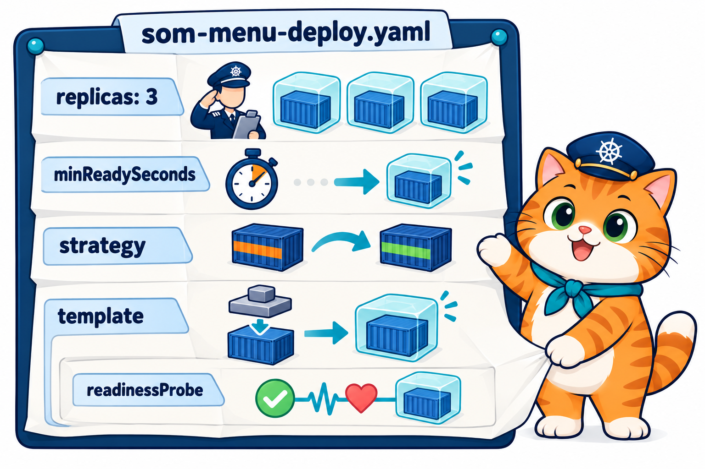
</p>

ไฟล์ `02_LAB/som-menu/k8s/som-menu-deploy.yaml` (LAB 4) ยาวราว 50 บรรทัด ถ้าพับเหลือแค่โครงจะเหลือแค่นี้

```yaml
apiVersion: apps/v1
kind: Deployment
metadata:
  name: som-menu            # ชื่อ Deployment → ReplicaSet som-menu-<hash> → Pod som-menu-<hash>-<สุ่ม>
  labels:                   # ป้ายของตัว Deployment เอง
  annotations:              # change-cause ของรุ่นนี้
spec:
  replicas: 3               # 3 สาขา
  minReadySeconds: 10       # จับเวลาก่อนนับว่าสาขาเปิด
  strategy:                 # วิธีเปลี่ยนรุ่น
  selector:                 # นับ Pod ที่มีป้าย app=som-menu
  template:                 # แม่พิมพ์ของทุกสาขา
    metadata:               # ป้ายของ Pod
    spec:
      containers:
        - name: web         # หน้าร้าน Node.js port 3000
```

ส่วนบนของไฟล์ (ของ Deployment)

```yaml
metadata:
  name: som-menu
  labels:
    app: som-menu
  annotations:
    kubernetes.io/change-cause: "เมนูเวอร์ชัน 1.0"   # ← หัวข้อ 9: โชว์ใน kubectl rollout history
spec:
  replicas: 3                    # ← บทที่ 3: จำนวนสาขา
  minReadySeconds: 10            # ← หัวข้อ 8
  strategy:
    type: RollingUpdate          # ← หัวข้อ 7
    rollingUpdate:
      maxSurge: 1                # ← หัวข้อ 8: เกินได้ 1
      maxUnavailable: 0          # ← หัวข้อ 8 และ 11: ร้านไม่ปิด
  selector:
    matchLabels:
      app: som-menu              # ← หัวข้อ 5.1: ReplicaSet จะเติม pod-template-hash ให้เอง
```

ส่วนแม่พิมพ์ (ของ Pod) เป็นของจากบทที่ 2–3 ทั้งหมด

```yaml
  template:
    metadata:
      labels:
        app: som-menu            # ต้องตรงกับ selector
        version: "1.0"           # ← บทที่ 3 หัวข้อ 10: ป้ายเสริมไว้ดูรุ่น (selector ไม่ได้ใช้)
    spec:
      containers:
        - name: web
          image: som-menu:1.0
          imagePullPolicy: IfNotPresent   # ← บทที่ 2: ใช้ image ที่ kind load ไว้บน node
          env:                            # ← บทที่ 2 หัวข้อ 7.2
            - name: SHOP_NAME
              value: "ร้านอาหารแมวน้องส้ม"
          ports:
            - containerPort: 3000
          readinessProbe:                 # ← บทที่ 2 หัวข้อ 10 + หัวข้อ 11: ตัดสินว่าสาขาใหม่ "พร้อม"
            httpGet:
              path: /api/health
              port: 3000
            periodSeconds: 5
          livenessProbe:                  # ← บทที่ 2 หัวข้อ 10: ค้างนานเกิน → restart
            ...
          resources:                      # ← บทที่ 2 หัวข้อ 7.4
            requests: { cpu: 50m, memory: 64Mi }
            limits:   { cpu: 200m, memory: 128Mi }
```

ไฟล์ `som-menu-deploy-v2.yaml` ต่างจากไฟล์นี้แค่ 3 บรรทัด: `change-cause: "เมนูเวอร์ชัน 2.0"`, `version: "2.0"` และ `image: som-menu:2.0` (image รุ่น 2.0 หน้าเว็บเป็นสีเขียวอมฟ้า และมีเมนูใหม่ "ไอศกรีมแมว")

แปลทั้งไฟล์เป็นประโยคเดียว: **"ขอ Deployment `som-menu` (รุ่น "เมนูเวอร์ชัน 1.0") ดูแลหน้าร้าน 3 สาขาที่ติดป้าย `app=som-menu` ทุกสาขาใช้ image `som-menu:1.0` ฟัง port 3000 และเมื่อเปลี่ยนรุ่น ให้เปิดสาขาใหม่เกินได้ทีละ 1 ห้ามสาขาที่พร้อมต่ำกว่า 3 และสาขาใหม่ต้องผ่าน `/api/health` ต่อเนื่อง 10 วินาทีจึงนับว่าเปิด"**

> 🧪 **พิสูจน์ใน LAB:** build image 2 รุ่น แล้วเปิดร้าน 3 สาขาด้วยไฟล์นี้ → **LAB 4** ขั้นที่ [1](../02_LAB/README.md#ขั้นที่-1-build-image-ของหน้าร้าน-2-เวอร์ชัน), [3](../02_LAB/README.md#ขั้นที่-3-เปิดร้าน-3-สาขาด้วย-deployment)

---

## 13. port-forward ระหว่างเปลี่ยนรุ่น และบทถัดไป

> 🎯 **หัวข้อนี้เรียนเพื่อ:** เข้าใจว่า **ทำไม port-forward หลุดระหว่างเปลี่ยนรุ่น** ทั้งที่ร้านไม่ได้ปิด ปัญหานี้คือเหตุผลที่ต้องเรียน Service ในบทถัดไป

<p align="center">
  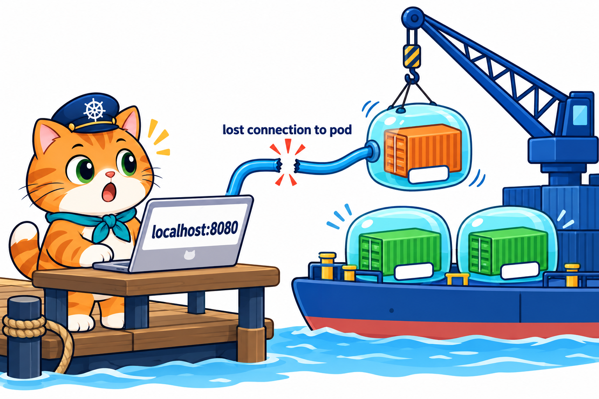
</p>

`kubectl port-forward deploy/som-menu 8080:3000` ก็เหมือน `rs/som-menu` ในบทที่ 3: kubectl **เลือก Pod มา 1 ตัว** แล้วต่อท่อเข้าตัวนั้น (หน้าเว็บบอกชื่อ Pod และเวอร์ชันของสาขาที่เสิร์ฟ)

ระหว่าง rolling update Pod เก่าถูกลบทีละตัว พอถึงคิวของ Pod ที่ท่อต่ออยู่ **ท่อก็ขาด** (LAB 4 ตัดบรรทัด error ยาวออก)

```text
Forwarding from 127.0.0.1:8080 -> 3000
Handling connection for 8080
...
error: lost connection to pod
```

- เปลี่ยนรุ่นเสร็จต้องรัน port-forward ใหม่เอง ถึงจะเห็นร้านเมนู 2.0 (และเกิดซ้ำตอน `rollout undo` ใน LAB 4)
- ร้านไม่ได้ปิด (Pod ที่พร้อมยังมีครบ 3) แต่ **ท่อของเราผูกกับ Pod ตัวเดียว** จึงหลุดไปด้วย

<p align="center">
  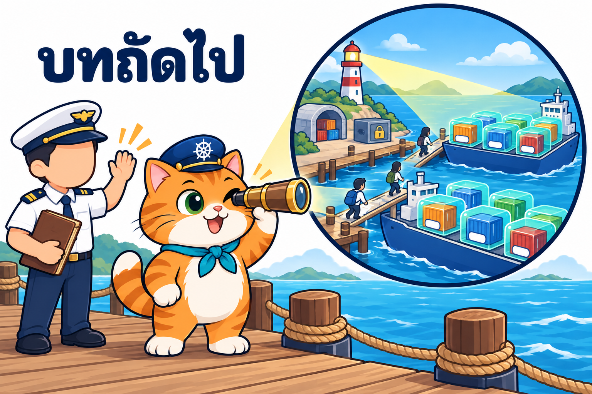
</p>

ปัญหาที่ยังเหลือ บทถัดไปมีทางแก้

- port-forward ไปสาขาเดียว และหลุดทุกครั้งที่ Pod ถูกเปลี่ยน → **Service** ให้ที่อยู่เดียวที่คงที่ กระจายลูกค้าไปทุกสาขาที่พร้อม ไม่ว่า Pod จะถูกเปลี่ยนรุ่นกี่รอบ (บทที่ 5)
- ข้อมูลใน Pod หายเมื่อได้ Pod ใหม่ (rolling update สร้าง Pod ใหม่ทุกตัว) → **PersistentVolume**
- รหัสผ่านยังเขียนอยู่ใน YAML (บทที่ 2) → **Secret**

> 🧪 **พิสูจน์ใน LAB:** port-forward หลุดทุกครั้งที่เปลี่ยนรุ่น ต้องต่อท่อใหม่เอง → **LAB 4** ขั้นที่ [4](../02_LAB/README.md#ขั้นที่-4-เปิดหน้าร้านใน-browser), [8](../02_LAB/README.md#ขั้นที่-8-port-forward-หลุด), [10](../02_LAB/README.md#ขั้นที่-10-เปิดร้านหลังย้อนกลับ)

---

## 14. สรุปและคำถามทบทวน

<p align="center">
  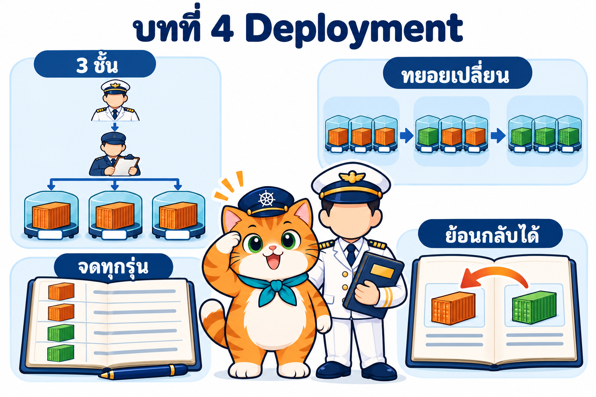
</p>

### สรุป

1. **Deployment** ดูแล ReplicaSet อีกชั้น เพื่อเปลี่ยนเวอร์ชันทีละ Pod และย้อนกลับได้
2. ทำงาน 3 ชั้น: deployment-controller ปรับ replicas ของ **ReplicaSet** → replicaset-controller สร้าง/ลบ **Pod**
3. YAML เหมือน ReplicaSet เกือบทุกบรรทัด เปลี่ยน `kind: Deployment` + เพิ่ม `annotations` / `strategy` ได้
4. ชื่อ Pod 3 ท่อน `<Deployment>-<pod-template-hash>-<สุ่ม>` และเจ้าของ 2 ชั้น Pod → ReplicaSet → Deployment
5. ReplicaSet ยังซ่อม Pod เอง, Deployment ซ่อม ReplicaSet, scale ที่ Deployment (scale rs แล้วเด้งกลับ) และ **ไฟล์ชนะ**
6. เปลี่ยน `template` = ReplicaSet ใหม่ ทยอยเพิ่มใหม่-ลดเก่า ReplicaSet เก่าเหลือ 0 แต่ยังเก็บไว้
7. `maxSurge` / `maxUnavailable` คุมจังหวะ (ค่าเริ่มต้น 25% → 3 Pod ได้ 1 / 0) และ `minReadySeconds` จับเวลาก่อนนับว่าพร้อม
8. `rollout status` เฝ้าดู, `rollout history` + `change-cause` จดรุ่น, `rollout undo` ปลุก ReplicaSet เก่า (revision เดิมได้เลขใหม่)
9. อัปเดตพัง (`ErrImagePull`) ค้างแต่ร้านไม่ปิด, `progressDeadlineSeconds` แค่แจ้งล้มเหลว ต้อง undo เอง และหลัง undo ต้องทำไฟล์ให้ตรง
10. port-forward ผูกกับ Pod เดียว หลุดระหว่างเปลี่ยนรุ่น → บทหน้า **Service** ให้ที่อยู่คงที่

### คำถามทบทวน

**1. ใน LAB 3 `kubectl get deploy` แสดงแบบนี้ แปลว่าอะไร ลูกค้าเข้าร้านได้ไหม ควรดูอะไรต่อ**

```text
NAME   READY   UP-TO-DATE   AVAILABLE   AGE
web    3/3     1            3           41s
```

<details>
<summary>แนวคำตอบ</summary>

มี Pod พร้อม 3 ตัว (ลูกค้าเข้าได้) แต่ใช้แม่พิมพ์ใหม่แค่ 1 ตัว แปลว่าการเปลี่ยนรุ่นค้าง ให้ `kubectl get pods` / `describe pod` ตัวใหม่ (เจอ `ErrImagePull` เพราะ image `nginx:1.99-alpine` ไม่มีจริง) แล้ว `kubectl rollout undo`
</details>

**2. ในไฟล์นี้มี `spec` กี่ชุด แต่ละชุดเป็นของใคร และ `strategy` กับ `containers` เป็นค่าของใคร**

```yaml
spec:
  replicas: 3
  strategy:
    type: RollingUpdate
  selector:
    matchLabels:
      app: cat
  template:
    metadata:
      labels:
        app: cat
    spec:
      containers:
        - name: meow
          image: nginx:1.27-alpine
```

<details>
<summary>แนวคำตอบ</summary>

2 ชุด `spec:` บรรทัดแรก (ไม่เยื้อง) เป็นของ Deployment ส่วน `spec:` ใต้ `template:` เป็นของ Pod `strategy` เป็นค่าของ Deployment (วิธีเปลี่ยนรุ่น) ส่วน `containers` เป็นของ Pod มี container 1 ตัวชื่อ `meow`
</details>

**3. YAML ต่อไปนี้ผิดกี่จุด อะไรบ้าง**

```text
apiVersion: v1
kind: deployment
metadata:
  name: som-menu
spec:
  replicas: 3
  selector:
    matchLabels:
      app: som-menu
  template:
    metadata:
      labels:
        app: menu
    spec:
      minReadySeconds: 10
      containers:
        - name: web
          image: som-menu:2.0
```

<details>
<summary>แนวคำตอบ</summary>

1. `apiVersion: v1` ต้องเป็น `apps/v1`
2. `kind: deployment` ต้องเป็น `Deployment`
3. ป้ายในแม่พิมพ์ `app: menu` ไม่ตรงกับ selector `app: som-menu`
4. `minReadySeconds` เป็นค่าของ Deployment ต้องอยู่ใต้ `spec` ระดับบน ไม่ใช่ใต้ `template.spec`
</details>

**4. Pod ชื่อ `web-5b86859d48-l2db6` ใน LAB 2 แต่ละท่อนคืออะไร และใครเป็นเจ้าของ**

<details>
<summary>แนวคำตอบ</summary>

`web` = ชื่อ Deployment, `5b86859d48` = pod-template-hash ของแม่พิมพ์ nginx 1.28 (เป็นชื่อท้ายของ ReplicaSet `web-5b86859d48`), `l2db6` = สุ่ม เจ้าของโดยตรงคือ ReplicaSet `web-5b86859d48` ซึ่งมีเจ้าของคือ Deployment `web`
</details>

**5. ใน LAB 1 สั่ง `kubectl scale rs web-6bd858c6f9 --replicas=2` ได้ `scaled` แต่ `get rs` ยังเห็น 5 เพราะอะไร ถ้าอยากได้ 2 จริงต้องทำอย่างไร**

<details>
<summary>แนวคำตอบ</summary>

ReplicaSet ลดเหลือ 2 จริง แต่ Deployment ขอไว้ 5 จึงตั้งกลับเป็น 5 และสร้าง Pod ใหม่ 3 ตัว (AGE `3s`) ต้อง scale ที่ Deployment (`kubectl scale deployment web --replicas=2`) หรือดีที่สุดคือแก้ `replicas` ในไฟล์แล้ว apply
</details>

**6. หลังเปลี่ยนเป็น nginx 1.28 ใน LAB 2 `kubectl get rs` ยังเห็น `web-6bd858c6f9   0   0   0` ควรลบทิ้งไหม และทำไมหลัง `rollout undo` ประวัติไม่มี revision 1 แต่มี 3 เป็น `nginx 1.27`**

<details>
<summary>แนวคำตอบ</summary>

ไม่ต้องลบ ReplicaSet เก่าที่เหลือ 0 คือแม่พิมพ์รุ่นก่อนที่เก็บไว้ให้ `rollout undo` ใช้ย้อนกลับ ตอน undo Deployment ปลุก ReplicaSet ตัวเดิมนี้กลับมาเป็นรุ่นล่าสุด รุ่นนี้จึงได้เลขใหม่เป็น 3 แทน 1 โดยไม่สร้าง ReplicaSet ใหม่
</details>

**7. ใน LAB 4 `rollout undo` กลับเป็นเมนู 1.0 แล้ว วันต่อมาเพื่อนร่วมทีม `kubectl apply -f som-menu-deploy-v2.yaml` เพื่อแก้ค่าอื่น จะเกิดอะไรขึ้น ควรทำอย่างไรตั้งแต่แรก**

<details>
<summary>แนวคำตอบ</summary>

แม่พิมพ์ในไฟล์ v2 ต่างจากที่รันอยู่ ร้านจะ rolling update กลับเป็นเมนู 2.0 ที่เพิ่งหนีมา (ไฟล์ชนะ) Warning ตอน undo เตือนเรื่องนี้ หลัง undo ต้องแก้ไฟล์กลับหรือ apply ไฟล์รุ่นเก่าเหมือนขั้นสุดท้ายของ LAB 4 (`kubectl apply -f som-menu/k8s/som-menu-deploy.yaml`)
</details>

**8. Deployment ที่ `replicas: 3` และไม่ได้เขียน `strategy` ระหว่าง rolling update จะมี Pod ได้มากที่สุดกี่ตัว และ Pod ที่พร้อมต่ำสุดกี่ตัว**

<details>
<summary>แนวคำตอบ</summary>

ค่าเริ่มต้น 25% / 25% → `maxSurge` ปัดขึ้นได้ 1 (สูงสุด 4 ตัว) `maxUnavailable` ปัดลงได้ 0 (พร้อมต่ำสุด 3 ตัว) เท่ากับที่ LAB 4 เขียนเองว่า `maxSurge: 1`, `maxUnavailable: 0`
</details>

**9. ใน LAB 4 เปิดร้านด้วย `port-forward deploy/som-menu 8080:3000` แล้ว apply เมนู 2.0 ทำไม terminal ขึ้น `lost connection to pod` ทั้งที่ร้านไม่ได้ปิด**

<details>
<summary>แนวคำตอบ</summary>

port-forward เลือก Pod เก่ามาแค่ 1 ตัว rolling update ลบ Pod เก่าทีละตัว พอถึงตัวที่ต่ออยู่ท่อจึงขาด ร้านยังมี Pod พร้อมครบ 3 แต่ท่อไม่ย้ายตาม ต้องรัน port-forward ใหม่ บทหน้าใช้ Service แก้
</details>

---

## เอกสารอ้างอิง

- Kubernetes Docs: [Deployments](https://kubernetes.io/docs/concepts/workloads/controllers/deployment/) · [Performing a Rolling Update (tutorial)](https://kubernetes.io/docs/tutorials/kubernetes-basics/update/update-intro/) · [ReplicaSet](https://kubernetes.io/docs/concepts/workloads/controllers/replicaset/)
- [kubectl rollout](https://kubernetes.io/docs/reference/kubectl/generated/kubectl_rollout/) · [kubectl scale](https://kubernetes.io/docs/reference/kubectl/generated/kubectl_scale/) · [Owners and Dependents](https://kubernetes.io/docs/concepts/overview/working-with-objects/owners-dependents/)

> ภาพประกอบในโฟลเดอร์ [`images/`](images/) สร้างด้วย AI เพื่อการเรียนการสอน (prompt อยู่ใน [`images/imagegen-prompts.md`](images/imagegen-prompts.md)) ผลลัพธ์คำสั่งมาจาก LAB จริงบน kind v0.33.0 / Kubernetes v1.37.0 ชื่อ ReplicaSet, ชื่อ Pod, AGE และ IP ในเครื่องผู้เรียนจะต่างกัน
