# LAB บทที่ 4: Kubernetes Deployment — ร้านน้องส้มเปลี่ยนเมนูโดยไม่ปิดร้าน

> **รายวิชา:** Software Development Tools and Environments (DevTools)
> **หัวข้อ:** ปฏิบัติการ Kubernetes Deployment — Deployment → ReplicaSet → Pod, pod-template-hash, scale, rolling update, rollout status/history/undo, progressDeadlineSeconds, maxSurge/maxUnavailable และร้านที่เปลี่ยนเมนูโดยไม่ปิดร้าน
> **ผลลัพธ์การเรียนรู้ที่เกี่ยวข้อง:** CLO-5, CLO-6
> **ทฤษฎีประกอบ:** [01_Theory/README.md](../01_Theory/README.md)

---

## บทนำ

ทุก LAB ทำ **ใน container `k8s-lab`** (image `tuchsanai/devtools-kind:2569_1` มี kubectl, kind, helm, k9s และ Docker ข้างในครบ) บทที่แล้ว LAB 4 จบด้วยปัญหาว่า แก้แม่พิมพ์ของ ReplicaSet แล้วต้อง **ลบ Pod เก่าเอง** ร้านจึงปิดไปชั่วครู่ บทนี้ให้ **Deployment** มาคุม ReplicaSet อีกชั้น ตั้งแต่ Deployment แรก ดูว่ามันสร้าง ReplicaSet และ Pod ให้อย่างไร ลองเปลี่ยนรุ่นแบบทยอยทีละ Pod (rolling update) ย้อนกลับ (rollback) ลองอัปเดตพังให้เห็นว่าร้านไม่ปิด จนถึงให้ **"ร้านอาหารแมวน้องส้ม"** เปลี่ยนเมนูเป็นเวอร์ชัน 2.0 โดยลูกค้ายังเข้าร้านได้ตลอด

> บล็อก **Expected output** คือผลที่ควรเห็นหลังรันคำสั่ง (ไม่ต้องพิมพ์ตาม) มาจากการทดลองจริงรอบเดียวกันทั้งบทเมื่อ 19 ต.ค. 2569 (kind v0.33.0, kubectl v1.37.1, Kubernetes v1.37.0) **ชื่อ ReplicaSet และ Pod ถูกสุ่มท้ายชื่อทุกครั้ง** (เช่น `web-6bd858c6f9-lpjxd`) ค่า AGE, IP และ Node ในเครื่องนักศึกษาจะต่างไป เป็นเรื่องปกติ

| สัญลักษณ์ | รันที่ไหน |
|---|---|
| 🖥️ | Terminal/PowerShell บนเครื่องนักศึกษา |
| 🐧 | SSH session ใน k8s-lab (prompt `root@k8s-lab`) |
| 🌐 | browser บนเครื่องนักศึกษา |

ทุก LAB มี **ภาพแผนการทดลอง** บอกว่า LAB นั้นมีกี่การทดลอง และทุกขั้นเริ่มด้วย 2 บรรทัดนี้ อ่านก่อนพิมพ์คำสั่ง

- 🎯 **เป้าหมายขั้นนี้** = ขั้นนี้ทดลองเพื่อพิสูจน์หลักการอะไร (มีลิงก์ไปหัวข้อทฤษฎีที่เกี่ยวข้อง)
- 🔍 **สังเกต** = ตอนดูผลลัพธ์ให้มองหาอะไร ถ้าเห็นตามนี้ แปลว่าหลักการนั้นเป็นจริง

### กติกา

- ทำงานในโฟลเดอร์ `/workspace/DevTools/05_kubernetes/004_kubernetes_Deployment/02_LAB` และ **ลบ Deployment ของตัวเองทุกครั้งที่จบ LAB**
- **ชื่อ ReplicaSet และ Pod ในเครื่องแต่ละคนไม่เหมือนกัน** คำสั่งที่มี `# ← เปลี่ยนเป็นชื่อ ... ของตัวเอง` ให้แทนด้วยชื่อที่เห็นจาก `kubectl get rs` หรือ `kubectl get pods` ในเครื่องตัวเอง
- ใช้แค่ Deployment, ReplicaSet และ Pod เข้าถึงแอปด้วย `kubectl port-forward` + แท็บ PORTS ของ VS Code (Service เป็นของบทถัดไป)

## สารบัญ LAB

| LAB | ชื่อ | เวลาโดยประมาณ | ความยาก |
|:---:|---|:---:|:---:|
| 0 | [เตรียมสภาพแวดล้อม (Setup)](#lab-0-เตรียมสภาพแวดล้อม-setup) (container `k8s-lab` + คลัสเตอร์ + git clone) | 20–30 นาที | ⭐ |
| 1 | [Deployment แรก: Deployment → ReplicaSet → Pod](#lab-1-deployment-แรก-deployment--replicaset--pod) | 25 นาที | ⭐⭐ |
| 2 | [Rolling update และ rollback](#lab-2-rolling-update-และ-rollback) | 25 นาที | ⭐⭐⭐ |
| 3 | [อัปเดตพัง แต่ร้านไม่ปิด](#lab-3-อัปเดตพัง-แต่ร้านไม่ปิด) | 20 นาที | ⭐⭐⭐ |
| 4 | [LAB สุดท้าย: ร้านอาหารแมวน้องส้มเปลี่ยนเมนูโดยไม่ปิดร้าน](#lab-4-lab-สุดท้าย-ร้านอาหารแมวน้องส้มเปลี่ยนเมนูโดยไม่ปิดร้าน) | 45–60 นาที | ⭐⭐⭐⭐⭐ |
| – | [เก็บกวาดหลังจบบท](#เก็บกวาดหลังจบบท) · [สรุปคำสั่ง kubectl ในบทนี้](#สรุปคำสั่ง-kubectl-ในบทนี้) | | |

รวมประมาณ 2.5–3 ชั่วโมง (เครื่องช้าหรือเน็ตช้าอาจนานกว่านี้ เพราะต้องดึง image จาก Docker Hub)

### สารบัญรูปภาพ

| รูปที่ | เรื่อง | รูปที่ | เรื่อง |
|:---:|---|:---:|---|
| 1 | [LAB 0 Setup container และคลัสเตอร์](#fig-1) | 13 | [LAB 3 ทำไมร้านไม่ปิดแต่การเปลี่ยนรุ่นค้าง](#fig-13) |
| 2 | [LAB 0 git clone](#fig-2) | 14 | [LAB 3 ไฟ 2 ดวง Available / Progressing](#fig-14) |
| 3 | [LAB 1 Deployment → ReplicaSet → Pod](#fig-3) | 15 | [LAB 3 เลขรุ่นขยับอย่างไรตอน undo](#fig-15) |
| 4 | [แผนการทดลอง LAB 1](#fig-4) | 16 | [LAB 4 ร้านน้องส้มทยอยเปลี่ยนเมนูทีละสาขา](#fig-16) |
| 5 | [LAB 2 rolling update และ rollout undo](#fig-5) | 17 | [แผนการทดลอง LAB 4](#fig-17) |
| 6 | [แผนการทดลอง LAB 2](#fig-6) | 18 | [LAB 4 attach VS Code เข้า k8s-lab](#fig-18) |
| 7 | [LAB 2 คำสั่ง rollout history ถามผู้จัดการคนไหน](#fig-7) | 19 | [LAB 4 เปิดเว็บผ่าน VS Code PORTS](#fig-19) |
| 8 | [LAB 2 อ่านคำสั่ง rollout history ทีละคำ](#fig-8) | 20 | [ภาพหน้าจอจริง: หน้าร้านเวอร์ชัน 1.0](#fig-20) |
| 9 | [LAB 2 ไฟล์รุ่นใหม่ แก้ตรงไหน](#fig-9) | 21 | [LAB 4 เส้นเวลาการเปลี่ยนเมนู 2.0](#fig-21) |
| 10 | [LAB 2 เทียบ YAML รุ่นเดิมกับรุ่นใหม่](#fig-10) | 22 | [port-forward หลุดเมื่อ Pod รุ่นเก่าถูกปิด](#fig-22) |
| 11 | [LAB 3 อัปเดตพัง แต่ร้านไม่ปิด](#fig-11) | 23 | [ภาพหน้าจอจริง: หน้าร้านเวอร์ชัน 2.0](#fig-23) |
| 12 | [แผนการทดลอง LAB 3](#fig-12) | 24 | [ภาพหน้าจอจริง: ย้อนกลับเป็นเวอร์ชัน 1.0](#fig-24) |

### โครงสร้างไฟล์ LAB

```text
02_LAB/
├── README.md                     ← เอกสารนี้
├── images/                       ← ภาพประกอบ + screenshots/ ภาพหน้าจอจริงของร้าน
├── labs/
│   ├── lab01-first-deploy/web-deploy.yaml        ← ใช้ใน LAB 1, 2, 3
│   ├── lab02-rolling-update/web-deploy-v2.yaml   ← ใช้ใน LAB 2
│   └── lab03-bad-update/web-deploy-bad.yaml      ← ใช้ใน LAB 3
└── som-menu/
    ├── app/                      ← เว็บหน้าร้าน Node.js (server.js + Dockerfile)
    └── k8s/{som-menu-deploy,som-menu-deploy-v2}.yaml
```

---

## LAB 0: เตรียมสภาพแวดล้อม (Setup)

**เป้าหมาย:** สร้าง container `k8s-lab` และคลัสเตอร์ kind ชื่อ `lab` (1 control-plane + 2 worker) แล้วดึงไฟล์ LAB มาไว้ใน container (รายละเอียดของแต่ละคำสั่งดูได้จาก [LAB บทที่ 1](../../001_kubernetes-introduction/02_LAB/readme.md))

**ต้องมี:** Docker Desktop (Linux containers, RAM อย่างน้อย 4 GB) และ SSH client

> ถ้ายังมี container `k8s-lab` จากบทที่ 3 อยู่ ใช้ต่อได้เลย: 🖥️ `docker start k8s-lab` → SSH เข้าไป (ข้อ 2) → `k8s-up` (ถ้าคลัสเตอร์ยังอยู่จะข้ามการสร้าง) แล้วไปขั้นที่ 2

### ขั้นที่ 1: Setup container และคลัสเตอร์

<p align="center" id="fig-1">
  <br>
  <em><b>รูปที่ 1</b> LAB0 ขั้นที่ 1: (1) docker run สร้าง container k8s-lab (2) ssh -p 2223 เข้าไปข้างใน (3) รัน k8s-up สร้าง kind cluster ชื่อ lab ได้ 3 node Ready (control-plane 1 ตัว + worker 2 ตัว)</em>
</p>

**1) สร้าง container** 🖥️ **บนเครื่องนักศึกษา** (image ประมาณ 1.5 GB ครั้งแรกใช้เวลาหลายนาที)

```bash
docker pull tuchsanai/devtools-kind:2569_1
```

```bash
docker run -dit --name k8s-lab --hostname k8s-lab --privileged -p 2223:22 -p 8889:8888 tuchsanai/devtools-kind:2569_1
```

- `--privileged` ให้รัน Docker ซ้อนใน container ได้ (kind ต้องใช้) **ขาดไม่ได้**
- `-p 2223:22` เปิดทาง SSH เข้า container ผ่าน port `2223`
- `-p 8889:8888` เปิด JupyterLab ที่ `http://localhost:8889/lab` (ทางเลือก)

หลัง `docker run` **รอสัก 5–10 วินาที** ให้ container เริ่ม sshd และ dockerd ข้างในให้เสร็จก่อน

**2) SSH เข้า container** 🖥️ ครั้งแรกพิมพ์ `yes` แล้วใส่รหัสผ่าน `passwd`

```bash
ssh -p 2223 root@localhost
```

**3) สร้างและตรวจคลัสเตอร์** 🐧 **ใน SSH session ของ k8s-lab** (prompt `root@k8s-lab:~#`)

```bash
time k8s-up
```

**Expected output** (ตัดเฉพาะส่วนสำคัญ)

<pre>
...
[k8s-up] cluster 'lab' พร้อมใช้งาน (kubectl context: kind-lab)
...
real	0m29.418s
</pre>

`k8s-up` สร้างคลัสเตอร์ใช้เวลาราว 30 วินาที – 1 นาที ข้อความเรื่อง NodePort ท้าย `k8s-up` ข้ามได้

```bash
kubectl get nodes
```

**Expected output**

<pre>
NAME                STATUS   ROLES           AGE   VERSION
lab-control-plane   Ready    control-plane   22s   v1.37.0
lab-worker          Ready    &lt;none&gt;          12s   v1.37.0
lab-worker2         Ready    &lt;none&gt;          12s   v1.37.0
</pre>

```bash
kubectl get pods -A
```

**Expected output**

<pre>
NAMESPACE            NAME                                        READY   STATUS    RESTARTS   AGE
kube-system          coredns-559f6c778d-k4rqg                    1/1     Running   0          13s
kube-system          coredns-559f6c778d-q2z2x                    1/1     Running   0          13s
kube-system          etcd-lab-control-plane                      1/1     Running   0          19s
kube-system          kindnet-9cbpt                               1/1     Running   0          13s
kube-system          kindnet-kz95w                               1/1     Running   0          12s
kube-system          kindnet-mlkc9                               1/1     Running   0          12s
kube-system          kube-apiserver-lab-control-plane            1/1     Running   0          19s
kube-system          kube-controller-manager-lab-control-plane   1/1     Running   0          19s
kube-system          kube-proxy-9kwg8                            1/1     Running   0          13s
kube-system          kube-proxy-jvxwd                            1/1     Running   0          12s
kube-system          kube-proxy-rrv5s                            1/1     Running   0          12s
kube-system          kube-scheduler-lab-control-plane            1/1     Running   0          19s
local-path-storage   local-path-provisioner-75f7fc7dc5-r6mgc     1/1     Running   0          13s
</pre>

`kube-controller-manager` คือตัวที่มี **deployment-controller** และ **replicaset-controller** อยู่ข้างใน: deployment-controller ดูแล Deployment (สร้างและปรับจำนวน ReplicaSet) ส่วน replicaset-controller นับและสร้าง Pod เหมือนบทที่ 3 (ถ้าบาง Pod ยัง `0/1` ให้รอสักครู่แล้วสั่งซ้ำ)

> **✅ ผ่านเมื่อ:** node 3 ตัว `Ready` และ Pod ระบบทุกตัวเป็น `Running`

### ขั้นที่ 2: git clone ไฟล์ LAB

<p align="center" id="fig-2">
  <br>
  <em><b>รูปที่ 2</b> LAB0 ขั้นที่ 2: git clone ดึง repo DevTools มาไว้ที่ /workspace/DevTools ใน k8s-lab แล้ว cd ลงไปจนถึงโฟลเดอร์ 02_LAB ของบทที่ 4 ที่มี labs และ som-menu</em>
</p>

🐧 **ใน SSH session ของ k8s-lab**

```bash
cd /workspace
```

```bash
git clone https://github.com/Tuchsanai/DevTools.git
```

ถ้าเคย clone ไว้แล้วในบทก่อน ๆ จะขึ้นว่า `already exists` ให้ `cd DevTools` แล้ว `git pull` แทน จากนั้น `cd /workspace`

```bash
cd DevTools/05_kubernetes/004_kubernetes_Deployment/02_LAB
```

> **✅ ผ่านเมื่อ:** prompt เป็น `root@k8s-lab:/workspace/DevTools/05_kubernetes/004_kubernetes_Deployment/02_LAB#` ทุกคำสั่งที่อ้าง `labs/...` หรือ `som-menu/...` ต้องรันจากโฟลเดอร์นี้

---

## LAB 1: Deployment แรก: Deployment → ReplicaSet → Pod

<p align="center" id="fig-3">
  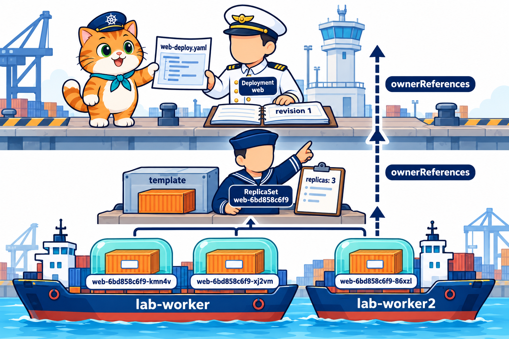<br>
  <em><b>รูปที่ 3</b> LAB1: ส่งไฟล์ web-deploy.yaml ให้ผู้จัดการ (Deployment web) ผู้จัดการตั้งหัวหน้าลูกเรือ (ReplicaSet web-6bd858c6f9) ขึ้นมาปั๊ม Pod 3 ตัวชื่อ web-6bd858c6f9-xxxxx ลงเรือ 2 ลำ ลูกศร ownerReferences บอกเจ้าของ 2 ชั้น: Pod → ReplicaSet → Deployment</em>
</p>

**เป้าหมาย:** สร้าง Deployment จากไฟล์ YAML ดูว่ามันสร้าง ReplicaSet และ Pod ให้อย่างไร ชื่อมาจากไหน ใครเป็นเจ้าของใคร แล้วลองลบ Pod ลบ ReplicaSet และ scale ดูว่าใครเป็นคนคุม

<p align="center" id="fig-4">
  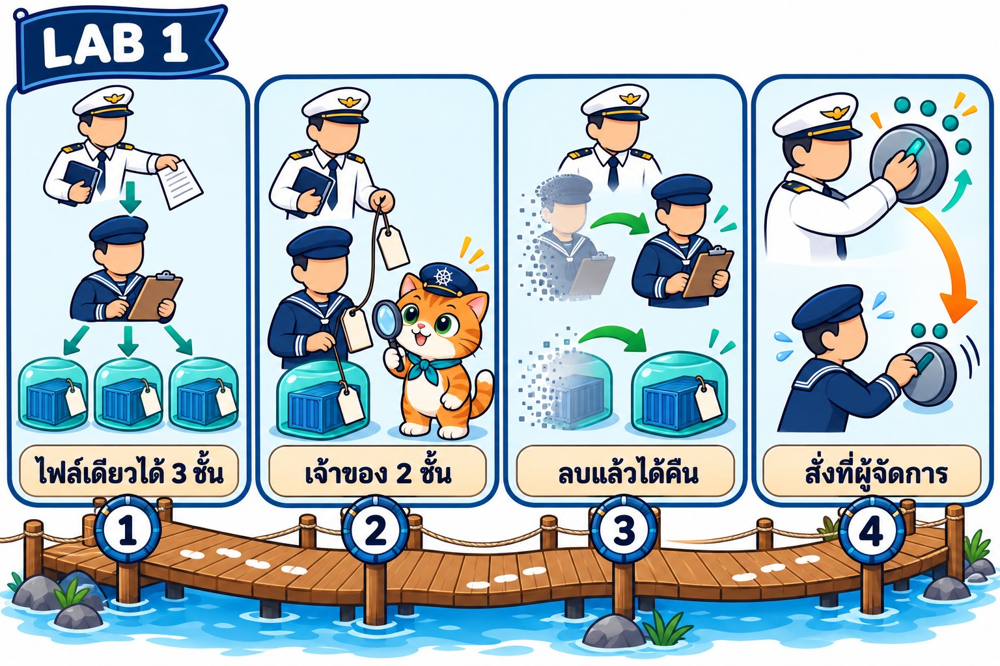<br>
  <em><b>รูปที่ 4</b> แผนการทดลอง LAB1 มี 4 การทดลอง: (1) ขั้นที่ 1–3 ส่งไฟล์เดียวได้ครบ 3 ชั้น Deployment → ReplicaSet → Pod (2) ขั้นที่ 4 เจ้าของ 2 ชั้นใน ownerReferences (3) ขั้นที่ 5–6 ลบ Pod หรือลบ ReplicaSet แล้วได้คืน (4) ขั้นที่ 7–10 scale ต้องสั่งที่ Deployment และลบ Deployment ตัวเดียวหายหมดทั้ง 3 ชั้น</em>
</p>

🐧 **ใน SSH session ของ k8s-lab** (ทุกขั้นใน LAB 1–3)

### ขั้นที่ 1: ไฟล์ Deployment แรก

> 🎯 **เป้าหมายขั้นนี้:** รู้จัก YAML ของ Deployment ว่าต่างจาก ReplicaSet ในบทที่ 3 ตรงไหน ก่อนลงมือ จะได้รู้ว่าผลแต่ละขั้นมาจากบรรทัดไหน ([ทฤษฎีหัวข้อ 4](../01_Theory/README.md#4-อ่าน-yaml-ของ-deployment-ทีละบรรทัด))
>
> 🔍 **สังเกต:** เทียบกับ `web-rs.yaml` ต่างแค่ `kind: Deployment` กับ `annotations` ส่วน `replicas` / `selector` / `template` เหมือนเดิมทุกบรรทัด

ไฟล์ `labs/lab01-first-deploy/web-deploy.yaml` (เปิดดูได้ใน VS Code หรือ JupyterLab)

```yaml
# LAB 1, 2, 3: Deployment แรก — ขอ Pod nginx 3 ตัว โดย Deployment สร้าง ReplicaSet มาดูแล Pod ให้อีกชั้น
apiVersion: apps/v1          # กลุ่มเดียวกับ ReplicaSet
kind: Deployment             # ← เทียบกับ web-rs.yaml ในบทที่ 3 เปลี่ยนแค่ตรงนี้ (กับ annotations)
metadata:
  name: web                  # ชื่อ Deployment → ReplicaSet ชื่อ web-<hash> → Pod ชื่อ web-<hash>-<สุ่ม>
  annotations:
    kubernetes.io/change-cause: "nginx 1.27"   # บันทึกว่ารุ่นนี้คืออะไร โชว์ใน kubectl rollout history
spec:
  replicas: 3                # อยากได้ Pod 3 ตัวตลอดเวลา
  selector:                  # นับ Pod จากป้าย app=web (เหมือน ReplicaSet)
    matchLabels:
      app: web
  template:                  # แม่พิมพ์ Pod — เปลี่ยนแม่พิมพ์เมื่อไร Deployment จะทยอยเปลี่ยน Pod ให้
    metadata:
      labels:
        app: web             # ต้องตรงกับ selector
    spec:
      containers:
        - name: nginx
          image: nginx:1.27-alpine
          ports:
            - containerPort: 80
```

ทำงานอย่างไร

- เทียบกับ `web-rs.yaml` ของบทที่ 3 ต่างกันแค่ 2 จุด คือ `kind: Deployment` และ `annotations`
- `kind: Deployment` = ขอ **ผู้จัดการ** ที่จะตั้ง ReplicaSet (หัวหน้าลูกเรือ) ขึ้นมาคุม Pod อีกชั้น เราไม่ต้องเขียน ReplicaSet เอง
- `kubernetes.io/change-cause` = โน้ตบอกว่ารุ่นนี้คืออะไร จะไปโผล่ใน `kubectl rollout history` (LAB 2)
- `replicas`, `selector`, `template` ความหมายเหมือน ReplicaSet ทุกอย่าง Deployment ส่งต่อค่าเหล่านี้ให้ ReplicaSet ที่มันสร้าง
- เปลี่ยน `template` เมื่อไร Deployment จะสร้าง ReplicaSet ตัวใหม่แล้วทยอยเปลี่ยน Pod ให้ (LAB 2)

### ขั้นที่ 2: สร้าง Deployment แล้วดูทั้ง 3 ชั้น

> 🎯 **เป้าหมายขั้นนี้:** ทดสอบว่า **ส่งไฟล์ Deployment ไฟล์เดียว ได้ครบ 3 ชั้น** Deployment → ReplicaSet → Pod โดยไม่ต้องเขียน ReplicaSet เอง ([ทฤษฎีหัวข้อ 2](../01_Theory/README.md#2-deployment-คืออะไร) · [ทฤษฎีหัวข้อ 3](../01_Theory/README.md#3-deployment-ทำงานอย่างไร))
>
> 🔍 **สังเกต:** มี ReplicaSet `web-<hash>` ที่เราไม่ได้เขียน, ชื่อ Pod มี 3 ท่อน และมีป้าย `pod-template-hash` ที่ Deployment ติดให้เอง

```bash
kubectl apply -f labs/lab01-first-deploy/web-deploy.yaml
```

**Expected output**

<pre>
deployment.apps/web created
</pre>

รอสัก 10 วินาที แล้วดู Deployment (`deploy` คือชื่อย่อของ `deployment`)

```bash
kubectl get deploy
```

**Expected output**

<pre>
NAME   READY   UP-TO-DATE   AVAILABLE   AGE
web    3/3     3            3           10s
</pre>

- `READY 3/3` = Pod พร้อม 3 จากที่ขอ 3
- `UP-TO-DATE` = จำนวน Pod ที่เป็น **แม่พิมพ์ล่าสุด** แล้ว
- `AVAILABLE` = จำนวน Pod ที่พร้อมให้บริการลูกค้า

```bash
kubectl get rs
```

**Expected output**

<pre>
NAME             DESIRED   CURRENT   READY   AGE
web-6bd858c6f9   3         3         3       10s
</pre>

เราไม่ได้เขียน ReplicaSet เลย แต่มี ReplicaSet ชื่อ **`web-6bd858c6f9`** = ชื่อ Deployment + **hash ของแม่พิมพ์** (ตัวเลขที่คำนวณจาก `template`)

```bash
kubectl get pods --show-labels
```

**Expected output**

<pre>
NAME                   READY   STATUS    RESTARTS   AGE   LABELS
web-6bd858c6f9-lpjxd   1/1     Running   0          10s   app=web,pod-template-hash=6bd858c6f9
web-6bd858c6f9-vsx6z   1/1     Running   0          10s   app=web,pod-template-hash=6bd858c6f9
web-6bd858c6f9-xl8bz   1/1     Running   0          10s   app=web,pod-template-hash=6bd858c6f9
</pre>

- ชื่อ Pod มี **3 ท่อน**: `web` (ชื่อ Deployment) - `6bd858c6f9` (hash ของแม่พิมพ์) - `86xzl` (ตัวอักษรสุ่ม)
- นอกจากป้าย `app=web` ที่เราเขียน ยังมีป้าย **`pod-template-hash=6bd858c6f9`** ที่ Deployment ติดให้เอง ไว้แยกว่า Pod ตัวไหนมาจากแม่พิมพ์รุ่นไหน

### ขั้นที่ 3: อ่านรายละเอียดด้วย describe

> 🎯 **เป้าหมายขั้นนี้:** หา **หลักฐานว่า Deployment ไม่ได้สร้าง Pod เอง** แต่สั่งให้ ReplicaSet สร้าง ([ทฤษฎีหัวข้อ 3](../01_Theory/README.md#3-deployment-ทำงานอย่างไร))
>
> 🔍 **สังเกต:** Events จาก `deployment-controller` มีบรรทัดเดียว `Scaled up replica set ... from 0 to 3` และ `revision: 1` กับ `NewReplicaSet`

```bash
kubectl describe deploy web
```

**Expected output** (ตัดเฉพาะส่วนสำคัญ)

<pre>
Name:                   web
...
Annotations:            deployment.kubernetes.io/revision: 1
                        kubernetes.io/change-cause: nginx 1.27
Selector:               app=web
Replicas:               3 desired | 3 updated | 3 total | 3 available | 0 unavailable
StrategyType:           RollingUpdate
MinReadySeconds:        0
RollingUpdateStrategy:  25% max unavailable, 25% max surge
...
OldReplicaSets:  &lt;none&gt;
NewReplicaSet:   web-6bd858c6f9 (3/3 replicas created)
Events:
  Type    Reason             Age   From                   Message
  ----    ------             ----  ----                   -------
  Normal  ScalingReplicaSet  10s   deployment-controller  Scaled up replica set web-6bd858c6f9 from 0 to 3
</pre>

- `deployment.kubernetes.io/revision: 1` = นี่คือ **รุ่นที่ 1** ของ Deployment นี้ และ `change-cause` คือโน้ตจากไฟล์
- `StrategyType: RollingUpdate` = เวลาเปลี่ยนแม่พิมพ์จะ **ทยอยเปลี่ยน** ทีละส่วน (ค่าเริ่มต้น) ตัวเลข 25% ใช้ใน LAB 2
- `NewReplicaSet` = ReplicaSet ที่ Deployment ใช้อยู่ตอนนี้
- Events มีแค่บรรทัดเดียวจาก **`deployment-controller`**: "Scaled up replica set ... from 0 to 3" Deployment **ไม่ได้สร้าง Pod เอง** แค่สั่ง ReplicaSet ให้มี 3 ตัว แล้ว ReplicaSet ไปสร้าง Pod ต่อ

### ขั้นที่ 4: เจ้าของ 2 ชั้น

> 🎯 **เป้าหมายขั้นนี้:** ดูว่า **เจ้าของมี 2 ชั้น** Pod → ReplicaSet → Deployment ([ทฤษฎีหัวข้อ 5](../01_Theory/README.md#5-ชื่อ-pod-3-ท่อน-และเจ้าของ-2-ชั้น))
>
> 🔍 **สังเกต:** `ownerReferences` ของ Pod ชี้ไป `kind: ReplicaSet` ส่วนของ ReplicaSet ชี้ไป `kind: Deployment` และ `uid` ของ ReplicaSet ตรงกับที่ Pod อ้างถึง

เลือก Pod มา 1 ตัวจาก `kubectl get pods`

```bash
kubectl get pod web-6bd858c6f9-lpjxd -o yaml    # ← เปลี่ยนเป็นชื่อ Pod ของตัวเอง
```

**Expected output** (ตัดเฉพาะส่วนสำคัญ)

<pre>
apiVersion: v1
kind: Pod
metadata:
  creationTimestamp: "2026-10-19T11:03:35Z"
  generateName: web-6bd858c6f9-
  generation: 1
  labels:
    app: web
    pod-template-hash: 6bd858c6f9
  name: web-6bd858c6f9-lpjxd
  namespace: default
  ownerReferences:
  - apiVersion: apps/v1
    blockOwnerDeletion: true
    controller: true
    kind: ReplicaSet
    name: web-6bd858c6f9
    uid: 107c44ff-4a0d-4302-82e9-df8712254d3a
  resourceVersion: "650"
...
</pre>

เจ้าของของ Pod ยังเป็น **ReplicaSet** `web-6bd858c6f9` เหมือนบทที่ 3 แล้วใครเป็นเจ้าของ ReplicaSet

```bash
kubectl get rs web-6bd858c6f9 -o yaml    # ← เปลี่ยนเป็นชื่อ ReplicaSet ของตัวเอง
```

**Expected output** (ตัดเฉพาะส่วนสำคัญ)

<pre>
apiVersion: apps/v1
kind: ReplicaSet
metadata:
  annotations:
    deployment.kubernetes.io/desired-replicas: "3"
    deployment.kubernetes.io/max-replicas: "4"
    deployment.kubernetes.io/revision: "1"
    kubernetes.io/change-cause: nginx 1.27
  creationTimestamp: "2026-10-19T11:03:35Z"
  generation: 1
  labels:
    app: web
    pod-template-hash: 6bd858c6f9
  name: web-6bd858c6f9
  namespace: default
  ownerReferences:
  - apiVersion: apps/v1
    blockOwnerDeletion: true
    controller: true
    kind: Deployment
    name: web
    uid: 28ec9577-73e6-4f5f-8db7-e9e79669384b
  resourceVersion: "669"
  uid: 107c44ff-4a0d-4302-82e9-df8712254d3a
spec:
  replicas: 3
  selector:
    matchLabels:
      app: web
      pod-template-hash: 6bd858c6f9
...
</pre>

- `ownerReferences` ของ ReplicaSet ชี้ไปที่ **`kind: Deployment` ชื่อ `web`** จึงเป็นเจ้าของ 2 ชั้น: Pod → ReplicaSet → Deployment
- `uid` ของ ReplicaSet (`107c44ff-...`) ตรงกับ `uid` ใน `ownerReferences` ของ Pod ข้างบน
- selector ของ ReplicaSet มี `pod-template-hash` เพิ่มมา ReplicaSet จึงนับเฉพาะ Pod จากแม่พิมพ์รุ่นของตัวเอง

### ขั้นที่ 5: ลบ Pod 1 ตัว

> 🎯 **เป้าหมายขั้นนี้:** ทดสอบว่า **การสร้าง Pod แทนตัวที่หาย (self-healing) ยังเป็นงานของ ReplicaSet** แม้มี Deployment คุมอยู่ ([ทฤษฎีหัวข้อ 6](../01_Theory/README.md#6-ใครดูแลอะไร-deployment-หรือ-replicaset))
>
> 🔍 **สังเกต:** จำนวนยังเป็น 3 ตัวที่มาแทนมี **ชื่อใหม่ `AGE` น้อย** แต่ hash ตรงกลางชื่อยังเหมือนเดิม

```bash
kubectl delete pod web-6bd858c6f9-lpjxd    # ← เปลี่ยนเป็นชื่อ Pod ของตัวเอง
```

**Expected output**

<pre>
pod "web-6bd858c6f9-lpjxd" deleted from default namespace
</pre>

```bash
kubectl get pods
```

**Expected output**

<pre>
NAME                   READY   STATUS    RESTARTS   AGE
web-6bd858c6f9-v2gb2   1/1     Running   0          1s
web-6bd858c6f9-vsx6z   1/1     Running   0          11s
web-6bd858c6f9-xl8bz   1/1     Running   0          11s
</pre>

ได้ `web-6bd858c6f9-v2gb2` อายุ 1 วินาทีมาแทน การสร้าง Pod แทนตัวที่หาย (self-healing) **ยังเป็นงานของ ReplicaSet** เหมือนบทที่ 3 Deployment ไม่ต้องทำอะไร

### ขั้นที่ 6: ลบ ReplicaSet ทั้งตัว

> 🎯 **เป้าหมายขั้นนี้:** ทดสอบว่า **Deployment ดูแล ReplicaSet แบบเดียวกับที่ ReplicaSet ดูแล Pod** ลบหัวหน้าลูกเรือแล้วได้คืนไหม ([ทฤษฎีหัวข้อ 6](../01_Theory/README.md#6-ใครดูแลอะไร-deployment-หรือ-replicaset))
>
> 🔍 **สังเกต:** ReplicaSet `AGE 0s` โผล่มาทันทีและได้ **ชื่อเดิม** (แม่พิมพ์เดิม hash เดิม) แต่ Pod ทั้ง 3 ตัวเป็นตัวใหม่หมด

ลองลบหัวหน้าลูกเรือทิ้งดูบ้าง

```bash
kubectl delete rs web-6bd858c6f9    # ← เปลี่ยนเป็นชื่อ ReplicaSet ของตัวเอง
```

**Expected output**

<pre>
replicaset.apps "web-6bd858c6f9" deleted from default namespace
</pre>

```bash
kubectl get rs
```

**Expected output**

<pre>
NAME             DESIRED   CURRENT   READY   AGE
web-6bd858c6f9   3         3         0       0s
</pre>

ReplicaSet **อายุ 0 วินาที** โผล่มาทันที และได้ **ชื่อเดิม** เพราะแม่พิมพ์ไม่เปลี่ยน hash จึงเท่าเดิม

```bash
kubectl get pods
```

**Expected output**

<pre>
NAME                   READY   STATUS              RESTARTS   AGE
web-6bd858c6f9-6tcl7   0/1     ContainerCreating   0          0s
web-6bd858c6f9-svwks   0/1     ContainerCreating   0          0s
web-6bd858c6f9-tdl5h   0/1     ContainerCreating   0          0s
web-6bd858c6f9-v2gb2   1/1     Terminating         0          1s
web-6bd858c6f9-vsx6z   1/1     Terminating         0          11s
web-6bd858c6f9-xl8bz   1/1     Terminating         0          11s
</pre>

Pod เก่า 3 ตัวถูกลบตาม ReplicaSet ตัวเก่า (`Terminating`) ส่วน ReplicaSet ตัวใหม่สร้าง Pod ใหม่ 3 ตัว รอสัก 5 วินาที แล้วดูอีกครั้ง

```bash
kubectl get rs
```

**Expected output**

<pre>
NAME             DESIRED   CURRENT   READY   AGE
web-6bd858c6f9   3         3         3       5s
</pre>

```bash
kubectl get pods
```

**Expected output**

<pre>
NAME                   READY   STATUS    RESTARTS   AGE
web-6bd858c6f9-6tcl7   1/1     Running   0          5s
web-6bd858c6f9-svwks   1/1     Running   0          5s
web-6bd858c6f9-tdl5h   1/1     Running   0          5s
</pre>

ผู้จัดการ (Deployment) เห็นว่าหัวหน้าลูกเรือหายไป จึงตั้งคนใหม่จากแม่พิมพ์เดิมทันที = Deployment ดูแล ReplicaSet แบบเดียวกับที่ ReplicaSet ดูแล Pod

### ขั้นที่ 7: Scale ที่ Deployment

> 🎯 **เป้าหมายขั้นนี้:** ทดสอบว่า **scale ที่ Deployment** แล้วตัวเลขถูกส่งต่อลงไปถึง ReplicaSet ([ทฤษฎีหัวข้อ 6](../01_Theory/README.md#6-ใครดูแลอะไร-deployment-หรือ-replicaset))
>
> 🔍 **สังเกต:** `READY 5/5` ที่ Deployment และ `DESIRED 5` ที่ ReplicaSet

```bash
kubectl scale deployment web --replicas=5
```

**Expected output**

<pre>
deployment.apps/web scaled
</pre>

รอสัก 5 วินาที

```bash
kubectl get deploy
```

**Expected output**

<pre>
NAME   READY   UP-TO-DATE   AVAILABLE   AGE
web    5/5     5            5           21s
</pre>

```bash
kubectl get rs
```

**Expected output**

<pre>
NAME             DESIRED   CURRENT   READY   AGE
web-6bd858c6f9   5         5         5       10s
</pre>

scale ที่ Deployment แล้ว Deployment ส่งต่อตัวเลขให้ ReplicaSet (`DESIRED 5`)

### ขั้นที่ 8: กับดัก — scale ที่ ReplicaSet

> 🎯 **เป้าหมายขั้นนี้:** ทดสอบกับดัก: **สั่ง ReplicaSet ตรง ๆ ข้ามหัว Deployment** ใครชนะ ([ทฤษฎีหัวข้อ 6](../01_Theory/README.md#6-ใครดูแลอะไร-deployment-หรือ-replicaset))
>
> 🔍 **สังเกต:** คำสั่งบอก `scaled` แต่ `DESIRED` เด้งกลับเป็น 5 และมี Pod ใหม่ `AGE` ไม่กี่วินาที

ถ้าข้ามหัวผู้จัดการไปสั่งหัวหน้าลูกเรือตรง ๆ จะเป็นอย่างไร

```bash
kubectl scale rs web-6bd858c6f9 --replicas=2    # ← เปลี่ยนเป็นชื่อ ReplicaSet ของตัวเอง
```

**Expected output**

<pre>
replicaset.apps/web-6bd858c6f9 scaled
</pre>

รอสัก 3 วินาที

```bash
kubectl get rs
```

**Expected output**

<pre>
NAME             DESIRED   CURRENT   READY   AGE
web-6bd858c6f9   5         5         5       14s
</pre>

```bash
kubectl get pods
```

**Expected output**

<pre>
NAME                   READY   STATUS    RESTARTS   AGE
web-6bd858c6f9-46zwl   1/1     Running   0          3s
web-6bd858c6f9-js6z4   1/1     Running   0          3s
web-6bd858c6f9-mcbc5   1/1     Running   0          9s
web-6bd858c6f9-qgxcd   1/1     Running   0          3s
web-6bd858c6f9-tdl5h   1/1     Running   0          14s
</pre>

คำสั่งบอกว่า `scaled` แต่ ReplicaSet **เด้งกลับเป็น 5** และมี Pod ใหม่ 3 ตัว (`AGE 3s`) แปลว่า ReplicaSet ลดเหลือ 2 จริง แล้ว Deployment เห็นว่าไม่ตรงกับที่ตัวเองตั้งไว้ (5) จึงสั่งกลับเป็น 5 ทันที **ผู้จัดการชนะหัวหน้าลูกเรือ** ถ้ามี Deployment ให้ scale ที่ Deployment เท่านั้น

### ขั้นที่ 9: apply ไฟล์เดิมอีกครั้ง

> 🎯 **เป้าหมายขั้นนี้:** ทดสอบว่า **ค่าจาก `scale` กับค่าในไฟล์ อะไรชนะ** เมื่อ apply ไฟล์เดิมซ้ำ ([ทฤษฎีหัวข้อ 6](../01_Theory/README.md#6-ใครดูแลอะไร-deployment-หรือ-replicaset))
>
> 🔍 **สังเกต:** จาก 5 ตัวกลับเป็น 3 ตามไฟล์ (`configured`)

ตอนนี้ Deployment มี 5 ตัว แต่ในไฟล์ยังเขียน `replicas: 3`

```bash
kubectl apply -f labs/lab01-first-deploy/web-deploy.yaml
```

**Expected output**

<pre>
deployment.apps/web configured
</pre>

รอสัก 5 วินาที

```bash
kubectl get deploy
```

**Expected output**

<pre>
NAME   READY   UP-TO-DATE   AVAILABLE   AGE
web    3/3     3            3           30s
</pre>

```bash
kubectl get pods
```

**Expected output**

<pre>
NAME                   READY   STATUS    RESTARTS   AGE
web-6bd858c6f9-46zwl   1/1     Running   0          8s
web-6bd858c6f9-qgxcd   1/1     Running   0          8s
web-6bd858c6f9-tdl5h   1/1     Running   0          19s
</pre>

กลับเป็น **3** เหมือนบทที่ 3 (**ไฟล์ชนะ**) จำนวนถาวรต้องแก้ `replicas` ในไฟล์แล้ว apply

### ขั้นที่ 10: ลบ Deployment

> 🎯 **เป้าหมายขั้นนี้:** ทดสอบว่า **ลบ Deployment ตัวเดียว ทั้ง 3 ชั้นหายตาม** ตามสายเจ้าของ ([ทฤษฎีหัวข้อ 5](../01_Theory/README.md#5-ชื่อ-pod-3-ท่อน-และเจ้าของ-2-ชั้น))
>
> 🔍 **สังเกต:** `get deploy`, `get rs` และ `get pods` ขึ้น `No resources found` ทั้งหมด

```bash
kubectl delete -f labs/lab01-first-deploy/web-deploy.yaml
```

**Expected output**

<pre>
deployment.apps "web" deleted from default namespace
</pre>

```bash
kubectl get deploy
```

**Expected output**

<pre>
No resources found in default namespace.
</pre>

```bash
kubectl get rs
```

**Expected output**

<pre>
No resources found in default namespace.
</pre>

รอสัก 5 วินาที

```bash
kubectl get pods
```

**Expected output**

<pre>
No resources found in default namespace.
</pre>

ลบ Deployment ตัวเดียว ReplicaSet และ Pod ถูกลบตามหมดทั้ง 3 ชั้น

### สิ่งที่เห็น

- Deployment สร้าง ReplicaSet ชื่อ `<deployment>-<hash ของแม่พิมพ์>` แล้ว ReplicaSet สร้าง Pod ชื่อ `<deployment>-<hash>-<สุ่ม>` ที่มีป้าย `pod-template-hash`
- เจ้าของมี 2 ชั้นตาม `ownerReferences`: Pod → ReplicaSet → Deployment
- ลบ Pod → ReplicaSet สร้างแทน, ลบ ReplicaSet → Deployment สร้างแทน (ชื่อเดิมเพราะแม่พิมพ์เดิม)
- scale ต้องสั่งที่ Deployment ถ้าสั่งที่ ReplicaSet จะถูก Deployment ทับกลับ และ `apply` ไฟล์ก็ทับค่าที่ scale ไว้

> **🤔 คำถามชวนคิด:** ถ้าลองแก้ `image` ใน `web-deploy.yaml` แล้ว apply ชื่อ ReplicaSet จะยังเป็น `web-6bd858c6f9` หรือไม่ เพราะอะไร (คำตอบอยู่ใน LAB 2)

---

## LAB 2: Rolling update และ rollback

<p align="center" id="fig-5">
  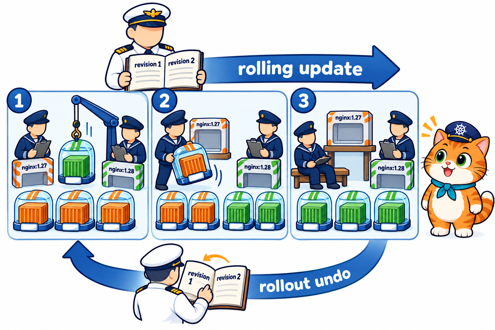<br>
  <em><b>รูปที่ 5</b> LAB2: ผู้จัดการถือสมุดบันทึกรุ่น (revision) สั่งหัวหน้าทีมใหม่ (แม่พิมพ์ nginx:1.28 กล่องแถบเขียว) ใส่กล่องใหม่ทีละใบ และหัวหน้าทีมเก่า (แม่พิมพ์ nginx:1.27 กล่องแถบส้ม) เก็บกล่องเก่าทีละใบ จนทีมเก่าเหลือ 0 แต่เก็บแม่พิมพ์ไว้บนชั้น rollout undo = พลิกสมุดกลับหน้าเดิมแล้วปลุกทีมเก่า</em>
</p>

**เป้าหมาย:** เปลี่ยน nginx จากรุ่น 1.27 เป็น 1.28 ด้วยการแก้แม่พิมพ์แล้ว apply ดู Deployment ทยอยเปลี่ยน Pod ทีละตัว (rolling update) ดูประวัติรุ่น แล้วย้อนกลับ (rollback)

<p align="center" id="fig-6">
  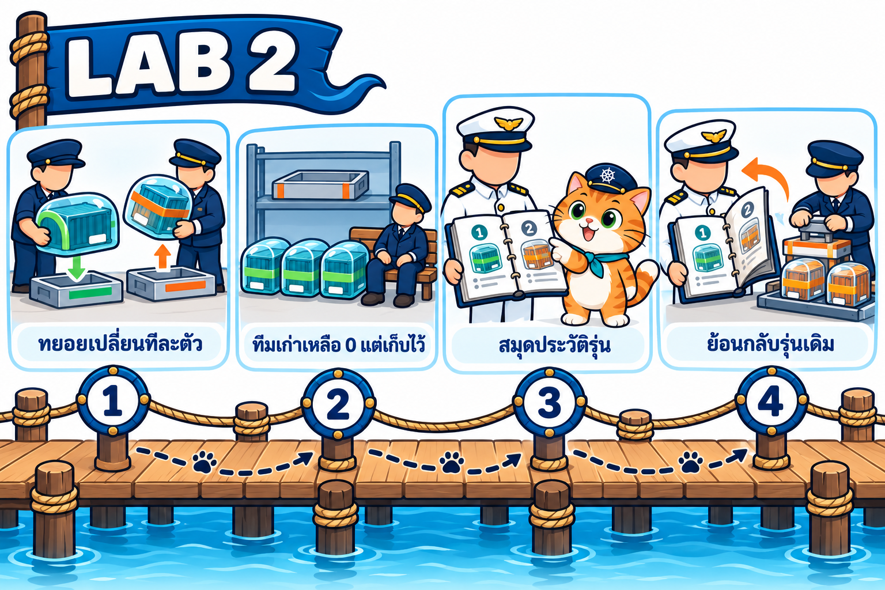<br>
  <em><b>รูปที่ 6</b> แผนการทดลอง LAB2 มี 4 การทดลอง: (1) ขั้นที่ 1–3 แก้แม่พิมพ์แล้ว Deployment ทยอยเปลี่ยน Pod ทีละตัว (2) ขั้นที่ 4–5 ReplicaSet เก่าเหลือ 0 แต่เก็บไว้ และจังหวะเพิ่มใหม่-ลดเก่า (3) ขั้นที่ 6 สมุดประวัติรุ่น rollout history (4) ขั้นที่ 7 rollout undo ย้อนกลับรุ่นเดิม แล้วขั้นที่ 8 ลบ Deployment โดยไม่ใช้ไฟล์ YAML</em>
</p>

### ขั้นที่ 1: สร้าง Deployment รุ่นแรก

> 🎯 **เป้าหมายขั้นนี้:** เตรียม **รุ่นแรก (revision 1)** ไว้เทียบตอนเปลี่ยนรุ่น ([ทฤษฎีหัวข้อ 9](../01_Theory/README.md#9-ติดตามการเปลี่ยนรุ่น-rollout-status-และ-history))
>
> 🔍 **สังเกต:** hash เป็น `6bd858c6f9` เท่ากับ LAB 1 (แม่พิมพ์เดิม hash เดิม) และ `rollout history` มี `REVISION 1` กับ `CHANGE-CAUSE nginx 1.27`

```bash
kubectl apply -f labs/lab01-first-deploy/web-deploy.yaml
```

**Expected output**

<pre>
deployment.apps/web created
</pre>

รอสัก 10 วินาที

```bash
kubectl get pods
```

**Expected output**

<pre>
NAME                   READY   STATUS    RESTARTS   AGE
web-6bd858c6f9-2tw76   1/1     Running   0          10s
web-6bd858c6f9-89pwv   1/1     Running   0          10s
web-6bd858c6f9-qwhfk   1/1     Running   0          10s
</pre>

hash ยังเป็น `6bd858c6f9` เหมือน LAB 1 เพราะแม่พิมพ์เหมือนเดิมทุกตัวอักษร ต่อไปจะดูประวัติรุ่น แต่ก่อนพิมพ์ **อ่านคำสั่งให้ออกก่อนว่าแต่ละคำมาจากไหน**

<p align="center" id="fig-7">
  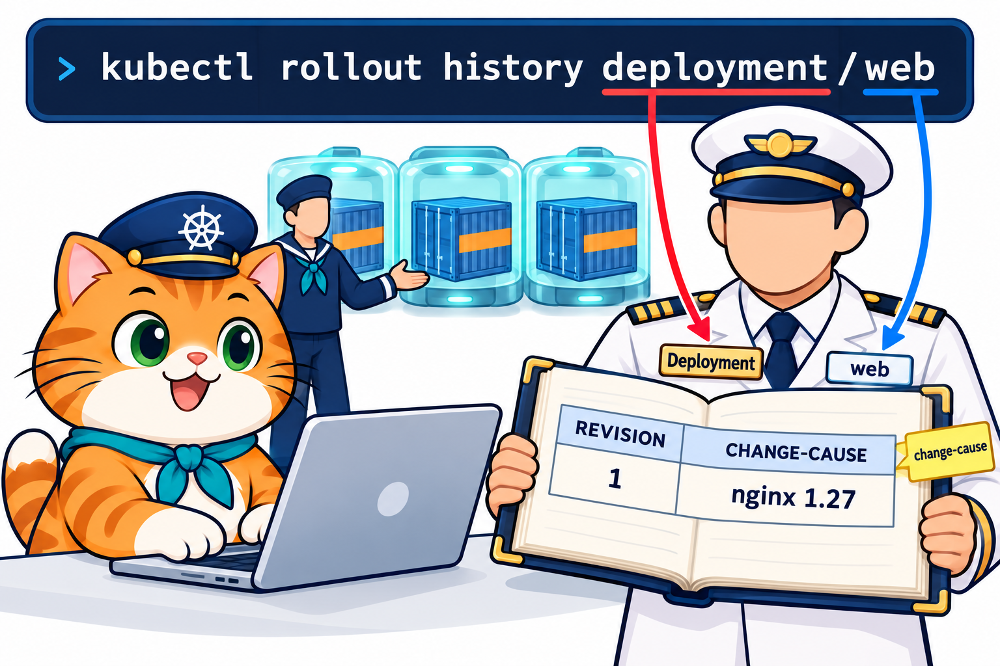<br>
  <em><b>รูปที่ 7</b> kubectl rollout history deployment/web = ขอให้ผู้จัดการ (ชนิด Deployment) ชื่อ web เปิดสมุดบันทึกรุ่น หน้าแรกมี REVISION 1 ที่ CHANGE-CAUSE เป็น nginx 1.27 ซึ่งมาจากโน้ต change-cause ในไฟล์</em>
</p>

<p align="center" id="fig-8">
  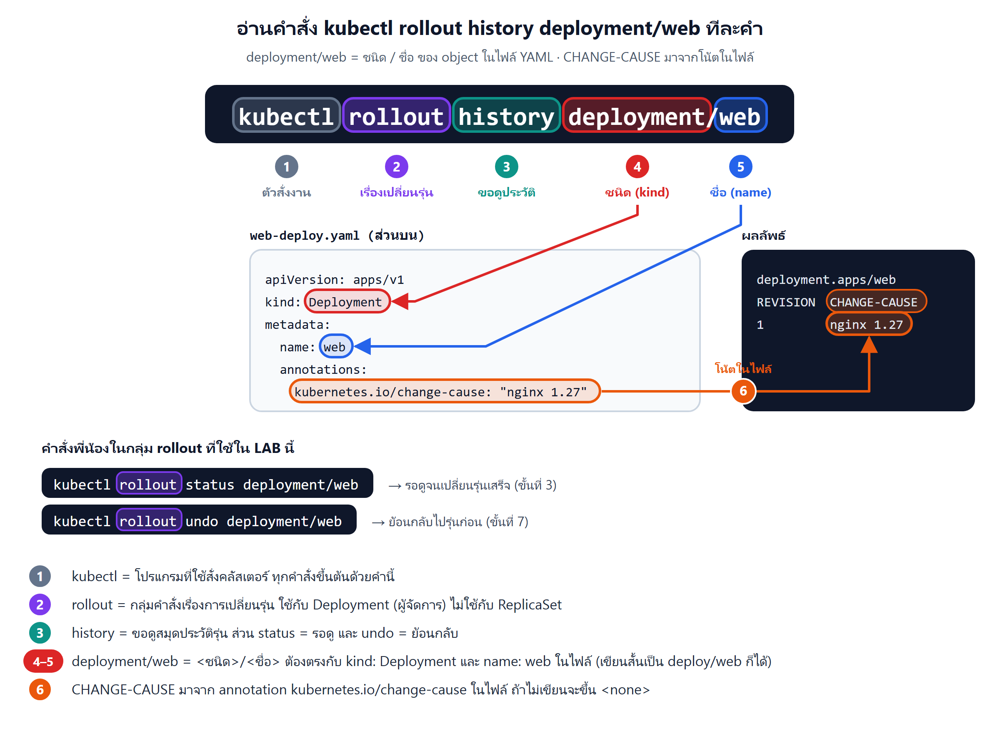<br>
  <em><b>รูปที่ 8</b> อ่านคำสั่งทีละคำ: deployment/web คือชนิดและชื่อที่ตรงกับ kind: Deployment และ name: web ในไฟล์ ส่วนคอลัมน์ CHANGE-CAUSE ในผลลัพธ์มาจาก annotation kubernetes.io/change-cause</em>
</p>

คำสั่งนี้มาจากไหน

| คำ | ความหมาย | มาจากไหน |
|---|---|---|
| `kubectl` | โปรแกรมสั่งคลัสเตอร์ | ใช้ทุกคำสั่ง |
| `rollout` | กลุ่มคำสั่งเรื่อง **การเปลี่ยนรุ่น** | ใช้กับ Deployment (ผู้จัดการ) |
| `history` | ขอดู **สมุดประวัติรุ่น** | พี่น้องในกลุ่มเดียวกันคือ `status` (ขั้นที่ 3) และ `undo` (ขั้นที่ 7) |
| `deployment/web` | `<ชนิด>/<ชื่อ>` ของ object ที่จะถาม | `kind: Deployment` และ `metadata.name: web` ในไฟล์ YAML |

- `deployment/web` ต้องตรงกับไฟล์ที่ apply ไป ถ้าพิมพ์ `deployment/web2` จะขึ้น not found เพราะไม่มี Deployment ชื่อนั้น จะเขียนสั้นเป็น `deploy/web` ก็ได้
- คอลัมน์ `CHANGE-CAUSE` ไม่ได้มาจาก kubectl เอง แต่มาจากโน้ต `kubernetes.io/change-cause` ที่เราเขียนไว้ใน `metadata.annotations` ของไฟล์ ถ้าไม่ได้เขียนจะขึ้น `<none>`

```bash
kubectl rollout history deployment/web
```

**Expected output**

<pre>
deployment.apps/web 
REVISION  CHANGE-CAUSE
1         nginx 1.27

</pre>

มีรุ่นเดียวคือ `REVISION 1` และ `CHANGE-CAUSE` มาจาก annotation `kubernetes.io/change-cause` ในไฟล์

### ขั้นที่ 2: ไฟล์รุ่นใหม่

> 🎯 **เป้าหมายขั้นนี้:** ดูว่า **แก้ตรงไหนถึงนับว่าเปลี่ยนแม่พิมพ์** ก่อน apply ([ทฤษฎีหัวข้อ 7](../01_Theory/README.md#7-rolling-update-ทยอยเปลี่ยนทีละ-pod))
>
> 🔍 **สังเกต:** ต่างจากไฟล์ LAB 1 แค่ 2 บรรทัดที่มี `← เปลี่ยน` และ `image` อยู่ใต้ `template`

ไฟล์ `labs/lab02-rolling-update/web-deploy-v2.yaml`

```yaml
# LAB 2: เปลี่ยน nginx เป็นรุ่น 1.28 — ต่างจาก web-deploy.yaml แค่ 2 บรรทัดที่มี ← เท่านั้น
apiVersion: apps/v1
kind: Deployment
metadata:
  name: web                  # ชื่อเดิม → apply แล้วเป็นการแก้ Deployment ตัวเดิม
  annotations:
    kubernetes.io/change-cause: "nginx 1.28"   # ← เปลี่ยน
spec:
  replicas: 3
  selector:
    matchLabels:
      app: web
  template:
    metadata:
      labels:
        app: web
    spec:
      containers:
        - name: nginx
          image: nginx:1.28-alpine   # ← เปลี่ยน: แม่พิมพ์เปลี่ยน → Deployment ทยอยเปลี่ยน Pod ทีละตัว
          ports:
            - containerPort: 80
```

ทำงานอย่างไร

- ชื่อยังเป็น `web` การ apply จึงเป็นการ **แก้ Deployment ตัวเดิม**
- ต่างจากไฟล์ LAB 1 แค่ **2 บรรทัดที่มี `← เปลี่ยน`**: โน้ต `change-cause` เป็น `nginx 1.28` และ `image: nginx:1.28-alpine`
- `image` อยู่ใน `template` แม่พิมพ์จึงเปลี่ยน hash ใหม่ → Deployment สร้าง ReplicaSet ตัวใหม่แล้วทยอยย้าย Pod ไปหา

<p align="center" id="fig-9">
  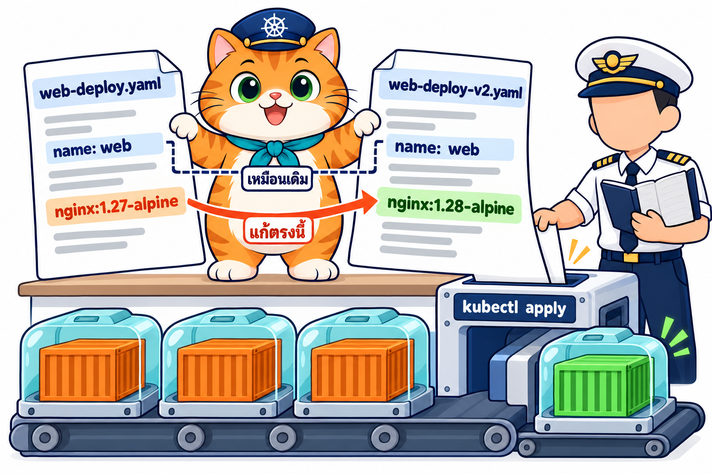<br>
  <em><b>รูปที่ 9</b> ไฟล์รุ่นใหม่คือไฟล์เดิมที่แก้นิดเดียว: name: web เหมือนเดิม (จึงเป็นการแก้ผู้จัดการคนเดิม) แก้แค่ image จาก nginx:1.27-alpine เป็น nginx:1.28-alpine แล้วส่งด้วย kubectl apply ผู้จัดการจะปั๊มกล่องแถบเขียวรุ่นใหม่ทีละใบ</em>
</p>

วางไฟล์ 2 รุ่นเทียบกัน (ตัด comment ออก) ให้เห็นว่า **ตรงไหนต้องแก้ ตรงไหนห้ามแก้**

<p align="center" id="fig-10">
  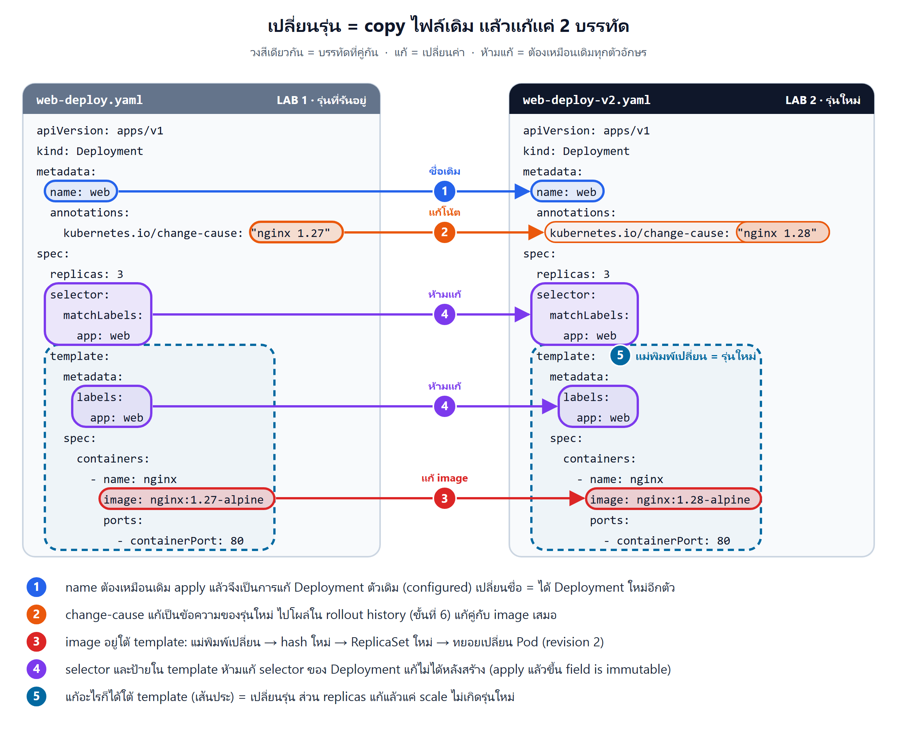<br>
  <em><b>รูปที่ 10</b> เทียบ YAML รุ่นเดิมกับรุ่นใหม่ ① name เดิม ② แก้โน้ต change-cause ③ แก้ image ④ selector และป้ายห้ามแก้ ⑤ แม่พิมพ์ (template) เปลี่ยน = รุ่นใหม่</em>
</p>

**หลักการเขียนไฟล์รุ่นใหม่สำหรับ rolling update** (เลขตรงกับรูปที่ 10)

1. **copy ไฟล์เดิมมาแก้** อย่าเขียนใหม่ทั้งไฟล์ จะได้ไม่เผลอแก้บรรทัดอื่น
2. **① `name` ต้องเหมือนเดิม** apply แล้วจึงขึ้น `configured` (แก้ตัวเดิม) ถ้าเปลี่ยนชื่อ เช่น `web-v2` จะได้ Deployment **ตัวใหม่อีกตัว** อยู่คู่กับตัวเดิม (Pod รวม 6 ตัว) ไม่ใช่การเปลี่ยนรุ่น
3. **③ แก้สิ่งที่อยากเปลี่ยนใต้ `template`** เช่น `image` แม่พิมพ์เปลี่ยน → hash ใหม่ → ReplicaSet ใหม่ → ทยอยเปลี่ยน Pod ส่วนการแก้ `replicas` อย่างเดียวเป็นแค่ scale ไม่เกิดรุ่นใหม่
4. **② แก้โน้ต `change-cause` คู่กันเสมอ** ให้บอกว่ารุ่นนี้คืออะไร ไม่งั้น `rollout history` จะโชว์ข้อความของรุ่นเก่า (แก้แค่โน้ตอย่างเดียวก็ไม่เกิดรุ่นใหม่)
5. **④ ห้ามแก้ `selector` และป้ายใน `template`** selector ของ Deployment แก้ไม่ได้หลังสร้าง ลองแก้ `app: web` เป็น `app: web2` ทั้งสองที่แล้ว apply จะได้

<pre>
The Deployment "web" is invalid: spec.selector: Invalid value: {"matchLabels":{"app":"web2"}}: field is immutable
</pre>

(ผลข้อ 2 และข้อ 5 มาจากการทดลองตอนเตรียม LAB ไม่ต้องทำตาม)

### ขั้นที่ 3: เปลี่ยนรุ่น

> 🎯 **เป้าหมายขั้นนี้:** ทดสอบ **rolling update**: แก้แม่พิมพ์แล้ว apply Deployment ทยอยเปลี่ยน Pod ให้เองโดยเราไม่ต้องลบ Pod ([ทฤษฎีหัวข้อ 7](../01_Theory/README.md#7-rolling-update-ทยอยเปลี่ยนทีละ-pod) · [ทฤษฎีหัวข้อ 9](../01_Theory/README.md#9-ติดตามการเปลี่ยนรุ่น-rollout-status-และ-history))
>
> 🔍 **สังเกต:** `rollout status` นับ Pod รุ่นใหม่ขึ้นทีละตัว 1 → 2 → 3 แล้วจบด้วย `successfully rolled out`

```bash
kubectl apply -f labs/lab02-rolling-update/web-deploy-v2.yaml
```

**Expected output**

<pre>
deployment.apps/web configured
</pre>

ดูความคืบหน้าทันที คำสั่งนี้ **รอจนเปลี่ยนรุ่นเสร็จแล้วจบเอง** (ประมาณ 15 วินาที)

```bash
kubectl rollout status deployment/web
```

**Expected output**

<pre>
Waiting for deployment "web" rollout to finish: 1 out of 3 new replicas have been updated...
Waiting for deployment "web" rollout to finish: 1 out of 3 new replicas have been updated...
Waiting for deployment "web" rollout to finish: 1 out of 3 new replicas have been updated...
Waiting for deployment "web" rollout to finish: 2 out of 3 new replicas have been updated...
Waiting for deployment "web" rollout to finish: 2 out of 3 new replicas have been updated...
Waiting for deployment "web" rollout to finish: 2 out of 3 new replicas have been updated...
Waiting for deployment "web" rollout to finish: 2 out of 3 new replicas have been updated...
Waiting for deployment "web" rollout to finish: 1 old replicas are pending termination...
Waiting for deployment "web" rollout to finish: 1 old replicas are pending termination...
Waiting for deployment "web" rollout to finish: 1 old replicas are pending termination...
deployment "web" successfully rolled out
</pre>

นับ Pod รุ่นใหม่ขึ้นทีละตัว 1 → 2 → 3 (บางเครื่องเห็นบรรทัด `0 out of 3` ก่อน ถ้าพิมพ์เร็วมาก) แล้วรอ Pod รุ่นเก่าตัวสุดท้ายปิด จบด้วย `successfully rolled out`

### ขั้นที่ 4: ReplicaSet เก่ากับใหม่

> 🎯 **เป้าหมายขั้นนี้:** ยืนยันว่า **เปลี่ยนแม่พิมพ์ = ได้ ReplicaSet ตัวใหม่** และ ReplicaSet ตัวเก่าถูกเก็บไว้ ไม่ถูกลบ ([ทฤษฎีหัวข้อ 7](../01_Theory/README.md#7-rolling-update-ทยอยเปลี่ยนทีละ-pod))
>
> 🔍 **สังเกต:** ReplicaSet hash ใหม่มี 3 ตัว ReplicaSet เก่าเหลือ 0 แต่ยังอยู่ และ Pod ใหม่ `AGE` ไม่เท่ากัน (เกิดทีละตัว)

```bash
kubectl get rs -o wide
```

**Expected output**

<pre>
NAME             DESIRED   CURRENT   READY   AGE   CONTAINERS   IMAGES              SELECTOR
web-5b86859d48   3         3         3       15s   nginx        nginx:1.28-alpine   app=web,pod-template-hash=5b86859d48
web-6bd858c6f9   0         0         0       25s   nginx        nginx:1.27-alpine   app=web,pod-template-hash=6bd858c6f9
</pre>

- ReplicaSet ใหม่ `web-5b86859d48` (hash ใหม่, `nginx:1.28-alpine`) มี **3** ตัว
- ReplicaSet เก่า `web-6bd858c6f9` (`nginx:1.27-alpine`) เหลือ **0** แต่ **ไม่ถูกลบ** เก็บแม่พิมพ์เก่าไว้เผื่อย้อนกลับ

```bash
kubectl get pods
```

**Expected output**

<pre>
NAME                   READY   STATUS        RESTARTS   AGE
web-5b86859d48-5m57j   1/1     Running       0          1s
web-5b86859d48-5mrk9   1/1     Running       0          8s
web-5b86859d48-tlngl   1/1     Running       0          15s
web-6bd858c6f9-qwhfk   1/1     Terminating   0          25s
</pre>

Pod รุ่นใหม่อายุ **15s, 8s, 1s** = เกิดทีละตัว ไม่ใช่พร้อมกัน ส่วน `web-6bd858c6f9-qwhfk` คือ Pod รุ่นเก่าตัวสุดท้ายที่กำลังปิด

### ขั้นที่ 5: ดูจังหวะการเปลี่ยนรุ่นใน Events

> 🎯 **เป้าหมายขั้นนี้:** ดูว่า **จังหวะเพิ่มใหม่-ลดเก่า มาจาก maxSurge / maxUnavailable** ค่าเริ่มต้น 25% ([ทฤษฎีหัวข้อ 8](../01_Theory/README.md#8-maxsurge-maxunavailable-และ-minreadyseconds))
>
> 🔍 **สังเกต:** Events สลับกัน `Scaled up` ตัวใหม่ทีละ 1 กับ `Scaled down` ตัวเก่าทีละ 1 และ `revision: 2`

```bash
kubectl describe deploy web
```

**Expected output** (ตัดเฉพาะส่วนสำคัญ)

<pre>
Name:                   web
...
Annotations:            deployment.kubernetes.io/revision: 2
                        kubernetes.io/change-cause: nginx 1.28
Selector:               app=web
Replicas:               3 desired | 3 updated | 3 total | 3 available | 0 unavailable
StrategyType:           RollingUpdate
MinReadySeconds:        0
RollingUpdateStrategy:  25% max unavailable, 25% max surge
...
OldReplicaSets:  web-6bd858c6f9 (0/0 replicas created)
NewReplicaSet:   web-5b86859d48 (3/3 replicas created)
Events:
  Type    Reason             Age   From                   Message
  ----    ------             ----  ----                   -------
  Normal  ScalingReplicaSet  25s   deployment-controller  Scaled up replica set web-6bd858c6f9 from 0 to 3
  Normal  ScalingReplicaSet  15s   deployment-controller  Scaled up replica set web-5b86859d48 from 0 to 1
  Normal  ScalingReplicaSet  8s    deployment-controller  Scaled down replica set web-6bd858c6f9 from 3 to 2
  Normal  ScalingReplicaSet  8s    deployment-controller  Scaled up replica set web-5b86859d48 from 1 to 2
  Normal  ScalingReplicaSet  1s    deployment-controller  Scaled down replica set web-6bd858c6f9 from 2 to 1
  Normal  ScalingReplicaSet  1s    deployment-controller  Scaled up replica set web-5b86859d48 from 2 to 3
  Normal  ScalingReplicaSet  0s    deployment-controller  Scaled down replica set web-6bd858c6f9 from 1 to 0
</pre>

- Events เล่าเรื่องทั้งหมด: **เพิ่มใหม่ 1 → ลดเก่า 1 → เพิ่มใหม่ 1 → ลดเก่า 1 ...** สลับกันจนใหม่ = 3 เก่า = 0 นี่คือ **rolling update**
- จังหวะนี้มาจาก `RollingUpdateStrategy: 25% max unavailable, 25% max surge` (ค่าเริ่มต้น): 25% ของ 3 ปัดขึ้น = เกิน 3 ได้ทีละ **1** ตัว (max surge) และ 25% ของ 3 ปัดลง = ขาดได้ **0** ตัว (max unavailable) จึงต้องเพิ่มตัวใหม่ก่อนแล้วค่อยลดตัวเก่า
- `revision: 2` = ตอนนี้เป็นรุ่นที่ 2

### ขั้นที่ 6: ดูประวัติรุ่น

> 🎯 **เป้าหมายขั้นนี้:** ดูว่า **Deployment จดประวัติรุ่น** ไว้อย่างไร ([ทฤษฎีหัวข้อ 9](../01_Theory/README.md#9-ติดตามการเปลี่ยนรุ่น-rollout-status-และ-history))
>
> 🔍 **สังเกต:** `REVISION 1` และ `2` พร้อม `CHANGE-CAUSE` ที่มาจาก annotation ในไฟล์

```bash
kubectl rollout history deployment/web
```

**Expected output**

<pre>
deployment.apps/web 
REVISION  CHANGE-CAUSE
1         nginx 1.27
2         nginx 1.28

</pre>

แต่ละ revision = ReplicaSet 1 ตัว (แม่พิมพ์ 1 รุ่น) ที่ Deployment เก็บไว้

### ขั้นที่ 7: ย้อนกลับ (rollback)

> 🎯 **เป้าหมายขั้นนี้:** ทดสอบ **rollback**: ย้อนไปรุ่นก่อนแบบทยอยเหมือนกัน โดยปลุก ReplicaSet เก่า ไม่สร้างตัวใหม่ ([ทฤษฎีหัวข้อ 10](../01_Theory/README.md#10-ย้อนกลับด้วย-rollout-undo))
>
> 🔍 **สังเกต:** ReplicaSet `6bd858c6f9` กลับเป็น 3 ไม่มี hash ใหม่เกิดขึ้น, revision 1 กลายเป็น 3 และมี `Warning` เรื่องไฟล์ที่ apply ล่าสุด

สมมุติว่ารุ่น 1.28 มีปัญหา ขอย้อนกลับไปรุ่นก่อนหน้า

```bash
kubectl rollout undo deployment/web
```

**Expected output**

<pre>
Warning: resource deployments/web was previously managed with 'kubectl apply'. Rolling back will not update the kubectl.kubernetes.io/last-applied-configuration annotation, which may cause unexpected behavior on future 'kubectl apply' operations. Consider using 'kubectl apply' with your previous configuration file instead.
deployment.apps/web rolled back
</pre>

- บรรทัดสุดท้าย `rolled back` = ย้อนสำเร็จ
- `Warning` ยาว ๆ เตือนว่า **ไฟล์ที่ apply ล่าสุดยังเป็น v2** (nginx 1.28) การ undo ไม่ได้แก้ไฟล์ให้ ถ้าวันหลังมีคน apply ไฟล์ v2 อีก คลัสเตอร์จะกลับไปเป็น 1.28 ทันที ทีมจึงควรแก้ไฟล์ให้ตรงกับที่ย้อนไป (LAB 4 ขั้นที่ 11 จะทำให้ดู)

```bash
kubectl rollout status deployment/web
```

**Expected output**

<pre>
Waiting for deployment "web" rollout to finish: 0 out of 3 new replicas have been updated...
Waiting for deployment "web" rollout to finish: 1 out of 3 new replicas have been updated...
Waiting for deployment "web" rollout to finish: 1 out of 3 new replicas have been updated...
Waiting for deployment "web" rollout to finish: 1 out of 3 new replicas have been updated...
Waiting for deployment "web" rollout to finish: 2 out of 3 new replicas have been updated...
Waiting for deployment "web" rollout to finish: 2 out of 3 new replicas have been updated...
Waiting for deployment "web" rollout to finish: 2 out of 3 new replicas have been updated...
Waiting for deployment "web" rollout to finish: 2 out of 3 new replicas have been updated...
Waiting for deployment "web" rollout to finish: 1 old replicas are pending termination...
Waiting for deployment "web" rollout to finish: 1 old replicas are pending termination...
Waiting for deployment "web" rollout to finish: 1 old replicas are pending termination...
deployment "web" successfully rolled out
</pre>

การย้อนกลับก็เป็น rolling update เหมือนกัน (ทยอยทีละตัว)

```bash
kubectl get rs -o wide
```

**Expected output**

<pre>
NAME             DESIRED   CURRENT   READY   AGE   CONTAINERS   IMAGES              SELECTOR
web-5b86859d48   0         0         0       18s   nginx        nginx:1.28-alpine   app=web,pod-template-hash=5b86859d48
web-6bd858c6f9   3         3         3       28s   nginx        nginx:1.27-alpine   app=web,pod-template-hash=6bd858c6f9
</pre>

ไม่มี ReplicaSet ใหม่เกิดขึ้น Deployment **ปลุก ReplicaSet เก่า `web-6bd858c6f9`** (nginx 1.27) กลับเป็น 3 และลดตัว 1.28 เหลือ 0

```bash
kubectl get pods
```

**Expected output**

<pre>
NAME                   READY   STATUS        RESTARTS   AGE
web-5b86859d48-tlngl   1/1     Terminating   0          18s
web-6bd858c6f9-65n95   1/1     Running       0          3s
web-6bd858c6f9-fczj7   1/1     Running       0          2s
web-6bd858c6f9-m4xsg   1/1     Running       0          1s
</pre>

Pod ที่ Running ขึ้นต้น `web-6bd858c6f9-` (แม่พิมพ์เดิม) แต่ท้ายชื่อเป็นตัวใหม่ทั้งหมด = **Pod ใหม่** ที่ปั๊มจากแม่พิมพ์เก่า ส่วน Pod รุ่น 1.28 ตัวสุดท้ายกำลังปิด (`Terminating`)

```bash
kubectl rollout history deployment/web
```

**Expected output**

<pre>
deployment.apps/web 
REVISION  CHANGE-CAUSE
2         nginx 1.28
3         nginx 1.27

</pre>

revision 1 หายไปกลายเป็น **revision 3** เพราะ undo = "เอาแม่พิมพ์ของรุ่น 1 มาใช้เป็นรุ่นล่าสุด" เลข revision จึงนับต่อเป็น 3

### ขั้นที่ 8: ลบ Deployment โดยไม่ใช้ไฟล์ YAML

> 🎯 **เป้าหมายขั้นนี้:** ทดสอบว่า **ลบ Deployment ได้โดยไม่ต้องมีไฟล์ YAML** แค่รู้ชนิดกับชื่อ และ `-l` หาจากป้ายของใคร ([ทฤษฎีหัวข้อ 5](../01_Theory/README.md#5-ชื่อ-pod-3-ท่อน-และเจ้าของ-2-ชั้น))
>
> 🔍 **สังเกต:** ลบด้วยป้าย `app=web` ได้ `No resources found` แต่ลบด้วยชื่อ `web` สำเร็จ และ ReplicaSet กับ Pod หายตามทั้งสาย

สมมุติว่าไม่มีไฟล์ YAML อยู่ในมือ ขั้นแรกดูก่อนว่ามี Deployment ชื่ออะไร ติดป้ายอะไร

```bash
kubectl get deploy --show-labels
```

**Expected output**

<pre>
NAME   READY   UP-TO-DATE   AVAILABLE   AGE   LABELS
web    3/3     3            3           28s   &lt;none&gt;
</pre>

ตัว Deployment `web` **ไม่มีป้าย** (`<none>`) เพราะในไฟล์เราเขียน `labels` ไว้ใต้ `template` เท่านั้น ลองลบด้วยป้าย `app=web` ดู

```bash
kubectl delete deployment -l app=web
```

**Expected output**

<pre>
No resources found
</pre>

ไม่มี Deployment ไหนติดป้าย `app=web` ป้ายนี้อยู่บน **Pod** ต่างหาก คราวนี้ลบด้วย **ชนิด + ชื่อ**

```bash
kubectl delete deployment web
```

**Expected output**

<pre>
deployment.apps "web" deleted from default namespace
</pre>

```bash
kubectl get rs
```

**Expected output**

<pre>
No resources found in default namespace.
</pre>

รอสัก 5 วินาที

```bash
kubectl get pods
```

**Expected output**

<pre>
No resources found in default namespace.
</pre>

- `kubectl delete deployment web` = ลบ object ชนิด Deployment ชื่อ `web` ได้ผลเหมือน `kubectl delete -f` ทุกอย่าง เพราะ `-f` ก็แค่อ่าน `kind` กับ `metadata.name` จากไฟล์
- เขียนแบบอื่นได้: `kubectl delete deploy web` หรือ `kubectl delete deployment/web` ถ้าพิมพ์ชื่อที่ไม่มีจะได้ `Error from server (NotFound): deployments.apps "web" not found`
- `-l` หาจากป้าย **บนตัว object ที่สั่งลบ** อยากลบด้วยป้ายต้องเขียน `labels` ไว้ใต้ `metadata` ของ Deployment ด้วย (ร้านน้องส้มใน LAB 4 มี `app: som-menu` ทั้งสองที่)

### สิ่งที่เห็น

- แก้ `template` แล้ว apply → Deployment สร้าง ReplicaSet ใหม่ (hash ใหม่) แล้วทยอย **เพิ่มใหม่-ลดเก่า** ทีละตัว ไม่ต้องลบ Pod เองแบบบทที่ 3
- ReplicaSet เก่าถูกลดเหลือ 0 แต่ยังเก็บไว้ = แม่พิมพ์เก่าพร้อมใช้ย้อนกลับ
- `kubectl rollout status` รอดูจนเสร็จ, `kubectl rollout history` ดูรุ่นพร้อม `CHANGE-CAUSE`, `kubectl rollout undo` ย้อนไปรุ่นก่อนโดยปลุก ReplicaSet เก่า
- undo ทำให้ revision เดิมกลายเป็นเลขใหม่ (1 → 3) และไฟล์ที่ apply ล่าสุดไม่ถูกแก้ตาม
- ลบ Deployment ได้โดยไม่ต้องมีไฟล์ด้วย `kubectl delete deployment web` (ชนิด + ชื่อ) ส่วน `-l` หาจากป้ายบนตัว Deployment เอง ไม่ใช่ป้ายของ Pod

> **🤔 คำถามชวนคิด:** ถ้า undo อีกครั้งตอนนี้ (history มี 2 และ 3) จะได้ nginx รุ่นไหน และ revision ใหม่จะเป็นเลขอะไร

---

## LAB 3: อัปเดตพัง แต่ร้านไม่ปิด

<p align="center" id="fig-11">
  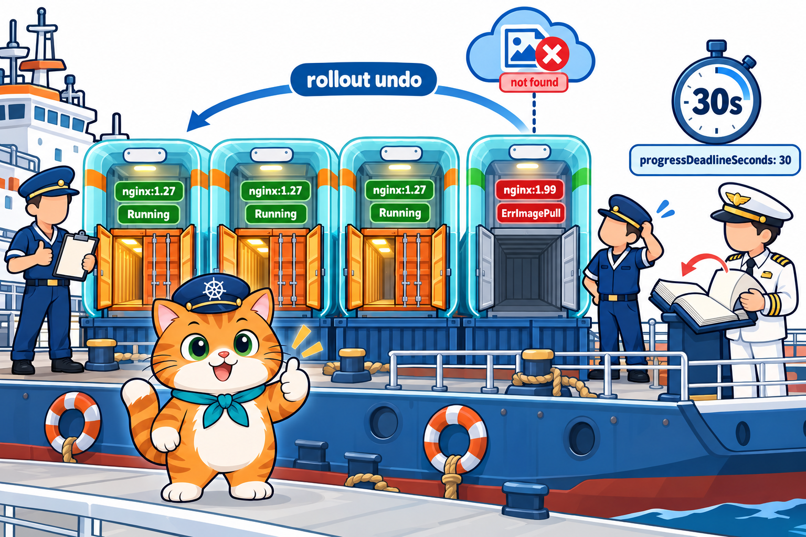<br>
  <em><b>รูปที่ 11</b> LAB3: กล่องใหม่ 1 ใบติดป้ายแดง nginx:1.99 ดึงพิมพ์เขียวไม่ได้ (ErrImagePull) แต่กล่องเก่า 3 ใบยังเปิดร้านอยู่ ผู้จัดการดูนาฬิกาจนเกิน 30 วินาที (progressDeadlineSeconds) แล้วพลิกสมุดกลับ (rollout undo)</em>
</p>

**เป้าหมาย:** ลองเปลี่ยนเป็น image ที่ไม่มีอยู่จริง (พิมพ์เลขรุ่นผิด) ดูว่า Deployment ทำอย่างไร ร้านยังเปิดอยู่ไหม รู้ได้อย่างไรว่าพัง แล้วย้อนกลับ

<p align="center" id="fig-12">
  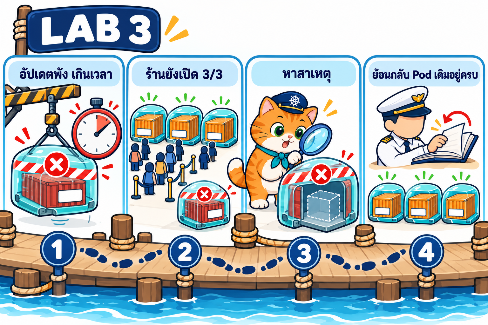<br>
  <em><b>รูปที่ 12</b> แผนการทดลอง LAB3 มี 4 การทดลอง: (1) ขั้นที่ 1–3 อัปเดตเป็น image ที่ไม่มีจริงจนเกิน progressDeadlineSeconds (2) ขั้นที่ 4 ร้านยังเปิด 3/3 เพราะ Pod เก่าไม่ถูกลด (3) ขั้นที่ 5 หาสาเหตุจาก Events และ Conditions (4) ขั้นที่ 6–7 rollout undo แล้ว Pod เดิมยังอยู่ครบ</em>
</p>

> **ทบทวนก่อนเริ่ม: คำสั่งตระกูล `rollout` ที่ใช้ใน LAB นี้** (อ่านทีละคำได้ใน [รูปที่ 8](#fig-8))
>
> - `kubectl rollout status deployment/web` = **"เปลี่ยนรุ่นเสร็จหรือยัง"** คำสั่งนี้ค้างรอจนเสร็จ หรือจนประกาศว่าล้มเหลว
> - `kubectl rollout history deployment/web` = **"เคยมีรุ่นอะไรบ้าง"** เปิดสมุดรุ่น ตอบทันทีไม่ต้องรอ
> - `kubectl rollout undo deployment/web` = **"ย้อนไปรุ่นก่อนหน้า"** ทยอยเปลี่ยน Pod กลับเหมือนตอนเปลี่ยนรุ่น
>
> ทั้ง 3 คำสั่งลงท้ายด้วย `deployment/web` เสมอ = ถามผู้จัดการชนิด Deployment ชื่อ `web` (ตรงกับ `kind` และ `metadata.name` ในไฟล์)

### ขั้นที่ 1: สร้าง Deployment รุ่นดี

> 🎯 **เป้าหมายขั้นนี้:** เตรียม **ร้านรุ่นดี 3 ตัว** ไว้เทียบว่าตอนอัปเดตพัง Pod เก่าจะถูกแตะไหม ([ทฤษฎีหัวข้อ 11](../01_Theory/README.md#11-อัปเดตพัง-แต่ร้านไม่ปิด))
>
> 🔍 **สังเกต:** จดชื่อ Pod 3 ตัวนี้ไว้ ท้าย LAB จะเทียบว่ายังเป็นตัวเดิมหรือไม่

```bash
kubectl apply -f labs/lab01-first-deploy/web-deploy.yaml
```

**Expected output**

<pre>
deployment.apps/web created
</pre>

รอสัก 10 วินาที

```bash
kubectl get pods
```

**Expected output**

<pre>
NAME                   READY   STATUS    RESTARTS   AGE
web-6bd858c6f9-k7tsh   1/1     Running   0          10s
web-6bd858c6f9-rnjmx   1/1     Running   0          10s
web-6bd858c6f9-zdcjm   1/1     Running   0          10s
</pre>

**จดชื่อ Pod 3 ตัวนี้ไว้** (ตัวอย่างนี้คือ `k7tsh`, `rnjmx`, `zdcjm` ของนักศึกษาจะต่างไป) ขั้นที่ 6 จะกลับมาเทียบ

### ขั้นที่ 2: ไฟล์อัปเดตที่พิมพ์ผิด

> 🎯 **เป้าหมายขั้นนี้:** ดูว่า **ใส่อะไรผิด และตั้งเส้นตายไว้อย่างไร** ก่อน apply ([ทฤษฎีหัวข้อ 11](../01_Theory/README.md#11-อัปเดตพัง-แต่ร้านไม่ปิด))
>
> 🔍 **สังเกต:** `image: nginx:1.99-alpine` ที่ไม่มีอยู่จริง และ `progressDeadlineSeconds: 30`

ไฟล์ `labs/lab03-bad-update/web-deploy-bad.yaml`

```yaml
# LAB 3: อัปเดตพัง — พิมพ์เลขรุ่น nginx ผิด (ไม่มี image นี้จริง) ดูว่าร้านยังเปิดอยู่ไหม
apiVersion: apps/v1
kind: Deployment
metadata:
  name: web
  annotations:
    kubernetes.io/change-cause: "nginx 1.99 (พิมพ์ผิด)"
spec:
  replicas: 3
  progressDeadlineSeconds: 30   # ← ใหม่: เปลี่ยนรุ่นไม่คืบหน้าเกิน 30 วินาที = ถือว่าล้มเหลว (ค่าเริ่มต้น 600)
  selector:
    matchLabels:
      app: web
  template:
    metadata:
      labels:
        app: web
    spec:
      containers:
        - name: nginx
          image: nginx:1.99-alpine   # ← พิมพ์ผิด: ไม่มีรุ่นนี้ใน Docker Hub → Pod ใหม่ดึง image ไม่ได้
          ports:
            - containerPort: 80
```

ทำงานอย่างไร

- ไฟล์นี้คือ `web-deploy.yaml` ของ LAB 1 ที่แก้ 3 จุด ชื่อยังเป็น `web` การ apply จึงเป็นการ **เปลี่ยนรุ่นของ Deployment ตัวเดิม** (หลักการเขียนไฟล์รุ่นใหม่ใน LAB 2 ขั้นที่ 2)
- `image: nginx:1.99-alpine` (บรรทัด `← พิมพ์ผิด`) = **ต้นเหตุของปัญหา** รุ่นนี้ไม่มีใน Docker Hub ตั้งใจพิมพ์ผิดให้เหมือนความผิดพลาดที่เจอได้จริง
- `progressDeadlineSeconds: 30` (บรรทัด `← ใหม่`) = **นาฬิกาจับเวลาของการเปลี่ยนรุ่น** ถ้าผ่านไป 30 วินาทีแล้วการเปลี่ยนรุ่นไม่คืบหน้าเลย (ไม่มี Pod รุ่นใหม่พร้อมเพิ่มขึ้น) ให้ประกาศว่า **ล้มเหลว** ค่าเริ่มต้นคือ 600 วินาที (10 นาที) ตั้งสั้นไว้จะได้ไม่ต้องรอนาน
- โน้ต `change-cause` เปลี่ยนเป็น `nginx 1.99 (พิมพ์ผิด)` จะได้เห็นใน `rollout history` ว่ารุ่นนี้คือรุ่นที่พัง

### ขั้นที่ 3: apply แล้วรอดู

> 🎯 **เป้าหมายขั้นนี้:** ทดสอบว่า **Deployment รู้ได้อย่างไรว่าการเปลี่ยนรุ่นล้มเหลว** ([ทฤษฎีหัวข้อ 9](../01_Theory/README.md#9-ติดตามการเปลี่ยนรุ่น-rollout-status-และ-history) · [ทฤษฎีหัวข้อ 11](../01_Theory/README.md#11-อัปเดตพัง-แต่ร้านไม่ปิด))
>
> 🔍 **สังเกต:** ค้างอยู่ที่ `1 out of 3` แล้วจบด้วย `exceeded its progress deadline` หลังราว 30 วินาที

```bash
kubectl apply -f labs/lab03-bad-update/web-deploy-bad.yaml
```

**Expected output**

<pre>
deployment.apps/web configured
</pre>

`configured` = แก้ Deployment `web` ตัวเดิม apply **ผ่าน** เพราะ Kubernetes ไม่รู้ว่ามี image นี้หรือไม่ จนกว่าจะลองดึงจริง ต่อไปเฝ้าดูการเปลี่ยนรุ่น ใส่ `time` ไว้ข้างหน้าเพื่อจับเวลา (แบบ `time k8s-up` ใน LAB 0)

```bash
time kubectl rollout status deployment/web
```

**Expected output** (รอประมาณ 30 วินาที)

<pre>
Waiting for deployment "web" rollout to finish: 1 out of 3 new replicas have been updated...
error: deployment "web" exceeded its progress deadline

real	0m30.098s
user	0m0.031s
sys	0m0.029s
</pre>

อ่านทีละบรรทัด

- `1 out of 3 new replicas have been updated` = Pod รุ่นใหม่ **ถูกสร้างแล้ว 1 จาก 3 ตัว** (updated = สร้างจากแม่พิมพ์ใหม่แล้ว ยังไม่ได้แปลว่าพร้อม) แล้วตัวเลขไม่ขยับอีกเลย
- `exceeded its progress deadline` = **เกินเส้นตาย 30 วินาที** ตาม `progressDeadlineSeconds` Deployment จึงประกาศว่าการเปลี่ยนรุ่นนี้ **ล้มเหลว**
- `real 0m30.098s` = คำสั่งรอจริง 30 วินาที ตรงกับค่าที่ตั้งไว้

> **⚠️ ล้มเหลวไม่ได้แปลว่าย้อนกลับ:** `rollout status` แค่รายงานว่าล้มเหลว Deployment **ยังค้างอยู่ที่รุ่นที่พัง** ไม่ได้ย้อนกลับให้เอง (พิมพ์ `rollout status` ซ้ำตอนนี้ก็ได้ error เดิมทันที) ต้องสั่งย้อนเองในขั้นที่ 6

### ขั้นที่ 4: ร้านยังเปิดอยู่ไหม

> 🎯 **เป้าหมายขั้นนี้:** ทดสอบหลักการสำคัญของ LAB นี้: **อัปเดตพังแล้วร้านยังเปิดไหม** ([ทฤษฎีหัวข้อ 8](../01_Theory/README.md#8-maxsurge-maxunavailable-และ-minreadyseconds) · [ทฤษฎีหัวข้อ 11](../01_Theory/README.md#11-อัปเดตพัง-แต่ร้านไม่ปิด))
>
> 🔍 **สังเกต:** `READY 3/3` / `AVAILABLE 3`, Pod ใหม่ 1 ตัว `ImagePullBackOff` ส่วน Pod เก่า 3 ตัว **ชื่อเดิม** ยัง `Running`

ดูทีละชั้น เริ่มจากผู้จัดการ (Deployment)

```bash
kubectl get deploy
```

**Expected output**

<pre>
NAME   READY   UP-TO-DATE   AVAILABLE   AGE
web    3/3     1            3           41s
</pre>

- `READY 3/3` = Pod ที่พร้อม 3 จากที่ขอ 3 = **ลูกค้ายังได้ 3 สาขา**
- `UP-TO-DATE 1` = Pod ที่เป็นแม่พิมพ์ใหม่ (`nginx:1.99-alpine`) มีแค่ **1** ตัว
- `AVAILABLE 3` = Pod ที่พร้อมให้บริการจริง 3 ตัว (เป็นตัวเก่าทั้งหมด)

ต่อไปดูหัวหน้าลูกเรือ (ReplicaSet) ทั้งสองทีม

```bash
kubectl get rs -o wide
```

**Expected output**

<pre>
NAME             DESIRED   CURRENT   READY   AGE   CONTAINERS   IMAGES              SELECTOR
web-5f795d85b    1         1         0       31s   nginx        nginx:1.99-alpine   app=web,pod-template-hash=5f795d85b
web-6bd858c6f9   3         3         3       41s   nginx        nginx:1.27-alpine   app=web,pod-template-hash=6bd858c6f9
</pre>

- **ทีมใหม่** `web-5f795d85b` (`nginx:1.99-alpine`): ขอ 1 สร้าง 1 แต่ **พร้อม 0**
- **ทีมเก่า** `web-6bd858c6f9` (`nginx:1.27-alpine`): ยัง **3 ตัวพร้อมครบ** Deployment ไม่ได้ลดทีมเก่าเลยแม้แต่ตัวเดียว

สุดท้ายดู Pod

```bash
kubectl get pods
```

**Expected output**

<pre>
NAME                   READY   STATUS             RESTARTS   AGE
web-5f795d85b-n5zw6    0/1     ImagePullBackOff   0          31s
web-6bd858c6f9-k7tsh   1/1     Running            0          41s
web-6bd858c6f9-rnjmx   1/1     Running            0          41s
web-6bd858c6f9-zdcjm   1/1     Running            0          41s
</pre>

- Pod เก่า 3 ตัว **ชื่อตรงกับที่จดไว้ในขั้นที่ 1** ยัง `Running` = ลูกค้ายังเข้าร้านได้ตามปกติ
- Pod ใหม่ `0/1` สถานะ `ImagePullBackOff` = ดึง image ไม่ได้ แล้ว **พักรอก่อนลองใหม่** (back-off) บางจังหวะจะเห็นเป็น `ErrImagePull` = เพิ่งลองดึงแล้วพัง สองคำนี้สลับกันไปเรื่อย ๆ เพราะ kubelet ลองดึงซ้ำ (อาการเดียวกับบทที่ 2)

**ทำไม Deployment ไม่ลด Pod เก่า?** ไฟล์นี้ไม่ได้ตั้ง `maxSurge` / `maxUnavailable` จึงใช้ค่าเริ่มต้น 25% ทั้งคู่ คำนวณกับ `replicas: 3` ได้ตามรูปข้างล่าง

<p align="center" id="fig-13">
  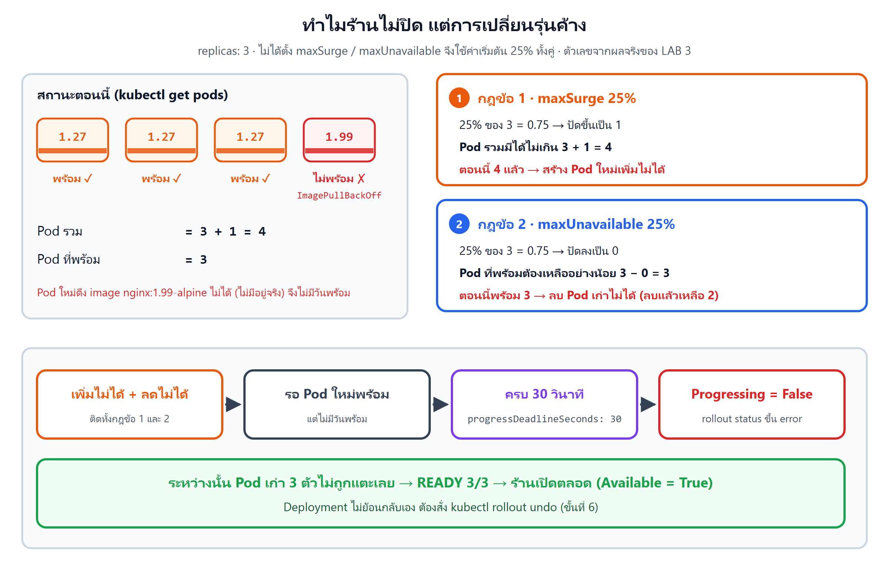<br>
  <em><b>รูปที่ 13</b> ทำไมร้านไม่ปิด แต่การเปลี่ยนรุ่นค้าง: กฎข้อ 1 (maxSurge) ให้มี Pod รวมได้ไม่เกิน 4 ซึ่งเต็มแล้ว จึงสร้างเพิ่มไม่ได้ กฎข้อ 2 (maxUnavailable) บังคับให้พร้อมอย่างน้อย 3 จึงลบ Pod เก่าไม่ได้ Pod ใหม่ไม่มีวันพร้อม การเปลี่ยนรุ่นจึงค้างจนครบ 30 วินาที ระหว่างนั้น Pod เก่า 3 ตัวไม่ถูกแตะ ร้านเปิดตลอด</em>
</p>

- **กฎข้อ 1 `maxSurge`** 25% ของ 3 = 0.75 ปัดขึ้นเป็น **1** → มี Pod รวมได้ไม่เกิน 3 + 1 = **4** ตอนนี้มี 4 แล้ว (เก่า 3 + ใหม่ 1) จึง **สร้างเพิ่มไม่ได้**
- **กฎข้อ 2 `maxUnavailable`** 25% ของ 3 = 0.75 ปัดลงเป็น **0** → Pod ที่พร้อมต้องเหลืออย่างน้อย 3 − 0 = **3** ถ้าลบตัวเก่าจะเหลือพร้อม 2 จึง **ลบไม่ได้**
- Deployment จึงต้องรอให้ Pod ใหม่พร้อมก่อน แต่มันไม่มีวันพร้อม การเปลี่ยนรุ่นจึง **ค้างอยู่ขั้นแรก** และ Pod เก่าไม่ถูกแตะ = **ร้านไม่ปิด**

### ขั้นที่ 5: หาสาเหตุ

> 🎯 **เป้าหมายขั้นนี้:** ฝึก **หาสาเหตุ** จาก Events ของ Pod และ Conditions ของ Deployment ([ทฤษฎีหัวข้อ 11](../01_Theory/README.md#11-อัปเดตพัง-แต่ร้านไม่ปิด))
>
> 🔍 **สังเกต:** คำว่า `not found` ใน Events ของ Pod และ `Progressing False ProgressDeadlineExceeded` คู่กับ `Available True`

ถาม 2 ชั้น: **Pod ที่พังบอกอะไร** แล้ว **ผู้จัดการ (Deployment) สรุปว่าอย่างไร**

```bash
kubectl describe pod web-5f795d85b-n5zw6    # ← เปลี่ยนเป็นชื่อ Pod ที่พังของตัวเอง
```

**Expected output** (ตัดเฉพาะส่วน Events)

<pre>
...
Events:
  Type     Reason     Age                From               Message
  ----     ------     ----               ----               -------
  Normal   Scheduled  31s                default-scheduler  Successfully assigned default/web-5f795d85b-n5zw6 to lab-worker2
  Normal   BackOff    27s                kubelet            spec.containers{nginx}: Back-off pulling image "nginx:1.99-alpine"
  Warning  Failed     27s                kubelet            spec.containers{nginx}: Error: ImagePullBackOff
  Normal   Pulling    15s (x2 over 30s)  kubelet            spec.containers{nginx}: Pulling image "nginx:1.99-alpine"
  Warning  Failed     12s (x2 over 28s)  kubelet            spec.containers{nginx}: Failed to pull image "nginx:1.99-alpine": rpc error: code = NotFound desc = failed to pull and unpack image "docker.io/library/nginx:1.99-alpine": failed to resolve reference "docker.io/library/nginx:1.99-alpine": docker.io/library/nginx:1.99-alpine: not found
  Warning  Failed     12s (x2 over 28s)  kubelet            spec.containers{nginx}: Error: ErrImagePull
</pre>

- อ่านบรรทัด `Warning` ที่ยาวที่สุด คำสำคัญอยู่ท้ายบรรทัด: **`nginx:1.99-alpine: not found`** = ไม่มี image รุ่นนี้ใน Docker Hub (พิมพ์เลขรุ่นผิด)
- `(x2 over 30s)` = kubelet ลองดึงซ้ำแล้ว 2 ครั้งใน 30 วินาที ทุกครั้งพังด้วยเหตุผลเดิม
- Pod ถูกวางบนเรือได้ปกติ (`Scheduled`) ปัญหาอยู่ที่ **ดึง image ไม่ได้** อย่างเดียว

ต่อไปดูว่าผู้จัดการสรุปสถานการณ์ว่าอย่างไร

```bash
kubectl describe deploy web
```

**Expected output** (ตัดเฉพาะส่วนสำคัญ)

<pre>
Name:                   web
...
Annotations:            deployment.kubernetes.io/revision: 2
                        kubernetes.io/change-cause: nginx 1.99 (พิมพ์ผิด)
Selector:               app=web
Replicas:               3 desired | 1 updated | 4 total | 3 available | 1 unavailable
...
Conditions:
  Type           Status  Reason
  ----           ------  ------
  Available      True    MinimumReplicasAvailable
  Progressing    False   ProgressDeadlineExceeded
OldReplicaSets:  web-6bd858c6f9 (3/3 replicas created)
NewReplicaSet:   web-5f795d85b (1/1 replicas created)
...
</pre>

แถว `Replicas` อ่านแยกทีละคำ

- `3 desired` = ขอไว้ 3 / `1 updated` = เป็นแม่พิมพ์ใหม่ 1 / `4 total` = มีอยู่จริงรวม 4 (เก่า 3 + ใหม่ 1)
- `3 available` = พร้อมให้บริการ 3 / `1 unavailable` = ไม่พร้อม 1 (ตัวที่ดึง image ไม่ได้)

แถว `Conditions` คือ **ไฟสัญญาณ 2 ดวง** ของผู้จัดการ แต่ละดวงตอบคนละคำถาม

<p align="center" id="fig-14">
  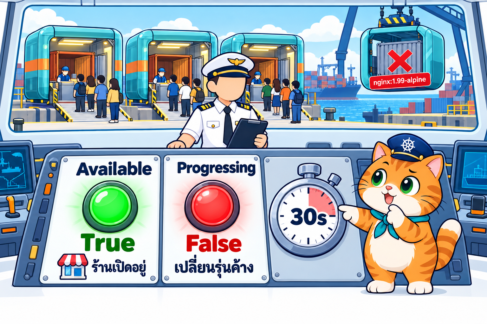<br>
  <em><b>รูปที่ 14</b> ไฟ 2 ดวงใน Conditions ของ Deployment: Available = True (ไฟเขียว ร้านเปิดอยู่ เพราะ Pod เก่า 3 ตัวยังพร้อม) แต่ Progressing = False (ไฟแดง การเปลี่ยนรุ่นค้างเกิน 30 วินาที เพราะ Pod ใหม่ nginx:1.99-alpine ดึง image ไม่ได้)</em>
</p>

- **`Available True`** ตอบว่า **"ร้านเปิดอยู่ไหม"** = เปิด (Pod พร้อมครบตามขั้นต่ำ `MinimumReplicasAvailable`)
- **`Progressing False`** ตอบว่า **"การเปลี่ยนรุ่นเดินหน้าไหม"** = ไม่ ค้างเกินเส้นตาย (`ProgressDeadlineExceeded`)
- สองดวงนี้แยกกันได้ อัปเดตพังจึงเห็น **เขียว + แดง** พร้อมกัน ส่วนตอนปกติ (LAB 1 ขั้นที่ 3) เป็น **True ทั้งคู่**

### ขั้นที่ 6: ย้อนกลับ

> 🎯 **เป้าหมายขั้นนี้:** ทดสอบว่า **Deployment ไม่ย้อนกลับเอง** ต้องสั่ง undo และ undo ครั้งนี้เสร็จทันทีเพราะ Pod เก่ายังอยู่ครบ ([ทฤษฎีหัวข้อ 10](../01_Theory/README.md#10-ย้อนกลับด้วย-rollout-undo) · [ทฤษฎีหัวข้อ 11](../01_Theory/README.md#11-อัปเดตพัง-แต่ร้านไม่ปิด))
>
> 🔍 **สังเกต:** `rollout status` จบทันทีโดยไม่มี `Waiting` และ Pod 3 ตัว **ชื่อตรงกับที่จดไว้ในขั้นที่ 1** `AGE` นับต่อ

ก่อนย้อน เปิดสมุดรุ่นดูก่อนว่าจะย้อนไปรุ่นไหน

```bash
kubectl rollout history deployment/web
```

**Expected output**

<pre>
deployment.apps/web 
REVISION  CHANGE-CAUSE
1         nginx 1.27
2         nginx 1.99 (พิมพ์ผิด)

</pre>

- `REVISION` = เลขรุ่น นับเพิ่มทุกครั้งที่ **แม่พิมพ์เปลี่ยน** / `CHANGE-CAUSE` = โน้ต `change-cause` ในไฟล์ของรุ่นนั้น
- **เลขมากที่สุด = รุ่นที่ใช้อยู่ตอนนี้** = รุ่น 2 (พิมพ์ผิด) ดังนั้น `undo` จะพากลับไป **รุ่น 1** (`nginx 1.27`)

```bash
kubectl rollout undo deployment/web
```

**Expected output**

<pre>
Warning: resource deployments/web was previously managed with 'kubectl apply'. Rolling back will not update the kubectl.kubernetes.io/last-applied-configuration annotation, which may cause unexpected behavior on future 'kubectl apply' operations. Consider using 'kubectl apply' with your previous configuration file instead.
deployment.apps/web rolled back
</pre>

- บรรทัดสุดท้าย `rolled back` = ย้อนสำเร็จ
- `Warning` เรื่องเดียวกับ LAB 2: ไฟล์ที่ apply ล่าสุดยังเป็น **ไฟล์ที่พิมพ์ผิด** ถ้าใครเผลอ apply ไฟล์นั้นอีก ร้านจะพังซ้ำ (LAB 4 ขั้นที่ 11 จะแก้ให้ดู)

```bash
kubectl rollout status deployment/web
```

**Expected output**

<pre>
deployment "web" successfully rolled out
</pre>

เสร็จทันที ไม่มีบรรทัด `Waiting` (บางเครื่องอาจเห็น `1 old replicas are pending termination...` ก่อน 1 บรรทัด = รอ Pod ที่พังปิด) เพราะทีมเก่ามี 3 ตัวพร้อมอยู่แล้ว **ไม่มีอะไรต้องสร้างใหม่** รอสัก 5 วินาที แล้วดู Pod

```bash
kubectl get pods
```

**Expected output**

<pre>
NAME                   READY   STATUS    RESTARTS   AGE
web-6bd858c6f9-k7tsh   1/1     Running   0          46s
web-6bd858c6f9-rnjmx   1/1     Running   0          46s
web-6bd858c6f9-zdcjm   1/1     Running   0          46s
</pre>

เทียบกับชื่อที่จดไว้ในขั้นที่ 1: **Pod 3 ตัวเดิม** (`k7tsh`, `rnjmx`, `zdcjm`) `AGE` นับต่อเนื่อง (46s) และ `RESTARTS 0` = **ร้านไม่เคยปิดเลยแม้แต่วินาทีเดียว** การ undo แค่ลดทีมใหม่ที่พังเหลือ 0 (Pod ที่พังถูกลบไป)

```bash
kubectl get rs -o wide
```

**Expected output**

<pre>
NAME             DESIRED   CURRENT   READY   AGE   CONTAINERS   IMAGES              SELECTOR
web-5f795d85b    0         0         0       36s   nginx        nginx:1.99-alpine   app=web,pod-template-hash=5f795d85b
web-6bd858c6f9   3         3         3       46s   nginx        nginx:1.27-alpine   app=web,pod-template-hash=6bd858c6f9
</pre>

ทีมที่พัง `web-5f795d85b` เหลือ **0** แต่ยังเก็บไว้ (แม่พิมพ์ทุกรุ่นถูกเก็บไว้เผื่อย้อน) ทีมเก่า `web-6bd858c6f9` กลับมาเป็นทีมหลัก เปิดสมุดรุ่นอีกครั้ง

```bash
kubectl rollout history deployment/web
```

**Expected output**

<pre>
deployment.apps/web 
REVISION  CHANGE-CAUSE
2         nginx 1.99 (พิมพ์ผิด)
3         nginx 1.27

</pre>

**รุ่น 1 หายไป แล้วมีรุ่น 3 เป็น `nginx 1.27`** จุดนี้คนงงบ่อยที่สุด ดูรูปข้างล่าง

<p align="center" id="fig-15">
  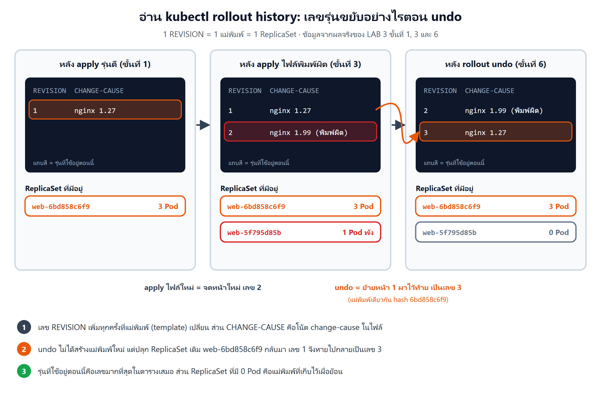<br>
  <em><b>รูปที่ 15</b> อ่าน rollout history ตลอด LAB 3: หลังขั้นที่ 1 มีรุ่น 1 (nginx 1.27) หลังขั้นที่ 3 เพิ่มรุ่น 2 (พิมพ์ผิด) หลัง undo ในขั้นที่ 6 แม่พิมพ์ของรุ่น 1 ถูกหยิบกลับมาใช้แล้วจดเป็นรุ่น 3 จึงไม่มีเลข 1 แล้ว ReplicaSet web-6bd858c6f9 ยังเป็นตัวเดิมตลอด</em>
</p>

- `undo` ไม่ได้ "ลบรุ่น 2" แต่ **หยิบแม่พิมพ์ของรุ่น 1 กลับมาใช้เป็นรุ่นล่าสุด** แล้วจดเลขใหม่ต่อท้ายเป็น **3** (แม่พิมพ์เดียวกันจึงไม่จดซ้ำเป็นเลข 1 อีก)
- ReplicaSet ของรุ่น 3 คือ `web-6bd858c6f9` ตัวเดิม (hash เดิม) ไม่มี ReplicaSet ใหม่เกิดขึ้น
- อยากรู้ว่าแต่ละเลขคือแม่พิมพ์อะไร ใส่ `--revision=<เลข>` ต่อท้ายได้ (ไม่บังคับทำ)

```bash
kubectl rollout history deployment/web --revision=3
```

**Expected output**

<pre>
deployment.apps/web with revision #3
Pod Template:
  Labels:	app=web
	pod-template-hash=6bd858c6f9
  Annotations:	kubernetes.io/change-cause: nginx 1.27
  Containers:
   nginx:
    Image:	nginx:1.27-alpine
...
</pre>

รุ่น 3 = แม่พิมพ์ `nginx:1.27-alpine` ที่มี `pod-template-hash=6bd858c6f9` ตรงกับ ReplicaSet ทีมเก่า

### ขั้นที่ 7: ลบ Deployment

> 🎯 **เป้าหมายขั้นนี้:** เก็บกวาด Deployment ของ LAB นี้
>
> 🔍 **สังเกต:** ได้ `deleted` และ `No resources found`

```bash
kubectl delete -f labs/lab01-first-deploy/web-deploy.yaml
```

**Expected output**

<pre>
deployment.apps "web" deleted from default namespace
</pre>

รอสัก 5 วินาที

```bash
kubectl get pods
```

**Expected output**

<pre>
No resources found in default namespace.
</pre>

ลบด้วยไฟล์ไหนก็ได้ (หรือ `kubectl delete deployment web`) เพราะทุกไฟล์ใน LAB 1–3 ชื่อ Deployment `web` เหมือนกัน

### สิ่งที่เห็น

- image ผิด → Pod ใหม่ `ErrImagePull` / `ImagePullBackOff` แต่ Deployment **ไม่ลด Pod เก่า** เพราะกฎ `maxUnavailable` (0) บังคับให้พร้อมอย่างน้อย 3 ร้านจึงเปิดครบตลอด (`READY 3/3`)
- `progressDeadlineSeconds` คือนาฬิกาจับเวลา ค้างเกินกำหนด → `rollout status` ขึ้น `exceeded its progress deadline` และไฟ `Progressing` เป็น `False` ขณะที่ไฟ `Available` ยังเป็น `True`
- Deployment **ไม่ย้อนกลับเอง** เราต้องสั่ง `kubectl rollout undo` ซึ่งเสร็จทันทีเพราะ Pod เก่ายังอยู่ครบ
- `rollout history` เลขมากสุด = รุ่นปัจจุบัน และ undo ทำให้เลขรุ่นที่ย้อนไปขยับเป็นเลขใหม่ (1 → 3)

> **🤔 คำถามชวนคิด:** ถ้าไม่ได้ใส่ `progressDeadlineSeconds: 30` (ใช้ค่าเริ่มต้น 600) ร้านจะปิดไหม และ `kubectl rollout status` จะต่างไปอย่างไร

---

## LAB 4: LAB สุดท้าย: ร้านอาหารแมวน้องส้มเปลี่ยนเมนูโดยไม่ปิดร้าน

<p align="center" id="fig-16">
  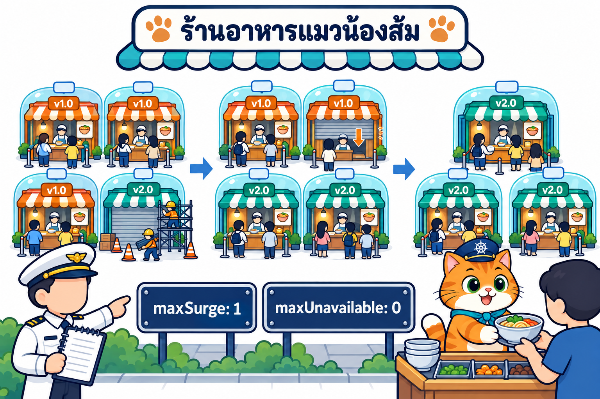<br>
  <em><b>รูปที่ 16</b> LAB สุดท้าย: Deployment som-menu ทยอยเปลี่ยนหน้าร้านจากเวอร์ชัน 1.0 (ส้ม) เป็นเวอร์ชัน 2.0 (เขียวอมฟ้า) ทีละสาขา เปิดสาขาใหม่ได้เกินทีละ 1 (maxSurge: 1) และสาขาที่พร้อมไม่ต่ำกว่า 3 เลย (maxUnavailable: 0) ลูกค้าจึงได้รับบริการตลอด</em>
</p>

**เป้าหมาย:** เปิดหน้าร้านน้องส้ม 3 สาขาด้วย Deployment เปลี่ยนเมนูเป็นเวอร์ชัน 2.0 โดยร้านไม่ปิดเลย ดูสองรุ่นเปิดปนกันระหว่างเปลี่ยน แล้วย้อนกลับเมื่อลูกค้าไม่ชอบเมนูใหม่

<p align="center" id="fig-17">
  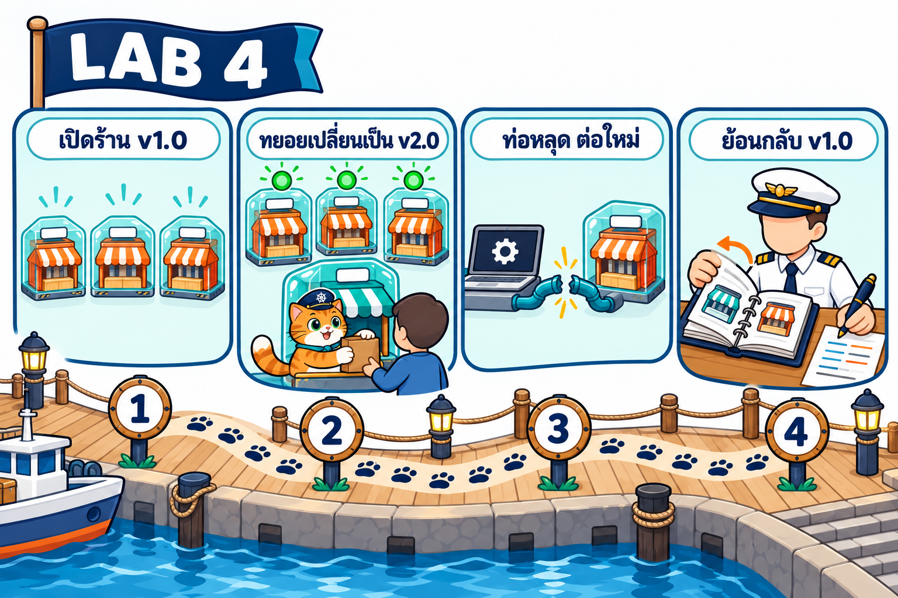<br>
  <em><b>รูปที่ 17</b> แผนการทดลอง LAB4 มี 4 การทดลอง: (1) ขั้นที่ 0–5 เปิดร้าน 3 สาขาเวอร์ชัน 1.0 (2) ขั้นที่ 6–7 ทยอยเปลี่ยนเป็นเวอร์ชัน 2.0 โดยสาขาที่พร้อมไม่ต่ำกว่า 3 (3) ขั้นที่ 8 port-forward หลุดต้องต่อท่อใหม่ (4) ขั้นที่ 9–12 ย้อนกลับเป็นเวอร์ชัน 1.0 แล้ว apply ไฟล์ให้ตรงกับคลัสเตอร์</em>
</p>

หน้าร้าน (`som-menu/app/server.js`) เป็นเว็บ Node.js เล็ก ๆ ตัวเดียวกับบทที่ 3 บอก **ชื่อ Pod ที่เสิร์ฟหน้านี้** และเวอร์ชันของร้าน แต่ละ Pod = 1 สาขา

**ต้องมี:** VS Code + extension **Container Tools** และ **Dev Containers** (แบบบทที่ 3 LAB 4) ทุกคำสั่งใน LAB นี้พิมพ์ใน **Terminal ของ VS Code** ที่ attach เข้า container k8s-lab

### ขั้นที่ 0: เปิด VS Code แล้ว attach เข้า container k8s-lab

> 🎯 **เป้าหมายขั้นนี้:** เตรียมที่ทำงานให้ **พิมพ์คำสั่งและเปิดเว็บจาก VS Code ได้** (ใช้แท็บ PORTS ในขั้นที่ 4)
>
> 🔍 **สังเกต:** มุมล่างซ้ายขึ้น `Container tuchsanai/devtools-kind:2569_1 (k8s-lab)` และเปิดโฟลเดอร์ `02_LAB` แล้ว

<p align="center" id="fig-18">
  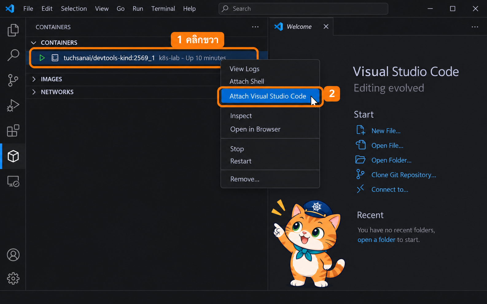<br>
  <em><b>รูปที่ 18</b> LAB4 ขั้นที่ 0 (ภาพจำลองหน้าจอ VS Code): ในแท็บ Containers คลิกขวาที่ k8s-lab แล้วเลือก Attach Visual Studio Code</em>
</p>

1. เปิด VS Code บนเครื่องนักศึกษา กดไอคอน **Containers** ที่แถบซ้าย
2. **คลิกขวา** ที่ container `k8s-lab` (image `tuchsanai/devtools-kind:2569_1`) แล้วเลือก **Attach Visual Studio Code**
3. VS Code จะเปิดหน้าต่างใหม่ มุมล่างซ้ายขึ้น `Container tuchsanai/devtools-kind:2569_1 (k8s-lab)` = ตอนนี้ทำงานอยู่ **ใน container** แล้ว
4. เมนู **File → Open Folder** เลือก `/workspace/DevTools/05_kubernetes/004_kubernetes_Deployment/02_LAB`
5. เมนู **Terminal → New Terminal**

### ขั้นที่ 1: build image ของหน้าร้าน 2 เวอร์ชัน

> 🎯 **เป้าหมายขั้นนี้:** เตรียม **image 2 รุ่นจากโค้ดเดียวกัน** ไว้เป็นแม่พิมพ์เก่ากับใหม่ ([ทฤษฎีหัวข้อ 12](../01_Theory/README.md#12-อ่าน-yaml-ร้านน้องส้มทั้งไฟล์))
>
> 🔍 **สังเกต:** ได้ `som-menu:1.0` และ `som-menu:2.0` ต่างกันแค่ `APP_VERSION` ที่ส่งตอน build

```bash
cd som-menu/app
```

```bash
docker build -t som-menu:1.0 .
```

**Expected output** (บรรทัดท้าย ๆ ครั้งแรกต้องดึง `node:22-alpine` อาจใช้เวลาหลายสิบวินาที)

<pre>
...
#9 naming to docker.io/library/som-menu:1.0 0.0s done
#9 unpacking to docker.io/library/som-menu:1.0 0.0s done
#9 DONE 0.2s
</pre>

เวอร์ชัน 2.0 ใช้โค้ดเดียวกัน แต่ส่งค่า `APP_VERSION=2.0` ตอน build (หน้าร้านจะเปลี่ยนสีและมีเมนูใหม่)

```bash
docker build -t som-menu:2.0 --build-arg APP_VERSION=2.0 .
```

**Expected output** (บรรทัดท้าย ๆ)

<pre>
...
#9 naming to docker.io/library/som-menu:2.0 done
#9 unpacking to docker.io/library/som-menu:2.0 0.0s done
#9 DONE 0.1s
</pre>

กลับไปที่โฟลเดอร์ `02_LAB`

```bash
cd ../..
```

### ขั้นที่ 2: นำ image เข้าคลัสเตอร์

> 🎯 **เป้าหมายขั้นนี้:** ส่ง image ทั้ง 2 รุ่นเข้า **ทุก node** เพราะ Pod รุ่นใหม่ไปเกิดบนเรือลำไหนก็ได้
>
> 🔍 **สังเกต:** ขึ้น `loading...` ครบ 3 node × 2 รุ่น = 6 บรรทัด

```bash
kind load docker-image som-menu:1.0 som-menu:2.0 --name lab
```

**Expected output**

<pre>
Image: "som-menu:1.0" with ID "sha256:5a48f933475e675b2de4832d44606980c81000f92241cf4781e3b3e8584b7e59" not yet present on node "lab-control-plane", loading...
Image: "som-menu:1.0" with ID "sha256:5a48f933475e675b2de4832d44606980c81000f92241cf4781e3b3e8584b7e59" not yet present on node "lab-worker2", loading...
Image: "som-menu:1.0" with ID "sha256:5a48f933475e675b2de4832d44606980c81000f92241cf4781e3b3e8584b7e59" not yet present on node "lab-worker", loading...
Image: "som-menu:2.0" with ID "sha256:2eee34995d6eed4c35d85cf32ec6b65848650ac8340ef1aadc48e7fdb059111c" not yet present on node "lab-control-plane", loading...
Image: "som-menu:2.0" with ID "sha256:2eee34995d6eed4c35d85cf32ec6b65848650ac8340ef1aadc48e7fdb059111c" not yet present on node "lab-worker2", loading...
Image: "som-menu:2.0" with ID "sha256:2eee34995d6eed4c35d85cf32ec6b65848650ac8340ef1aadc48e7fdb059111c" not yet present on node "lab-worker", loading...
</pre>

ส่งทั้ง 2 เวอร์ชันเข้าทุก node ไว้ก่อน เพราะ Pod ไปเกิดบนเรือลำไหนก็ได้ (ลำดับ node ในแต่ละเครื่องอาจต่างกัน)

### ขั้นที่ 3: เปิดร้าน 3 สาขาด้วย Deployment

> 🎯 **เป้าหมายขั้นนี้:** อ่าน **ค่าที่ทำให้ร้านไม่ปิด** (`maxSurge` / `maxUnavailable` / `minReadySeconds` / readinessProbe) แล้วเปิดร้าน 3 สาขา ([ทฤษฎีหัวข้อ 8](../01_Theory/README.md#8-maxsurge-maxunavailable-และ-minreadyseconds) · [ทฤษฎีหัวข้อ 12](../01_Theory/README.md#12-อ่าน-yaml-ร้านน้องส้มทั้งไฟล์))
>
> 🔍 **สังเกต:** `0 of 3 updated replicas are available` ระหว่างรอ `minReadySeconds` แล้วได้ครบ 3 ชั้น Deployment → ReplicaSet → Pod

ไฟล์ `som-menu/k8s/som-menu-deploy.yaml`

```yaml
# LAB 4: ร้านอาหารแมวน้องส้ม — Deployment ดูแลหน้าร้าน 3 สาขา (เวอร์ชัน 1.0)
apiVersion: apps/v1
kind: Deployment
metadata:
  name: som-menu
  labels:
    app: som-menu
  annotations:
    kubernetes.io/change-cause: "เมนูเวอร์ชัน 1.0"   # โชว์ใน kubectl rollout history
spec:
  replicas: 3                    # เปิด 3 สาขา = Pod 3 ตัว
  minReadySeconds: 10            # สาขาใหม่ต้องพร้อมต่อเนื่อง 10 วินาที จึงนับว่าเปิดแล้ว (ช้าลงพอให้เห็นการเปลี่ยนรุ่น)
  strategy:
    type: RollingUpdate          # เปลี่ยนรุ่นแบบทยอยทีละสาขา (ค่าเริ่มต้นของ Deployment)
    rollingUpdate:
      maxSurge: 1                # เปิดสาขาใหม่เกิน 3 ได้ทีละ 1 สาขา
      maxUnavailable: 0          # สาขาที่พร้อมต้องไม่ต่ำกว่า 3 เลย → ร้านไม่ปิดระหว่างเปลี่ยนรุ่น
  selector:
    matchLabels:
      app: som-menu              # นับเฉพาะ Pod ที่มีป้ายนี้
  template:                      # แม่พิมพ์ของทุกสาขา
    metadata:
      labels:
        app: som-menu            # ต้องตรงกับ selector
        version: "1.0"           # ป้ายเสริมไว้ดูรุ่น (selector ไม่ได้ใช้)
    spec:
      containers:
        - name: web
          image: som-menu:1.0
          imagePullPolicy: IfNotPresent   # ใช้ image ที่ kind load ไว้บน node
          env:
            - name: SHOP_NAME
              value: "ร้านอาหารแมวน้องส้ม"
          ports:
            - containerPort: 3000      # port ที่ port-forward 8080:3000 ส่งเข้ามา
          readinessProbe:              # ตอบ /api/health ได้ = สาขาพร้อมรับลูกค้า
            httpGet:
              path: /api/health
              port: 3000
            periodSeconds: 5
          livenessProbe:               # ค้างนานเกินไป → kubelet restart container
            httpGet:
              path: /api/health
              port: 3000
            initialDelaySeconds: 5
            periodSeconds: 10
          resources:                   # ทุกสาขาจองเท่ากัน เพราะมาจากแม่พิมพ์เดียวกัน
            requests: { cpu: 50m, memory: 64Mi }
            limits:   { cpu: 200m, memory: 128Mi }
```

ทำงานอย่างไร

- ส่วน `template` เหมือน `som-menu-rs.yaml` ของบทที่ 3 ทุกบรรทัด (ป้าย `version`, `env`, probe ทั้งสอง, `resources`) ที่เปลี่ยนคือ `kind: Deployment` และโน้ต `change-cause`
- **ของใหม่ 3 ค่า** อยู่ใต้ `spec` ระดับบน (เป็นของ Deployment ไม่ใช่ของ Pod) และทั้ง 3 ค่าทำงานเฉพาะ **ตอนเปลี่ยนรุ่น** เท่านั้น ตอนเปิดร้านครั้งแรกแทบไม่เห็นผล
  - `maxSurge: 1` = ระหว่างเปลี่ยนรุ่น เปิดสาขา **เกิน 3 ได้ทีละ 1** (สูงสุด 4 สาขา) เหมือนมีช่องจอดสำรอง 1 ช่อง
  - `maxUnavailable: 0` = สาขาที่พร้อมต้อง **ไม่ต่ำกว่า 3 เลย** จึงต้องเปิดสาขาใหม่ให้พร้อมก่อน แล้วค่อยปิดสาขาเก่า 1 สาขา
  - `minReadySeconds: 10` = สาขาใหม่ต้อง **พร้อมต่อเนื่อง 10 วินาที** จึงนับว่า "เปิดแล้ว" (available) ทำให้เปลี่ยนรุ่นช้าพอให้เราดูทัน และกันแอปที่พร้อมแป๊บเดียวแล้วล้ม
- `readinessProbe` (ถาม `/api/health`) คือตัวตัดสินว่าสาขาใหม่ "พร้อม" หรือยัง Deployment ใช้คำตอบนี้ก่อนจะยอมปิดสาขาเก่า

```bash
kubectl apply -f som-menu/k8s/som-menu-deploy.yaml
```

**Expected output**

<pre>
deployment.apps/som-menu created
</pre>

```bash
kubectl rollout status deployment/som-menu
```

**Expected output** (รอประมาณ 10 วินาที)

<pre>
Waiting for deployment "som-menu" rollout to finish: 0 of 3 updated replicas are available...
Waiting for deployment "som-menu" rollout to finish: 0 of 3 updated replicas are available...
Waiting for deployment "som-menu" rollout to finish: 0 of 3 updated replicas are available...
Waiting for deployment "som-menu" rollout to finish: 0 of 3 updated replicas are available...
deployment "som-menu" successfully rolled out
</pre>

`0 of 3 updated replicas are available` = Pod รุ่นนี้ถูกสร้างครบ 3 แล้ว แต่ **ยังไม่มีตัวไหนนับว่า available** เพราะต้องพร้อมต่อเนื่องครบ 10 วินาทีก่อน (`minReadySeconds`) ครบแล้วจึงจบด้วย `successfully rolled out`

```bash
kubectl get deploy
```

**Expected output**

<pre>
NAME       READY   UP-TO-DATE   AVAILABLE   AGE
som-menu   3/3     3            3           11s
</pre>

```bash
kubectl get rs
```

**Expected output**

<pre>
NAME                  DESIRED   CURRENT   READY   AGE
som-menu-5f5c95db8f   3         3         3       11s
</pre>

```bash
kubectl get pods -o wide
```

**Expected output**

<pre>
NAME                        READY   STATUS    RESTARTS   AGE   IP            NODE          NOMINATED NODE   READINESS GATES
som-menu-5f5c95db8f-645xp   1/1     Running   0          11s   10.244.2.10   lab-worker    &lt;none&gt;           &lt;none&gt;
som-menu-5f5c95db8f-gs4k6   1/1     Running   0          11s   10.244.1.20   lab-worker2   &lt;none&gt;           &lt;none&gt;
som-menu-5f5c95db8f-pxfkz   1/1     Running   0          11s   10.244.1.19   lab-worker2   &lt;none&gt;           &lt;none&gt;
</pre>

ร้านเปิดครบ 3 สาขา ทั้ง 3 ชั้น: Deployment `som-menu` → ReplicaSet `som-menu-5f5c95db8f` → Pod `som-menu-5f5c95db8f-xxxxx` กระจายบนเรือ 2 ลำ

### ขั้นที่ 4: เปิดหน้าร้านใน browser

> 🎯 **เป้าหมายขั้นนี้:** เปิดหน้าร้านจริง และรู้ว่า **port-forward ต่อท่อเข้า Pod ตัวเดียว** ([ทฤษฎีหัวข้อ 13](../01_Theory/README.md#13-port-forward-ระหว่างเปลี่ยนรุ่น-และบทถัดไป))
>
> 🔍 **สังเกต:** หน้าร้านสีส้ม เวอร์ชัน 1.0 และชื่อ Pod ที่เสิร์ฟหน้านี้ (จดไว้)

`port-forward` ใส่ชื่อ Deployment ได้ (`deploy/som-menu`) kubectl จะ **เลือก Pod มา 1 ตัว** แล้วต่อท่อเข้าตัวนั้น (เหมือน `rs/` ในบทที่ 3)

```bash
kubectl port-forward deploy/som-menu 8080:3000
```

**Expected output**

<pre>
Forwarding from 127.0.0.1:8080 -&gt; 3000
Forwarding from [::1]:8080 -&gt; 3000
</pre>

คำสั่งนี้ **ค้างไว้** (อย่าปิด) แล้วไปที่แท็บ **PORTS** ของ VS Code ชี้ที่แถว port `8080` แล้วกดไอคอน **ลูกโลก (Open in Browser)** (ถ้าไม่เห็นแถว กด **Forward a Port** แล้วพิมพ์ `8080`)

<p align="center" id="fig-19">
  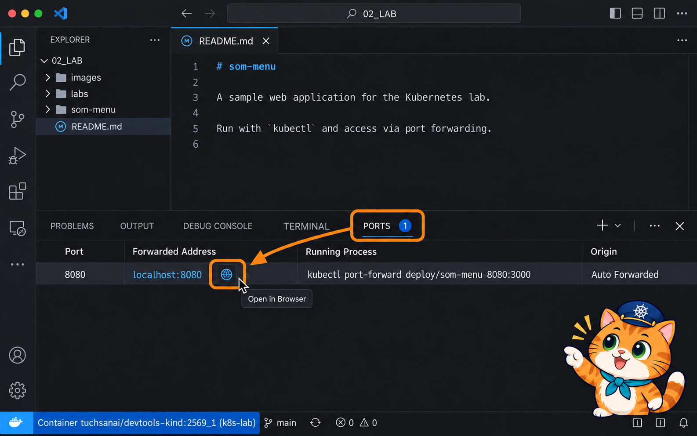<br>
  <em><b>รูปที่ 19</b> LAB4 ขั้นที่ 4 (ภาพจำลองหน้าจอ VS Code ที่ attach เข้า k8s-lab แล้ว): แท็บ PORTS แสดง port 8080 ที่มาจาก kubectl port-forward deploy/som-menu 8080:3000 ชี้ที่แถวนั้นแล้วกดไอคอนลูกโลก Open in Browser</em>
</p>

🌐 browser จะเปิด `http://localhost:8080` เห็นหน้าร้านเวอร์ชัน 1.0 และชื่อ Pod ที่เสิร์ฟหน้านี้

<p align="center" id="fig-20">
  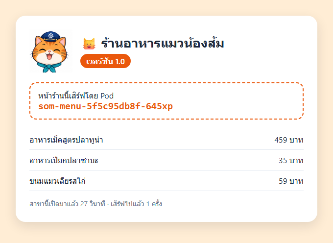<br>
  <em><b>รูปที่ 20</b> ภาพหน้าจอจริงจากการทดลอง: หน้าร้านเวอร์ชัน 1.0 เสิร์ฟโดย Pod som-menu-5f5c95db8f-645xp (ทดสอบ 19 ต.ค. 2569 ด้วย browser จริงบนเครื่อง host ผ่าน kubectl port-forward deploy/som-menu 8080:3000 ตอนถ่ายต่อท่อออกมาด้วย SSH tunnel แทนแท็บ PORTS ของ VS Code หน้าเว็บที่เห็นเหมือนกัน)</em>
</p>

**จดชื่อ Pod ที่เห็นบนหน้าเว็บไว้** (ตัวอย่างนี้คือ `som-menu-5f5c95db8f-645xp` ของนักศึกษาจะต่างไป) Pod ตัวนี้คือ **ปลายท่อ** ของ port-forward ขั้นที่ 8 จะเห็นว่าเกิดอะไรกับท่อเมื่อ Pod ตัวนี้ถูกปิด

### ขั้นที่ 5: ดู log ของสาขานั้น

> 🎯 **เป้าหมายขั้นนี้:** ยืนยันว่า **หน้าเว็บที่เห็นมาจากสาขาไหน** ด้วย log ของ Pod นั้น
>
> 🔍 **สังเกต:** log ขึ้น `v1.0` และชื่อ Pod ตรงกับที่เห็นบนหน้าเว็บ

เปิด **Terminal ใหม่** ใน VS Code (กด `+` ที่แท็บ TERMINAL) เพราะ terminal แรกยังรัน port-forward อยู่ ขั้นต่อจากนี้พิมพ์ใน terminal ที่ 2 ยกเว้นที่บอกว่า terminal แรก

```bash
kubectl logs som-menu-5f5c95db8f-645xp    # ← เปลี่ยนเป็นชื่อ Pod ของตัวเอง (ชื่อที่เห็นบนหน้าเว็บ)
```

**Expected output**

<pre>
ร้านอาหารแมวน้องส้ม v1.0 เปิดสาขา som-menu-5f5c95db8f-645xp ที่ port 3000
[v1.0] som-menu-5f5c95db8f-645xp เสิร์ฟหน้าร้านครั้งที่ 1
</pre>

บรรทัดแรกคือตอนสาขาเปิด บรรทัดที่สองคือตอนเราเปิดหน้าเว็บ 1 ครั้ง (refresh กี่ครั้งก็นับเพิ่มที่สาขาเดิม เพราะท่อต่อเข้าสาขาเดียว)

### ขั้นที่ 6: เปลี่ยนเป็นเมนูเวอร์ชัน 2.0

> 🎯 **เป้าหมายขั้นนี้:** ทดสอบหลักการหลักของบท: **เปลี่ยนรุ่นโดยร้านไม่ปิด** สองรุ่นเปิดปนกันได้ แต่สาขาที่พร้อมไม่ต่ำกว่า 3 ([ทฤษฎีหัวข้อ 7](../01_Theory/README.md#7-rolling-update-ทยอยเปลี่ยนทีละ-pod) · [ทฤษฎีหัวข้อ 8](../01_Theory/README.md#8-maxsurge-maxunavailable-และ-minreadyseconds))
>
> 🔍 **สังเกต:** `version=1.0` 3 ตัว + `version=2.0` 1 ตัว รวม 4 = 3 + `maxSurge: 1` และสาขา 1.0 ยัง `1/1` ครบ 3

ไฟล์ `som-menu/k8s/som-menu-deploy-v2.yaml`

```yaml
# LAB 4: ร้านอาหารแมวน้องส้ม — เปลี่ยนเป็นเมนูเวอร์ชัน 2.0
# ต่างจาก som-menu-deploy.yaml แค่ 3 บรรทัดที่มี ← เท่านั้น
apiVersion: apps/v1
kind: Deployment
metadata:
  name: som-menu
  labels:
    app: som-menu
  annotations:
    kubernetes.io/change-cause: "เมนูเวอร์ชัน 2.0"   # ← เปลี่ยน
spec:
  replicas: 3                    # เปิด 3 สาขา = Pod 3 ตัว
  minReadySeconds: 10            # สาขาใหม่ต้องพร้อมต่อเนื่อง 10 วินาที จึงนับว่าเปิดแล้ว (ช้าลงพอให้เห็นการเปลี่ยนรุ่น)
  strategy:
    type: RollingUpdate          # เปลี่ยนรุ่นแบบทยอยทีละสาขา (ค่าเริ่มต้นของ Deployment)
    rollingUpdate:
      maxSurge: 1                # เปิดสาขาใหม่เกิน 3 ได้ทีละ 1 สาขา
      maxUnavailable: 0          # สาขาที่พร้อมต้องไม่ต่ำกว่า 3 เลย → ร้านไม่ปิดระหว่างเปลี่ยนรุ่น
  selector:
    matchLabels:
      app: som-menu              # นับเฉพาะ Pod ที่มีป้ายนี้
  template:                      # แม่พิมพ์ของทุกสาขา
    metadata:
      labels:
        app: som-menu            # ต้องตรงกับ selector
        version: "2.0"           # ← เปลี่ยน
    spec:
      containers:
        - name: web
          image: som-menu:2.0           # ← เปลี่ยน
          imagePullPolicy: IfNotPresent   # ใช้ image ที่ kind load ไว้บน node
          env:
            - name: SHOP_NAME
              value: "ร้านอาหารแมวน้องส้ม"
          ports:
            - containerPort: 3000      # port ที่ port-forward 8080:3000 ส่งเข้ามา
          readinessProbe:              # ตอบ /api/health ได้ = สาขาพร้อมรับลูกค้า
            httpGet:
              path: /api/health
              port: 3000
            periodSeconds: 5
          livenessProbe:               # ค้างนานเกินไป → kubelet restart container
            httpGet:
              path: /api/health
              port: 3000
            initialDelaySeconds: 5
            periodSeconds: 10
          resources:                   # ทุกสาขาจองเท่ากัน เพราะมาจากแม่พิมพ์เดียวกัน
            requests: { cpu: 50m, memory: 64Mi }
            limits:   { cpu: 200m, memory: 128Mi }
```

ต่างจาก `som-menu-deploy.yaml` แค่ **3 บรรทัดที่มี `← เปลี่ยน`** ตามหลักการเขียนไฟล์รุ่นใหม่ (LAB 2 ขั้นที่ 2): ชื่อ `som-menu` เหมือนเดิม และแก้เฉพาะ

- โน้ต `change-cause` เป็น `เมนูเวอร์ชัน 2.0` (จะไปโผล่ใน `rollout history`)
- ป้ายในแม่พิมพ์ `version: "2.0"` (เดิม `"1.0"`) ไว้ดูว่า Pod ไหนรุ่นอะไร selector ไม่ได้ใช้ป้ายนี้ จึงแก้ได้
- `image: som-menu:2.0` (เดิม `som-menu:1.0`) = ตัวที่ทำให้แม่พิมพ์เปลี่ยน → ReplicaSet ใหม่ → rolling update

เตรียมพิมพ์คำสั่ง `kubectl get pods --show-labels` ต่อ **ทันที** หลัง apply เพื่อจับจังหวะที่สองรุ่นเปิดปนกัน

```bash
kubectl apply -f som-menu/k8s/som-menu-deploy-v2.yaml
```

**Expected output**

<pre>
deployment.apps/som-menu configured
</pre>

```bash
kubectl get pods --show-labels
```

**Expected output**

<pre>
NAME                        READY   STATUS    RESTARTS   AGE   LABELS
som-menu-5f5c95db8f-645xp   1/1     Running   0          29s   app=som-menu,pod-template-hash=5f5c95db8f,version=1.0
som-menu-5f5c95db8f-gs4k6   1/1     Running   0          29s   app=som-menu,pod-template-hash=5f5c95db8f,version=1.0
som-menu-5f5c95db8f-pxfkz   1/1     Running   0          29s   app=som-menu,pod-template-hash=5f5c95db8f,version=1.0
som-menu-6bf6c9f6c5-4z86z   0/1     Pending   0          0s    app=som-menu,pod-template-hash=6bf6c9f6c5,version=2.0
</pre>

- สาขา `version=1.0` ยังครบ 3 และยัง `1/1` = **ร้านเปิดเต็มที่**
- สาขาใหม่ `version=2.0` เพิ่งเกิด (`AGE 0s`) ยัง `0/1 Pending` = กำลังหาเรือและเริ่ม container ถ้าพิมพ์ช้ากว่านี้จะเห็น `ContainerCreating` หรือ `1/1 Running` แทน
- `pod-template-hash` ต่างกัน (`5f5c95db8f` กับ `6bf6c9f6c5`) = แม่พิมพ์คนละรุ่น คนละทีม

```bash
kubectl get rs
```

**Expected output**

<pre>
NAME                  DESIRED   CURRENT   READY   AGE
som-menu-5f5c95db8f   3         3         3       29s
som-menu-6bf6c9f6c5   1         1         0       0s
</pre>

- ทีมเก่า 3 + ทีมใหม่ 1 = **4 ตัว** พอดี 3 + `maxSurge: 1` (เปิดสาขาที่ 4 ได้แค่ 1 สาขา)
- ทีมเก่ายัง `READY 3` = สาขาที่พร้อม **ไม่ต่ำกว่า 3** ตาม `maxUnavailable: 0` = **ร้านไม่ปิด**

### ขั้นที่ 7: รอให้เปลี่ยนรุ่นเสร็จ

> 🎯 **เป้าหมายขั้นนี้:** ดูว่า **`minReadySeconds` คุมจังหวะ** ให้เปลี่ยนทีละสาขา ([ทฤษฎีหัวข้อ 8](../01_Theory/README.md#8-maxsurge-maxunavailable-และ-minreadyseconds) · [ทฤษฎีหัวข้อ 9](../01_Theory/README.md#9-ติดตามการเปลี่ยนรุ่น-rollout-status-และ-history))
>
> 🔍 **สังเกต:** สาขาใหม่ `AGE` ห่างกันราว 10 วินาที และสาขาเก่าตัวสุดท้ายที่ `Terminating` คือตัวที่ browser ต่อท่ออยู่

```bash
kubectl rollout status deployment/som-menu
```

**Expected output** (รอประมาณ 30 วินาที)

<pre>
Waiting for deployment "som-menu" rollout to finish: 1 out of 3 new replicas have been updated...
Waiting for deployment "som-menu" rollout to finish: 1 out of 3 new replicas have been updated...
Waiting for deployment "som-menu" rollout to finish: 1 out of 3 new replicas have been updated...
Waiting for deployment "som-menu" rollout to finish: 1 out of 3 new replicas have been updated...
Waiting for deployment "som-menu" rollout to finish: 2 out of 3 new replicas have been updated...
Waiting for deployment "som-menu" rollout to finish: 2 out of 3 new replicas have been updated...
Waiting for deployment "som-menu" rollout to finish: 2 out of 3 new replicas have been updated...
Waiting for deployment "som-menu" rollout to finish: 2 out of 3 new replicas have been updated...
Waiting for deployment "som-menu" rollout to finish: 2 out of 3 new replicas have been updated...
Waiting for deployment "som-menu" rollout to finish: 1 old replicas are pending termination...
Waiting for deployment "som-menu" rollout to finish: 1 old replicas are pending termination...
Waiting for deployment "som-menu" rollout to finish: 1 old replicas are pending termination...
Waiting for deployment "som-menu" rollout to finish: 1 old replicas are pending termination...
deployment "som-menu" successfully rolled out
</pre>

`rollout status` พิมพ์บรรทัดใหม่ทุกครั้งที่สถานะเปลี่ยน อ่านเป็น 3 ช่วง

- `1 out of 3 new replicas have been updated` → `2 out of 3` = จำนวนสาขารุ่นใหม่ที่ **สร้างแล้ว** ขยับทีละ 1
- `1 old replicas are pending termination` = สาขารุ่นใหม่ครบ 3 แล้ว **เหลือรอสาขาเก่าตัวสุดท้ายปิด**
- `successfully rolled out` = เสร็จ ทุกสาขาเป็นรุ่นใหม่ และสาขาเก่าปิดหมด

จังหวะจริงที่วัดทุก 2 วินาทีระหว่างทดลอง (สาขาที่พร้อมอยู่ที่ 3 ตลอด ไม่เคยต่ำกว่า)

<p align="center" id="fig-21">
  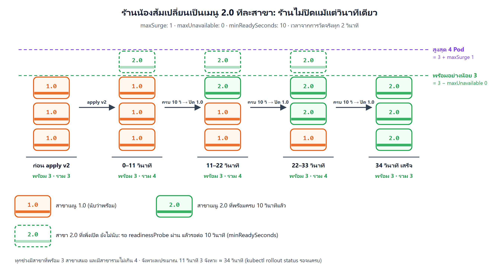<br>
  <em><b>รูปที่ 21</b> เส้นเวลาจริงของการเปลี่ยนเป็นเมนู 2.0: ทุกช่วงมีสาขาพร้อม 3 สาขาและรวมไม่เกิน 4 สาขา สาขา 2.0 ที่เพิ่งเปิด (เส้นประ) ต้องผ่าน readinessProbe แล้วรอต่ออีก 10 วินาที (minReadySeconds) ก่อน Deployment จะปิดสาขา 1.0 ให้ 1 สาขา ทำซ้ำ 3 จังหวะ รวมประมาณ 34 วินาที</em>
</p>

```bash
kubectl get rs -o wide
```

**Expected output**

<pre>
NAME                  DESIRED   CURRENT   READY   AGE   CONTAINERS   IMAGES         SELECTOR
som-menu-5f5c95db8f   0         0         0       60s   web          som-menu:1.0   app=som-menu,pod-template-hash=5f5c95db8f
som-menu-6bf6c9f6c5   3         3         3       31s   web          som-menu:2.0   app=som-menu,pod-template-hash=6bf6c9f6c5
</pre>

```bash
kubectl get pods --show-labels
```

**Expected output**

<pre>
NAME                        READY   STATUS        RESTARTS   AGE   LABELS
som-menu-5f5c95db8f-645xp   1/1     Terminating   0          60s   app=som-menu,pod-template-hash=5f5c95db8f,version=1.0
som-menu-6bf6c9f6c5-4z86z   1/1     Running       0          31s   app=som-menu,pod-template-hash=6bf6c9f6c5,version=2.0
som-menu-6bf6c9f6c5-5phjj   1/1     Running       0          10s   app=som-menu,pod-template-hash=6bf6c9f6c5,version=2.0
som-menu-6bf6c9f6c5-7242z   1/1     Running       0          20s   app=som-menu,pod-template-hash=6bf6c9f6c5,version=2.0
</pre>

- สาขา `version=2.0` ครบ 3 อายุ **31s, 20s, 10s** ห่างกันราว 10 วินาที = เปิดทีละสาขาตามจังหวะ `minReadySeconds`
- `som-menu-5f5c95db8f-645xp` สาขาเก่าตัวสุดท้ายกำลังปิด ซึ่งก็คือ **สาขาที่ browser ของเราต่อท่ออยู่** (ชื่อที่จดไว้ในขั้นที่ 4)

### ขั้นที่ 8: port-forward หลุด

> 🎯 **เป้าหมายขั้นนี้:** ทดสอบว่า **port-forward ผูกกับ Pod ตัวเดียว** เมื่อ Pod นั้นถูกปิดจะเป็นอย่างไร (ปัญหาที่ Service ในบทถัดไปแก้) ([ทฤษฎีหัวข้อ 13](../01_Theory/README.md#13-port-forward-ระหว่างเปลี่ยนรุ่น-และบทถัดไป))
>
> 🔍 **สังเกต:** `lost connection to pod` ทั้งที่สาขา v2.0 เปิดครบ และหลังต่อท่อใหม่เห็นหน้าร้านสีเขียวอมฟ้าเวอร์ชัน 2.0

ลอง **refresh browser** จะเปิดไม่ได้ และ terminal แรกที่รัน port-forward จะขึ้น

<pre>
Forwarding from 127.0.0.1:8080 -&gt; 3000
Forwarding from [::1]:8080 -&gt; 3000
Handling connection for 8080
Handling connection for 8080
Handling connection for 8080
Handling connection for 8080
Handling connection for 8080
Handling connection for 8080
E1019 18:06:58.129690   36193 portforward.go:549] "An error occurred forwarding" err="error forwarding port 3000 to pod ffe340a448509e43e1c532be4e0047ce045172d9fcd3f250d1a8020fb9c89875, uid : failed to execute portforward in network namespace \"/var/run/netns/cni-93f72853-99f1-f034-71a6-d9ead7607edb\": failed to connect to localhost:3000 inside namespace \"ffe340a448509e43e1c532be4e0047ce045172d9fcd3f250d1a8020fb9c89875\", IPv4: dial tcp4 127.0.0.1:3000: connect: connection refused IPv6 dial tcp6 [::1]:3000: connect: connection refused " localPort=8080 remotePort=3000
error: lost connection to pod
</pre>

- `Handling connection for 8080` = ทุกครั้งที่ browser ขอหน้าเว็บ (หน้าเว็บ รูปน้องส้ม) ท่อส่งต่อให้ 1 ครั้ง
- บรรทัด `E1019 ...` ยาว ๆ = ท่อส่งต่อไม่ได้แล้ว เพราะแอปในสาขานั้นปิดไปแล้ว (`connection refused`) ข้อความกลางบรรทัดอาจต่างไปตามจังหวะที่ Pod ปิด (บางครั้งเป็น `network namespace ... is closed`) **ให้ดูบรรทัดสุดท้าย**
- `error: lost connection to pod` = port-forward **จบการทำงานเอง** ท่อขาดแล้ว

<p align="center" id="fig-22">
  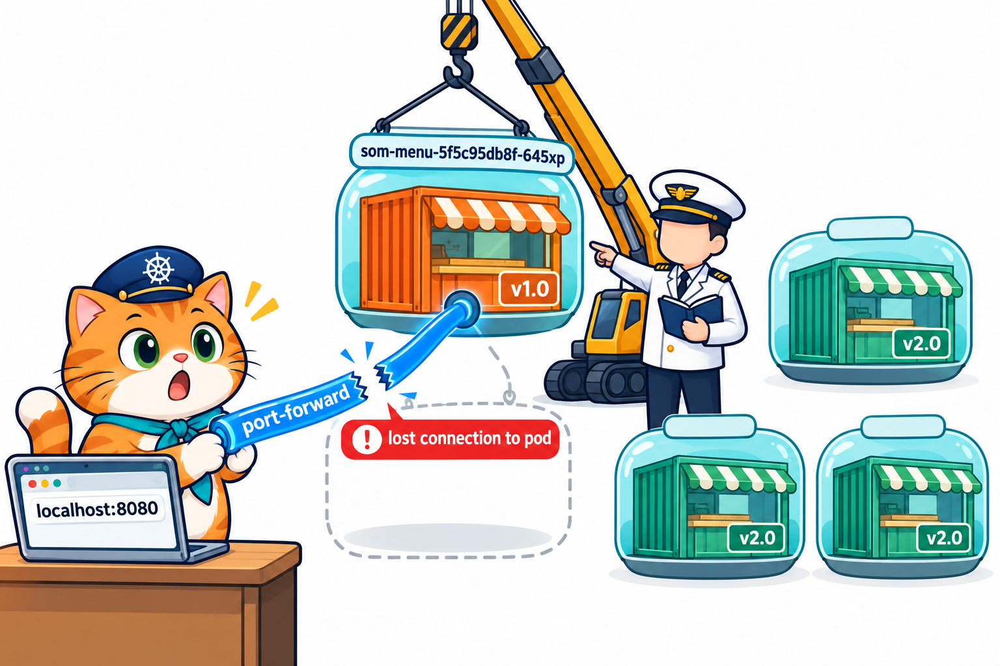<br>
  <em><b>รูปที่ 22</b> port-forward ต่อท่อเข้าสาขาเดียว (Pod som-menu-5f5c95db8f-645xp) เมื่อผู้จัดการเปลี่ยนสาขานั้นเป็นรุ่นใหม่ Pod เก่าถูกปิด ท่อจึงขาด (lost connection to pod) แม้สาขา v2.0 จะเปิดครบแล้ว ต้องต่อท่อใหม่เอง</em>
</p>

ร้าน **ไม่ได้ปิด** (สาขา v2.0 เปิดครบ 3) แต่ port-forward ผูกกับ **Pod ตัวเดียว** ที่เลือกไว้ตอนเริ่ม Pod นั้นถูกปิด ท่อก็ขาด ปัญหานี้ Deployment แก้ไม่ได้ ต้องรอ **Service** ในบทถัดไป ตอนนี้ต่อท่อใหม่ใน **terminal แรก**

```bash
kubectl port-forward deploy/som-menu 8080:3000
```

**Expected output**

<pre>
Forwarding from 127.0.0.1:8080 -&gt; 3000
Forwarding from [::1]:8080 -&gt; 3000
</pre>

refresh browser จะเห็นหน้าร้านสีเขียวอมฟ้า **เวอร์ชัน 2.0** มีเมนูใหม่ "ไอศกรีมแมว"

<p align="center" id="fig-23">
  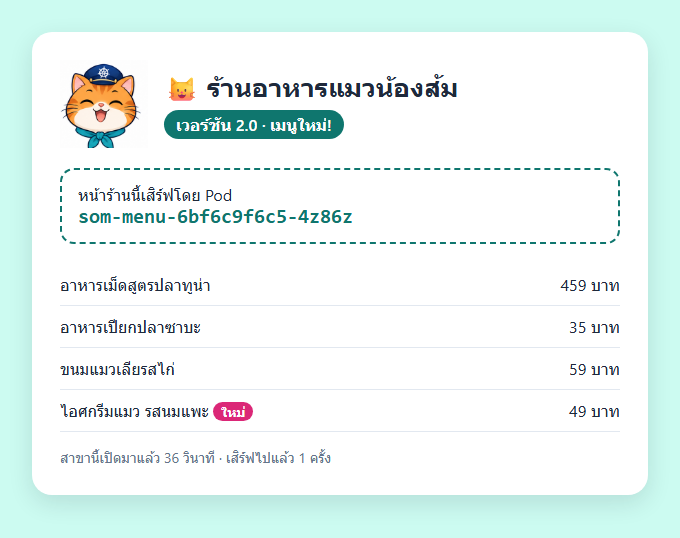<br>
  <em><b>รูปที่ 23</b> ภาพหน้าจอจริงจากการทดลอง: หน้าร้านเวอร์ชัน 2.0 เสิร์ฟโดย Pod som-menu-6bf6c9f6c5-4z86z มีเมนูใหม่ไอศกรีมแมว (ทดสอบ 19 ต.ค. 2569 ด้วย browser จริงบนเครื่อง host ผ่าน kubectl port-forward deploy/som-menu 8080:3000 ตอนถ่ายต่อท่อออกมาด้วย SSH tunnel แทนแท็บ PORTS ของ VS Code หน้าเว็บที่เห็นเหมือนกัน)</em>
</p>

ใน terminal ที่ 2 ดู log ของสาขาที่เห็นบนหน้าเว็บ

```bash
kubectl logs som-menu-6bf6c9f6c5-4z86z    # ← เปลี่ยนเป็นชื่อ Pod ของตัวเอง (ชื่อที่เห็นบนหน้าเว็บ)
```

**Expected output**

<pre>
ร้านอาหารแมวน้องส้ม v2.0 เปิดสาขา som-menu-6bf6c9f6c5-4z86z ที่ port 3000
[v2.0] som-menu-6bf6c9f6c5-4z86z เสิร์ฟหน้าร้านครั้งที่ 1
</pre>

### ขั้นที่ 9: ลูกค้าไม่ชอบเมนูใหม่ ย้อนกลับ

> 🎯 **เป้าหมายขั้นนี้:** ทดสอบ **rollback แบบร้านไม่ปิด** ด้วยกติกา `maxSurge` / `maxUnavailable` เดียวกัน ([ทฤษฎีหัวข้อ 10](../01_Theory/README.md#10-ย้อนกลับด้วย-rollout-undo))
>
> 🔍 **สังเกต:** ReplicaSet เดิม `som-menu-5f5c95db8f` กลับเป็น 3 ด้วย Pod ใหม่ และรุ่น 1 กลายเป็นรุ่น 3

ทำแบบเดียวกับ LAB 3 ขั้นที่ 6: **เปิดสมุดรุ่นก่อน → undo → รอดู → เปิดสมุดอีกครั้ง**

```bash
kubectl rollout history deployment/som-menu
```

**Expected output**

<pre>
deployment.apps/som-menu 
REVISION  CHANGE-CAUSE
1         เมนูเวอร์ชัน 1.0
2         เมนูเวอร์ชัน 2.0

</pre>

รุ่นปัจจุบันคือเลขมากสุด = **รุ่น 2** (เมนู 2.0) undo จะพากลับไป **รุ่น 1**

```bash
kubectl rollout undo deployment/som-menu
```

**Expected output**

<pre>
Warning: resource deployments/som-menu was previously managed with 'kubectl apply'. Rolling back will not update the kubectl.kubernetes.io/last-applied-configuration annotation, which may cause unexpected behavior on future 'kubectl apply' operations. Consider using 'kubectl apply' with your previous configuration file instead.
deployment.apps/som-menu rolled back
</pre>

```bash
kubectl rollout status deployment/som-menu
```

**Expected output** (รอประมาณ 35 วินาที)

<pre>
Waiting for deployment "som-menu" rollout to finish: 0 out of 3 new replicas have been updated...
Waiting for deployment "som-menu" rollout to finish: 1 out of 3 new replicas have been updated...
Waiting for deployment "som-menu" rollout to finish: 1 out of 3 new replicas have been updated...
Waiting for deployment "som-menu" rollout to finish: 1 out of 3 new replicas have been updated...
Waiting for deployment "som-menu" rollout to finish: 1 out of 3 new replicas have been updated...
Waiting for deployment "som-menu" rollout to finish: 2 out of 3 new replicas have been updated...
Waiting for deployment "som-menu" rollout to finish: 2 out of 3 new replicas have been updated...
Waiting for deployment "som-menu" rollout to finish: 2 out of 3 new replicas have been updated...
Waiting for deployment "som-menu" rollout to finish: 2 out of 3 new replicas have been updated...
Waiting for deployment "som-menu" rollout to finish: 2 out of 3 new replicas have been updated...
Waiting for deployment "som-menu" rollout to finish: 1 old replicas are pending termination...
Waiting for deployment "som-menu" rollout to finish: 1 old replicas are pending termination...
Waiting for deployment "som-menu" rollout to finish: 1 old replicas are pending termination...
Waiting for deployment "som-menu" rollout to finish: 1 old replicas are pending termination...
deployment "som-menu" successfully rolled out
</pre>

ต่างจาก LAB 3 ตรงที่ **ต้องรอเหมือนตอนเปลี่ยนรุ่น** เพราะคราวนี้สาขาเมนู 1.0 ถูกปิดไปหมดแล้ว (ทีมเก่าเหลือ 0) ต้องเปิดสาขา 1.0 ใหม่ทีละสาขาด้วยกติกา `maxSurge: 1` / `maxUnavailable: 0` / `minReadySeconds: 10` เดิม ร้านจึงไม่ปิดระหว่างย้อนเช่นกัน ส่วน `new replicas` ตอนนี้หมายถึงสาขารุ่นที่กำลังย้อนไป (เมนู 1.0)

```bash
kubectl get pods --show-labels
```

**Expected output**

<pre>
NAME                        READY   STATUS        RESTARTS   AGE   LABELS
som-menu-5f5c95db8f-5n5sr   1/1     Running       0          10s   app=som-menu,pod-template-hash=5f5c95db8f,version=1.0
som-menu-5f5c95db8f-mg456   1/1     Running       0          20s   app=som-menu,pod-template-hash=5f5c95db8f,version=1.0
som-menu-5f5c95db8f-wx2ms   1/1     Running       0          31s   app=som-menu,pod-template-hash=5f5c95db8f,version=1.0
som-menu-6bf6c9f6c5-7242z   1/1     Terminating   0          57s   app=som-menu,pod-template-hash=6bf6c9f6c5,version=2.0
</pre>

สาขา `version=1.0` กลับมาครบ 3 ขึ้นต้นด้วย hash เดิม `5f5c95db8f` แต่ท้ายชื่อใหม่ทั้งหมด = **Pod ใหม่** ที่ปั๊มจากแม่พิมพ์เดิม ส่วนสาขา 2.0 ตัวสุดท้ายกำลังปิด

```bash
kubectl get rs -o wide
```

**Expected output**

<pre>
NAME                  DESIRED   CURRENT   READY   AGE   CONTAINERS   IMAGES         SELECTOR
som-menu-5f5c95db8f   3         3         3       97s   web          som-menu:1.0   app=som-menu,pod-template-hash=5f5c95db8f
som-menu-6bf6c9f6c5   0         0         0       68s   web          som-menu:2.0   app=som-menu,pod-template-hash=6bf6c9f6c5
</pre>

ReplicaSet เดิม `som-menu-5f5c95db8f` (อายุ 97s = ตัวแรกสุดของร้าน) ถูกปลุกกลับเป็น 3 ส่วน ReplicaSet เมนู 2.0 เหลือ 0 แต่ยังเก็บไว้

```bash
kubectl rollout history deployment/som-menu
```

**Expected output**

<pre>
deployment.apps/som-menu 
REVISION  CHANGE-CAUSE
2         เมนูเวอร์ชัน 2.0
3         เมนูเวอร์ชัน 1.0

</pre>

เลขรุ่นขยับแบบเดียวกับ [รูปที่ 15](#fig-15): แม่พิมพ์เมนู 1.0 ถูกหยิบกลับมาใช้แล้วจดเป็น **รุ่น 3** (เลขมากสุด = รุ่นที่ใช้อยู่ตอนนี้)

### ขั้นที่ 10: เปิดร้านหลังย้อนกลับ

> 🎯 **เป้าหมายขั้นนี้:** ยืนยันด้วยตาว่า **ร้านกลับเป็นเวอร์ชันเดิม** หลัง undo ([ทฤษฎีหัวข้อ 13](../01_Theory/README.md#13-port-forward-ระหว่างเปลี่ยนรุ่น-และบทถัดไป))
>
> 🔍 **สังเกต:** port-forward หลุดอีกรอบ และหลังต่อใหม่เห็นหน้าร้านสีส้มเวอร์ชัน 1.0 ชื่อ Pod ขึ้นต้นด้วย hash เดิม แต่ท้ายชื่อใหม่

port-forward ใน terminal แรกหลุดอีกแล้ว เพราะ Pod v2.0 ที่ต่ออยู่ถูกปิด

<pre>
Forwarding from 127.0.0.1:8080 -&gt; 3000
Forwarding from [::1]:8080 -&gt; 3000
Handling connection for 8080
Handling connection for 8080
Handling connection for 8080
Handling connection for 8080
Handling connection for 8080
Handling connection for 8080
E1019 18:07:35.203674   37164 portforward.go:549] "An error occurred forwarding" err="error forwarding port 3000 to pod 6e25e904780c4462ab91797ac94526ad0721408a5eccd7da4993f44be4df702d, uid : network namespace for sandbox \"6e25e904780c4462ab91797ac94526ad0721408a5eccd7da4993f44be4df702d\" is closed" localPort=8080 remotePort=3000
error: lost connection to pod
</pre>

รอบนี้ข้อความกลางบรรทัดเป็น `network namespace ... is closed` (Pod ปิดไปแล้วทั้งกล่อง) แต่บรรทัดสุดท้ายเหมือนเดิม: `lost connection to pod` ต่อท่อใหม่ใน terminal แรก

```bash
kubectl port-forward deploy/som-menu 8080:3000
```

**Expected output**

<pre>
Forwarding from 127.0.0.1:8080 -&gt; 3000
Forwarding from [::1]:8080 -&gt; 3000
</pre>

refresh browser จะเห็นหน้าร้านสีส้ม **เวอร์ชัน 1.0** กลับมา (ไม่มีเมนูไอศกรีมแมว) และชื่อ Pod ขึ้นต้น `som-menu-5f5c95db8f-` เหมือนตอนแรก แต่ท้ายชื่อเป็นตัวใหม่

<p align="center" id="fig-24">
  <br>
  <em><b>รูปที่ 24</b> ภาพหน้าจอจริงจากการทดลอง: หลัง kubectl rollout undo หน้าร้านกลับเป็นเวอร์ชัน 1.0 เสิร์ฟโดย Pod som-menu-5f5c95db8f-wx2ms (แม่พิมพ์เดิม hash เดิม แต่เป็น Pod ใหม่) (ทดสอบ 19 ต.ค. 2569 ด้วย browser จริงบนเครื่อง host ผ่าน kubectl port-forward deploy/som-menu 8080:3000 ตอนถ่ายต่อท่อออกมาด้วย SSH tunnel แทนแท็บ PORTS ของ VS Code หน้าเว็บที่เห็นเหมือนกัน)</em>
</p>

### ขั้นที่ 11: ทำให้ไฟล์ตรงกับคลัสเตอร์

> 🎯 **เป้าหมายขั้นนี้:** แก้ปัญหาที่ `Warning` ของ undo เตือนไว้: **ทำให้ไฟล์ที่ apply ล่าสุดตรงกับคลัสเตอร์** ([ทฤษฎีหัวข้อ 10](../01_Theory/README.md#10-ย้อนกลับด้วย-rollout-undo))
>
> 🔍 **สังเกต:** ขึ้น `configured` แต่ไม่มี revision ใหม่ และ Pod 3 ตัวชื่อเดิม `AGE` นับต่อ

ตอนนี้ **คลัสเตอร์เป็นเมนู 1.0** (undo แล้ว) แต่ **ไฟล์ที่ apply ล่าสุดคือ v2** ถ้าวันหลังมีคน apply ไฟล์ v2 ซ้ำ ร้านจะเปลี่ยนกลับเป็นเมนู 2.0 ที่ลูกค้าไม่ชอบทันที (ไฟล์ชนะ) จึง apply ไฟล์เวอร์ชัน 1.0 ให้ตรงกัน ใน terminal ที่ 2

```bash
kubectl apply -f som-menu/k8s/som-menu-deploy.yaml
```

**Expected output**

<pre>
deployment.apps/som-menu configured
</pre>

```bash
kubectl rollout history deployment/som-menu
```

**Expected output**

<pre>
deployment.apps/som-menu 
REVISION  CHANGE-CAUSE
2         เมนูเวอร์ชัน 2.0
3         เมนูเวอร์ชัน 1.0

</pre>

```bash
kubectl get pods --show-labels
```

**Expected output**

<pre>
NAME                        READY   STATUS    RESTARTS   AGE   LABELS
som-menu-5f5c95db8f-5n5sr   1/1     Running   0          16s   app=som-menu,pod-template-hash=5f5c95db8f,version=1.0
som-menu-5f5c95db8f-mg456   1/1     Running   0          26s   app=som-menu,pod-template-hash=5f5c95db8f,version=1.0
som-menu-5f5c95db8f-wx2ms   1/1     Running   0          37s   app=som-menu,pod-template-hash=5f5c95db8f,version=1.0
</pre>

- ขึ้น `configured` แต่ **ไม่มี revision ใหม่** (ยังเป็น 2 กับ 3) เพราะแม่พิมพ์ในไฟล์ตรงกับรุ่น 3 ที่รันอยู่แล้ว
- Pod 3 ตัว **ชื่อเดิม** `AGE` นับต่อ = ไม่มี Pod ไหนถูกเปลี่ยน
- apply ครั้งนี้แค่อัปเดต **บันทึกว่าไฟล์ล่าสุดคือเวอร์ชัน 1.0** (ตัวที่ `Warning` ของ undo พูดถึง) จากนี้ใคร apply ไฟล์ก็ไม่พาร้านย้อนไปเมนู 2.0 โดยไม่ตั้งใจ

### ขั้นที่ 12: เก็บกวาด

> 🎯 **เป้าหมายขั้นนี้:** เก็บกวาดร้านของ LAB นี้
>
> 🔍 **สังเกต:** ได้ `deleted` (ReplicaSet และ Pod ถูกลบตาม)

กลับไปที่ terminal แรกแล้วกด **Ctrl+C** หยุด port-forward จากนั้น

```bash
kubectl delete -f som-menu/k8s/som-menu-deploy.yaml
```

**Expected output**

<pre>
deployment.apps "som-menu" deleted from default namespace
</pre>

รอสัก 5 วินาที

```bash
kubectl get pods
```

**Expected output**

<pre>
No resources found in default namespace.
</pre>

### สิ่งที่เห็น

- แก้แม่พิมพ์แล้ว apply → Deployment เปลี่ยนรุ่นให้เองทีละสาขา **ไม่ต้องลบ Pod เอง** และระหว่างเปลี่ยนมีสองรุ่นเปิดปนกัน (`version=1.0` กับ `version=2.0`)
- `maxSurge: 1` + `maxUnavailable: 0` = เปิดสาขาใหม่ให้พร้อมก่อน แล้วค่อยปิดสาขาเก่า 1 สาขา สาขาที่พร้อมจึงไม่ต่ำกว่า 3 ตลอด และ `minReadySeconds: 10` ทำให้แต่ละจังหวะห่างกันราว 10 วินาทีพอให้เห็น
- `rollout status` บอกความคืบหน้า (`new replicas updated` → `old replicas pending termination` → `successfully rolled out`) `rollout history` บอกว่ารุ่นไหนใช้อยู่ (เลขมากสุด) `rollout undo` ย้อนกลับแบบไม่ปิดร้านเช่นกัน แล้วควร apply ไฟล์ให้ตรงกับรุ่นที่ย้อนไป
- port-forward ยังผูกกับ Pod ตัวเดียว ทุกครั้งที่เปลี่ยนรุ่นจึงหลุด (`lost connection to pod`) แม้ร้านจะไม่ปิด

### คำถามท้าย LAB 4

1. ระหว่างเปลี่ยนจากเวอร์ชัน 1.0 เป็น 2.0 ทำไมจำนวน Pod ที่พร้อม (READY) ไม่เคยต่ำกว่า 3 และทำไมมี Pod รวมได้มากสุดแค่ 4 ตัว
2. ถ้าเปลี่ยน `maxUnavailable: 0` เป็น `maxUnavailable: 1` (ส่วน `maxSurge: 1` เหมือนเดิม) ตอนเปลี่ยนรุ่นจะต่างไปอย่างไร ร้านจะเหลือสาขาที่พร้อมน้อยสุดกี่สาขา และจะเปลี่ยนรุ่นเร็วขึ้นหรือช้าลง

---

## เก็บกวาดหลังจบบท

🐧 **ใน SSH session ของ k8s-lab** ตรวจว่าไม่มี Deployment, ReplicaSet และ Pod ค้าง

```bash
kubectl get deploy
```

**Expected output**

<pre>
No resources found in default namespace.
</pre>

```bash
kubectl get rs
```

**Expected output**

<pre>
No resources found in default namespace.
</pre>

```bash
kubectl get pods
```

**Expected output**

<pre>
No resources found in default namespace.
</pre>

ถ้ายังเห็นอยู่ ให้ลบด้วย `kubectl delete deploy <ชื่อ>` (ลบ Deployment แล้ว ReplicaSet และ Pod หายตาม)

คลัสเตอร์ `lab` เก็บไว้ใช้ต่อในบทถัดไปได้ ถ้าต้องการคืนทรัพยากรเครื่อง ให้ลบคลัสเตอร์ด้วย `k8s-down` (ทางเลือก, image ที่ `kind load` ไว้จะหายไปด้วย) จากนั้นออกจาก SSH ด้วย `exit`

🖥️ **บนเครื่องนักศึกษา** (ทางเลือก) หยุด container เพื่อคืน RAM/CPU แล้วเปิดใหม่ครั้งหน้าด้วย `docker start k8s-lab` (คลัสเตอร์และไฟล์ใน `/workspace` ยังอยู่)

```bash
docker stop k8s-lab
```

> **บทถัดไป:** น้องส้มจะใช้ **Service** เป็นที่อยู่เดียวของร้านที่กระจายลูกค้าไปทุกสาขา ไม่หลุดแม้ Deployment จะเปลี่ยนรุ่นหรือ Pod ถูกลบ

---

## สรุปคำสั่ง kubectl ในบทนี้

**สร้าง / ลบ**

| คำสั่ง | ใช้ทำอะไร |
|---|---|
| `kubectl apply -f <ไฟล์>` | สร้าง Deployment หรือแก้ตัวเดิม (แก้ `template` = เปลี่ยนรุ่น) |
| `kubectl delete -f <ไฟล์>` | ลบตามไฟล์ (ลบ Deployment แล้ว ReplicaSet และ Pod ถูกลบตาม) |
| `kubectl delete deploy <ชื่อ>` | ลบ Deployment ตามชื่อ ไม่ต้องมีไฟล์ YAML (ReplicaSet และ Pod หายตาม) |
| `kubectl get deploy --show-labels` | ดูชื่อและป้ายของ Deployment ก่อนลบ (`-l` หาจากป้ายนี้ ไม่ใช่ป้ายของ Pod) |
| `kubectl delete rs <ชื่อ>` | ลบ ReplicaSet (ถ้ามี Deployment ดูแล จะสร้างตัวใหม่แทน) |
| `kubectl delete pod <ชื่อ>` | ลบ Pod (ReplicaSet จะสร้างตัวใหม่แทน) |

**ดูสถานะ**

| คำสั่ง | ใช้ทำอะไร |
|---|---|
| `kubectl get deploy` | รายการ Deployment: READY, UP-TO-DATE, AVAILABLE |
| `kubectl describe deploy <ชื่อ>` | รายละเอียด: revision, strategy, Conditions, Old/NewReplicaSet, Events |
| `kubectl get rs` | รายการ ReplicaSet (ชื่อ `<deployment>-<hash>`) |
| `kubectl get rs -o wide` | เพิ่ม image ของแม่พิมพ์และ SELECTOR (มี `pod-template-hash`) |
| `kubectl get rs <ชื่อ> -o yaml` | ดู `ownerReferences` ว่า Deployment ไหนเป็นเจ้าของ |
| `kubectl get pods` | รายการ Pod |
| `kubectl get pods -o wide` | เพิ่ม IP และ Node ของ Pod |
| `kubectl get pods --show-labels` | ดูป้ายของ Pod (`pod-template-hash`, `version`) |
| `kubectl get pod <ชื่อ> -o yaml` | ดู `ownerReferences` ว่า ReplicaSet ไหนเป็นเจ้าของ |
| `kubectl describe pod <ชื่อ>` | รายละเอียด + Events (เช่น `ErrImagePull` / `not found`) |

**เพิ่ม-ลด**

| คำสั่ง | ใช้ทำอะไร |
|---|---|
| `kubectl scale deployment <ชื่อ> --replicas=<N>` | เปลี่ยนจำนวน Pod (apply ไฟล์ทีหลังจะทับค่านี้) |
| `kubectl scale rs <ชื่อ> --replicas=<N>` | ไม่ควรใช้กับ ReplicaSet ของ Deployment เพราะ Deployment จะทับกลับ |

**เปลี่ยนรุ่น / ย้อนกลับ**

| คำสั่ง | ใช้ทำอะไร |
|---|---|
| `kubectl rollout status deployment/<ชื่อ>` | รอดูการเปลี่ยนรุ่นจนเสร็จ (หรือจนเกิน `progressDeadlineSeconds`) |
| `kubectl rollout history deployment/<ชื่อ>` | ดูรายการ revision พร้อม `CHANGE-CAUSE` |
| `kubectl rollout history deployment/<ชื่อ> --revision=<เลข>` | ดูว่ารุ่นนั้นใช้แม่พิมพ์อะไร (image, ป้าย, `pod-template-hash`) |
| `time <คำสั่ง>` | จับเวลาว่าคำสั่งรอนานเท่าไร (เช่น `time kubectl rollout status deployment/web`) |
| `kubectl rollout undo deployment/<ชื่อ>` | ย้อนกลับไปรุ่นก่อนหน้า (ปลุก ReplicaSet เก่า) แล้วควร apply ไฟล์ให้ตรง |

**เข้าถึงแอป / ดู log**

| คำสั่ง | ใช้ทำอะไร |
|---|---|
| `kubectl port-forward deploy/<ชื่อ> <port เครื่อง>:<port ใน Pod>` | ต่อท่อเข้า Pod 1 ตัวของ Deployment (Pod ถูกปิดตอนเปลี่ยนรุ่น = ท่อขาด, Ctrl+C เพื่อหยุด) |
| `kubectl logs <ชื่อ Pod>` | ดูสิ่งที่แอปใน Pod พิมพ์ออกมา |

**คลัสเตอร์และ image**

| คำสั่ง | ใช้ทำอะไร |
|---|---|
| `k8s-up` / `k8s-down` | สร้าง / ลบคลัสเตอร์ kind ชื่อ `lab` |
| `docker build -t <ชื่อ:tag> --build-arg <KEY=VALUE> .` | build image และส่งค่าเข้าไปตอน build |
| `kind load docker-image <image...> --name lab` | ส่ง image เข้าทุก node ของคลัสเตอร์ |
