# บทที่ 5: Kubernetes Service — ที่อยู่เดียวของร้านน้องส้ม

> **รายวิชา:** Software Development Tools and Environments (DevTools) · **CLO-5, CLO-6**
> **บทก่อนหน้า:** [บทที่ 4 Kubernetes Deployment](../../004_kubernetes_Deployment/01_Theory/README.md) · **LAB ของบทนี้:** [02_LAB](../02_LAB/README.md)

อ่านบทนี้จบแล้วควรทำได้ 4 อย่าง

1. อธิบายได้ว่า **Service** คืออะไร และมันหา Pod เจอได้อย่างไรจาก **ป้าย (selector)** และ **Endpoints**
2. **อ่านไฟล์ YAML ของ Service ออกทุกบรรทัด** และแยก `port`, `targetPort`, `nodePort` ออกจากกันได้
3. เรียก Service ด้วยชื่อในคลัสเตอร์ (**ClusterIP + DNS**) และเปิดจากนอกคลัสเตอร์ด้วย **NodePort**
4. บอกได้ว่า Service ยังทำอะไร **ไม่ได้** (ดูแลค่าตั้งค่า รหัสผ่าน และข้อมูลของร้าน) ก่อนไปบทถัดไป

## สารบัญ

1. [เริ่มเรื่อง: ลูกค้าหาร้านไม่เจอ](#1-เริ่มเรื่อง-ลูกค้าหาร้านไม่เจอ)
2. [Service คืออะไร](#2-service-คืออะไร)
3. [Service ทำงานอย่างไร](#3-service-ทำงานอย่างไร)
4. [อ่าน YAML ของ Service ทีละบรรทัด](#4-อ่าน-yaml-ของ-service-ทีละบรรทัด)
5. [port, targetPort, nodePort: 3 ตัวเลขที่ต้องแยกให้ออก](#5-port-targetport-nodeport-3-ตัวเลขที่ต้องแยกให้ออก)
6. [เรียกด้วยชื่อ: DNS ในคลัสเตอร์](#6-เรียกด้วยชื่อ-dns-ในคลัสเตอร์)
7. [Service หา Pod จากป้าย](#7-service-หา-pod-จากป้าย)
8. [กับดัก: selector พิมพ์ผิด แล้ว Endpoints ว่าง](#8-กับดัก-selector-พิมพ์ผิด-แล้ว-endpoints-ว่าง)
9. [ClusterIP: ที่อยู่ภายในคลัสเตอร์](#9-clusterip-ที่อยู่ภายในคลัสเตอร์)
10. [NodePort: ประตูบนทุก Node](#10-nodeport-ประตูบนทุก-node)
11. [Service ระหว่างเปลี่ยนรุ่น: readinessProbe และ rolling update](#11-service-ระหว่างเปลี่ยนรุ่น-readinessprobe-และ-rolling-update)
12. [อ่าน YAML ร้านน้องส้มทั้งไฟล์](#12-อ่าน-yaml-ร้านน้องส้มทั้งไฟล์)
13. [ปูทางบทถัดไป](#13-ปูทางบทถัดไป)
14. [สรุปและคำถามทบทวน](#14-สรุปและคำถามทบทวน)

---

## 1. เริ่มเรื่อง: ลูกค้าหาร้านไม่เจอ

<p align="center">
  
</p>

ในบทที่ 4 ร้านอาหารแมวน้องส้มเปลี่ยนเมนูได้โดยร้านไม่ปิดแล้ว แต่ **ลูกค้ายังหาร้านไม่เจอ** ([บทที่ 4 หัวข้อ 13](../../004_kubernetes_Deployment/01_Theory/README.md#13-port-forward-ระหว่างเปลี่ยนรุ่น-และบทถัดไป))

- `kubectl port-forward` ต่อท่อเข้า **Pod เดียว** ลูกค้าทุกคนไปกองที่สาขาเดียว
- พอ Pod นั้นถูกลบหรือเปลี่ยนรุ่น **ท่อขาด** ต้องรันใหม่เอง
- จะให้ลูกค้าจด **Pod IP** ไว้ก็ไม่ได้ เพราะ Pod ใหม่ได้ IP ใหม่ทุกครั้ง ([บทที่ 2 หัวข้อ 3](../../002_kubernetes_pod/01_Theory/README.md#3-pod-อยู่ที่ไหน-และคุยกันอย่างไร))

> "ร้านเรามีหลายสาขา สาขาเปลี่ยนตลอด ส้มต้องมี **พนักงานต้อนรับหน้าท่า** ที่นั่งประจำบูธเดิม ชื่อเดิม แล้วคอยส่งลูกค้าไปสาขาที่พร้อม" — กัปตันบอก

พนักงานต้อนรับคนนี้คือ **Service** ทบทวนอุปมาท่าเรือ แล้วเพิ่มตัวละครใหม่

<p align="center">
  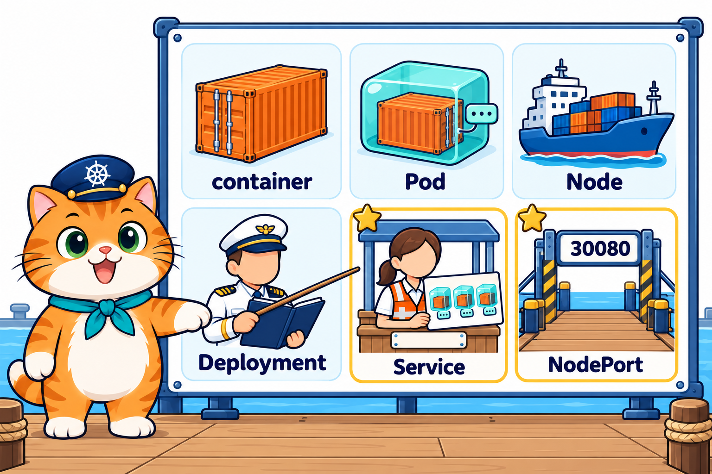
</p>

- **container** = ตู้สินค้า / **Pod** = กล่องห่อตู้ มีป้าย IP 1 อัน (เปลี่ยนได้)
- **Node** = เรือ (`lab-worker`, `lab-worker2`) / **Control Plane** = หอบังคับการ
- **ReplicaSet** = หัวหน้าลูกเรือ / **Deployment** = ผู้จัดการลูกเรือ (บทที่ 3–4)
- **Service** = **พนักงานต้อนรับหน้าท่า** (เสื้อกั๊กสีส้ม) ประจำ **บูธต้อนรับ** มีป้ายชื่อคงที่ (`web`) กับป้ายที่อยู่ (ClusterIP) ถือ **กระดานรายชื่อกล่องที่พร้อม** (Endpoints)
- **NodePort** = **ประตูท่าเรือหมายเลข `30080`** มีบนเรือทุกลำ เปิดออกสู่ถนนด้านนอก
- **kube-proxy** = คนเรือที่ **วางรางส่งลูกค้า** บนเรือทุกลำ / **DNS** = **สมุดรายชื่อท่า** (ชื่อ → ที่อยู่)

> **ขอบเขตบทนี้:** Service 2 แบบคือ **ClusterIP** (ใช้ในคลัสเตอร์) และ **NodePort** (เปิดออกนอกคลัสเตอร์) ส่วนแบบ LoadBalancer และ Ingress ใช้กับคลาวด์หรือเว็บหลายโดเมน ไม่อยู่ในบทนี้

---

## 2. Service คืออะไร

<p align="center">
  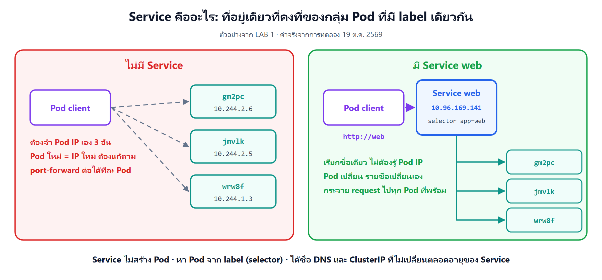
</p>

**Service คือ object ที่ให้ "ที่อยู่เดียวที่คงที่" กับกลุ่ม Pod ที่ติดป้ายเดียวกัน แล้วกระจายลูกค้าไปยัง Pod ที่พร้อมในกลุ่มนั้น**

- เราบอกแค่ **"ส่งไป Pod ป้ายไหน"** (`selector`) กับ **"เปิดรับ port ไหน ส่งต่อ port ไหน"** (`ports`)
- Service ได้ **ชื่อ** (`web`) และ **IP ภายในคลัสเตอร์** (ClusterIP) ที่ไม่เปลี่ยนตลอดอายุของ Service
- Pod จะถูกลบ เกิดใหม่ เปลี่ยนรุ่นกี่รอบ ลูกค้าก็เรียกที่อยู่เดิม

ตัวอย่างจริงจาก LAB 1: Pod `client` เรียก `http://web` 6 ครั้ง ได้คำตอบจาก Pod คนละตัว

```text
$ kubectl get svc
NAME         TYPE        CLUSTER-IP     EXTERNAL-IP   PORT(S)   AGE
kubernetes   ClusterIP   10.96.0.1      <none>        443/TCP   6m28s
web          ClusterIP   10.96.39.117   <none>        80/TCP    0s

$ kubectl exec client -- wget -qO- http://web
Hello from Pod web-65b66cc75b-ktpwd
$ kubectl exec client -- wget -qO- http://web
Hello from Pod web-65b66cc75b-8wgnn
...
$ kubectl exec client -- wget -qO- http://web
Hello from Pod web-65b66cc75b-9nnn8
```

- `web` = Service ของเรา `TYPE` = `ClusterIP` (ค่าเริ่มต้น) ได้ที่อยู่ `10.96.39.117`
- `kubernetes` = Service ที่คลัสเตอร์สร้างไว้เองตั้งแต่แรก (ทางเข้า kube-apiserver) ไม่ต้องไปยุ่ง
- 6 ครั้งได้ครบทั้ง 3 Pod (`ktpwd` 4 ครั้ง, `8wgnn` 1, `9nnn8` 1) Service **เลือกให้ทีละการเชื่อมต่อ** ไม่ได้วนตามลำดับเป๊ะ

เทียบกับ port-forward ที่ใช้มาตั้งแต่บทที่ 2

| | `kubectl port-forward` (บทที่ 2–4) | Service (บทนี้) |
|---|---|---|
| ส่งไปกี่ Pod | Pod เดียวที่ kubectl เลือก | ทุก Pod ที่ป้ายตรงและพร้อม |
| Pod ถูกลบ/เปลี่ยนรุ่น | ท่อขาด ต้องรันใหม่ | ไม่สะดุด Service ส่งไปตัวใหม่เอง |
| อยู่ได้นานแค่ไหน | เท่ากับ terminal ที่รันค้างไว้ | อยู่ในคลัสเตอร์จนกว่าจะลบ |
| ใครใช้ได้ | เครื่องที่รันคำสั่งเท่านั้น | Pod ทุกตัวในคลัสเตอร์ (และคนนอก ถ้าเป็น NodePort) |
| ใช้ทำอะไร | ดีบัก ส่องดู Pod ตัวเดียว | ที่อยู่จริงของแอป |

---

## 3. Service ทำงานอย่างไร

<p align="center">
  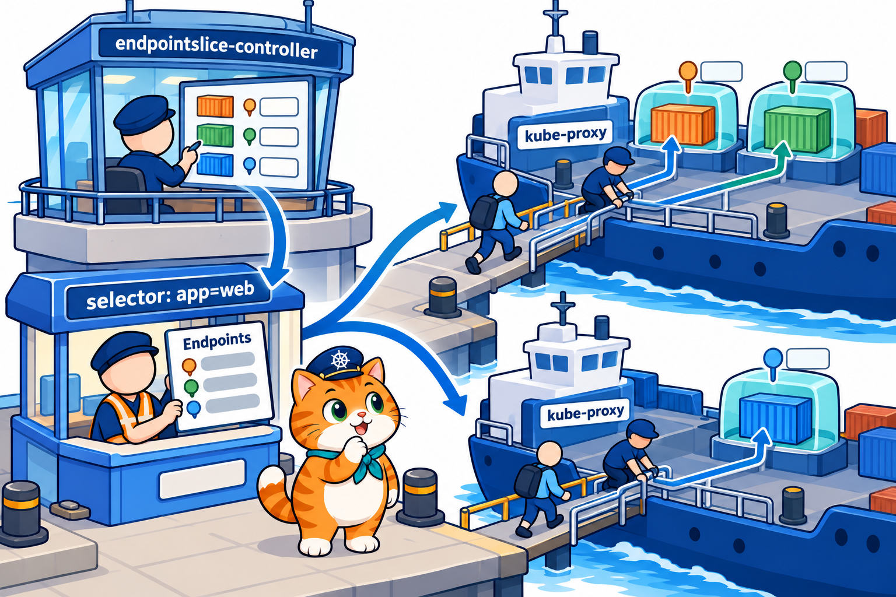
</p>

พนักงานต้อนรับไม่ได้เดินพาลูกค้าไปเอง งานแบ่งเป็น 3 ช่วง

1. **selector → รายชื่อ Pod** : **endpointslice-controller** ใน **kube-controller-manager** (หอบังคับการ) คอยดูว่า Pod ไหนติดป้ายตรง `selector` และ **พร้อม** แล้วจดเป็น **EndpointSlice** (กระดานรายชื่อ = IP:port ของ Pod)
2. **รายชื่อ → ราง** : **kube-proxy** ซึ่งมี **1 ตัวบนทุก Node** อ่าน Service กับรายชื่อนี้ แล้ววางกฎเครือข่ายบนเรือของตัวเองว่า "ใครเรียก ClusterIP:port นี้ ส่งต่อไป Pod ในรายชื่อสักตัว"
3. **ราง → Pod** : ลูกค้าเรียกที่อยู่ของ Service จากเรือลำไหนก็ได้ กฎบนเรือลำนั้นส่งต่อไป Pod ตัวหนึ่ง (อยู่เรือเดียวกันหรือคนละลำก็ได้)

kube-proxy 3 ตัว (1 ตัวต่อ Node) เห็นตั้งแต่ LAB 0

```text
$ kubectl get pods -A
NAMESPACE     NAME                                        READY   STATUS    RESTARTS   AGE
...
kube-system   kube-controller-manager-lab-control-plane   1/1     Running   0          25s
kube-system   kube-proxy-87c4n                            1/1     Running   0          12s
kube-system   kube-proxy-cpx9d                            1/1     Running   0          12s
kube-system   kube-proxy-vwlmj                            1/1     Running   0          17s
```

### ดูรายชื่อจริงใน LAB 1

(ตัดคอลัมน์ท้ายของ `-o wide` และบรรทัดที่ไม่เกี่ยวออก)

```text
$ kubectl get pods -o wide
NAME                   READY   STATUS    RESTARTS   AGE   IP            NODE
web-65b66cc75b-8wgnn   1/1     Running   0          10s   10.244.2.18   lab-worker
web-65b66cc75b-9nnn8   1/1     Running   0          10s   10.244.2.19   lab-worker
web-65b66cc75b-ktpwd   1/1     Running   0          10s   10.244.1.12   lab-worker2

$ kubectl describe svc web
Name:                     web
Selector:                 app=web                ← หา Pod จากป้ายนี้
Type:                     ClusterIP
IP:                       10.96.39.117           ← ที่อยู่ของ Service
Port:                     <unset>  80/TCP        ← port ของ Service
TargetPort:               80/TCP                 ← port ของ container ที่ส่งต่อไป
Endpoints:                10.244.2.18:80,10.244.1.12:80,10.244.2.19:80   ← Pod IP ทั้ง 3 ตัว
...

$ kubectl get endpointslices
NAME         ADDRESSTYPE   PORTS   ENDPOINTS                             AGE
kubernetes   IPv4          6443    172.19.0.2                            6m28s
web-9fqdm    IPv4          80      10.244.2.18,10.244.1.12,10.244.2.19   0s
```

- บรรทัด `Endpoints:` คือ **Pod IP:targetPort** ของทั้ง 3 Pod ตรงกับคอลัมน์ `IP` ของ `get pods` เป๊ะ
- EndpointSlice `web-9fqdm` ถูกสร้างให้เอง (ชื่อ Service + ท้ายสุ่ม) เราไม่ได้เขียนไฟล์ของมันเลย
- `<unset>` หน้า `80/TCP` คือ **ชื่อของ port** ที่เราไม่ได้ตั้ง ไม่ใช่ error
- เรียก Pod IP ตรง ๆ ก็ยังได้ (`wget -qO- http://10.244.2.18` ตอบ `web-65b66cc75b-8wgnn`) แต่ IP นี้หายไปพร้อม Pod

> **ประโยคเดียวที่ต้องจำ:** Service **ไม่ได้รับลูกค้าแล้วส่งต่อเอง** มันเป็น "ที่อยู่ + รายชื่อ" ส่วนคนที่ทำให้ลูกค้าไปถึง Pod จริงคือ **kube-proxy บนทุก Node**

---

## 4. อ่าน YAML ของ Service ทีละบรรทัด

YAML ของบทนี้ใช้กฎเดิมจาก [บทที่ 2 หัวข้อ 5](../../002_kubernetes_pod/01_Theory/README.md#5-yaml-ฉบับเข้าใจง่าย) ทบทวนสั้น ๆ

- `key: value` = ค่าเดี่ยว / เยื้องเข้า = **เป็นลูก** / เยื้องเท่ากัน = **เป็นพี่น้อง**
- `- ` (ขีด + เว้นวรรค) = **เริ่มรายการใหม่ 1 ชิ้น** (`ports` เป็น list เหมือน `containers`)
- object ที่ห่อ Pod มี `metadata` / `spec` **2 ชุด** (บทที่ 3–4)

สิ่งใหม่ของ YAML บทนี้: **Service มี `metadata` / `spec` ชุดเดียว เพราะ Service ไม่มี `template` และไม่สร้าง Pod** มันแค่ชี้ไปหา Pod ที่มีอยู่แล้ว

### 4.1 วาง Deployment คู่กับ Service

<p align="center">
  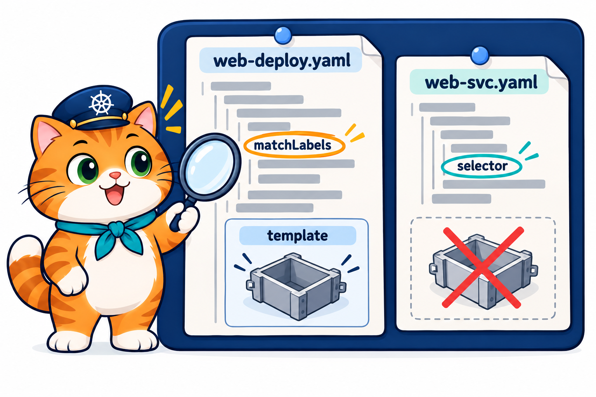
</p>

LAB 1 ใช้ 2 ไฟล์คู่กัน วางเทียบกัน (ตัด comment และบรรทัด `command` / `args` ออกเป็น `...`) **วงสีเดียวกัน = ค่าที่ต้องตรงกัน** ลูกศรบอกว่า Service เอาค่ามาจากตรงไหนใน Deployment

<p align="center">
  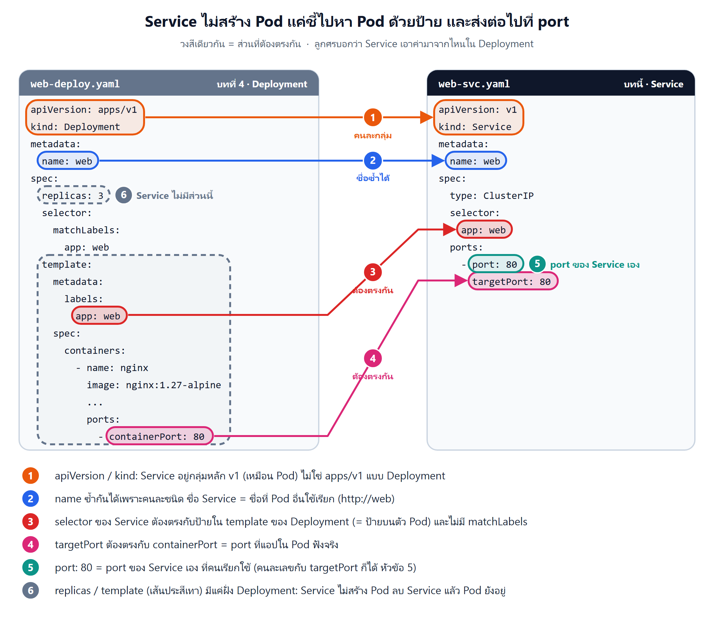
</p>

อ่านตามเลขในภาพ

- **① `apiVersion` / `kind` คนละกลุ่ม** Service อยู่กลุ่มหลัก **`v1`** (เหมือน Pod) ไม่ใช่ `apps/v1` แบบ Deployment
- **② `name` ซ้ำกันได้** เพราะเป็น object คนละชนิด ชื่อ Service คือชื่อที่ Pod อื่นใช้เรียก เช่น `http://web` (หัวข้อ 6)
- **③ ป้ายต้องตรงกัน** `selector` ของ Service จับป้ายใน **`template.metadata.labels`** ของ Deployment (= ป้ายบนตัว Pod) ไม่ใช่ป้ายของตัว Deployment และ selector ของ Service **ใส่ป้ายตรง ๆ** ไม่มี `matchLabels:` คั่น
- **④ `targetPort` ต้องตรงกับ `containerPort`** คือ port ที่แอปใน Pod ฟังอยู่จริง Service ส่งลูกค้าต่อไปที่เลขนี้
- **⑤ `port` เป็นของ Service เอง** คือ port ที่คนเรียกใช้ จะเป็นคนละเลขกับ `targetPort` ก็ได้ (หัวข้อ 5)
- **⑥ ส่วนเส้นประสีเทามีแค่ฝั่ง Deployment** Service **ไม่มี `replicas` ไม่มี `template` ไม่มี `containers`** มันไม่สร้าง Pod แค่ชี้ไปหา ลบ Service ทิ้ง Pod ก็ยังอยู่ครบ

### 4.2 ไล่ไฟล์จริงจาก LAB 1

ไฟล์ `02_LAB/labs/lab01-clusterip/web-svc.yaml`

```yaml
# LAB 1, 2: Service แรก (ClusterIP) — ที่อยู่เดียวของ Pod ทุกตัวที่ติดป้าย app=web ใช้ได้เฉพาะในคลัสเตอร์
apiVersion: v1               # Service อยู่กลุ่มหลัก v1 เหมือน Pod
kind: Service
metadata:
  name: web                  # ชื่อ Service = ชื่อที่ Pod อื่นใช้เรียก เช่น http://web
spec:
  type: ClusterIP            # ค่าเริ่มต้น: ได้ IP ภายในคลัสเตอร์ 1 อันที่ไม่เปลี่ยน
  selector:
    app: web                 # ส่งงานให้ Pod ที่มีป้ายนี้ (ไม่มี matchLabels แบบ ReplicaSet)
  ports:
    - port: 80               # port ของ Service (คนเรียกใช้ port นี้)
      targetPort: 80         # port ของ container ใน Pod ที่จะส่งต่อไป
```

ไฟล์นี้ใช้ใน LAB 1 และ LAB 2

อ่านทีละบรรทัด

| บรรทัด | ความหมาย |
|---|---|
| `apiVersion: v1` | Service อยู่กลุ่มหลัก รุ่น `v1` (เหมือน Pod) |
| `kind: Service` | ขอสร้าง **Service** |
| `metadata:` → `name: web` | Service ชื่อ `web` = **ชื่อที่ใช้เรียก** (`http://web`) และชื่อใน DNS (หัวข้อ 6) |
| `spec:` → `type: ClusterIP` | แบบของ Service ได้ IP ภายในคลัสเตอร์ (ไม่เขียนก็ได้ เพราะเป็นค่าเริ่มต้น) |
| `  selector:` → `app: web` | ส่งลูกค้าไปทุก Pod ที่ติดป้าย `app=web` |
| `  ports:` | รายการ port ที่ Service เปิดรับ (มีได้หลายชิ้น) |
| `    - port: 80` | port ของ **Service** คนเรียกใช้ `web:80` (ไม่ใส่ port ใน URL = 80) |
| `      targetPort: 80` | port ของ **container ใน Pod** ที่ส่งต่อไป ต้องตรงกับ `containerPort` |

แปลทั้งไฟล์เป็นประโยคเดียว: **"ขอ Service ชื่อ `web` แบบ ClusterIP รับลูกค้าที่ port 80 แล้วส่งต่อไป port 80 ของ Pod ทุกตัวที่ติดป้าย `app=web`"**

### 4.3 ผิดบ่อย แก้ง่าย

| ผิด | ถูก | เพราะ |
|---|---|---|
| `apiVersion: apps/v1` | `apiVersion: v1` | Service อยู่กลุ่มหลัก ไม่ได้อยู่กลุ่ม `apps` |
| `kind: service` | `kind: Service` | ตัว S ต้องใหญ่ |
| `selector:` → `matchLabels:` → `app: web` | `selector:` → `app: web` | selector ของ Service เป็นป้ายตรง ๆ Kubernetes ไม่รับ `matchLabels` ตรงนี้ |
| `targetPort` ไม่ตรง `containerPort` (เช่น 80 แต่แอปฟัง 3000) | ให้ตรงกัน | Endpoints มีครบ แต่ส่งไปผิดประตู เรียกแล้วต่อไม่ติด |
| selector พิมพ์ผิด (`app: wbe`) | ให้ตรงป้ายใน `template` | apply ผ่าน แต่ **Endpoints ว่าง** (หัวข้อ 8) |

> **⚠️ กับดัก:** 2 แถวล่างเป็นความผิดที่ **apply ผ่านทุกครั้ง** Kubernetes ไม่รู้ว่าเราตั้งใจจะส่งไป Pod ไหน หรือแอปฟัง port อะไร ต้องตรวจเองด้วย `kubectl describe svc`

---

## 5. port, targetPort, nodePort: 3 ตัวเลขที่ต้องแยกให้ออก

<p align="center">
  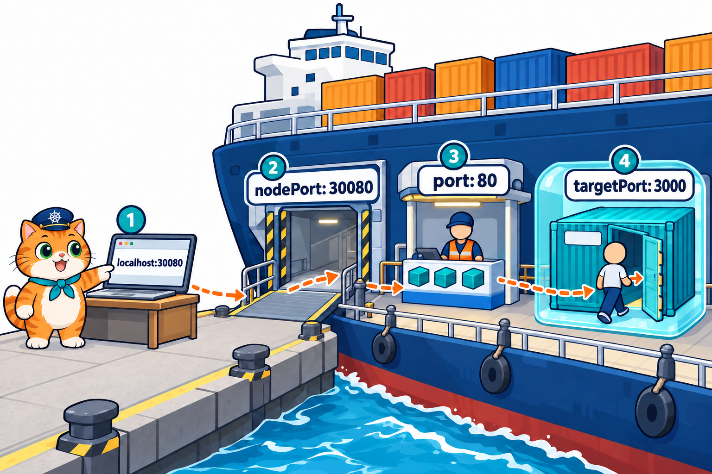
</p>

ร้านน้องส้มใน LAB 4 ใช้ตัวเลขไม่ซ้ำกันเลย จึงเห็นชัดว่าแต่ละตัวอยู่ตรงไหน (`som-menu/k8s/som-menu-svc.yaml`)

```yaml
  ports:
    - port: 80               # ในคลัสเตอร์เรียก http://som-menu (port 80)
      targetPort: 3000       # หน้าร้าน Node.js ฟัง port 3000
      nodePort: 30080        # นอกคลัสเตอร์เปิด http://localhost:30080
```

| ตัวเลข | เป็น port ของใคร | ใครใช้ | ในอุปมา |
|---|---|---|---|
| `nodePort: 30080` | **Node** (เปิดบนทุก Node) | คนนอกคลัสเตอร์ | ประตูท่าเรือหมายเลข 30080 |
| `port: 80` | **Service** (ที่ ClusterIP) | Pod ในคลัสเตอร์ | ช่องรับลูกค้าของบูธต้อนรับ |
| `targetPort: 3000` | **container ใน Pod** | Service ส่งต่อมา | ประตูของกล่อง (= `containerPort`) |

ลูกค้าจาก browser เดินทางแบบนี้: `localhost:30080` → **nodePort 30080** → Service **port 80** → Pod **targetPort 3000**

เห็นทั้ง 3 ตัวในผลจริงของ LAB 4

```text
$ kubectl get svc
NAME         TYPE        CLUSTER-IP      EXTERNAL-IP   PORT(S)        AGE
som-menu     NodePort    10.96.254.181   <none>        80:30080/TCP   10s     ← port:nodePort

$ kubectl describe svc som-menu
Port:                     <unset>  80/TCP
TargetPort:               3000/TCP
NodePort:                 <unset>  30080/TCP
Endpoints:                10.244.2.39:3000,10.244.2.38:3000,10.244.1.25:3000   ← ลงท้าย :3000 = targetPort
```

- คอลัมน์ `PORT(S)` เขียน **`port:nodePort`** (`80:30080`) ส่วน targetPort ไม่โผล่ในคอลัมน์นี้
- Endpoints ลงท้ายด้วย **targetPort** เสมอ เพราะเป็นที่อยู่จริงของ Pod
- ใน LAB 1–3 `port` กับ `targetPort` เป็น 80 ทั้งคู่ (nginx ฟัง 80) ดูเหมือนตัวเดียวกัน แต่เป็นคนละ port

> **เคล็ดลับ:** จำจากซ้ายไปขวาตามทางเดินของลูกค้า **node → service → target** (ประตูท่าเรือ → บูธ → กล่อง) และ `targetPort` ต้องเท่ากับ `containerPort` ใน Deployment เสมอ

---

## 6. เรียกด้วยชื่อ: DNS ในคลัสเตอร์

<p align="center">
  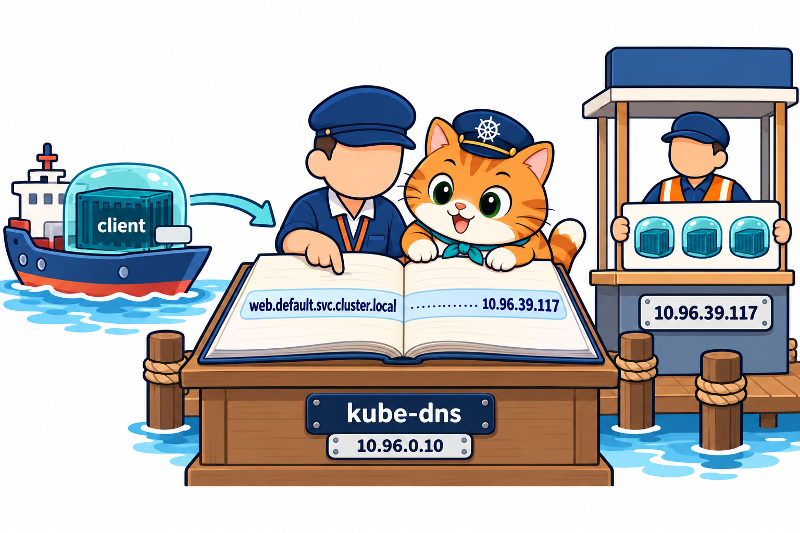
</p>

Pod `client` เรียก `http://web` ได้ ทั้งที่ไม่รู้ IP เพราะคลัสเตอร์มี **DNS** (สมุดรายชื่อท่า) แปลชื่อ Service เป็น ClusterIP ให้

DNS ของคลัสเตอร์ก็เป็น Service ตัวหนึ่ง ชื่อ `kube-dns` เห็นตั้งแต่ LAB 0

```text
$ kubectl get svc -A
NAMESPACE     NAME         TYPE        CLUSTER-IP   EXTERNAL-IP   PORT(S)                  AGE
default       kubernetes   ClusterIP   10.96.0.1    <none>        443/TCP                  26s
kube-system   kube-dns     ClusterIP   10.96.0.10   <none>        53/UDP,53/TCP,9153/TCP   25s
```

- `kube-dns` ส่งต่อให้ Pod `coredns-...` 2 ตัวใน `kube-system` (Pod ที่ทำหน้าที่สมุดรายชื่อจริง)
- Pod ทุกตัวในคลัสเตอร์ถูกตั้งให้ถาม DNS ที่ `10.96.0.10`

ถามสมุดรายชื่อเองจาก Pod `client` (LAB 1)

```text
$ kubectl exec client -- nslookup web.default.svc.cluster.local
Server:		10.96.0.10              ← ถาม kube-dns
Address:	10.96.0.10:53

Name:	web.default.svc.cluster.local
Address: 10.96.39.117            ← ได้ ClusterIP ของ Service web
```

### ชื่อสั้น และชื่อเต็ม

ชื่อเต็มของ Service คือ `<ชื่อ Service>.<namespace>.svc.cluster.local`

- `web` = ชื่อ Service
- `default` = **namespace** (ห้องที่ object อยู่) ทุกอย่างที่เราสร้างมาตั้งแต่บทที่ 2 อยู่ห้อง `default`
- `svc.cluster.local` = ท้ายชื่อของ Service ทุกตัวในคลัสเตอร์นี้

Pod ที่อยู่ namespace เดียวกันเรียกแค่ `web` ก็พอ (LAB 1 เรียกทั้ง `http://web` และ `http://web.default.svc.cluster.local` ได้ทั้งคู่) ส่วน Pod ต่างห้องต้องเรียกชื่อยาวขึ้น เช่น `web.default`

> **ประโยคเดียวที่ต้องจำ:** ในแอป **ให้เรียกชื่อ Service** (`http://web`, `http://som-menu`) ไม่ใช่ Pod IP หรือ ClusterIP เพราะชื่อไม่เปลี่ยนแม้ลบแล้วสร้าง Service ใหม่ (หัวข้อ 9)

---

## 7. Service หา Pod จากป้าย

<p align="center">
  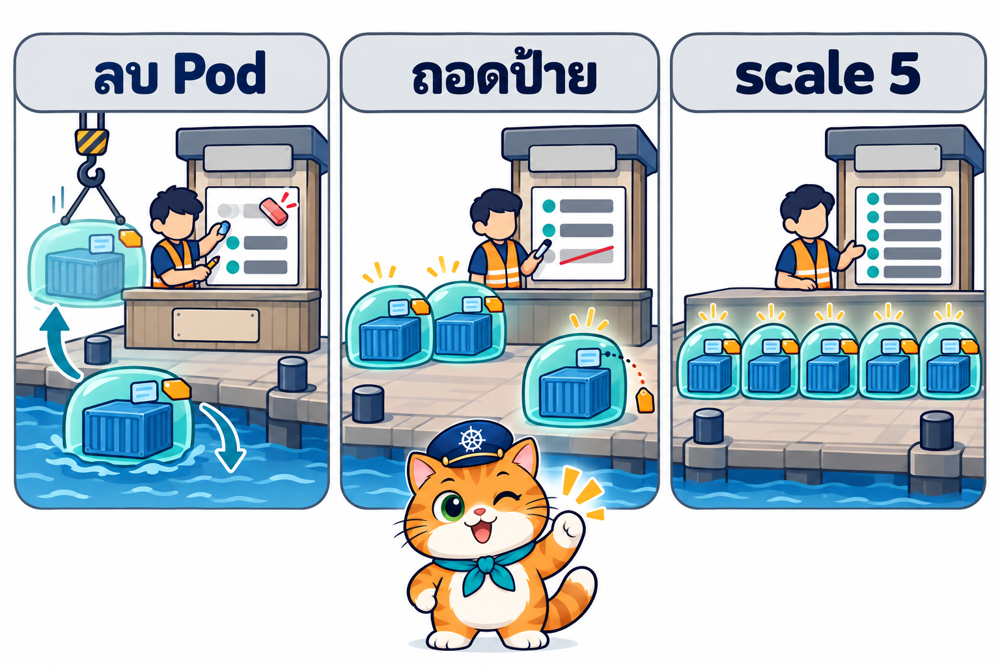
</p>

พนักงานต้อนรับ **ไม่ได้จำชื่อกล่อง** แต่ดูป้าย เหมือนหัวหน้าลูกเรือที่นับ Pod จากป้ายใน [บทที่ 3 หัวข้อ 8](../../003_kubernetes_Replicaset/01_Theory/README.md#8-labels-replicaset-นับ-pod-จากป้าย) รายชื่อ (Endpoints) จึง **ตาม Pod เสมอ** ใน LAB 2 ลองเปลี่ยน Pod 3 แบบ

**1) ลบ Pod → ตัวใหม่เข้ารายชื่อเอง**

```text
Endpoints:  10.244.1.13:80,10.244.2.22:80,10.244.2.23:80      ← ก่อนลบ

$ kubectl delete pod web-65b66cc75b-c96gf
$ kubectl get pods -o wide
web-65b66cc75b-grb46   1/1     Running   0          6s    10.244.1.14   lab-worker2   ← ตัวใหม่ IP ใหม่

Endpoints:  10.244.2.22:80,10.244.2.23:80,10.244.1.14:80      ← หลังลบ: .13 ออก .14 เข้า
```

ReplicaSet สร้าง Pod ใหม่ (บทที่ 3) ส่วน Service เห็นป้าย `app=web` บน Pod ใหม่ จึงใส่ IP ใหม่ในรายชื่อให้ **เราไม่ต้องแก้ Service เลย**

**2) ถอดป้าย → หลุดจากรายชื่อ ทั้งที่ยังรันอยู่** (ตัดบางคอลัมน์ออก)

```text
$ kubectl label pod web-65b66cc75b-grb46 app-
pod/web-65b66cc75b-grb46 unlabeled

$ kubectl get pods -o wide --show-labels
NAME                   READY   STATUS    AGE   IP            LABELS
web-65b66cc75b-grb46   1/1     Running   11s   10.244.1.14   pod-template-hash=65b66cc75b       ← ไม่มี app=web แล้ว
web-65b66cc75b-hkqtr   1/1     Running   5s    10.244.1.15   app=web,pod-template-hash=65b66cc75b   ← ReplicaSet สร้างมาเติม
...

Endpoints:  10.244.2.22:80,10.244.2.23:80,10.244.1.15:80      ← .14 หายไป .15 เข้ามา
```

- Pod `grb46` ยัง `Running` แต่ **ไม่มีลูกค้าถูกส่งไปอีก** (`wget http://web` 4 ครั้งได้ `pw5ld`, `hkqtr`, `pw5ld`, `wqrqq`)
- เกิด 2 เรื่องพร้อมกันจากป้ายเดียว: ReplicaSet นับได้ 2 จึงสร้าง `hkqtr` มาเติม และ Service ตัด `grb46` ออกจากรายชื่อ

**3) scale เป็น 5 → รายชื่อยาวขึ้นเอง**

```text
$ kubectl scale deployment web --replicas=5
Endpoints:  10.244.2.22:80,10.244.2.23:80,10.244.1.15:80 + 2 more...
```

`+ 2 more...` = มีอีก 2 ตัว (`describe` ย่อให้เมื่อยาว) ดูครบได้ด้วย `kubectl get endpointslices`

> **เคล็ดลับ:** ถอดป้ายใช้ **แยก Pod ที่มีปัญหาออกจากหน้าร้าน** ได้ ลูกค้าไม่ถูกส่งไปตัวนั้นแล้ว แต่เรายังเข้าไป `exec` / `logs` ตรวจได้ ตรวจเสร็จแล้วลบเอง (LAB 2 ลบ `grb46` ทิ้งตอนท้าย)

---

## 8. กับดัก: selector พิมพ์ผิด แล้ว Endpoints ว่าง

<p align="center">
  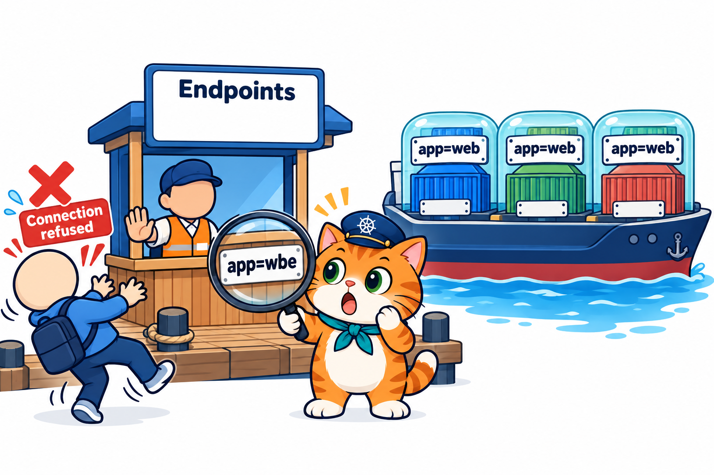
</p>

ไฟล์ `02_LAB/labs/lab02-selector/web-svc-typo.yaml` พิมพ์ป้ายสลับตัวอักษร

```yaml
metadata:
  name: web-typo
spec:
  selector:
    app: wbe                 # ← พิมพ์ผิด (ที่ถูกคือ web) ไม่มี Pod ไหนติดป้ายนี้
```

ผลจริงใน LAB 2: apply ผ่าน ได้ ClusterIP ด้วย ดูเหมือนปกติทุกอย่าง

```text
$ kubectl apply -f labs/lab02-selector/web-svc-typo.yaml
service/web-typo created

$ kubectl get svc
NAME         TYPE        CLUSTER-IP      EXTERNAL-IP   PORT(S)   AGE
web          ClusterIP   10.96.173.122   <none>        80/TCP    31s
web-typo     ClusterIP   10.96.49.240    <none>        80/TCP    0s     ← ไม่มีอะไรบอกว่าผิด
```

แต่พอดูรายชื่อ และลองเรียก

```text
$ kubectl describe svc web-typo
Selector:                 app=wbe
Endpoints:                                    ← ว่าง!

$ kubectl exec client -- wget -qO- http://web-typo
wget: can't connect to remote host (10.96.49.240): Connection refused
command terminated with exit code 1
```

- ชื่อ `web-typo` แปลเป็น IP ได้ (DNS ทำงาน) แต่ **ไม่มี Pod ในรายชื่อ** จึงไม่มีใครรับ ได้ `Connection refused`
- Pod `web` 5 ตัวรันปกติอยู่ข้าง ๆ ตลอด ปัญหาไม่ได้อยู่ที่ Pod

### ตรวจ 3 ขั้น เมื่อเรียก Service ไม่ได้

1. **`kubectl describe svc <ชื่อ>`** ดูบรรทัด `Endpoints:` ถ้า **ว่าง** = Service หา Pod ไม่เจอ ไปขั้น 2
2. **`kubectl get pods --show-labels`** เทียบป้ายของ Pod กับบรรทัด `Selector:` ทีละตัวอักษร (`wbe` ≠ `web`) หรือ Pod มีครบแต่ `READY 0/1` (ยังไม่พร้อม หัวข้อ 11)
3. ถ้า Endpoints **มีครบ** แต่ยังต่อไม่ติด → เทียบ `TargetPort` กับ `containerPort` ของ Pod

> **⚠️ กับดัก:** Service ที่ selector ผิด **ไม่มี error ตอน apply ไม่มี Events ไม่มี STATUS สีแดง** สิ่งเดียวที่บอกคือ `Endpoints:` ว่าง ให้ดูบรรทัดนี้เป็นอย่างแรกทุกครั้ง

---

## 9. ClusterIP: ที่อยู่ภายในคลัสเตอร์

<p align="center">
  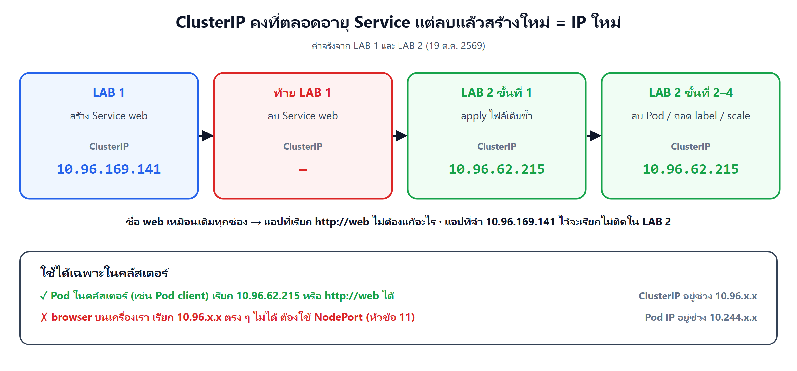
</p>

**ClusterIP** คือแบบเริ่มต้นของ Service ได้ IP 1 อัน (ในคลัสเตอร์ kind อยู่ช่วง `10.96.x.x` ส่วน Pod อยู่ช่วง `10.244.x.x`)

**คงที่ตลอดอายุ Service** ใน LAB 2 ลบ Pod ถอดป้าย scale เป็น 5 แต่ `describe svc web` ขึ้น `IP: 10.96.173.122` ทุกครั้ง มีแต่บรรทัด `Endpoints:` ที่เปลี่ยน

**แต่ลบ Service แล้วสร้างใหม่ = ได้ IP ใหม่**

- LAB 1 Service `web` ได้ `10.96.39.117`
- ตอนท้าย LAB 1 ลบทิ้ง แล้ว LAB 2 apply ไฟล์เดิมซ้ำ ได้ `10.96.173.122`
- ชื่อ `web` เหมือนเดิม → แอปที่เรียกด้วยชื่อ (หัวข้อ 6) ไม่ต้องแก้อะไร

**ใช้ได้เฉพาะในคลัสเตอร์** ClusterIP เป็นที่อยู่ภายในคลัสเตอร์ Pod ทุกตัวเรียกได้ แต่ browser บนเครื่องเรา **เรียกตรงไม่ได้** ในอุปมาคือบูธอยู่ในรั้วท่าเรือ คนบนถนนเดินเข้าไปไม่ถึง LAB 1–2 จึงต้องใช้ Pod `client` เป็นลูกค้าในคลัสเตอร์

ไฟล์ `labs/lab01-clusterip/client-pod.yaml` เป็น Pod เดี่ยว (บทที่ 2) ที่แค่นอนรอให้เรา `exec` เข้าไป

```yaml
spec:
  containers:
    - name: busybox
      image: busybox:1.37
      command: ["sleep", "3600"]   # นอนรอ 1 ชั่วโมง (มี wget และ nslookup ให้ใช้)
```

> **เคล็ดลับ:** ClusterIP เหมาะกับของที่ **ใช้กันเองในคลัสเตอร์** เช่น ฐานข้อมูลที่หน้าเว็บเรียก คนนอกไม่ควรเข้าถึงอยู่แล้ว ส่วนหน้าร้านที่ลูกค้าต้องเปิดจาก browser ใช้ NodePort (หัวข้อ 10)

---

## 10. NodePort: ประตูบนทุก Node

<p align="center">
  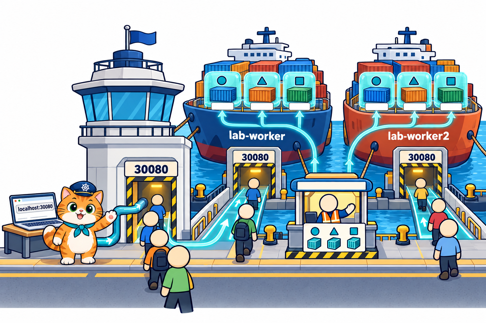
</p>

**NodePort** = Service ที่ได้ **ClusterIP ทุกอย่างเหมือนเดิม** แล้วเปิด **port เดียวกันบนทุก Node** เพิ่มให้คนนอกคลัสเตอร์เข้าได้ ไฟล์ `02_LAB/labs/lab03-nodeport/web-svc-nodeport.yaml` ต่างจาก `web-svc.yaml` แค่ 2 บรรทัด

```yaml
spec:
  type: NodePort             # ← ใหม่: ได้ทั้ง ClusterIP และ port บนทุก Node
  selector:
    app: web
  ports:
    - port: 80               # port ของ Service ในคลัสเตอร์
      targetPort: 80         # port ของ container
      nodePort: 30080        # ← ใหม่: port บนทุก Node (ต้องอยู่ในช่วง 30000–32767) แล็บนี้ map ออกมาถึงเครื่องเราแล้ว
```

- `nodePort` ต้องอยู่ในช่วง **30000–32767** ถ้าไม่เขียน Kubernetes สุ่มเลขในช่วงนี้ให้
- LAB นี้ **เขียนเลขเอง** เพราะ k8s-lab ส่งออกมาถึงเครื่องเราเฉพาะ `30080`–`30082`

ผลจริงใน LAB 3

```text
$ kubectl get svc
NAME           TYPE        CLUSTER-IP     EXTERNAL-IP   PORT(S)        AGE
web-nodeport   NodePort    10.96.76.223   <none>        80:30080/TCP   5s     ← มี ClusterIP ด้วย

$ curl http://localhost:30080
Hello from Pod web-65b66cc75b-knhn8
...
$ curl http://localhost:30080
Hello from Pod web-65b66cc75b-wsszc
```

### ประตูมีบนเรือทุกลำ

ลองเรียกตรงที่ IP ของ Node แต่ละตัว (`INTERNAL-IP` จาก `kubectl get nodes -o wide`)

```text
lab-worker    172.19.0.4        lab-worker2   172.19.0.3

$ curl http://172.19.0.4:30080      ← ประตูของ lab-worker
Hello from Pod web-65b66cc75b-knhn8 ← Pod นี้อยู่บน lab-worker2

$ curl http://172.19.0.3:30080      ← ประตูของ lab-worker2
Hello from Pod web-65b66cc75b-wsszc ← Pod นี้อยู่บน lab-worker
```

เข้าประตูของเรือลำไหนก็ได้ kube-proxy บนเรือลำนั้นส่งต่อไป Pod ในรายชื่อ **ซึ่งอาจอยู่คนละลำ** (หัวข้อ 3) Node ที่ไม่มี Pod ของเราเลยก็เปิดประตูนี้เหมือนกัน

### ทำไม LAB 0 ต้องเพิ่ม `-p 30080-30082:30080-30082`

คลัสเตอร์ kind ทั้งก้อน (3 Node) อยู่ **ข้างใน container `k8s-lab`** อีกที ลูกค้าจาก browser จึงต้องผ่าน 2 ชั้น

1. `-p 30080-30082:30080-30082` ตอน `docker run` = เปิดทางจาก **เครื่องเรา** เข้า **container k8s-lab**
2. คลัสเตอร์ kind ใน k8s-lab ตั้งไว้แล้วให้ port ชุดนี้ส่งต่อเข้า **nodePort ของ Node** (`k8s-up` บอกไว้ว่า `NodePort ที่ map ออก host: 30080 30081 30082`)

ขาดชั้นแรก `curl localhost:30080` ใน SSH ของ k8s-lab ยังได้ แต่ browser บนเครื่องเราเปิดไม่ได้ และถ้าตั้ง `nodePort` เป็นเลขอื่นนอก 30080–30082 ก็เข้าได้แค่ด้วย IP ของ Node จากใน k8s-lab

| | ClusterIP | NodePort |
|---|---|---|
| ได้ ClusterIP | ใช่ | ใช่ (ทุก NodePort มี ClusterIP ด้วย) |
| เปิด port บน Node | ไม่ | ทุก Node (30000–32767) |
| ใครเรียกได้ | Pod ในคลัสเตอร์ | Pod ในคลัสเตอร์ + คนนอกที่เข้าถึง Node ได้ |
| ใช้ใน LAB | 1, 2 (`web`, `web-typo`) | 3, 4 (`web-nodeport`, `som-menu`) |

> **เคล็ดลับ:** ในคลาวด์จริงมี `type: LoadBalancer` ที่ขอเครื่องกระจายโหลดของผู้ให้บริการคลาวด์มาเปิดที่อยู่เดียวหน้าทุก Node ให้ คลัสเตอร์ kind บนเครื่องเราไม่มีเครื่องนั้น บทนี้จึงใช้ NodePort

---

## 11. Service ระหว่างเปลี่ยนรุ่น: readinessProbe และ rolling update

<p align="center">
  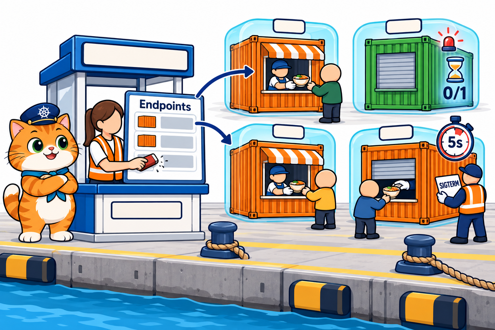
</p>

ใน LAB 4 ร้านน้องส้มเปิดด้วย Service NodePort `som-menu` แล้วเปลี่ยนรุ่นด้วย Deployment แบบบทที่ 4 คราวนี้ **ไม่ต้องรัน port-forward ใหม่เลย**

### refresh แล้วเห็นหลายสาขา

```text
$ curl http://localhost:30080/api/info
{"pod":"som-menu-5f5c95db8f-s5s9q","version":"1.0"}
$ curl http://localhost:30080/api/info
{"pod":"som-menu-5f5c95db8f-s5s9q","version":"1.0"}
$ curl http://localhost:30080/api/info
{"pod":"som-menu-5f5c95db8f-v2cvl","version":"1.0"}
$ curl http://localhost:30080/api/info
{"pod":"som-menu-5f5c95db8f-q6fk5","version":"1.0"}
```

ใน browser เปิด `http://localhost:30080` 3 ครั้งแรกได้ `som-menu-5f5c95db8f-v2cvl` ครั้งที่ 4 ได้ `som-menu-5f5c95db8f-s5s9q` ตรงกับ `kubectl logs` ของแต่ละสาขา (`v2cvl` เสิร์ฟ 3 ครั้ง, `s5s9q` เสิร์ฟ 1 ครั้ง)

Service เลือก Pod **ต่อการเชื่อมต่อ 1 ครั้ง** ไม่ใช่ต่อการกด refresh ปกติ browser ใช้การเชื่อมต่อเดิมซ้ำ (ได้สาขาเดิมตลอด) แอปร้านน้องส้มจึงตอบหน้าร้านพร้อม `connection: close` ให้ปิดการเชื่อมต่อทุกครั้ง refresh จึงเป็นการเชื่อมต่อใหม่ที่ Service เลือกสาขาใหม่ได้

### Pod ที่ยัง 0/1 ไม่ได้รับลูกค้า

หลัง apply `som-menu-deploy-v2.yaml` 3 วินาที มี Pod รุ่น 2.0 แล้ว 1 ตัว แต่ยังไม่ผ่าน readinessProbe (`/api/health`) (ย่อป้าย `pod-template-hash` เป็น `...`)

```text
$ kubectl get pods --show-labels
NAME                        READY   STATUS    RESTARTS   AGE   LABELS
som-menu-5f5c95db8f-q6fk5   1/1     Running   0          44s   app=som-menu,...,version=1.0
som-menu-5f5c95db8f-s5s9q   1/1     Running   0          44s   app=som-menu,...,version=1.0
som-menu-5f5c95db8f-v2cvl   1/1     Running   0          44s   app=som-menu,...,version=1.0
som-menu-6bf6c9f6c5-gllvz   0/1     Running   0          3s    app=som-menu,...,version=2.0   ← ป้ายตรง แต่ยังไม่พร้อม
```

ช่วงนั้น curl 6 ครั้ง ได้ `version: 1.0` **ทั้ง 6 ครั้ง** ไม่มีใครถูกส่งไป `gllvz` เพราะ endpointslice-controller ใส่ในรายชื่อเฉพาะ Pod ที่ **ป้ายตรง และ READY** (readinessProbe จากบทที่ 2 หัวข้อ 10 ทำงานคู่กับ Service ตรงนี้)

### เปลี่ยนรุ่นเสร็จ แค่ refresh

```text
$ kubectl describe svc som-menu
IP:                       10.96.254.181                                         ← ที่อยู่เดิม
Endpoints:                10.244.1.26:3000,10.244.2.40:3000,10.244.2.41:3000   ← Pod รุ่น 2.0 ทั้ง 3 ตัว

$ curl http://localhost:30080/api/info
{"pod":"som-menu-6bf6c9f6c5-gllvz","version":"2.0"}
```

browser ไม่ได้ทำอะไรเพิ่ม แค่ refresh ก็เห็นหน้าร้านรุ่น 2.0 สีเขียวอมฟ้า ต่างจากบทที่ 4 ที่ต้องรัน port-forward ใหม่หลังเจอ `lost connection to pod`

### rollback แล้วเห็น v1 / v2 ปนกัน

ระหว่าง `kubectl rollout undo` ยิง curl 6 ครั้ง ได้ `1.0` 4 ครั้ง (`2p9db`, `zwrnc`) และ `2.0` 2 ครั้ง (`gllvz`, `cjzrb`) เพราะ selector ของ Service คือ `app=som-menu` อย่างเดียว ไม่สนป้าย `version` **ทุกสาขาที่พร้อมได้ลูกค้าหมด ไม่ว่ารุ่นไหน** พอ rollout เสร็จก็เหลือ `1.0` ล้วน

### Pod ที่กำลังปิด ต้องรอให้ Service ถอดชื่อก่อน

ตอน Pod ถูกลบ (เช่น Pod เก่าระหว่าง rolling update) เกิด 2 เรื่อง **พร้อมกัน** ไม่ได้รอกัน

- kubelet ส่งสัญญาณ **SIGTERM** บอกแอปใน Pod ว่า "ปิดร้านได้แล้ว" (STATUS เป็น `Terminating`)
- endpointslice-controller ถอด Pod ออกจากรายชื่อ แล้ว kube-proxy บนทุก Node ค่อยปรับรางตาม **ซึ่งใช้เวลาอีกนิด**

ถ้าแอปปิดทันทีที่ได้ SIGTERM ลูกค้าที่ยังถูกส่งมาตามรางเก่าในช่วงนั้นจะเจอประตูปิด แอปร้านน้องส้ม (`som-menu/app/server.js`) จึงรอก่อน

```js
// รอ 5 วินาทีให้ Service ถอดสาขานี้ออกจากรายชื่อ (Endpoints) ก่อน ระหว่างนั้นยังเสิร์ฟลูกค้าที่หลงมาได้ แล้วค่อยปิดร้าน
process.on("SIGTERM", () => {
  console.log(`ปิดสาขา ${POD_NAME} (รอ 5 วินาทีให้ Service หยุดส่งลูกค้ามาก่อน)`);
  setTimeout(() => {
    server.close(() => process.exit(0));
    ...
  }, 5000);
});
```

> **⚠️ กับดัก:** ตอนทดลองก่อนแก้แอป เคยเจอ `Connection reset by peer` 1 ครั้งตอน Pod เก่าปิด หลังให้แอปรอ 5 วินาทีหลัง SIGTERM ยิง curl ระหว่าง rolling update และ rollback รวม 941 ครั้ง ไม่ล้มเลย **"ร้านไม่ปิด" ต้องมีทั้ง readinessProbe ตอนเปิด และรอสักครู่ตอนปิด** (Kubernetes ให้เวลาปิดตัวได้ 30 วินาทีโดยค่าเริ่มต้น 5 วินาทีจึงพอดี)

---

## 12. อ่าน YAML ร้านน้องส้มทั้งไฟล์

<p align="center">
  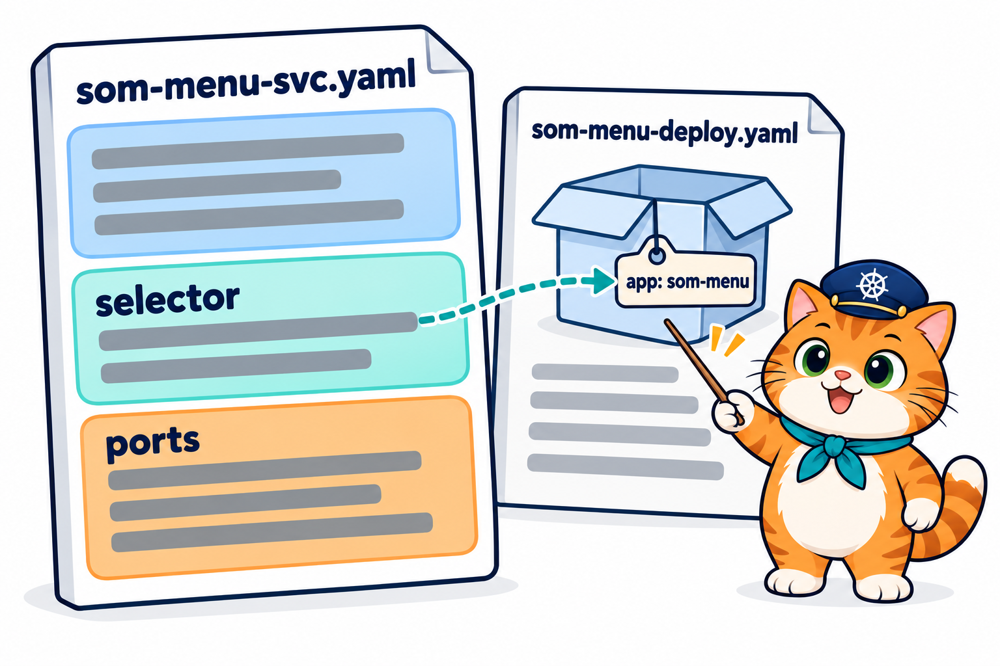
</p>

LAB 4 ใช้ 2 ไฟล์คู่กัน: `som-menu-deploy.yaml` (สร้างสาขา บทที่ 4) และ `som-menu-svc.yaml` (ที่อยู่ของร้าน) ไฟล์ Service ยาวแค่ 14 บรรทัด ถ้าพับเหลือแค่โครง

```yaml
apiVersion: v1
kind: Service
metadata:
  name: som-menu        # ชื่อร้าน = ชื่อที่ใช้เรียกในคลัสเตอร์ http://som-menu
spec:
  type: NodePort        # เปิดประตูบนทุก Node
  selector:             # ส่งลูกค้าไปสาขาที่ติดป้ายไหน
  ports:                # รับที่ไหน ส่งต่อไปไหน
```

ไฟล์เต็ม `02_LAB/som-menu/k8s/som-menu-svc.yaml`

```yaml
# LAB 4: ที่อยู่เดียวของร้านน้องส้ม — Service แบบ NodePort กระจายลูกค้าไปทุกสาขาที่พร้อม
apiVersion: v1                 # ← หัวข้อ 4: Service อยู่กลุ่มหลัก
kind: Service
metadata:
  name: som-menu               # ← หัวข้อ 6: ชื่อใน DNS = som-menu.default.svc.cluster.local
spec:
  type: NodePort               # ← หัวข้อ 10
  selector:
    app: som-menu            # ทุกสาขาที่ติดป้ายนี้ ไม่สนว่า version 1.0 หรือ 2.0
  ports:
    - port: 80               # ในคลัสเตอร์เรียก http://som-menu (port 80)
      targetPort: 3000       # หน้าร้าน Node.js ฟัง port 3000
      nodePort: 30080        # นอกคลัสเตอร์เปิด http://localhost:30080
```

(comment ที่มี `←` เพิ่มเพื่ออ่านคู่บทนี้ ในไฟล์จริงไม่มี)

### selector ของ Service จับป้ายในแม่พิมพ์ของ Deployment

ส่วนที่เกี่ยวกันใน `som-menu-deploy.yaml`

```yaml
  template:                      # แม่พิมพ์ของทุกสาขา
    metadata:
      labels:
        app: som-menu            # ← Service ใช้ป้ายนี้ (selector: app: som-menu)
        version: "1.0"           # ← Service ไม่ได้ใช้ จึงรับทั้ง 1.0 และ 2.0
    spec:
      containers:
        - name: web
          image: som-menu:1.0
          ...
          ports:
            - containerPort: 3000      # ← = targetPort ของ Service (หัวข้อ 5)
          readinessProbe:              # ← หัวข้อ 11: ผ่านแล้วจึงเข้ารายชื่อของ Service
            httpGet:
              path: /api/health
              port: 3000
            periodSeconds: 5
```

- 3 จุดที่ต้องตรงกันระหว่าง 2 ไฟล์: **ป้าย** (`app: som-menu`), **port** (`targetPort` = `containerPort` = 3000), และ readinessProbe ที่ตัดสินว่าสาขาไหนพร้อม
- ถ้าใส่ `version: "1.0"` ลงใน selector ของ Service ด้วย พอเปลี่ยนเป็นรุ่น 2.0 เสร็จ จะไม่มี Pod ตรงเลย กลายเป็น **Endpoints ว่าง** แบบหัวข้อ 8 ทั้งร้าน
- `som-menu-deploy-v2.yaml` ต่างแค่ 3 บรรทัด (บทที่ 4) และหัวไฟล์เขียนไว้ว่า **"Service ตัวเดิม ไม่ต้องแก้"**

แปลทั้งไฟล์เป็นประโยคเดียว: **"ขอ Service ชื่อ `som-menu` แบบ NodePort เปิดประตู 30080 บนทุก Node และ port 80 ในคลัสเตอร์ แล้วส่งลูกค้าต่อไป port 3000 ของทุกสาขาที่ติดป้าย `app=som-menu` และพร้อม ไม่ว่าจะเป็นรุ่นไหน"**

---

## 13. ปูทางบทถัดไป

<p align="center">
  
</p>

ร้านมีที่อยู่เดียวแล้ว ลูกค้าเข้าได้ทุกสาขา แต่ใน LAB ยังเห็นปัญหาที่ Service ช่วยไม่ได้

- **ค่าตั้งค่าเขียนอยู่ใน YAML ของ Deployment** เช่น `SHOP_NAME: "ร้านอาหารแมวน้องส้ม"` แก้ชื่อร้านทีต้องแก้ไฟล์ Deployment แล้วเปลี่ยนรุ่นทุกสาขา
- **ค่าบางอย่างฝังใน image ตอน build** เช่น `APP_VERSION` ที่ส่งด้วย `--build-arg APP_VERSION=2.0` ใน LAB 4 จะเปลี่ยนค่าต้อง build image ใหม่
- **รหัสผ่านฐานข้อมูลยังเขียนเปิดอยู่ใน YAML** ตั้งแต่บทที่ 2 ใครเปิดไฟล์ก็เห็น
- → **ConfigMap** (ค่าตั้งค่า) และ **Secret** (รหัสผ่าน) แยกค่าพวกนี้ออกจาก YAML ของ Pod และ image **(บทที่ 6)**
- ข้อมูลใน Pod ยังหายเมื่อได้ Pod ใหม่ (rolling update สร้าง Pod ใหม่ทุกตัว) → **PersistentVolume (บทที่ 7)**

---

## 14. สรุปและคำถามทบทวน

<p align="center">
  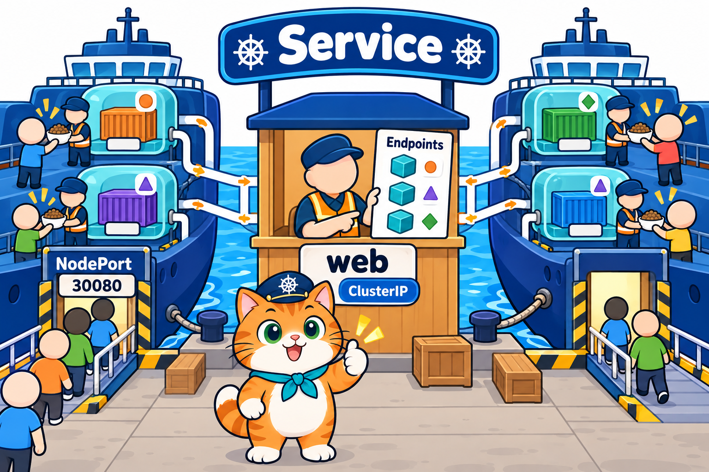
</p>

### สรุป

1. **Service** ให้ที่อยู่เดียวที่คงที่ (ชื่อ + ClusterIP) กับกลุ่ม Pod ที่ติดป้ายเดียวกัน และกระจายลูกค้าไปทุก Pod ที่พร้อม
2. ทำงาน 3 ช่วง: `selector` → endpointslice-controller จด **Endpoints** → **kube-proxy บนทุก Node** วางกฎส่งต่อ → Pod
3. YAML ของ Service ใช้ `apiVersion: v1` มี `metadata` / `spec` ชุดเดียว **ไม่มี template ไม่สร้าง Pod** และ selector ไม่มี `matchLabels`
4. 3 ตัวเลข: `nodePort` (Node, คนนอก) → `port` (Service, ในคลัสเตอร์) → `targetPort` (container ต้องตรง `containerPort`) และ `PORT(S)` เขียน `port:nodePort`
5. เรียกด้วยชื่อผ่าน DNS (`kube-dns` ที่ `10.96.0.10`) ชื่อสั้น `web` หรือชื่อเต็ม `web.default.svc.cluster.local`
6. Endpoints **ตามป้ายเสมอ**: ลบ Pod, ถอดป้าย, scale แล้วรายชื่อเปลี่ยนเอง ไม่ต้องแก้ Service
7. selector พิมพ์ผิด apply ผ่านแต่ **Endpoints ว่าง** → `Connection refused` ตรวจ `describe svc` → `--show-labels` → targetPort
8. **ClusterIP** คงที่ตลอดอายุ Service แต่ใช้ได้ในคลัสเตอร์เท่านั้น ลบแล้วสร้างใหม่ได้ IP ใหม่ จึงเรียกด้วยชื่อ
9. **NodePort** เปิด port 30000–32767 บนทุก Node เข้าประตูไหนก็ไปถึง Pod ได้ทุกลำ (k8s-lab ส่งออกเฉพาะ 30080–30082)
10. Pod ที่ READY `0/1` ไม่อยู่ใน Endpoints, เปลี่ยนรุ่นแล้วแค่ refresh, Pod ที่กำลังปิดควรรอให้ถอดชื่อก่อน → บทหน้า **ConfigMap + Secret**

### คำถามทบทวน

**1. อ่าน YAML นี้แล้วตอบ: Pod อื่นในคลัสเตอร์เรียกด้วย URL อะไร คนนอกคลัสเตอร์เข้าที่ port ไหน และแอปใน Pod ต้องฟัง port อะไร**

```yaml
apiVersion: v1
kind: Service
metadata:
  name: cat-api
spec:
  type: NodePort
  selector:
    app: cat-api
  ports:
    - port: 8080
      targetPort: 5000
      nodePort: 30081
```

<details>
<summary>แนวคำตอบ</summary>

ในคลัสเตอร์เรียก `http://cat-api:8080` (port ของ Service) คนนอกเข้า `<IP ของ Node ไหนก็ได้>:30081` (บน k8s-lab คือ `http://localhost:30081`) แอปใน Pod ต้องฟัง port 5000 (targetPort = containerPort)
</details>

**2. YAML ต่อไปนี้ผิดกี่จุด อะไรบ้าง**

```text
apiVersion: apps/v1
kind: service
metadata:
  name: som-menu
spec:
  type: NodePort
  selector:
    matchLabels:
      app: som-menu
  ports:
    - port: 80
      targetPort: 3000
      nodePort: 8080
```

<details>
<summary>แนวคำตอบ</summary>

1. `apiVersion: apps/v1` ต้องเป็น `v1`
2. `kind: service` ต้องเป็น `Service`
3. selector ของ Service ไม่มี `matchLabels` ต้องเขียน `app: som-menu` ใต้ `selector:` ตรง ๆ
4. `nodePort: 8080` อยู่นอกช่วง 30000–32767 (และใน k8s-lab ควรใช้ 30080–30082)
</details>

**3. เพื่อนบอกว่า "Pod รันครบ 3 ตัว แต่เรียก `http://shop` แล้วได้ `Connection refused`" แล้วส่งผลนี้มา สาเหตุน่าจะเป็นอะไร ตรวจอะไรต่อ**

```text
$ kubectl describe svc shop
Selector:                 app=shpo
TargetPort:               80/TCP
Endpoints:
```

<details>
<summary>แนวคำตอบ</summary>

`Endpoints:` ว่าง = Service หา Pod ไม่เจอ และ selector `app=shpo` น่าจะพิมพ์ผิด (เหมือน `app: wbe` ใน LAB 2) ให้ `kubectl get pods --show-labels` เทียบป้ายจริงของ Pod แล้วแก้ selector ในไฟล์ แล้ว apply ใหม่
</details>

**4. `kubectl get svc` แสดงบรรทัดนี้ Service เป็นแบบไหน ตัวเลข 80 กับ 30080 คืออะไร และ targetPort ดูได้จากไหน**

```text
NAME       TYPE       CLUSTER-IP      EXTERNAL-IP   PORT(S)        AGE
som-menu   NodePort   10.96.254.181   <none>        80:30080/TCP   10s
```

<details>
<summary>แนวคำตอบ</summary>

แบบ NodePort (มี ClusterIP `10.96.254.181` ด้วย) `80` = port ของ Service ใช้ในคลัสเตอร์ `30080` = nodePort เปิดบนทุก Node targetPort ไม่อยู่ในคอลัมน์นี้ ดูจาก `kubectl describe svc som-menu` (`TargetPort: 3000/TCP` และ Endpoints ลงท้าย `:3000`)
</details>

**5. ใน LAB 2 ถอดป้าย `app` ออกจาก `web-65b66cc75b-grb46` แล้ว Pod นั้นยัง `Running` แต่ `wget http://web` 4 ครั้งไม่เคยได้คำตอบจากมันเลย เพราะอะไร และทำไมมี Pod `hkqtr` โผล่มา**

<details>
<summary>แนวคำตอบ</summary>

Service เลือก Pod จากป้าย `app=web` พอถอดป้าย `grb46` จึงหลุดจาก Endpoints ไม่มีลูกค้าถูกส่งไป ส่วน ReplicaSet ก็นับจากป้ายเหมือนกัน นับได้ 2 จึงสร้าง `hkqtr` มาเติมให้ครบ 3 แล้ว Service ก็ใส่ `hkqtr` ในรายชื่อเอง
</details>

**6. ใน LAB 4 หลัง apply รุ่น 2.0 มี Pod `som-menu-6bf6c9f6c5-gllvz   0/1   Running` ติดป้าย `app=som-menu` ตรงกับ selector แต่ curl 6 ครั้งได้รุ่น 1.0 ทั้งหมด เพราะอะไร**

<details>
<summary>แนวคำตอบ</summary>

Pod ใหม่ยังไม่ผ่าน readinessProbe (`/api/health`) READY จึงเป็น `0/1` และ Service ใส่ในรายชื่อเฉพาะ Pod ที่ป้ายตรง **และพร้อม** ลูกค้าจึงถูกส่งไปแค่ Pod รุ่น 1.0 ที่พร้อมอยู่ 3 ตัว
</details>

**7. บทที่ 4 เปลี่ยนรุ่นแล้ว port-forward ขึ้น `lost connection to pod` ต้องรันใหม่ แต่ LAB 4 บทนี้แค่ refresh browser ก็เห็นรุ่น 2.0 ต่างกันตรงไหน**

<details>
<summary>แนวคำตอบ</summary>

port-forward ผูกท่อกับ Pod ตัวเดียว Pod ถูกลบท่อก็ขาด ส่วน Service ผูกกับ **ป้าย** ที่อยู่ `localhost:30080` (nodePort) ไม่เปลี่ยน Endpoints เปลี่ยนเป็น Pod รุ่นใหม่เอง refresh ใหม่ก็ถูกส่งไป Pod รุ่น 2.0
</details>

**8. ทำไมแอปร้านน้องส้มรอ 5 วินาทีหลังได้ SIGTERM แทนที่จะปิดทันที**

<details>
<summary>แนวคำตอบ</summary>

ตอนลบ Pod การส่ง SIGTERM กับการถอด Pod ออกจาก Endpoints เกิดพร้อมกัน และ kube-proxy บนทุก Node ต้องใช้เวลาปรับรางอีกนิด ถ้าปิดทันที ลูกค้าที่ยังถูกส่งมาช่วงนั้นจะต่อไม่ติด (เคยเจอ `Connection reset by peer`) รอ 5 วินาทีให้ถอดชื่อเสร็จก่อน แล้วค่อยปิด
</details>

**9. LAB 1 Service `web` ได้ `10.96.39.117` แต่ LAB 2 apply ไฟล์เดิมได้ `10.96.173.122` เกิดอะไรขึ้น ถ้ามีแอปที่ hard-code `10.96.39.117` ไว้จะเป็นอย่างไร ควรเขียนแบบไหน**

<details>
<summary>แนวคำตอบ</summary>

ตอนท้าย LAB 1 ลบ Service ทิ้ง LAB 2 จึงเป็น Service ตัวใหม่ ได้ ClusterIP ใหม่ (ClusterIP คงที่แค่ตลอดอายุ Service ตัวเดิม) แอปที่ hard-code IP เก่าจะเรียกไม่ติด ควรเรียกด้วยชื่อ `http://web` ที่ DNS แปลเป็น IP ปัจจุบันให้เสมอ
</details>

**10. ถ้าแก้ `som-menu-svc.yaml` ให้ `targetPort: 80` (แต่แอปฟัง 3000) `describe svc` จะเห็น Endpoints ไหม แล้วเรียกได้ไหม**

<details>
<summary>แนวคำตอบ</summary>

เห็น Endpoints ครบ 3 ตัว (ป้ายยังตรง และ Pod พร้อม) แต่ลงท้ายเป็น `:80` ซึ่งไม่มีแอปฟังอยู่ จึงเรียกไม่ติด เป็นขั้นที่ 3 ของการตรวจในหัวข้อ 8: Endpoints มีแต่ต่อไม่ได้ → เทียบ `targetPort` กับ `containerPort`
</details>

---

## เอกสารอ้างอิง

- Kubernetes Docs: [Service](https://kubernetes.io/docs/concepts/services-networking/service/) · [DNS for Services and Pods](https://kubernetes.io/docs/concepts/services-networking/dns-pod-service/) · [EndpointSlices](https://kubernetes.io/docs/concepts/services-networking/endpoint-slices/)
- [Connecting Applications with Services](https://kubernetes.io/docs/tutorials/services/connect-applications-service/) · [Pod Lifecycle: Termination of Pods](https://kubernetes.io/docs/concepts/workloads/pods/pod-lifecycle/#pod-termination)

> ภาพประกอบในโฟลเดอร์ [`images/`](images/) สร้างด้วย AI เพื่อการเรียนการสอน (prompt อยู่ใน [`images/imagegen-prompts.md`](images/imagegen-prompts.md)) ผลลัพธ์คำสั่งมาจาก LAB จริงบน kind v0.33.0 / Kubernetes v1.37.0 (ทดลอง 18 ต.ค. 2569) ชื่อ Pod, ClusterIP, Pod IP, Node IP และลำดับที่ Service เลือก Pod ในเครื่องผู้เรียนจะต่างกัน
