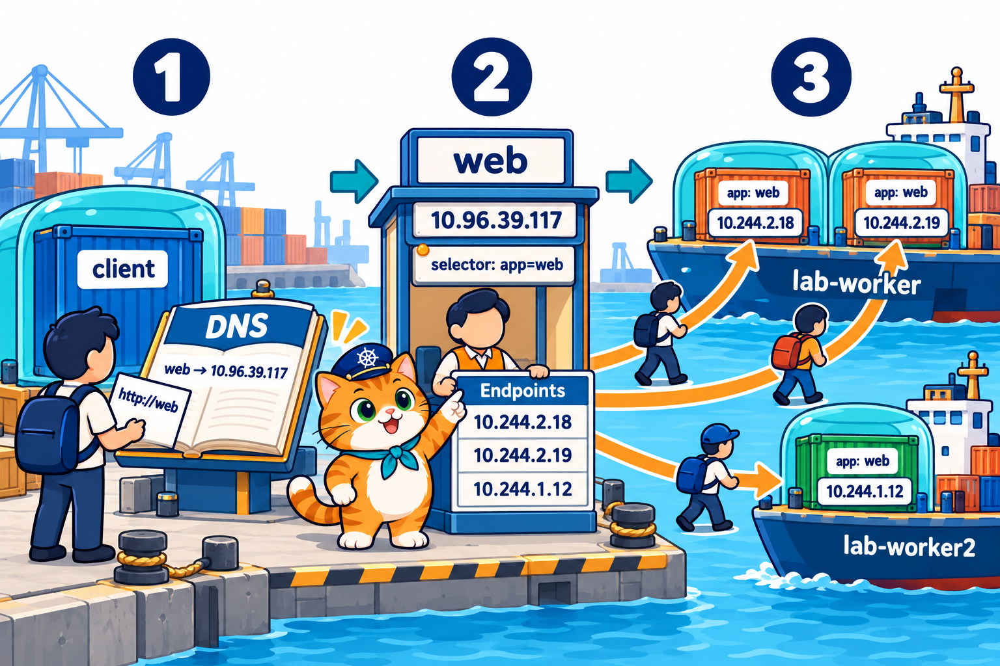
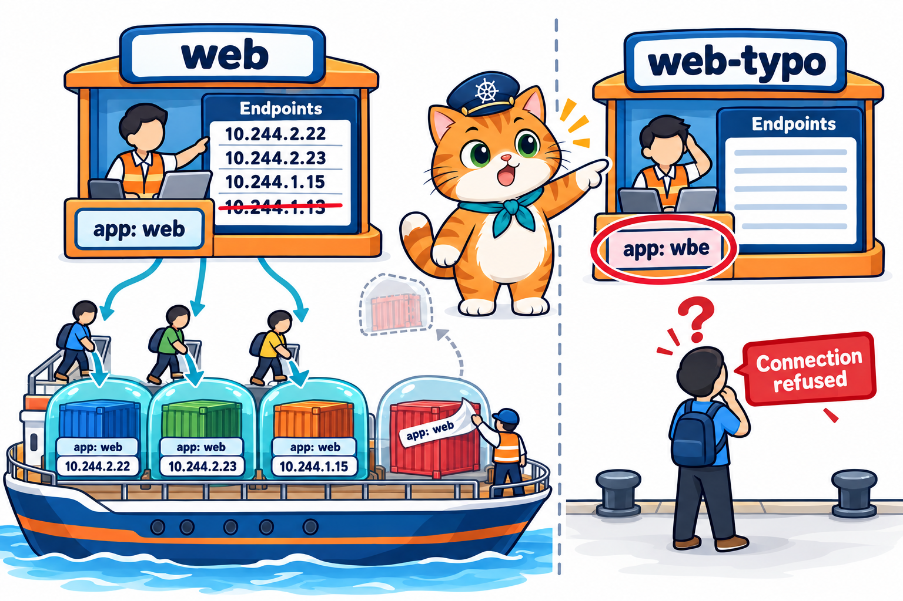
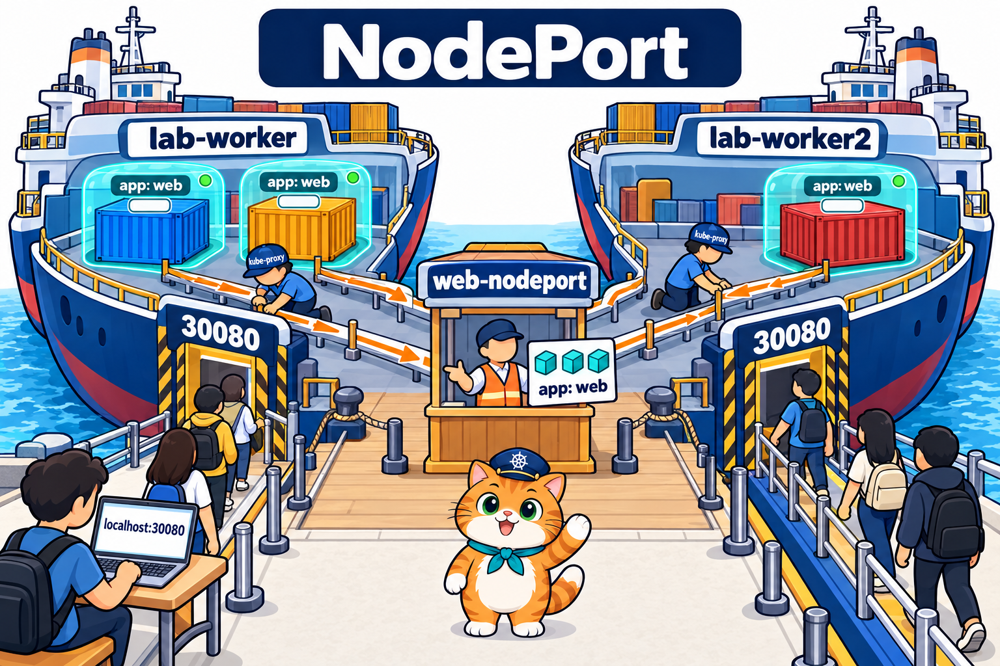
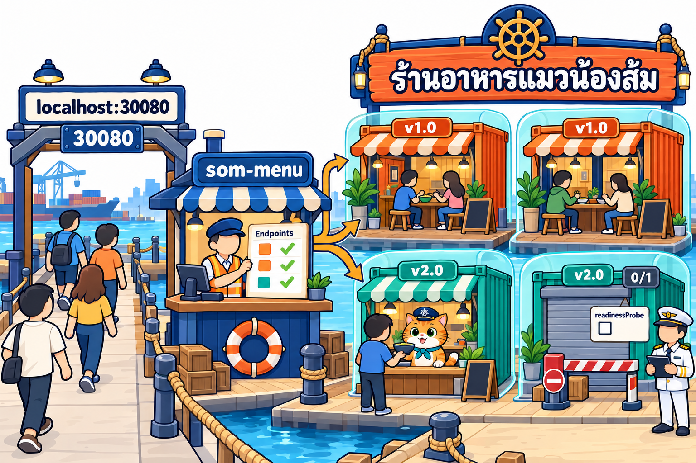
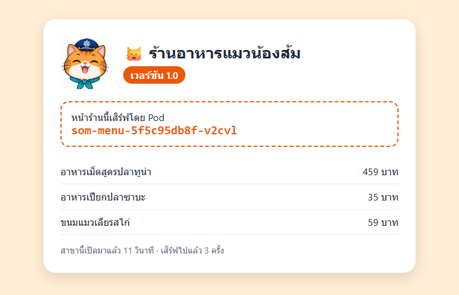
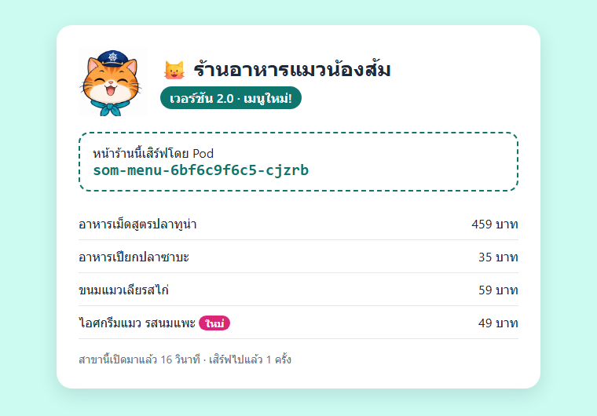
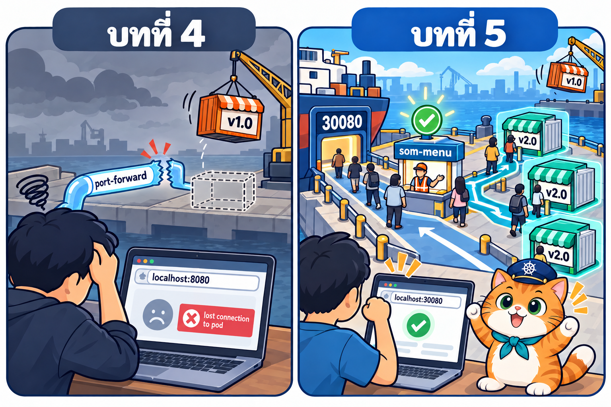

# LAB บทที่ 5: Kubernetes Service — ที่อยู่เดียวของร้านน้องส้ม

> **รายวิชา:** Software Development Tools and Environments (DevTools)
> **หัวข้อ:** ปฏิบัติการ Kubernetes Service — ClusterIP, selector และ Endpoints, ชื่อ Service กับ DNS, NodePort และร้านน้องส้มที่มีที่อยู่เดียวแม้ Deployment จะเปลี่ยนรุ่น
> **ผลลัพธ์การเรียนรู้ที่เกี่ยวข้อง:** CLO-5, CLO-6
> **ทฤษฎีประกอบ:** [01_Theory/README.md](../01_Theory/README.md)

---

## บทนำ

ทุก LAB ทำ **ใน container `k8s-lab`** (image `tuchsanai/devtools-kind:2569_1` มี kubectl, kind, helm, k9s และ Docker ข้างในครบ) บทที่แล้ว LAB 4 จบด้วยปัญหาว่า `kubectl port-forward` ต่อท่อเข้า **Pod ได้ทีละตัว** และท่อ **หลุดทุกครั้ง** (`lost connection to pod`) ที่ Deployment เปลี่ยนรุ่นแล้ว Pod ตัวนั้นถูกปิด บทนี้ให้ **Service** เป็น **ที่อยู่เดียว** ของ Pod ทั้งกลุ่ม ตั้งแต่ Service แรกที่เรียกด้วยชื่อจากในคลัสเตอร์ ดูว่า Service หา Pod จากป้ายอย่างไร เปิดประตู NodePort ให้ browser บนเครื่องเราเข้าได้ จนถึงให้ **"ร้านอาหารแมวน้องส้ม"** มีที่อยู่เดียว `http://localhost:30080` ที่กระจายลูกค้าไปทุกสาขา และไม่หลุดแม้ร้านจะเปลี่ยนเมนูเป็นเวอร์ชัน 2.0

> บล็อก **Expected output** คือผลที่ควรเห็นหลังรันคำสั่ง (ไม่ต้องพิมพ์ตาม) มาจากการทดลองจริงเมื่อ 18 ต.ค. 2569 (kind v0.33.0, kubectl v1.37.1, Kubernetes v1.37.0) **ชื่อ Pod, IP ของ Pod และ CLUSTER-IP ของ Service ถูกสุ่มทุกครั้ง** (เช่น `web-65b66cc75b-8wgnn`, `10.244.2.18`, `10.96.39.117`) และ **Pod ที่ตอบในแต่ละครั้งก็สุ่ม** ค่าในเครื่องนักศึกษาจะต่างไป เป็นเรื่องปกติ

| สัญลักษณ์ | รันที่ไหน |
|---|---|
| 🖥️ | Terminal/PowerShell บนเครื่องนักศึกษา |
| 🐧 | SSH session ใน k8s-lab (prompt `root@k8s-lab`) |
| 🌐 | browser บนเครื่องนักศึกษา |

### กติกา

- ทำงานในโฟลเดอร์ `/workspace/DevTools/05_kubernetes/005_kubernetes_Service/02_LAB` และ **ลบ Service และ Deployment ของตัวเองทุกครั้งที่จบ LAB**
- **ชื่อ Pod, IP ของ Pod และ IP ของ Node ในเครื่องแต่ละคนไม่เหมือนกัน** คำสั่งที่มี `# ← เปลี่ยนเป็น ... ของตัวเอง` ให้แทนด้วยค่าที่เห็นจาก `kubectl get pods -o wide` หรือ `kubectl get nodes -o wide` ในเครื่องตัวเอง
- บทนี้ **ไม่ใช้ port-forward และไม่ต้องใช้ VS Code แล้ว** เข้าถึงแอปผ่าน Service แบบ **ClusterIP** (จากในคลัสเตอร์) และ **NodePort** (จากนอกคลัสเตอร์ ที่ `http://localhost:30080`) เท่านั้น (Ingress และ LoadBalancer ไม่อยู่ในบทนี้)

## สารบัญ LAB

| LAB | ชื่อ | เวลาโดยประมาณ | ความยาก |
|:---:|---|:---:|:---:|
| 0 | [เตรียมสภาพแวดล้อม (Setup)](#lab-0-เตรียมสภาพแวดล้อม-setup) (container `k8s-lab` ที่เปิด port NodePort + คลัสเตอร์ + git clone) | 20–30 นาที | ⭐ |
| 1 | [Service แรก (ClusterIP)](#lab-1-service-แรก-clusterip) | 25 นาที | ⭐⭐ |
| 2 | [Service หา Pod จากป้าย](#lab-2-service-หา-pod-จากป้าย) | 25 นาที | ⭐⭐⭐ |
| 3 | [NodePort: เปิดประตูให้คนนอกคลัสเตอร์](#lab-3-nodeport-เปิดประตูให้คนนอกคลัสเตอร์) | 20 นาที | ⭐⭐⭐ |
| 4 | [LAB สุดท้าย: ร้านน้องส้มมีที่อยู่เดียว](#lab-4-lab-สุดท้าย-ร้านน้องส้มมีที่อยู่เดียว) | 45–60 นาที | ⭐⭐⭐⭐⭐ |
| – | [เก็บกวาดหลังจบบท](#เก็บกวาดหลังจบบท) · [สรุปคำสั่ง kubectl ในบทนี้](#สรุปคำสั่ง-kubectl-ในบทนี้) | | |

รวมประมาณ 2.5–3 ชั่วโมง (เครื่องช้าหรือเน็ตช้าอาจนานกว่านี้ เพราะต้องดึง image จาก Docker Hub)

### สารบัญรูปภาพ

| รูปที่ | เรื่อง | รูปที่ | เรื่อง |
|:---:|---|:---:|---|
| 1 | [LAB 0 Setup container และคลัสเตอร์](#fig-1) | 7 | [LAB 4 บูธ som-menu ส่งลูกค้าเฉพาะสาขาที่พร้อม](#fig-7) |
| 2 | [LAB 0 git clone](#fig-2) | 8 | [ภาพหน้าจอจริง: หน้าร้านเวอร์ชัน 1.0 สาขาแรก](#fig-8) |
| 3 | [LAB 1 Service ClusterIP และชื่อใน DNS](#fig-3) | 9 | [ภาพหน้าจอจริง: refresh แล้วได้อีกสาขา](#fig-9) |
| 4 | [LAB 2 Endpoints ตามป้าย และ selector พิมพ์ผิด](#fig-4) | 10 | [ภาพหน้าจอจริง: แค่ refresh ก็ได้เวอร์ชัน 2.0](#fig-10) |
| 5 | [LAB 3 NodePort ประตู 30080 บนทุก Node](#fig-5) | 11 | [บทที่ 4 ท่อหลุด เทียบกับบทที่ 5 ที่อยู่เดียว](#fig-11) |
| 6 | [ภาพหน้าจอจริง: nginx ผ่าน NodePort](#fig-6) | | |

### โครงสร้างไฟล์ LAB

```text
02_LAB/
├── README.md                     ← เอกสารนี้
├── images/                       ← ภาพประกอบ + screenshots/ ภาพหน้าจอจริง
├── labs/
│   ├── lab01-clusterip/{web-deploy,web-svc,client-pod}.yaml   ← ใช้ใน LAB 1, 2 (web-deploy ใช้ใน LAB 3 ด้วย)
│   ├── lab02-selector/web-svc-typo.yaml                       ← ใช้ใน LAB 2
│   └── lab03-nodeport/web-svc-nodeport.yaml                   ← ใช้ใน LAB 3
└── som-menu/
    ├── app/                      ← เว็บหน้าร้าน Node.js (server.js + Dockerfile)
    └── k8s/{som-menu-deploy,som-menu-deploy-v2,som-menu-svc}.yaml
```

---

## LAB 0: เตรียมสภาพแวดล้อม (Setup)

**เป้าหมาย:** สร้าง container `k8s-lab` **ที่เปิด port NodePort `30080–30082` ออกมาถึงเครื่องนักศึกษา** และคลัสเตอร์ kind ชื่อ `lab` (1 control-plane + 2 worker) แล้วดึงไฟล์ LAB มาไว้ใน container (รายละเอียดของแต่ละคำสั่งดูได้จาก [LAB บทที่ 1](../../001_kubernetes-introduction/02_LAB/readme.md))

**ต้องมี:** Docker Desktop (Linux containers, RAM อย่างน้อย 4 GB) และ SSH client

> **ถ้ายังมี container `k8s-lab` จากบทก่อน:** container นั้นสร้างโดย **ไม่มี** `-p 30080-30082:30080-30082` จึงเปิด NodePort จาก browser บนเครื่องไม่ได้ (เพิ่ม port ให้ container ที่สร้างไปแล้วไม่ได้) ให้ลบทิ้งแล้วสร้างใหม่ตามขั้นที่ 1 ด้วย 🖥️ `docker rm -f k8s-lab` ไม่ต้องกังวล ไฟล์ LAB ได้จาก git clone ใหม่ในขั้นที่ 2 และคลัสเตอร์สร้างใหม่ได้ด้วย `k8s-up` (ถ้ามีงานของตัวเองเก็บไว้ใน container ให้คัดลอกออกมาก่อน)

### ขั้นที่ 1: Setup container และคลัสเตอร์

<p align="center" id="fig-1">
  <br>
  <em><b>รูปที่ 1</b> LAB0 ขั้นที่ 1: (1) docker run สร้าง container k8s-lab (2) ssh -p 2223 เข้าไปข้างใน (3) รัน k8s-up สร้าง kind cluster ชื่อ lab ได้ 3 node Ready (control-plane 1 ตัว + worker 2 ตัว)</em>
</p>

**1) สร้าง container** 🖥️ **บนเครื่องนักศึกษา** (image ประมาณ 1.5 GB ครั้งแรกใช้เวลาหลายนาที)

```bash
docker pull tuchsanai/devtools-kind:2569_1
```

```bash
docker run -dit --name k8s-lab --hostname k8s-lab --privileged -p 2223:22 -p 8889:8888 -p 30080-30082:30080-30082 tuchsanai/devtools-kind:2569_1
```

- `--privileged` ให้รัน Docker ซ้อนใน container ได้ (kind ต้องใช้) **ขาดไม่ได้**
- `-p 2223:22` เปิดทาง SSH เข้า container ผ่าน port `2223`
- `-p 8889:8888` เปิด JupyterLab ที่ `http://localhost:8889/lab` (ทางเลือก)
- `-p 30080-30082:30080-30082` **ใหม่ในบทนี้** เปิด port `30080`, `30081`, `30082` ของ container ออกมาที่เครื่องนักศึกษา เป็นทางให้ browser เข้าถึง Service แบบ **NodePort** ใน LAB 3–4 (`http://localhost:30080`)

หลัง `docker run` **รอสัก 5–10 วินาที** ให้ container เริ่ม sshd และ dockerd ข้างในให้เสร็จก่อน

**2) SSH เข้า container** 🖥️ ครั้งแรกพิมพ์ `yes` แล้วใส่รหัสผ่าน `passwd`

```bash
ssh -p 2223 root@localhost
```

**3) สร้างและตรวจคลัสเตอร์** 🐧 **ใน SSH session ของ k8s-lab** (prompt `root@k8s-lab:~#`)

```bash
time k8s-up
```

**Expected output** (ตัดเฉพาะส่วนสำคัญ)

<pre>
...
[k8s-up] cluster 'lab' พร้อมใช้งาน (kubectl context: kind-lab)
...
  NodePort ที่ map ออก host: 30080 30081 30082

real	0m34.846s
</pre>

`k8s-up` สร้างคลัสเตอร์ใช้เวลาราว 30 วินาที – 1 นาที บรรทัด **`NodePort ที่ map ออก host: 30080 30081 30082`** ที่บทก่อน ๆ ข้ามไป บทนี้ใช้จริงแล้ว: คลัสเตอร์ `lab` เปิด port 30080–30082 ของ Node ออกมาที่ container `k8s-lab` และ `-p 30080-30082:30080-30082` ตอน `docker run` ต่อออกมาถึงเครื่องเราอีกชั้น

```bash
kubectl get nodes
```

**Expected output**

<pre>
NAME                STATUS   ROLES           AGE   VERSION
lab-control-plane   Ready    control-plane   28s   v1.37.0
lab-worker          Ready    &lt;none&gt;          12s   v1.37.0
lab-worker2         Ready    &lt;none&gt;          12s   v1.37.0
</pre>

```bash
kubectl get pods -A
```

**Expected output**

<pre>
NAMESPACE            NAME                                        READY   STATUS    RESTARTS   AGE
kube-system          coredns-559f6c778d-c4rvk                    1/1     Running   0          25s
kube-system          coredns-559f6c778d-ns75j                    1/1     Running   0          25s
kube-system          etcd-lab-control-plane                      1/1     Running   0          33s
kube-system          kindnet-jd98m                               1/1     Running   0          25s
kube-system          kindnet-nlmxt                               1/1     Running   0          20s
kube-system          kindnet-qf5f2                               1/1     Running   0          20s
kube-system          kube-apiserver-lab-control-plane            1/1     Running   0          34s
kube-system          kube-controller-manager-lab-control-plane   1/1     Running   0          33s
kube-system          kube-proxy-87c4n                            1/1     Running   0          20s
kube-system          kube-proxy-cpx9d                            1/1     Running   0          20s
kube-system          kube-proxy-vwlmj                            1/1     Running   0          25s
kube-system          kube-scheduler-lab-control-plane            1/1     Running   0          34s
local-path-storage   local-path-provisioner-75f7fc7dc5-b9l5l     1/1     Running   0          25s
</pre>

ถ้า `coredns` บางตัวยังเป็น `0/1` ให้รอสัก 10 วินาที แล้วสั่งซ้ำ บทนี้มี 2 กลุ่มที่ทำงานให้ Service

- **`kube-proxy`** มี **3 ตัว = 1 ตัวต่อ Node** ทำหน้าที่วางเส้นทางบนทุก Node ว่าลูกค้าที่เรียก Service จะถูกส่งต่อไป Pod ไหน
- **`coredns`** คือ **สมุดรายชื่อ** (DNS) ของคลัสเตอร์ แปลงชื่อ Service เช่น `web` เป็นที่อยู่ IP

```bash
kubectl get svc -A
```

**Expected output**

<pre>
NAMESPACE     NAME         TYPE        CLUSTER-IP   EXTERNAL-IP   PORT(S)                  AGE
default       kubernetes   ClusterIP   10.96.0.1    &lt;none&gt;        443/TCP                  26s
kube-system   kube-dns     ClusterIP   10.96.0.10   &lt;none&gt;        53/UDP,53/TCP,9153/TCP   25s
</pre>

(`svc` คือชื่อย่อของ `service`) คลัสเตอร์ใหม่ก็มี Service อยู่แล้ว 2 ตัว

- `kubernetes` = ที่อยู่ของ API server สำหรับโปรแกรมที่รันใน Pod
- **`kube-dns`** = Service ของ `coredns` ที่ **`10.96.0.10`** port 53 **จำเลขนี้ไว้** จะเจออีกใน LAB 1

> **✅ ผ่านเมื่อ:** node 3 ตัว `Ready`, Pod ระบบทุกตัวเป็น `1/1 Running` และเห็น Service `kube-dns`

### ขั้นที่ 2: git clone ไฟล์ LAB

<p align="center" id="fig-2">
  <br>
  <em><b>รูปที่ 2</b> LAB0 ขั้นที่ 2: git clone ดึง repo DevTools มาไว้ที่ /workspace/DevTools ใน k8s-lab แล้ว cd ลงไปจนถึงโฟลเดอร์ 02_LAB ของบทที่ 5 ที่มี labs และ som-menu</em>
</p>

🐧 **ใน SSH session ของ k8s-lab**

```bash
cd /workspace
```

```bash
git clone https://github.com/Tuchsanai/DevTools.git
```

ถ้าเคย clone ไว้แล้วใน container นี้ จะขึ้นว่า `already exists` ให้ `cd DevTools` แล้ว `git pull` แทน จากนั้น `cd /workspace`

```bash
cd DevTools/05_kubernetes/005_kubernetes_Service/02_LAB
```

> **✅ ผ่านเมื่อ:** prompt เป็น `root@k8s-lab:/workspace/DevTools/05_kubernetes/005_kubernetes_Service/02_LAB#` ทุกคำสั่งที่อ้าง `labs/...` หรือ `som-menu/...` ต้องรันจากโฟลเดอร์นี้

---

## LAB 1: Service แรก (ClusterIP)

<p align="center" id="fig-3">
  <br>
  <em><b>รูปที่ 3</b> LAB1: (1) ลูกค้าจาก Pod client ถามสมุดรายชื่อ (DNS) ว่า web อยู่ที่ไหน ได้ 10.96.39.117 (2) ไปที่บูธต้อนรับ web ที่มีป้ายชื่อและที่อยู่คงที่ พนักงานต้อนรับ (Service) ถือกระดาน Endpoints รายชื่อ IP ของ Pod ที่ป้ายตรง selector app=web (3) ส่งลูกค้าไป Pod 3 กล่องบนเรือ lab-worker และ lab-worker2 สลับกัน</em>
</p>

**เป้าหมาย:** สร้าง Pod nginx 3 ตัวด้วย Deployment แล้วสร้าง Service แบบ ClusterIP เป็นที่อยู่เดียวของทั้ง 3 ตัว เรียกด้วยชื่อ `web` จาก Pod อีกตัวในคลัสเตอร์ ดูว่า Service กระจายงาน และชื่อ `web` แปลงเป็น IP ได้อย่างไร

🐧 **ใน SSH session ของ k8s-lab** (ทุกขั้นใน LAB 1–3)

### ขั้นที่ 1: Pod nginx 3 ตัวที่บอกชื่อตัวเอง

ไฟล์ `labs/lab01-clusterip/web-deploy.yaml`

```yaml
# LAB 1, 2, 3: เว็บ nginx 3 Pod ที่บอกชื่อ Pod ของตัวเองบนหน้าเว็บ — ไว้ดูว่า Service ส่งลูกค้าไป Pod ไหน
apiVersion: apps/v1
kind: Deployment
metadata:
  name: web
spec:
  replicas: 3
  selector:
    matchLabels:
      app: web
  template:
    metadata:
      labels:
        app: web                 # ← ป้ายนี้แหละที่ Service ใช้หา Pod
    spec:
      containers:
        - name: nginx
          image: nginx:1.27-alpine
          command: ["/bin/sh", "-c"]   # เปลี่ยนคำสั่งเริ่มต้น (บทที่ 2): เขียนหน้าเว็บก่อน แล้วค่อยเปิด nginx
          args:
            - echo "Hello from Pod $(hostname)" > /usr/share/nginx/html/index.html && exec nginx -g "daemon off;"
          ports:
            - containerPort: 80
```

ทำงานอย่างไร

- เป็น Deployment แบบบทที่ 4: ชื่อ `web`, ขอ Pod 3 ตัว, ป้าย **`app: web`** (ป้ายนี้คือสิ่งที่ Service จะใช้หา Pod)
- `command` + `args` (เรื่องเดียวกับบทที่ 2) เปลี่ยนคำสั่งเริ่มต้นของ container ให้ shell ทำ 2 อย่างต่อกัน: เขียนหน้าเว็บ `Hello from Pod <ชื่อ Pod>` (`$(hostname)` ใน Pod = ชื่อ Pod) แล้วค่อยเปิด nginx
- หน้าเว็บของแต่ละ Pod จึงต่างกัน เราจะรู้ได้ทันทีว่า **Pod ไหนเป็นคนตอบ**

```bash
kubectl apply -f labs/lab01-clusterip/web-deploy.yaml
```

**Expected output**

<pre>
deployment.apps/web created
</pre>

รอสัก 10 วินาที แล้วดู Pod พร้อม IP

```bash
kubectl get pods -o wide
```

**Expected output**

<pre>
NAME                   READY   STATUS    RESTARTS   AGE   IP            NODE          NOMINATED NODE   READINESS GATES
web-65b66cc75b-8wgnn   1/1     Running   0          10s   10.244.2.18   lab-worker    &lt;none&gt;           &lt;none&gt;
web-65b66cc75b-9nnn8   1/1     Running   0          10s   10.244.2.19   lab-worker    &lt;none&gt;           &lt;none&gt;
web-65b66cc75b-ktpwd   1/1     Running   0          10s   10.244.1.12   lab-worker2   &lt;none&gt;           &lt;none&gt;
</pre>

Pod 3 ตัว **IP คนละอัน** อยู่บนเรือ 2 ลำ ถ้าโปรแกรมอื่นอยากเรียกเว็บนี้ จะจำ IP ตัวไหน และถ้า Pod ถูกลบ IP ก็เปลี่ยน นี่คือปัญหาที่ Service แก้

### ขั้นที่ 2: สร้าง Service

ไฟล์ `labs/lab01-clusterip/web-svc.yaml`

```yaml
# LAB 1, 2: Service แรก (ClusterIP) — ที่อยู่เดียวของ Pod ทุกตัวที่ติดป้าย app=web ใช้ได้เฉพาะในคลัสเตอร์
apiVersion: v1               # Service อยู่กลุ่มหลัก v1 เหมือน Pod
kind: Service
metadata:
  name: web                  # ชื่อ Service = ชื่อที่ Pod อื่นใช้เรียก เช่น http://web
spec:
  type: ClusterIP            # ค่าเริ่มต้น: ได้ IP ภายในคลัสเตอร์ 1 อันที่ไม่เปลี่ยน
  selector:
    app: web                 # ส่งงานให้ Pod ที่มีป้ายนี้ (ไม่มี matchLabels แบบ ReplicaSet)
  ports:
    - port: 80               # port ของ Service (คนเรียกใช้ port นี้)
      targetPort: 80         # port ของ container ใน Pod ที่จะส่งต่อไป
```

ทำงานอย่างไร

- `kind: Service` ชื่อ **`web`** = ชื่อนี้คือที่อยู่ที่ Pod อื่นใช้เรียก (`http://web`)
- `type: ClusterIP` = ได้ **IP ภายในคลัสเตอร์ 1 อัน ที่ไม่เปลี่ยน** ตลอดอายุของ Service (เรียกได้เฉพาะจากในคลัสเตอร์)
- `selector: app: web` = ส่งงานให้ **ทุก Pod ที่มีป้าย `app=web`** (เขียนป้ายตรง ๆ ไม่มี `matchLabels` แบบ ReplicaSet)
- `port: 80` คือ port ที่คนเรียกใช้ ส่วน `targetPort: 80` คือ port ของ container ที่ Service ส่งต่อไป (LAB 4 สองค่านี้จะไม่เท่ากัน)
- Service ไม่ได้สร้าง Pod เลย และไม่ใช่เจ้าของ Pod มันแค่ **หา Pod จากป้าย** แล้วส่งงานให้

```bash
kubectl apply -f labs/lab01-clusterip/web-svc.yaml
```

**Expected output**

<pre>
service/web created
</pre>

```bash
kubectl get svc
```

**Expected output**

<pre>
NAME         TYPE        CLUSTER-IP     EXTERNAL-IP   PORT(S)   AGE
kubernetes   ClusterIP   10.96.0.1      &lt;none&gt;        443/TCP   6m28s
web          ClusterIP   10.96.39.117   &lt;none&gt;        80/TCP    0s
</pre>

Service `web` ได้ **`CLUSTER-IP 10.96.39.117`** (ขึ้นต้น `10.96.` เหมือน `kube-dns` ใน LAB 0 คนละช่วงกับ IP ของ Pod ที่ขึ้นต้น `10.244.`) และเปิด port `80/TCP`

### ขั้นที่ 3: Service ส่งงานให้ใคร (Endpoints)

```bash
kubectl describe svc web
```

**Expected output**

<pre>
Name:                     web
Namespace:                default
Labels:                   &lt;none&gt;
Annotations:              &lt;none&gt;
Selector:                 app=web
Type:                     ClusterIP
IP Family Policy:         SingleStack
IP Families:              IPv4
IP:                       10.96.39.117
IPs:                      10.96.39.117
Port:                     &lt;unset&gt;  80/TCP
TargetPort:               80/TCP
Endpoints:                10.244.2.18:80,10.244.1.12:80,10.244.2.19:80
Session Affinity:         None
Internal Traffic Policy:  Cluster
Events:                   &lt;none&gt;
</pre>

- `Selector: app=web` = หา Pod จากป้ายนี้
- `IP: 10.96.39.117` = ที่อยู่คงที่ของ Service
- **`Endpoints`** = รายชื่อ **IP:port ของ Pod ที่ Service จะส่งงานให้** เทียบกับ `kubectl get pods -o wide` ในขั้นที่ 1: `10.244.2.18`, `10.244.2.19`, `10.244.1.12` ตรงกับ Pod ทั้ง 3 ตัว (ลำดับไม่สำคัญ)

Kubernetes เก็บรายชื่อนี้ไว้ใน object ชื่อ **EndpointSlice** ดูได้โดยตรง

```bash
kubectl get endpointslices
```

**Expected output**

<pre>
NAME         ADDRESSTYPE   PORTS   ENDPOINTS                             AGE
kubernetes   IPv4          6443    172.19.0.2                            6m28s
web-9fqdm    IPv4          80      10.244.2.18,10.244.1.12,10.244.2.19   0s
</pre>

EndpointSlice `web-9fqdm` (ชื่อ Service + ตัวอักษรสุ่ม) ถูกสร้างให้เองพร้อม Service มี IP ของ Pod ทั้ง 3 ตัว เราไม่ต้องเขียนรายชื่อนี้เอง

### ขั้นที่ 4: Pod ลูกค้า

Service แบบ ClusterIP เรียกได้จาก **ในคลัสเตอร์** เท่านั้น จึงต้องมี Pod ไว้เป็นลูกค้า ไฟล์ `labs/lab01-clusterip/client-pod.yaml`

```yaml
# LAB 1, 2: Pod ลูกค้า — busybox ที่นอนรอเฉย ๆ ให้เรา exec เข้าไปเรียก Service จากในคลัสเตอร์
apiVersion: v1
kind: Pod
metadata:
  name: client
spec:
  containers:
    - name: busybox
      image: busybox:1.37
      command: ["sleep", "3600"]   # นอนรอ 1 ชั่วโมง (มี wget และ nslookup ให้ใช้)
```

ทำงานอย่างไร

- Pod เดี่ยวชื่อ `client` จาก image `busybox` (Linux ตัวเล็กที่มีคำสั่งพื้นฐาน เช่น `wget` และ `nslookup`)
- `command: ["sleep", "3600"]` = ไม่ทำอะไร แค่นอนรอ 1 ชั่วโมง ให้เรา `kubectl exec` เข้าไปสั่งคำสั่งได้
- **ไม่มีป้าย `app: web`** Service `web` จึงไม่ส่งงานให้ Pod นี้

```bash
kubectl apply -f labs/lab01-clusterip/client-pod.yaml
```

**Expected output**

<pre>
pod/client created
</pre>

รอสัก 10 วินาที

```bash
kubectl get pods
```

**Expected output**

<pre>
NAME                   READY   STATUS    RESTARTS   AGE
client                 1/1     Running   0          8s
web-65b66cc75b-8wgnn   1/1     Running   0          18s
web-65b66cc75b-9nnn8   1/1     Running   0          18s
web-65b66cc75b-ktpwd   1/1     Running   0          18s
</pre>

### ขั้นที่ 5: เรียก Service ด้วยชื่อ

```bash
kubectl exec client -- wget -qO- http://web
```

- `kubectl exec client -- <คำสั่ง>` = รันคำสั่งใน Pod `client` (บทที่ 2)
- `wget -qO- <url>` = ดึงหน้าเว็บแล้วพิมพ์ออกจอ (`-q` ไม่พิมพ์ความคืบหน้า, `-O-` เขียนผลออกจอ)

**สั่งซ้ำ 6 ครั้ง** (กดลูกศรขึ้นแล้ว Enter)

**Expected output** (ผลของทั้ง 6 ครั้งต่อกัน)

<pre>
Hello from Pod web-65b66cc75b-ktpwd
Hello from Pod web-65b66cc75b-8wgnn
Hello from Pod web-65b66cc75b-ktpwd
Hello from Pod web-65b66cc75b-ktpwd
Hello from Pod web-65b66cc75b-ktpwd
Hello from Pod web-65b66cc75b-9nnn8
</pre>

- เรียกที่อยู่เดียว `http://web` แต่ **ชื่อ Pod ที่ตอบเปลี่ยนไปมา** ครบทั้ง 3 ตัว = Service **กระจายงาน** ให้ Pod ใน Endpoints
- Service เลือก Pod แบบสุ่ม ไม่ได้วนตามลำดับ จึงอาจได้ตัวเดิมซ้ำหลายครั้ง (ตัวอย่างนี้ `ktpwd` ได้ 4 ครั้ง)

### ขั้นที่ 6: ชื่อ web มาจากไหน (DNS)

ชื่อ `web` เป็นชื่อย่อ ชื่อเต็มของ Service คือ `<ชื่อ Service>.<namespace>.svc.cluster.local`

```bash
kubectl exec client -- wget -qO- http://web.default.svc.cluster.local
```

**Expected output**

<pre>
Hello from Pod web-65b66cc75b-8wgnn
</pre>

ได้ผลเหมือนกัน (`default` คือ namespace ที่เราสร้าง Service ไว้) แล้วใครแปลงชื่อเป็นที่อยู่ ถามสมุดรายชื่อด้วย `nslookup`

```bash
kubectl exec client -- nslookup web.default.svc.cluster.local
```

**Expected output**

<pre>
Server:		10.96.0.10
Address:	10.96.0.10:53


Name:	web.default.svc.cluster.local
Address: 10.96.39.117

</pre>

- `Server: 10.96.0.10` = ผู้ตอบคือ **`kube-dns`** (CoreDNS) ที่เห็นใน `kubectl get svc -A` ของ LAB 0
- `Address: 10.96.39.117` = ตรงกับ **CLUSTER-IP** ของ Service `web` ในขั้นที่ 2
- ลำดับจริงคือ `http://web` → DNS แปลงเป็น `10.96.39.117` → kube-proxy บน Node ส่งต่อไป Pod ตัวใดตัวหนึ่งใน Endpoints

### ขั้นที่ 7: เรียก Pod ด้วย IP ตรง ๆ ได้ไหม

เลือก IP ของ Pod มา 1 ตัวจาก `kubectl get pods -o wide` ในขั้นที่ 1

```bash
kubectl exec client -- wget -qO- http://10.244.2.18    # ← เปลี่ยนเป็น IP ของ Pod web ตัวหนึ่งของตัวเอง
```

**Expected output**

<pre>
Hello from Pod web-65b66cc75b-8wgnn
</pre>

ดูอีกครั้งว่า IP นี้เป็นของ Pod ไหน (`-l app=web` = เลือกเฉพาะ Pod ที่มีป้าย `app=web` จึงไม่มี `client`)

```bash
kubectl get pods -l app=web -o wide
```

**Expected output**

<pre>
NAME                   READY   STATUS    RESTARTS   AGE   IP            NODE          NOMINATED NODE   READINESS GATES
web-65b66cc75b-8wgnn   1/1     Running   0          19s   10.244.2.18   lab-worker    &lt;none&gt;           &lt;none&gt;
web-65b66cc75b-9nnn8   1/1     Running   0          19s   10.244.2.19   lab-worker    &lt;none&gt;           &lt;none&gt;
web-65b66cc75b-ktpwd   1/1     Running   0          19s   10.244.1.12   lab-worker2   &lt;none&gt;           &lt;none&gt;
</pre>

`10.244.2.18` คือ `web-65b66cc75b-8wgnn` เรียกด้วย IP ของ Pod **ได้** แต่ได้ Pod ตัวเดียวทุกครั้ง และ IP นี้จะหายไปเมื่อ Pod ถูกลบหรือเปลี่ยนรุ่น (LAB 2 จะเห็น) งานจริงจึงเรียกด้วย **ชื่อ Service** เสมอ

### ขั้นที่ 8: ลบทุกอย่างของ LAB 1

`kubectl delete -f` ใส่ชื่อ **โฟลเดอร์** ได้ จะลบทุกอย่างจากทุกไฟล์ในโฟลเดอร์นั้นในคำสั่งเดียว

```bash
kubectl delete -f labs/lab01-clusterip/
```

**Expected output**

<pre>
pod "client" deleted from default namespace
deployment.apps "web" deleted from default namespace
service "web" deleted from default namespace
</pre>

คำสั่งนี้ **ค้างราว 30 วินาที** เพราะ `sleep` ใน Pod `client` ไม่ตอบสัญญาณขอปิด (SIGTERM) Kubernetes จึงรอครบเวลาผ่อนผัน 30 วินาทีแล้วบังคับปิด รอสัก 5 วินาที

```bash
kubectl get svc
```

**Expected output**

<pre>
NAME         TYPE        CLUSTER-IP   EXTERNAL-IP   PORT(S)   AGE
kubernetes   ClusterIP   10.96.0.1    &lt;none&gt;        443/TCP   7m14s
</pre>

```bash
kubectl get pods
```

**Expected output**

<pre>
No resources found in default namespace.
</pre>

### สิ่งที่เห็น

- Service `web` (ClusterIP) ได้ **ที่อยู่คงที่** 1 อัน (`CLUSTER-IP`) และ **ชื่อ** `web` ที่ Pod อื่นใช้เรียกได้
- Service หา Pod จาก `selector` (ป้าย `app=web`) แล้วเก็บรายชื่อ IP ของ Pod ไว้ใน **Endpoints** (EndpointSlice)
- เรียก `http://web` หลายครั้ง → Pod ที่ตอบสลับกันไป = Service กระจายงาน
- ชื่อ `web` แปลงเป็น `CLUSTER-IP` ได้ด้วย **DNS ของคลัสเตอร์** (`kube-dns` ที่ `10.96.0.10`) ชื่อเต็มคือ `web.default.svc.cluster.local`

> **🤔 คำถามชวนคิด:** ถ้ารัน `kubectl delete -f labs/lab01-clusterip/web-svc.yaml` แล้ว apply ใหม่ CLUSTER-IP จะเท่าเดิมไหม แล้ว Pod `client` ที่เรียกด้วยชื่อ `http://web` ต้องแก้อะไรหรือเปล่า (ลองสังเกตใน LAB 2)

---

## LAB 2: Service หา Pod จากป้าย

<p align="center" id="fig-4">
  <br>
  <em><b>รูปที่ 4</b> LAB2: ซ้าย พนักงานต้อนรับของบูธ web อัปเดตกระดาน Endpoints เอง เมื่อกล่องถูกลบ IP เก่าถูกขีดฆ่าและมี IP ใหม่มาแทน กล่องที่ถูกลอกป้าย app: web ออกจะไม่มีลูกค้าถูกส่งไป ขวา บูธ web-typo ที่ selector พิมพ์ผิดเป็น app: wbe กระดาน Endpoints ว่างเปล่า ลูกค้าได้ Connection refused</em>
</p>

**เป้าหมาย:** ดูว่า Endpoints ของ Service เปลี่ยนตาม Pod เองเมื่อ Pod ถูกลบ ถูกถอดป้าย หรือเพิ่มจำนวน และเจอกับดักที่พบบ่อยที่สุด: พิมพ์ป้ายใน `selector` ผิด

### ขั้นที่ 1: สร้างทุกอย่างจากโฟลเดอร์เดียว

`kubectl apply -f` ใส่ชื่อโฟลเดอร์ได้เหมือน `delete` จะสร้าง Deployment, Service และ Pod client จากไฟล์ทั้ง 3 ใน LAB 1 พร้อมกัน

```bash
kubectl apply -f labs/lab01-clusterip/
```

**Expected output**

<pre>
pod/client created
deployment.apps/web created
service/web created
</pre>

รอสัก 10 วินาที

```bash
kubectl get pods -o wide
```

**Expected output**

<pre>
NAME                   READY   STATUS    RESTARTS   AGE   IP            NODE          NOMINATED NODE   READINESS GATES
client                 1/1     Running   0          12s   10.244.2.21   lab-worker    &lt;none&gt;           &lt;none&gt;
web-65b66cc75b-c96gf   1/1     Running   0          12s   10.244.1.13   lab-worker2   &lt;none&gt;           &lt;none&gt;
web-65b66cc75b-pw5ld   1/1     Running   0          12s   10.244.2.23   lab-worker    &lt;none&gt;           &lt;none&gt;
web-65b66cc75b-wqrqq   1/1     Running   0          12s   10.244.2.22   lab-worker    &lt;none&gt;           &lt;none&gt;
</pre>

```bash
kubectl describe svc web
```

**Expected output** (ตัดเฉพาะส่วนสำคัญ)

<pre>
Name:                     web
...
Selector:                 app=web
Type:                     ClusterIP
...
IP:                       10.96.173.122
...
Endpoints:                10.244.1.13:80,10.244.2.22:80,10.244.2.23:80
...
</pre>

Service สร้างใหม่จึงได้ IP ใหม่ `10.96.173.122` (ไม่ใช่ `10.96.39.117` ของ LAB 1) แต่ชื่อยังเป็น `web` เหมือนเดิม Endpoints มี IP ของ Pod web ทั้ง 3 ตัว (ไม่มี `client` `10.244.2.21` เพราะไม่มีป้าย `app=web`)

### ขั้นที่ 2: ลบ Pod แล้ว Endpoints เปลี่ยนเอง

```bash
kubectl delete pod web-65b66cc75b-c96gf    # ← เปลี่ยนเป็นชื่อ Pod web ตัวหนึ่งของตัวเอง
```

**Expected output**

<pre>
pod "web-65b66cc75b-c96gf" deleted from default namespace
</pre>

รอสัก 5 วินาที

```bash
kubectl get pods -o wide
```

**Expected output**

<pre>
NAME                   READY   STATUS    RESTARTS   AGE   IP            NODE          NOMINATED NODE   READINESS GATES
client                 1/1     Running   0          18s   10.244.2.21   lab-worker    &lt;none&gt;           &lt;none&gt;
web-65b66cc75b-grb46   1/1     Running   0          6s    10.244.1.14   lab-worker2   &lt;none&gt;           &lt;none&gt;
web-65b66cc75b-pw5ld   1/1     Running   0          18s   10.244.2.23   lab-worker    &lt;none&gt;           &lt;none&gt;
web-65b66cc75b-wqrqq   1/1     Running   0          18s   10.244.2.22   lab-worker    &lt;none&gt;           &lt;none&gt;
</pre>

ReplicaSet สร้าง `web-65b66cc75b-grb46` มาแทน (บทที่ 3) และได้ **IP ใหม่ `10.244.1.14`** (ตัวที่ถูกลบคือ `10.244.1.13`)

```bash
kubectl describe svc web
```

**Expected output** (ตัดเฉพาะส่วนสำคัญ)

<pre>
Name:                     web
...
IP:                       10.96.173.122
...
Endpoints:                10.244.2.22:80,10.244.2.23:80,10.244.1.14:80
...
</pre>

`10.244.1.13` หายไป และ `10.244.1.14` เข้ามาแทนใน Endpoints **เอง** ส่วน IP ของ Service (`10.96.173.122`) ไม่เปลี่ยน ลูกค้าที่เรียก `http://web` ไม่ต้องรู้เลยว่า Pod เปลี่ยนตัว

### ขั้นที่ 3: ถอดป้ายออกจาก Pod

`kubectl label pod <ชื่อ> app-` = **ลบป้าย** `app` ออกจาก Pod (ชื่อป้ายตามด้วย `-`) ลองถอดป้ายจาก Pod ที่เพิ่งเกิดใหม่

```bash
kubectl label pod web-65b66cc75b-grb46 app-    # ← เปลี่ยนเป็นชื่อ Pod web ตัวหนึ่งของตัวเอง
```

**Expected output**

<pre>
pod/web-65b66cc75b-grb46 unlabeled
</pre>

รอสัก 5 วินาที

```bash
kubectl get pods -o wide --show-labels
```

**Expected output**

<pre>
NAME                   READY   STATUS    RESTARTS   AGE   IP            NODE          NOMINATED NODE   READINESS GATES   LABELS
client                 1/1     Running   0          23s   10.244.2.21   lab-worker    &lt;none&gt;           &lt;none&gt;            &lt;none&gt;
web-65b66cc75b-grb46   1/1     Running   0          11s   10.244.1.14   lab-worker2   &lt;none&gt;           &lt;none&gt;            pod-template-hash=65b66cc75b
web-65b66cc75b-hkqtr   1/1     Running   0          5s    10.244.1.15   lab-worker2   &lt;none&gt;           &lt;none&gt;            app=web,pod-template-hash=65b66cc75b
web-65b66cc75b-pw5ld   1/1     Running   0          23s   10.244.2.23   lab-worker    &lt;none&gt;           &lt;none&gt;            app=web,pod-template-hash=65b66cc75b
web-65b66cc75b-wqrqq   1/1     Running   0          23s   10.244.2.22   lab-worker    &lt;none&gt;           &lt;none&gt;            app=web,pod-template-hash=65b66cc75b
</pre>

- `grb46` เหลือแค่ป้าย `pod-template-hash` แต่ **ยัง Running** อยู่
- ReplicaSet นับ Pod จากป้าย `app=web` เหลือ 2 ตัว จึงสร้าง `hkqtr` (`10.244.1.15`) มาเติมให้ครบ 3 (เหมือนบทที่ 3)

```bash
kubectl describe svc web
```

**Expected output** (ตัดเฉพาะส่วนสำคัญ)

<pre>
Name:                     web
...
Endpoints:                10.244.2.22:80,10.244.2.23:80,10.244.1.15:80
...
</pre>

`10.244.1.14` (Pod `grb46` ที่ถอดป้าย) **หลุดออกจาก Endpoints** แม้จะยัง Running และ `10.244.1.15` (`hkqtr`) เข้ามาแทน ลองเรียก Service

```bash
kubectl exec client -- wget -qO- http://web
```

**สั่งซ้ำ 4 ครั้ง**

**Expected output** (ผลของทั้ง 4 ครั้งต่อกัน)

<pre>
Hello from Pod web-65b66cc75b-pw5ld
Hello from Pod web-65b66cc75b-hkqtr
Hello from Pod web-65b66cc75b-pw5ld
Hello from Pod web-65b66cc75b-wqrqq
</pre>

ไม่มี `grb46` เลย Service ส่งงานให้ **เฉพาะ Pod ที่ป้ายตรงกับ selector** เท่านั้น ไม่สนว่า Pod จะ Running อยู่หรือมาจาก Deployment ไหน

### ขั้นที่ 4: ลบ Pod ที่ถอดป้าย แล้วเพิ่มเป็น 5 ตัว

Pod `grb46` ไม่มีใครดูแลแล้ว (ReplicaSet ไม่นับ Service ไม่ส่งงาน) ลบทิ้ง

```bash
kubectl delete pod web-65b66cc75b-grb46    # ← เปลี่ยนเป็นชื่อ Pod ที่ถอดป้ายของตัวเอง
```

**Expected output**

<pre>
pod "web-65b66cc75b-grb46" deleted from default namespace
</pre>

```bash
kubectl scale deployment web --replicas=5
```

**Expected output**

<pre>
deployment.apps/web scaled
</pre>

รอสัก 5 วินาที

```bash
kubectl get pods -o wide
```

**Expected output**

<pre>
NAME                   READY   STATUS    RESTARTS   AGE   IP            NODE          NOMINATED NODE   READINESS GATES
client                 1/1     Running   0          31s   10.244.2.21   lab-worker    &lt;none&gt;           &lt;none&gt;
web-65b66cc75b-fqqhb   1/1     Running   0          7s    10.244.1.16   lab-worker2   &lt;none&gt;           &lt;none&gt;
web-65b66cc75b-hkqtr   1/1     Running   0          13s   10.244.1.15   lab-worker2   &lt;none&gt;           &lt;none&gt;
web-65b66cc75b-lxzws   1/1     Running   0          7s    10.244.2.24   lab-worker    &lt;none&gt;           &lt;none&gt;
web-65b66cc75b-pw5ld   1/1     Running   0          31s   10.244.2.23   lab-worker    &lt;none&gt;           &lt;none&gt;
web-65b66cc75b-wqrqq   1/1     Running   0          31s   10.244.2.22   lab-worker    &lt;none&gt;           &lt;none&gt;
</pre>

```bash
kubectl describe svc web
```

**Expected output** (ตัดเฉพาะส่วนสำคัญ)

<pre>
Name:                     web
...
Endpoints:                10.244.2.22:80,10.244.2.23:80,10.244.1.15:80 + 2 more...
...
</pre>

`+ 2 more...` = `describe` แสดงแค่ 3 ตัวแรก แล้วบอกว่ายังมีอีก 2 รวมเป็น **5** ตามจำนวน Pod Pod ใหม่ (`10.244.1.16`, `10.244.2.24`) เข้ารายชื่อเองทันทีที่พร้อม ไม่ต้องแก้ Service เลย

### ขั้นที่ 5: กับดัก — พิมพ์ป้ายใน selector ผิด

ไฟล์ `labs/lab02-selector/web-svc-typo.yaml`

```yaml
# LAB 2: Service ที่พิมพ์ป้ายผิด — selector หา Pod ไม่เจอ จึงไม่มีใครรับงาน
apiVersion: v1
kind: Service
metadata:
  name: web-typo
spec:
  selector:
    app: wbe                 # ← พิมพ์ผิด (ที่ถูกคือ web) ไม่มี Pod ไหนติดป้ายนี้
  ports:
    - port: 80
      targetPort: 80
```

ทำงานอย่างไร

- Service ชื่อ `web-typo` ไม่ได้เขียน `type` จึงเป็น **ClusterIP** (ค่าเริ่มต้น)
- `selector: app: wbe` **พิมพ์สลับตัวอักษร** (ที่ถูกคือ `web`) ไม่มี Pod ไหนติดป้ายนี้

```bash
kubectl apply -f labs/lab02-selector/web-svc-typo.yaml
```

**Expected output**

<pre>
service/web-typo created
</pre>

Kubernetes **ไม่เตือนอะไรเลย** สร้างให้ตามปกติ

```bash
kubectl get svc
```

**Expected output**

<pre>
NAME         TYPE        CLUSTER-IP      EXTERNAL-IP   PORT(S)   AGE
kubernetes   ClusterIP   10.96.0.1       &lt;none&gt;        443/TCP   7m46s
web          ClusterIP   10.96.173.122   &lt;none&gt;        80/TCP    31s
web-typo     ClusterIP   10.96.49.240    &lt;none&gt;        80/TCP    0s
</pre>

`web-typo` ได้ `CLUSTER-IP` และ port ปกติทุกอย่าง ดูจากตรงนี้ไม่รู้เลยว่าผิด

```bash
kubectl describe svc web-typo
```

**Expected output**

<pre>
Name:                     web-typo
Namespace:                default
Labels:                   &lt;none&gt;
Annotations:              &lt;none&gt;
Selector:                 app=wbe
Type:                     ClusterIP
IP Family Policy:         SingleStack
IP Families:              IPv4
IP:                       10.96.49.240
IPs:                      10.96.49.240
Port:                     &lt;unset&gt;  80/TCP
TargetPort:               80/TCP
Endpoints:                
Session Affinity:         None
Internal Traffic Policy:  Cluster
Events:                   &lt;none&gt;
</pre>

**`Endpoints:` ว่างเปล่า** = selector `app=wbe` หา Pod ไม่เจอสักตัว ลองเรียกดู

```bash
kubectl exec client -- wget -qO- http://web-typo
```

**Expected output**

<pre>
wget: can't connect to remote host (10.96.49.240): Connection refused
command terminated with exit code 1
</pre>

ชื่อ `web-typo` แปลงเป็น IP `10.96.49.240` ได้ (DNS ทำงาน) แต่ไม่มี Pod ให้ส่งต่อ จึงได้ **`Connection refused`** เวลาเรียก Service แล้วต่อไม่ได้ ให้ตรวจ **Endpoints** ด้วย `kubectl describe svc` เป็นอย่างแรก ถ้าว่าง = selector ไม่ตรงกับป้ายของ Pod

### ขั้นที่ 6: ลบทุกอย่างของ LAB 2

```bash
kubectl delete -f labs/lab02-selector/web-svc-typo.yaml
```

**Expected output**

<pre>
service "web-typo" deleted from default namespace
</pre>

```bash
kubectl delete -f labs/lab01-clusterip/
```

**Expected output** (ค้างราว 30 วินาทีเหมือน LAB 1)

<pre>
pod "client" deleted from default namespace
deployment.apps "web" deleted from default namespace
service "web" deleted from default namespace
</pre>

รอสัก 5 วินาที

```bash
kubectl get pods
```

**Expected output**

<pre>
No resources found in default namespace.
</pre>

ไฟล์ Deployment ยังเขียน `replicas: 3` แต่ไม่เป็นไร `delete -f` ลบตามชื่อ Deployment จึงลบทั้ง 5 ตัวที่ scale ไว้

### สิ่งที่เห็น

- Endpoints **อัปเดตเอง** ทุกครั้งที่ Pod เปลี่ยน: ลบ Pod → IP เก่าออก IP ใหม่เข้า, scale เพิ่ม → IP ใหม่เข้า ส่วน IP และชื่อของ Service ไม่เปลี่ยน
- Service เลือก Pod **จากป้ายเท่านั้น** ถอดป้าย `app` ออก Pod ก็หลุดจาก Endpoints ทันทีแม้ยัง Running (และ ReplicaSet สร้างตัวใหม่มาแทน เพราะนับจากป้ายเหมือนกัน)
- `describe svc` แสดง Endpoints แค่ 3 ตัวแรก ที่เหลือเป็น `+ N more...`
- selector พิมพ์ผิด → Service มี IP ปกติแต่ **Endpoints ว่าง** เรียกแล้วได้ `Connection refused` วิธีตรวจคือดู Endpoints

> **🤔 คำถามชวนคิด:** ถ้าสร้าง Pod เดี่ยวอีกตัวที่ติดป้าย `app: web` เอง (ไม่ได้มาจาก Deployment `web`) Service `web` จะส่งงานให้ Pod นั้นด้วยหรือไม่ เพราะอะไร

---

## LAB 3: NodePort: เปิดประตูให้คนนอกคลัสเตอร์

<p align="center" id="fig-5">
  <br>
  <em><b>รูปที่ 5</b> LAB3: NodePort = ประตูหมายเลข 30080 ที่เปิดบนเรือทุกลำ คนจากถนนด้านนอก (browser ที่ localhost:30080) เข้าประตูลำไหนก็ได้ คนเรือ kube-proxy วางรางส่งต่อไปบูธ web-nodeport แล้วไป Pod ที่ป้าย app: web</em>
</p>

**เป้าหมาย:** ClusterIP เรียกได้แค่ในคลัสเตอร์ คราวนี้ใช้ Service แบบ **NodePort** เปิด port `30080` บนทุก Node ให้ curl และ browser จากนอกคลัสเตอร์เข้าถึง Pod ได้ โดยไม่ต้องใช้ port-forward

### ขั้นที่ 1: สร้าง Pod nginx 3 ตัว

ใช้ไฟล์ Deployment เดิมของ LAB 1

```bash
kubectl apply -f labs/lab01-clusterip/web-deploy.yaml
```

**Expected output**

<pre>
deployment.apps/web created
</pre>

รอสัก 10 วินาที

```bash
kubectl get pods -o wide
```

**Expected output**

<pre>
NAME                   READY   STATUS    RESTARTS   AGE   IP            NODE          NOMINATED NODE   READINESS GATES
web-65b66cc75b-knhn8   1/1     Running   0          10s   10.244.1.17   lab-worker2   &lt;none&gt;           &lt;none&gt;
web-65b66cc75b-mz8sm   1/1     Running   0          10s   10.244.2.25   lab-worker    &lt;none&gt;           &lt;none&gt;
web-65b66cc75b-wsszc   1/1     Running   0          10s   10.244.2.26   lab-worker    &lt;none&gt;           &lt;none&gt;
</pre>

**จดไว้ว่า Pod ไหนอยู่ Node ไหน** จะใช้ในขั้นที่ 4

### ขั้นที่ 2: Service แบบ NodePort

ไฟล์ `labs/lab03-nodeport/web-svc-nodeport.yaml`

```yaml
# LAB 3: Service แบบ NodePort — เปิดประตู 30080 บนทุก Node ให้คนนอกคลัสเตอร์เข้าถึงได้
apiVersion: v1
kind: Service
metadata:
  name: web-nodeport
spec:
  type: NodePort             # ← ใหม่: ได้ทั้ง ClusterIP และ port บนทุก Node
  selector:
    app: web
  ports:
    - port: 80               # port ของ Service ในคลัสเตอร์
      targetPort: 80         # port ของ container
      nodePort: 30080        # ← ใหม่: port บนทุก Node (ต้องอยู่ในช่วง 30000–32767) แล็บนี้ map ออกมาถึงเครื่องเราแล้ว
```

ทำงานอย่างไร

- ต่างจาก `web-svc.yaml` ของ LAB 1 แค่ **2 บรรทัดที่มี `← ใหม่`** (และชื่อ `web-nodeport`)
- `type: NodePort` = ได้ทุกอย่างของ ClusterIP (IP ภายใน + ชื่อ) **บวก** port บน **ทุก Node** ของคลัสเตอร์
- `nodePort: 30080` = เลข port บน Node ต้องอยู่ในช่วง `30000–32767` (ถ้าไม่เขียน Kubernetes จะสุ่มให้) ที่เลือก 30080 เพราะเป็น port ที่ LAB 0 map ออกมาถึงเครื่องเราไว้แล้ว
- เส้นทาง: `<IP ของ Node ไหนก็ได้>:30080` → `port: 80` ของ Service → `targetPort: 80` ของ Pod

```bash
kubectl apply -f labs/lab03-nodeport/web-svc-nodeport.yaml
```

**Expected output**

<pre>
service/web-nodeport created
</pre>

รอสัก 5 วินาที

```bash
kubectl get svc
```

**Expected output**

<pre>
NAME           TYPE        CLUSTER-IP     EXTERNAL-IP   PORT(S)        AGE
kubernetes     ClusterIP   10.96.0.1      &lt;none&gt;        443/TCP        8m39s
web-nodeport   NodePort    10.96.76.223   &lt;none&gt;        80:30080/TCP   5s
</pre>

- `TYPE NodePort` แต่ **ยังมี `CLUSTER-IP`** (`10.96.76.223`) Pod ในคลัสเตอร์ยังเรียกด้วยชื่อ `web-nodeport` ได้เหมือน LAB 1
- `PORT(S) 80:30080/TCP` = port `80` ของ Service และ port **`30080` บน Node**

```bash
kubectl describe svc web-nodeport
```

**Expected output**

<pre>
Name:                     web-nodeport
Namespace:                default
Labels:                   &lt;none&gt;
Annotations:              &lt;none&gt;
Selector:                 app=web
Type:                     NodePort
IP Family Policy:         SingleStack
IP Families:              IPv4
IP:                       10.96.76.223
IPs:                      10.96.76.223
Port:                     &lt;unset&gt;  80/TCP
TargetPort:               80/TCP
NodePort:                 &lt;unset&gt;  30080/TCP
Endpoints:                10.244.2.25:80,10.244.2.26:80,10.244.1.17:80
Session Affinity:         None
External Traffic Policy:  Cluster
Internal Traffic Policy:  Cluster
Events:                   &lt;none&gt;
</pre>

มีบรรทัด **`NodePort: 30080/TCP`** เพิ่มจาก LAB 1 ส่วน `Endpoints` ยังเป็น IP ของ Pod 3 ตัวตามป้าย `app=web` เหมือนเดิม

### ขั้นที่ 3: เรียกจากนอกคลัสเตอร์ด้วย curl

ตอนนี้เราอยู่ใน container `k8s-lab` ซึ่ง **อยู่นอกคลัสเตอร์** (คลัสเตอร์คือ Node 3 ตัวที่ kind สร้างไว้ข้างใน) `localhost:30080` ของ k8s-lab ถูก map ไปที่ port 30080 ของ Node `lab-control-plane` ตั้งแต่ `k8s-up`

```bash
curl http://localhost:30080
```

**สั่งซ้ำ 4 ครั้ง**

**Expected output** (ผลของทั้ง 4 ครั้งต่อกัน)

<pre>
Hello from Pod web-65b66cc75b-knhn8
Hello from Pod web-65b66cc75b-knhn8
Hello from Pod web-65b66cc75b-mz8sm
Hello from Pod web-65b66cc75b-wsszc
</pre>

เข้าทางประตูของ `lab-control-plane` ซึ่ง **ไม่มี Pod web อยู่เลย** แต่ยังได้คำตอบจาก Pod ทั้ง 3 ตัวบนเรือ worker สลับกัน เพราะ kube-proxy บน Node นั้นส่งต่อให้

### ขั้นที่ 4: ประตูเปิดบนทุก Node

ดู IP ของ Node แต่ละตัว

```bash
kubectl get nodes -o wide
```

**Expected output**

<pre>
NAME                STATUS   ROLES           AGE     VERSION   INTERNAL-IP   EXTERNAL-IP   OS-IMAGE                       KERNEL-VERSION                             CONTAINER-RUNTIME
lab-control-plane   Ready    control-plane   8m41s   v1.37.0   172.19.0.2    &lt;none&gt;        Debian GNU/Linux 13 (trixie)   6.6.87.2-microsoft-standard-WSL2 (amd64)   containerd://2.3.4
lab-worker          Ready    &lt;none&gt;          8m25s   v1.37.0   172.19.0.4    &lt;none&gt;        Debian GNU/Linux 13 (trixie)   6.6.87.2-microsoft-standard-WSL2 (amd64)   containerd://2.3.4
lab-worker2         Ready    &lt;none&gt;          8m25s   v1.37.0   172.19.0.3    &lt;none&gt;        Debian GNU/Linux 13 (trixie)   6.6.87.2-microsoft-standard-WSL2 (amd64)   containerd://2.3.4
</pre>

`INTERNAL-IP` คือ IP ของ Node แต่ละตัว ลองเคาะประตู 30080 ของ `lab-worker` ตรง ๆ

```bash
curl http://172.19.0.4:30080    # ← เปลี่ยนเป็น INTERNAL-IP ของ lab-worker ของตัวเอง
```

**Expected output**

<pre>
Hello from Pod web-65b66cc75b-knhn8
</pre>

แล้วประตูของ `lab-worker2`

```bash
curl http://172.19.0.3:30080    # ← เปลี่ยนเป็น INTERNAL-IP ของ lab-worker2 ของตัวเอง
```

**Expected output**

<pre>
Hello from Pod web-65b66cc75b-wsszc
</pre>

- ทั้ง 2 Node ตอบได้ = **NodePort เปิด port เดียวกันบนทุก Node** (รวม `lab-control-plane` ในขั้นที่ 3)
- เข้าประตู `lab-worker` แต่ได้ `knhn8` ที่อยู่บน **`lab-worker2`** และเข้าประตู `lab-worker2` แต่ได้ `wsszc` ที่อยู่บน **`lab-worker`** (เทียบกับขั้นที่ 1) = เข้าประตูไหนก็ส่งไปได้ทุก Pod ใน Endpoints

### ขั้นที่ 5: เปิดด้วย browser บนเครื่องนักศึกษา

🌐 เปิด browser บนเครื่องนักศึกษา ไปที่ `http://localhost:30080`

<p align="center" id="fig-6">
  <br>
  <em><b>รูปที่ 6</b> ภาพหน้าจอจริงจากการทดลอง: browser เปิด http://localhost:30080 เห็น Hello from Pod web-65b66cc75b-mz8sm ผ่าน Service web-nodeport (ทดสอบ 18 ต.ค. 2569 ด้วย Chrome จริงบนเครื่อง host ตอนถ่าย container ทดลอง map port 30080 ไปที่ port อื่นของ host นักศึกษาเปิด http://localhost:30080 ตรง ๆ หน้าเว็บที่เห็นเหมือนกัน)</em>
</p>

เส้นทางคือ browser → port 30080 ของเครื่องเรา (`-p 30080-30082:30080-30082` ตอน `docker run`) → port 30080 ของ k8s-lab → port 30080 ของ Node `lab-control-plane` (`k8s-up` map ไว้) → kube-proxy → Pod **ไม่ต้องใช้ port-forward และไม่ต้องเปิดค้างไว้**

กด refresh แล้วมักได้ **ชื่อ Pod เดิม** เพราะ browser ใช้การเชื่อมต่อเดิมซ้ำ (keep-alive) และ Service เลือก Pod ตอน **เปิดการเชื่อมต่อใหม่** เท่านั้น แอปน้องส้มใน LAB 4 แก้เรื่องนี้ไว้แล้ว

### ขั้นที่ 6: ลบ Service และ Deployment

```bash
kubectl delete -f labs/lab03-nodeport/web-svc-nodeport.yaml
```

**Expected output**

<pre>
service "web-nodeport" deleted from default namespace
</pre>

```bash
kubectl delete -f labs/lab01-clusterip/web-deploy.yaml
```

**Expected output**

<pre>
deployment.apps "web" deleted from default namespace
</pre>

รอสัก 5 วินาที

```bash
kubectl get svc
```

**Expected output**

<pre>
NAME         TYPE        CLUSTER-IP   EXTERNAL-IP   PORT(S)   AGE
kubernetes   ClusterIP   10.96.0.1    &lt;none&gt;        443/TCP   9m21s
</pre>

```bash
kubectl get pods
```

**Expected output**

<pre>
No resources found in default namespace.
</pre>

### สิ่งที่เห็น

- `type: NodePort` + `nodePort: 30080` = Service แบบ ClusterIP ที่เปิด port `30080` เพิ่มบน **ทุก Node** (`PORT(S) 80:30080/TCP`)
- เคาะประตู 30080 ของ Node ไหนก็ได้ (`localhost:30080` ใน k8s-lab, IP ของ `lab-worker` หรือ `lab-worker2`) Service ส่งต่อให้ทุก Pod ใน Endpoints แม้ Pod จะอยู่คนละ Node
- browser บนเครื่องเราเข้าถึงแอปในคลัสเตอร์ได้ผ่าน `http://localhost:30080` โดยไม่ต้องใช้ port-forward

> **🤔 คำถามชวนคิด:** ถ้ามีอีกทีมสร้าง Service แบบ NodePort ที่ระบุ `nodePort: 30080` เหมือนกันในคลัสเตอร์เดียวกัน จะเกิดอะไรขึ้น และทำไมคลัสเตอร์ถึงต้องห้ามแบบนั้น

---

## LAB 4: LAB สุดท้าย: ร้านน้องส้มมีที่อยู่เดียว

<p align="center" id="fig-7">
  <br>
  <em><b>รูปที่ 7</b> LAB สุดท้าย: ลูกค้าเข้าร้านน้องส้มทางเดียวคือ localhost:30080 ผ่านประตู 30080 ไปที่บูธ som-menu พนักงานต้อนรับส่งลูกค้าไปทุกสาขาที่อยู่บนกระดาน Endpoints ระหว่างเปลี่ยนเมนูจาก v1.0 (กันสาดส้ม) เป็น v2.0 (กันสาดเขียว) สาขาใหม่ที่ยัง 0/1 (readinessProbe ยังไม่ผ่าน) ไม่มีลูกค้าถูกส่งไป</em>
</p>

**เป้าหมาย:** เปิดร้านน้องส้ม 3 สาขาด้วย Deployment แล้วให้ Service แบบ NodePort เป็น **ที่อยู่เดียวของร้าน** `http://localhost:30080` refresh แล้วได้สาขาต่าง ๆ เปลี่ยนเมนูเป็นเวอร์ชัน 2.0 และย้อนกลับ โดยลูกค้า **ไม่ต้องเปลี่ยนที่อยู่และไม่ต้องต่อท่อใหม่** เลย (แก้ปัญหา port-forward หลุดของบทที่ 4)

**ไม่ต้องใช้ VS Code** ทุกคำสั่งพิมพ์ใน 🐧 **SSH session ของ k8s-lab** ตามเดิม ส่วนหน้าเว็บเปิดด้วย 🌐 browser บนเครื่องนักศึกษา

หน้าร้าน (`som-menu/app/server.js`) เป็นเว็บ Node.js ตัวเดียวกับบทที่ 4 บอก **ชื่อ Pod ที่เสิร์ฟหน้านี้** และเวอร์ชันของร้าน แต่ละ Pod = 1 สาขา บทนี้แก้โค้ด 2 จุดให้ทำงานคู่กับ Service

- **ตอบ `connection: close`** ทุกครั้งที่เสิร์ฟหน้าร้าน browser จึงต้องเปิดการเชื่อมต่อใหม่ทุกครั้งที่ refresh และ Service ได้เลือกสาขาใหม่ทุกครั้ง (nginx ใน LAB 3 ไม่ได้ทำ refresh จึงมักได้ Pod เดิม)

  ```js
  res.writeHead(200, { "content-type": "text/html; charset=utf-8", connection: "close" });
  ```

- **รอ 5 วินาทีหลังได้รับ SIGTERM** (สัญญาณขอปิดที่ Kubernetes ส่งมาตอนลบ Pod หรือเปลี่ยนรุ่น) ให้ Service ถอดสาขานี้ออกจาก Endpoints ให้เสร็จก่อน ระหว่างนั้นลูกค้าที่ยังหลงมาก็ยังได้รับบริการ แล้วค่อยปิดร้าน

  ```js
  process.on("SIGTERM", () => {
    console.log(`ปิดสาขา ${POD_NAME} (รอ 5 วินาทีให้ Service หยุดส่งลูกค้ามาก่อน)`);
    setTimeout(() => {
  ```

### ขั้นที่ 1: build image ของหน้าร้าน 2 เวอร์ชัน

```bash
cd som-menu/app
```

```bash
docker build -t som-menu:1.0 .
```

**Expected output** (บรรทัดท้าย ๆ ครั้งแรกต้องดึง `node:22-alpine` อาจใช้เวลาหลายสิบวินาที)

<pre>
...
#9 naming to docker.io/library/som-menu:1.0 done
#9 unpacking to docker.io/library/som-menu:1.0
#9 unpacking to docker.io/library/som-menu:1.0 1.1s done
#9 DONE 1.3s
</pre>

เวอร์ชัน 2.0 ใช้โค้ดเดียวกัน แต่ส่งค่า `APP_VERSION=2.0` ตอน build (หน้าร้านจะเปลี่ยนสีและมีเมนูใหม่)

```bash
docker build -t som-menu:2.0 --build-arg APP_VERSION=2.0 .
```

**Expected output** (บรรทัดท้าย ๆ)

<pre>
...
#9 naming to docker.io/library/som-menu:2.0 done
#9 unpacking to docker.io/library/som-menu:2.0 0.0s done
#9 DONE 0.2s
</pre>

กลับไปที่โฟลเดอร์ `02_LAB`

```bash
cd ../..
```

### ขั้นที่ 2: นำ image เข้าคลัสเตอร์

```bash
kind load docker-image som-menu:1.0 som-menu:2.0 --name lab
```

**Expected output**

<pre>
Image: "som-menu:1.0" with ID "sha256:ef32bc8c6ffe93e5d2bed9fcf166030dcbfffbb936f975005a0e734c1721339b" not yet present on node "lab-worker", loading...
Image: "som-menu:1.0" with ID "sha256:ef32bc8c6ffe93e5d2bed9fcf166030dcbfffbb936f975005a0e734c1721339b" not yet present on node "lab-worker2", loading...
Image: "som-menu:1.0" with ID "sha256:ef32bc8c6ffe93e5d2bed9fcf166030dcbfffbb936f975005a0e734c1721339b" not yet present on node "lab-control-plane", loading...
Image: "som-menu:2.0" with ID "sha256:259858733cc4eedc232f73d1d1ee6c102c9d4601771a6d07381fe67f16223c65" not yet present on node "lab-worker", loading...
Image: "som-menu:2.0" with ID "sha256:259858733cc4eedc232f73d1d1ee6c102c9d4601771a6d07381fe67f16223c65" not yet present on node "lab-worker2", loading...
Image: "som-menu:2.0" with ID "sha256:259858733cc4eedc232f73d1d1ee6c102c9d4601771a6d07381fe67f16223c65" not yet present on node "lab-control-plane", loading...
</pre>

ส่งทั้ง 2 เวอร์ชันเข้าทุก node ไว้ก่อน เพราะ Pod ไปเกิดบนเรือลำไหนก็ได้

### ขั้นที่ 3: Deployment ของร้าน 3 สาขา

ไฟล์ `som-menu/k8s/som-menu-deploy.yaml`

```yaml
# LAB 4: ร้านอาหารแมวน้องส้ม — Deployment ดูแลหน้าร้าน 3 สาขา (เวอร์ชัน 1.0) ใช้คู่กับ som-menu-svc.yaml
apiVersion: apps/v1
kind: Deployment
metadata:
  name: som-menu
  labels:
    app: som-menu
  annotations:
    kubernetes.io/change-cause: "เมนูเวอร์ชัน 1.0"   # โชว์ใน kubectl rollout history
spec:
  replicas: 3                    # เปิด 3 สาขา = Pod 3 ตัว
  minReadySeconds: 10            # สาขาใหม่ต้องพร้อมต่อเนื่อง 10 วินาที จึงนับว่าเปิดแล้ว (ช้าลงพอให้เห็นการเปลี่ยนรุ่น)
  strategy:
    type: RollingUpdate          # เปลี่ยนรุ่นแบบทยอยทีละสาขา (ค่าเริ่มต้นของ Deployment)
    rollingUpdate:
      maxSurge: 1                # เปิดสาขาใหม่เกิน 3 ได้ทีละ 1 สาขา
      maxUnavailable: 0          # สาขาที่พร้อมต้องไม่ต่ำกว่า 3 เลย → ร้านไม่ปิดระหว่างเปลี่ยนรุ่น
  selector:
    matchLabels:
      app: som-menu              # นับเฉพาะ Pod ที่มีป้ายนี้
  template:                      # แม่พิมพ์ของทุกสาขา
    metadata:
      labels:
        app: som-menu            # ต้องตรงกับ selector
        version: "1.0"           # ป้ายเสริมไว้ดูรุ่น (selector ไม่ได้ใช้)
    spec:
      containers:
        - name: web
          image: som-menu:1.0
          imagePullPolicy: IfNotPresent   # ใช้ image ที่ kind load ไว้บน node
          env:
            - name: SHOP_NAME
              value: "ร้านอาหารแมวน้องส้ม"
          ports:
            - containerPort: 3000      # port ที่ Service ส่งต่อเข้ามา (targetPort)
          readinessProbe:              # ตอบ /api/health ได้ = สาขาพร้อมรับลูกค้า
            httpGet:
              path: /api/health
              port: 3000
            periodSeconds: 5
          livenessProbe:               # ค้างนานเกินไป → kubelet restart container
            httpGet:
              path: /api/health
              port: 3000
            initialDelaySeconds: 5
            periodSeconds: 10
          resources:                   # ทุกสาขาจองเท่ากัน เพราะมาจากแม่พิมพ์เดียวกัน
            requests: { cpu: 50m, memory: 64Mi }
            limits:   { cpu: 200m, memory: 128Mi }
```

ทำงานอย่างไร

- **เหมือน `som-menu-deploy.yaml` ของบทที่ 4 ทุกบรรทัด** ต่างแค่ comment 2 จุด: บรรทัดแรก (`ใช้คู่กับ som-menu-svc.yaml`) และ comment ของ `containerPort: 3000` ที่ตอนนี้เป็น port ที่ **Service** ส่งต่อเข้ามา (ไม่ใช่ port-forward แล้ว)
- ป้าย `app: som-menu` ในแม่พิมพ์คือป้ายที่ Service จะใช้หาสาขา ส่วนป้าย `version` ไว้ดูรุ่น
- `readinessProbe` สำคัญกับ Service มาก: Pod ที่ **ยังไม่ผ่าน** readinessProbe (`READY 0/1`) จะ **ไม่ถูกใส่ใน Endpoints** ลูกค้าจึงไม่ถูกส่งไปสาขาที่ยังไม่พร้อม (ขั้นที่ 8 จะเห็น)

### ขั้นที่ 4: Service ที่อยู่เดียวของร้าน

ไฟล์ `som-menu/k8s/som-menu-svc.yaml`

```yaml
# LAB 4: ที่อยู่เดียวของร้านน้องส้ม — Service แบบ NodePort กระจายลูกค้าไปทุกสาขาที่พร้อม
apiVersion: v1
kind: Service
metadata:
  name: som-menu
spec:
  type: NodePort
  selector:
    app: som-menu            # ทุกสาขาที่ติดป้ายนี้ ไม่สนว่า version 1.0 หรือ 2.0
  ports:
    - port: 80               # ในคลัสเตอร์เรียก http://som-menu (port 80)
      targetPort: 3000       # หน้าร้าน Node.js ฟัง port 3000
      nodePort: 30080        # นอกคลัสเตอร์เปิด http://localhost:30080
```

ทำงานอย่างไร

- Service ชื่อ `som-menu` แบบ **NodePort** เหมือน LAB 3
- `selector: app: som-menu` = ทุกสาขาที่มีป้ายนี้ **ไม่ดูป้าย `version`** ระหว่างเปลี่ยนรุ่น Service จึงส่งลูกค้าได้ทั้งสาขา 1.0 และ 2.0
- port 3 ตัวไม่เท่ากันแล้ว: `nodePort: 30080` (ประตูบนทุก Node ที่ browser เข้ามา) → `port: 80` (port ของ Service ในคลัสเตอร์ Pod อื่นเรียก `http://som-menu`) → `targetPort: 3000` (port ที่หน้าร้าน Node.js ฟังอยู่ ตรงกับ `containerPort: 3000`)

### ขั้นที่ 5: เปิดร้าน

```bash
kubectl apply -f som-menu/k8s/som-menu-deploy.yaml
```

**Expected output**

<pre>
deployment.apps/som-menu created
</pre>

```bash
kubectl apply -f som-menu/k8s/som-menu-svc.yaml
```

**Expected output**

<pre>
service/som-menu created
</pre>

```bash
kubectl rollout status deployment/som-menu
```

**Expected output** (รอประมาณ 10 วินาที)

<pre>
Waiting for deployment "som-menu" rollout to finish: 0 of 3 updated replicas are available...
Waiting for deployment "som-menu" rollout to finish: 0 of 3 updated replicas are available...
Waiting for deployment "som-menu" rollout to finish: 0 of 3 updated replicas are available...
deployment "som-menu" successfully rolled out
</pre>

```bash
kubectl get svc
```

**Expected output**

<pre>
NAME         TYPE        CLUSTER-IP      EXTERNAL-IP   PORT(S)        AGE
kubernetes   ClusterIP   10.96.0.1       &lt;none&gt;        443/TCP        75m
som-menu     NodePort    10.96.254.181   &lt;none&gt;        80:30080/TCP   10s
</pre>

```bash
kubectl get pods -o wide
```

**Expected output**

<pre>
NAME                        READY   STATUS    RESTARTS   AGE   IP            NODE          NOMINATED NODE   READINESS GATES
som-menu-5f5c95db8f-q6fk5   1/1     Running   0          11s   10.244.2.39   lab-worker    &lt;none&gt;           &lt;none&gt;
som-menu-5f5c95db8f-s5s9q   1/1     Running   0          11s   10.244.1.25   lab-worker2   &lt;none&gt;           &lt;none&gt;
som-menu-5f5c95db8f-v2cvl   1/1     Running   0          11s   10.244.2.38   lab-worker    &lt;none&gt;           &lt;none&gt;
</pre>

```bash
kubectl describe svc som-menu
```

**Expected output**

<pre>
Name:                     som-menu
Namespace:                default
Labels:                   &lt;none&gt;
Annotations:              &lt;none&gt;
Selector:                 app=som-menu
Type:                     NodePort
IP Family Policy:         SingleStack
IP Families:              IPv4
IP:                       10.96.254.181
IPs:                      10.96.254.181
Port:                     &lt;unset&gt;  80/TCP
TargetPort:               3000/TCP
NodePort:                 &lt;unset&gt;  30080/TCP
Endpoints:                10.244.2.39:3000,10.244.2.38:3000,10.244.1.25:3000
Session Affinity:         None
External Traffic Policy:  Cluster
Internal Traffic Policy:  Cluster
Events:                   &lt;none&gt;
</pre>

- `Port: 80/TCP` → `TargetPort: 3000/TCP` และ `NodePort: 30080/TCP` ตรงกับไฟล์
- `Endpoints` = IP ของ 3 สาขาที่ **port 3000** ตรงกับ `kubectl get pods -o wide`

### ขั้นที่ 6: ลูกค้าเข้าร้านทาง localhost:30080

`/api/info` ของหน้าร้านตอบชื่อสาขา (Pod) และเวอร์ชันเป็น JSON สั้น ๆ เหมาะกับ curl

```bash
curl http://localhost:30080/api/info
```

**สั่งซ้ำ 4 ครั้ง**

**Expected output** (ผลของทั้ง 4 ครั้งต่อกัน)

<pre>
{"pod":"som-menu-5f5c95db8f-s5s9q","version":"1.0"}
{"pod":"som-menu-5f5c95db8f-s5s9q","version":"1.0"}
{"pod":"som-menu-5f5c95db8f-v2cvl","version":"1.0"}
{"pod":"som-menu-5f5c95db8f-q6fk5","version":"1.0"}
</pre>

ที่อยู่เดียว ได้ครบทั้ง 3 สาขา เวอร์ชัน `1.0`

### ขั้นที่ 7: เปิดหน้าร้านใน browser

🌐 เปิด browser บนเครื่องนักศึกษา ไปที่ `http://localhost:30080` **ไม่ต้องใช้ VS Code และไม่ต้องรัน port-forward** แบบบทที่ 4

<p align="center" id="fig-8">
  <br>
  <em><b>รูปที่ 8</b> ภาพหน้าจอจริงจากการทดลอง: เปิด http://localhost:30080 ได้หน้าร้านเวอร์ชัน 1.0 เสิร์ฟโดย Pod som-menu-5f5c95db8f-v2cvl (ทดสอบ 18 ต.ค. 2569 ด้วย Chrome จริงบนเครื่อง host ตอนถ่าย container ทดลอง map port 30080 ไปที่ port อื่นของ host นักศึกษาเปิด http://localhost:30080 ตรง ๆ หน้าเว็บที่เห็นเหมือนกัน)</em>
</p>

กด **refresh** ไปเรื่อย ๆ Service สุ่มสาขาให้ทุกครั้ง จึงอาจได้สาขาเดิมซ้ำ 2–3 ครั้งก่อน (ตอนทดลอง ครั้งที่ 1–3 ได้ `v2cvl` ครั้งที่ 4 ได้สาขาอื่น)

<p align="center" id="fig-9">
  <br>
  <em><b>รูปที่ 9</b> ภาพหน้าจอจริงจากการทดลอง: ที่อยู่เดิม http://localhost:30080 แค่กด refresh ได้อีกสาขาคือ Pod som-menu-5f5c95db8f-s5s9q (ทดสอบ 18 ต.ค. 2569 ด้วย Chrome จริงบนเครื่อง host ตอนถ่าย container ทดลอง map port 30080 ไปที่ port อื่นของ host นักศึกษาเปิด http://localhost:30080 ตรง ๆ หน้าเว็บที่เห็นเหมือนกัน)</em>
</p>

ดู log ของ 2 สาขาที่เห็นบนหน้าเว็บ

```bash
kubectl logs som-menu-5f5c95db8f-v2cvl    # ← เปลี่ยนเป็นชื่อ Pod สาขาแรกที่เห็นบนหน้าเว็บของตัวเอง
```

**Expected output**

<pre>
ร้านอาหารแมวน้องส้ม v1.0 เปิดสาขา som-menu-5f5c95db8f-v2cvl ที่ port 3000
[v1.0] som-menu-5f5c95db8f-v2cvl เสิร์ฟหน้าร้านครั้งที่ 1
[v1.0] som-menu-5f5c95db8f-v2cvl เสิร์ฟหน้าร้านครั้งที่ 2
[v1.0] som-menu-5f5c95db8f-v2cvl เสิร์ฟหน้าร้านครั้งที่ 3
</pre>

```bash
kubectl logs som-menu-5f5c95db8f-s5s9q    # ← เปลี่ยนเป็นชื่อ Pod สาขาที่สองที่เห็นบนหน้าเว็บของตัวเอง
```

**Expected output**

<pre>
ร้านอาหารแมวน้องส้ม v1.0 เปิดสาขา som-menu-5f5c95db8f-s5s9q ที่ port 3000
[v1.0] som-menu-5f5c95db8f-s5s9q เสิร์ฟหน้าร้านครั้งที่ 1
</pre>

log ตรงกับที่ refresh: สาขา `v2cvl` เสิร์ฟ 3 ครั้ง แล้วครั้งที่ 4 ไปที่ `s5s9q` (การเรียก `/api/info` ด้วย curl ไม่นับในบรรทัด "เสิร์ฟหน้าร้าน")

### ขั้นที่ 8: เปลี่ยนเป็นเมนูเวอร์ชัน 2.0

ไฟล์ `som-menu/k8s/som-menu-deploy-v2.yaml`

```yaml
# LAB 4: ร้านอาหารแมวน้องส้ม — เปลี่ยนเป็นเมนูเวอร์ชัน 2.0 (Service ตัวเดิม ไม่ต้องแก้)
# ต่างจาก som-menu-deploy.yaml แค่ 3 บรรทัดที่มี ← เท่านั้น
apiVersion: apps/v1
kind: Deployment
metadata:
  name: som-menu
  labels:
    app: som-menu
  annotations:
    kubernetes.io/change-cause: "เมนูเวอร์ชัน 2.0"   # ← เปลี่ยน
spec:
  replicas: 3                    # เปิด 3 สาขา = Pod 3 ตัว
  minReadySeconds: 10            # สาขาใหม่ต้องพร้อมต่อเนื่อง 10 วินาที จึงนับว่าเปิดแล้ว (ช้าลงพอให้เห็นการเปลี่ยนรุ่น)
  strategy:
    type: RollingUpdate          # เปลี่ยนรุ่นแบบทยอยทีละสาขา (ค่าเริ่มต้นของ Deployment)
    rollingUpdate:
      maxSurge: 1                # เปิดสาขาใหม่เกิน 3 ได้ทีละ 1 สาขา
      maxUnavailable: 0          # สาขาที่พร้อมต้องไม่ต่ำกว่า 3 เลย → ร้านไม่ปิดระหว่างเปลี่ยนรุ่น
  selector:
    matchLabels:
      app: som-menu              # นับเฉพาะ Pod ที่มีป้ายนี้
  template:                      # แม่พิมพ์ของทุกสาขา
    metadata:
      labels:
        app: som-menu            # ต้องตรงกับ selector
        version: "2.0"           # ← เปลี่ยน
    spec:
      containers:
        - name: web
          image: som-menu:2.0           # ← เปลี่ยน
          imagePullPolicy: IfNotPresent   # ใช้ image ที่ kind load ไว้บน node
          env:
            - name: SHOP_NAME
              value: "ร้านอาหารแมวน้องส้ม"
          ports:
            - containerPort: 3000      # port ที่ Service ส่งต่อเข้ามา (targetPort)
          readinessProbe:              # ตอบ /api/health ได้ = สาขาพร้อมรับลูกค้า
            httpGet:
              path: /api/health
              port: 3000
            periodSeconds: 5
          livenessProbe:               # ค้างนานเกินไป → kubelet restart container
            httpGet:
              path: /api/health
              port: 3000
            initialDelaySeconds: 5
            periodSeconds: 10
          resources:                   # ทุกสาขาจองเท่ากัน เพราะมาจากแม่พิมพ์เดียวกัน
            requests: { cpu: 50m, memory: 64Mi }
            limits:   { cpu: 200m, memory: 128Mi }
```

ต่างจาก `som-menu-deploy.yaml` แค่ **3 บรรทัดที่มี `← เปลี่ยน`** (โน้ต `change-cause`, ป้าย `version: "2.0"` และ `image: som-menu:2.0`) ส่วน **Service ไม่ต้องแก้อะไรเลย** เพราะสาขาใหม่ยังติดป้าย `app: som-menu` เหมือนเดิม

เตรียมพิมพ์คำสั่งถัดไป **ทันที** หลัง apply เพื่อจับจังหวะที่สาขาใหม่เพิ่งเกิด

```bash
kubectl apply -f som-menu/k8s/som-menu-deploy-v2.yaml
```

**Expected output**

<pre>
deployment.apps/som-menu configured
</pre>

รอสัก 3 วินาที แล้วเรียกร้าน

```bash
curl http://localhost:30080/api/info
```

**สั่งซ้ำ 6 ครั้ง** (เร็ว ๆ)

**Expected output** (ผลของทั้ง 6 ครั้งต่อกัน)

<pre>
{"pod":"som-menu-5f5c95db8f-v2cvl","version":"1.0"}
{"pod":"som-menu-5f5c95db8f-v2cvl","version":"1.0"}
{"pod":"som-menu-5f5c95db8f-v2cvl","version":"1.0"}
{"pod":"som-menu-5f5c95db8f-v2cvl","version":"1.0"}
{"pod":"som-menu-5f5c95db8f-s5s9q","version":"1.0"}
{"pod":"som-menu-5f5c95db8f-q6fk5","version":"1.0"}
</pre>

ยังเป็น **`1.0` ทั้งหมด** ทั้งที่ apply v2 ไปแล้ว ดูว่าเกิดอะไรขึ้น

```bash
kubectl get pods --show-labels
```

**Expected output**

<pre>
NAME                        READY   STATUS    RESTARTS   AGE   LABELS
som-menu-5f5c95db8f-q6fk5   1/1     Running   0          44s   app=som-menu,pod-template-hash=5f5c95db8f,version=1.0
som-menu-5f5c95db8f-s5s9q   1/1     Running   0          44s   app=som-menu,pod-template-hash=5f5c95db8f,version=1.0
som-menu-5f5c95db8f-v2cvl   1/1     Running   0          44s   app=som-menu,pod-template-hash=5f5c95db8f,version=1.0
som-menu-6bf6c9f6c5-gllvz   0/1     Running   0          3s    app=som-menu,pod-template-hash=6bf6c9f6c5,version=2.0
</pre>

- สาขาใหม่ `som-menu-6bf6c9f6c5-gllvz` (`version=2.0`) เกิดแล้ว และมีป้าย `app=som-menu` ตรงกับ selector ของ Service
- แต่ยังเป็น **`READY 0/1`** = **readinessProbe ยังไม่ผ่าน** (ยังไม่ได้ตอบ `/api/health`) Kubernetes จึง **ยังไม่ใส่สาขานี้ใน Endpoints** และ **Service ยังไม่ส่งลูกค้าไปหา** ลูกค้าจึงได้แต่สาขา 1.0 ที่พร้อมแล้ว ไม่มีใครเจอสาขาที่ยังเปิดไม่เสร็จ

### ขั้นที่ 9: รอให้เปลี่ยนรุ่นเสร็จ

```bash
kubectl rollout status deployment/som-menu
```

**Expected output** (รอประมาณ 30 วินาที)

<pre>
Waiting for deployment "som-menu" rollout to finish: 1 out of 3 new replicas have been updated...
Waiting for deployment "som-menu" rollout to finish: 1 out of 3 new replicas have been updated...
Waiting for deployment "som-menu" rollout to finish: 1 out of 3 new replicas have been updated...
Waiting for deployment "som-menu" rollout to finish: 1 out of 3 new replicas have been updated...
Waiting for deployment "som-menu" rollout to finish: 2 out of 3 new replicas have been updated...
Waiting for deployment "som-menu" rollout to finish: 2 out of 3 new replicas have been updated...
Waiting for deployment "som-menu" rollout to finish: 2 out of 3 new replicas have been updated...
Waiting for deployment "som-menu" rollout to finish: 2 out of 3 new replicas have been updated...
Waiting for deployment "som-menu" rollout to finish: 2 out of 3 new replicas have been updated...
Waiting for deployment "som-menu" rollout to finish: 1 old replicas are pending termination...
Waiting for deployment "som-menu" rollout to finish: 1 old replicas are pending termination...
Waiting for deployment "som-menu" rollout to finish: 1 old replicas are pending termination...
Waiting for deployment "som-menu" rollout to finish: 1 old replicas are pending termination...
deployment "som-menu" successfully rolled out
</pre>

รอสัก 5 วินาที ให้สาขาเก่าตัวสุดท้ายปิดเสร็จ (แต่ละสาขารอ 5 วินาทีหลังได้ SIGTERM)

```bash
kubectl get pods --show-labels
```

**Expected output**

<pre>
NAME                        READY   STATUS    RESTARTS   AGE   LABELS
som-menu-6bf6c9f6c5-2ptvj   1/1     Running   0          26s   app=som-menu,pod-template-hash=6bf6c9f6c5,version=2.0
som-menu-6bf6c9f6c5-cjzrb   1/1     Running   0          16s   app=som-menu,pod-template-hash=6bf6c9f6c5,version=2.0
som-menu-6bf6c9f6c5-gllvz   1/1     Running   0          41s   app=som-menu,pod-template-hash=6bf6c9f6c5,version=2.0
</pre>

```bash
kubectl describe svc som-menu
```

**Expected output** (ตัดเฉพาะส่วนสำคัญ)

<pre>
Name:                     som-menu
...
Selector:                 app=som-menu
Type:                     NodePort
...
IP:                       10.96.254.181
...
NodePort:                 &lt;unset&gt;  30080/TCP
Endpoints:                10.244.1.26:3000,10.244.2.40:3000,10.244.2.41:3000
...
</pre>

**Endpoints เป็น IP ชุดใหม่ทั้งหมด** (ไม่มี `10.244.2.38`, `10.244.2.39`, `10.244.1.25` ของสาขา 1.0 แล้ว) แต่ IP ของ Service (`10.96.254.181`) และ NodePort `30080` **เหมือนเดิมทุกอย่าง**

```bash
curl http://localhost:30080/api/info
```

**สั่งซ้ำ 4 ครั้ง**

**Expected output** (ผลของทั้ง 4 ครั้งต่อกัน)

<pre>
{"pod":"som-menu-6bf6c9f6c5-gllvz","version":"2.0"}
{"pod":"som-menu-6bf6c9f6c5-gllvz","version":"2.0"}
{"pod":"som-menu-6bf6c9f6c5-cjzrb","version":"2.0"}
{"pod":"som-menu-6bf6c9f6c5-2ptvj","version":"2.0"}
</pre>

### ขั้นที่ 10: แค่ refresh ก็ได้เมนูใหม่

🌐 กลับไปที่ browser แล้ว **กด refresh อย่างเดียว** ไม่ต้องทำอะไรเพิ่ม

<p align="center" id="fig-10">
  <br>
  <em><b>รูปที่ 10</b> ภาพหน้าจอจริงจากการทดลอง: หลังเปลี่ยนรุ่น แค่กด refresh ที่ http://localhost:30080 เดิม ได้หน้าร้านสีเขียวอมฟ้าเวอร์ชัน 2.0 เสิร์ฟโดย Pod som-menu-6bf6c9f6c5-cjzrb มีเมนูใหม่ไอศกรีมแมว (ทดสอบ 18 ต.ค. 2569 ด้วย Chrome จริงบนเครื่อง host ตอนถ่าย container ทดลอง map port 30080 ไปที่ port อื่นของ host นักศึกษาเปิด http://localhost:30080 ตรง ๆ หน้าเว็บที่เห็นเหมือนกัน)</em>
</p>

<p align="center" id="fig-11">
  <br>
  <em><b>รูปที่ 11</b> เทียบสองบท: บทที่ 4 port-forward ต่อท่อตรงเข้าสาขาเดียว พอสาขานั้นถูกปิดตอนเปลี่ยนรุ่น ท่อก็ขาด (lost connection to pod) บทที่ 5 browser เข้าทางประตู 30080 ไปที่บูธ Service som-menu ซึ่งส่งต่อไปสาขาที่พร้อมเสมอ สาขาไหนถูกปิด ลูกค้าก็ไปสาขาอื่นได้ทันที</em>
</p>

เทียบกับบทที่ 4: ตอนนั้น port-forward ผูกกับ **Pod ตัวเดียว** พอเปลี่ยนรุ่นแล้ว Pod นั้นถูกปิด ท่อก็ขาด ต้องรัน port-forward ใหม่ทุกครั้ง คราวนี้ browser ต่อกับ **ประตู 30080 ของ Service** ซึ่งไม่เคยหายไปไหน Service แค่เปลี่ยนรายชื่อสาขาใน Endpoints ลูกค้าจึง **ไม่ต้องเปลี่ยนที่อยู่และไม่ต้องต่อท่อใหม่**

### ขั้นที่ 11: ย้อนกลับ ระหว่างย้อนลูกค้าได้ทั้งสองรุ่น

```bash
kubectl rollout history deployment/som-menu
```

**Expected output**

<pre>
deployment.apps/som-menu 
REVISION  CHANGE-CAUSE
1         เมนูเวอร์ชัน 1.0
2         เมนูเวอร์ชัน 2.0

</pre>

```bash
kubectl rollout undo deployment/som-menu
```

**Expected output**

<pre>
Warning: resource deployments/som-menu was previously managed with 'kubectl apply'. Rolling back will not update the kubectl.kubernetes.io/last-applied-configuration annotation, which may cause unexpected behavior on future 'kubectl apply' operations. Consider using 'kubectl apply' with your previous configuration file instead.
deployment.apps/som-menu rolled back
</pre>

`Warning` เรื่องเดียวกับบทที่ 4 (ไฟล์ที่ apply ล่าสุดยังเป็น v2 ขั้นที่ 12 จะแก้) รอสัก 15 วินาที แล้วเรียกร้าน

```bash
curl http://localhost:30080/api/info
```

**สั่งซ้ำ 6 ครั้ง**

**Expected output** (ผลของทั้ง 6 ครั้งต่อกัน)

<pre>
{"pod":"som-menu-5f5c95db8f-2p9db","version":"1.0"}
{"pod":"som-menu-5f5c95db8f-zwrnc","version":"1.0"}
{"pod":"som-menu-5f5c95db8f-2p9db","version":"1.0"}
{"pod":"som-menu-6bf6c9f6c5-gllvz","version":"2.0"}
{"pod":"som-menu-6bf6c9f6c5-cjzrb","version":"2.0"}
{"pod":"som-menu-5f5c95db8f-zwrnc","version":"1.0"}
</pre>

**`1.0` กับ `2.0` ปนกัน** = ระหว่างย้อนกลับ ทั้งสาขาเก่าและใหม่ที่พร้อมอยู่ใน Endpoints พร้อมกัน (selector ดูแค่ `app=som-menu` ไม่ดู `version`) ลูกค้าแต่ละคนจึงอาจได้คนละรุ่น แต่ **ทุกคนได้รับบริการ**

```bash
kubectl get pods --show-labels
```

**Expected output**

<pre>
NAME                        READY   STATUS        RESTARTS   AGE   LABELS
som-menu-5f5c95db8f-2p9db   1/1     Running       0          4s    app=som-menu,pod-template-hash=5f5c95db8f,version=1.0
som-menu-5f5c95db8f-zwrnc   1/1     Running       0          15s   app=som-menu,pod-template-hash=5f5c95db8f,version=1.0
som-menu-6bf6c9f6c5-2ptvj   1/1     Terminating   0          65s   app=som-menu,pod-template-hash=6bf6c9f6c5,version=2.0
som-menu-6bf6c9f6c5-cjzrb   1/1     Running       0          55s   app=som-menu,pod-template-hash=6bf6c9f6c5,version=2.0
som-menu-6bf6c9f6c5-gllvz   1/1     Running       0          80s   app=som-menu,pod-template-hash=6bf6c9f6c5,version=2.0
</pre>

- สาขา 1.0 ใหม่ 2 สาขา + สาขา 2.0 ที่ยังเปิดอยู่ 2 สาขา = 4 สาขาที่ curl เจอข้างบน
- `som-menu-6bf6c9f6c5-2ptvj` เป็น **`Terminating`** (กำลังปิด รอ 5 วินาทีตามที่แก้ใน server.js) ถูกถอดออกจาก Endpoints แล้ว จึง **ไม่มีลูกค้าถูกส่งไป** (ไม่มีชื่อนี้ใน curl ทั้ง 6 ครั้ง)

```bash
kubectl rollout status deployment/som-menu
```

**Expected output**

<pre>
Waiting for deployment "som-menu" rollout to finish: 2 out of 3 new replicas have been updated...
Waiting for deployment "som-menu" rollout to finish: 2 out of 3 new replicas have been updated...
Waiting for deployment "som-menu" rollout to finish: 2 out of 3 new replicas have been updated...
Waiting for deployment "som-menu" rollout to finish: 2 out of 3 new replicas have been updated...
Waiting for deployment "som-menu" rollout to finish: 1 old replicas are pending termination...
Waiting for deployment "som-menu" rollout to finish: 1 old replicas are pending termination...
Waiting for deployment "som-menu" rollout to finish: 1 old replicas are pending termination...
Waiting for deployment "som-menu" rollout to finish: 1 old replicas are pending termination...
deployment "som-menu" successfully rolled out
</pre>

เริ่มที่ `2 out of 3` เพราะเราสั่งช้ากว่า undo ไปราว 15 วินาที รอสัก 5 วินาที แล้วเรียกร้านอีกครั้ง

```bash
curl http://localhost:30080/api/info
```

**สั่งซ้ำ 4 ครั้ง**

**Expected output** (ผลของทั้ง 4 ครั้งต่อกัน)

<pre>
{"pod":"som-menu-5f5c95db8f-zwrnc","version":"1.0"}
{"pod":"som-menu-5f5c95db8f-2p9db","version":"1.0"}
{"pod":"som-menu-5f5c95db8f-2p9db","version":"1.0"}
{"pod":"som-menu-5f5c95db8f-zwrnc","version":"1.0"}
</pre>

กลับเป็น **`1.0` ทั้งหมด** ที่อยู่ยังเป็น `http://localhost:30080` เหมือนเดิม (refresh browser ก็จะเห็นหน้าร้านสีส้มเวอร์ชัน 1.0 กลับมา)

### ขั้นที่ 12: ทำให้ไฟล์ตรงกับคลัสเตอร์

เหมือนบทที่ 4: apply ไฟล์เวอร์ชัน 1.0 ให้ไฟล์ที่ apply ล่าสุดตรงกับรุ่นที่ย้อนไป

```bash
kubectl apply -f som-menu/k8s/som-menu-deploy.yaml
```

**Expected output**

<pre>
deployment.apps/som-menu configured
</pre>

### ขั้นที่ 13: เก็บกวาด

```bash
kubectl delete -f som-menu/k8s/som-menu-svc.yaml
```

**Expected output**

<pre>
service "som-menu" deleted from default namespace
</pre>

```bash
kubectl delete -f som-menu/k8s/som-menu-deploy.yaml
```

**Expected output**

<pre>
deployment.apps "som-menu" deleted from default namespace
</pre>

ไม่ต้องกด Ctrl+C หยุดอะไรเลย เพราะบทนี้ไม่มี port-forward ค้างไว้

### สิ่งที่เห็น

- Service `som-menu` แบบ NodePort = **ที่อยู่เดียวของร้าน** `http://localhost:30080` ทั้ง curl และ browser refresh แล้วได้สาขาต่าง ๆ ไม่ต้องใช้ VS Code หรือ port-forward
- ระหว่างเปลี่ยนรุ่น สาขาใหม่ที่ยัง `0/1` (readinessProbe ยังไม่ผ่าน) **ไม่อยู่ใน Endpoints** และสาขาที่กำลังปิด (`Terminating`) ก็ถูกถอดออก Service จึงส่งลูกค้าไปเฉพาะสาขาที่พร้อม
- เปลี่ยนรุ่นหรือย้อนกลับ → Endpoints เปลี่ยนเป็น IP ชุดใหม่ แต่ IP ของ Service, NodePort และที่อยู่ที่ลูกค้าใช้ **ไม่เปลี่ยน** แค่ refresh ก็ได้รุ่นใหม่ ไม่หลุดแบบ port-forward ในบทที่ 4
- selector ดูแค่ `app=som-menu` ระหว่างเปลี่ยนรุ่นลูกค้าจึงได้ทั้ง `1.0` และ `2.0` ปนกัน

### คำถามท้าย LAB 4

1. ตอนเปลี่ยนเป็นเวอร์ชัน 2.0 ทำไม curl 6 ครั้งแรกไม่เจอสาขา 2.0 เลยทั้งที่ Pod `som-menu-6bf6c9f6c5-gllvz` เกิดแล้วและมีป้าย `app=som-menu` ถ้าลบ `readinessProbe` ออกจาก Deployment ลูกค้าที่เข้ามาช่วงนั้นอาจเจออะไร
2. ถ้าแก้ selector ของ `som-menu-svc.yaml` เป็น `app: som-menu` และ `version: "2.0"` แล้ว apply ขณะที่ร้านยังเป็นเวอร์ชัน 1.0 ทั้งหมด ลูกค้าที่เปิด `http://localhost:30080` จะเจออะไร และวิธีตรวจคืออะไร (นึกถึงขั้นที่ 5 ของ LAB 2)

---

## เก็บกวาดหลังจบบท

🐧 **ใน SSH session ของ k8s-lab** ตรวจว่าไม่มี Service, Deployment และ Pod ค้าง รอสัก 10 วินาทีหลังลบใน LAB 4 แล้วสั่ง

```bash
kubectl get svc
```

**Expected output**

<pre>
NAME         TYPE        CLUSTER-IP   EXTERNAL-IP   PORT(S)   AGE
kubernetes   ClusterIP   10.96.0.1    &lt;none&gt;        443/TCP   78m
</pre>

เหลือแค่ Service `kubernetes` ของระบบ (ห้ามลบ)

```bash
kubectl get deploy
```

**Expected output**

<pre>
No resources found in default namespace.
</pre>

```bash
kubectl get pods
```

**Expected output**

<pre>
No resources found in default namespace.
</pre>

ถ้ายังเห็นอยู่ ให้ลบด้วย `kubectl delete svc <ชื่อ>` และ `kubectl delete deploy <ชื่อ>` (Pod `client` ลบด้วย `kubectl delete pod client`)

คลัสเตอร์ `lab` เก็บไว้ใช้ต่อในบทถัดไปได้ ถ้าต้องการคืนทรัพยากรเครื่อง ให้ลบคลัสเตอร์ด้วย `k8s-down` (ทางเลือก, image ที่ `kind load` ไว้จะหายไปด้วย) จากนั้นออกจาก SSH ด้วย `exit`

🖥️ **บนเครื่องนักศึกษา** (ทางเลือก) หยุด container เพื่อคืน RAM/CPU แล้วเปิดใหม่ครั้งหน้าด้วย `docker start k8s-lab` (คลัสเตอร์, ไฟล์ใน `/workspace` และ port `30080–30082` ที่ map ไว้ยังอยู่)

```bash
docker stop k8s-lab
```

---

## สรุปคำสั่ง kubectl ในบทนี้

**สร้าง / ลบ**

| คำสั่ง | ใช้ทำอะไร |
|---|---|
| `kubectl apply -f <ไฟล์>` | สร้าง/อัปเดต Service หรือ Deployment ตามไฟล์ |
| `kubectl apply -f <โฟลเดอร์>/` | สร้าง/อัปเดตจากทุกไฟล์ในโฟลเดอร์ในคำสั่งเดียว |
| `kubectl delete -f <ไฟล์หรือโฟลเดอร์>` | ลบทุกอย่างที่อยู่ในไฟล์ (หรือทุกไฟล์ในโฟลเดอร์) |
| `kubectl delete svc <ชื่อ>` | ลบ Service ตามชื่อ (Pod ไม่ถูกลบตาม) |
| `kubectl delete pod <ชื่อ>` | ลบ Pod (ถ้ามี ReplicaSet ดูแล จะสร้างตัวใหม่แทนและ Endpoints เปลี่ยนตาม) |

**ดู Service / Endpoints**

| คำสั่ง | ใช้ทำอะไร |
|---|---|
| `kubectl get svc` | รายการ Service: TYPE, CLUSTER-IP, PORT(S) (`80:30080/TCP` = NodePort) |
| `kubectl get svc -A` | Service ทุก namespace (เช่น `kube-dns` ของระบบ) |
| `kubectl describe svc <ชื่อ>` | รายละเอียด: Selector, IP, Port, TargetPort, NodePort และ **Endpoints** (ว่าง = selector ไม่ตรง) |
| `kubectl get endpointslices` | รายชื่อ IP ของ Pod ที่แต่ละ Service ส่งงานให้ |
| `kubectl get pods -o wide` | Pod พร้อม IP และ Node ไว้เทียบกับ Endpoints |
| `kubectl get pods -l <key>=<value> -o wide` | เฉพาะ Pod ที่มีป้ายนั้น (แบบที่ Service เลือก) |
| `kubectl get pods --show-labels` | ดูป้ายของ Pod (`app`, `version`, `pod-template-hash`) |
| `kubectl get nodes -o wide` | Node พร้อม `INTERNAL-IP` ไว้ทดสอบ NodePort |
| `kubectl get pods -A` | Pod ทุก namespace (เช่น `kube-proxy`, `coredns`) |

**แก้ป้าย / จำนวน**

| คำสั่ง | ใช้ทำอะไร |
|---|---|
| `kubectl label pod <ชื่อ> <key>-` | ถอดป้ายออกจาก Pod (Pod หลุดจาก Endpoints และ ReplicaSet) |
| `kubectl scale deployment <ชื่อ> --replicas=<N>` | เปลี่ยนจำนวน Pod (Endpoints เพิ่ม/ลดตาม) |

**ทดสอบจากในคลัสเตอร์**

| คำสั่ง | ใช้ทำอะไร |
|---|---|
| `kubectl exec <pod> -- wget -qO- http://<ชื่อ Service>` | เรียก Service ด้วยชื่อจาก Pod ในคลัสเตอร์ |
| `kubectl exec <pod> -- wget -qO- http://<ชื่อ>.<namespace>.svc.cluster.local` | เรียกด้วยชื่อเต็ม |
| `kubectl exec <pod> -- wget -qO- http://<IP ของ Pod>` | เรียก Pod ตัวเดียวตรง ๆ (IP เปลี่ยนเมื่อ Pod ใหม่) |
| `kubectl exec <pod> -- nslookup <ชื่อ>.<namespace>.svc.cluster.local` | ถาม DNS ว่าชื่อ Service แปลงเป็น IP อะไร |

**ทดสอบจากนอกคลัสเตอร์**

| คำสั่ง | ใช้ทำอะไร |
|---|---|
| `curl http://localhost:30080` | เรียก NodePort จาก k8s-lab (ผ่าน `lab-control-plane`) |
| `curl http://<INTERNAL-IP ของ Node>:30080` | เคาะประตู NodePort ของ Node ที่ระบุ |
| 🌐 `http://localhost:30080` | เปิดด้วย browser บนเครื่องนักศึกษา (ต้อง `docker run` ด้วย `-p 30080-30082:30080-30082`) |

**Deployment / rollout / log**

| คำสั่ง | ใช้ทำอะไร |
|---|---|
| `kubectl rollout status deployment/<ชื่อ>` | รอดูการเปลี่ยนรุ่นจนเสร็จ |
| `kubectl rollout history deployment/<ชื่อ>` | ดูรายการ revision พร้อม `CHANGE-CAUSE` |
| `kubectl rollout undo deployment/<ชื่อ>` | ย้อนกลับไปรุ่นก่อนหน้า แล้วควร apply ไฟล์ให้ตรง |
| `kubectl logs <ชื่อ Pod>` | ดูสิ่งที่แอปใน Pod พิมพ์ออกมา |

**คลัสเตอร์และ image**

| คำสั่ง | ใช้ทำอะไร |
|---|---|
| `k8s-up` / `k8s-down` | สร้าง / ลบคลัสเตอร์ kind ชื่อ `lab` |
| `docker build -t <ชื่อ:tag> --build-arg <KEY=VALUE> .` | build image และส่งค่าเข้าไปตอน build |
| `kind load docker-image <image...> --name lab` | ส่ง image เข้าทุก node ของคลัสเตอร์ |
