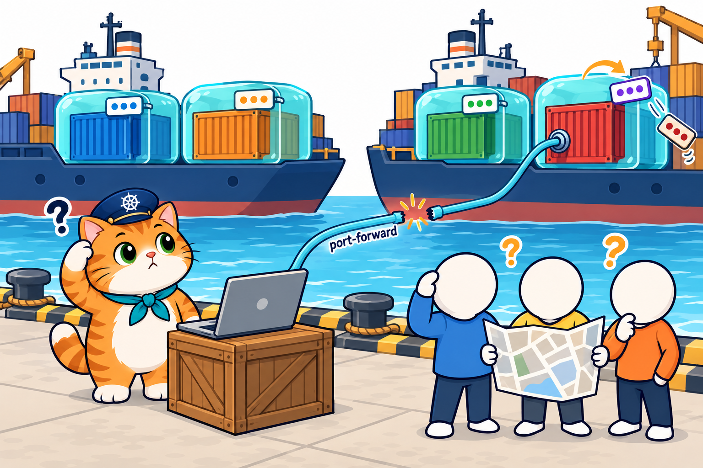

# บทที่ 5: Kubernetes Service — ที่อยู่เดียวของร้านน้องส้ม

> **รายวิชา:** Software Development Tools and Environments (DevTools)
> **หัวข้อ:** Service 3 แบบ (ClusterIP, NodePort, LoadBalancer), ที่อยู่และ port (nodePort / port / targetPort / containerPort), selector และ Endpoints, DNS ในคลัสเตอร์ และ Service คู่กับ rolling update
> **ผลลัพธ์การเรียนรู้ที่เกี่ยวข้อง:** CLO-5, CLO-6

<p align="center">
  <br>
  <em>บทที่แล้วร้านเปลี่ยนเมนูได้โดยไม่ปิด แต่ลูกค้าเข้าร้านผ่านท่อ port-forward ที่ต่อได้สาขาเดียวและหลุดทุกครั้งที่สาขาเปลี่ยน บทนี้น้องส้มมีพนักงานต้อนรับ Service ที่มีที่อยู่เดียวและพาลูกค้าไปทุกสาขาที่พร้อม</em>
</p>

## บทนี้เรียนอะไร

บทที่ 4 Deployment เปลี่ยนรุ่นได้โดยร้านไม่ปิด แต่เรายังเปิดเว็บด้วย `kubectl port-forward` ที่ต่อเข้า **Pod ตัวเดียว** และหลุดทุกครั้งที่ Pod นั้นถูกเปลี่ยน บทนี้ใช้ **Service** ซึ่งเป็น **ที่อยู่เดียวที่ไม่เปลี่ยน** ของ Pod ทุกตัวที่ติดป้ายเดียวกัน กระจายลูกค้าไปทุกสาขาที่พร้อม ใช้ได้ทั้ง **ในคลัสเตอร์ (ClusterIP + ชื่อ DNS)** และ **จากนอกคลัสเตอร์ (NodePort)** ปิดท้ายด้วย **ร้านอาหารแมวน้องส้ม** ที่เปิดจาก browser ได้ตรง ๆ ที่ `http://localhost:30080` refresh แล้วเจอคนละสาขา และเปลี่ยนรุ่นหรือย้อนกลับได้โดยหน้าเว็บไม่หลุด

| ส่วน | เนื้อหา | ลิงก์ |
|---|---|---|
| 📖 **ทฤษฎี** | Service คืออะไร, **Service มี 3 แบบพร้อมภาพสถาปัตยกรรมแต่ละแบบ**, **ที่อยู่ 3 แบบกับ port 4 ตัว**, selector → Endpoints → kube-proxy, อ่าน YAML ของ Service ทีละบรรทัด, port / targetPort / nodePort, DNS ในคลัสเตอร์, Endpoints ตามป้ายของ Pod, กับดัก selector ผิด, ClusterIP, NodePort, Service คู่กับ readinessProbe และ rolling update (มีคำถามทบทวนพร้อมแนวคำตอบ) | [01_Theory/README.md](01_Theory/README.md) |
| 🧪 **ปฏิบัติการ** | LAB 0–4: สร้างคลัสเตอร์ (เปิด port 30080–30082) → Service แรกแบบ ClusterIP → Endpoints ตาม label + กับดัก selector / targetPort ผิด → NodePort + ลอง LoadBalancer → **LAB สุดท้าย: ร้านอาหารแมวน้องส้มมีที่อยู่เดียว** พร้อมสรุปคำสั่งท้ายบท | [02_LAB/README.md](02_LAB/README.md) |

## คำแนะนำในการเรียน

1. **อ่านทฤษฎีก่อน** อย่างน้อยหัวข้อ 1–7 แล้วเริ่ม LAB 0–1 ได้เลย หัวข้อ 3 (Service 3 แบบ) และ 4 (ที่อยู่และ port) สำคัญที่สุด ต้องแยกให้ออกก่อน
2. ก่อนทำ LAB 2–4 ให้อ่านหัวข้อ 8–13 (Endpoints, selector ผิด, ClusterIP, NodePort, Service กับ rolling update, YAML ร้านน้องส้ม)
3. ทำ LAB **ตามลำดับ** ใช้เวลารวมประมาณ 2.5–3 ชั่วโมง
4. สังเกตสัญลักษณ์ในเอกสาร LAB ว่าคำสั่งรันที่ไหน: 🖥️ บนเครื่องนักศึกษา / 🐧 ใน SSH session ของ k8s-lab / 🌐 browser
5. ผลลัพธ์ในเอกสารมาจากการทดลองจริงรอบเดียวกันทั้งบท (19 ต.ค. 2569, Kubernetes v1.37.0) แต่ **ชื่อ Pod, IP ของ Pod และ CLUSTER-IP ถูกสุ่มทุกครั้ง** และ Pod ที่ตอบแต่ละครั้งอาจต่างจากในเอกสาร
6. ลองตอบคำถามทบทวนด้วยตัวเองก่อนเปิดดูแนวคำตอบ

> **ขอบเขตของบทนี้:** ใช้ Service แบบ **ClusterIP** และ **NodePort** กับ Deployment / Pod ส่วน LoadBalancer และ Ingress ไม่อยู่ในบทนี้ ค่าตั้งค่าและรหัสผ่านของแอป (ConfigMap / Secret) เป็น **เนื้อหาของบทถัดไป**

## สิ่งที่ต้องมีก่อนเริ่ม

- ผ่าน [บทที่ 4: Kubernetes Deployment](../004_kubernetes_Deployment/README.md) แล้ว สร้าง Deployment และสั่ง rolling update / rollback ได้
- container **`k8s-lab`** ที่สร้างด้วย **`-p 30080-30082:30080-30082`** (LAB 0 ของบทนี้) ถ้า container เดิมสร้างโดยไม่มี port นี้ ให้ลบแล้วสร้างใหม่ตาม LAB 0
- เครื่องต่ออินเทอร์เน็ตได้ (ดึง image จาก Docker Hub) และ browser บนเครื่องนักศึกษา (บทนี้ไม่ต้องใช้ VS Code)

## โครงสร้างโฟลเดอร์

```text
005_kubernetes_Service/
├── README.md                         ← หน้านี้
├── 01_Theory/
│   ├── README.md                     ← เอกสารทฤษฎี
│   └── images/                       ← ภาพประกอบ (+ imagegen-prompts.md)
└── 02_LAB/
    ├── README.md                     ← คู่มือ LAB 0–4
    ├── images/                       ← ภาพประกอบ LAB + screenshots/ ภาพหน้าจอจริง
    ├── labs/                         ← YAML ของ LAB 1–3
    │   ├── lab01-clusterip/          ← web-deploy.yaml, web-svc.yaml, client-pod.yaml
    │   ├── lab02-selector/           ← web-svc-typo.yaml, web-svc-wrongport.yaml
    │   └── lab03-nodeport/           ← web-svc-nodeport.yaml, web-svc-lb.yaml
    └── som-menu/                     ← LAB 4 ร้านอาหารแมวน้องส้มมีที่อยู่เดียว
        ├── app/                      ← เว็บหน้าร้าน Node.js (server.js + Dockerfile)
        └── k8s/                      ← som-menu-deploy.yaml, som-menu-deploy-v2.yaml, som-menu-svc.yaml
```

ใน LAB 0 จะ `git clone` repo เข้า container แล้วทำงานที่ `/workspace/DevTools/05_kubernetes/005_kubernetes_Service/02_LAB` ภายใน k8s-lab

## เริ่มเลย

👉 [อ่านทฤษฎี](01_Theory/README.md) → [ลงมือทำ LAB](02_LAB/README.md)

**บทถัดไป:** [บทที่ 6: Kubernetes ConfigMap และ Secret — เปลี่ยนป้ายร้านโดยไม่ต้อง build ใหม่](../006_kubernetes_ConfigMap_Secret/README.md)
