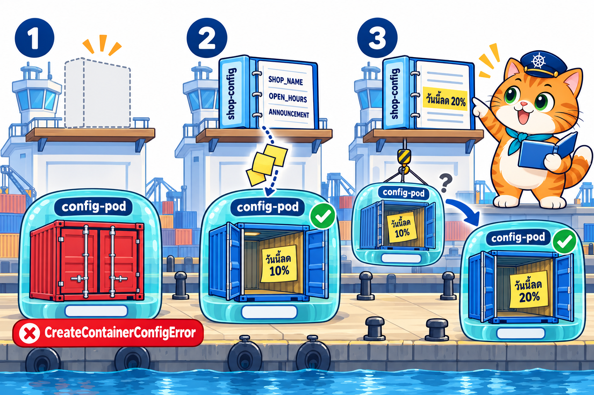
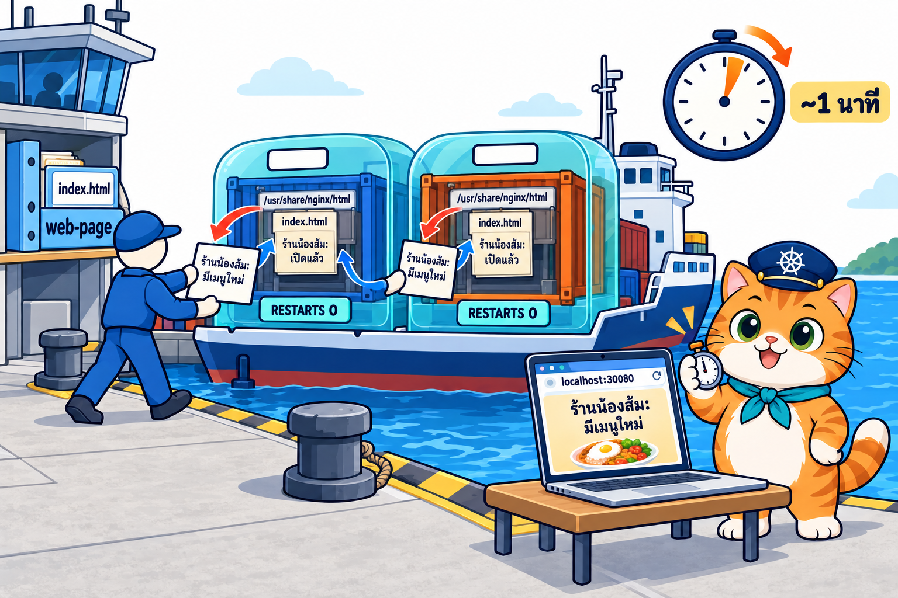
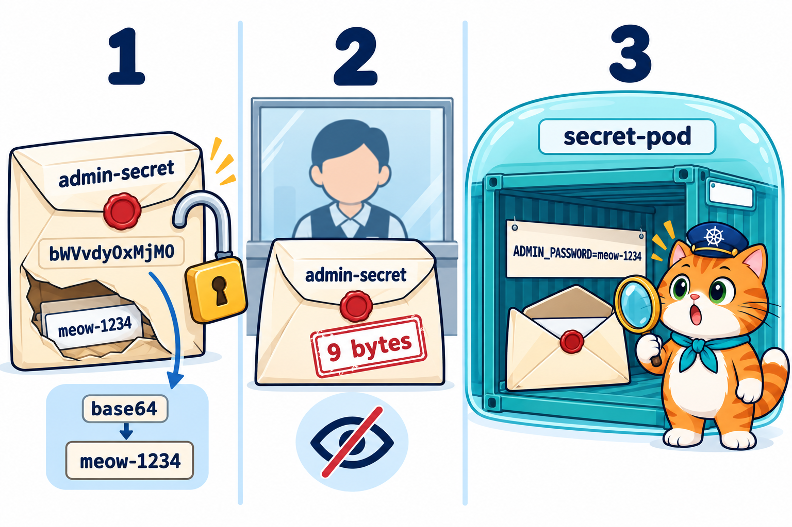
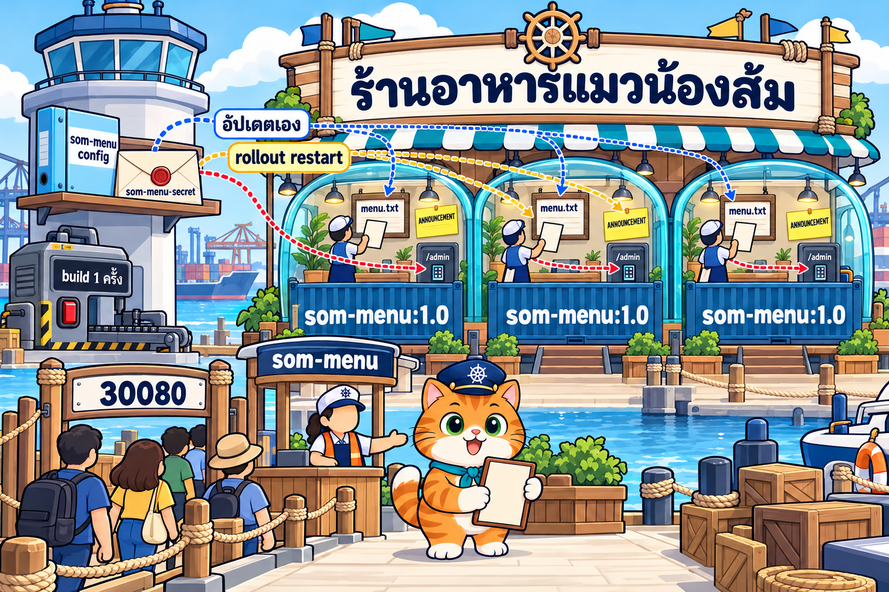
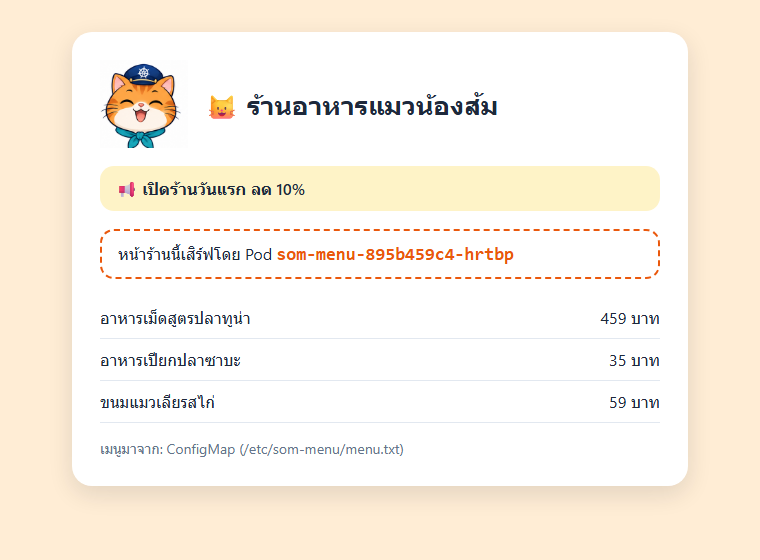
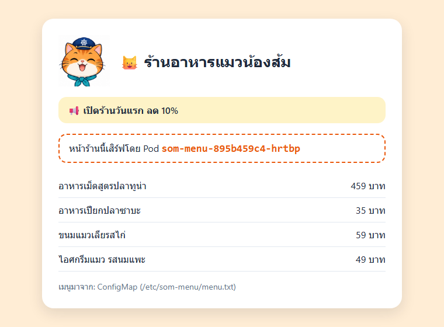
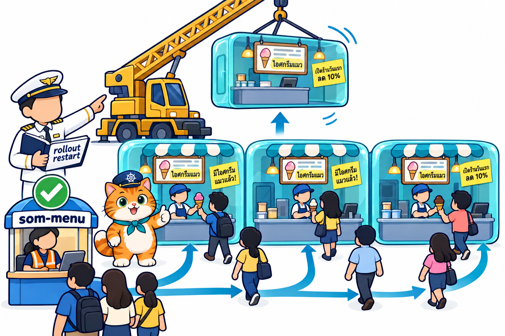
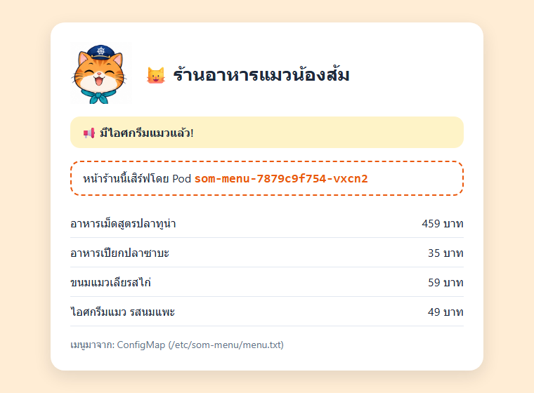

# LAB บทที่ 6: Kubernetes ConfigMap และ Secret — เปลี่ยนป้ายร้านโดยไม่ต้อง build ใหม่

> **รายวิชา:** Software Development Tools and Environments (DevTools)
> **หัวข้อ:** ปฏิบัติการ Kubernetes ConfigMap และ Secret — ส่งค่าเข้า Pod เป็นตัวแปร env และเป็นไฟล์, ค่าที่อัปเดตเองกับค่าที่ต้อง restart, base64 ไม่ใช่การเข้ารหัส และร้านน้องส้มที่เปลี่ยนเมนูและประกาศได้โดยไม่ต้อง build image ใหม่
> **ผลลัพธ์การเรียนรู้ที่เกี่ยวข้อง:** CLO-5, CLO-6
> **ทฤษฎีประกอบ:** [01_Theory/README.md](../01_Theory/README.md)

---

## บทนำ

ทุก LAB ทำ **ใน container `k8s-lab`** (image `tuchsanai/devtools-kind:2569_1` มี kubectl, kind, helm, k9s และ Docker ข้างในครบ) บทที่แล้วร้านน้องส้มมี **ที่อยู่เดียว** `http://localhost:30080` แล้ว แต่ชื่อร้านยังเขียนไว้ใน YAML ของ Deployment และเวอร์ชันยังฝังอยู่ใน image ตอน build เปลี่ยนทีไรต้องแก้ YAML หรือ build ใหม่ บทนี้แยกค่าเหล่านั้นออกมาเป็น object ของ Kubernetes เอง **ConfigMap** เก็บค่าตั้งค่าทั่วไป และ **Secret** เก็บรหัสผ่าน ตั้งแต่ส่งค่าเข้า Pod เป็นตัวแปร env, ส่งเป็นไฟล์ที่อัปเดตเอง, ดูว่า Secret ปลอดภัยแค่ไหน จนถึง **"ร้านอาหารแมวน้องส้ม"** ที่ build image ครั้งเดียว แล้วเปลี่ยนเมนูและประกาศได้โดยไม่ต้อง build ใหม่เลย

> บล็อก **Expected output** คือผลที่ควรเห็นหลังรันคำสั่ง (ไม่ต้องพิมพ์ตาม) มาจากการทดลองจริงเมื่อ 18 ต.ค. 2569 (kind v0.33.0, kubectl v1.37.1, Kubernetes v1.37.0) **ชื่อ Pod, IP และ CLUSTER-IP ถูกสุ่มทุกครั้ง** (เช่น `web-6ffd6db47c-7sm82`, `10.96.77.209`) และ **เวลาที่ไฟล์จาก ConfigMap อัปเดต** อาจเร็วหรือช้ากว่าในเอกสารเล็กน้อย ค่าในเครื่องนักศึกษาจะต่างไป เป็นเรื่องปกติ

| สัญลักษณ์ | รันที่ไหน |
|---|---|
| 🖥️ | Terminal/PowerShell บนเครื่องนักศึกษา |
| 🐧 | SSH session ใน k8s-lab (prompt `root@k8s-lab`) |
| 🌐 | browser บนเครื่องนักศึกษา |

### กติกา

- ทำงานในโฟลเดอร์ `/workspace/DevTools/05_kubernetes/006_kubernetes_ConfigMap_Secret/02_LAB` และ **ลบ Pod, Deployment, Service, ConfigMap และ Secret ของตัวเองทุกครั้งที่จบ LAB**
- **ชื่อ Pod ในเครื่องแต่ละคนไม่เหมือนกัน** คำสั่งที่มี `# ← เปลี่ยนเป็น ... ของตัวเอง` ให้แทนด้วยชื่อที่เห็นจาก `kubectl get pods` ในเครื่องตัวเอง
- **รหัสผ่านในไฟล์ LAB (`meow-1234`, `tuna-5678`) เป็นรหัสตัวอย่างเพื่อการเรียนเท่านั้น** ห้ามนำไปใช้จริง และงานจริง **ห้าม commit ไฟล์ Secret ที่มีรหัสจริงขึ้น Git** บทนี้ไม่ต้องใช้ VS Code เปิดเว็บผ่าน NodePort `http://localhost:30080` แบบบทที่ 5

## สารบัญ LAB

| LAB | ชื่อ | เวลาโดยประมาณ | ความยาก |
|:---:|---|:---:|:---:|
| 0 | [เตรียมสภาพแวดล้อม (Setup)](#lab-0-เตรียมสภาพแวดล้อม-setup) (container `k8s-lab` ที่เปิด port NodePort + คลัสเตอร์ + git clone) | 20–30 นาที | ⭐ |
| 1 | [ConfigMap เป็นตัวแปร env](#lab-1-configmap-เป็นตัวแปร-env) | 25 นาที | ⭐⭐ |
| 2 | [ConfigMap เป็นไฟล์](#lab-2-configmap-เป็นไฟล์) | 25 นาที | ⭐⭐⭐ |
| 3 | [Secret เก็บรหัสผ่าน](#lab-3-secret-เก็บรหัสผ่าน) | 20 นาที | ⭐⭐⭐ |
| 4 | [LAB สุดท้าย: ร้านน้องส้มเปลี่ยนป้ายโดยไม่ต้อง build ใหม่](#lab-4-lab-สุดท้าย-ร้านน้องส้มเปลี่ยนป้ายโดยไม่ต้อง-build-ใหม่) | 45–60 นาที | ⭐⭐⭐⭐⭐ |
| – | [เก็บกวาดหลังจบบท](#เก็บกวาดหลังจบบท) · [สรุปคำสั่ง kubectl ในบทนี้](#สรุปคำสั่ง-kubectl-ในบทนี้) | | |

รวมประมาณ 2.5–3 ชั่วโมง (มีช่วงรอให้ไฟล์จาก ConfigMap อัปเดตราว 1 นาที และเครื่องช้าหรือเน็ตช้าอาจนานกว่านี้ เพราะต้องดึง image จาก Docker Hub)

### สารบัญรูปภาพ

| รูปที่ | เรื่อง | รูปที่ | เรื่อง |
|:---:|---|:---:|---|
| 1 | [LAB 0 Setup container และคลัสเตอร์](#fig-1) | 7 | [LAB 3 Secret ซองปิดผนึกที่แค่พับไว้](#fig-7) |
| 2 | [LAB 0 git clone](#fig-2) | 8 | [LAB 4 ร้านน้องส้มรับค่าจาก ConfigMap และ Secret](#fig-8) |
| 3 | [LAB 1 ConfigMap เป็นแผ่นโน้ต env](#fig-3) | 9 | [ภาพหน้าจอจริง: หน้าร้านจาก config รุ่นแรก](#fig-9) |
| 4 | [LAB 2 ConfigMap เป็นไฟล์ที่อัปเดตเอง](#fig-4) | 10 | [ภาพหน้าจอจริง: เมนูใหม่มาเอง แต่ประกาศยังเดิม](#fig-10) |
| 5 | [ภาพหน้าจอจริง: หน้าเว็บจาก ConfigMap รุ่นแรก](#fig-5) | 11 | [LAB 4 rollout restart เปลี่ยนกล่องทีละใบ](#fig-11) |
| 6 | [ภาพหน้าจอจริง: หน้าเว็บเปลี่ยนเองโดย Pod เดิม](#fig-6) | 12 | [ภาพหน้าจอจริง: ประกาศใหม่หลัง rollout restart](#fig-12) |

### โครงสร้างไฟล์ LAB

```text
02_LAB/
├── README.md                     ← เอกสารนี้
├── images/                       ← ภาพประกอบ + screenshots/ ภาพหน้าจอจริง
├── labs/
│   ├── lab01-configmap-env/{shop-config,shop-config-v2,config-pod}.yaml   ← ใช้ใน LAB 1
│   ├── lab02-configmap-file/{web-page,web-page-v2,web-deploy}.yaml        ← ใช้ใน LAB 2
│   └── lab03-secret/{admin-secret,secret-pod}.yaml                        ← ใช้ใน LAB 3
└── som-menu/
    ├── app/                      ← เว็บหน้าร้าน Node.js (server.js + Dockerfile) ไม่มีค่าตั้งค่าฝังใน image
    └── k8s/{som-menu-config,som-menu-config-v2,som-menu-secret,som-menu-deploy,som-menu-svc}.yaml
```

---

## LAB 0: เตรียมสภาพแวดล้อม (Setup)

**เป้าหมาย:** สร้าง container `k8s-lab` **ที่เปิด port NodePort `30080–30082` ออกมาถึงเครื่องนักศึกษา** และคลัสเตอร์ kind ชื่อ `lab` (1 control-plane + 2 worker) แล้วดึงไฟล์ LAB มาไว้ใน container (รายละเอียดของแต่ละคำสั่งดูได้จาก [LAB บทที่ 1](../../001_kubernetes-introduction/02_LAB/readme.md))

**ต้องมี:** Docker Desktop (Linux containers, RAM อย่างน้อย 4 GB) และ SSH client

> **ถ้ายังมี container `k8s-lab` จากบทที่ 5:** container นั้นสร้างด้วย `-p 30080-30082:30080-30082` แล้ว ใช้ต่อได้เลย 🖥️ `docker start k8s-lab` แล้วข้ามไปข้อ 2 (SSH) ถ้าคลัสเตอร์ยังอยู่ก็ข้าม `k8s-up` ได้ แต่ถ้าเป็น container ที่สร้าง **ก่อนบทที่ 5** (ไม่มี `-p 30080-30082:30080-30082`) ให้ลบทิ้งด้วย 🖥️ `docker rm -f k8s-lab` แล้วสร้างใหม่ตามขั้นที่ 1 (ถ้ามีงานของตัวเองเก็บไว้ใน container ให้คัดลอกออกมาก่อน)

### ขั้นที่ 1: Setup container และคลัสเตอร์

<p align="center" id="fig-1">
  <br>
  <em><b>รูปที่ 1</b> LAB0 ขั้นที่ 1: (1) docker run สร้าง container k8s-lab (2) ssh -p 2223 เข้าไปข้างใน (3) รัน k8s-up สร้าง kind cluster ชื่อ lab ได้ 3 node Ready (control-plane 1 ตัว + worker 2 ตัว)</em>
</p>

**1) สร้าง container** 🖥️ **บนเครื่องนักศึกษา** (image ประมาณ 1.5 GB ครั้งแรกใช้เวลาหลายนาที)

```bash
docker pull tuchsanai/devtools-kind:2569_1
```

```bash
docker run -dit --name k8s-lab --hostname k8s-lab --privileged -p 2223:22 -p 8889:8888 -p 30080-30082:30080-30082 tuchsanai/devtools-kind:2569_1
```

- `--privileged` ให้รัน Docker ซ้อนใน container ได้ (kind ต้องใช้) **ขาดไม่ได้**
- `-p 2223:22` เปิดทาง SSH เข้า container ผ่าน port `2223`
- `-p 8889:8888` เปิด JupyterLab ที่ `http://localhost:8889/lab` (ทางเลือก)
- `-p 30080-30082:30080-30082` เปิด port `30080`, `30081`, `30082` ของ container ออกมาที่เครื่องนักศึกษา (แบบบทที่ 5) เป็นทางให้ browser เปิดเว็บผ่าน Service แบบ **NodePort** ใน LAB 2 และ LAB 4 (`http://localhost:30080`)

หลัง `docker run` **รอสัก 5–10 วินาที** ให้ container เริ่ม sshd และ dockerd ข้างในให้เสร็จก่อน

**2) SSH เข้า container** 🖥️ ครั้งแรกพิมพ์ `yes` แล้วใส่รหัสผ่าน `passwd`

```bash
ssh -p 2223 root@localhost
```

**3) สร้างและตรวจคลัสเตอร์** 🐧 **ใน SSH session ของ k8s-lab** (prompt `root@k8s-lab:~#`)

```bash
time k8s-up
```

**Expected output** (ตัดเฉพาะส่วนสำคัญ)

<pre>
...
[k8s-up] cluster 'lab' พร้อมใช้งาน (kubectl context: kind-lab)
...
  NodePort ที่ map ออก host: 30080 30081 30082

real	0m33.310s
</pre>

`k8s-up` สร้างคลัสเตอร์ใช้เวลาราว 30 วินาที – 1 นาที บรรทัด `NodePort ที่ map ออก host: 30080 30081 30082` คือทางที่ browser บนเครื่องเราเข้ามาถึง Service แบบ NodePort (เหมือนบทที่ 5)

```bash
kubectl get nodes
```

**Expected output**

<pre>
NAME                STATUS   ROLES           AGE   VERSION
lab-control-plane   Ready    control-plane   27s   v1.37.0
lab-worker          Ready    &lt;none&gt;          12s   v1.37.0
lab-worker2         Ready    &lt;none&gt;          12s   v1.37.0
</pre>

```bash
kubectl get pods -A
```

**Expected output**

<pre>
NAMESPACE            NAME                                        READY   STATUS    RESTARTS   AGE
kube-system          coredns-559f6c778d-tmp25                    1/1     Running   0          26s
kube-system          coredns-559f6c778d-xkn9d                    1/1     Running   0          26s
kube-system          etcd-lab-control-plane                      1/1     Running   0          36s
kube-system          kindnet-2rklf                               1/1     Running   0          22s
kube-system          kindnet-5s75r                               1/1     Running   0          27s
kube-system          kindnet-5z2h5                               1/1     Running   0          22s
kube-system          kube-apiserver-lab-control-plane            1/1     Running   0          36s
kube-system          kube-controller-manager-lab-control-plane   1/1     Running   0          36s
kube-system          kube-proxy-b67wk                            1/1     Running   0          22s
kube-system          kube-proxy-bx6wf                            1/1     Running   0          27s
kube-system          kube-proxy-zkrrj                            1/1     Running   0          22s
kube-system          kube-scheduler-lab-control-plane            1/1     Running   0          36s
local-path-storage   local-path-provisioner-75f7fc7dc5-b72k7     1/1     Running   0          26s
</pre>

ถ้า Pod บางตัวยังเป็น `0/1` ให้รอสัก 10 วินาที แล้วสั่งซ้ำ

> **✅ ผ่านเมื่อ:** node 3 ตัว `Ready` และ Pod ระบบทุกตัวเป็น `1/1 Running`

### ขั้นที่ 2: git clone ไฟล์ LAB

<p align="center" id="fig-2">
  <br>
  <em><b>รูปที่ 2</b> LAB0 ขั้นที่ 2: git clone ดึง repo DevTools มาไว้ที่ /workspace/DevTools ใน k8s-lab แล้ว cd ลงไปจนถึงโฟลเดอร์ 02_LAB ของบทที่ 6 ที่มี labs และ som-menu</em>
</p>

🐧 **ใน SSH session ของ k8s-lab**

```bash
cd /workspace
```

```bash
git clone https://github.com/Tuchsanai/DevTools.git
```

ถ้าเคย clone ไว้แล้วใน container นี้ จะขึ้นว่า `already exists` ให้ `cd DevTools` แล้ว `git pull` แทน จากนั้น `cd /workspace`

```bash
cd DevTools/05_kubernetes/006_kubernetes_ConfigMap_Secret/02_LAB
```

> **✅ ผ่านเมื่อ:** prompt เป็น `root@k8s-lab:/workspace/DevTools/05_kubernetes/006_kubernetes_ConfigMap_Secret/02_LAB#` ทุกคำสั่งที่อ้าง `labs/...` หรือ `som-menu/...` ต้องรันจากโฟลเดอร์นี้

---

## LAB 1: ConfigMap เป็นตัวแปร env

<p align="center" id="fig-3">
  <br>
  <em><b>รูปที่ 3</b> LAB1: (1) กล่อง config-pod มาถึงก่อนแฟ้มคู่มือ shop-config จะวางบนชั้น container เปิดไม่ได้ ติดป้ายแดง CreateContainerConfigError (2) วางแฟ้มสีฟ้าแล้ว ค่าในแฟ้มถูกแปะเป็นแผ่นโน้ต env ในตู้ตอนเปิดกล่อง (3) แก้แฟ้มเป็นลด 20% กล่องเดิมยังเห็นโน้ตเก่า 10% ต้องเปลี่ยนเป็นกล่องใหม่จึงได้โน้ตใหม่</em>
</p>

**เป้าหมาย:** สร้าง ConfigMap แรกเก็บค่าตั้งค่าของร้าน แล้วส่งเข้า Pod เป็น **ตัวแปร env** ดูว่าเกิดอะไรขึ้นถ้า Pod มาก่อน ConfigMap และถ้าแก้ ConfigMap แล้ว Pod ที่รันอยู่เห็นค่าใหม่หรือไม่

🐧 **ใน SSH session ของ k8s-lab** (ทุกขั้นใน LAB 1–3)

### ขั้นที่ 1: Pod ที่ขอค่าจาก ConfigMap

ไฟล์ `labs/lab01-configmap-env/config-pod.yaml`

```yaml
# LAB 1: Pod ที่อ่านค่าจาก ConfigMap shop-config มาเป็นตัวแปร env
apiVersion: v1
kind: Pod
metadata:
  name: config-pod
spec:
  containers:
    - name: busybox
      image: busybox:1.37
      command: ["sleep", "3600"]
      env:
        - name: SHOP_NAME              # ดึงทีละ key: ตั้งชื่อตัวแปรเองได้
          valueFrom:
            configMapKeyRef:
              name: shop-config        # ชื่อ ConfigMap
              key: SHOP_NAME           # key ใน data
      envFrom:                         # ดึงทุก key ใน ConfigMap มาเป็นตัวแปรในครั้งเดียว
        - configMapRef:
            name: shop-config
```

ทำงานอย่างไร

- Pod `config-pod` จาก `busybox` ที่ `sleep 3600` นอนรอเฉย ๆ ให้เรา `kubectl exec` เข้าไปดูตัวแปร (แบบ Pod `client` ของบทที่ 5)
- **`env` + `configMapKeyRef`** = ดึง **ทีละ key**: ตัวแปร `SHOP_NAME` เอาค่าจาก key `SHOP_NAME` ของ ConfigMap `shop-config` (ชื่อตัวแปรตั้งเองได้ ไม่จำเป็นต้องตรงกับ key)
- **`envFrom` + `configMapRef`** = ดึง **ทุก key** ใน ConfigMap มาเป็นตัวแปรในครั้งเดียว ชื่อตัวแปร = ชื่อ key
- ไฟล์นี้ใช้ทั้ง 2 แบบให้เห็น (`SHOP_NAME` จึงได้ค่าเดียวกันจากทั้งสองทาง) งานจริงเลือกแบบใดแบบหนึ่ง

**ตั้งใจสร้าง Pod ก่อน** ทั้งที่ยังไม่มี ConfigMap `shop-config` เพื่อดูว่าเกิดอะไรขึ้น

```bash
kubectl apply -f labs/lab01-configmap-env/config-pod.yaml
```

**Expected output**

<pre>
pod/config-pod created
</pre>

Kubernetes รับ Pod ไว้ตามปกติ ไม่ได้ตรวจว่ามี ConfigMap ชื่อนี้หรือยัง รอสัก 8 วินาที

```bash
kubectl get pods
```

**Expected output**

<pre>
NAME         READY   STATUS                       RESTARTS   AGE
config-pod   0/1     CreateContainerConfigError   0          8s
</pre>

**`CreateContainerConfigError`** = kubelet สร้าง container ไม่ได้เพราะ **ค่าตั้งค่าของ container ไม่ครบ** ดูสาเหตุ

```bash
kubectl describe pod config-pod
```

**Expected output** (ตัดเฉพาะส่วนสำคัญ)

<pre>
Name:             config-pod
...
Status:           Pending
...
    State:          Waiting
      Reason:       CreateContainerConfigError
    Ready:          False
    Restart Count:  0
    Environment Variables from:
      shop-config  ConfigMap  Optional: false
    Environment:
      SHOP_NAME:  &lt;set to the key 'SHOP_NAME' of config map 'shop-config'&gt;  Optional: false
...
Events:
  Type     Reason     Age              From               Message
  ----     ------     ----             ----               -------
  Normal   Scheduled  8s               default-scheduler  Successfully assigned default/config-pod to lab-worker
  Normal   Pulling    7s               kubelet            spec.containers{busybox}: Pulling image "busybox:1.37"
  Normal   Pulled     1s               kubelet            spec.containers{busybox}: Successfully pulled image "busybox:1.37" in 6.064s (6.064s including waiting). Image size: 2222118 bytes.
  Warning  Failed     0s (x2 over 1s)  kubelet            spec.containers{busybox}: Error: configmap "shop-config" not found
  Normal   Pulled     0s               kubelet            spec.containers{busybox}: Container image "busybox:1.37" already present on machine and can be accessed by the pod
</pre>

- `Environment Variables from: shop-config ConfigMap` = มาจาก `envFrom` และ `Environment: SHOP_NAME: <set to the key 'SHOP_NAME' of config map 'shop-config'>` = มาจาก `configMapKeyRef`
- `Optional: false` = ConfigMap นี้ **ต้องมี** ถ้าไม่มี container เริ่มไม่ได้
- Events บอกตรง ๆ: **`configmap "shop-config" not found`** ดึง image ได้แล้ว (`Pulled`) แต่ยังสร้าง container ไม่ได้

### ขั้นที่ 2: สร้าง ConfigMap

ไฟล์ `labs/lab01-configmap-env/shop-config.yaml`

```yaml
# LAB 1: ConfigMap แรก — เก็บค่าตั้งค่าของร้านไว้นอก image เป็นคู่ key: value
apiVersion: v1
kind: ConfigMap
metadata:
  name: shop-config
data:                            # ค่าทุกตัวเป็นข้อความ (string) เสมอ
  SHOP_NAME: "ร้านอาหารแมวน้องส้ม"
  OPEN_HOURS: "09:00-21:00"
  ANNOUNCEMENT: "วันนี้ลด 10%"
```

ทำงานอย่างไร

- `kind: ConfigMap` อยู่กลุ่มหลัก `v1` เหมือน Pod และ Service ชื่อ **`shop-config`** ตรงกับที่ Pod ขอไว้
- **ไม่มี `spec`** มีแต่ **`data`** = รายการคู่ `key: value` 3 คู่ (ชื่อร้าน, เวลาเปิด, ประกาศ)
- ค่าทุกตัวเป็น **ข้อความ (string)** เสมอ ใส่ `"..."` ไว้กันพลาด เช่น `09:00-21:00` หรือตัวเลข

```bash
kubectl apply -f labs/lab01-configmap-env/shop-config.yaml
```

**Expected output**

<pre>
configmap/shop-config created
</pre>

```bash
kubectl get configmap
```

**Expected output**

<pre>
NAME               DATA   AGE
kube-root-ca.crt   1      46s
shop-config        3      0s
</pre>

- `shop-config` มี `DATA 3` = 3 key
- `kube-root-ca.crt` เป็น ConfigMap ที่ Kubernetes สร้างไว้ในทุก namespace เอง (ใบรับรองของคลัสเตอร์) **ห้ามลบ**

```bash
kubectl describe configmap shop-config
```

**Expected output**

<pre>
Name:         shop-config
Namespace:    default
Labels:       &lt;none&gt;
Annotations:  &lt;none&gt;

Data
====
ANNOUNCEMENT:
----
วันนี้ลด 10%

OPEN_HOURS:
----
09:00-21:00

SHOP_NAME:
----
ร้านอาหารแมวน้องส้ม


BinaryData
====

Events:  &lt;none&gt;
</pre>

`describe` แสดงทุก key พร้อมค่าตรง ๆ (เรียงตามตัวอักษร) ConfigMap **ไม่ได้ซ่อนค่าอะไรเลย** จึงใช้กับค่าทั่วไปเท่านั้น ห้ามใส่รหัสผ่าน (LAB 3 จะใช้ Secret)

### ขั้นที่ 3: Pod เริ่มทำงานเอง

ไม่ต้องลบหรือ apply Pod ใหม่ **kubelet ลองสร้าง container ใหม่เองเป็นระยะ** รอสัก 20 วินาที

```bash
kubectl get pods
```

**Expected output**

<pre>
NAME         READY   STATUS    RESTARTS   AGE
config-pod   1/1     Running   0          29s
</pre>

ถ้ายังเป็น `CreateContainerConfigError` ให้รออีก 10 วินาที แล้วสั่งซ้ำ ดูค่าตัวแปรใน Pod (`printenv` = พิมพ์ค่าตัวแปร env ที่ระบุ)

```bash
kubectl exec config-pod -- printenv SHOP_NAME OPEN_HOURS ANNOUNCEMENT
```

**Expected output**

<pre>
ร้านอาหารแมวน้องส้ม
09:00-21:00
วันนี้ลด 10%
</pre>

ค่าทั้ง 3 จาก ConfigMap กลายเป็นตัวแปร env ใน container แล้ว (`OPEN_HOURS` และ `ANNOUNCEMENT` มาจาก `envFrom` เพราะไม่ได้เขียนแยกไว้ใน `env`)

### ขั้นที่ 4: แก้ ConfigMap แล้ว Pod เดิมเห็นไหม

ไฟล์ `labs/lab01-configmap-env/shop-config-v2.yaml`

```yaml
# LAB 1: แก้ ConfigMap shop-config — ต่างจาก shop-config.yaml แค่บรรทัดที่มี ← เท่านั้น
apiVersion: v1
kind: ConfigMap
metadata:
  name: shop-config
data:
  SHOP_NAME: "ร้านอาหารแมวน้องส้ม"
  OPEN_HOURS: "09:00-21:00"
  ANNOUNCEMENT: "วันนี้ลด 20%"   # ← เปลี่ยน
```

ชื่อ ConfigMap ยังเป็น `shop-config` เหมือนเดิม apply แล้วจึงเป็นการ **แก้ตัวเดิม** ต่างแค่ประกาศเปลี่ยนจาก `ลด 10%` เป็น **`ลด 20%`**

```bash
kubectl apply -f labs/lab01-configmap-env/shop-config-v2.yaml
```

**Expected output**

<pre>
configmap/shop-config configured
</pre>

```bash
kubectl describe configmap shop-config
```

**Expected output**

<pre>
Name:         shop-config
Namespace:    default
Labels:       &lt;none&gt;
Annotations:  &lt;none&gt;

Data
====
ANNOUNCEMENT:
----
วันนี้ลด 20%

OPEN_HOURS:
----
09:00-21:00

SHOP_NAME:
----
ร้านอาหารแมวน้องส้ม


BinaryData
====

Events:  &lt;none&gt;
</pre>

ในคลัสเตอร์ ConfigMap เป็น **`วันนี้ลด 20%`** แล้ว ถาม Pod ที่รันอยู่

```bash
kubectl exec config-pod -- printenv ANNOUNCEMENT
```

**Expected output**

<pre>
วันนี้ลด 10%
</pre>

**Pod เดิมยังเห็น `10%`** เพราะตัวแปร env ถูกใส่ให้ container **ครั้งเดียวตอนเริ่ม** (เหมือนแผ่นโน้ตที่แปะในตู้ตอนเปิดกล่อง) แก้ ConfigMap ทีหลังไม่มีผลกับ container ที่รันอยู่ ต้องสร้าง Pod ใหม่

### ขั้นที่ 5: สร้าง Pod ใหม่ให้ได้ค่าใหม่

```bash
kubectl delete pod config-pod
```

**Expected output**

<pre>
pod "config-pod" deleted from default namespace
</pre>

คำสั่งนี้ **ค้างราว 30 วินาที** เพราะ `sleep` ไม่ตอบสัญญาณขอปิด (SIGTERM) Kubernetes จึงรอครบเวลาผ่อนผันแล้วบังคับปิด (เหมือน Pod `client` ในบทที่ 5)

```bash
kubectl apply -f labs/lab01-configmap-env/config-pod.yaml
```

**Expected output**

<pre>
pod/config-pod created
</pre>

รอสัก 8 วินาที

```bash
kubectl get pods
```

**Expected output**

<pre>
NAME         READY   STATUS    RESTARTS   AGE
config-pod   1/1     Running   0          8s
</pre>

รอบนี้ ConfigMap มีอยู่แล้ว Pod จึง `Running` ทันที

```bash
kubectl exec config-pod -- printenv ANNOUNCEMENT
```

**Expected output**

<pre>
วันนี้ลด 20%
</pre>

Pod ใหม่อ่านค่าตอนเริ่ม จึงได้ **`20%`** ตามที่แก้

### ขั้นที่ 6: ลบทุกอย่างของ LAB 1

ลบ **ทีละไฟล์**

```bash
kubectl delete -f labs/lab01-configmap-env/config-pod.yaml
```

**Expected output** (ค้างราว 30 วินาทีเหมือนขั้นที่ 5)

<pre>
pod "config-pod" deleted from default namespace
</pre>

```bash
kubectl delete -f labs/lab01-configmap-env/shop-config.yaml
```

**Expected output**

<pre>
configmap "shop-config" deleted from default namespace
</pre>

> **⚠️ ไม่ใช้ `kubectl delete -f labs/lab01-configmap-env/` ทั้งโฟลเดอร์** เพราะในโฟลเดอร์มีทั้ง `shop-config.yaml` และ `shop-config-v2.yaml` ที่เป็น ConfigMap **ชื่อเดียวกัน** ไฟล์แรกลบไปแล้ว ไฟล์ที่สองจะหาไม่เจอและขึ้น error `NotFound` ลบไฟล์เดียว (`shop-config.yaml`) ก็พอ เพราะ `delete -f` ลบตามชื่อ ไม่ได้ดูว่าค่าในไฟล์เป็นรุ่นไหน

```bash
kubectl get configmap
```

**Expected output**

<pre>
NAME               DATA   AGE
kube-root-ca.crt   1      2m17s
</pre>

เหลือแค่ `kube-root-ca.crt` ของระบบ

### สิ่งที่เห็น

- ConfigMap เก็บค่าตั้งค่าเป็นคู่ `key: value` ใน `data` (ค่าเป็นข้อความเสมอ) แยกจาก image และจาก YAML ของ Pod
- ส่งเข้า Pod เป็นตัวแปร env ได้ 2 แบบ: `configMapKeyRef` (ทีละ key ตั้งชื่อตัวแปรเอง) และ `envFrom` (ทุก key ในครั้งเดียว)
- Pod ที่ขอ ConfigMap ที่ **ยังไม่มี** ค้างที่ `CreateContainerConfigError` (Events: `configmap "shop-config" not found`) พอสร้าง ConfigMap แล้ว kubelet ลองใหม่และ Pod `Running` เอง
- ตัวแปร env ถูกอ่าน **ครั้งเดียวตอน container เริ่ม** แก้ ConfigMap แล้ว Pod เดิมยังเห็นค่าเก่า ต้องสร้าง Pod ใหม่

> **🤔 คำถามชวนคิด:** ถ้าในงานจริงมี Pod 3 ตัวจาก Deployment ใช้ ConfigMap แบบ env อยู่ แล้วเราแก้ประกาศใน ConfigMap จะต้องลบ Pod ทีละตัวเองหรือมีวิธีที่สะดวกกว่า (LAB 4 จะเฉลย)

---

## LAB 2: ConfigMap เป็นไฟล์

<p align="center" id="fig-4">
  <br>
  <em><b>รูปที่ 4</b> LAB2: แฟ้มคู่มือ web-page มีแผ่น index.html ถูกส่งเข้าไปเป็นกระดานแขวนที่ /usr/share/nginx/html ในกล่อง nginx ทั้ง 2 ใบ เมื่อแก้แฟ้ม คนส่งของจากส่วนกลางเอาแผ่นใหม่ไปเปลี่ยนให้เองภายในราว 1 นาที กล่องเดิมไม่ถูกเปลี่ยน (RESTARTS 0) แค่ refresh browser ก็เห็นหน้าใหม่</em>
</p>

**เป้าหมาย:** ใช้ ConfigMap เก็บ **ไฟล์ทั้งไฟล์** (หน้าเว็บ `index.html`) แล้ว mount เข้า Pod nginx เป็นไฟล์ เปิดดูผ่าน NodePort แล้วแก้ ConfigMap ดูว่าไฟล์ใน Pod ที่รันอยู่ **เปลี่ยนเอง** โดยไม่ต้องสร้าง Pod ใหม่

### ขั้นที่ 1: ConfigMap ที่เก็บไฟล์

ไฟล์ `labs/lab02-configmap-file/web-page.yaml`

```yaml
# LAB 2: ConfigMap ที่เก็บ "ไฟล์" ทั้งไฟล์ — key = ชื่อไฟล์, value = เนื้อไฟล์
apiVersion: v1
kind: ConfigMap
metadata:
  name: web-page
data:
  index.html: |                  # | = ข้อความหลายบรรทัด เก็บตามที่เขียนทุกบรรทัด
    <meta charset="utf-8">
    <h1>ร้านน้องส้ม: เปิดแล้ว</h1>
```

ทำงานอย่างไร

- ConfigMap ชื่อ `web-page` มี key เดียวคือ **`index.html`** เมื่อ mount เป็นไฟล์ **key = ชื่อไฟล์** และ **value = เนื้อไฟล์**
- **`|`** = ค่าเป็นข้อความหลายบรรทัด เก็บทุกบรรทัดที่ย่อหน้าไว้ข้างใต้ตามที่เขียน (ตัดย่อหน้าออก) ได้ไฟล์ HTML 2 บรรทัด
- `<meta charset="utf-8">` บอก browser ว่าเป็นภาษาไทยแบบ UTF-8 จะได้ไม่เป็นภาษาต่างดาว

### ขั้นที่ 2: Deployment ที่ mount ConfigMap เป็นไฟล์ + Service

ไฟล์ `labs/lab02-configmap-file/web-deploy.yaml` (2 object ในไฟล์เดียว คั่นด้วย `---`)

```yaml
# LAB 2: nginx ที่ใช้หน้าเว็บจาก ConfigMap web-page (mount เป็นไฟล์) + Service NodePort 30080
apiVersion: apps/v1
kind: Deployment
metadata:
  name: web
spec:
  replicas: 2
  selector:
    matchLabels:
      app: web
  template:
    metadata:
      labels:
        app: web
    spec:
      containers:
        - name: nginx
          image: nginx:1.27-alpine
          ports:
            - containerPort: 80
          volumeMounts:
            - name: page                       # ใช้ volume ชื่อ page (ประกาศข้างล่าง)
              mountPath: /usr/share/nginx/html # วางไว้ที่โฟลเดอร์หน้าเว็บของ nginx
      volumes:
        - name: page
          configMap:
            name: web-page                     # ทุก key ใน ConfigMap web-page กลายเป็นไฟล์ 1 ไฟล์
---
apiVersion: v1
kind: Service
metadata:
  name: web
spec:
  type: NodePort
  selector:
    app: web
  ports:
    - port: 80
      targetPort: 80
      nodePort: 30080
```

ทำงานอย่างไร

- **ส่วนแรก** Deployment `web` เปิด nginx 2 Pod ป้าย `app: web` (แบบบทที่ 4)
- **`volumes`** (ระดับ Pod) ประกาศ volume ชื่อ `page` ที่ข้อมูลมาจาก **`configMap: name: web-page`** ทุก key ใน ConfigMap กลายเป็นไฟล์ 1 ไฟล์
- **`volumeMounts`** (ระดับ container) เอา volume `page` ไปวางที่ **`/usr/share/nginx/html`** = โฟลเดอร์หน้าเว็บของ nginx จึงได้ไฟล์ `/usr/share/nginx/html/index.html` จาก ConfigMap
- `name: page` ต้องตรงกันทั้ง 2 ที่ (`volumes` ประกาศ, `volumeMounts` ใช้)
- **`---`** คั่น 2 object ในไฟล์เดียว **ส่วนที่สอง** คือ Service `web` แบบ **NodePort 30080** (แบบบทที่ 5) ให้ browser เปิดได้

สร้าง ConfigMap ก่อน แล้วค่อยสร้าง Deployment (กันไม่ให้ Pod ค้างแบบ LAB 1)

```bash
kubectl apply -f labs/lab02-configmap-file/web-page.yaml
```

**Expected output**

<pre>
configmap/web-page created
</pre>

```bash
kubectl apply -f labs/lab02-configmap-file/web-deploy.yaml
```

**Expected output**

<pre>
deployment.apps/web created
service/web created
</pre>

ไฟล์เดียวสร้าง 2 object รอสัก 10 วินาที

```bash
kubectl get pods
```

**Expected output**

<pre>
NAME                   READY   STATUS    RESTARTS   AGE
web-6ffd6db47c-7sm82   1/1     Running   0          10s
web-6ffd6db47c-qg4dx   1/1     Running   0          10s
</pre>

```bash
kubectl get svc
```

**Expected output**

<pre>
NAME         TYPE        CLUSTER-IP     EXTERNAL-IP   PORT(S)        AGE
kubernetes   ClusterIP   10.96.0.1      &lt;none&gt;        443/TCP        2m47s
web          NodePort    10.96.77.209   &lt;none&gt;        80:30080/TCP   10s
</pre>

### ขั้นที่ 3: ดูหน้าเว็บและไฟล์ใน Pod

```bash
curl http://localhost:30080
```

**Expected output**

<pre>
&lt;meta charset="utf-8"&gt;
&lt;h1&gt;ร้านน้องส้ม: เปิดแล้ว&lt;/h1&gt;
</pre>

nginx เสิร์ฟเนื้อไฟล์ตรงตาม key `index.html` ใน ConfigMap ดูไฟล์ในโฟลเดอร์หน้าเว็บของ Pod (`ls` = แสดงรายชื่อไฟล์)

```bash
kubectl exec web-6ffd6db47c-7sm82 -- ls /usr/share/nginx/html    # ← เปลี่ยนเป็นชื่อ Pod web ตัวหนึ่งของตัวเอง
```

**Expected output**

<pre>
index.html
</pre>

มี **`index.html` ไฟล์เดียว** = 1 key ใน ConfigMap ไฟล์หน้าเว็บเดิมที่มากับ image nginx หายไปจากโฟลเดอร์นี้ เพราะ mount **วางทับทั้งโฟลเดอร์**

🌐 เปิด browser บนเครื่องนักศึกษา ไปที่ `http://localhost:30080`

<p align="center" id="fig-5">
  <br>
  <em><b>รูปที่ 5</b> ภาพหน้าจอจริงจากการทดลอง: browser เปิด http://localhost:30080 เห็นหัวข้อ ร้านน้องส้ม: เปิดแล้ว จากไฟล์ index.html ใน ConfigMap web-page (ทดสอบ 18 ต.ค. 2569 ด้วย Chrome จริงบนเครื่อง host ตอนถ่าย container ทดลอง map port 30080 ไปที่ port อื่นของ host นักศึกษาเปิด http://localhost:30080 ตรง ๆ หน้าเว็บที่เห็นเหมือนกัน)</em>
</p>

### ขั้นที่ 4: แก้หน้าเว็บใน ConfigMap

ไฟล์ `labs/lab02-configmap-file/web-page-v2.yaml`

```yaml
# LAB 2: แก้หน้าเว็บใน ConfigMap web-page — ต่างจาก web-page.yaml แค่บรรทัด <h1> เท่านั้น
apiVersion: v1
kind: ConfigMap
metadata:
  name: web-page
data:
  index.html: |
    <meta charset="utf-8">
    <h1>ร้านน้องส้ม: มีเมนูใหม่</h1>
```

ต่างจาก `web-page.yaml` แค่บรรทัด **`<h1>`** ที่เปลี่ยนจาก `เปิดแล้ว` เป็น **`มีเมนูใหม่`** (บรรทัดใต้ `|` เป็นเนื้อไฟล์ จึงเขียน comment `# ← เปลี่ยน` ไว้ข้างในไม่ได้ ไม่งั้นจะกลายเป็นส่วนหนึ่งของหน้าเว็บ) ส่วน Deployment ไม่ต้องแก้อะไรเลย

```bash
kubectl apply -f labs/lab02-configmap-file/web-page-v2.yaml
```

**Expected output**

<pre>
configmap/web-page configured
</pre>

เรียกหน้าเว็บ **ทันที**

```bash
curl http://localhost:30080
```

**Expected output**

<pre>
&lt;meta charset="utf-8"&gt;
&lt;h1&gt;ร้านน้องส้ม: เปิดแล้ว&lt;/h1&gt;
</pre>

ยังเป็นหน้าเก่า รอสัก 30 วินาที แล้วสั่งซ้ำ

```bash
curl http://localhost:30080
```

**Expected output**

<pre>
&lt;meta charset="utf-8"&gt;
&lt;h1&gt;ร้านน้องส้ม: เปิดแล้ว&lt;/h1&gt;
</pre>

**ยังเก่าอยู่** ไม่ได้ผิดอะไร kubelet บนแต่ละ Node **ตรวจ ConfigMap ที่ mount เป็นไฟล์เป็นระยะ** แล้วค่อยเปลี่ยนไฟล์ให้ ใช้เวลาได้ถึงราว 1 นาทีกว่า รออีกราว 50 วินาที (ตอนทดลองหน้าเว็บเปลี่ยนหลัง apply ประมาณ 79 วินาที) แล้วสั่งซ้ำ

```bash
curl http://localhost:30080
```

**Expected output**

<pre>
&lt;meta charset="utf-8"&gt;
&lt;h1&gt;ร้านน้องส้ม: มีเมนูใหม่&lt;/h1&gt;
</pre>

ถ้ายังเป็นหน้าเก่า ให้รออีก 10 วินาที แล้วสั่งซ้ำ ได้ **`มีเมนูใหม่`** แล้ว ดูว่า Pod ถูกเปลี่ยนหรือเปล่า

```bash
kubectl get pods
```

**Expected output**

<pre>
NAME                   READY   STATUS    RESTARTS   AGE
web-6ffd6db47c-7sm82   1/1     Running   0          90s
web-6ffd6db47c-qg4dx   1/1     Running   0          90s
</pre>

**ชื่อ Pod เดิม** `AGE 90s` และ **`RESTARTS 0`** = ไม่มี Pod ใหม่และไม่มี container ไหน restart **ไฟล์ใน Pod ที่รันอยู่เปลี่ยนเอง** (ต่างจาก env ใน LAB 1 ที่ต้องสร้าง Pod ใหม่) nginx อ่านไฟล์ใหม่ทุกครั้งที่มีคนขอหน้าเว็บ จึงเห็นผลทันที

🌐 กลับไปที่ browser แล้วกด **refresh**

<p align="center" id="fig-6">
  <br>
  <em><b>รูปที่ 6</b> ภาพหน้าจอจริงจากการทดลอง: หลัง apply web-page-v2.yaml ราว 1 นาที กด refresh ที่ http://localhost:30080 เดิม เห็น ร้านน้องส้ม: มีเมนูใหม่ โดย Pod nginx ทั้ง 2 ตัวเป็นตัวเดิม ไม่ restart (ทดสอบ 18 ต.ค. 2569 ด้วย Chrome จริงบนเครื่อง host ตอนถ่าย container ทดลอง map port 30080 ไปที่ port อื่นของ host นักศึกษาเปิด http://localhost:30080 ตรง ๆ หน้าเว็บที่เห็นเหมือนกัน)</em>
</p>

### ขั้นที่ 5: ลบทุกอย่างของ LAB 2

```bash
kubectl delete -f labs/lab02-configmap-file/web-deploy.yaml
```

**Expected output**

<pre>
deployment.apps "web" deleted from default namespace
service "web" deleted from default namespace
</pre>

```bash
kubectl delete -f labs/lab02-configmap-file/web-page.yaml
```

**Expected output**

<pre>
configmap "web-page" deleted from default namespace
</pre>

(ลบทีละไฟล์ด้วยเหตุผลเดียวกับ LAB 1: `web-page.yaml` กับ `web-page-v2.yaml` เป็น ConfigMap ชื่อเดียวกัน)

### สิ่งที่เห็น

- ConfigMap เก็บ **ไฟล์ทั้งไฟล์** ได้: key = ชื่อไฟล์, value = เนื้อไฟล์ (ใช้ `|` สำหรับข้อความหลายบรรทัด)
- `volumes` (`configMap: name: ...`) + `volumeMounts` (`mountPath`) วาง ConfigMap เป็นไฟล์ในโฟลเดอร์ของ container และ **วางทับทั้งโฟลเดอร์**
- แก้ ConfigMap แล้ว **ไฟล์ใน Pod ที่รันอยู่เปลี่ยนเอง** ภายในราว 1 นาที โดย Pod เดิมไม่ถูกสร้างใหม่และไม่ restart
- ไฟล์ไม่ได้เปลี่ยนทันทีหลัง apply ต้องรอ kubelet อัปเดตให้ ช่วงแรกจึงยังเห็นค่าเก่า

> **🤔 คำถามชวนคิด:** ไฟล์ใน Pod เปลี่ยนเองแล้ว แต่ถ้าแอปอ่านไฟล์ตั้งค่า **ครั้งเดียวตอนเริ่ม** แล้วจำไว้ในหน่วยความจำ (ไม่อ่านใหม่ทุกครั้งแบบ nginx) ผู้ใช้จะเห็นค่าใหม่หรือไม่ เพราะอะไร

---

## LAB 3: Secret เก็บรหัสผ่าน

<p align="center" id="fig-7">
  <br>
  <em><b>รูปที่ 7</b> LAB3: (1) Secret admin-secret เป็นซองปิดผนึกตราแดง ข้างนอกเขียน bWVvdy0xMjM0 (base64) แต่ซองแค่พับไว้ไม่ได้ล็อก ข้างในคือรหัสจริง meow-1234 (2) kubectl describe มองผ่านกระจกฝ้าเห็นแค่ 9 bytes (3) ใน Pod secret-pod ซองถูกเปิดแล้ว ADMIN_PASSWORD=meow-1234 อ่านได้ตรง ๆ</em>
</p>

**เป้าหมาย:** เก็บรหัสผ่านใน **Secret** แทน ConfigMap ส่งเข้า Pod เป็นตัวแปร env แล้วดูว่า Secret ซ่อนค่าแค่ไหน และ **base64 ไม่ใช่การเข้ารหัส**

### ขั้นที่ 1: สร้าง Secret

ไฟล์ `labs/lab03-secret/admin-secret.yaml`

```yaml
# LAB 3: Secret แรก — เก็บรหัสผ่านแยกจาก ConfigMap
# ⚠️ ไฟล์นี้มีรหัสตัวอย่างไว้เรียนเท่านั้น งานจริงห้าม commit Secret ขึ้น Git
apiVersion: v1
kind: Secret
metadata:
  name: admin-secret
type: Opaque                     # Secret ทั่วไป เก็บ key: value อะไรก็ได้
stringData:                      # เขียนเป็นข้อความธรรมดา Kubernetes จะแปลงเป็น base64 ใน data ให้เอง
  ADMIN_PASSWORD: "meow-1234"
```

ทำงานอย่างไร

- `kind: Secret` ชื่อ `admin-secret` หน้าตาคล้าย ConfigMap แต่ไว้เก็บ **ข้อมูลลับ** เช่น รหัสผ่าน
- `type: Opaque` = Secret ทั่วไป เก็บคู่ `key: value` อะไรก็ได้
- **`stringData`** = เขียนค่าเป็นข้อความธรรมดาได้เลย Kubernetes จะแปลงเป็น **base64** แล้วเก็บไว้ใน `data` ให้เอง (ถ้าเขียน `data` เองต้องแปลงเป็น base64 ก่อน)

> **⚠️ รหัส `meow-1234` เป็นรหัสตัวอย่าง** ที่ใส่ไว้ใน repo ให้เรียนเท่านั้น งานจริง **ห้าม commit ไฟล์ Secret ที่มีรหัสจริงขึ้น Git** เพราะใครที่เข้าถึง repo ได้ก็อ่านได้ทันที

```bash
kubectl apply -f labs/lab03-secret/admin-secret.yaml
```

**Expected output**

<pre>
secret/admin-secret created
</pre>

```bash
kubectl get secret
```

**Expected output**

<pre>
NAME           TYPE     DATA   AGE
admin-secret   Opaque   1      1s
</pre>

### ขั้นที่ 2: Secret ซ่อนค่าแค่ไหน

```bash
kubectl describe secret admin-secret
```

**Expected output**

<pre>
Name:         admin-secret
Namespace:    default
Labels:       &lt;none&gt;
Annotations:  &lt;none&gt;

Type:  Opaque

Data
====
ADMIN_PASSWORD:  9 bytes
</pre>

ต่างจาก `describe configmap` ใน LAB 1: **ไม่โชว์ค่า** บอกแค่ว่า `ADMIN_PASSWORD` ยาว **`9 bytes`** (`meow-1234` มี 9 ตัวอักษร) กันคนที่มองจอข้างหลังเห็นรหัส แต่ลองขอดู Secret ทั้งก้อนเป็น YAML

```bash
kubectl get secret admin-secret -o yaml
```

**Expected output**

<pre>
apiVersion: v1
data:
  ADMIN_PASSWORD: bWVvdy0xMjM0
kind: Secret
metadata:
  annotations:
    kubectl.kubernetes.io/last-applied-configuration: |
      {"apiVersion":"v1","kind":"Secret","metadata":{"annotations":{},"name":"admin-secret","namespace":"default"},"stringData":{"ADMIN_PASSWORD":"meow-1234"},"type":"Opaque"}
  creationTimestamp: "2026-10-18T09:11:46Z"
  name: admin-secret
  namespace: default
  resourceVersion: "1105"
  uid: c46720a4-06c0-48e0-8cc5-24d61bb960e6
type: Opaque
</pre>

- `stringData` ถูกแปลงเป็น **`data: ADMIN_PASSWORD: bWVvdy0xMjM0`** = `meow-1234` ในรูป **base64**
- **base64 ไม่ใช่การเข้ารหัส** เป็นแค่การเขียนข้อมูลด้วยตัวอักษรชุดหนึ่ง ไม่มีกุญแจ ใครเห็น `bWVvdy0xMjM0` ก็ถอดกลับเป็น `meow-1234` ได้ทันทีด้วยเครื่องมือ base64 ทั่วไป (เหมือนซองที่แค่พับไว้ ไม่ได้ล็อก)

> **⚠️ ดูบรรทัด `last-applied-configuration`:** `kubectl apply` จดสิ่งที่ apply ล่าสุดไว้ใน annotation นี้ (เรื่องเดียวกับ Warning ตอน `rollout undo` ในบทที่ 4) เพราะเราเขียนด้วย `stringData` จึงมี **`"ADMIN_PASSWORD":"meow-1234"` เป็นข้อความธรรมดาโผล่อยู่ตรง ๆ** ไม่ต้องถอด base64 ด้วยซ้ำ คนที่สั่ง `kubectl get secret -o yaml` ได้ก็อ่านรหัสได้ งานจริงจึงต้อง **จำกัดสิทธิ์ว่าใครอ่าน Secret ได้** (Secret ปลอดภัยแค่ไหน ดูทฤษฎีประกอบ)

### ขั้นที่ 3: Pod ที่ใช้รหัสจาก Secret

ไฟล์ `labs/lab03-secret/secret-pod.yaml`

```yaml
# LAB 3: Pod ที่อ่านรหัสผ่านจาก Secret admin-secret มาเป็นตัวแปร env
apiVersion: v1
kind: Pod
metadata:
  name: secret-pod
spec:
  containers:
    - name: busybox
      image: busybox:1.37
      command: ["sleep", "3600"]
      env:
        - name: ADMIN_PASSWORD
          valueFrom:
            secretKeyRef:              # เหมือน configMapKeyRef แต่ดึงจาก Secret
              name: admin-secret
              key: ADMIN_PASSWORD
```

ทำงานอย่างไร

- โครงเหมือน `config-pod.yaml` ของ LAB 1 ต่างแค่ใช้ **`secretKeyRef`** แทน `configMapKeyRef`
- ตัวแปร `ADMIN_PASSWORD` เอาค่าจาก key `ADMIN_PASSWORD` ของ Secret `admin-secret`

```bash
kubectl apply -f labs/lab03-secret/secret-pod.yaml
```

**Expected output**

<pre>
pod/secret-pod created
</pre>

รอสัก 8 วินาที

```bash
kubectl get pods
```

**Expected output**

<pre>
NAME         READY   STATUS    RESTARTS   AGE
secret-pod   1/1     Running   0          8s
</pre>

```bash
kubectl exec secret-pod -- printenv ADMIN_PASSWORD
```

**Expected output**

<pre>
meow-1234
</pre>

ใน container ได้ **รหัสจริง `meow-1234`** ไม่ใช่ `bWVvdy0xMjM0` kubelet ถอด base64 ให้ก่อนใส่เป็นตัวแปร แอปจึงใช้รหัสได้ทันทีโดยไม่ต้องแปลงเอง

```bash
kubectl describe pod secret-pod
```

**Expected output** (ตัดเฉพาะส่วนสำคัญ)

<pre>
Name:             secret-pod
...
Status:           Running
...
    Environment:
      ADMIN_PASSWORD:  &lt;set to the key 'ADMIN_PASSWORD' in secret 'admin-secret'&gt;  Optional: false
...
</pre>

`describe pod` บอกแค่ว่าค่า **มาจาก Secret ไหน key อะไร** ไม่โชว์รหัส

### ขั้นที่ 4: ลบทุกอย่างของ LAB 3

```bash
kubectl delete -f labs/lab03-secret/secret-pod.yaml
```

**Expected output** (ค้างราว 30 วินาทีเหมือน LAB 1)

<pre>
pod "secret-pod" deleted from default namespace
</pre>

```bash
kubectl delete -f labs/lab03-secret/admin-secret.yaml
```

**Expected output**

<pre>
secret "admin-secret" deleted from default namespace
</pre>

```bash
kubectl get secret
```

**Expected output**

<pre>
No resources found in default namespace.
</pre>

### สิ่งที่เห็น

- Secret เขียนคล้าย ConfigMap ใช้ `stringData` เขียนค่าธรรมดาได้ Kubernetes เก็บเป็น **base64** ใน `data`
- `describe secret` และ `describe pod` **ไม่โชว์ค่า** (`9 bytes`, `<set to the key ... in secret ...>`) แต่ `get secret -o yaml` เห็น base64 และ annotation `last-applied-configuration` เห็นรหัสตรง ๆ
- **base64 ไม่ใช่การเข้ารหัส** ใครอ่าน Secret ได้ก็รู้รหัส ต้องควบคุมสิทธิ์และห้าม commit Secret จริงขึ้น Git
- ส่งเข้า Pod เป็น env ด้วย `secretKeyRef` ใน container ได้ค่าจริงที่ถอด base64 แล้ว

> **🤔 คำถามชวนคิด:** ถ้า base64 ไม่ใช่การเข้ารหัส แล้วการแยกรหัสผ่านไว้ใน Secret แทนที่จะใส่ใน ConfigMap ได้ประโยชน์อะไรบ้าง

---

## LAB 4: LAB สุดท้าย: ร้านน้องส้มเปลี่ยนป้ายโดยไม่ต้อง build ใหม่

<p align="center" id="fig-8">
  <br>
  <em><b>รูปที่ 8</b> LAB สุดท้าย: ร้านน้องส้ม 3 สาขาใช้ image som-menu:1.0 เดียวกันที่ build ครั้งเดียว เมนูมาจากกระดานแขวน menu.txt ที่อัปเดตเอง ประกาศมาจากแผ่นโน้ต env ANNOUNCEMENT ที่ต้อง rollout restart ถึงจะเปลี่ยน และรหัสหลังร้าน /admin มาจากซองตราแดง som-menu-secret ลูกค้าเข้าร้านทางประตู 30080 ผ่านบูธ Service som-menu เหมือนบทที่ 5</em>
</p>

**เป้าหมาย:** เปิดร้านน้องส้ม 3 สาขาจาก image ที่ **ไม่มีค่าตั้งค่าฝังอยู่เลย** ชื่อร้าน ประกาศ และเมนูมาจาก ConfigMap รหัสหน้าหลังร้านมาจาก Secret แล้วเปลี่ยนเมนูและประกาศ **โดยไม่ต้อง build image ใหม่และไม่ต้องแก้ YAML ของ Deployment**

**ไม่ต้องใช้ VS Code** ทุกคำสั่งพิมพ์ใน 🐧 **SSH session ของ k8s-lab** ส่วนหน้าเว็บเปิดด้วย 🌐 browser บนเครื่องนักศึกษาที่ `http://localhost:30080` แบบบทที่ 5

หน้าร้าน (`som-menu/app/server.js`) เขียนใหม่ในบทนี้ให้ **อ่านค่าทุกอย่างจากนอก image**

```js
const SHOP_NAME = process.env.SHOP_NAME || "ร้านอาหารแมวน้องส้ม";
const ANNOUNCEMENT = process.env.ANNOUNCEMENT || "";
const ADMIN_PASSWORD = process.env.ADMIN_PASSWORD || "";
const MENU_FILE = process.env.MENU_FILE || "/etc/som-menu/menu.txt";
```

- **`SHOP_NAME`, `ANNOUNCEMENT`** = ตัวแปร env จาก ConfigMap อ่าน **ครั้งเดียวตอนเริ่ม** (แบบ LAB 1)
- **เมนู** = ไฟล์ `/etc/som-menu/menu.txt` จาก ConfigMap อ่าน **ใหม่ทุกครั้งที่มีลูกค้า** (แบบ LAB 2) 1 บรรทัด = 1 เมนู รูปแบบ `ชื่อ|ราคา`
- **`ADMIN_PASSWORD`** = ตัวแปร env จาก Secret (แบบ LAB 3) ใช้เข้าหน้าหลังร้าน **`/admin`** ด้วยชื่อผู้ใช้ **`som`** (HTTP Basic Auth)
- `Dockerfile` ไม่มีชื่อร้าน ประกาศ เมนู หรือรหัสผ่านฝังอยู่เลย (ไม่มี `--build-arg APP_VERSION` แบบบทที่ 5) จึง **build ครั้งเดียว** ใช้ได้ตลอดบท

### ขั้นที่ 1: build image ของหน้าร้าน (ครั้งเดียว)

```bash
cd som-menu/app
```

```bash
docker build -t som-menu:1.0 .
```

**Expected output** (ตัดเฉพาะส่วนสำคัญ ครั้งแรกต้องดึง `node:22-alpine` อาจใช้เวลาหลายสิบวินาที)

<pre>
...
#9 naming to docker.io/library/som-menu:1.0 done
#9 unpacking to docker.io/library/som-menu:1.0 0.0s done
#9 DONE 0.2s
</pre>

ชื่อ `som-menu:1.0` ซ้ำกับบทที่ 5 แต่เป็นโค้ดใหม่ของบทนี้ build ทับได้เลย กลับไปที่โฟลเดอร์ `02_LAB`

```bash
cd ../..
```

### ขั้นที่ 2: นำ image เข้าคลัสเตอร์

```bash
kind load docker-image som-menu:1.0 --name lab
```

**Expected output**

<pre>
Image: "som-menu:1.0" with ID "sha256:00b7ec27ef9a4cf0d0da244d7ef90996d6a9f45b124c360c6c48ba71db91f731" not yet present on node "lab-worker", loading...
Image: "som-menu:1.0" with ID "sha256:00b7ec27ef9a4cf0d0da244d7ef90996d6a9f45b124c360c6c48ba71db91f731" not yet present on node "lab-worker2", loading...
Image: "som-menu:1.0" with ID "sha256:00b7ec27ef9a4cf0d0da244d7ef90996d6a9f45b124c360c6c48ba71db91f731" not yet present on node "lab-control-plane", loading...
</pre>

ส่ง image เข้าทุก node **ครั้งเดียว** หลังจากนี้เปลี่ยนเมนูและประกาศกี่ครั้งก็ไม่ต้อง build หรือ `kind load` อีก

### ขั้นที่ 3: อ่านไฟล์ YAML ทั้ง 4 ไฟล์

**ไฟล์ที่ 1** `som-menu/k8s/som-menu-config.yaml`

```yaml
# LAB 4: ค่าตั้งค่าร้านน้องส้ม — ชื่อร้าน + ประกาศ (ใช้เป็น env) และเมนู (ใช้เป็นไฟล์)
apiVersion: v1
kind: ConfigMap
metadata:
  name: som-menu-config
data:
  SHOP_NAME: "ร้านอาหารแมวน้องส้ม"
  ANNOUNCEMENT: "เปิดร้านวันแรก ลด 10%"
  menu.txt: |                    # 1 บรรทัด = 1 เมนู รูปแบบ ชื่อ|ราคา
    อาหารเม็ดสูตรปลาทูน่า|459
    อาหารเปียกปลาซาบะ|35
    ขนมแมวเลียรสไก่|59
```

ทำงานอย่างไร

- ConfigMap เดียว เก็บ 3 key ใช้ **2 แบบ** ในไฟล์เดียว
- `SHOP_NAME` และ `ANNOUNCEMENT` = ค่าสั้น ๆ จะใช้เป็น **ตัวแปร env** (แบบ LAB 1)
- `menu.txt` = **ไฟล์ทั้งไฟล์** (ใช้ `|` แบบ LAB 2) เมนู 3 รายการ จะใช้ **mount เป็นไฟล์**

**ไฟล์ที่ 2** `som-menu/k8s/som-menu-secret.yaml`

```yaml
# LAB 4: รหัสผ่านหน้าหลังร้าน /admin (ชื่อผู้ใช้ som)
# ⚠️ รหัสตัวอย่างไว้เรียนเท่านั้น งานจริงห้าม commit Secret ขึ้น Git
apiVersion: v1
kind: Secret
metadata:
  name: som-menu-secret
type: Opaque
stringData:
  ADMIN_PASSWORD: "tuna-5678"
```

ทำงานอย่างไร

- Secret แบบ LAB 3 ชื่อ `som-menu-secret` เก็บรหัสหน้าหลังร้าน **`tuna-5678`** (รหัสตัวอย่าง ห้ามใช้จริง)

**ไฟล์ที่ 3** `som-menu/k8s/som-menu-deploy.yaml`

```yaml
# LAB 4: ร้านอาหารแมวน้องส้ม 3 สาขา — ค่าตั้งค่าจาก ConfigMap รหัสผ่านจาก Secret (image ไม่ต้อง build ใหม่)
apiVersion: apps/v1
kind: Deployment
metadata:
  name: som-menu
spec:
  replicas: 3
  selector:
    matchLabels:
      app: som-menu
  template:
    metadata:
      labels:
        app: som-menu
    spec:
      containers:
        - name: web
          image: som-menu:1.0
          imagePullPolicy: IfNotPresent   # ใช้ image ที่ kind load ไว้บน node
          env:
            - name: SHOP_NAME             # จาก ConfigMap (อ่านครั้งเดียวตอน container เริ่ม)
              valueFrom:
                configMapKeyRef:
                  name: som-menu-config
                  key: SHOP_NAME
            - name: ANNOUNCEMENT          # จาก ConfigMap (แก้แล้วต้อง restart Pod)
              valueFrom:
                configMapKeyRef:
                  name: som-menu-config
                  key: ANNOUNCEMENT
            - name: ADMIN_PASSWORD        # จาก Secret
              valueFrom:
                secretKeyRef:
                  name: som-menu-secret
                  key: ADMIN_PASSWORD
          volumeMounts:
            - name: menu                  # เมนูเป็นไฟล์ /etc/som-menu/menu.txt (แก้แล้วไฟล์เปลี่ยนเอง)
              mountPath: /etc/som-menu
          ports:
            - containerPort: 3000
          readinessProbe:
            httpGet:
              path: /api/health
              port: 3000
            periodSeconds: 5
          resources:
            requests: { cpu: 50m, memory: 64Mi }
            limits:   { cpu: 200m, memory: 128Mi }
      volumes:
        - name: menu
          configMap:
            name: som-menu-config
            items:                        # เลือกเฉพาะ key menu.txt มาเป็นไฟล์ (ไม่เอา SHOP_NAME, ANNOUNCEMENT)
              - key: menu.txt
                path: menu.txt
```

ทำงานอย่างไร

- Deployment `som-menu` 3 สาขา image **`som-menu:1.0`** ตัวเดียว ไม่มีค่าตั้งค่าเขียนตรง ๆ ใน YAML เลย (บทที่ 5 ยังเขียน `value: "ร้านอาหารแมวน้องส้ม"` ไว้ตรงนี้)
- **`env` 3 ตัว**: `SHOP_NAME` และ `ANNOUNCEMENT` จาก ConfigMap ด้วย `configMapKeyRef` ส่วน `ADMIN_PASSWORD` จาก Secret ด้วย `secretKeyRef`
- **`volumes` + `volumeMounts`** แบบ LAB 2 วาง ConfigMap ที่โฟลเดอร์ `/etc/som-menu` แต่มี **`items`** = **เลือกเฉพาะ key `menu.txt`** มาเป็นไฟล์ `menu.txt` (ถ้าไม่เขียน `items` จะได้ไฟล์ `SHOP_NAME` และ `ANNOUNCEMENT` มาด้วย)
- `readinessProbe` ถาม `/api/health` และ `resources` เหมือนบทที่ 4–5

**ไฟล์ที่ 4** `som-menu/k8s/som-menu-svc.yaml`

```yaml
# LAB 4: ที่อยู่เดียวของร้าน (บทที่ 5) — เปิดจาก browser ที่ http://localhost:30080
apiVersion: v1
kind: Service
metadata:
  name: som-menu
spec:
  type: NodePort
  selector:
    app: som-menu
  ports:
    - port: 80
      targetPort: 3000
      nodePort: 30080
```

ทำงานอย่างไร

- Service แบบ NodePort ของบทที่ 5: ประตู `30080` → port `80` ของ Service → port `3000` ของหน้าร้าน ส่งลูกค้าไปทุกสาขาที่มีป้าย `app: som-menu`

### ขั้นที่ 4: เปิดร้าน (apply ทีละไฟล์)

apply ConfigMap และ Secret **ก่อน** Deployment เพื่อไม่ให้สาขาค้างที่ `CreateContainerConfigError` แบบ LAB 1

> **⚠️ อย่าใช้ `kubectl apply -f som-menu/k8s/` ทั้งโฟลเดอร์** เพราะในโฟลเดอร์มีทั้ง `som-menu-config.yaml` และ `som-menu-config-v2.yaml` ที่เป็น ConfigMap ชื่อเดียวกัน kubectl จะ apply ทั้งสองไฟล์ตามลำดับชื่อ ร้านจะเปิดด้วย config รุ่น 2 ทันทีโดยไม่ตั้งใจ

```bash
kubectl apply -f som-menu/k8s/som-menu-config.yaml
```

**Expected output**

<pre>
configmap/som-menu-config created
</pre>

```bash
kubectl apply -f som-menu/k8s/som-menu-secret.yaml
```

**Expected output**

<pre>
secret/som-menu-secret created
</pre>

```bash
kubectl apply -f som-menu/k8s/som-menu-deploy.yaml
```

**Expected output**

<pre>
deployment.apps/som-menu created
</pre>

```bash
kubectl apply -f som-menu/k8s/som-menu-svc.yaml
```

**Expected output**

<pre>
service/som-menu created
</pre>

```bash
kubectl rollout status deployment/som-menu
```

**Expected output**

<pre>
Waiting for deployment "som-menu" rollout to finish: 0 of 3 updated replicas are available...
Waiting for deployment "som-menu" rollout to finish: 2 of 3 updated replicas are available...
deployment "som-menu" successfully rolled out
</pre>

`get` ใส่หลายชนิดคั่นด้วย `,` ได้ ดู ConfigMap และ Secret พร้อมกัน

```bash
kubectl get configmap,secret
```

**Expected output**

<pre>
NAME                         DATA   AGE
configmap/kube-root-ca.crt   1      5m12s
configmap/som-menu-config    3      1s

NAME                     TYPE     DATA   AGE
secret/som-menu-secret   Opaque   1      1s
</pre>

`som-menu-config` มี `DATA 3` (`SHOP_NAME`, `ANNOUNCEMENT`, `menu.txt`) และ `som-menu-secret` มี `DATA 1`

```bash
kubectl get pods
```

**Expected output**

<pre>
NAME                       READY   STATUS    RESTARTS   AGE
som-menu-895b459c4-hrtbp   1/1     Running   0          1s
som-menu-895b459c4-sg9rv   1/1     Running   0          1s
som-menu-895b459c4-wfn4z   1/1     Running   0          1s
</pre>

### ขั้นที่ 5: ตรวจว่าแต่ละสาขาได้ค่าอะไร

```bash
kubectl logs som-menu-895b459c4-hrtbp    # ← เปลี่ยนเป็นชื่อ Pod som-menu ตัวหนึ่งของตัวเอง
```

**Expected output**

<pre>
ร้านอาหารแมวน้องส้ม เปิดสาขา som-menu-895b459c4-hrtbp ที่ port 3000 ประกาศ: "เปิดร้านวันแรก ลด 10%" ตั้งรหัสหลังร้าน: แล้ว
</pre>

แอปพิมพ์ตอนเริ่มว่าได้ชื่อร้านและ **ประกาศ `เปิดร้านวันแรก ลด 10%`** จาก ConfigMap และ **ตั้งรหัสหลังร้านแล้ว** (ได้ `ADMIN_PASSWORD` จาก Secret แต่ไม่พิมพ์รหัสออก log) ดูไฟล์ในโฟลเดอร์เมนู

```bash
kubectl exec som-menu-895b459c4-hrtbp -- ls /etc/som-menu    # ← เปลี่ยนเป็นชื่อ Pod som-menu ตัวหนึ่งของตัวเอง
```

**Expected output**

<pre>
menu.txt
</pre>

มีแค่ **`menu.txt`** ทั้งที่ ConfigMap มี 3 key เพราะ `items` เลือกมาแค่ key เดียว

🌐 เปิด browser บนเครื่องนักศึกษา ไปที่ `http://localhost:30080`

<p align="center" id="fig-9">
  <br>
  <em><b>รูปที่ 9</b> ภาพหน้าจอจริงจากการทดลอง: เปิด http://localhost:30080 ได้หน้าร้านอาหารแมวน้องส้ม ประกาศ เปิดร้านวันแรก ลด 10% เมนู 3 รายการ เสิร์ฟโดย Pod som-menu-895b459c4-hrtbp และบรรทัดล่างบอกว่าเมนูมาจาก ConfigMap (/etc/som-menu/menu.txt) (ทดสอบ 18 ต.ค. 2569 ด้วย Chrome จริงบนเครื่อง host ตอนถ่าย container ทดลอง map port 30080 ไปที่ port อื่นของ host นักศึกษาเปิด http://localhost:30080 ตรง ๆ หน้าเว็บที่เห็นเหมือนกัน)</em>
</p>

ชื่อร้าน ประกาศ และเมนูบนหน้าเว็บมาจาก `som-menu-config` ทั้งหมด image ไม่รู้ค่าเหล่านี้เลย (ชื่อ Pod ที่เห็นอาจต่างไป เพราะ Service สุ่มสาขาให้)

### ขั้นที่ 6: หน้าหลังร้านที่ใช้รหัสจาก Secret

`curl -u <ผู้ใช้>:<รหัส>` = ส่งชื่อผู้ใช้และรหัสผ่านไปกับคำขอ (HTTP Basic Auth) ลองแบบ **ไม่ใส่รหัส** ก่อน

```bash
curl http://localhost:30080/admin
```

**Expected output**

<pre>
หลังร้าน: รหัสผ่านไม่ถูกต้อง
</pre>

ใส่ชื่อผู้ใช้ `som` กับรหัส **`tuna-5678`** จาก Secret

```bash
curl -u som:tuna-5678 http://localhost:30080/admin
```

**Expected output**

<pre>
หลังร้าน som-menu-895b459c4-sg9rv: เสิร์ฟไปแล้ว 0 ครั้ง
</pre>

เข้าได้ ได้หน้าหลังร้านของสาขาที่ Service ส่งไป (ตัวอย่างนี้ `sg9rv` ซึ่งยังไม่เคยเสิร์ฟหน้าร้าน เพราะ browser เมื่อกี้ไปที่ `hrtbp`) ลองรหัสผิด

```bash
curl -u som:1234 http://localhost:30080/admin
```

**Expected output**

<pre>
หลังร้าน: รหัสผ่านไม่ถูกต้อง
</pre>

รหัสผิดเข้าไม่ได้ ทุกสาขารู้รหัสเดียวกันเพราะอ่านจาก Secret ตัวเดียวกัน โดยไม่มีรหัสอยู่ใน image หรือใน YAML ของ Deployment เลย

### ขั้นที่ 7: เปลี่ยนเมนูและประกาศใน ConfigMap

ไฟล์ `som-menu/k8s/som-menu-config-v2.yaml`

```yaml
# LAB 4: แก้ค่าตั้งค่าร้าน — ต่างจาก som-menu-config.yaml แค่ 2 จุดที่มี ← เท่านั้น
apiVersion: v1
kind: ConfigMap
metadata:
  name: som-menu-config
data:
  SHOP_NAME: "ร้านอาหารแมวน้องส้ม"
  ANNOUNCEMENT: "มีไอศกรีมแมวแล้ว!"   # ← เปลี่ยน (env: ต้อง restart Pod ถึงจะเห็น)
  menu.txt: |
    อาหารเม็ดสูตรปลาทูน่า|459
    อาหารเปียกปลาซาบะ|35
    ขนมแมวเลียรสไก่|59
    ไอศกรีมแมว รสนมแพะ|49
```

ต่างจาก `som-menu-config.yaml` **2 จุด**

- `ANNOUNCEMENT` เปลี่ยนเป็น **`มีไอศกรีมแมวแล้ว!`** (มี `# ← เปลี่ยน`) ใช้เป็น **env**
- `menu.txt` เพิ่มบรรทัดสุดท้าย **`ไอศกรีมแมว รสนมแพะ|49`** ใช้เป็น **ไฟล์** (บรรทัดใต้ `|` เป็นเนื้อไฟล์ จึงใส่ comment `# ←` ไม่ได้)

```bash
kubectl apply -f som-menu/k8s/som-menu-config-v2.yaml
```

**Expected output**

<pre>
configmap/som-menu-config configured
</pre>

รอสัก 5 วินาที

```bash
kubectl get pods
```

**Expected output**

<pre>
NAME                       READY   STATUS    RESTARTS   AGE
som-menu-895b459c4-hrtbp   1/1     Running   0          8s
som-menu-895b459c4-sg9rv   1/1     Running   0          8s
som-menu-895b459c4-wfn4z   1/1     Running   0          8s
</pre>

แก้ ConfigMap **ไม่ได้ทำให้ Deployment สร้าง Pod ใหม่** ยังเป็น 3 สาขาเดิม เพราะ YAML ของ Deployment ไม่ได้เปลี่ยน

**รอราว 1 นาที** (ตอนทดลองเมนูเปลี่ยนหลัง apply ประมาณ 63 วินาที) แล้ว 🌐 กลับไปที่ browser กด **refresh**

<p align="center" id="fig-10">
  <br>
  <em><b>รูปที่ 10</b> ภาพหน้าจอจริงจากการทดลอง: หลัง apply som-menu-config-v2.yaml ราว 1 นาที refresh ที่ http://localhost:30080 เมนูมี ไอศกรีมแมว รสนมแพะ 49 บาท เพิ่มมาเองโดย Pod เดิม som-menu-895b459c4-hrtbp แต่ประกาศยังเป็น เปิดร้านวันแรก ลด 10% (ทดสอบ 18 ต.ค. 2569 ด้วย Chrome จริงบนเครื่อง host ตอนถ่าย container ทดลอง map port 30080 ไปที่ port อื่นของ host นักศึกษาเปิด http://localhost:30080 ตรง ๆ หน้าเว็บที่เห็นเหมือนกัน)</em>
</p>

ถ้ายังไม่เห็นไอศกรีมแมว ให้รออีก 10 วินาที แล้ว refresh ใหม่

- **เมนูเปลี่ยนแล้ว** (มีไอศกรีมแมว) เพราะ `menu.txt` เป็น **ไฟล์** ที่ kubelet อัปเดตให้เอง และแอปอ่านไฟล์ใหม่ทุกครั้งที่มีลูกค้า (แบบ LAB 2)
- **ประกาศยังเป็น `เปิดร้านวันแรก ลด 10%`** เพราะ `ANNOUNCEMENT` เป็น **env** ที่อ่านครั้งเดียวตอน container เริ่ม (แบบ LAB 1)

```bash
kubectl get pods
```

**Expected output**

<pre>
NAME                       READY   STATUS    RESTARTS   AGE
som-menu-895b459c4-hrtbp   1/1     Running   0          67s
som-menu-895b459c4-sg9rv   1/1     Running   0          67s
som-menu-895b459c4-wfn4z   1/1     Running   0          67s
</pre>

ยังเป็น 3 สาขาเดิม (`AGE 67s`) เมนูใหม่มาถึงได้โดยไม่มี Pod ใหม่เลย

### ขั้นที่ 8: rollout restart ให้ประกาศใหม่ขึ้นป้าย

<p align="center" id="fig-11">
  <br>
  <em><b>รูปที่ 11</b> LAB4: ผู้จัดการลูกเรือ (Deployment) เปิดสมุดสั่ง rollout restart เครนยกกล่องสาขาเก่าที่โน้ตประกาศยังเป็น เปิดร้านวันแรก ลด 10% ออกทีละใบ แล้ววางกล่องใหม่ที่ได้โน้ต มีไอศกรีมแมวแล้ว! เมนูไอศกรีมแมวมีครบทุกสาขาอยู่แล้ว ระหว่างนั้นบูธ Service som-menu ส่งลูกค้าไปสาขาที่เปิดอยู่ได้ตลอด</em>
</p>

ตัวแปร env จะเปลี่ยนได้ต้องมี **container ใหม่** ถ้าลบ Pod เองทีละตัวแบบ LAB 1 ร้านอาจมีช่วงที่สาขาไม่ครบ คำสั่งใหม่ **`kubectl rollout restart`** สั่งให้ Deployment **เปลี่ยน Pod ทุกตัวแบบ rolling update** (ทยอยทีละสาขาแบบบทที่ 4) **โดยไม่ต้องแก้ YAML และไม่ต้องเปลี่ยน image**

```bash
kubectl rollout restart deployment/som-menu
```

**Expected output**

<pre>
deployment.apps/som-menu restarted
</pre>

```bash
kubectl rollout status deployment/som-menu
```

**Expected output**

<pre>
Waiting for deployment "som-menu" rollout to finish: 1 out of 3 new replicas have been updated...
Waiting for deployment "som-menu" rollout to finish: 1 out of 3 new replicas have been updated...
Waiting for deployment "som-menu" rollout to finish: 1 out of 3 new replicas have been updated...
Waiting for deployment "som-menu" rollout to finish: 2 out of 3 new replicas have been updated...
Waiting for deployment "som-menu" rollout to finish: 2 out of 3 new replicas have been updated...
Waiting for deployment "som-menu" rollout to finish: 2 out of 3 new replicas have been updated...
Waiting for deployment "som-menu" rollout to finish: 1 old replicas are pending termination...
Waiting for deployment "som-menu" rollout to finish: 1 old replicas are pending termination...
deployment "som-menu" successfully rolled out
</pre>

ทยอยเปลี่ยนทีละสาขาเหมือนตอนเปลี่ยนรุ่นในบทที่ 4 รอสัก 5 วินาที ให้สาขาเก่าปิดเสร็จ (แอปรอ 5 วินาทีหลังได้ SIGTERM แบบบทที่ 5)

```bash
kubectl get pods
```

**Expected output**

<pre>
NAME                        READY   STATUS    RESTARTS   AGE
som-menu-7879c9f754-29kxc   1/1     Running   0          7s
som-menu-7879c9f754-jlnmg   1/1     Running   0          9s
som-menu-7879c9f754-vxcn2   1/1     Running   0          8s
</pre>

**3 สาขาใหม่ทั้งหมด** hash ใน ชื่อ Pod เปลี่ยนจาก `895b459c4` เป็น **`7879c9f754`** = ReplicaSet ใหม่ (`rollout restart` เขียนเวลาที่สั่งลงในแม่พิมพ์ของ Pod แม่พิมพ์จึงเปลี่ยน แม้เราไม่ได้แก้ YAML)

```bash
kubectl logs som-menu-7879c9f754-29kxc    # ← เปลี่ยนเป็นชื่อ Pod som-menu ตัวใหม่ของตัวเอง
```

**Expected output**

<pre>
ร้านอาหารแมวน้องส้ม เปิดสาขา som-menu-7879c9f754-29kxc ที่ port 3000 ประกาศ: "มีไอศกรีมแมวแล้ว!" ตั้งรหัสหลังร้าน: แล้ว
</pre>

container ใหม่อ่าน env ตอนเริ่ม จึงได้ **ประกาศ `มีไอศกรีมแมวแล้ว!`**

🌐 กลับไปที่ browser กด **refresh**

<p align="center" id="fig-12">
  <br>
  <em><b>รูปที่ 12</b> ภาพหน้าจอจริงจากการทดลอง: หลัง kubectl rollout restart กด refresh ที่ http://localhost:30080 เดิม ประกาศเปลี่ยนเป็น มีไอศกรีมแมวแล้ว! เมนูยังมีไอศกรีมแมว เสิร์ฟโดย Pod ใหม่ som-menu-7879c9f754-vxcn2 (ทดสอบ 18 ต.ค. 2569 ด้วย Chrome จริงบนเครื่อง host ตอนถ่าย container ทดลอง map port 30080 ไปที่ port อื่นของ host นักศึกษาเปิด http://localhost:30080 ตรง ๆ หน้าเว็บที่เห็นเหมือนกัน)</em>
</p>

ทั้งหมดนี้ **ไม่ได้ build image ใหม่ ไม่ได้ `kind load` ใหม่ และไม่ได้แก้ YAML ของ Deployment** แก้แค่ ConfigMap แล้วสั่ง `rollout restart`

### ขั้นที่ 9: เก็บกวาด (ลบทีละไฟล์)

```bash
kubectl delete -f som-menu/k8s/som-menu-svc.yaml
```

**Expected output**

<pre>
service "som-menu" deleted from default namespace
</pre>

```bash
kubectl delete -f som-menu/k8s/som-menu-deploy.yaml
```

**Expected output**

<pre>
deployment.apps "som-menu" deleted from default namespace
</pre>

```bash
kubectl delete -f som-menu/k8s/som-menu-secret.yaml
```

**Expected output**

<pre>
secret "som-menu-secret" deleted from default namespace
</pre>

```bash
kubectl delete -f som-menu/k8s/som-menu-config.yaml
```

**Expected output**

<pre>
configmap "som-menu-config" deleted from default namespace
</pre>

ลบทีละไฟล์ด้วยเหตุผลเดียวกับตอน apply (`som-menu-config-v2.yaml` เป็น ConfigMap ชื่อเดียวกัน ลบแล้วจากไฟล์แรก) รอสัก 5 วินาที แล้วตรวจทุกชนิดในคำสั่งเดียว

```bash
kubectl get deploy,svc,configmap,secret
```

**Expected output**

<pre>
NAME                 TYPE        CLUSTER-IP   EXTERNAL-IP   PORT(S)   AGE
service/kubernetes   ClusterIP   10.96.0.1    &lt;none&gt;        443/TCP   6m45s

NAME                         DATA   AGE
configmap/kube-root-ca.crt   1      6m37s
</pre>

ไม่มี Deployment และ Secret เหลือ (ชนิดที่ว่างจะไม่แสดงหัวตาราง) เหลือแค่ Service `kubernetes` และ ConfigMap `kube-root-ca.crt` ของระบบ (ห้ามลบ)

### สิ่งที่เห็น

- image `som-menu:1.0` **build ครั้งเดียว** ชื่อร้าน ประกาศ และเมนูมาจาก ConfigMap รหัสหลังร้านมาจาก Secret ไม่มีค่าใดฝังอยู่ใน image หรือ YAML ของ Deployment
- ConfigMap เดียวใช้ได้ทั้งแบบ env (`configMapKeyRef`) และแบบไฟล์ (`volumes` + `items` เลือกเฉพาะ key ที่ต้องการ)
- แก้ ConfigMap แล้ว **เมนู (ไฟล์) เปลี่ยนเองในราว 1 นาที** โดย Pod เดิม แต่ **ประกาศ (env) ไม่เปลี่ยน** จนกว่าจะมี container ใหม่
- `kubectl rollout restart` เปลี่ยน Pod ทุกตัวแบบ rolling update โดยไม่แก้ YAML ลูกค้ายังเข้าร้านผ่าน Service ได้ตลอด และได้ประกาศใหม่

### คำถามท้าย LAB 4

1. หลัง apply `som-menu-config-v2.yaml` ทำไมเมนูบนหน้าเว็บเปลี่ยนเองโดยไม่มี Pod ใหม่ แต่ประกาศกลับไม่เปลี่ยน ถ้าอยากให้ประกาศเปลี่ยนเองโดยไม่ต้อง `rollout restart` จะต้องแก้ทั้ง YAML และ `server.js` อย่างไร
2. ถ้าต้องเปลี่ยนรหัสหลังร้านจาก `tuna-5678` เป็นรหัสใหม่ใน `som-menu-secret.yaml` แล้ว apply ทันทีที่ apply เสร็จ `curl -u som:<รหัสใหม่>` จะเข้าได้หรือไม่ และต้องทำอะไรต่อให้ทุกสาขาใช้รหัสใหม่ (นึกถึงว่า `ADMIN_PASSWORD` ส่งเข้า Pod แบบไหน)

---

## เก็บกวาดหลังจบบท

🐧 **ใน SSH session ของ k8s-lab** ขั้นที่ 9 ของ LAB 4 ตรวจด้วย `kubectl get deploy,svc,configmap,secret` ไปแล้ว ตรวจ Pod อีกครั้งว่าไม่มีค้าง

```bash
kubectl get pods
```

**Expected output**

<pre>
No resources found in default namespace.
</pre>

ถ้ายังเห็นของที่สร้างใน LAB ค้างอยู่ ให้ลบตามชื่อด้วย `kubectl delete pod <ชื่อ>`, `kubectl delete deploy <ชื่อ>`, `kubectl delete svc <ชื่อ>`, `kubectl delete configmap <ชื่อ>` หรือ `kubectl delete secret <ชื่อ>` (ห้ามลบ Service `kubernetes` และ ConfigMap `kube-root-ca.crt` ของระบบ)

คลัสเตอร์ `lab` เก็บไว้ใช้ต่อในบทถัดไปได้ ถ้าต้องการคืนทรัพยากรเครื่อง ให้ลบคลัสเตอร์ด้วย `k8s-down` (ทางเลือก, image ที่ `kind load` ไว้จะหายไปด้วย) จากนั้นออกจาก SSH ด้วย `exit`

🖥️ **บนเครื่องนักศึกษา** (ทางเลือก) หยุด container เพื่อคืน RAM/CPU แล้วเปิดใหม่ครั้งหน้าด้วย `docker start k8s-lab` (คลัสเตอร์, ไฟล์ใน `/workspace` และ port `30080–30082` ที่ map ไว้ยังอยู่)

```bash
docker stop k8s-lab
```

---

## สรุปคำสั่ง kubectl ในบทนี้

**สร้าง / ลบ**

| คำสั่ง | ใช้ทำอะไร |
|---|---|
| `kubectl apply -f <ไฟล์>` | สร้าง/อัปเดต ConfigMap, Secret, Pod, Deployment หรือ Service ตามไฟล์ (ไฟล์ที่มี `---` สร้างได้หลาย object) |
| `kubectl delete -f <ไฟล์>` | ลบทุกอย่างที่อยู่ในไฟล์ (ลบตามชื่อ ไม่ดูว่าค่าในไฟล์เป็นรุ่นไหน) |
| `kubectl delete pod <ชื่อ>` | ลบ Pod (Pod เดี่ยวต้อง apply ใหม่เองถึงจะได้ค่า env ใหม่) |
| `kubectl delete configmap <ชื่อ>` / `kubectl delete secret <ชื่อ>` | ลบ ConfigMap / Secret ตามชื่อ |

**ดู ConfigMap / Secret**

| คำสั่ง | ใช้ทำอะไร |
|---|---|
| `kubectl get configmap` | รายการ ConfigMap พร้อมจำนวน key (`DATA`) |
| `kubectl describe configmap <ชื่อ>` | ดูทุก key พร้อมค่าตรง ๆ |
| `kubectl get secret` | รายการ Secret พร้อม `TYPE` และจำนวน key |
| `kubectl describe secret <ชื่อ>` | ดูชื่อ key และขนาด (`9 bytes`) ไม่โชว์ค่า |
| `kubectl get secret <ชื่อ> -o yaml` | ดู Secret ทั้งก้อน: ค่าใน `data` เป็น base64 (ถอดกลับได้ ไม่ใช่การเข้ารหัส) |
| `kubectl get configmap,secret` | ดูหลายชนิดในคำสั่งเดียว (คั่นด้วย `,`) |
| `kubectl get deploy,svc,configmap,secret` | ตรวจว่าลบครบทุกชนิดหรือยัง |

**ดูสถานะ Pod**

| คำสั่ง | ใช้ทำอะไร |
|---|---|
| `kubectl get pods` | รายการ Pod (`CreateContainerConfigError` = ConfigMap/Secret ที่ขอไม่มี) |
| `kubectl describe pod <ชื่อ>` | ดู `Environment` ว่าค่ามาจาก ConfigMap/Secret ไหน + Events บอกสาเหตุ |
| `kubectl logs <ชื่อ Pod>` | ดูสิ่งที่แอปใน Pod พิมพ์ออกมา (เช่น ประกาศที่อ่านได้ตอนเริ่ม) |

**ดูค่าใน Pod**

| คำสั่ง | ใช้ทำอะไร |
|---|---|
| `kubectl exec <pod> -- printenv <ชื่อ...>` | พิมพ์ค่าตัวแปร env ใน container (ใส่หลายชื่อได้) |
| `kubectl exec <pod> -- ls <โฟลเดอร์>` | ดูไฟล์ในโฟลเดอร์ที่ mount ConfigMap ไว้ |

**ทดสอบเว็บ**

| คำสั่ง | ใช้ทำอะไร |
|---|---|
| `curl http://localhost:30080` | เรียกเว็บผ่าน NodePort จาก k8s-lab |
| `curl -u <ผู้ใช้>:<รหัส> http://localhost:30080/admin` | เรียกหน้าที่ต้องใส่ชื่อผู้ใช้และรหัสผ่าน (HTTP Basic Auth) |
| 🌐 `http://localhost:30080` | เปิดด้วย browser บนเครื่องนักศึกษา (ต้อง `docker run` ด้วย `-p 30080-30082:30080-30082`) |

**Deployment**

| คำสั่ง | ใช้ทำอะไร |
|---|---|
| `kubectl rollout status deployment/<ชื่อ>` | รอดูการเปลี่ยน Pod จนเสร็จ |
| `kubectl rollout restart deployment/<ชื่อ>` | เปลี่ยน Pod ทุกตัวแบบ rolling update โดยไม่แก้ YAML (ให้ container อ่าน env จาก ConfigMap/Secret ใหม่) |

**คลัสเตอร์และ image**

| คำสั่ง | ใช้ทำอะไร |
|---|---|
| `k8s-up` / `k8s-down` | สร้าง / ลบคลัสเตอร์ kind ชื่อ `lab` |
| `docker build -t <ชื่อ:tag> .` | build image (บทนี้ build ครั้งเดียว ค่าตั้งค่ามาจาก ConfigMap/Secret) |
| `kind load docker-image <image> --name lab` | ส่ง image เข้าทุก node ของคลัสเตอร์ |
