# บทที่ 7: Kubernetes PersistentVolume — สมุดออเดอร์ที่ไม่หาย

> **รายวิชา:** Software Development Tools and Environments (DevTools) · **CLO-5, CLO-6**
> **บทก่อนหน้า:** [บทที่ 6 Kubernetes ConfigMap และ Secret](../../006_kubernetes_ConfigMap_Secret/01_Theory/README.md) · **LAB ของบทนี้:** [02_LAB](../02_LAB/README.md)

อ่านบทนี้จบแล้วควรทำได้ 4 อย่าง

1. อธิบายได้ว่าข้อมูลที่แอปเขียนไว้ **ใน container**, ใน **emptyDir** และบน **PVC** อยู่ได้นานแค่ไหน และ **PVC / PV / StorageClass** ต่างกันอย่างไร
2. **อ่านไฟล์ YAML ของ PVC ออกทุกบรรทัด** และบอกได้ว่า Pod ใช้ PVC ชื่ออะไร mount ไว้ที่ไหน
3. อ่าน `kubectl get pvc` / `describe pvc` แล้วบอกได้ว่า PVC ที่ค้าง `Pending` **ปกติหรือผิด** และรู้ว่าลบอะไรแล้วข้อมูลหาย
4. บอกได้ว่าที่เก็บแบบ `local-path` ของ kind ยังทำอะไร **ไม่ได้** (ย้ายเรือไม่ได้) และร้านยังขาดอะไรก่อนไปบทถัดไป

## สารบัญ

1. [เริ่มเรื่อง: Pod ใหม่ สมุดออเดอร์หาย](#1-เริ่มเรื่อง-pod-ใหม่-สมุดออเดอร์หาย)
2. [ข้อมูลอยู่ที่ไหนได้บ้าง](#2-ข้อมูลอยู่ที่ไหนได้บ้าง)
3. [PVC, PV และ StorageClass คืออะไร](#3-pvc-pv-และ-storageclass-คืออะไร)
4. [อ่าน YAML ของ PVC ทีละบรรทัด](#4-อ่าน-yaml-ของ-pvc-ทีละบรรทัด)
5. [ต่อ PVC เข้า Pod](#5-ต่อ-pvc-เข้า-pod)
6. [วงจรชีวิต: จาก Pending เป็น Bound](#6-วงจรชีวิต-จาก-pending-เป็น-bound)
7. [ที่เก็บผูกกับเรือลำเดียว](#7-ที่เก็บผูกกับเรือลำเดียว)
8. [accessModes: ใครเขียนได้บ้าง](#8-accessmodes-ใครเขียนได้บ้าง)
9. [ลบอะไรแล้วข้อมูลหาย](#9-ลบอะไรแล้วข้อมูลหาย)
10. [กับดัก: PVC ค้าง Pending](#10-กับดัก-pvc-ค้าง-pending)
11. [ฐานข้อมูลบน PVC](#11-ฐานข้อมูลบน-pvc)
12. [อ่าน YAML ร้านน้องส้มทั้งไฟล์](#12-อ่าน-yaml-ร้านน้องส้มทั้งไฟล์)
13. [ปูทางบทถัดไป](#13-ปูทางบทถัดไป)
14. [สรุปและคำถามทบทวน](#14-สรุปและคำถามทบทวน)

---

## 1. เริ่มเรื่อง: Pod ใหม่ สมุดออเดอร์หาย

<p align="center">
  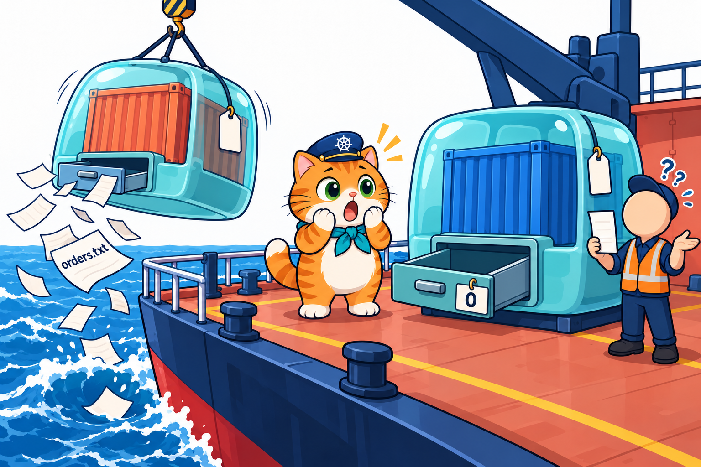
</p>

ในบทที่ 6 ค่าตั้งค่าและรหัสผ่านแยกออกจาก image แล้ว แต่ยังมีของอีกประเภทที่ส่งเข้า Pod ไม่ได้: **ข้อมูลที่แอปเขียนขึ้นเองระหว่างทำงาน** ([บทที่ 6 หัวข้อ 13](../../006_kubernetes_ConfigMap_Secret/01_Theory/README.md#13-ปูทางบทถัดไป))

- **Pod เป็นของชั่วคราว** ([บทที่ 2 หัวข้อ 14](../../002_kubernetes_pod/01_Theory/README.md#14-pod-เป็นของชั่วคราว-และบทถัดไป)) ถูกลบ ถูกแทน ได้ Pod ใหม่ที่ว่างเปล่า
- **เปลี่ยนรุ่นทีไรได้ Pod ใหม่ทุกตัว** ทั้ง rolling update ([บทที่ 4 หัวข้อ 7](../../004_kubernetes_Deployment/01_Theory/README.md#7-rolling-update-ทยอยเปลี่ยนทีละ-pod)) และ `rollout restart` ในบทที่ 6 ยอด `เสิร์ฟไปแล้ว ... ครั้ง` จึงกลับเป็น 0
- ฐานข้อมูลของร้านในบทที่ 2 ใช้ **emptyDir** ([บทที่ 2 หัวข้อ 11](../../002_kubernetes_pod/01_Theory/README.md#11-emptydir-ที่เก็บไฟล์ของ-pod)) ลบ Pod แล้วออเดอร์กลับเป็น 0

> "สมุดออเดอร์อย่าเก็บไว้ใน **ลิ้นชักของกล่อง** ทิ้งกล่องทีไร ลิ้นชักก็ไปด้วย ไปยื่น **ใบขอเช่าล็อกเกอร์** แล้วเก็บสมุดไว้ในล็อกเกอร์ที่ยึดอยู่บนดาดฟ้าเรือดีกว่า" — กัปตันบอก

ทบทวนอุปมาท่าเรือ แล้วเพิ่มตัวละครใหม่ 3 ตัว

<p align="center">
  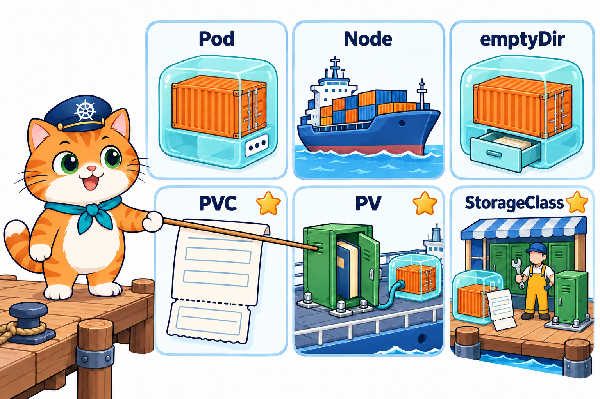
</p>

- **container** = ตู้สินค้า / **Pod** = กล่องโปร่งห่อตู้ มีป้าย IP 1 อัน
- **Node** = เรือ (`lab-worker`, `lab-worker2`) / **Control Plane** = หอบังคับการ
- **Deployment** = ผู้จัดการลูกเรือ / **Service** = พนักงานต้อนรับที่บูธ / **NodePort** = ประตู `30080`
- **ConfigMap** = แฟ้มคู่มือสีฟ้า / **Secret** = ซองปิดผนึกตราแดง (บทที่ 6)
- **emptyDir** = **ลิ้นชักในกล่อง** ทิ้งกล่องเมื่อไร ลิ้นชักไปด้วย (บทที่ 2)
- **PVC** (PersistentVolumeClaim) = **ใบขอเช่าล็อกเกอร์** เขียนว่าขอขนาดเท่าไร ใช้แบบไหน
- **PV** (PersistentVolume) = **ล็อกเกอร์เหล็กสีเขียวที่ยึดติดกับดาดฟ้าเรือลำหนึ่ง** ข้างในมี **สมุดออเดอร์ปกแข็ง** ย้ายไปเรือลำอื่นไม่ได้
- **StorageClass** = **บริษัทให้เช่าล็อกเกอร์ `standard`** มีคนงานชุดหมีสีเหลือง (local-path-provisioner) คอยสร้างล็อกเกอร์ให้เมื่อกล่องแรกมาขอ

> **ขอบเขตบทนี้:** PVC + การสร้าง PV ให้อัตโนมัติ (dynamic provisioning) ด้วย StorageClass `standard` ที่ kind ติดตั้งมาให้ ส่วนการสร้าง PV เองด้วยมือเป็นงานของผู้ดูแลคลัสเตอร์ ที่เก็บแบบใช้ร่วมกันหลายเครื่อง (เช่น NFS) ต้องมีระบบเก็บข้อมูลเพิ่ม และ StatefulSet (ฐานข้อมูลหลายตัวที่แต่ละตัวมีที่เก็บของตัวเอง) ไม่อยู่ในบทนี้

---

## 2. ข้อมูลอยู่ที่ไหนได้บ้าง

<p align="center">
  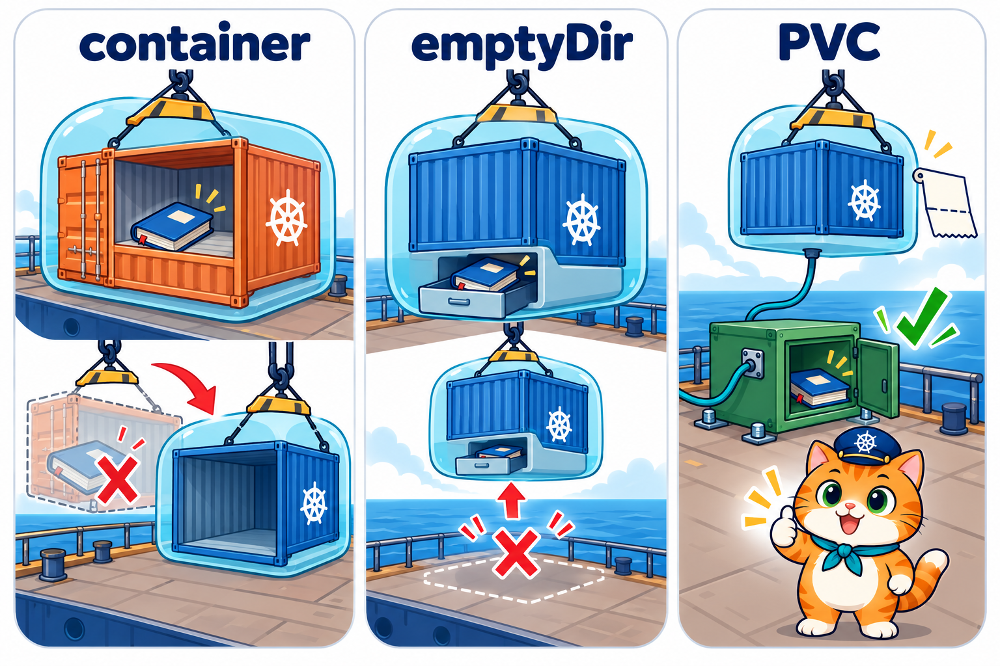
</p>

ไฟล์ที่แอปเขียนอยู่ได้ 3 ที่ แต่ละที่ **อายุไม่เท่ากัน**

| เหตุการณ์ | เขียนใน container เฉย ๆ | emptyDir (บทที่ 2) | PVC (บทนี้) |
|---|---|---|---|
| container ล้มแล้วเริ่มใหม่ (RESTARTS เพิ่ม) | **หาย** | อยู่ | อยู่ |
| ลบ Pod / ได้ Pod ใหม่ตอนเปลี่ยนรุ่น, `rollout restart` | **หาย** | **หาย** | อยู่ |
| ลบ Deployment (Pod หายหมด) | **หาย** | **หาย** | อยู่ |
| ลบ PVC | – | – | **หาย** (หัวข้อ 9) |

- **ใน container** = อายุเท่า container ทุกครั้งที่เริ่มใหม่ ได้ระบบไฟล์จาก image สด ๆ
- **emptyDir** = อายุเท่า **Pod** (ลิ้นชักติดกับกล่อง)
- **PVC** = อายุเท่า **PVC** ซึ่งเป็น object แยกจาก Pod และ Deployment เราลบเองเมื่อไร ข้อมูลถึงหาย

### ผลจริงใน LAB 1: emptyDir vs PVC

LAB 1 ใช้ Pod 2 ตัวที่สั่งงานเหมือนกันทุกตัวอักษร ต่างกันแค่ที่เก็บ (หัวข้อ 5) คำสั่งของ container คือ

```yaml
      command: ["sh", "-c", "echo \"$(date +%T) $(hostname) เปิดสมุด\" >> /data/notes.txt; cat /data/notes.txt; sleep 3600"]
```

- `echo "... เปิดสมุด" >> /data/notes.txt` = เขียน **ต่อท้าย** สมุด 1 บรรทัด (`>>` = ต่อท้าย ไม่ทับ) `$(date +%T)` = เวลา, `$(hostname)` = ชื่อ Pod
- `cat /data/notes.txt` = พิมพ์สมุดทั้งเล่มออก log / `sleep 3600` = นอนรอให้ container ไม่จบ
- ดังนั้น **จำนวนบรรทัดใน log = จำนวนครั้งที่ container เคยเริ่มกับสมุดเล่มนี้**

ลบ Pod แล้ว apply ใหม่ซ้ำ ๆ ได้ผลดังนี้ (เวลาใน log เป็นเวลา UTC ของ container)

```text
$ kubectl logs notes-emptydir          (emptyDir รอบที่ 1)
09:23:10 notes-emptydir เปิดสมุด
$ kubectl logs notes-emptydir          (emptyDir รอบที่ 2 หลังลบ Pod แล้ว apply ใหม่)
09:23:17 notes-emptydir เปิดสมุด          ← เหลือบรรทัดเดียว สมุดเล่มเก่าหายไปกับ Pod

$ kubectl logs notes-pvc-pod           (PVC รอบที่ 3 หลังลบ Pod ไปแล้ว 2 ครั้ง)
09:23:35 notes-pvc-pod เปิดสมุด
09:23:49 notes-pvc-pod เปิดสมุด
09:23:58 notes-pvc-pod เปิดสมุด           ← 1 → 2 → 3 บรรทัด เขียนต่อเล่มเดิม
```

> **ประโยคเดียวที่ต้องจำ:** ข้อมูลที่ต้องอยู่นานกว่า Pod ต้องเขียนลง **โฟลเดอร์ที่ mount จาก PVC** เท่านั้น เขียนที่อื่นใน container หายหมดเมื่อได้ Pod ใหม่

---

## 3. PVC, PV และ StorageClass คืออะไร

<p align="center">
  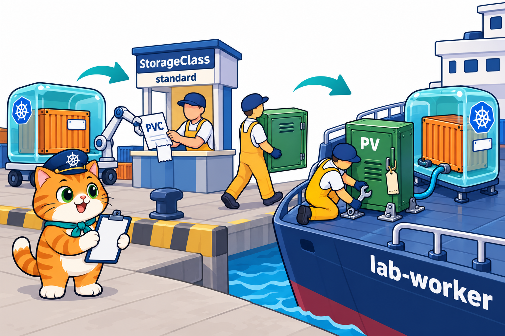
</p>

ที่เก็บถาวรใน Kubernetes มี 3 ตัวละคร **ใครขอ ใครให้ ใครสร้าง**

- **PVC** (PersistentVolumeClaim = "ใบขอที่เก็บถาวร") = **เราเขียน** บอกแค่ "ขอ 100Mi เขียนได้" ไม่ต้องรู้ว่าดิสก์อยู่ที่ไหน Pod อ้าง PVC ด้วย **ชื่อ**
- **PV** (PersistentVolume = "ที่เก็บถาวร") = **ที่เก็บจริง** (ในบทนี้คือโฟลเดอร์บนเรือ) 1 PV ผูกกับ 1 PVC
- **StorageClass** = **แบบของที่เก็บ** บอกว่าใครเป็นคนสร้าง PV และสร้างแบบไหน พอมี PVC ใหม่ มันสร้าง PV ให้อัตโนมัติ (**dynamic provisioning**)

แยก 3 ตัวทำไม: คนเขียนแอปแค่ **ขอ** ส่วน **ที่เก็บจริง** เป็นเรื่องของคลัสเตอร์ PVC ไฟล์เดียวกันใช้ได้ทั้งบน kind และบนคลาวด์ ต่างกันแค่ StorageClass ของแต่ละที่

kind ติดตั้ง StorageClass ไว้ให้แล้วตั้งแต่ `k8s-up` (บรรทัด `Installing StorageClass 💾`) ผลจริงใน LAB 0

```text
$ kubectl get storageclass
NAME                 PROVISIONER             RECLAIMPOLICY   VOLUMEBINDINGMODE      ALLOWVOLUMEEXPANSION   AGE
standard (default)   rancher.io/local-path   Delete          WaitForFirstConsumer   false                  28s

$ kubectl get pods -A
NAMESPACE            NAME                                        READY   STATUS    RESTARTS   AGE
...
local-path-storage   local-path-provisioner-75f7fc7dc5-jwzxb     1/1     Running   0          23s    ← คนงานชุดหมีเหลือง
```

- `NAME` = `standard (default)` ชื่อบริษัท และเป็น **ค่าเริ่มต้น** PVC ที่ไม่ระบุ StorageClass ได้ตัวนี้
- `PROVISIONER` = `rancher.io/local-path` ใครสร้าง PV ให้ = Pod `local-path-provisioner` ซึ่งสร้าง **โฟลเดอร์บน Node**
- `RECLAIMPOLICY` = `Delete` ลบ PVC แล้ว **ลบ PV และข้อมูลทิ้งด้วย** (หัวข้อ 9)
- `VOLUMEBINDINGMODE` = `WaitForFirstConsumer` **รอ Pod แรก** ที่ใช้ PVC ก่อน แล้วค่อยสร้าง PV (หัวข้อ 6)
- `ALLOWVOLUMEEXPANSION` = `false` ขยายขนาดทีหลังไม่ได้

เทียบ 3 ตัวละคร

| | PVC | PV | StorageClass |
|---|---|---|---|
| คืออะไร | ใบขอ (ขนาด + วิธีใช้) | ที่เก็บจริง | แบบ/บริษัทที่สร้างที่เก็บ |
| ใครสร้าง | **เรา** (`kubectl apply`) | provisioner สร้างให้อัตโนมัติ | kind ติดตั้งมาให้ |
| อยู่ใน namespace ไหม | อยู่ (ต้องห้องเดียวกับ Pod) | ไม่ (ของทั้งคลัสเตอร์) | ไม่ (ของทั้งคลัสเตอร์) |
| ดูด้วย | `kubectl get pvc` | `kubectl get pv` | `kubectl get storageclass` |
| ในอุปมา | ใบขอเช่าล็อกเกอร์ | ล็อกเกอร์เหล็กสีเขียวบนเรือ | บริษัทให้เช่า `standard` |
| ในบทนี้ | `notes-pvc`, `som-db-data`, `som-orders` | `pvc-898343c0-...` (ชื่อสุ่ม) | `standard` |

---

## 4. อ่าน YAML ของ PVC ทีละบรรทัด

<p align="center">
  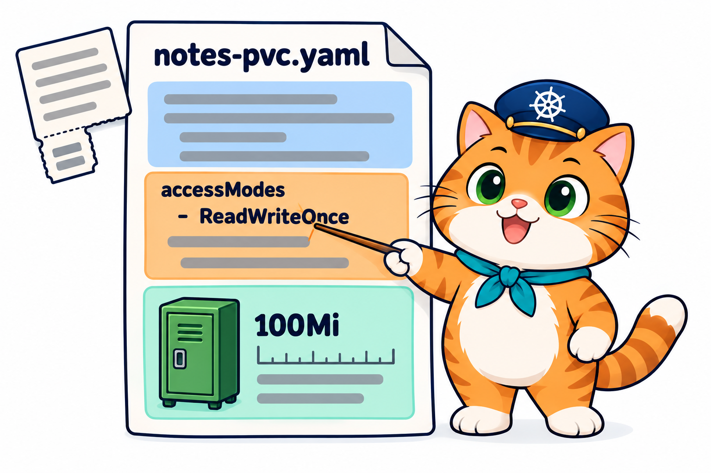
</p>

### 4.1 ทบทวน YAML และสิ่งใหม่ของบทนี้

YAML ของบทนี้ใช้กฎเดิมจาก [บทที่ 2 หัวข้อ 5](../../002_kubernetes_pod/01_Theory/README.md#5-yaml-ฉบับเข้าใจง่าย)

- `key: value` = ค่าเดี่ยว / เยื้องเข้า = **เป็นลูก** / เยื้องเท่ากัน = **เป็นพี่น้อง**
- `- ` (ขีด + เว้นวรรค) = รายการ 1 ชิ้น เช่น `containers`, `volumes`
- `resources` → `requests` เคยเจอแล้วใน [บทที่ 2 หัวข้อ 7.4](../../002_kubernetes_pod/01_Theory/README.md#74-resources-จองที่-และเพดาน) (จอง CPU / memory) บทนี้ใช้จอง **ดิสก์**

สิ่งใหม่ของ YAML บทนี้: **list ของข้อความ** `accessModes:` → `- ReadWriteOnce` เป็น list ที่แต่ละชิ้นเป็นคำเดียว ไม่ใช่ map แบบ `- name: ...` ที่คุ้นกัน

### 4.2 ไล่ไฟล์จริงจาก LAB 1

ไฟล์ `02_LAB/labs/lab01-emptydir-vs-pvc/notes-pvc.yaml`

```yaml
# LAB 1, 2: ใบขอพื้นที่เก็บข้อมูล (PVC) — ขอ 100Mi แล้ว Kubernetes หาที่เก็บถาวรมาให้
apiVersion: v1
kind: PersistentVolumeClaim
metadata:
  name: notes-pvc
spec:
  accessModes:
    - ReadWriteOnce            # เขียนได้จาก Node เดียวในเวลาเดียวกัน
  resources:
    requests:
      storage: 100Mi           # ขนาดที่ขอ
  # ไม่ระบุ storageClassName = ใช้ StorageClass ค่าเริ่มต้นของคลัสเตอร์ (ใน kind คือ standard)
```

อ่านทีละบรรทัด

| บรรทัด | ความหมาย |
|---|---|
| `apiVersion: v1` | PVC อยู่กลุ่มหลัก `v1` (เหมือน Pod, Service, ConfigMap) |
| `kind: PersistentVolumeClaim` | ขอสร้าง **ใบขอที่เก็บ** (P, V, C ตัวใหญ่ เขียนเต็ม ตัวย่อ `pvc` ใช้ได้แค่ใน `kubectl`) |
| `metadata:` → `name: notes-pvc` | ชื่อใบขอ = ชื่อที่ Pod ใช้อ้าง (`claimName: notes-pvc` หัวข้อ 5) |
| `spec:` | สิ่งที่ขอ (PVC มี `spec` ต่างจาก ConfigMap ที่มีแค่ `data`) |
| `  accessModes:` → `- ReadWriteOnce` | วิธีใช้: **เขียนได้จาก Node เดียว** (หัวข้อ 8) เป็น list ขอได้หลายแบบ |
| `  resources:` → `requests:` | ขอจองทรัพยากร |
| `      storage: 100Mi` | ขนาด **100Mi** (Mi = เมบิไบต์ = 1024 × 1024 ไบต์ จึงราว 105 MB) ใหญ่กว่าใช้ `Gi` |
| `# ไม่ระบุ storageClassName` | ไม่ใส่ = ใช้ `standard (default)` ถ้าใส่ต้องสะกดตรงชื่อใน `kubectl get storageclass` |

แปลทั้งไฟล์เป็นประโยคเดียว: **"ขอที่เก็บถาวรชื่อ `notes-pvc` ขนาด 100Mi ให้เขียนได้จาก Node เดียว จากบริษัทค่าเริ่มต้นของคลัสเตอร์"**

- ไฟล์นี้ **ไม่มีคำว่าดิสก์อยู่ที่ไหน** เลย เป็นแค่ใบขอ ที่เก็บจริงถูกสร้างตอนหลัง (หัวข้อ 6)
- `local-path` ของ kind **ไม่ได้จำกัดขนาดจริง** ตัวเลข 100Mi ถูกจดไว้ที่ PV (`CAPACITY 100Mi`) แต่แอปเขียนเกินได้ ระบบเก็บข้อมูลบนคลาวด์จะสร้างดิสก์ขนาดตามที่ขอจริง

### 4.3 ผิดบ่อย แก้ง่าย

| ผิด | ถูก | เพราะ |
|---|---|---|
| `apiVersion: apps/v1` | `apiVersion: v1` | PVC อยู่กลุ่มหลัก ไม่ใช่กลุ่ม `apps` แบบ Deployment |
| `kind: PVC` หรือ `kind: PersistentVolumeclaim` | `kind: PersistentVolumeClaim` | ใน YAML ต้องชื่อเต็ม C ตัวใหญ่ |
| `storage: 100` | `storage: 100Mi` | ไม่มีหน่วย = **100 ไบต์** ไม่ใช่ 100 เมกะ |
| ลืม `accessModes` | ใส่ `- ReadWriteOnce` | apply ไม่ผ่าน PVC ต้องมี access mode อย่างน้อย 1 แบบ |
| `accessModes: ReadWriteOnce` | `accessModes:` แล้ว `- ReadWriteOnce` บรรทัดถัดไป | ต้องเป็น list (มีขีด) apply ไม่ผ่าน |
| `storageClassName: standrad` | `standard` หรือไม่ใส่เลย | **apply ผ่าน** แต่ค้าง `Pending` ตลอด (หัวข้อ 10) |

> **⚠️ กับดัก:** แถวสุดท้ายอันตรายที่สุด เพราะ apply ผ่านเงียบ ๆ เหมือนไม่มีอะไรผิด ต้องดู `kubectl describe pvc` เท่านั้นถึงจะรู้

---

## 5. ต่อ PVC เข้า Pod

<p align="center">
  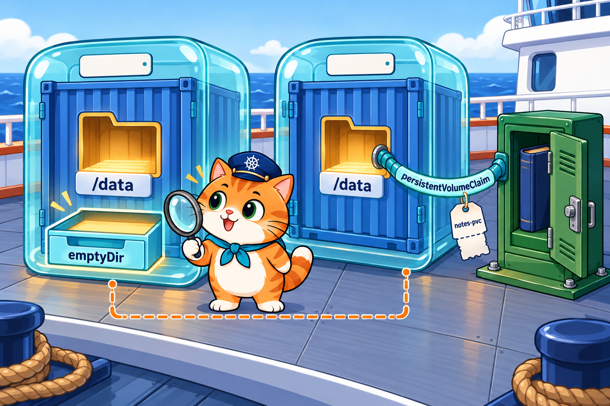
</p>

ใช้ 2 ขั้นเหมือน emptyDir ใน [บทที่ 2 หัวข้อ 11](../../002_kubernetes_pod/01_Theory/README.md#11-emptydir-ที่เก็บไฟล์ของ-pod) และ ConfigMap แบบไฟล์ในบทที่ 6: **ประกาศ volume** ที่ระดับ Pod แล้ว **mount** เข้า container

วาง 2 ไฟล์ของ LAB 1 เทียบกัน (ตัดหัวไฟล์และ `command` ที่เหมือนกันออก)

```yaml
# notes-emptydir-pod.yaml                      # notes-pod.yaml
metadata:                                       metadata:
  name: notes-emptydir                            name: notes-pvc-pod
spec:                                           spec:
  containers:                                     containers:
    - name: busybox                                 - name: busybox
      image: busybox:1.37                             image: busybox:1.37
      volumeMounts:                                   volumeMounts:
        - name: notes                                   - name: notes
          mountPath: /data                                mountPath: /data
  volumes:                                        volumes:
    - name: notes                                   - name: notes
      emptyDir: {}                                    persistentVolumeClaim:   # ← ต่างแค่ 2 บรรทัดนี้
                                                        claimName: notes-pvc
```

(วางข้างกันเพื่ออ่านเทียบ ในไฟล์จริงแยกกันคนละไฟล์ comment ที่มี `←` เพิ่มเพื่ออ่านคู่บทนี้)

- `volumes` → `- name: notes` = ประกาศ volume ชื่อ `notes` ของ Pod
- `persistentVolumeClaim:` → `claimName: notes-pvc` = volume นี้ **มาจาก PVC ชื่อ `notes-pvc`** (ตรงกับ `metadata.name` ของ PVC ในหัวข้อ 4 และต้องอยู่ namespace เดียวกัน)
- `volumeMounts` → `name: notes` + `mountPath: /data` = เสียบ volume `notes` ไว้ที่โฟลเดอร์ `/data` ใน container **เหมือนเดิมทุกตัวอักษร**
- แอปไม่รู้ด้วยซ้ำว่าเปลี่ยนที่เก็บ มันเห็นแค่โฟลเดอร์ `/data` เหมือนเดิม ต่างกันแค่ว่า **โฟลเดอร์นั้นอยู่นอก Pod**

คราวนี้วาง **ใบขอ PVC คู่กับ Pod ที่ใช้มัน** ให้เห็นว่า 2 ไฟล์ต่อกันด้วยชื่อตรงไหน **วงสีเดียวกัน = ค่าที่ต้องตรงกัน**

<p align="center">
  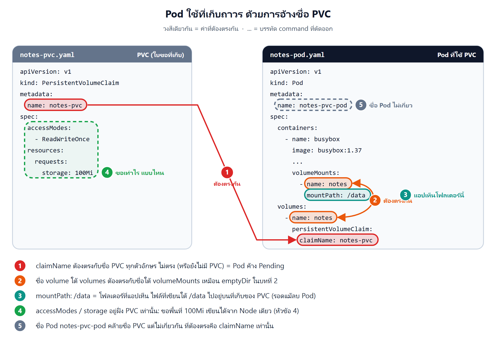
</p>

- **① `claimName` ต้องตรงกับชื่อ PVC** (`notes-pvc`) นี่คือจุดเดียวที่ 2 ไฟล์ต่อกัน
- **② ชื่อ volume ต้องตรงกัน** `notes` ใต้ `volumes` กับใต้ `volumeMounts` เหมือน emptyDir ในบทที่ 2
- **③ `mountPath: /data`** คือโฟลเดอร์ที่แอปเห็น ไฟล์ที่เขียนใต้ `/data` ไปอยู่บนที่เก็บของ PVC
- **④ ขนาดและวิธีเขียน** (`accessModes`, `storage`) อยู่ฝั่ง PVC เท่านั้น Pod ไม่ต้องรู้
- **⑤ ชื่อ Pod ไม่เกี่ยว** `notes-pvc-pod` คล้ายชื่อ PVC แต่ไม่ได้ใช้จับคู่ ที่ต้องตรงคือ `claimName` เท่านั้น

ถ้า Pod อ้าง PVC ที่ยังไม่มี Pod จะค้าง `Pending` (scheduler หาเรือให้ไม่ได้จนกว่าจะมี PVC) ดังนั้นลำดับที่ LAB ใช้คือ **apply PVC ก่อน Pod เสมอ**

> **เคล็ดลับ:** อ่าน YAML ของ Pod แล้วอยากรู้ว่าข้อมูลรอดไหม ให้ไล่ 2 จุด: `volumes` ใช้ชนิดอะไร (`emptyDir` = อายุเท่า Pod, `persistentVolumeClaim` = อายุเท่า PVC) และแอปเขียนไฟล์ลง **ใต้ `mountPath`** หรือเปล่า

---

## 6. วงจรชีวิต: จาก Pending เป็น Bound

<p align="center">
  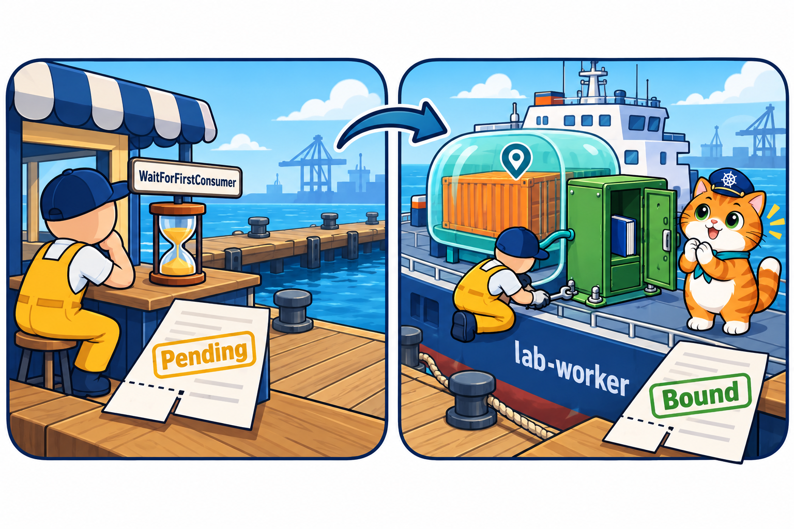
</p>

LAB 2 ดูทีละขั้น เริ่มจาก apply **PVC อย่างเดียว** ยังไม่มี Pod

```text
$ kubectl apply -f labs/lab01-emptydir-vs-pvc/notes-pvc.yaml
$ kubectl get pvc
NAME        STATUS    VOLUME   CAPACITY   ACCESS MODES   STORAGECLASS   VOLUMEATTRIBUTESCLASS   AGE
notes-pvc   Pending                                      standard       <unset>                 5s

$ kubectl describe pvc notes-pvc
Status:        Pending
Events:
  Type    Reason                Age   From                         Message
  ----    ------                ----  ----                         -------
  Normal  WaitForFirstConsumer  5s    persistentvolume-controller  waiting for first consumer to be created before binding

$ kubectl get pv
No resources found
```

- `Pending` + Event **`Normal`** `WaitForFirstConsumer` = **"รอผู้ใช้คนแรก"** เป็นเรื่องปกติ ไม่ใช่ error
- `get pv` ยังว่าง = **ยังไม่มีล็อกเกอร์** บริษัทรับใบขอไว้แล้ว แต่ยังไม่สร้าง

จากนั้น apply Pod ที่ใช้ PVC นี้

```text
$ kubectl apply -f labs/lab01-emptydir-vs-pvc/notes-pod.yaml
$ kubectl get pvc
NAME        STATUS   VOLUME                                     CAPACITY   ACCESS MODES   STORAGECLASS   VOLUMEATTRIBUTESCLASS   AGE
notes-pvc   Bound    pvc-898343c0-d464-48a4-8dc5-f79957ad9b8f   100Mi      RWO            standard       <unset>                 20s

$ kubectl get pv
NAME                                       CAPACITY   ACCESS MODES   RECLAIM POLICY   STATUS   CLAIM               STORAGECLASS   ...   AGE
pvc-898343c0-d464-48a4-8dc5-f79957ad9b8f   100Mi      RWO            Delete           Bound    default/notes-pvc   standard       ...   12s
```

(ตัดคอลัมน์ `VOLUMEATTRIBUTESCLASS`, `REASON` ของ `get pv` ออก ใช้กับฟีเจอร์ที่บทนี้ไม่ใช้)

- PVC เป็น **`Bound`** (ผูกแล้ว) คอลัมน์ `VOLUME` บอกชื่อ PV ที่ได้ / `ACCESS MODES` ย่อ `ReadWriteOnce` เป็น `RWO`
- PV **เพิ่งเกิด** (AGE 12s น้อยกว่า PVC ที่ 20s) ชื่อ `pvc-<รหัสของ PVC>` ตั้งให้อัตโนมัติ
- คอลัมน์ `CLAIM` ของ PV = `default/notes-pvc` บอกว่าผูกกับใบขอใบไหน ห้องไหน (PV ไม่มี namespace ของตัวเอง จึงต้องบอกห้องของ PVC)

### ใครทำอะไร ตั้งแต่ apply จนได้ Bound

1. เรา apply PVC → **persistentvolume-controller** (อยู่ใน controller manager ที่หอบังคับการ) เห็นว่า `standard` เป็นแบบ `WaitForFirstConsumer` จึงจด Event แล้ว **รอ**
2. เรา apply Pod ที่อ้าง `notes-pvc` → **scheduler** เลือกเรือให้ Pod (ได้ `lab-worker`) แล้วจดชื่อเรือลงใน PVC
3. **local-path-provisioner** (คนงานชุดหมีเหลือง) เห็นใบขอที่รู้เรือแล้ว → สร้าง **โฟลเดอร์บนเรือ `lab-worker`** + สร้าง object **PV** ชื่อ `pvc-898343c0-...`
4. **persistentvolume-controller** ผูก PVC ↔ PV → ทั้งคู่ `Bound`
5. **kubelet** บน `lab-worker` mount โฟลเดอร์นั้นเข้า container ที่ `/data` → Pod `Running`

ทำไมต้อง **รอ Pod แรก**: ที่เก็บแบบ local-path เป็นโฟลเดอร์บนเรือลำใดลำหนึ่ง ถ้าสร้างล็อกเกอร์ไว้ก่อนแบบสุ่มเรือ อาจไปยึดบนเรือที่ Pod ลงไม่ได้ (เช่นเรือที่ CPU / memory ไม่พอ) รอให้ scheduler เลือกเรือก่อนแล้วค่อยสร้างตรงนั้นจึงปลอดภัยกว่า (อีกแบบคือ `Immediate` สร้าง PV ทันทีที่มี PVC)

> **ประโยคเดียวที่ต้องจำ:** บน kind PVC ที่เพิ่ง apply ค้าง **`Pending` เป็นเรื่องปกติ** จนกว่าจะมี Pod แรกมาใช้ PV ถึงถูกสร้างและ PVC เป็น `Bound`

---

## 7. ที่เก็บผูกกับเรือลำเดียว

<p align="center">
  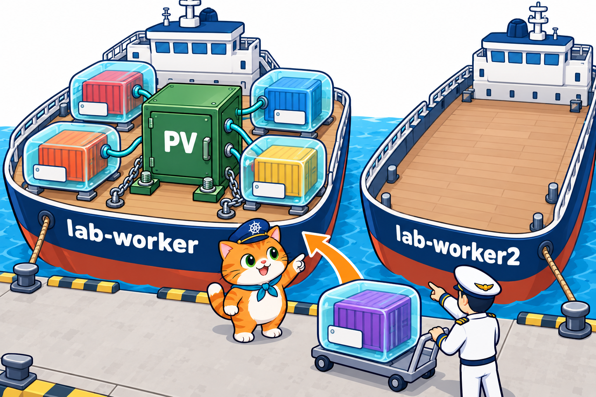
</p>

`describe pv` ใน LAB 2 บอกว่าล็อกเกอร์อยู่ไหน (ตัดบางบรรทัดออก)

```text
$ kubectl describe pv pvc-898343c0-d464-48a4-8dc5-f79957ad9b8f
Annotations:       local.path.provisioner/selected-node: lab-worker      ← สร้างบนเรือ lab-worker
                   pv.kubernetes.io/provisioned-by: rancher.io/local-path
Claim:             default/notes-pvc
Node Affinity:
  Required Terms:
    Term 0:        kubernetes.io/hostname in [lab-worker]             ← ใช้ได้เฉพาะบน lab-worker
Source:
    Type:          HostPath (bare host directory volume)
    Path:          /var/local-path-provisioner/pvc-898343c0-d464-48a4-8dc5-f79957ad9b8f_default_notes-pvc
```

- **`Source` → `HostPath`** = ที่เก็บจริงคือ **โฟลเดอร์บนเครื่องของ Node** ที่ `Path` (ชื่อโฟลเดอร์ = ชื่อ PV + ห้อง + ชื่อ PVC)
- **`Node Affinity`** = กติกาว่า PV นี้ใช้ได้เฉพาะ Node ที่ชื่อ (`kubernetes.io/hostname`) อยู่ในรายการ `[lab-worker]` = **ล็อกเกอร์ยึดติดกับดาดฟ้าเรือ `lab-worker`**
- scheduler อ่านกติกานี้ Pod ไหนใช้ PVC นี้ **ต้องไปลง `lab-worker` เท่านั้น**

### Pod ใหม่ไปลงเรือลำเดิมเสมอ

ใน[บทที่ 3–4](../../004_kubernetes_Deployment/01_Theory/README.md) Pod มักกระจายไปทั้ง `lab-worker` และ `lab-worker2` แต่บทนี้ทุก Pod ที่ใช้ PVC ไปลงเรือลำเดียว (ย่อผล `kubectl get pods -o wide` เหลือคอลัมน์ที่สอน)

```text
LAB 2: ลบ Pod แล้ว apply ใหม่
notes-pvc-pod   1/1   Running   0   15s   10.244.1.5   lab-worker
notes-pvc-pod   1/1   Running   0   6s    10.244.1.6   lab-worker      ← IP ใหม่ เรือเดิม

LAB 4: kubectl scale deployment som-menu --replicas=4
NAME                        READY   STATUS    RESTARTS   AGE   IP            NODE
som-menu-549fb49c45-pbq9p   1/1     Running   0          19s   10.244.1.38   lab-worker
som-menu-549fb49c45-qndcj   1/1     Running   0          8s    10.244.1.41   lab-worker
som-menu-549fb49c45-r9c58   1/1     Running   0          8s    10.244.1.40   lab-worker
som-menu-549fb49c45-x7djd   1/1     Running   0          19s   10.244.1.39   lab-worker   ← ครบ 4 ตัว ลำเดียว
```

### ข้อดีและข้อจำกัดของ local-path

- **ข้อดี:** ไม่ต้องตั้งค่าอะไร เร็ว (เป็นโฟลเดอร์ในเครื่อง) เหมาะกับเรียนและทดสอบ
- **ข้อจำกัด 1:** **เรือล่ม = ข้อมูลอยู่กับเรือ** ถ้า `lab-worker` เสีย Pod ย้ายไป `lab-worker2` ไม่ได้ (ค้าง `Pending`) ข้อมูลก็ไม่ตามไป
- **ข้อจำกัด 2:** scale เพิ่มเท่าไร ทุก Pod ก็เบียดอยู่เรือลำเดียว ไม่ได้กระจายงาน
- **ข้อจำกัด 3:** บน kind ตัว Node เองก็เป็น container ของ Docker สั่ง `k8s-down` ลบคลัสเตอร์ = ลบเรือ = ข้อมูลหายหมด

บนคลาวด์จริง StorageClass มักสร้าง **ดิสก์ผ่านเครือข่าย** ที่ถอดจากเครื่องหนึ่งไปเสียบอีกเครื่องได้ PV จึงย้ายตาม Pod ได้ ไม่ได้ผูกกับเรือลำเดียวแบบ local-path

---

## 8. accessModes: ใครเขียนได้บ้าง

<p align="center">
  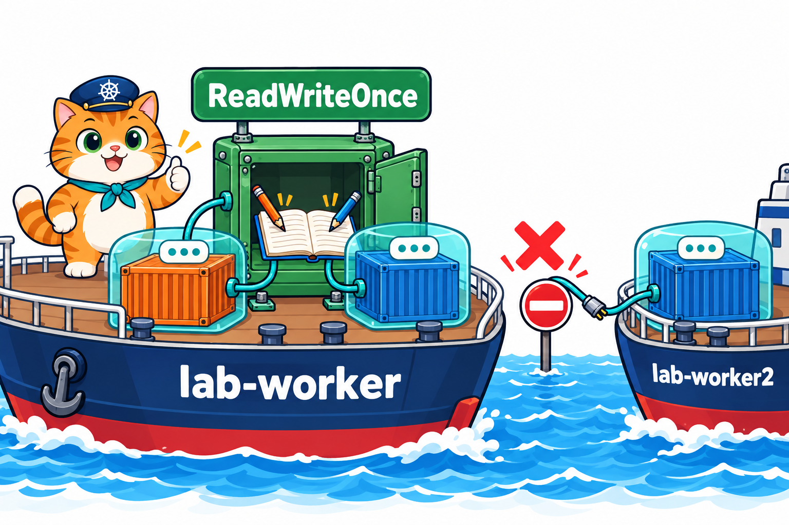
</p>

`accessModes` บอกว่า **ที่เก็บนี้ถูก mount ได้อย่างไร**

- **`ReadWriteOnce` (RWO)** = อ่านเขียนได้จาก **Node เดียว** ในเวลาเดียวกัน ← ทุก PVC ในบทนี้ใช้แบบนี้ และเป็นแบบเดียวที่ local-path ทำได้
- `ReadOnlyMany` (ROX) = หลาย Node อ่านได้อย่างเดียว / `ReadWriteMany` (RWX) = หลาย Node อ่านเขียนได้พร้อมกัน ต้องมีระบบเก็บข้อมูลแบบใช้ร่วม (เช่น NFS) ซึ่ง kind ไม่มี

### "Once" คือ Node เดียว ไม่ใช่ Pod เดียว

จุดที่คนเข้าใจผิดบ่อย: RWO **ไม่ได้แปลว่าใช้ได้ Pod เดียว** Pod หลายตัวบน **เรือลำเดียวกัน** ใช้ล็อกเกอร์เดียวกันได้ทุกตัว LAB 4 scale เป็น 4 แล้วสั่งอาหาร 4 ครั้ง

```text
$ curl -d menu=tuna http://localhost:30080/order
รับออเดอร์ #4 อาหารเม็ดสูตรปลาทูน่า โดย som-menu-549fb49c45-x7djd
รับออเดอร์ #5 อาหารเม็ดสูตรปลาทูน่า โดย som-menu-549fb49c45-qndcj
รับออเดอร์ #6 อาหารเม็ดสูตรปลาทูน่า โดย som-menu-549fb49c45-pbq9p
รับออเดอร์ #7 อาหารเม็ดสูตรปลาทูน่า โดย som-menu-549fb49c45-r9c58
```

- (สั่ง 4 ครั้ง แสดงผลรวมไว้ด้วยกัน) **4 Pod ต่างกัน** เขียนสมุดเล่มเดียวกัน เลขออเดอร์ต่อกัน #4 → #7 เพราะทุก Pod อยู่ `lab-worker` (หัวข้อ 7)
- Service กระจายลูกค้าไปทุกสาขาเหมือนบทที่ 5 แต่ทุกสาขาเปิดสมุดเล่มเดียวกัน ยอดจึงตรงกันทุกสาขา
- แอปร้านน้องส้มแค่ **เขียนต่อท้าย** บรรทัดสั้น ๆ จึงใช้ร่วมกันได้ ฐานข้อมูลจริงห้ามเปิดไฟล์ชุดเดียวกันหลายตัว (หัวข้อ 11)
- ถ้าต้องการจำกัดเหลือ Pod เดียวจริง ๆ มีแบบ `ReadWriteOncePod` แต่บทนี้ไม่ใช้

---

## 9. ลบอะไรแล้วข้อมูลหาย

<p align="center">
  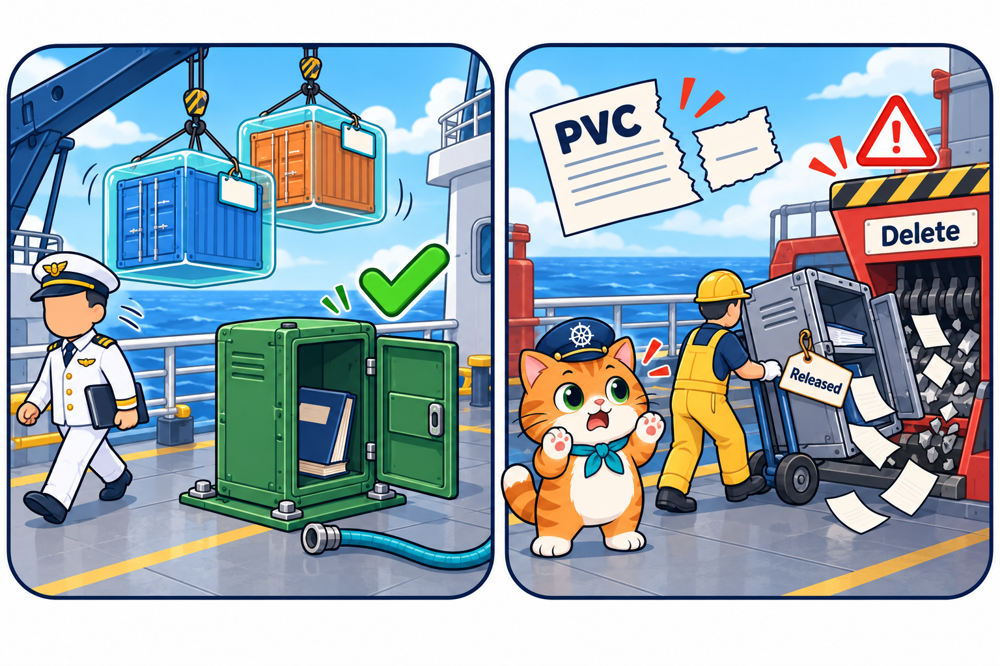
</p>

PVC เป็น object แยกจาก Pod และ Deployment จึง **ลบ Pod หรือ Deployment ข้อมูลไม่หาย** สิ่งเดียวที่ทำให้หายคือ **ลบ PVC**

| ลบอะไร | PVC | ข้อมูล | เห็นใน |
|---|---|---|---|
| Pod (`kubectl delete pod`) | ยัง `Bound` | อยู่ Pod ใหม่อ่านต่อได้ | LAB 1, 2, 3, 4 |
| เปลี่ยน Pod ทั้งชุด (`rollout restart`) | ยัง `Bound` | อยู่ | LAB 3 |
| Deployment (`kubectl delete -f som-menu-deploy.yaml`) | ยัง `Bound` | อยู่ สร้าง Deployment ใหม่ก็ได้สมุดเล่มเดิม | LAB 4 |
| **PVC** (`kubectl delete -f notes-pvc.yaml`) | หาย | PV `Released` แล้วถูกลบ **ข้อมูลหายถาวร** | LAB 2, 4 |

### ลบ PVC แล้วเกิดอะไรขึ้น

ผลจริงใน LAB 2 (ลบ Pod ก่อน แล้วลบ PVC)

```text
$ kubectl delete -f labs/lab01-emptydir-vs-pvc/notes-pvc.yaml
$ kubectl get pv
NAME                                       CAPACITY   ACCESS MODES   RECLAIM POLICY   STATUS     CLAIM               ...
pvc-898343c0-d464-48a4-8dc5-f79957ad9b8f   100Mi      RWO            Delete           Released   default/notes-pvc   ...

$ kubectl get pv                       (5 วินาทีต่อมา)
No resources found
```

1. ใบขอถูกฉีก → PV เปลี่ยนเป็น **`Released`** (ปล่อยแล้ว ไม่มีใบขอผูกอยู่)
2. `RECLAIM POLICY` ของ PV เป็น **`Delete`** (ได้มาจาก StorageClass `standard` หัวข้อ 3) → provisioner **ลบ PV และโฟลเดอร์บนเรือทิ้ง**
3. ไม่มีปุ่มกู้คืน apply `notes-pvc.yaml` ใหม่ได้ PVC ชื่อเดิม แต่ได้ **PV ใหม่ที่ว่างเปล่า**

ถ้า StorageClass ตั้ง `reclaimPolicy: Retain` PV และข้อมูลจะถูกเก็บไว้ให้ผู้ดูแลจัดการเอง แต่ `standard` ของ kind เป็น `Delete`

`describe pvc` มีบรรทัด `Finalizers: [kubernetes.io/pvc-protection]` = ตัวกันลบ ถ้าสั่งลบ PVC ขณะที่ Pod ยังใช้อยู่ PVC จะค้าง `Terminating` จนกว่า Pod นั้นหาย ไม่ได้ถูกดึงออกจาก Pod ที่กำลังทำงาน

> **⚠️ กับดัก:** `kubectl delete -f` ทั้งโฟลเดอร์ หรือไฟล์ที่มี PVC รวมอยู่ = **ลบสมุดออเดอร์ทิ้งถาวร** LAB 4 จึงเก็บกวาดแบบทีละไฟล์ และ **ลบ PVC เป็นอย่างสุดท้าย** เมื่อแน่ใจว่าไม่ต้องการข้อมูลแล้วจริง ๆ

---

## 10. กับดัก: PVC ค้าง Pending

<p align="center">
  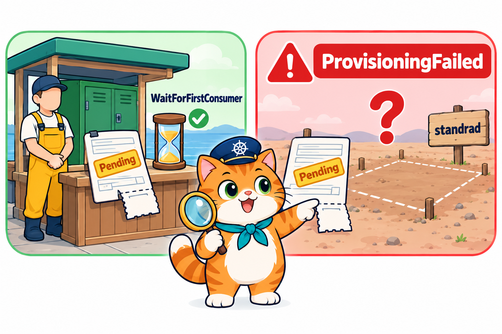
</p>

`kubectl get pvc` เห็น `Pending` เหมือนกันทุกตัวอักษร แต่มี **2 สาเหตุที่ต่างกันมาก** LAB 2 apply `notes-pvc-typo.yaml` ที่สะกด StorageClass ผิด

```yaml
spec:
  storageClassName: standrad   # ← พิมพ์ผิด (ที่ถูกคือ standard)
```

```text
$ kubectl get pvc
NAME             STATUS    VOLUME   CAPACITY   ACCESS MODES   STORAGECLASS   VOLUMEATTRIBUTESCLASS   AGE
notes-pvc-typo   Pending                                      standrad       <unset>                 5s

$ kubectl describe pvc notes-pvc-typo
StorageClass:  standrad
Status:        Pending
Events:
  Type     Reason              Age   From                         Message
  ----     ------              ----  ----                         -------
  Warning  ProvisioningFailed  5s    persistentvolume-controller  storageclass.storage.k8s.io "standrad" not found
```

เทียบกับ `notes-pvc` ในหัวข้อ 6

| | ปกติ: รอ Pod แรก | ผิด: StorageClass ไม่มี |
|---|---|---|
| `get pvc` | `Pending` | `Pending` (เหมือนกัน) |
| Event `Type` | `Normal` | **`Warning`** |
| Event `Reason` | `WaitForFirstConsumer` | **`ProvisioningFailed`** |
| Message | `waiting for first consumer ...` | `storageclass ... "standrad" not found` |
| ต้องทำอะไร | ไม่ต้องทำอะไร apply Pod แล้วจะ `Bound` เอง | แก้ชื่อ แล้ว **ลบ PVC สร้างใหม่** |

วิธีอ่าน: `kubectl describe pvc <ชื่อ>` → ไปที่ `Events` → ดู **`Type` ก่อน** (`Normal` = ตามขั้นตอน / `Warning` = มีปัญหา) → อ่าน `Reason` + `Message` แล้วเทียบชื่อกับ `kubectl get storageclass`

ต่างจาก Pod ที่บางอย่างแก้แล้ว apply ทับได้ **`spec` ของ PVC ส่วนใหญ่แก้ไม่ได้หลังสร้าง** (รวมถึง `storageClassName`) ต้อง `kubectl delete -f` แล้ว apply ไฟล์ที่แก้แล้วใหม่ ซึ่งไม่เสียอะไรเพราะ PVC ที่ค้าง `Pending` ยังไม่มีข้อมูล

> **⚠️ กับดัก:** เห็น `Pending` อย่าเพิ่งตกใจ และอย่าเพิ่งวางใจ ดู **`Type` ของ Event** เสมอ `Normal WaitForFirstConsumer` = รอ Pod / `Warning ProvisioningFailed` = ผิด ต้องแก้

---

## 11. ฐานข้อมูลบน PVC

<p align="center">
  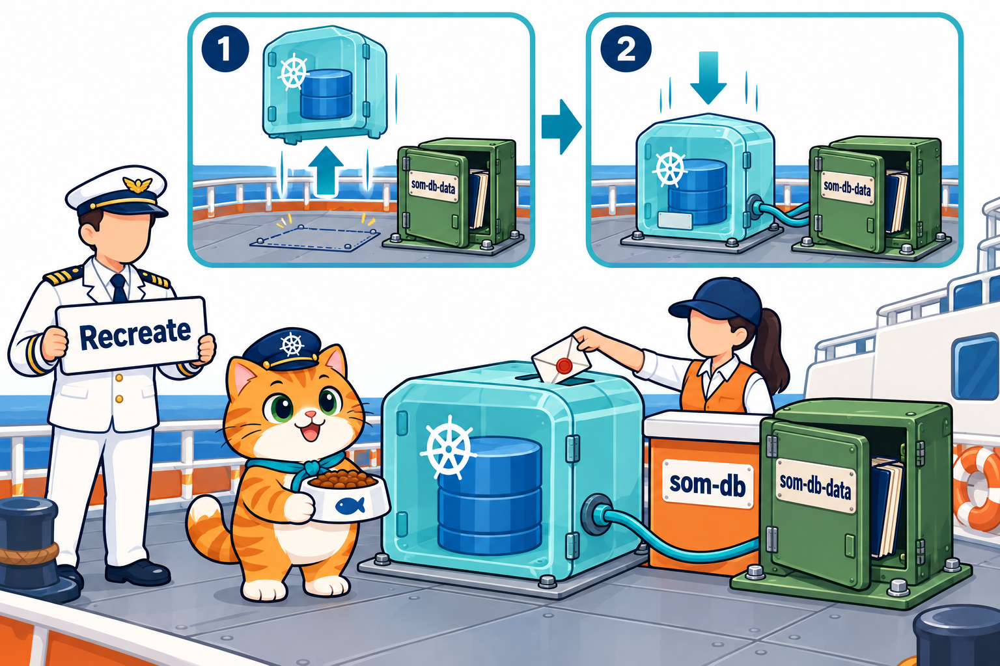
</p>

LAB 3 ย้ายฐานข้อมูล PostgreSQL ของร้าน (บทที่ 2 ใช้ emptyDir) มาไว้บน PVC และใช้ของจากบทที่ 5–6 ครบ 3 ไฟล์ใน `02_LAB/labs/lab03-database/` apply ตามลำดับ **ซอง → ใบขอ → ร้าน**

```text
$ kubectl apply -f labs/lab03-database/db-secret.yaml    → secret/som-db-secret created
$ kubectl apply -f labs/lab03-database/db-pvc.yaml       → persistentvolumeclaim/som-db-data created
$ kubectl apply -f labs/lab03-database/db-deploy.yaml    → deployment.apps/som-db created
                                                           service/som-db created
```

(ผลแต่ละคำสั่งย่อมาไว้ท้ายบรรทัด) `db-secret.yaml` คือ Secret แบบ [บทที่ 6 หัวข้อ 9](../../006_kubernetes_ConfigMap_Secret/01_Theory/README.md#9-secret-คืออะไร-และ-base64) เก็บ `POSTGRES_PASSWORD` (รหัสตัวอย่าง) ส่วน `db-pvc.yaml` หน้าตาเหมือน `notes-pvc.yaml` ทุกบรรทัด ต่างแค่ชื่อ `som-db-data` และขนาด `500Mi`

### อ่าน db-deploy.yaml

```yaml
apiVersion: apps/v1
kind: Deployment
metadata:
  name: som-db
spec:
  replicas: 1                  # ฐานข้อมูลนี้มีได้ตัวเดียว (เขียนไฟล์ชุดเดียวกัน)
  strategy:
    type: Recreate             # เปลี่ยน Pod: ปิดตัวเก่าก่อน แล้วค่อยเปิดตัวใหม่ (ไม่ให้ 2 ตัวเขียนพร้อมกัน)   ← ใหม่
  selector: ...
  template:
    ...
    spec:
      containers:
        - name: postgres
          image: postgres:17-alpine
          env:
            - name: POSTGRES_USER
              value: som
            - name: POSTGRES_DB
              value: catshop
            - name: POSTGRES_PASSWORD   # จาก Secret (บทที่ 6)                          ← บทที่ 6 หัวข้อ 9
              valueFrom:
                secretKeyRef:
                  name: som-db-secret
                  key: POSTGRES_PASSWORD
          ports:
            - containerPort: 5432
          readinessProbe:              # พร้อมเมื่อ pg_isready ตอบว่ารับงานได้ (exec probe บทที่ 2)   ← บทที่ 2 หัวข้อ 10
            exec:
              command: ["pg_isready", "-U", "som", "-d", "catshop"]
            periodSeconds: 5
          volumeMounts:
            - name: data
              mountPath: /var/lib/postgresql/data   # ที่ที่ PostgreSQL เก็บข้อมูล       ← หัวข้อ 5
      volumes:
        - name: data
          persistentVolumeClaim:
            claimName: som-db-data
---
apiVersion: v1
kind: Service
metadata:
  name: som-db                 # แอปอื่นเรียก som-db:5432 ได้ (บทที่ 5)                  ← บทที่ 5 หัวข้อ 7
spec: ...                      # selector app: som-db, port 5432 → targetPort 5432
```

(ตัด comment หัวไฟล์, ป้ายใน `selector` / `template.metadata` และ `spec` ของ Service ออก comment ที่มี `←` เพิ่มเพื่ออ่านคู่บทนี้)

- **`mountPath: /var/lib/postgresql/data`** = โฟลเดอร์ที่ PostgreSQL เก็บตารางและข้อมูลทั้งหมด เอา PVC มาวางตรงนี้พอดี ฐานข้อมูลจึงอยู่บนล็อกเกอร์
- **`readinessProbe` → `exec`** = รันคำสั่ง `pg_isready` ใน container จบด้วย exit 0 = ฐานข้อมูลพร้อมรับงาน Service จึงส่งงานมา
- **Service `som-db`** อยู่ไฟล์เดียวกันคั่นด้วย `---` แอปอื่นในคลัสเตอร์เรียก `som-db:5432` ด้วยชื่อ ไม่ต้องรู้ IP ของ Pod

### ทำไมต้อง `strategy: Recreate`

- ค่าเริ่มต้นของ Deployment คือ **`RollingUpdate`** ([บทที่ 4 หัวข้อ 7](../../004_kubernetes_Deployment/01_Theory/README.md#7-rolling-update-ทยอยเปลี่ยนทีละ-pod)): **เปิด Pod ใหม่ก่อน** แล้วค่อยปิดตัวเก่า ร้านจึงไม่ปิด
- กับฐานข้อมูล = ช่วงสั้น ๆ มี **PostgreSQL 2 ตัวเปิดไฟล์ชุดเดียวกัน** และเพราะทั้งคู่อยู่ `lab-worker` (หัวข้อ 7) RWO ก็ไม่ได้กันไว้ (หัวข้อ 8) ไฟล์ฐานข้อมูลเสียหายได้
- **`Recreate`** = **ปิดตัวเก่าให้หมดก่อน** แล้วค่อยเปิดตัวใหม่ ฐานข้อมูลหยุดรับงานไม่กี่วินาที แลกกับข้อมูลที่ไม่พัง

### ผลจริงใน LAB 3

```text
$ kubectl get pods -o wide
NAME                      READY   STATUS    RESTARTS   AGE   IP           NODE
som-db-558cdd755b-qhv57   1/1     Running   0          24s   10.244.1.9   lab-worker     ← PVC som-db-data 500Mi Bound แล้ว

$ kubectl exec deploy/som-db -- psql -U som -d catshop -c "CREATE TABLE orders (id serial PRIMARY KEY, menu text);"
CREATE TABLE
$ kubectl exec deploy/som-db -- psql -U som -d catshop -c "INSERT INTO orders (menu) VALUES ('ปลาทูน่า'), ('ปลาซาบะ');"
INSERT 0 2
```

- **`kubectl exec deploy/som-db`** (ใหม่) = เข้าไปรันคำสั่งใน Pod ตัวหนึ่งของ Deployment `som-db` **ไม่ต้องพิมพ์ชื่อ Pod** สะดวกมากเพราะชื่อ Pod เปลี่ยนทุกครั้งที่ลบ
- `psql -U som -d catshop -c "..."` = โปรแกรมคุยกับ PostgreSQL ผู้ใช้ `som` ฐานข้อมูล `catshop` รันคำสั่ง SQL 1 คำสั่ง (`CREATE TABLE` สร้างตาราง, `INSERT` เพิ่ม 2 แถว)

ลบ Pod และ `rollout restart` แล้วถามซ้ำ

```text
$ kubectl delete pod som-db-558cdd755b-qhv57
$ kubectl get pods -o wide
som-db-558cdd755b-xf29z   1/1     Running   0          6s    10.244.1.10   lab-worker     ← Pod ใหม่ เรือเดิม

$ kubectl exec deploy/som-db -- psql -U som -d catshop -c "SELECT * FROM orders;"
 id |  menu
----+---------
  1 | ปลาทูน่า
  2 | ปลาซาบะ
(2 rows)                                                                                ← ยังอยู่

$ kubectl rollout restart deployment/som-db
$ kubectl exec deploy/som-db -- psql -U som -d catshop -c "SELECT * FROM orders;"
...
(2 rows)                                                                                ← ยังอยู่
```

ต่างจากบทที่ 2 ที่ลบ Pod แล้วออเดอร์กลับเป็น 0 เพราะไฟล์ฐานข้อมูลอยู่บน PVC ไม่ได้อยู่ในลิ้นชักของกล่อง

> **เคล็ดลับ:** ฐานข้อมูลบน Deployment ให้ใช้ **`replicas: 1` + `strategy: Recreate`** เสมอ ถ้าต้องการฐานข้อมูลหลายตัวที่แต่ละตัวมีที่เก็บของตัวเอง เป็นงานของ StatefulSet (นอกขอบเขตบทนี้)

---

## 12. อ่าน YAML ร้านน้องส้มทั้งไฟล์

<p align="center">
  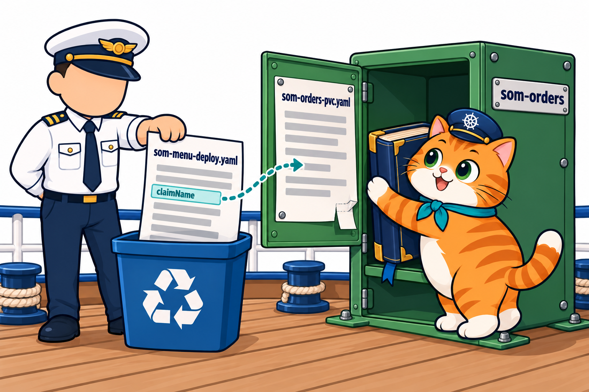
</p>

LAB 4 ใช้ 3 ไฟล์ใน `02_LAB/som-menu/k8s/` apply ทีละไฟล์ **ใบขอมาก่อนร้าน**

```text
$ kubectl apply -f som-menu/k8s/som-orders-pvc.yaml    → persistentvolumeclaim/som-orders created
$ kubectl apply -f som-menu/k8s/som-menu-deploy.yaml   → deployment.apps/som-menu created
$ kubectl apply -f som-menu/k8s/som-menu-svc.yaml      → service/som-menu created
```

- `som-orders-pvc.yaml` หน้าตาเหมือน `notes-pvc.yaml` (หัวข้อ 4) ทุกบรรทัด ต่างแค่ `name: som-orders` และหัวไฟล์เขียนไว้ชัดว่า `PVC แยกจาก Deployment ลบ Deployment แล้วสมุดยังอยู่`
- `som-menu-svc.yaml` คือ Service NodePort `30080` → `3000` ตัวเดิมจากบทที่ 5

### 12.1 โครงของ som-menu-deploy.yaml

```yaml
apiVersion: apps/v1
kind: Deployment
metadata:
  name: som-menu
spec:
  replicas: 2                 # 2 สาขา ใช้สมุดเล่มเดียวกัน
  selector: ...
  template:
    metadata: ...             # ป้าย app: som-menu (Service ใช้ป้ายนี้ บทที่ 5)
    spec:
      containers:
        - name: web
          image: som-menu:1.0
          ports: ...
          volumeMounts: ...   # ← ใหม่: เสียบ volume orders ที่ /data
          readinessProbe: ...
          resources: ...
      volumes: ...            # ← ใหม่: volume orders มาจาก PVC som-orders
```

### 12.2 เปิดดูทีละส่วน

```yaml
        - name: web
          image: som-menu:1.0
          imagePullPolicy: IfNotPresent   # ใช้ image ที่ kind load ไว้บน node
          ports:
            - containerPort: 3000         # ← บทที่ 5: targetPort ของ Service
          volumeMounts:
            - name: orders
              mountPath: /data            # แอปเขียนสมุดที่ /data/orders.txt          ← หัวข้อ 5
          readinessProbe: ...             # ← บทที่ 2 หัวข้อ 10, บทที่ 5 หัวข้อ 12
          resources: ...                  # ← บทที่ 2 หัวข้อ 7.4
      volumes:
        - name: orders
          persistentVolumeClaim:
            claimName: som-orders         # ทุกสาขาใช้ PVC เดียวกัน                    ← หัวข้อ 5, 8
```

(comment ที่มี `←` เพิ่มเพื่ออ่านคู่บทนี้ ในไฟล์จริงไม่มี)

แอป (`02_LAB/som-menu/app/server.js`) เขียนสมุดลงโฟลเดอร์ที่ mount ไว้พอดี

```js
const ORDERS_FILE = process.env.ORDERS_FILE || "/data/orders.txt";   // ← อยู่ใต้ mountPath /data
...
  fs.appendFileSync(ORDERS_FILE, `${time}|${POD_NAME}|${item.name}\n`);   // สั่ง 1 ครั้ง = ต่อท้าย 1 บรรทัด
```

- `mountPath: /data` ↔ `ORDERS_FILE` = `/data/orders.txt` **ต้องตรงกัน** ถ้าแอปเขียนที่อื่น (เช่น `/tmp`) สมุดจะหายเหมือนเดิม
- ยอดในหน้าร้านมาจาก **นับบรรทัดในสมุด** ทุกครั้งที่มีคนเปิดหน้า ไม่ได้นับในหน่วยความจำแบบบทที่ 6 (`let served = 0`)

### 12.3 ทำไม PVC อยู่คนละไฟล์กับ Deployment

LAB 3 รวม Deployment กับ Service ไว้ไฟล์เดียวด้วย `---` ได้ เพราะลบพร้อมกันก็ไม่เสียอะไร แต่ **PVC แยกไฟล์เสมอ**

- `kubectl delete -f som-menu-deploy.yaml` ลบ **เฉพาะ Deployment** สมุดยังอยู่
- ถ้า PVC อยู่ไฟล์เดียวกันกับ Deployment คำสั่งเดียวกันนี้จะ **ลบสมุดไปด้วย** (หัวข้อ 9)
- อายุของร้าน (Deployment) กับอายุของข้อมูล (PVC) **ไม่เท่ากัน** จึงไม่ควรอยู่ไฟล์เดียวกัน

### 12.4 ผลจริงใน LAB 4

สั่ง 3 ออเดอร์ แล้วลบ Pod ทั้งหมด

```text
$ curl -d menu=tuna http://localhost:30080/order
รับออเดอร์ #1 อาหารเม็ดสูตรปลาทูน่า โดย som-menu-549fb49c45-hswf5
...   (สั่ง saba เป็น #2, chicken เป็น #3)
$ curl -d menu=pizza http://localhost:30080/order
ไม่มีเมนูนี้

$ kubectl delete pod -l app=som-menu                    ← ลบทั้ง 5vpzg และ hswf5
$ curl http://localhost:30080/api/orders
{"pod":"som-menu-549fb49c45-76lgj","total":3}           ← Pod ใหม่ ยอดยัง 3
$ kubectl logs som-menu-549fb49c45-76lgj
ร้านอาหารแมวน้องส้ม เปิดสาขา som-menu-549fb49c45-76lgj ที่ port 3000 สมุดออเดอร์มีอยู่แล้ว 3 รายการ
```

ลบ **Deployment ทั้งตัว** แล้วสร้างใหม่

```text
$ kubectl delete -f som-menu/k8s/som-menu-deploy.yaml
$ kubectl get pods
No resources found in default namespace.
$ kubectl get pvc
NAME         STATUS   VOLUME                                     CAPACITY   ACCESS MODES   STORAGECLASS   ...
som-orders   Bound    pvc-3ca10fca-1f75-4642-a122-5204ffe8a7b0   100Mi      RWO            standard       ...   ← ไม่มีร้าน แต่สมุดยังอยู่

$ kubectl apply -f som-menu/k8s/som-menu-deploy.yaml
$ curl http://localhost:30080/api/orders
{"pod":"som-menu-549fb49c45-pbq9p","total":3}           ← ร้านใหม่ สมุดเล่มเดิม
```

- Pod ใหม่ยังขึ้นต้น `som-menu-549fb49c45-` เพราะแม่พิมพ์เหมือนเดิม hash จึงเท่าเดิม ([บทที่ 4 หัวข้อ 5](../../004_kubernetes_Deployment/01_Theory/README.md#5-ชื่อ-pod-3-ท่อน-และเจ้าของ-2-ชั้น))
- จากนั้น scale เป็น 4 → ทุก Pod อยู่ `lab-worker` (หัวข้อ 7) และสั่งเพิ่มได้ #4–#7 รวม 7 รายการ (หัวข้อ 8)
- ภาพหน้าจอจริง: [ยังไม่มีออเดอร์](../02_LAB/images/screenshots/20261018_lab4_01-shop-no-orders.png) · [3 ออเดอร์](../02_LAB/images/screenshots/20261018_lab4_02-shop-3-orders.png) · [หลังสร้างร้านใหม่และ scale](../02_LAB/images/screenshots/20261018_lab4_03-shop-orders-kept.png)

เก็บกวาดท้าย LAB 4 ลบ Service → Deployment → **PVC เป็นอย่างสุดท้าย** แล้ว `get pv` ได้ `No resources found` (สมุดหายถาวรตอนนี้ ตามหัวข้อ 9)

แปลทั้ง Deployment เป็นประโยคเดียว: **"ขอร้าน `som-menu` 2 สาขาจาก image `som-menu:1.0` ทุกสาขาเสียบ PVC `som-orders` ไว้ที่ `/data` จึงเขียนสมุดออเดอร์เล่มเดียวกัน ลบร้านกี่ครั้งสมุดก็ไม่หาย ตราบใดที่ไม่ลบ PVC"**

---

## 13. ปูทางบทถัดไป

<p align="center">
  
</p>

ร้านน้องส้มตอนนี้มีของครบชุด: **Deployment** ดูแลสาขาและเปลี่ยนรุ่น (บทที่ 4) + **Service** ที่อยู่เดียวของร้าน (บทที่ 5) + **ConfigMap / Secret** ค่าตั้งค่าและรหัสผ่าน (บทที่ 6) + **PVC** สมุดออเดอร์และฐานข้อมูลที่อยู่นานกว่า Pod (บทนี้) แต่ยังมีสิ่งที่ขาด

- ลูกค้าเข้าร้านด้วย **เลข port** `http://localhost:30080` ไม่ใช่ชื่อร้านแบบเว็บทั่วไป
- ถ้าร้านมีหลายบริการ (หน้าร้าน หลังร้าน ระบบอื่น) ต้องเปิด **NodePort คนละประตู** และ LAB 0 map ออกมาให้แค่ `30080`–`30082`
- → **Ingress (บทที่ 8)** ประตูหน้าเดียวของท่าเรือ ที่ส่งลูกค้าไปบริการที่ถูกต้องตามชื่อหรือ path
- ฐานข้อมูลหลายตัวที่แต่ละตัวต้องมี **ชื่อและที่เก็บของตัวเอง** ยังทำด้วย Deployment ไม่ได้ (บทนี้ใช้ `replicas: 1`) → เป็นงานของ StatefulSet ในภายหลัง

---

## 14. สรุปและคำถามทบทวน

<p align="center">
  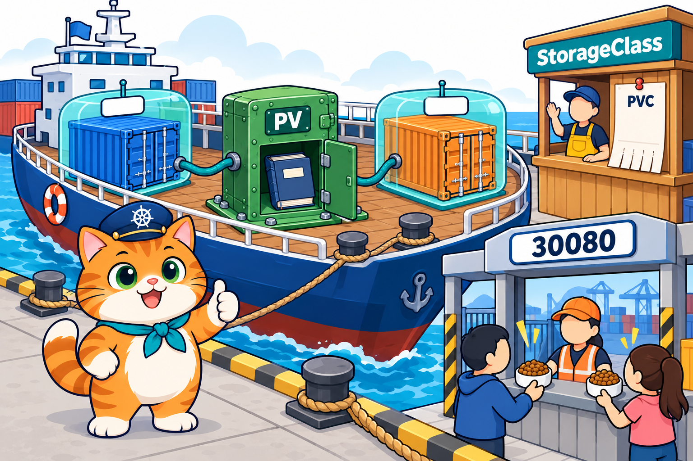
</p>

### สรุป

1. ข้อมูลใน container อายุเท่า container, **emptyDir** อายุเท่า Pod, **PVC** อายุเท่า PVC ลบ Pod / `rollout restart` / ลบ Deployment ข้อมูลบน PVC ยังอยู่
2. **PVC** = ใบขอ (ขนาด + accessModes) ที่เราเขียน, **PV** = ที่เก็บจริง, **StorageClass** = แบบที่สร้าง PV ให้อัตโนมัติ (dynamic provisioning)
3. kind มี StorageClass **`standard (default)`** ของ `rancher.io/local-path` แบบ `Delete` + `WaitForFirstConsumer` สร้างโดย Pod `local-path-provisioner`
4. YAML ของ PVC: `apiVersion: v1`, `kind: PersistentVolumeClaim`, `accessModes` เป็น **list** (`- ReadWriteOnce`), `storage` ต้องมีหน่วย (`100Mi`)
5. ต่อเข้า Pod ด้วย `volumes` → `persistentVolumeClaim.claimName` + `volumeMounts.mountPath` ต่างจาก emptyDir แค่ 2 บรรทัด แอปต้องเขียนไฟล์ **ใต้ mountPath**
6. PVC ใหม่ค้าง **`Pending` (Normal `WaitForFirstConsumer`)** จนมี Pod แรก แล้ว PV `pvc-...` ถูกสร้างและเป็น **`Bound`**
7. PV ของ local-path เป็นโฟลเดอร์บน Node มี **Node Affinity** ผูกกับ `lab-worker` ทุก Pod ที่ใช้ PVC นี้ไปลงเรือลำนั้นเสมอ เรือเสีย = ข้อมูลไปไหนไม่ได้
8. **`ReadWriteOnce`** = เขียนได้จาก **Node เดียว** (ไม่ใช่ Pod เดียว) Pod หลายตัวบนเรือเดียวกันใช้ร่วมกันได้
9. **ลบ PVC** + `reclaimPolicy: Delete` → PV `Released` → ถูกลบ **ข้อมูลหายถาวร** ส่วน `Pending` แบบ **Warning `ProvisioningFailed`** = StorageClass ผิด ต้องลบแล้วสร้างใหม่
10. ฐานข้อมูลบน PVC ใช้ `replicas: 1` + **`strategy: Recreate`** ส่วนการเข้าร้านด้วยชื่อและหลายบริการผ่านประตูเดียว → บทหน้า **Ingress**

### คำถามทบทวน

**1. อ่าน YAML นี้แล้วตอบ: Pod ใช้ PVC ชื่ออะไร mount ไว้ที่ไหน และถ้าลบ Pod แล้วสร้างใหม่ ไฟล์ใน `/cache` กับ `/var/data` อันไหนยังอยู่**

```yaml
spec:
  containers:
    - name: api
      image: cat-api:1.0
      volumeMounts:
        - name: shop-data
          mountPath: /var/data
        - name: tmp
          mountPath: /cache
  volumes:
    - name: shop-data
      persistentVolumeClaim:
        claimName: cat-orders
    - name: tmp
      emptyDir: {}
```

<details>
<summary>แนวคำตอบ</summary>

ใช้ PVC ชื่อ `cat-orders` (จาก `claimName`) mount ไว้ที่ `/var/data` ผ่าน volume ชื่อ `shop-data` ลบ Pod แล้วไฟล์ใน `/var/data` ยังอยู่ (อายุเท่า PVC) ส่วน `/cache` เป็น emptyDir หายไปพร้อม Pod
</details>

**2. PVC นี้ผิดกี่จุด อะไรบ้าง**

```text
apiVersion: apps/v1
kind: PersistentVolumeclaim
metadata:
  name: notes-pvc
spec:
  accessModes: ReadWriteOnce
  resources:
    requests:
      storage: 100
```

<details>
<summary>แนวคำตอบ</summary>

1. `apiVersion: apps/v1` ต้องเป็น `v1`
2. `kind: PersistentVolumeclaim` ต้องเป็น `PersistentVolumeClaim` (C ใหญ่)
3. `accessModes` ต้องเป็น list: `accessModes:` แล้วบรรทัดถัดไป `- ReadWriteOnce`
4. `storage: 100` ไม่มีหน่วย = 100 ไบต์ ควรเป็น `100Mi`
</details>

**3. เพื่อน 2 คนส่งผลมา ทั้งคู่ `kubectl get pvc` ขึ้น `Pending` ใครปกติ ใครผิด ผิดเพราะอะไร แก้อย่างไร**

```text
คนที่ 1:  Normal   WaitForFirstConsumer  persistentvolume-controller  waiting for first consumer to be created before binding
คนที่ 2:  Warning  ProvisioningFailed    persistentvolume-controller  storageclass.storage.k8s.io "fast-ssd" not found
```

<details>
<summary>แนวคำตอบ</summary>

คนที่ 1 ปกติ (`Normal`) StorageClass แบบ `WaitForFirstConsumer` รอ Pod แรก apply Pod ที่ใช้ PVC แล้วจะ `Bound` เอง คนที่ 2 ผิด (`Warning`) คลัสเตอร์ไม่มี StorageClass ชื่อ `fast-ssd` ดูชื่อที่มีด้วย `kubectl get storageclass` แก้ `storageClassName` (หรือลบบรรทัดนั้นเพื่อใช้ค่าเริ่มต้น) แล้วลบ PVC สร้างใหม่ (LAB 2)
</details>

**4. เพื่อนบอกว่า "`ReadWriteOnce` แปลว่าใช้ได้ Pod เดียว" ผลใน LAB 4 แย้งอย่างไร**

<details>
<summary>แนวคำตอบ</summary>

RWO = เขียนได้จาก **Node เดียว** ไม่ใช่ Pod เดียว LAB 4 scale เป็น 4 Pod ทุกตัวอยู่ `lab-worker` และรับออเดอร์ #4–#7 คนละตัว เขียนลงสมุด `som-orders` เล่มเดียวกันได้หมด
</details>

**5. ใน LAB 4 หลัง `kubectl scale deployment som-menu --replicas=4` ทำไม Pod ทั้ง 4 ตัวอยู่ `lab-worker` ไม่กระจายไป `lab-worker2` เหมือนบทที่ 3–4 และมีข้อเสียอะไร**

<details>
<summary>แนวคำตอบ</summary>

PV ของ local-path เป็นโฟลเดอร์บน `lab-worker` มี Node Affinity `kubernetes.io/hostname in [lab-worker]` scheduler จึงวาง Pod ที่ใช้ PVC นี้ได้แค่ลำนั้น ข้อเสีย: งานไม่กระจาย และถ้า `lab-worker` เสีย Pod ย้ายไปเรืออื่นไม่ได้ ข้อมูลติดอยู่กับเรือ
</details>

**6. ใน LAB 4 สั่ง `kubectl delete -f som-menu/k8s/som-menu-deploy.yaml` แล้ว `get pods` ว่าง แต่ `get pvc` ยัง `Bound` พอ apply ใหม่ ยอดออเดอร์เป็นเท่าไร เพราะอะไร**

<details>
<summary>แนวคำตอบ</summary>

ยังเป็น 3 (`{"pod":"som-menu-549fb49c45-pbq9p","total":3}`) เพราะ PVC `som-orders` อยู่คนละไฟล์และเป็น object แยกจาก Deployment ลบ Deployment ลบแค่ Pod สมุดบน PV ยังอยู่ Deployment ใหม่เสียบ PVC เดิมก็อ่านสมุดเล่มเดิม
</details>

**7. เพื่อนย้าย PVC `som-orders` ไปไว้ใน `som-menu-deploy.yaml` ไฟล์เดียวกัน คั่นด้วย `---` "จะได้ apply ครั้งเดียว" แล้ววันหนึ่งสั่ง `kubectl delete -f som-menu-deploy.yaml` เพื่อสร้างร้านใหม่ เกิดอะไรขึ้น**

<details>
<summary>แนวคำตอบ</summary>

PVC ถูกลบไปพร้อม Deployment `reclaimPolicy` ของ `standard` เป็น `Delete` PV จึง `Released` แล้วถูกลบ สมุดออเดอร์หายถาวร apply ใหม่ได้ PVC ชื่อเดิมแต่ PV ใหม่ว่างเปล่า ยอดเป็น 0 เพราะอายุของร้านกับข้อมูลไม่เท่ากัน PVC จึงควรแยกไฟล์
</details>

**8. ใน LAB 2 หลังลบ `notes-pvc` คำสั่ง `kubectl get pv` ขึ้น `Released` แล้วอีก 5 วินาทีขึ้น `No resources found` เกิดอะไรขึ้นกับสมุด `notes.txt`**

<details>
<summary>แนวคำตอบ</summary>

PV ไม่มีใบขอผูกแล้วจึงเป็น `Released` และเพราะ `RECLAIM POLICY` เป็น `Delete` provisioner จึงลบ PV พร้อมโฟลเดอร์บนเรือทิ้ง `notes.txt` หายถาวร (ถ้าเป็น `Retain` PV และข้อมูลจะยังอยู่ให้ผู้ดูแลจัดการ)
</details>

**9. ทำไม `db-deploy.yaml` ใน LAB 3 ใช้ `strategy: Recreate` ถ้าใช้ค่าเริ่มต้น `RollingUpdate` ตอน `rollout restart` จะเสี่ยงอะไร**

<details>
<summary>แนวคำตอบ</summary>

`RollingUpdate` เปิด Pod ใหม่ก่อนปิดตัวเก่า ช่วงนั้นจะมี PostgreSQL 2 ตัวเปิดไฟล์ฐานข้อมูลชุดเดียวกันบน PVC (ทั้งคู่อยู่ `lab-worker` RWO จึงไม่กัน) ไฟล์อาจเสียหาย `Recreate` ปิดตัวเก่าให้หมดก่อนแล้วค่อยเปิดตัวใหม่ แลกกับการหยุดรับงานไม่กี่วินาที
</details>

**10. Deployment ตัวหนึ่ง mount PVC ไว้ที่ `/data` แต่แอปเขียนสมุดไว้ที่ `/app/orders.txt` หลัง `rollout restart` ออเดอร์จะยังอยู่ไหม**

<details>
<summary>แนวคำตอบ</summary>

ไม่อยู่ `/app/orders.txt` ไม่ได้อยู่ใต้ `mountPath` `/data` จึงเป็นไฟล์ใน container เฉย ๆ ได้ Pod ใหม่ก็หาย แก้ให้แอปเขียนที่ `/data/...` (ร้านน้องส้มใช้ `ORDERS_FILE` = `/data/orders.txt`) หรือเปลี่ยน `mountPath` ให้ตรงกับที่แอปเขียน
</details>

---

## เอกสารอ้างอิง

- Kubernetes Docs: [Persistent Volumes](https://kubernetes.io/docs/concepts/storage/persistent-volumes/) · [Storage Classes](https://kubernetes.io/docs/concepts/storage/storage-classes/) · [Dynamic Volume Provisioning](https://kubernetes.io/docs/concepts/storage/dynamic-provisioning/)
- [Configure a Pod to Use a PersistentVolume for Storage](https://kubernetes.io/docs/tasks/configure-pod-container/configure-persistent-volume-storage/) · ที่เก็บแบบ local-path ที่ kind ใช้: [rancher/local-path-provisioner](https://github.com/rancher/local-path-provisioner)

> ภาพประกอบในโฟลเดอร์ [`images/`](images/) สร้างด้วย AI เพื่อการเรียนการสอน (prompt อยู่ใน [`images/imagegen-prompts.md`](images/imagegen-prompts.md)) ผลลัพธ์คำสั่งมาจาก LAB จริงบน kind v0.33.0 / Kubernetes v1.37.0 (ทดลอง 18 ต.ค. 2569) ชื่อ Pod ชื่อ PV และเวลาในเครื่องผู้เรียนจะต่างกัน รหัสผ่านในบทนี้เป็นรหัสตัวอย่าง
