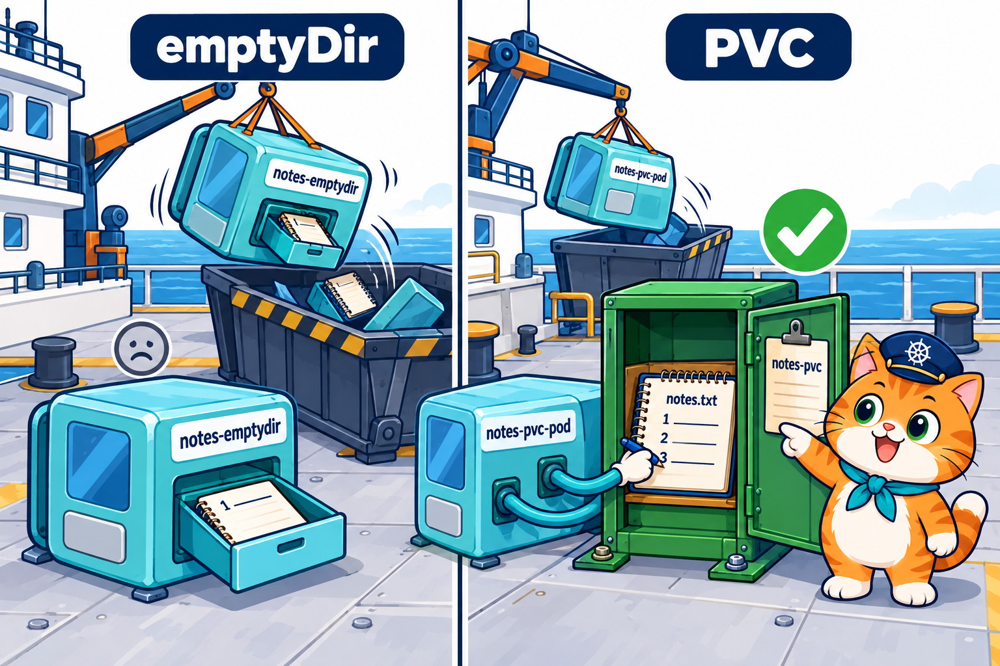
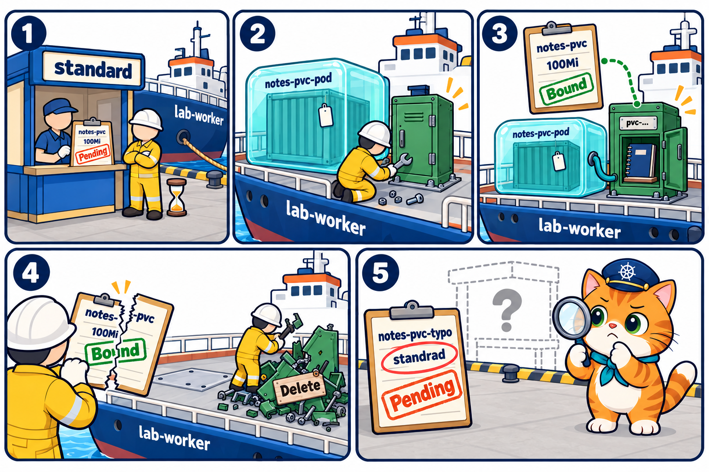
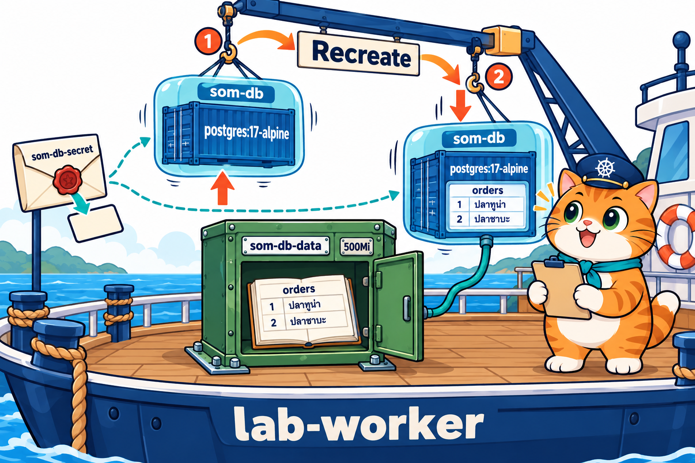
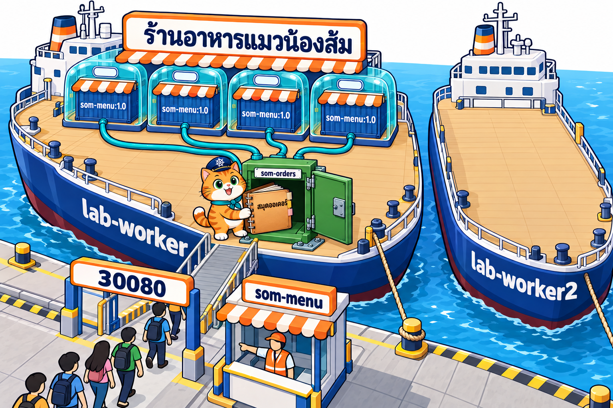
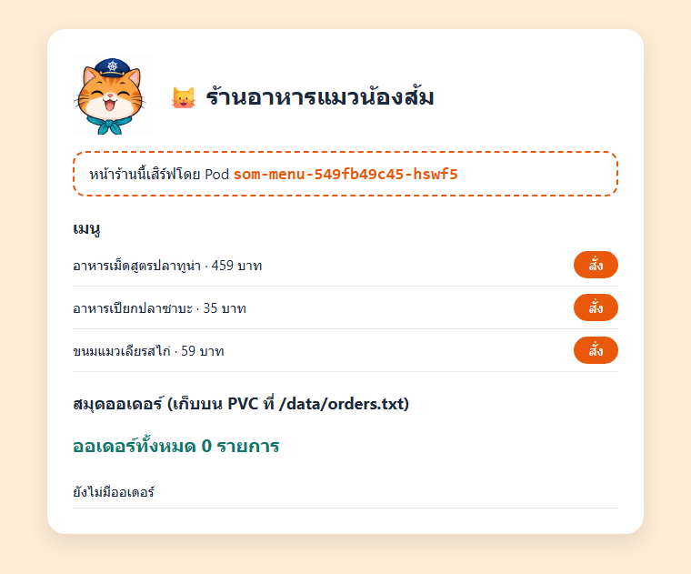
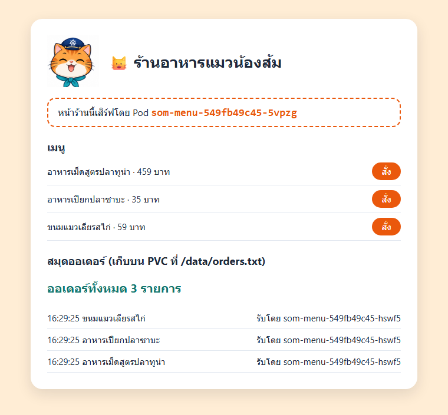
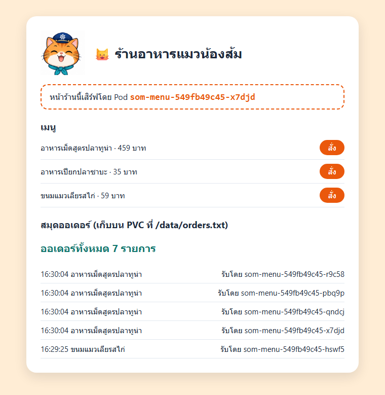
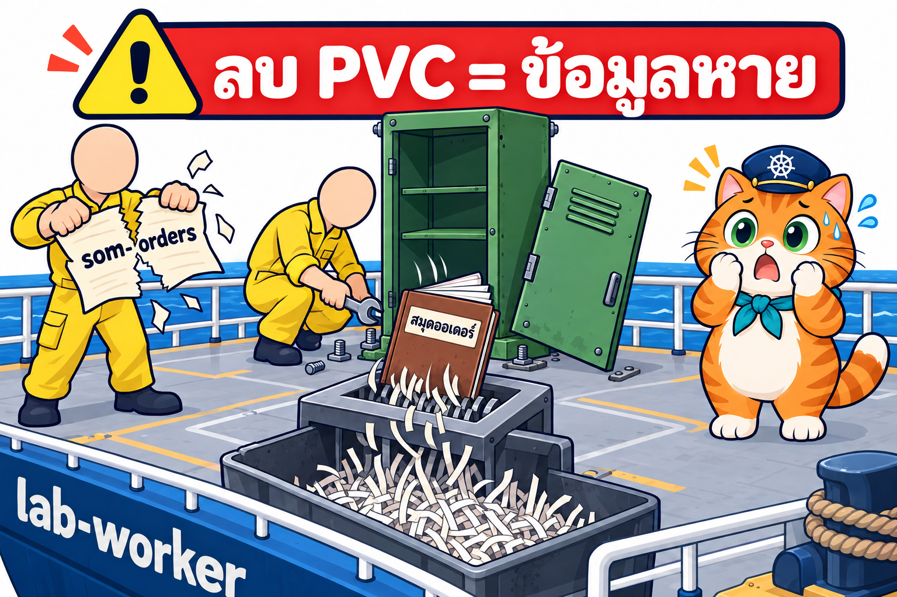

# LAB บทที่ 7: Kubernetes PersistentVolume — สมุดออเดอร์ที่ไม่หาย

> **รายวิชา:** Software Development Tools and Environments (DevTools)
> **หัวข้อ:** ปฏิบัติการ Kubernetes PersistentVolume (PV) และ PersistentVolumeClaim (PVC) — emptyDir ที่หายไปพร้อม Pod เทียบกับ PVC ที่อยู่ต่อ, ใบขอ PVC กับที่เก็บ PV ที่ StorageClass สร้างให้, ฐานข้อมูล PostgreSQL บน PVC และร้านน้องส้มที่สมุดออเดอร์ไม่หายแม้ลบ Deployment ทิ้งทั้งตัว
> **ผลลัพธ์การเรียนรู้ที่เกี่ยวข้อง:** CLO-5, CLO-6
> **ทฤษฎีประกอบ:** [01_Theory/README.md](../01_Theory/README.md)

---

## บทนำ

ทุก LAB ทำ **ใน container `k8s-lab`** (image `tuchsanai/devtools-kind:2569_1` มี kubectl, kind, helm, k9s และ Docker ข้างในครบ) บทที่แล้วร้านน้องส้มแยกค่าตั้งค่าและรหัสผ่านออกจาก image ได้แล้ว แต่ **ข้อมูลที่แอปเขียนขึ้นเองระหว่างทำงาน** ยังหายทุกครั้งที่ได้ Pod ใหม่ (ยอดเสิร์ฟในหน้า `/admin` กลับเป็น 0 หลัง `rollout restart` และฐานข้อมูลในบทที่ 2 ที่เก็บบน emptyDir ก็หายไปพร้อม Pod) บทนี้ใช้ **PersistentVolumeClaim (PVC)** ขอที่เก็บข้อมูลที่ **อายุยาวกว่า Pod** ตั้งแต่เทียบ emptyDir กับ PVC ด้วยสมุดบันทึกเล่มเล็ก, ดูว่า PVC, PV และ StorageClass ทำงานร่วมกันอย่างไร, เก็บฐานข้อมูลบน PVC จนถึง **"ร้านอาหารแมวน้องส้ม"** ที่สมุดออเดอร์อยู่ครบแม้ลบ Pod ทุกตัว และแม้ลบ Deployment ทิ้งทั้งตัว

> บล็อก **Expected output** คือผลที่ควรเห็นหลังรันคำสั่ง (ไม่ต้องพิมพ์ตาม) มาจากการทดลองจริงเมื่อ 18 ต.ค. 2569 (kind v0.33.0, kubectl v1.37.1, Kubernetes v1.37.0) **ชื่อ Pod, ชื่อ PV (`pvc-...`), IP และเวลาในสมุด ถูกสุ่มหรือเปลี่ยนทุกครั้ง** (เช่น `som-menu-549fb49c45-hswf5`, `pvc-898343c0-d464-48a4-8dc5-f79957ad9b8f`) ค่าในเครื่องนักศึกษาจะต่างไป เป็นเรื่องปกติ

| สัญลักษณ์ | รันที่ไหน |
|---|---|
| 🖥️ | Terminal/PowerShell บนเครื่องนักศึกษา |
| 🐧 | SSH session ใน k8s-lab (prompt `root@k8s-lab`) |
| 🌐 | browser บนเครื่องนักศึกษา |

### กติกา

- ทำงานในโฟลเดอร์ `/workspace/DevTools/05_kubernetes/007_kubernetes_PersistentVolume/02_LAB` และ **ลบ Pod, Deployment, Service, Secret และ PVC ของตัวเองทุกครั้งที่จบ LAB**
- **ชื่อ Pod และชื่อ PV ในเครื่องแต่ละคนไม่เหมือนกัน** คำสั่งที่มี `# ← เปลี่ยนเป็น ... ของตัวเอง` ให้แทนด้วยชื่อที่เห็นจาก `kubectl get pods` หรือ `kubectl get pv` ในเครื่องตัวเอง
- **ลบ PVC = ข้อมูลในนั้นหายถาวร** (ไม่มีถังขยะให้กู้คืน) ลบ PVC เฉพาะตอนเก็บกวาดท้าย LAB เท่านั้น บทนี้ไม่ต้องใช้ VS Code เปิดเว็บผ่าน NodePort `http://localhost:30080` แบบบทที่ 5–6

## สารบัญ LAB

| LAB | ชื่อ | เวลาโดยประมาณ | ความยาก |
|:---:|---|:---:|:---:|
| 0 | [เตรียมสภาพแวดล้อม (Setup)](#lab-0-เตรียมสภาพแวดล้อม-setup) (container `k8s-lab` ที่เปิด port NodePort + คลัสเตอร์ + git clone) | 20–30 นาที | ⭐ |
| 1 | [emptyDir หาย vs PVC อยู่](#lab-1-emptydir-หาย-vs-pvc-อยู่) | 25 นาที | ⭐⭐ |
| 2 | [PVC, PV และ StorageClass](#lab-2-pvc-pv-และ-storageclass) | 25 นาที | ⭐⭐⭐ |
| 3 | [ฐานข้อมูลบน PVC](#lab-3-ฐานข้อมูลบน-pvc) | 25 นาที | ⭐⭐⭐ |
| 4 | [LAB สุดท้าย: สมุดออเดอร์ร้านน้องส้มที่ไม่หาย](#lab-4-lab-สุดท้าย-สมุดออเดอร์ร้านน้องส้มที่ไม่หาย) | 45–60 นาที | ⭐⭐⭐⭐⭐ |
| – | [เก็บกวาดหลังจบบท](#เก็บกวาดหลังจบบท) · [สรุปคำสั่ง kubectl ในบทนี้](#สรุปคำสั่ง-kubectl-ในบทนี้) | | |

รวมประมาณ 2.5–3 ชั่วโมง (เครื่องช้าหรือเน็ตช้าอาจนานกว่านี้ เพราะต้องดึง image `busybox`, `postgres` และ `node` จาก Docker Hub)

### สารบัญรูปภาพ

| รูปที่ | เรื่อง | รูปที่ | เรื่อง |
|:---:|---|:---:|---|
| 1 | [LAB 0 Setup container และคลัสเตอร์](#fig-1) | 6 | [LAB 4 ร้านน้องส้มหลายสาขาใช้สมุดออเดอร์เล่มเดียว](#fig-6) |
| 2 | [LAB 0 git clone](#fig-2) | 7 | [ภาพหน้าจอจริง: ร้านเปิดใหม่ ยังไม่มีออเดอร์](#fig-7) |
| 3 | [LAB 1 ลิ้นชัก emptyDir เทียบกับล็อกเกอร์ PVC](#fig-3) | 8 | [ภาพหน้าจอจริง: สมุดออเดอร์มี 3 รายการ](#fig-8) |
| 4 | [LAB 2 ใบขอเช่า PVC, ล็อกเกอร์ PV และบริษัท StorageClass](#fig-4) | 9 | [ภาพหน้าจอจริง: ออเดอร์เดิมยังอยู่หลังลบ Deployment](#fig-9) |
| 5 | [LAB 3 ฐานข้อมูลบน PVC](#fig-5) | 10 | [LAB 4 ลบ PVC = สมุดออเดอร์หายถาวร](#fig-10) |

### โครงสร้างไฟล์ LAB

```text
02_LAB/
├── README.md                     ← เอกสารนี้
├── images/                       ← ภาพประกอบ + screenshots/ ภาพหน้าจอจริง
├── labs/
│   ├── lab01-emptydir-vs-pvc/{notes-emptydir-pod,notes-pvc,notes-pod}.yaml   ← ใช้ใน LAB 1 (notes-pvc, notes-pod ใช้ต่อใน LAB 2)
│   ├── lab02-pv-lifecycle/notes-pvc-typo.yaml                                ← ใช้ใน LAB 2
│   └── lab03-database/{db-secret,db-pvc,db-deploy}.yaml                       ← ใช้ใน LAB 3
└── som-menu/
    ├── app/                      ← เว็บหน้าร้าน Node.js (server.js + Dockerfile) เขียนสมุดออเดอร์ที่ /data/orders.txt
    └── k8s/{som-orders-pvc,som-menu-deploy,som-menu-svc}.yaml
```

---

## LAB 0: เตรียมสภาพแวดล้อม (Setup)

**เป้าหมาย:** สร้าง container `k8s-lab` **ที่เปิด port NodePort `30080–30082` ออกมาถึงเครื่องนักศึกษา** และคลัสเตอร์ kind ชื่อ `lab` (1 control-plane + 2 worker) แล้วดึงไฟล์ LAB มาไว้ใน container (รายละเอียดของแต่ละคำสั่งดูได้จาก [LAB บทที่ 1](../../001_kubernetes-introduction/02_LAB/readme.md))

**ต้องมี:** Docker Desktop (Linux containers, RAM อย่างน้อย 4 GB) และ SSH client

> **ถ้ายังมี container `k8s-lab` จากบทที่ 5 หรือ 6:** container นั้นสร้างด้วย `-p 30080-30082:30080-30082` แล้ว ใช้ต่อได้เลย 🖥️ `docker start k8s-lab` แล้วข้ามไปข้อ 2 (SSH) ถ้าคลัสเตอร์ยังอยู่ก็ข้าม `k8s-up` ได้ แต่ถ้าเป็น container ที่สร้าง **ก่อนบทที่ 5** (ไม่มี `-p 30080-30082:30080-30082`) ให้ลบทิ้งด้วย 🖥️ `docker rm -f k8s-lab` แล้วสร้างใหม่ตามขั้นที่ 1 (ถ้ามีงานของตัวเองเก็บไว้ใน container ให้คัดลอกออกมาก่อน)

### ขั้นที่ 1: Setup container และคลัสเตอร์

<p align="center" id="fig-1">
  <br>
  <em><b>รูปที่ 1</b> LAB0 ขั้นที่ 1: (1) docker run สร้าง container k8s-lab (2) ssh -p 2223 เข้าไปข้างใน (3) รัน k8s-up สร้าง kind cluster ชื่อ lab ได้ 3 node Ready (control-plane 1 ตัว + worker 2 ตัว)</em>
</p>

**1) สร้าง container** 🖥️ **บนเครื่องนักศึกษา** (image ประมาณ 1.5 GB ครั้งแรกใช้เวลาหลายนาที)

```bash
docker pull tuchsanai/devtools-kind:2569_1
```

```bash
docker run -dit --name k8s-lab --hostname k8s-lab --privileged -p 2223:22 -p 8889:8888 -p 30080-30082:30080-30082 tuchsanai/devtools-kind:2569_1
```

- `--privileged` ให้รัน Docker ซ้อนใน container ได้ (kind ต้องใช้) **ขาดไม่ได้**
- `-p 2223:22` เปิดทาง SSH เข้า container ผ่าน port `2223`
- `-p 8889:8888` เปิด JupyterLab ที่ `http://localhost:8889/lab` (ทางเลือก)
- `-p 30080-30082:30080-30082` เปิด port `30080`, `30081`, `30082` ของ container ออกมาที่เครื่องนักศึกษา (แบบบทที่ 5) เป็นทางให้ browser เปิดเว็บผ่าน Service แบบ **NodePort** ใน LAB 4 (`http://localhost:30080`)

หลัง `docker run` **รอสัก 5–10 วินาที** ให้ container เริ่ม sshd และ dockerd ข้างในให้เสร็จก่อน

**2) SSH เข้า container** 🖥️ ครั้งแรกพิมพ์ `yes` แล้วใส่รหัสผ่าน `passwd`

```bash
ssh -p 2223 root@localhost
```

**3) สร้างและตรวจคลัสเตอร์** 🐧 **ใน SSH session ของ k8s-lab** (prompt `root@k8s-lab:~#`)

```bash
time k8s-up
```

**Expected output** (ตัดเฉพาะส่วนสำคัญ)

<pre>
...
 ✓ Installing StorageClass 💾
...
[k8s-up] cluster 'lab' พร้อมใช้งาน (kubectl context: kind-lab)
...
  NodePort ที่ map ออก host: 30080 30081 30082

real	0m29.706s
</pre>

`k8s-up` สร้างคลัสเตอร์ใช้เวลาราว 30 วินาที – 1 นาที สังเกตบรรทัด **`Installing StorageClass`** = kind ติดตั้ง "บริษัทให้เช่าที่เก็บข้อมูล" มาให้ตั้งแต่สร้างคลัสเตอร์ ซึ่งบทนี้จะใช้ทุก LAB

```bash
kubectl get nodes
```

**Expected output**

<pre>
NAME                STATUS   ROLES           AGE   VERSION
lab-control-plane   Ready    control-plane   22s   v1.37.0
lab-worker          Ready    &lt;none&gt;          12s   v1.37.0
lab-worker2         Ready    &lt;none&gt;          12s   v1.37.0
</pre>

```bash
kubectl get pods -A
```

**Expected output**

<pre>
NAMESPACE            NAME                                        READY   STATUS    RESTARTS   AGE
kube-system          coredns-559f6c778d-285f6                    1/1     Running   0          23s
kube-system          coredns-559f6c778d-rtmnc                    1/1     Running   0          23s
kube-system          etcd-lab-control-plane                      1/1     Running   0          30s
kube-system          kindnet-dxnqc                               1/1     Running   0          22s
kube-system          kindnet-lgxm9                               1/1     Running   0          24s
kube-system          kindnet-nch5c                               1/1     Running   0          22s
kube-system          kube-apiserver-lab-control-plane            1/1     Running   0          31s
kube-system          kube-controller-manager-lab-control-plane   1/1     Running   0          30s
kube-system          kube-proxy-qkssx                            1/1     Running   0          22s
kube-system          kube-proxy-sptk2                            1/1     Running   0          24s
kube-system          kube-proxy-xcn6f                            1/1     Running   0          22s
kube-system          kube-scheduler-lab-control-plane            1/1     Running   0          31s
local-path-storage   local-path-provisioner-75f7fc7dc5-jwzxb     1/1     Running   0          23s
</pre>

ถ้า Pod บางตัวยังเป็น `0/1` ให้รอสัก 10 วินาที แล้วสั่งซ้ำ บรรทัดสุดท้าย **`local-path-provisioner`** (namespace `local-path-storage`) คือ **คนที่สร้างที่เก็บข้อมูลให้จริง ๆ ในบทนี้** (คนงานชุดหมีสีเหลืองของบริษัทให้เช่าล็อกเกอร์) บทก่อน ๆ ไม่เคยได้ใช้ บทนี้จะเห็นมันทำงาน

ดู StorageClass ที่คลัสเตอร์มี

```bash
kubectl get storageclass
```

**Expected output**

<pre>
NAME                 PROVISIONER             RECLAIMPOLICY   VOLUMEBINDINGMODE      ALLOWVOLUMEEXPANSION   AGE
standard (default)   rancher.io/local-path   Delete          WaitForFirstConsumer   false                  28s
</pre>

- **`standard (default)`** = StorageClass ชื่อ `standard` เป็น **ค่าเริ่มต้น** PVC ที่ไม่ระบุ StorageClass จะใช้ตัวนี้
- **`PROVISIONER rancher.io/local-path`** = คนสร้างที่เก็บคือ `local-path-provisioner` ข้างบน สร้างเป็นโฟลเดอร์บนดิสก์ของ Node
- **`RECLAIMPOLICY Delete`** = ลบ PVC เมื่อไร ที่เก็บถูกลบตาม (LAB 2 จะเห็นจริง)
- **`VOLUMEBINDINGMODE WaitForFirstConsumer`** = ยังไม่สร้างที่เก็บจนกว่าจะมี **Pod แรก** มาขอใช้ (LAB 2 จะเห็นจริง)

> **✅ ผ่านเมื่อ:** node 3 ตัว `Ready`, Pod ระบบทุกตัวเป็น `1/1 Running` และมี StorageClass `standard (default)`

### ขั้นที่ 2: git clone ไฟล์ LAB

<p align="center" id="fig-2">
  <br>
  <em><b>รูปที่ 2</b> LAB0 ขั้นที่ 2: git clone ดึง repo DevTools มาไว้ที่ /workspace/DevTools ใน k8s-lab แล้ว cd ลงไปจนถึงโฟลเดอร์ 02_LAB ของบทที่ 7 ที่มี labs และ som-menu</em>
</p>

🐧 **ใน SSH session ของ k8s-lab**

```bash
cd /workspace
```

```bash
git clone https://github.com/Tuchsanai/DevTools.git
```

ถ้าเคย clone ไว้แล้วใน container นี้ จะขึ้นว่า `already exists` ให้ `cd DevTools` แล้ว `git pull` แทน จากนั้น `cd /workspace`

```bash
cd DevTools/05_kubernetes/007_kubernetes_PersistentVolume/02_LAB
```

> **✅ ผ่านเมื่อ:** prompt เป็น `root@k8s-lab:/workspace/DevTools/05_kubernetes/007_kubernetes_PersistentVolume/02_LAB#` ทุกคำสั่งที่อ้าง `labs/...` หรือ `som-menu/...` ต้องรันจากโฟลเดอร์นี้

---

## LAB 1: emptyDir หาย vs PVC อยู่

<p align="center" id="fig-3">
  <br>
  <em><b>รูปที่ 3</b> LAB1: ซ้าย emptyDir เป็นลิ้นชักในกล่อง Pod notes-emptydir พอกล่องถูกทิ้ง ลิ้นชักและสมุดก็ไปด้วย กล่องใหม่ได้สมุดเล่มใหม่ที่มีบรรทัดเดียว ขวา สมุด notes.txt อยู่ในล็อกเกอร์สีเขียวของใบขอเช่า notes-pvc กล่อง notes-pvc-pod ถูกทิ้งแล้ว กล่องใหม่มาเขียนต่อเป็นบรรทัดที่ 2 และ 3 ในสมุดเล่มเดิม</em>
</p>

**เป้าหมาย:** เปิด "สมุดบันทึก" เล่มเล็กใน Pod 2 แบบ แบบแรกเก็บบน **emptyDir** (ลิ้นชักในกล่อง บทที่ 2) แบบที่สองเก็บบน **PVC** (ใบขอเช่าล็อกเกอร์) แล้วลบ Pod สร้างใหม่ซ้ำ ๆ ดูว่าสมุดเล่มไหนอยู่ต่อ

🐧 **ใน SSH session ของ k8s-lab** (ทุกขั้นใน LAB 1–3)

### ขั้นที่ 1: สมุดบันทึกบน emptyDir

ไฟล์ `labs/lab01-emptydir-vs-pvc/notes-emptydir-pod.yaml`

```yaml
# LAB 1: สมุดบันทึกบน emptyDir — Pod ถูกลบเมื่อไร สมุดหายไปด้วย (บทที่ 2)
apiVersion: v1
kind: Pod
metadata:
  name: notes-emptydir
spec:
  containers:
    - name: busybox
      image: busybox:1.37
      # ทุกครั้งที่ container เริ่ม: เขียนบรรทัดใหม่ต่อท้ายสมุด แล้วพิมพ์สมุดทั้งเล่มออก log จากนั้นนอนรอ
      command: ["sh", "-c", "echo \"$(date +%T) $(hostname) เปิดสมุด\" >> /data/notes.txt; cat /data/notes.txt; sleep 3600"]
      volumeMounts:
        - name: notes
          mountPath: /data
  volumes:
    - name: notes
      emptyDir: {}             # ที่เก็บชั่วคราว อายุเท่ากับ Pod
```

ทำงานอย่างไร

- Pod `notes-emptydir` จาก `busybox` ทุกครั้งที่ container เริ่ม จะทำ 3 อย่างต่อกัน (คั่นด้วย `;`)
  1. `echo "... เปิดสมุด" >> /data/notes.txt` = **เขียน 1 บรรทัดต่อท้าย** สมุด `/data/notes.txt` (`>>` = ต่อท้าย ไม่ลบของเดิม) บรรทัดมีเวลา (`date +%T`) และชื่อ Pod (`hostname`)
  2. `cat /data/notes.txt` = พิมพ์ **สมุดทั้งเล่ม** ออกมา เราจึงดูสมุดได้ด้วย `kubectl logs`
  3. `sleep 3600` = นอนรอ 1 ชั่วโมง ให้ Pod อยู่ต่อ
- **`volumes` → `emptyDir: {}`** = ลิ้นชักในกล่อง (บทที่ 2) mount ที่ `/data` **อายุเท่ากับ Pod**

```bash
kubectl apply -f labs/lab01-emptydir-vs-pvc/notes-emptydir-pod.yaml
```

**Expected output**

<pre>
pod/notes-emptydir created
</pre>

รอสัก 10 วินาที

```bash
kubectl get pods
```

**Expected output**

<pre>
NAME             READY   STATUS    RESTARTS   AGE
notes-emptydir   1/1     Running   0          10s
</pre>

ดูสมุด (สิ่งที่ Pod พิมพ์ออก log)

```bash
kubectl logs notes-emptydir
```

**Expected output**

<pre>
09:23:10 notes-emptydir เปิดสมุด
</pre>

สมุดมี **1 บรรทัด** เวลาในสมุดเป็นเวลา UTC (ช้ากว่าเวลาไทย 7 ชั่วโมง) ไม่ต้องสนใจ ดูแค่ว่า **เวลาต่างกัน = คนละบรรทัด**

### ขั้นที่ 2: ลบ Pod แล้วสร้างใหม่

```bash
kubectl delete pod notes-emptydir --now
```

**Expected output**

<pre>
pod "notes-emptydir" deleted from default namespace
</pre>

**`--now`** = ลบทันที ไม่ต้องรอครบเวลาผ่อนผัน 30 วินาที (บทที่ 2) ใช้ได้เพราะ `sleep` ใน busybox ไม่ตอบสัญญาณขอปิด (SIGTERM) อยู่แล้ว รอไปก็ไม่ได้อะไร สร้าง Pod ชื่อเดิมใหม่

```bash
kubectl apply -f labs/lab01-emptydir-vs-pvc/notes-emptydir-pod.yaml
```

**Expected output**

<pre>
pod/notes-emptydir created
</pre>

รอสัก 5 วินาที

```bash
kubectl logs notes-emptydir
```

**Expected output**

<pre>
09:23:17 notes-emptydir เปิดสมุด
</pre>

**ยังมีบรรทัดเดียว** และเวลาเปลี่ยนเป็น `09:23:17` = **สมุดเล่มใหม่** บรรทัด `09:23:10` เมื่อกี้หายไปพร้อม Pod เก่า เพราะ emptyDir เป็นลิ้นชักในกล่อง กล่องถูกทิ้ง ลิ้นชักก็ไปด้วย

```bash
kubectl delete pod notes-emptydir --now
```

**Expected output**

<pre>
pod "notes-emptydir" deleted from default namespace
</pre>

### ขั้นที่ 3: ใบขอพื้นที่ PVC และ Pod ที่ใช้ PVC

ไฟล์ `labs/lab01-emptydir-vs-pvc/notes-pvc.yaml`

```yaml
# LAB 1, 2: ใบขอพื้นที่เก็บข้อมูล (PVC) — ขอ 100Mi แล้ว Kubernetes หาที่เก็บถาวรมาให้
apiVersion: v1
kind: PersistentVolumeClaim
metadata:
  name: notes-pvc
spec:
  accessModes:
    - ReadWriteOnce            # เขียนได้จาก Node เดียวในเวลาเดียวกัน
  resources:
    requests:
      storage: 100Mi           # ขนาดที่ขอ
  # ไม่ระบุ storageClassName = ใช้ StorageClass ค่าเริ่มต้นของคลัสเตอร์ (ใน kind คือ standard)
```

ทำงานอย่างไร

- **`kind: PersistentVolumeClaim`** (เรียกสั้น ๆ ว่า **PVC**) = **ใบขอเช่าล็อกเกอร์** ชื่อ `notes-pvc` ไม่ได้เป็นที่เก็บเอง แต่เป็น "คำขอ" ให้ Kubernetes หาที่เก็บมาให้
- **`resources.requests.storage: 100Mi`** = ขอขนาด 100 MiB
- **`accessModes: ReadWriteOnce`** = อ่านเขียนได้จาก **Node เดียว** ในเวลาเดียวกัน (Pod หลายตัวบน Node เดียวกันใช้ร่วมกันได้ LAB 4 จะเห็น)
- ไม่ระบุ `storageClassName` จึงใช้ **`standard`** ที่เป็น `(default)` ใน LAB 0

ไฟล์ `labs/lab01-emptydir-vs-pvc/notes-pod.yaml`

```yaml
# LAB 1, 2: สมุดบันทึกบน PVC — Pod ถูกลบ สมุดยังอยู่ Pod ใหม่เขียนต่อจากเดิม
apiVersion: v1
kind: Pod
metadata:
  name: notes-pvc-pod
spec:
  containers:
    - name: busybox
      image: busybox:1.37
      command: ["sh", "-c", "echo \"$(date +%T) $(hostname) เปิดสมุด\" >> /data/notes.txt; cat /data/notes.txt; sleep 3600"]
      volumeMounts:
        - name: notes
          mountPath: /data
  volumes:
    - name: notes
      persistentVolumeClaim:   # ← ต่างจาก notes-emptydir-pod.yaml ตรงนี้: ใช้ PVC แทน emptyDir
        claimName: notes-pvc
```

ทำงานอย่างไร

- `command` และ `volumeMounts` (`/data`) **เหมือน `notes-emptydir-pod.yaml` ทุกตัวอักษร** แอปไม่รู้เลยว่า `/data` มาจากไหน
- ต่างกันแค่ชื่อ Pod (`notes-pvc-pod`) และ **`volumes`** ที่เปลี่ยนจาก `emptyDir: {}` เป็น **`persistentVolumeClaim: claimName: notes-pvc`** = ใช้ที่เก็บที่ได้จากใบขอ `notes-pvc`

สร้างใบขอก่อน แล้วค่อยสร้าง Pod

```bash
kubectl apply -f labs/lab01-emptydir-vs-pvc/notes-pvc.yaml
```

**Expected output**

<pre>
persistentvolumeclaim/notes-pvc created
</pre>

```bash
kubectl apply -f labs/lab01-emptydir-vs-pvc/notes-pod.yaml
```

**Expected output**

<pre>
pod/notes-pvc-pod created
</pre>

รอสัก 20 วินาที (ครั้งแรกต้องรอสร้างที่เก็บ และอาจต้องดึง image บน Node ที่ยังไม่มี)

```bash
kubectl get pods
```

**Expected output**

<pre>
NAME            READY   STATUS    RESTARTS   AGE
notes-pvc-pod   1/1     Running   0          21s
</pre>

ถ้ายังเป็น `Pending` หรือ `ContainerCreating` ให้รออีก 10 วินาที แล้วสั่งซ้ำ

```bash
kubectl logs notes-pvc-pod
```

**Expected output**

<pre>
09:23:35 notes-pvc-pod เปิดสมุด
</pre>

เริ่มต้นเหมือน emptyDir: สมุด 1 บรรทัด

### ขั้นที่ 4: ลบ Pod แล้วสร้างใหม่ 2 รอบ

```bash
kubectl delete pod notes-pvc-pod --now
```

**Expected output**

<pre>
pod "notes-pvc-pod" deleted from default namespace
</pre>

```bash
kubectl apply -f labs/lab01-emptydir-vs-pvc/notes-pod.yaml
```

**Expected output**

<pre>
pod/notes-pvc-pod created
</pre>

รอสัก 5 วินาที

```bash
kubectl logs notes-pvc-pod
```

**Expected output**

<pre>
09:23:35 notes-pvc-pod เปิดสมุด
09:23:49 notes-pvc-pod เปิดสมุด
</pre>

**2 บรรทัด!** บรรทัดแรก `09:23:35` ของ Pod ตัวที่ถูกลบไปแล้วยังอยู่ Pod ใหม่เปิด **สมุดเล่มเดิม** แล้วเขียนต่อท้าย ลองอีกรอบ

```bash
kubectl delete pod notes-pvc-pod --now
```

**Expected output**

<pre>
pod "notes-pvc-pod" deleted from default namespace
</pre>

```bash
kubectl apply -f labs/lab01-emptydir-vs-pvc/notes-pod.yaml
```

**Expected output**

<pre>
pod/notes-pvc-pod created
</pre>

รอสัก 5 วินาที

```bash
kubectl logs notes-pvc-pod
```

**Expected output**

<pre>
09:23:35 notes-pvc-pod เปิดสมุด
09:23:49 notes-pvc-pod เปิดสมุด
09:23:58 notes-pvc-pod เปิดสมุด
</pre>

**3 บรรทัด** สมุดโตขึ้นทุกครั้งที่ได้ Pod ใหม่ เพราะสมุดอยู่ใน **ล็อกเกอร์ที่ได้จาก PVC** ซึ่งไม่ได้เป็นส่วนหนึ่งของ Pod ทิ้งกล่องไปกี่ใบ ล็อกเกอร์ก็ยังอยู่

### ขั้นที่ 5: ลบทุกอย่างของ LAB 1

ลบ Pod ก่อน แล้วค่อยลบ PVC

```bash
kubectl delete pod notes-pvc-pod --now
```

**Expected output**

<pre>
pod "notes-pvc-pod" deleted from default namespace
</pre>

```bash
kubectl delete -f labs/lab01-emptydir-vs-pvc/notes-pvc.yaml
```

**Expected output**

<pre>
persistentvolumeclaim "notes-pvc" deleted from default namespace
</pre>

ลบ PVC = สมุด 3 บรรทัดนี้ **หายถาวร** (LAB 2 จะดูว่าเกิดอะไรขึ้นข้างหลัง)

### สิ่งที่เห็น

- **emptyDir** อายุเท่ากับ Pod ลบ Pod แล้วสร้างใหม่ได้สมุดเล่มใหม่ (บรรทัดเดียว เวลาใหม่)
- **PVC** = ใบขอที่เก็บข้อมูล Pod อ้างด้วย `persistentVolumeClaim: claimName:` แทน `emptyDir` ส่วน `command` และ `mountPath` ไม่ต้องแก้เลย
- ลบ Pod ที่ใช้ PVC แล้วสร้างใหม่ **สมุดเล่มเดิมยังอยู่** Pod ใหม่เขียนต่อเป็นบรรทัดที่ 2, 3
- `kubectl delete pod <ชื่อ> --now` ลบ Pod ทันทีไม่ต้องรอ 30 วินาที เหมาะกับ Pod ที่ไม่ตอบ SIGTERM อย่าง `sleep`

> **🤔 คำถามชวนคิด:** ขั้นที่ 4 เราลบ Pod เอง ถ้าเปลี่ยนเป็น **container ใน Pod เดิม restart** (Pod ไม่ถูกลบ ชื่อเดิม) สมุดบน emptyDir จะหายหรือไม่ เพราะอะไร (นึกถึงว่า emptyDir อายุเท่ากับอะไร)

---

## LAB 2: PVC, PV และ StorageClass

<p align="center" id="fig-4">
  <br>
  <em><b>รูปที่ 4</b> LAB2: (1) ใบขอเช่า notes-pvc 100Mi วางที่บริษัท standard ถูกประทับ Pending (2) พอกล่อง notes-pvc-pod มาถึงเรือ lab-worker คนงานชุดหมีเหลืองจึงสร้างล็อกเกอร์สีเขียวยึดกับดาดฟ้าเรือลำนั้น (3) ใบขอเปลี่ยนเป็น Bound ผูกกับล็อกเกอร์ pvc-... (4) ฉีกใบขอ ล็อกเกอร์ถูกรื้อทิ้งตาม Delete (5) ใบขอที่เขียนชื่อบริษัทผิดเป็น standrad ไม่มีใครรับ ค้าง Pending</em>
</p>

**เป้าหมาย:** ดูทีละขั้นว่าใบขอ **PVC** ได้ที่เก็บ **PV** (PersistentVolume) มาจากไหน **StorageClass** สร้าง PV ให้ตอนไหน ที่เก็บอยู่ที่ไหน และเกิดอะไรขึ้นกับ PV เมื่อลบ PVC รวมถึงใบขอที่ระบุ StorageClass ผิด

ใช้ไฟล์ `notes-pvc.yaml` และ `notes-pod.yaml` **ชุดเดิมจาก [LAB 1 ขั้นที่ 3](#ขั้นที่-3-ใบขอพื้นที่-pvc-และ-pod-ที่ใช้-pvc)** คราวนี้ apply **ทีละไฟล์แล้วหยุดดูระหว่างทาง**

### ขั้นที่ 1: ใบขอที่ยังไม่มีใครมาใช้

```bash
kubectl apply -f labs/lab01-emptydir-vs-pvc/notes-pvc.yaml
```

**Expected output**

<pre>
persistentvolumeclaim/notes-pvc created
</pre>

รอสัก 5 วินาที

```bash
kubectl get pvc
```

**Expected output**

<pre>
NAME        STATUS    VOLUME   CAPACITY   ACCESS MODES   STORAGECLASS   VOLUMEATTRIBUTESCLASS   AGE
notes-pvc   Pending                                      standard       &lt;unset&gt;                 5s
</pre>

**`STATUS Pending`** และช่อง `VOLUME` ว่าง = ใบขอยังไม่ได้ที่เก็บ `STORAGECLASS standard` = ใช้ค่าเริ่มต้นตามที่ LAB 0 เห็น ดูว่าทำไม

```bash
kubectl describe pvc notes-pvc
```

**Expected output**

<pre>
Name:          notes-pvc
Namespace:     default
StorageClass:  standard
Status:        Pending
Volume:        
Labels:        &lt;none&gt;
Annotations:   &lt;none&gt;
Finalizers:    [kubernetes.io/pvc-protection]
Capacity:      
Access Modes:  
VolumeMode:    Filesystem
Used By:       &lt;none&gt;
Events:
  Type    Reason                Age   From                         Message
  ----    ------                ----  ----                         -------
  Normal  WaitForFirstConsumer  5s    persistentvolume-controller  waiting for first consumer to be created before binding
</pre>

- Event **`WaitForFirstConsumer`** (`Normal` ไม่ใช่ error) = **รอ Pod แรกที่จะใช้ใบขอนี้** ก่อน ตรงกับ `VOLUMEBINDINGMODE WaitForFirstConsumer` ของ StorageClass `standard` ใน LAB 0
- ทำไมต้องรอ: ที่เก็บแบบ local-path เป็นโฟลเดอร์บนดิสก์ของ **Node ใด Node หนึ่ง** ถ้าสร้างก่อนรู้ว่า Pod จะไปอยู่ Node ไหน อาจได้ที่เก็บคนละ Node กับ Pod
- `Used By: <none>` = ยังไม่มี Pod ใช้ ส่วน `Finalizers: [kubernetes.io/pvc-protection]` = **กันไม่ให้ PVC ถูกลบจริงขณะที่ยังมี Pod ใช้อยู่** (LAB 4 จะเห็นผล)

```bash
kubectl get pv
```

**Expected output**

<pre>
No resources found
</pre>

ยัง **ไม่มี PV** (ที่เก็บจริง) สักตัว ไม่มี namespace ต่อท้ายเพราะ PV เป็นของ **ทั้งคลัสเตอร์** ไม่อยู่ใน namespace ไหน

### ขั้นที่ 2: Pod แรกมาถึง ได้ PV ทันที

```bash
kubectl apply -f labs/lab01-emptydir-vs-pvc/notes-pod.yaml
```

**Expected output**

<pre>
pod/notes-pvc-pod created
</pre>

รอสัก 15 วินาที

```bash
kubectl get pvc
```

**Expected output**

<pre>
NAME        STATUS   VOLUME                                     CAPACITY   ACCESS MODES   STORAGECLASS   VOLUMEATTRIBUTESCLASS   AGE
notes-pvc   Bound    pvc-898343c0-d464-48a4-8dc5-f79957ad9b8f   100Mi      RWO            standard       &lt;unset&gt;                 20s
</pre>

**`STATUS Bound`** = ใบขอ **ผูก** กับที่เก็บแล้ว ช่อง `VOLUME` คือชื่อ PV ที่ได้ ขนาด `100Mi` ตามที่ขอ `RWO` = ReadWriteOnce

```bash
kubectl get pv
```

**Expected output**

<pre>
NAME                                       CAPACITY   ACCESS MODES   RECLAIM POLICY   STATUS   CLAIM               STORAGECLASS   VOLUMEATTRIBUTESCLASS   REASON   AGE
pvc-898343c0-d464-48a4-8dc5-f79957ad9b8f   100Mi      RWO            Delete           Bound    default/notes-pvc   standard       &lt;unset&gt;                          12s
</pre>

- มี **PV 1 ตัว** ชื่อ `pvc-...` ที่ **เราไม่ได้เขียน YAML เลย** StorageClass `standard` สร้างให้อัตโนมัติตอน Pod แรกมาถึง (เรียกว่า dynamic provisioning)
- `CLAIM default/notes-pvc` = PV ตัวนี้เป็นของใบขอ `notes-pvc` ใน namespace `default`
- **`RECLAIM POLICY Delete`** = ถ้าลบใบขอ PV นี้จะถูกลบตาม (ขั้นที่ 4)

```bash
kubectl describe pv pvc-898343c0-d464-48a4-8dc5-f79957ad9b8f    # ← เปลี่ยนเป็นชื่อ PV ของตัวเอง (จาก kubectl get pv)
```

**Expected output**

<pre>
Name:              pvc-898343c0-d464-48a4-8dc5-f79957ad9b8f
Labels:            &lt;none&gt;
Annotations:       local.path.provisioner/selected-node: lab-worker
                   pv.kubernetes.io/provisioned-by: rancher.io/local-path
Finalizers:        [kubernetes.io/pv-protection]
StorageClass:      standard
Status:            Bound
Claim:             default/notes-pvc
Reclaim Policy:    Delete
Access Modes:      RWO
VolumeMode:        Filesystem
Capacity:          100Mi
Node Affinity:     
  Required Terms:  
    Term 0:        kubernetes.io/hostname in [lab-worker]
Message:           
Source:
    Type:          HostPath (bare host directory volume)
    Path:          /var/local-path-provisioner/pvc-898343c0-d464-48a4-8dc5-f79957ad9b8f_default_notes-pvc
    HostPathType:  DirectoryOrCreate
Events:            &lt;none&gt;
</pre>

- `provisioned-by: rancher.io/local-path` = สร้างโดย `local-path-provisioner` ที่เห็นใน LAB 0 และ `selected-node: lab-worker` = สร้างไว้บน Node **`lab-worker`**
- **`Source` → `Path`** = ที่เก็บจริงคือ **โฟลเดอร์ `/var/local-path-provisioner/pvc-..._default_notes-pvc` บนดิสก์ของ Node `lab-worker`** สมุด `notes.txt` อยู่ในโฟลเดอร์นี้
- **`Node Affinity: kubernetes.io/hostname in [lab-worker]`** = PV นี้ใช้ได้ **เฉพาะบน `lab-worker`** Pod ไหนจะใช้ต้องไปอยู่ Node นี้ (ล็อกเกอร์ยึดติดกับดาดฟ้าเรือลำนี้ ย้ายเรือไม่ได้)

ในเครื่องนักศึกษา Node อาจเป็น `lab-worker2` ก็ได้ ขึ้นกับว่า Pod แรกไปอยู่ Node ไหน

```bash
kubectl get pods -o wide
```

**Expected output**

<pre>
NAME            READY   STATUS    RESTARTS   AGE   IP           NODE         NOMINATED NODE   READINESS GATES
notes-pvc-pod   1/1     Running   0          15s   10.244.1.5   lab-worker   &lt;none&gt;           &lt;none&gt;
</pre>

Pod อยู่ `lab-worker` ตรงกับ `selected-node` ของ PV

### ขั้นที่ 3: Pod ใหม่ต้องไปอยู่ Node เดิม

```bash
kubectl delete pod notes-pvc-pod --now
```

**Expected output**

<pre>
pod "notes-pvc-pod" deleted from default namespace
</pre>

```bash
kubectl apply -f labs/lab01-emptydir-vs-pvc/notes-pod.yaml
```

**Expected output**

<pre>
pod/notes-pvc-pod created
</pre>

รอสัก 5 วินาที

```bash
kubectl get pods -o wide
```

**Expected output**

<pre>
NAME            READY   STATUS    RESTARTS   AGE   IP           NODE         NOMINATED NODE   READINESS GATES
notes-pvc-pod   1/1     Running   0          6s    10.244.1.6   lab-worker   &lt;none&gt;           &lt;none&gt;
</pre>

Pod ใหม่ (IP เปลี่ยนเป็น `10.244.1.6`) **ยังอยู่ `lab-worker`** ไม่ใช่เรื่องบังเอิญ scheduler อ่าน `Node Affinity` ของ PV แล้ว **ต้องวาง Pod บน Node ที่มีที่เก็บอยู่** เท่านั้น ลองลบสร้างใหม่กี่ครั้งก็ได้ Node เดิม

### ขั้นที่ 4: ลบ PVC แล้ว PV เป็นอย่างไร

```bash
kubectl delete pod notes-pvc-pod --now
```

**Expected output**

<pre>
pod "notes-pvc-pod" deleted from default namespace
</pre>

```bash
kubectl delete -f labs/lab01-emptydir-vs-pvc/notes-pvc.yaml
```

**Expected output**

<pre>
persistentvolumeclaim "notes-pvc" deleted from default namespace
</pre>

ดู PV **ทันที**

```bash
kubectl get pv
```

**Expected output**

<pre>
NAME                                       CAPACITY   ACCESS MODES   RECLAIM POLICY   STATUS     CLAIM               STORAGECLASS   VOLUMEATTRIBUTESCLASS   REASON   AGE
pvc-898343c0-d464-48a4-8dc5-f79957ad9b8f   100Mi      RWO            Delete           Released   default/notes-pvc   standard       &lt;unset&gt;                          25s
</pre>

**`STATUS Released`** = ใบขอที่เป็นเจ้าของถูกลบแล้ว PV ถูกปล่อย เพราะ `RECLAIM POLICY Delete` จึงกำลังจะถูกลบตาม รอสัก 5 วินาที

```bash
kubectl get pv
```

**Expected output**

<pre>
No resources found
</pre>

**PV หายไปแล้ว** `local-path-provisioner` ลบ PV และ **ลบโฟลเดอร์บน Node ทิ้ง** สมุด `notes.txt` ข้างในหายจริง กู้คืนไม่ได้ นี่คือเหตุผลของกติกา **"ลบ PVC = ข้อมูลหาย"**

### ขั้นที่ 5: ใบขอที่เขียนชื่อ StorageClass ผิด

ไฟล์ `labs/lab02-pv-lifecycle/notes-pvc-typo.yaml`

```yaml
# LAB 2: ใบขอพื้นที่ที่ระบุ StorageClass ผิดชื่อ — ไม่มีใครมาสร้างที่เก็บให้ PVC จึงค้าง Pending
apiVersion: v1
kind: PersistentVolumeClaim
metadata:
  name: notes-pvc-typo
spec:
  storageClassName: standrad   # ← พิมพ์ผิด (ที่ถูกคือ standard)
  accessModes:
    - ReadWriteOnce
  resources:
    requests:
      storage: 100Mi
```

ทำงานอย่างไร

- เหมือน `notes-pvc.yaml` แต่ชื่อ `notes-pvc-typo` และ **ระบุ `storageClassName` เอง** เป็น **`standrad`** (สลับตัว `a` กับ `r`) ซึ่งไม่มีในคลัสเตอร์

```bash
kubectl apply -f labs/lab02-pv-lifecycle/notes-pvc-typo.yaml
```

**Expected output**

<pre>
persistentvolumeclaim/notes-pvc-typo created
</pre>

Kubernetes รับใบขอไว้ตามปกติ ไม่ได้ตรวจว่ามี StorageClass ชื่อนี้หรือไม่ รอสัก 5 วินาที

```bash
kubectl get pvc
```

**Expected output**

<pre>
NAME             STATUS    VOLUME   CAPACITY   ACCESS MODES   STORAGECLASS   VOLUMEATTRIBUTESCLASS   AGE
notes-pvc-typo   Pending                                      standrad       &lt;unset&gt;                 5s
</pre>

`Pending` เหมือนขั้นที่ 1 แต่สาเหตุต่างกัน ดู Events

```bash
kubectl describe pvc notes-pvc-typo
```

**Expected output**

<pre>
Name:          notes-pvc-typo
Namespace:     default
StorageClass:  standrad
Status:        Pending
Volume:        
Labels:        &lt;none&gt;
Annotations:   &lt;none&gt;
Finalizers:    [kubernetes.io/pvc-protection]
Capacity:      
Access Modes:  
VolumeMode:    Filesystem
Used By:       &lt;none&gt;
Events:
  Type     Reason              Age   From                         Message
  ----     ------              ----  ----                         -------
  Warning  ProvisioningFailed  5s    persistentvolume-controller  storageclass.storage.k8s.io "standrad" not found
</pre>

**`Warning ProvisioningFailed`** + **`storageclass.storage.k8s.io "standrad" not found`** = ไม่มีบริษัทชื่อนี้ ไม่มีใครมาสร้างที่เก็บให้ ใบขอจะค้าง `Pending` ตลอดไป (ถ้ามี Pod มาใช้ Pod ก็จะค้าง `Pending` ด้วย) ต่างจากขั้นที่ 1 ที่เป็นแค่ `Normal WaitForFirstConsumer` เห็น `Pending` เมื่อไรให้ `describe pvc` ดู Events ก่อนเสมอ

```bash
kubectl delete -f labs/lab02-pv-lifecycle/notes-pvc-typo.yaml
```

**Expected output**

<pre>
persistentvolumeclaim "notes-pvc-typo" deleted from default namespace
</pre>

```bash
kubectl get pvc
```

**Expected output**

<pre>
No resources found in default namespace.
</pre>

### สิ่งที่เห็น

- **PVC** = ใบขอ, **PV** = ที่เก็บจริง, **StorageClass** = ผู้สร้าง PV ให้อัตโนมัติ (`standard` ใช้ `local-path-provisioner`) เราเขียนแค่ PVC ไม่ต้องเขียน PV เอง
- `WaitForFirstConsumer`: PVC เป็น `Pending` (Event `Normal`) จนกว่า **Pod แรก** จะมา แล้วจึงได้ PV และเป็น `Bound`
- PV แบบ local-path เป็นโฟลเดอร์บน **Node เดียว** (`Node Affinity`) Pod ที่ใช้ PVC นี้ทุกตัวต้องไปอยู่ Node นั้น
- ลบ PVC → PV เป็น `Released` แล้วถูกลบตาม (`RECLAIM POLICY Delete`) ข้อมูลหายจริง และ PVC ที่ระบุ StorageClass ผิดค้าง `Pending` พร้อม Event `ProvisioningFailed ... not found`

> **🤔 คำถามชวนคิด:** ถ้า Node `lab-worker` ที่มี PV อยู่ **พังทั้งเครื่อง** Pod `notes-pvc-pod` ตัวใหม่จะไปเกิดที่ `lab-worker2` แล้วอ่านสมุดเล่มเดิมได้หรือไม่ ที่เก็บแบบไหนถึงจะรอดกรณีนี้

---

## LAB 3: ฐานข้อมูลบน PVC

<p align="center" id="fig-5">
  <br>
  <em><b>รูปที่ 5</b> LAB3: กล่อง Pod som-db (postgres:17-alpine) บนเรือ lab-worker รับรหัสจากซองตราแดง som-db-secret และเก็บข้อมูลในล็อกเกอร์สีเขียว som-db-data 500Mi ที่มีตาราง orders (ปลาทูน่า, ปลาซาบะ) ป้าย Recreate = (1) ยกกล่องเก่าออกก่อน (2) แล้ววางกล่องใหม่ กล่องใหม่เปิดตาราง orders เดิมได้ครบ</em>
</p>

**เป้าหมาย:** เปิดฐานข้อมูล **PostgreSQL** ด้วย Deployment ที่เก็บข้อมูลบน PVC ใช้รหัสผ่านจาก **Secret** (บทที่ 6) และเรียกด้วยชื่อ **Service** (บทที่ 5) แล้วลบ Pod และ `rollout restart` ดูว่าข้อมูลในตารางยังอยู่ (บทที่ 2 ฐานข้อมูลเก็บบน emptyDir ลบ Pod แล้วออเดอร์หาย)

### ขั้นที่ 1: อ่านไฟล์ YAML ทั้ง 3 ไฟล์

**ไฟล์ที่ 1** `labs/lab03-database/db-secret.yaml`

```yaml
# LAB 3: รหัสผ่านฐานข้อมูล (บทที่ 6) — ⚠️ รหัสตัวอย่างไว้เรียนเท่านั้น งานจริงห้าม commit Secret ขึ้น Git
apiVersion: v1
kind: Secret
metadata:
  name: som-db-secret
type: Opaque
stringData:
  POSTGRES_PASSWORD: "meow1234"
```

ทำงานอย่างไร

- Secret แบบ LAB 3 ของบทที่ 6 ชื่อ `som-db-secret` เก็บรหัสฐานข้อมูล **`meow1234`** (รหัสตัวอย่างเพื่อการเรียนเท่านั้น ห้ามใช้จริง และงานจริงห้าม commit Secret ที่มีรหัสจริงขึ้น Git)

**ไฟล์ที่ 2** `labs/lab03-database/db-pvc.yaml`

```yaml
# LAB 3: ที่เก็บข้อมูลถาวรของฐานข้อมูล
apiVersion: v1
kind: PersistentVolumeClaim
metadata:
  name: som-db-data
spec:
  accessModes:
    - ReadWriteOnce
  resources:
    requests:
      storage: 500Mi
```

ทำงานอย่างไร

- ใบขอแบบ `notes-pvc.yaml` ชื่อ **`som-db-data`** ขอ **`500Mi`** ใช้ StorageClass ค่าเริ่มต้น `standard`

**ไฟล์ที่ 3** `labs/lab03-database/db-deploy.yaml` (2 object ในไฟล์เดียว คั่นด้วย `---`)

```yaml
# LAB 3: ฐานข้อมูล PostgreSQL 1 ตัว — ข้อมูลอยู่บน PVC รหัสผ่านจาก Secret เรียกด้วยชื่อ Service som-db
apiVersion: apps/v1
kind: Deployment
metadata:
  name: som-db
spec:
  replicas: 1                  # ฐานข้อมูลนี้มีได้ตัวเดียว (เขียนไฟล์ชุดเดียวกัน)
  strategy:
    type: Recreate             # เปลี่ยน Pod: ปิดตัวเก่าก่อน แล้วค่อยเปิดตัวใหม่ (ไม่ให้ 2 ตัวเขียนพร้อมกัน)
  selector:
    matchLabels:
      app: som-db
  template:
    metadata:
      labels:
        app: som-db
    spec:
      containers:
        - name: postgres
          image: postgres:17-alpine
          env:
            - name: POSTGRES_USER
              value: som
            - name: POSTGRES_DB
              value: catshop
            - name: POSTGRES_PASSWORD   # จาก Secret (บทที่ 6)
              valueFrom:
                secretKeyRef:
                  name: som-db-secret
                  key: POSTGRES_PASSWORD
          ports:
            - containerPort: 5432
          readinessProbe:              # พร้อมเมื่อ pg_isready ตอบว่ารับงานได้ (exec probe บทที่ 2)
            exec:
              command: ["pg_isready", "-U", "som", "-d", "catshop"]
            periodSeconds: 5
          volumeMounts:
            - name: data
              mountPath: /var/lib/postgresql/data   # ที่ที่ PostgreSQL เก็บข้อมูล
      volumes:
        - name: data
          persistentVolumeClaim:
            claimName: som-db-data
---
apiVersion: v1
kind: Service
metadata:
  name: som-db                 # แอปอื่นเรียก som-db:5432 ได้ (บทที่ 5)
spec:
  selector:
    app: som-db
  ports:
    - port: 5432
      targetPort: 5432
```

ทำงานอย่างไร

- **ส่วนแรก** Deployment `som-db` เปิด PostgreSQL 17 (`postgres:17-alpine`) **1 ตัว** (`replicas: 1`) สร้างผู้ใช้ `som` และฐานข้อมูล `catshop` จากตัวแปร env
- **`POSTGRES_PASSWORD`** มาจาก Secret `som-db-secret` ด้วย `secretKeyRef` (บทที่ 6) ไม่มีรหัสเขียนอยู่ใน YAML ของ Deployment
- **`strategy: Recreate`** = เวลาเปลี่ยน Pod ให้ **ปิดตัวเก่าให้เสร็จก่อน แล้วค่อยเปิดตัวใหม่** (ต่างจาก rolling update ปกติของบทที่ 4 ที่เปิดตัวใหม่ก่อน) เพราะฐานข้อมูลเขียนไฟล์ชุดเดียวกันบน PVC ถ้ามี 2 ตัวเขียนพร้อมกันข้อมูลอาจพัง
- **`readinessProbe` แบบ `exec`** (บทที่ 2) รันคำสั่ง `pg_isready` ใน container ถ้าตอบว่ารับงานได้ Pod จึง `1/1` Ready
- **`volumeMounts`** วาง PVC `som-db-data` ที่ **`/var/lib/postgresql/data`** = โฟลเดอร์ที่ PostgreSQL เก็บข้อมูลทั้งหมด (ตาราง แถวข้อมูล)
- **ส่วนที่สอง** (หลัง `---`) Service `som-db` แบบ ClusterIP (บทที่ 5) แอปอื่นในคลัสเตอร์เรียกฐานข้อมูลด้วยชื่อ **`som-db:5432`** ได้

### ขั้นที่ 2: เปิดฐานข้อมูล (apply ทีละไฟล์)

apply Secret และ PVC **ก่อน** Deployment

```bash
kubectl apply -f labs/lab03-database/db-secret.yaml
```

**Expected output**

<pre>
secret/som-db-secret created
</pre>

```bash
kubectl apply -f labs/lab03-database/db-pvc.yaml
```

**Expected output**

<pre>
persistentvolumeclaim/som-db-data created
</pre>

```bash
kubectl apply -f labs/lab03-database/db-deploy.yaml
```

**Expected output**

<pre>
deployment.apps/som-db created
service/som-db created
</pre>

```bash
kubectl rollout status deployment/som-db
```

**Expected output**

<pre>
Waiting for deployment "som-db" rollout to finish: 0 of 1 updated replicas are available...
deployment "som-db" successfully rolled out
</pre>

ครั้งแรกรอราว 20–30 วินาที (ดึง image `postgres:17-alpine` และ PostgreSQL เตรียมไฟล์ฐานข้อมูลบน PVC)

```bash
kubectl get pods -o wide
```

**Expected output**

<pre>
NAME                      READY   STATUS    RESTARTS   AGE   IP           NODE         NOMINATED NODE   READINESS GATES
som-db-558cdd755b-qhv57   1/1     Running   0          24s   10.244.1.9   lab-worker   &lt;none&gt;           &lt;none&gt;
</pre>

```bash
kubectl get pvc
```

**Expected output**

<pre>
NAME          STATUS   VOLUME                                     CAPACITY   ACCESS MODES   STORAGECLASS   VOLUMEATTRIBUTESCLASS   AGE
som-db-data   Bound    pvc-a6510c54-8ab4-43d7-afac-58fd6455986e   500Mi      RWO            standard       &lt;unset&gt;                 24s
</pre>

PVC `som-db-data` เป็น `Bound` ได้ PV ขนาด `500Mi` ทันทีที่ Pod ฐานข้อมูลมาถึง (แบบ LAB 2)

### ขั้นที่ 3: สร้างตารางและใส่ข้อมูล

`kubectl exec deploy/som-db -- <คำสั่ง>` = รันคำสั่งใน Pod ของ Deployment `som-db` **โดยไม่ต้องพิมพ์ชื่อ Pod** (kubectl เลือก Pod ของ Deployment ให้เอง ชื่อ Pod เปลี่ยนกี่ครั้งคำสั่งก็เหมือนเดิม) ส่วน `psql -U som -d catshop -c "<SQL>"` = ใช้โปรแกรม `psql` ใน container ต่อฐานข้อมูล `catshop` ด้วยผู้ใช้ `som` แล้วรันคำสั่ง SQL 1 คำสั่ง

สร้างตาราง `orders`

```bash
kubectl exec deploy/som-db -- psql -U som -d catshop -c "CREATE TABLE orders (id serial PRIMARY KEY, menu text);"
```

**Expected output**

<pre>
CREATE TABLE
</pre>

ใส่ออเดอร์ 2 รายการ

```bash
kubectl exec deploy/som-db -- psql -U som -d catshop -c "INSERT INTO orders (menu) VALUES ('ปลาทูน่า'), ('ปลาซาบะ');"
```

**Expected output**

<pre>
INSERT 0 2
</pre>

`INSERT 0 2` = ใส่ได้ 2 แถว อ่านข้อมูลในตาราง

```bash
kubectl exec deploy/som-db -- psql -U som -d catshop -c "SELECT * FROM orders;"
```

**Expected output**

<pre>
 id |  menu   
----+---------
  1 | ปลาทูน่า
  2 | ปลาซาบะ
(2 rows)
</pre>

ตาราง `orders` มี 2 แถว (คอลัมน์ภาษาไทยอาจดูเยื้องเล็กน้อย เป็นเรื่องปกติของการแสดงผลใน terminal)

### ขั้นที่ 4: ลบ Pod ฐานข้อมูล

```bash
kubectl delete pod som-db-558cdd755b-qhv57    # ← เปลี่ยนเป็นชื่อ Pod som-db ของตัวเอง
```

**Expected output**

<pre>
pod "som-db-558cdd755b-qhv57" deleted from default namespace
</pre>

ไม่ต้องใส่ `--now` เพราะ PostgreSQL ตอบ SIGTERM ปิดตัวเองเรียบร้อยภายในไม่กี่วินาที Deployment สร้าง Pod ใหม่ให้เอง

```bash
kubectl rollout status deployment/som-db
```

**Expected output**

<pre>
Waiting for deployment "som-db" rollout to finish: 0 of 1 updated replicas are available...
deployment "som-db" successfully rolled out
</pre>

```bash
kubectl get pods -o wide
```

**Expected output**

<pre>
NAME                      READY   STATUS    RESTARTS   AGE   IP            NODE         NOMINATED NODE   READINESS GATES
som-db-558cdd755b-xf29z   1/1     Running   0          6s    10.244.1.10   lab-worker   &lt;none&gt;           &lt;none&gt;
</pre>

**Pod ใหม่** (`xf29z`, IP ใหม่) อยู่ Node เดิม `lab-worker` เพราะ PV อยู่บน Node นั้น (แบบ LAB 2) ถามข้อมูลในตาราง

```bash
kubectl exec deploy/som-db -- psql -U som -d catshop -c "SELECT * FROM orders;"
```

**Expected output**

<pre>
 id |  menu   
----+---------
  1 | ปลาทูน่า
  2 | ปลาซาบะ
(2 rows)
</pre>

**ข้อมูลยังอยู่ครบ** ทั้งที่เป็น container ใหม่ทั้งตัว เพราะไฟล์ฐานข้อมูลอยู่บน PVC ไม่ใช่ใน container (คำสั่งเหมือนเดิมทุกตัวอักษร เพราะใช้ `deploy/som-db` ไม่ได้ใช้ชื่อ Pod)

### ขั้นที่ 5: rollout restart แบบ Recreate

```bash
kubectl rollout restart deployment/som-db
```

**Expected output**

<pre>
deployment.apps/som-db restarted
</pre>

```bash
kubectl rollout status deployment/som-db
```

**Expected output**

<pre>
Waiting for deployment "som-db" rollout to finish: 0 out of 1 new replicas have been updated...
Waiting for deployment "som-db" rollout to finish: 0 out of 1 new replicas have been updated...
Waiting for deployment "som-db" rollout to finish: 0 out of 1 new replicas have been updated...
Waiting for deployment "som-db" rollout to finish: 0 of 1 updated replicas are available...
deployment "som-db" successfully rolled out
</pre>

`0 out of 1 new replicas have been updated...` หลายบรรทัด = ช่วงที่ **รอ Pod เก่าปิดให้เสร็จก่อน** ยังไม่เริ่ม Pod ใหม่ (นี่คือ `Recreate`) จากนั้นจึงเปิด Pod ใหม่

```bash
kubectl exec deploy/som-db -- psql -U som -d catshop -c "SELECT * FROM orders;"
```

**Expected output**

<pre>
 id |  menu   
----+---------
  1 | ปลาทูน่า
  2 | ปลาซาบะ
(2 rows)
</pre>

เปลี่ยน Pod มา 2 รอบแล้ว ข้อมูลยังเป็น 2 แถวเดิม

### ขั้นที่ 6: ลบทุกอย่างของ LAB 3

ลบทีละไฟล์ Deployment ก่อน PVC

```bash
kubectl delete -f labs/lab03-database/db-deploy.yaml
```

**Expected output**

<pre>
deployment.apps "som-db" deleted from default namespace
service "som-db" deleted from default namespace
</pre>

```bash
kubectl delete -f labs/lab03-database/db-pvc.yaml
```

**Expected output**

<pre>
persistentvolumeclaim "som-db-data" deleted from default namespace
</pre>

คำสั่งนี้อาจค้างไม่กี่วินาที เพราะ `kubernetes.io/pvc-protection` รอให้ Pod ฐานข้อมูลปิดเสร็จก่อนจึงลบ PVC จริง ตาราง `orders` หายไปพร้อม PVC

```bash
kubectl delete -f labs/lab03-database/db-secret.yaml
```

**Expected output**

<pre>
secret "som-db-secret" deleted from default namespace
</pre>

รอสัก 5 วินาที

```bash
kubectl get pvc
```

**Expected output**

<pre>
No resources found in default namespace.
</pre>

```bash
kubectl get pv
```

**Expected output**

<pre>
No resources found
</pre>

ไม่มีทั้ง PVC และ PV เหลือ

### สิ่งที่เห็น

- ฐานข้อมูลเก็บไฟล์ไว้ที่ `mountPath` (`/var/lib/postgresql/data`) ซึ่งอยู่บน PVC ลบ Pod หรือ `rollout restart` แล้ว **ตารางและข้อมูลยังอยู่ครบ**
- **`strategy: Recreate`** ปิด Pod เก่าก่อนเปิดใหม่ เหมาะกับฐานข้อมูลตัวเดียวที่ห้ามมี 2 ตัวเขียนไฟล์ชุดเดียวกันพร้อมกัน
- `kubectl exec deploy/<ชื่อ> -- <คำสั่ง>` ให้ kubectl เลือก Pod ของ Deployment เอง ไม่ต้องตามชื่อ Pod ที่เปลี่ยนทุกครั้ง
- ของจากบทก่อนมาใช้ร่วมกัน: Secret (รหัสฐานข้อมูล), Service (ชื่อ `som-db`), readinessProbe แบบ exec

> **🤔 คำถามชวนคิด:** ถ้าเปลี่ยน `replicas: 1` เป็น `replicas: 2` โดยใช้ PVC `som-db-data` เดียวกัน คิดว่าจะได้ฐานข้อมูล 2 ตัวที่ช่วยกันทำงานหรือไม่ ทำไม `strategy: Recreate` และ comment `ฐานข้อมูลนี้มีได้ตัวเดียว` ถึงสำคัญ

---

## LAB 4: LAB สุดท้าย: สมุดออเดอร์ร้านน้องส้มที่ไม่หาย

<p align="center" id="fig-6">
  <br>
  <em><b>รูปที่ 6</b> LAB สุดท้าย: ร้านอาหารแมวน้องส้ม 4 สาขาจาก image som-menu:1.0 อยู่บนเรือ lab-worker ลำเดียวกันทั้งหมด ทุกสาขาต่อท่อเข้าล็อกเกอร์สีเขียว som-orders ที่มีสมุดออเดอร์เล่มเดียว ส่วนเรือ lab-worker2 ว่าง เพราะล็อกเกอร์ยึดอยู่กับเรือ lab-worker ลูกค้าเข้าทางประตู 30080 แล้วบูธ Service som-menu ส่งไปสาขาต่าง ๆ</em>
</p>

**เป้าหมาย:** เปิดร้านน้องส้มที่ลูกค้า **สั่งอาหารได้** ทุกออเดอร์ถูกเขียนลง **สมุดออเดอร์บน PVC** แล้วพิสูจน์ว่าสมุดไม่หาย ทั้งตอนลบ Pod ทุกตัว ตอน **ลบ Deployment ทิ้งทั้งตัว** และตอนเพิ่มสาขาเป็น 4 พร้อมดูข้อจำกัดของที่เก็บแบบ ReadWriteOnce + local-path

**ไม่ต้องใช้ VS Code** ทุกคำสั่งพิมพ์ใน 🐧 **SSH session ของ k8s-lab** ส่วนหน้าเว็บเปิดด้วย 🌐 browser บนเครื่องนักศึกษาที่ `http://localhost:30080` แบบบทที่ 5–6

หน้าร้าน (`som-menu/app/server.js`) เขียนใหม่ในบทนี้ให้มี **ปุ่มสั่งอาหาร** และเก็บออเดอร์เป็นไฟล์

```js
const ORDERS_FILE = process.env.ORDERS_FILE || "/data/orders.txt";
// ... ทุกครั้งที่มีออเดอร์ ...
fs.appendFileSync(ORDERS_FILE, `${time}|${POD_NAME}|${item.name}\n`);
```

- **สมุดออเดอร์** = ไฟล์ **`/data/orders.txt`** ทุกออเดอร์ **เขียนต่อท้าย** 1 บรรทัด (เวลา | Pod ที่รับ | ชื่อเมนู) แบบสมุดบันทึกใน LAB 1
- เมนูมี 3 อย่าง สั่งด้วยชื่อสั้น **`tuna`** (อาหารเม็ดสูตรปลาทูน่า), **`saba`** (อาหารเปียกปลาซาบะ), **`chicken`** (ขนมแมวเลียรสไก่) ผ่าน `POST /order` และดูจำนวนออเดอร์ทั้งหมดได้ที่ **`/api/orders`**
- ตอนเริ่ม แอปพิมพ์ออก log ว่าสมุดมีออเดอร์อยู่แล้วกี่รายการ
- `Dockerfile` ไม่มีสมุดออเดอร์อยู่ใน image โฟลเดอร์ `/data` มาจาก PVC ที่ Kubernetes ต่อเข้ามาให้

### ขั้นที่ 1: build image ของหน้าร้าน

```bash
cd som-menu/app
```

```bash
docker build -t som-menu:1.0 .
```

**Expected output** (ตัดเฉพาะส่วนสำคัญ ครั้งแรกต้องดึง `node:22-alpine` อาจใช้เวลาหลายสิบวินาที)

<pre>
...
#9 naming to docker.io/library/som-menu:1.0 done
#9 unpacking to docker.io/library/som-menu:1.0 0.1s done
#9 DONE 0.2s
</pre>

ชื่อ `som-menu:1.0` ซ้ำกับบทที่ 5–6 แต่เป็นโค้ดใหม่ของบทนี้ build ทับได้เลย กลับไปที่โฟลเดอร์ `02_LAB`

```bash
cd ../..
```

### ขั้นที่ 2: นำ image เข้าคลัสเตอร์

```bash
kind load docker-image som-menu:1.0 --name lab
```

**Expected output**

<pre>
Image: "som-menu:1.0" with ID "sha256:5fdb3685b1f58256ba8aa52f090aae1bffedf92069ba218a4c70159757c14ecb" not yet present on node "lab-worker2", loading...
Image: "som-menu:1.0" with ID "sha256:5fdb3685b1f58256ba8aa52f090aae1bffedf92069ba218a4c70159757c14ecb" not yet present on node "lab-control-plane", loading...
Image: "som-menu:1.0" with ID "sha256:5fdb3685b1f58256ba8aa52f090aae1bffedf92069ba218a4c70159757c14ecb" not yet present on node "lab-worker", loading...
</pre>

ส่ง image เข้าทุก node (ลำดับ node อาจต่างจากนี้)

### ขั้นที่ 3: อ่านไฟล์ YAML ทั้ง 3 ไฟล์

**ไฟล์ที่ 1** `som-menu/k8s/som-orders-pvc.yaml`

```yaml
# LAB 4: สมุดออเดอร์ของร้านน้องส้ม — PVC แยกจาก Deployment ลบ Deployment แล้วสมุดยังอยู่
apiVersion: v1
kind: PersistentVolumeClaim
metadata:
  name: som-orders
spec:
  accessModes:
    - ReadWriteOnce
  resources:
    requests:
      storage: 100Mi
```

ทำงานอย่างไร

- ใบขอ **`som-orders`** ขนาด `100Mi` แบบ `notes-pvc.yaml` ใน LAB 1
- **อยู่คนละไฟล์กับ Deployment โดยตั้งใจ** = เป็น object แยกกัน ลบ Deployment แล้ว PVC ไม่ถูกลบตาม (ขั้นที่ 7 จะพิสูจน์)

**ไฟล์ที่ 2** `som-menu/k8s/som-menu-deploy.yaml`

```yaml
# LAB 4: ร้านอาหารแมวน้องส้ม 2 สาขา ใช้สมุดออเดอร์เล่มเดียวกันบน PVC som-orders
apiVersion: apps/v1
kind: Deployment
metadata:
  name: som-menu
spec:
  replicas: 2
  selector:
    matchLabels:
      app: som-menu
  template:
    metadata:
      labels:
        app: som-menu
    spec:
      containers:
        - name: web
          image: som-menu:1.0
          imagePullPolicy: IfNotPresent   # ใช้ image ที่ kind load ไว้บน node
          ports:
            - containerPort: 3000
          volumeMounts:
            - name: orders
              mountPath: /data            # แอปเขียนสมุดที่ /data/orders.txt
          readinessProbe:
            httpGet:
              path: /api/health
              port: 3000
            periodSeconds: 5
          resources:
            requests: { cpu: 50m, memory: 64Mi }
            limits:   { cpu: 200m, memory: 128Mi }
      volumes:
        - name: orders
          persistentVolumeClaim:
            claimName: som-orders         # ทุกสาขาใช้ PVC เดียวกัน
```

ทำงานอย่างไร

- Deployment `som-menu` **2 สาขา** image `som-menu:1.0`
- **`volumes`** ใช้ **`persistentVolumeClaim: claimName: som-orders`** และ **`volumeMounts`** วางที่ **`/data`** แอปจึงเขียน `/data/orders.txt` ลงบน PVC
- Pod ทุกตัวที่เกิดจากแม่พิมพ์นี้อ้าง **PVC ตัวเดียวกัน** = **ทุกสาขาใช้สมุดออเดอร์เล่มเดียวกัน** (ไม่ใช่สาขาละเล่ม)
- `readinessProbe` ถาม `/api/health` และ `resources` เหมือนบทที่ 4–6

**ไฟล์ที่ 3** `som-menu/k8s/som-menu-svc.yaml`

```yaml
# LAB 4: ที่อยู่เดียวของร้าน (บทที่ 5) — เปิดจาก browser ที่ http://localhost:30080
apiVersion: v1
kind: Service
metadata:
  name: som-menu
spec:
  type: NodePort
  selector:
    app: som-menu
  ports:
    - port: 80
      targetPort: 3000
      nodePort: 30080
```

ทำงานอย่างไร

- Service แบบ NodePort ของบทที่ 5: ประตู `30080` → port `80` ของ Service → port `3000` ของหน้าร้าน ส่งลูกค้าไปทุกสาขาที่มีป้าย `app: som-menu`

### ขั้นที่ 4: เปิดร้าน (apply ทีละไฟล์)

apply PVC **ก่อน** Deployment

```bash
kubectl apply -f som-menu/k8s/som-orders-pvc.yaml
```

**Expected output**

<pre>
persistentvolumeclaim/som-orders created
</pre>

```bash
kubectl apply -f som-menu/k8s/som-menu-deploy.yaml
```

**Expected output**

<pre>
deployment.apps/som-menu created
</pre>

```bash
kubectl apply -f som-menu/k8s/som-menu-svc.yaml
```

**Expected output**

<pre>
service/som-menu created
</pre>

```bash
kubectl rollout status deployment/som-menu
```

**Expected output**

<pre>
Waiting for deployment "som-menu" rollout to finish: 0 of 2 updated replicas are available...
Waiting for deployment "som-menu" rollout to finish: 1 of 2 updated replicas are available...
deployment "som-menu" successfully rolled out
</pre>

```bash
kubectl get pvc
```

**Expected output**

<pre>
NAME         STATUS   VOLUME                                     CAPACITY   ACCESS MODES   STORAGECLASS   VOLUMEATTRIBUTESCLASS   AGE
som-orders   Bound    pvc-3ca10fca-1f75-4642-a122-5204ffe8a7b0   100Mi      RWO            standard       &lt;unset&gt;                 5s
</pre>

`Bound` แล้ว เพราะสาขาแรกมาถึง (แบบ LAB 2)

```bash
kubectl get pods -o wide
```

**Expected output**

<pre>
NAME                        READY   STATUS    RESTARTS   AGE   IP            NODE         NOMINATED NODE   READINESS GATES
som-menu-549fb49c45-5vpzg   1/1     Running   0          5s    10.244.1.35   lab-worker   &lt;none&gt;           &lt;none&gt;
som-menu-549fb49c45-hswf5   1/1     Running   0          5s    10.244.1.34   lab-worker   &lt;none&gt;           &lt;none&gt;
</pre>

**ทั้ง 2 สาขาอยู่ `lab-worker`** (ในเครื่องนักศึกษาอาจเป็น `lab-worker2` ทั้งคู่) ไม่กระจายไป 2 Node เหมือน Deployment ในบทก่อน เพราะใช้ PV เดียวกันที่อยู่บน Node เดียว

🌐 เปิด browser บนเครื่องนักศึกษา ไปที่ `http://localhost:30080`

<p align="center" id="fig-7">
  <br>
  <em><b>รูปที่ 7</b> ภาพหน้าจอจริงจากการทดลอง: เปิด http://localhost:30080 ได้หน้าร้านอาหารแมวน้องส้ม เสิร์ฟโดย Pod som-menu-549fb49c45-hswf5 มีเมนู 3 รายการพร้อมปุ่ม สั่ง และสมุดออเดอร์ (เก็บบน PVC ที่ /data/orders.txt) บอก ออเดอร์ทั้งหมด 0 รายการ ยังไม่มีออเดอร์ (ทดสอบ 18 ต.ค. 2569 ด้วย Chrome จริงบนเครื่อง host ตอนถ่าย container ทดลอง map port 30080 ไปที่ port อื่นของ host นักศึกษาเปิด http://localhost:30080 ตรง ๆ หน้าเว็บที่เห็นเหมือนกัน)</em>
</p>

ร้านเพิ่งเปิด สมุดออเดอร์ยังว่าง (ชื่อ Pod ที่เห็นอาจต่างไป เพราะ Service สุ่มสาขาให้)

### ขั้นที่ 5: รับออเดอร์

`curl -d menu=<เมนู> <url>` = ส่งข้อมูล `menu=<เมนู>` ไปแบบ **POST** (เหมือนกดปุ่ม **สั่ง** บนหน้าเว็บ) สั่ง 3 เมนู

```bash
curl -d menu=tuna http://localhost:30080/order
```

**Expected output**

<pre>
รับออเดอร์ #1 อาหารเม็ดสูตรปลาทูน่า โดย som-menu-549fb49c45-hswf5
</pre>

```bash
curl -d menu=saba http://localhost:30080/order
```

**Expected output**

<pre>
รับออเดอร์ #2 อาหารเปียกปลาซาบะ โดย som-menu-549fb49c45-hswf5
</pre>

```bash
curl -d menu=chicken http://localhost:30080/order
```

**Expected output**

<pre>
รับออเดอร์ #3 ขนมแมวเลียรสไก่ โดย som-menu-549fb49c45-hswf5
</pre>

ในเครื่องนักศึกษาแต่ละออเดอร์อาจถูกรับโดยคนละสาขา แต่ **เลขออเดอร์ต่อกัน #1, #2, #3** เสมอ เพราะทุกสาขาเขียนสมุดเล่มเดียวกัน ลองสั่งเมนูที่ไม่มี

```bash
curl -d menu=pizza http://localhost:30080/order
```

**Expected output**

<pre>
ไม่มีเมนูนี้
</pre>

เมนูที่ไม่มีไม่ถูกเขียนลงสมุด ดูจำนวนออเดอร์ทั้งหมด

```bash
curl http://localhost:30080/api/orders
```

**Expected output**

<pre>
{"pod":"som-menu-549fb49c45-hswf5","total":3}
</pre>

`total 3` = สมุดมี 3 ออเดอร์ (`pizza` ไม่นับ) ส่วน `pod` คือสาขาที่ตอบ

🌐 กลับไปที่ browser กด **refresh** (จะลองกดปุ่ม **สั่ง** บนหน้าเว็บก็ได้ ปุ่มส่งออเดอร์แบบเดียวกับ `curl -d` แล้วพากลับมาหน้าร้าน แต่ตัวเลขจะมากกว่าในเอกสาร)

<p align="center" id="fig-8">
  <br>
  <em><b>รูปที่ 8</b> ภาพหน้าจอจริงจากการทดลอง: หลังสั่งด้วย curl 3 ครั้ง refresh ที่ http://localhost:30080 หน้านี้เสิร์ฟโดยอีกสาขาคือ som-menu-549fb49c45-5vpzg แต่สมุดออเดอร์บอก ออเดอร์ทั้งหมด 3 รายการ ที่ som-menu-549fb49c45-hswf5 รับไว้ (ทดสอบ 18 ต.ค. 2569 ด้วย Chrome จริงบนเครื่อง host ตอนถ่าย container ทดลอง map port 30080 ไปที่ port อื่นของ host นักศึกษาเปิด http://localhost:30080 ตรง ๆ หน้าเว็บที่เห็นเหมือนกัน)</em>
</p>

หน้าร้านจากสาขา `5vpzg` เห็นออเดอร์ทั้ง 3 ที่สาขา `hswf5` รับไว้ = **สองสาขาอ่านสมุดเล่มเดียวกัน**

### ขั้นที่ 6: ลบ Pod ทุกสาขาพร้อมกัน

`-l app=som-menu` = เลือกทุก Pod ที่มีป้าย `app: som-menu` (บทที่ 3)

```bash
kubectl delete pod -l app=som-menu
```

**Expected output**

<pre>
pod "som-menu-549fb49c45-5vpzg" deleted from default namespace
pod "som-menu-549fb49c45-hswf5" deleted from default namespace
</pre>

คำสั่งค้างราว 5–7 วินาที เพราะแอปรอ 5 วินาทีหลังได้ SIGTERM ก่อนปิดร้าน (บทที่ 5) ระหว่างนั้น Deployment สร้างสาขาใหม่ขึ้นมาแทนแล้ว

```bash
kubectl rollout status deployment/som-menu
```

**Expected output**

<pre>
deployment "som-menu" successfully rolled out
</pre>

```bash
kubectl get pods -o wide
```

**Expected output**

<pre>
NAME                        READY   STATUS    RESTARTS   AGE   IP            NODE         NOMINATED NODE   READINESS GATES
som-menu-549fb49c45-76lgj   1/1     Running   0          6s    10.244.1.37   lab-worker   &lt;none&gt;           &lt;none&gt;
som-menu-549fb49c45-wqfg9   1/1     Running   0          6s    10.244.1.36   lab-worker   &lt;none&gt;           &lt;none&gt;
</pre>

**2 สาขาใหม่หมด** (`76lgj`, `wqfg9`) ไม่เหลือ Pod ที่รับออเดอร์ไว้เลย รอสัก 5 วินาที แล้วถามจำนวนออเดอร์

```bash
curl http://localhost:30080/api/orders
```

**Expected output**

<pre>
{"pod":"som-menu-549fb49c45-76lgj","total":3}
</pre>

สาขาใหม่ตอบ **`total 3`** สมุดยังอยู่ครบ ดู log ตอนสาขาใหม่เปิด

```bash
kubectl logs som-menu-549fb49c45-76lgj    # ← เปลี่ยนเป็นชื่อ Pod som-menu ตัวหนึ่งของตัวเอง
```

**Expected output**

<pre>
ร้านอาหารแมวน้องส้ม เปิดสาขา som-menu-549fb49c45-76lgj ที่ port 3000 สมุดออเดอร์มีอยู่แล้ว 3 รายการ
</pre>

ตอนเปิดร้าน สาขาใหม่ก็เจอ **สมุดออเดอร์ที่มีอยู่แล้ว 3 รายการ** บน PVC

### ขั้นที่ 7: ลบ Deployment ทิ้งทั้งตัว

คราวนี้ลบหนักกว่าเดิม: **ลบ Deployment** (Pod ทุกตัวหายและไม่มีใครสร้างใหม่) แต่ **ไม่ลบ PVC**

```bash
kubectl delete -f som-menu/k8s/som-menu-deploy.yaml
```

**Expected output**

<pre>
deployment.apps "som-menu" deleted from default namespace
</pre>

รอสัก 8 วินาที ให้สาขาปิดเสร็จ

```bash
kubectl get pods
```

**Expected output**

<pre>
No resources found in default namespace.
</pre>

ร้านปิดหมด ไม่มี Pod เหลือ แล้ว PVC ล่ะ

```bash
kubectl get pvc
```

**Expected output**

<pre>
NAME         STATUS   VOLUME                                     CAPACITY   ACCESS MODES   STORAGECLASS   VOLUMEATTRIBUTESCLASS   AGE
som-orders   Bound    pvc-3ca10fca-1f75-4642-a122-5204ffe8a7b0   100Mi      RWO            standard       &lt;unset&gt;                 29s
</pre>

**PVC `som-orders` ยัง `Bound` กับ PV ตัวเดิม** (`pvc-3ca10fca-...`) เพราะ PVC เป็น object แยกจาก Deployment ลบ Deployment ไม่ได้ลบ PVC ตาม เปิดร้านใหม่ด้วยไฟล์เดิม

```bash
kubectl apply -f som-menu/k8s/som-menu-deploy.yaml
```

**Expected output**

<pre>
deployment.apps/som-menu created
</pre>

```bash
kubectl rollout status deployment/som-menu
```

**Expected output**

<pre>
Waiting for deployment "som-menu" rollout to finish: 0 out of 2 new replicas have been updated...
Waiting for deployment "som-menu" rollout to finish: 0 of 2 updated replicas are available...
Waiting for deployment "som-menu" rollout to finish: 1 of 2 updated replicas are available...
deployment "som-menu" successfully rolled out
</pre>

รอสัก 5 วินาที

```bash
curl http://localhost:30080/api/orders
```

**Expected output**

<pre>
{"pod":"som-menu-549fb49c45-pbq9p","total":3}
</pre>

**Deployment ใหม่ทั้งตัว** แต่สมุดออเดอร์ยังเป็น **3 รายการเดิม** (Service `som-menu` ไม่ได้ถูกลบ จึงส่งลูกค้าไปสาขาใหม่ได้ทันที)

### ขั้นที่ 8: เพิ่มเป็น 4 สาขา

```bash
kubectl scale deployment som-menu --replicas=4
```

**Expected output**

<pre>
deployment.apps/som-menu scaled
</pre>

รอสัก 8 วินาที

```bash
kubectl get pods -o wide
```

**Expected output**

<pre>
NAME                        READY   STATUS    RESTARTS   AGE   IP            NODE         NOMINATED NODE   READINESS GATES
som-menu-549fb49c45-pbq9p   1/1     Running   0          19s   10.244.1.38   lab-worker   &lt;none&gt;           &lt;none&gt;
som-menu-549fb49c45-qndcj   1/1     Running   0          8s    10.244.1.41   lab-worker   &lt;none&gt;           &lt;none&gt;
som-menu-549fb49c45-r9c58   1/1     Running   0          8s    10.244.1.40   lab-worker   &lt;none&gt;           &lt;none&gt;
som-menu-549fb49c45-x7djd   1/1     Running   0          19s   10.244.1.39   lab-worker   &lt;none&gt;           &lt;none&gt;
</pre>

**ทั้ง 4 สาขาอยู่ `lab-worker`** แม้ `lab-worker2` จะว่างอยู่ เพราะ PV ของ `som-orders` เป็นโฟลเดอร์บน `lab-worker` (`Node Affinity` แบบ LAB 2) Pod ไหนจะใช้ต้องไปอยู่ Node นั้น นี่คือ **ข้อจำกัดของ ReadWriteOnce + local-path**: หลาย Pod ใช้ร่วมกันได้ แต่ต้องอยู่ **Node เดียวกัน** ถ้า Node นี้เต็มหรือพัง สาขาก็ไปที่อื่นไม่ได้ สั่งเพิ่ม 4 ออเดอร์

```bash
curl -d menu=tuna http://localhost:30080/order
```

**Expected output**

<pre>
รับออเดอร์ #4 อาหารเม็ดสูตรปลาทูน่า โดย som-menu-549fb49c45-x7djd
</pre>

```bash
curl -d menu=tuna http://localhost:30080/order
```

**Expected output**

<pre>
รับออเดอร์ #5 อาหารเม็ดสูตรปลาทูน่า โดย som-menu-549fb49c45-qndcj
</pre>

```bash
curl -d menu=tuna http://localhost:30080/order
```

**Expected output**

<pre>
รับออเดอร์ #6 อาหารเม็ดสูตรปลาทูน่า โดย som-menu-549fb49c45-pbq9p
</pre>

```bash
curl -d menu=tuna http://localhost:30080/order
```

**Expected output**

<pre>
รับออเดอร์ #7 อาหารเม็ดสูตรปลาทูน่า โดย som-menu-549fb49c45-r9c58
</pre>

Service ส่งออเดอร์ไป **หลายสาขา** (ตัวอย่างนี้ครบทั้ง 4) แต่เลขออเดอร์ **ต่อจาก #3 เป็น #4–#7** เพราะทุกสาขาเขียนสมุดเล่มเดียวกัน

🌐 กลับไปที่ browser กด **refresh**

<p align="center" id="fig-9">
  <br>
  <em><b>รูปที่ 9</b> ภาพหน้าจอจริงจากการทดลอง: หลังลบ Pod ทุกตัว ลบ Deployment แล้วสร้างใหม่ scale เป็น 4 และสั่งเพิ่ม 4 ออเดอร์ หน้าร้านจาก Pod som-menu-549fb49c45-x7djd บอก ออเดอร์ทั้งหมด 7 รายการ รายการล่าสุด 5 รายการรับโดย 4 สาขาใหม่ และรายการล่างสุด ขนมแมวเลียรสไก่ ยังเป็นออเดอร์ที่ som-menu-549fb49c45-hswf5 ซึ่งถูกลบไปแล้วรับไว้ (ทดสอบ 18 ต.ค. 2569 ด้วย Chrome จริงบนเครื่อง host ตอนถ่าย container ทดลอง map port 30080 ไปที่ port อื่นของ host นักศึกษาเปิด http://localhost:30080 ตรง ๆ หน้าเว็บที่เห็นเหมือนกัน)</em>
</p>

หน้าร้านแสดง 5 ออเดอร์ล่าสุด จาก **ทั้งหมด 7 รายการ** บรรทัดล่างสุด `ขนมแมวเลียรสไก่ รับโดย som-menu-549fb49c45-hswf5` มาจาก **Pod ที่ถูกลบไปตั้งแต่ขั้นที่ 6** และผ่านการลบ Deployment ทั้งตัวมาแล้ว

### ขั้นที่ 9: เก็บกวาด (PVC เป็นอย่างสุดท้าย)

<p align="center" id="fig-10">
  <br>
  <em><b>รูปที่ 10</b> LAB4: ร้านปิดหมดแล้ว เมื่อฉีกใบขอเช่า som-orders (ลบ PVC) คนงานชุดหมีเหลืองรื้อล็อกเกอร์สีเขียวบนเรือ lab-worker ทิ้ง สมุดออเดอร์ถูกส่งเข้าเครื่องทำลายเอกสาร ป้ายเตือน ลบ PVC = ข้อมูลหาย น้องส้มตกใจ</em>
</p>

ลบทีละไฟล์ Service และ Deployment ก่อน

```bash
kubectl delete -f som-menu/k8s/som-menu-svc.yaml
```

**Expected output**

<pre>
service "som-menu" deleted from default namespace
</pre>

```bash
kubectl delete -f som-menu/k8s/som-menu-deploy.yaml
```

**Expected output**

<pre>
deployment.apps "som-menu" deleted from default namespace
</pre>

> **⚠️ คำสั่งถัดไปลบ PVC = สมุดออเดอร์ทั้ง 7 รายการหายถาวร** (`RECLAIM POLICY Delete` แบบ LAB 2) ไม่มีถังขยะให้กู้คืน งานจริงต้องสำรองข้อมูลก่อนเสมอ ใน LAB นี้ลบได้เพราะจบบทแล้ว

```bash
kubectl delete -f som-menu/k8s/som-orders-pvc.yaml
```

**Expected output**

<pre>
persistentvolumeclaim "som-orders" deleted from default namespace
</pre>

คำสั่งค้างราว 5 วินาที เพราะ `kubernetes.io/pvc-protection` รอให้สาขาที่ยังใช้ PVC อยู่ปิดเสร็จก่อนจึงลบจริง รอสัก 8 วินาที แล้วตรวจ

```bash
kubectl get pods
```

**Expected output**

<pre>
No resources found in default namespace.
</pre>

```bash
kubectl get pvc
```

**Expected output**

<pre>
No resources found in default namespace.
</pre>

```bash
kubectl get pv
```

**Expected output**

<pre>
No resources found
</pre>

ไม่มี Pod, PVC และ PV เหลือ สมุดออเดอร์ถูกลบไปพร้อม PV แล้ว

### สิ่งที่เห็น

- แอปเขียนสมุดออเดอร์ที่ `/data/orders.txt` ซึ่ง mount จาก PVC `som-orders` **ลบ Pod ทุกตัว** หรือ **ลบ Deployment ทั้งตัว** แล้วสร้างใหม่ สมุดยังอยู่ครบ (`total 3`, log `สมุดออเดอร์มีอยู่แล้ว 3 รายการ`)
- PVC เป็น object **แยกจาก Deployment** ลบ Deployment ไม่ลบ PVC และ Deployment ใหม่ที่อ้าง `claimName` เดิมก็ได้ข้อมูลเดิมกลับมา
- หลายสาขาใช้ PVC เดียวกันได้ เลขออเดอร์ต่อกันไม่ว่าสาขาไหนรับ แต่กับ **ReadWriteOnce + local-path** ทุกสาขาต้องอยู่ **Node เดียวกับ PV** (scale เป็น 4 ก็อยู่ `lab-worker` ทั้งหมด)
- **ลบ PVC = ข้อมูลหายถาวร** จึงลบเป็นอย่างสุดท้าย และ PVC ที่ยังมี Pod ใช้อยู่จะถูกลบจริงก็ต่อเมื่อ Pod ปิดเสร็จ (`pvc-protection`)

### คำถามท้าย LAB 4

1. ขั้นที่ 8 scale เป็น 4 สาขาแล้วทุกสาขายังอยู่ `lab-worker` ทั้งที่ `lab-worker2` ว่าง ถ้าร้านโตจนต้องการให้สาขากระจายไปหลาย Node **และ** ยังใช้สมุดออเดอร์เล่มเดียวกัน ต้องเปลี่ยนที่เก็บข้อมูลอย่างไร (นึกถึง `accessModes` และที่เก็บที่ไม่ผูกกับดิสก์ของ Node ใด Node หนึ่ง)
2. ถ้าลืมเขียน `volumeMounts` ใน `som-menu-deploy.yaml` (แอปยังเขียน `/data/orders.txt` ได้ แต่เป็นโฟลเดอร์ใน container) หลังสั่ง 3 ออเดอร์แล้ว `kubectl delete pod -l app=som-menu` จะเห็น `total` เท่าไร และก่อนลบ แต่ละสาขาจะเห็นยอดออเดอร์เท่ากันหรือไม่ เพราะอะไร

---

## เก็บกวาดหลังจบบท

🐧 **ใน SSH session ของ k8s-lab** ขั้นที่ 9 ของ LAB 4 ตรวจด้วย `kubectl get pods`, `kubectl get pvc` และ `kubectl get pv` ไปแล้วว่าไม่มีอะไรเหลือ

ถ้ายังเห็นของที่สร้างใน LAB ค้างอยู่ ให้ลบตามชื่อด้วย `kubectl delete pod <ชื่อ>`, `kubectl delete deploy <ชื่อ>`, `kubectl delete svc <ชื่อ>`, `kubectl delete secret <ชื่อ>` หรือ `kubectl delete pvc <ชื่อ>` (ห้ามลบ Service `kubernetes` ของระบบ) **ลบ PVC เป็นอย่างสุดท้ายเสมอ** และ PV แบบ `Delete` จะถูกลบตามเอง ไม่ต้องลบ PV ด้วยมือ

คลัสเตอร์ `lab` เก็บไว้ใช้ต่อในบทถัดไปได้ ถ้าต้องการคืนทรัพยากรเครื่อง ให้ลบคลัสเตอร์ด้วย `k8s-down` (ทางเลือก, image ที่ `kind load` ไว้และที่เก็บข้อมูลทุกก้อนบน Node จะหายไปด้วย) จากนั้นออกจาก SSH ด้วย `exit`

🖥️ **บนเครื่องนักศึกษา** (ทางเลือก) หยุด container เพื่อคืน RAM/CPU แล้วเปิดใหม่ครั้งหน้าด้วย `docker start k8s-lab` (คลัสเตอร์, ไฟล์ใน `/workspace` และ port `30080–30082` ที่ map ไว้ยังอยู่)

```bash
docker stop k8s-lab
```

---

## สรุปคำสั่ง kubectl ในบทนี้

**สร้าง / ลบ**

| คำสั่ง | ใช้ทำอะไร |
|---|---|
| `kubectl apply -f <ไฟล์>` | สร้าง/อัปเดต PVC, Secret, Pod, Deployment หรือ Service ตามไฟล์ (ไฟล์ที่มี `---` สร้างได้หลาย object) |
| `kubectl delete -f <ไฟล์>` | ลบทุกอย่างที่อยู่ในไฟล์ (ไฟล์ PVC = ข้อมูลหาย ลบเป็นอย่างสุดท้าย) |
| `kubectl delete pod <ชื่อ>` | ลบ Pod (Deployment สร้างตัวใหม่ให้ ข้อมูลบน PVC ยังอยู่) |
| `kubectl delete pod -l <key>=<value>` | ลบทุก Pod ที่มีป้ายนั้น |

**ดูที่เก็บข้อมูล**

| คำสั่ง | ใช้ทำอะไร |
|---|---|
| `kubectl get pvc` | รายการใบขอ PVC: `Pending` (ยังไม่ได้ที่เก็บ) หรือ `Bound` (ได้ PV แล้ว) + ชื่อ PV ที่ได้ |
| `kubectl describe pvc <ชื่อ>` | ดู StorageClass, `Used By` และ Events (`WaitForFirstConsumer`, `ProvisioningFailed`) |
| `kubectl get pv` | รายการ PV ทั้งคลัสเตอร์: `RECLAIM POLICY`, `STATUS` (`Bound`/`Released`), `CLAIM` |
| `kubectl describe pv <ชื่อ>` | ดูว่า PV อยู่ Node ไหน (`Node Affinity`) และโฟลเดอร์จริงบน Node (`Path`) |
| `kubectl get storageclass` | รายการ StorageClass: ตัวไหน `(default)`, `PROVISIONER`, `RECLAIMPOLICY`, `VOLUMEBINDINGMODE` |

**ดูข้อมูลใน Pod**

| คำสั่ง | ใช้ทำอะไร |
|---|---|
| `kubectl logs <ชื่อ Pod>` | ดูสิ่งที่แอปใน Pod พิมพ์ออกมา (สมุดบันทึกใน LAB 1–2, จำนวนออเดอร์ตอนเปิดร้านใน LAB 4) |
| `kubectl exec deploy/<ชื่อ> -- psql -U <ผู้ใช้> -d <ฐานข้อมูล> -c "<SQL>"` | รัน SQL ใน Pod ของ Deployment โดยไม่ต้องพิมพ์ชื่อ Pod |
| `kubectl get pods -o wide` | ดูว่า Pod อยู่ Node ไหน (Pod ที่ใช้ PV แบบ local-path อยู่ Node เดียวกับ PV) |

**ทดสอบร้าน**

| คำสั่ง | ใช้ทำอะไร |
|---|---|
| `curl -d menu=<เมนู> http://localhost:30080/order` | สั่งอาหาร (POST) เมนู `tuna`, `saba`, `chicken` |
| `curl http://localhost:30080/api/orders` | ดูจำนวนออเดอร์ทั้งหมดในสมุด (`total`) และสาขาที่ตอบ |
| 🌐 `http://localhost:30080` | เปิดหน้าร้านด้วย browser บนเครื่องนักศึกษา กดปุ่ม สั่ง ได้ (ต้อง `docker run` ด้วย `-p 30080-30082:30080-30082`) |

**Deployment**

| คำสั่ง | ใช้ทำอะไร |
|---|---|
| `kubectl rollout status deployment/<ชื่อ>` | รอดูการเปลี่ยน Pod จนเสร็จ |
| `kubectl rollout restart deployment/<ชื่อ>` | เปลี่ยน Pod ทุกตัวโดยไม่แก้ YAML (`Recreate` = ปิดตัวเก่าก่อนเปิดใหม่) |
| `kubectl scale deployment <ชื่อ> --replicas=<จำนวน>` | เพิ่ม/ลดจำนวน Pod |

**ลบ Pod เร็ว**

| คำสั่ง | ใช้ทำอะไร |
|---|---|
| `kubectl delete pod <ชื่อ> --now` | ลบ Pod ทันทีไม่ต้องรอ 30 วินาที (ใช้กับ Pod ที่ไม่ตอบ SIGTERM เช่น busybox `sleep`) |

**คลัสเตอร์และ image**

| คำสั่ง | ใช้ทำอะไร |
|---|---|
| `k8s-up` / `k8s-down` | สร้าง / ลบคลัสเตอร์ kind ชื่อ `lab` (ลบคลัสเตอร์ = ที่เก็บข้อมูลบน Node หายหมด) |
| `docker build -t <ชื่อ:tag> .` | build image |
| `kind load docker-image <image> --name lab` | ส่ง image เข้าทุก node ของคลัสเตอร์ |
