# บทที่ 8: Kubernetes Ingress — ประตูใหญ่บานเดียว หลายร้าน

> **รายวิชา:** Software Development Tools and Environments (DevTools) · **CLO-5, CLO-6**
> **บทก่อนหน้า:** [บทที่ 7 Kubernetes PersistentVolume](../../007_kubernetes_PersistentVolume/01_Theory/README.md) · **LAB ของบทนี้:** [02_LAB](../02_LAB/README.md)

อ่านบทนี้จบแล้วควรทำได้ 4 อย่าง

1. อธิบายได้ว่า **Ingress** กับ **Ingress Controller** ต่างกันอย่างไร และทำไมต้องติดตั้ง controller (Traefik) ด้วย **Helm** ก่อน
2. **อ่านไฟล์ YAML ของ Ingress ออกทุกบรรทัด** และบอกได้ว่าชื่อ (host) / ทางเดิน (path) ไหนไปที่ Service และ port ไหน
3. อ่าน `kubectl describe ingress` และผล `curl` ที่ได้ `404 page not found` แล้วบอกได้ว่า **ผิดที่ป้าย ที่บูธ หรือไม่มียาม**
4. บอกได้ว่าร้านที่มีหลายไฟล์ยังติดตั้งและย้ายที่ **ยาก** อย่างไร ก่อนไปบทถัดไป

## สารบัญ

1. [เริ่มเรื่อง: ลูกค้าจำเลข port ไม่ไหว](#1-เริ่มเรื่อง-ลูกค้าจำเลข-port-ไม่ไหว)
2. [Ingress คืออะไร](#2-ingress-คืออะไร)
3. [Ingress กับ Ingress Controller: ป้าย กับ ยาม](#3-ingress-กับ-ingress-controller-ป้าย-กับ-ยาม)
4. [Helm: ติดตั้งของชุดใหญ่ในคำสั่งเดียว](#4-helm-ติดตั้งของชุดใหญ่ในคำสั่งเดียว)
5. [Namespace เบื้องต้น: โซนแยกบนท่า](#5-namespace-เบื้องต้น-โซนแยกบนท่า)
6. [อ่าน YAML ของ Ingress ทีละบรรทัด](#6-อ่าน-yaml-ของ-ingress-ทีละบรรทัด)
7. [เส้นทางของคำขอ ตั้งแต่ browser จนถึง Pod](#7-เส้นทางของคำขอ-ตั้งแต่-browser-จนถึง-pod)
8. [แยกตามชื่อ (host)](#8-แยกตามชื่อ-host)
9. [แยกตามทางเดิน (path) และ pathType](#9-แยกตามทางเดิน-path-และ-pathtype)
10. [กับดัก: ป้ายชี้ไปบูธที่ไม่มีอยู่จริง](#10-กับดัก-ป้ายชี้ไปบูธที่ไม่มีอยู่จริง)
11. [ทุกบูธอยู่ข้างใน มีประตูเดียว](#11-ทุกบูธอยู่ข้างใน-มีประตูเดียว)
12. [อ่าน YAML ร้านน้องส้มทั้งชุด](#12-อ่าน-yaml-ร้านน้องส้มทั้งชุด)
13. [ปูทางบทถัดไป](#13-ปูทางบทถัดไป)
14. [สรุปและคำถามทบทวน](#14-สรุปและคำถามทบทวน)

---

## 1. เริ่มเรื่อง: ลูกค้าจำเลข port ไม่ไหว

<p align="center">
  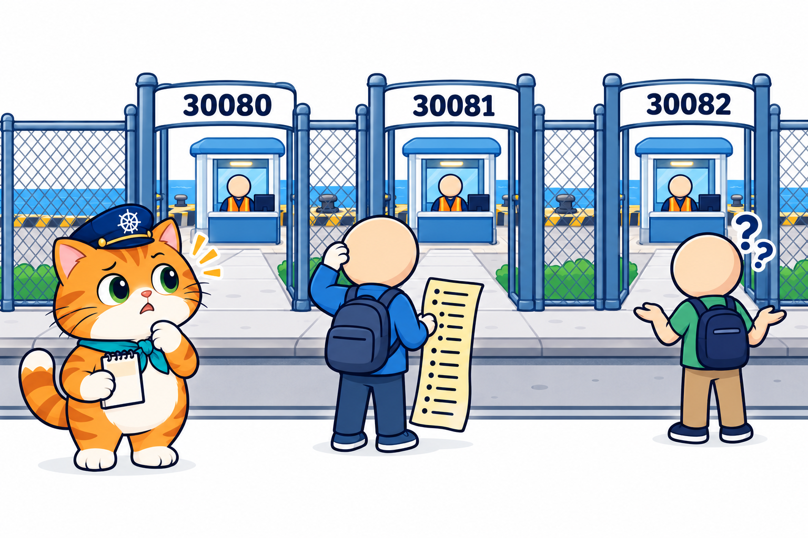
</p>

ในบทที่ 7 ร้านน้องส้มมีสมุดออเดอร์ที่ไม่หายแล้ว แต่ยังมีปัญหาที่หน้าประตู ([บทที่ 7 หัวข้อ 13](../../007_kubernetes_PersistentVolume/01_Theory/README.md#13-ปูทางบทถัดไป))

- ลูกค้าเข้าร้านด้วย **เลข port** `http://localhost:30080` ไม่ใช่ **ชื่อร้าน** แบบเว็บทั่วไป
- ถ้ามีหลายบริการ (หน้าร้าน ครัว ร้านเครื่องดื่ม) ต้องเปิด **NodePort คนละประตู** ([บทที่ 5 หัวข้อ 11](../../005_kubernetes_Service/01_Theory/README.md#11-nodeport-ประตูบนทุก-node)) ลูกค้าต้องจำว่าเลขไหนคือร้านไหน
- k8s-lab map ออกมาให้แค่ `30080`–`30082` = เปิดได้มากสุด 3 บริการ

> "ท่าเรือเรามีประตูเล็กเต็มรั้วไปหมด ปิดให้เหลือ **ประตูใหญ่บานเดียว** แล้วจ้าง **ยาม** ยืนเฝ้า ติด **ป้ายผังทางเข้า** ไว้ข้างประตู ลูกค้าบอกชื่อร้าน ยามก็ชี้ทางให้" — กัปตันบอก

ทบทวนอุปมาท่าเรือ แล้วเพิ่มตัวละครใหม่

<p align="center">
  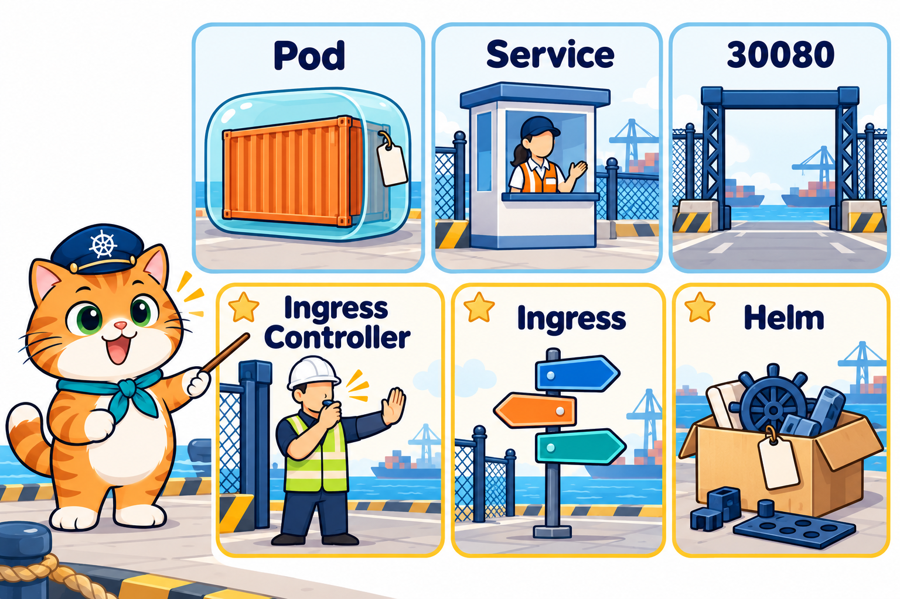
</p>

- **container** = ตู้สินค้า / **Pod** = กล่องโปร่งห่อตู้ มีป้าย IP 1 อัน
- **Node** = เรือ (`lab-worker`, `lab-worker2`) / **Control Plane** = หอบังคับการ (`lab-control-plane`)
- **Deployment** = ผู้จัดการลูกเรือ / **PVC / PV** = ใบขอเช่าล็อกเกอร์ / ล็อกเกอร์เหล็กสีเขียว (บทที่ 7)
- **Service** = พนักงานต้อนรับเสื้อกั๊กส้มที่บูธ **บทนี้ทุกบูธอยู่ข้างในท่า ไม่มีประตูของตัวเอง** (หัวข้อ 11)
- **Ingress Controller** (บทนี้ใช้ **Traefik**) = **ยามประตูใหญ่** (คนเรือไม่มีหน้า เสื้อสะท้อนแสงสีเหลืองมะนาว หมวกกันน็อกสีขาว ถือนกหวีด) ยืนที่ **ประตูใหญ่บานเดียวหมายเลข `30080`**
- **Ingress** = **ป้ายผังทางเข้า** ข้างประตูใหญ่ เขียนกฎ "ชื่อร้าน / ทางเดิน → บูธไหน" (**host** = ชื่อร้านบนป้าย, **path** = ทางเดินที่แยก)
- **Helm** = **กล่องชุดประกอบสำเร็จรูป** สั่งครั้งเดียวได้ยามพร้อมประตูครบชุด / **Namespace** = **โซนแยกบนท่า** มีป้ายชื่อโซน

> **ขอบเขตบทนี้:** Ingress แบบ **HTTP** ที่แยกลูกค้าตาม **host** และ **path** โดยใช้ Traefik เป็น controller ส่วน HTTPS (ใบรับรอง) ต้องตั้งค่าเพิ่มอีกชุดจึงไม่อยู่ในบทนี้, Gateway API เป็นรุ่นต่อยอดของ Ingress ที่จะพูดถึงทีหลัง และ Service แบบ LoadBalancer ใช้กับคลาวด์ ไม่ใช้บน kind

---

## 2. Ingress คืออะไร

<p align="center">
  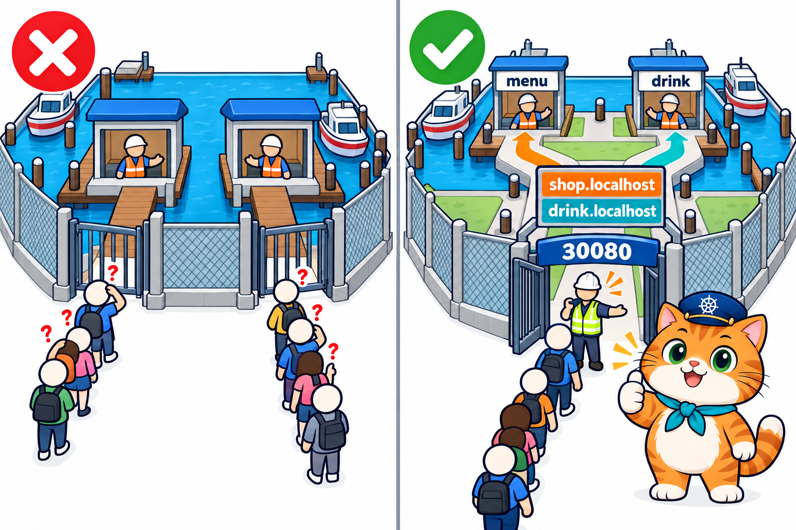
</p>

**Ingress คือ object ที่เก็บ "กฎการเข้าเว็บ" ว่าคำขอ HTTP ที่มาด้วย ชื่อ (host) ไหน และทางเดิน (path) ไหน ให้ส่งต่อไปที่ Service ตัวไหน port ไหน**

- ลูกค้าทุกคนเข้า **ประตูเดียว** (`30080`) แล้วบอกชื่อร้านที่อยากไป เช่น `shop.localhost` หรือ `drink.localhost`
- ป้ายเขียนว่า `shop.localhost` → บูธ `menu`, `drink.localhost` → บูธ `drink` ยามอ่านป้ายแล้วชี้ทาง
- เพิ่มร้านใหม่ = **เพิ่มกฎบนป้าย** ไม่ต้องเจาะรั้วเปิดประตูใหม่

เทียบกับบทที่ 5 ที่แต่ละแอปเปิด NodePort ของตัวเอง

| | NodePort ต่อแอป (บทที่ 5) | Ingress ประตูเดียว (บทนี้) |
|---|---|---|
| ลูกค้าเข้าด้วย | เลข port: `localhost:30080`, `:30081` | ชื่อ: `shop.localhost:30080`, `drink.localhost:30080` |
| 3 แอปใช้ประตูกี่บาน | 3 บาน (เลขละแอป) | **1 บาน** (ของยาม) |
| Service ของแอปเป็นแบบ | `NodePort` | `ClusterIP` (อยู่ข้างใน หัวข้อ 11) |
| แยกตาม path (`/menu`, `/drink`) | ทำไม่ได้ | ทำได้ (หัวข้อ 9) |
| ต้องติดตั้งอะไรเพิ่ม | ไม่ต้อง | ต้องมี **Ingress Controller** (หัวข้อ 3) |

> **ประโยคเดียวที่ต้องจำ:** Ingress ไม่ได้มาแทน Service แต่ **อยู่หน้า Service** ป้ายทุกแถวชี้ไปที่ **Service** เสมอ ไม่ได้ชี้ตรงไปที่ Pod

---

## 3. Ingress กับ Ingress Controller: ป้าย กับ ยาม

<p align="center">
  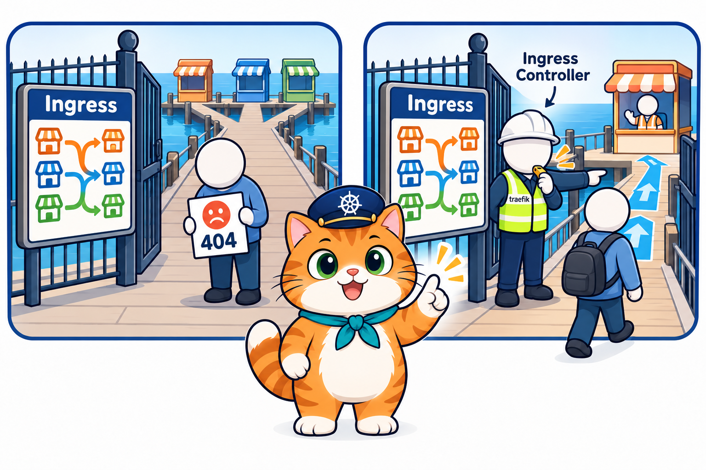
</p>

คำที่คล้ายกันมาก แต่เป็นคนละสิ่ง

- **Ingress** = **ป้าย** เป็นแค่ object เก็บกฎ (YAML ที่เรา apply) **ตัวมันเองไม่รับลูกค้า ไม่ส่งต่ออะไร**
- **Ingress Controller** = **ยาม** เป็นโปรแกรมที่รันอยู่ใน Pod คอยอ่านป้ายทุกแผ่นในคลัสเตอร์ แล้ว **รับคำขอจริง** ส่งต่อตามกฎ
- Kubernetes **ไม่ได้ติดตั้งยามมาให้** (ต่างจาก Deployment / Service ที่มี controller ในหอบังคับการอยู่แล้ว) ต้องติดตั้งเองก่อน ซึ่ง LAB 1 ทำด้วย Helm (หัวข้อ 4)

### ยามมาแล้ว แต่ยังไม่มีป้าย

LAB 1 ติดตั้ง Traefik เสร็จ ยังไม่ได้ apply Ingress สักแผ่น แล้วลอง `curl`

```text
$ kubectl get pods -n traefik
NAME                       READY   STATUS    RESTARTS   AGE
traefik-5f58d5c648-bnsq2   1/1     Running   0          50s

$ curl http://localhost:30080
404 page not found
$ curl http://shop.localhost:30080
404 page not found          ← ยามมีแล้ว แต่ป้ายว่าง ไม่รู้จะส่งไปไหน
```

- `404 page not found` ข้อความนี้ **มาจาก Traefik** = "ยามได้ยินแล้ว แต่ไม่มีกฎสำหรับคำขอนี้" ถือว่า **ประตูทำงานแล้ว**
- ตอนทดลองครั้งแรก `curl` เร็วเกินไปขณะ Pod ยัง `0/1` ได้ `Connection reset by peer` (ยังไม่มีใครเฝ้าประตู) รอจน `1/1` แล้วจึงได้ `404`

### มียามหลายยี่ห้อ: IngressClass บอกว่าใครอ่านป้าย

Ingress Controller มีหลายโครงการ เช่น Traefik, HAProxy, Contour, ของผู้ให้บริการคลาวด์ คลัสเตอร์หนึ่งมีได้หลายตัว จึงต้องมี **IngressClass** บอกว่า "ป้ายแบบนี้ ยามคนไหนรับผิดชอบ" ผลจริงใน LAB 1

```text
$ kubectl get ingressclass
NAME                CONTROLLER                      PARAMETERS   AGE
traefik (default)   traefik.io/ingress-controller   <none>       20s
```

- `NAME` = `traefik` ชื่อที่ Ingress ใช้อ้าง (`ingressClassName: traefik` หัวข้อ 6) และเป็น `(default)` ป้ายที่ไม่ระบุ class ก็ให้ Traefik อ่าน
- `CONTROLLER` = `traefik.io/ingress-controller` ยามตัวจริงที่อยู่เบื้องหลังชื่อนี้
- ทำไมบทนี้ใช้ Traefik: เดิมตัวที่นิยมที่สุดคือ **ingress-nginx** แต่โครงการเลิกพัฒนาไปแล้วเมื่อต้นปี 2026 บทนี้จึงใช้ Traefik ที่ยังพัฒนาอยู่ แนวคิดของ Ingress เหมือนกันทุกยี่ห้อ

> **⚠️ กับดัก:** `kubectl apply` Ingress ผ่าน และ `get ingress` ก็เห็น **ไม่ได้แปลว่ามีคนรับลูกค้า** ถ้าไม่มียาม ป้ายก็ไม่มีใครอ่าน ถ้า `curl` แล้วต่อไม่ติดเลย ให้ดู `kubectl get pods -n traefik` (มียามไหม `1/1` หรือยัง) และ `kubectl get ingressclass` ก่อนไปไล่ YAML

---

## 4. Helm: ติดตั้งของชุดใหญ่ในคำสั่งเดียว

<p align="center">
  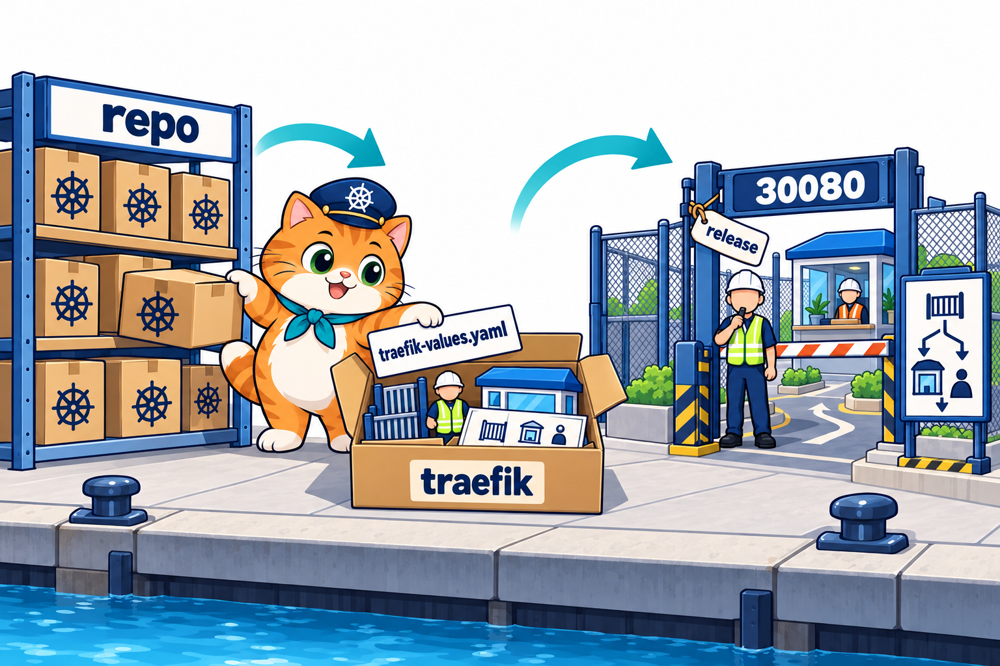
</p>

Traefik ไม่ใช่ YAML ไฟล์เดียว แต่มี Deployment, Service, IngressClass, สิทธิ์อ่านป้ายทั้งคลัสเตอร์ และอื่น ๆ อีกหลายชิ้น ถ้าเขียนเองทุกชิ้นจะยาวมาก **Helm** คือเครื่องมือที่ติดตั้งของชุดใหญ่แบบนี้ในคำสั่งเดียว (เหมือน `apt` / `npm` ของ Kubernetes)

| คำ | ความหมาย | ในบทนี้ | ในอุปมา |
|---|---|---|---|
| **chart** | แพ็กเกจ = ชุด YAML ทั้งหมดของโปรแกรมหนึ่ง พร้อมค่าตั้งต้น | `traefik/traefik` (รุ่น `traefik-42.0.0`) | กล่องชุดประกอบ |
| **repo** | ที่เก็บ chart บนเว็บ | `https://traefik.github.io/charts` | ชั้นวางกล่อง |
| **values** | ค่าที่เราอยากเปลี่ยนจากค่าตั้งต้นของ chart | `traefik-values.yaml` | การ์ดตั้งค่าที่ใส่ลงกล่อง |
| **release** | ของที่ติดตั้งแล้ว 1 ชุด มีชื่อ มีเลขรุ่น | `traefik` ใน namespace `traefik` | ชุดที่ประกอบเสร็จแล้ว |

### คำสั่งใน LAB 1 ทีละบรรทัด

```text
$ helm repo add traefik https://traefik.github.io/charts
"traefik" has been added to your repositories
$ helm repo update
$ helm install traefik traefik/traefik --namespace traefik --create-namespace -f labs/lab01-controller/traefik-values.yaml
STATUS: deployed
REVISION: 1
NOTES:
traefik with docker.io/traefik:v3.7.14 has been deployed successfully on traefik namespace!
```

- `helm repo add traefik <url>` = จดชั้นวางชื่อ `traefik` ไว้ในเครื่อง / `helm repo update` = อัปเดตรายการกล่องบนชั้นให้ล่าสุด
- `helm install traefik traefik/traefik` = ติดตั้ง chart `traefik/traefik` (`<ชื่อ repo>/<ชื่อ chart>`) ตั้งชื่อ release ว่า `traefik`
- `--namespace traefik --create-namespace` = ใส่ไว้ใน **โซน `traefik`** และสร้างโซนให้ถ้ายังไม่มี (หัวข้อ 5)
- `-f labs/lab01-controller/traefik-values.yaml` = ใช้การ์ดตั้งค่าของเราทับค่าตั้งต้น / `REVISION: 1` = ติดตั้งครั้งแรก

ดูของที่ติดตั้งแล้ว และลบออกทั้งชุด (ท้าย LAB 4)

```text
$ helm list -n traefik
NAME     NAMESPACE   REVISION   UPDATED                     STATUS     CHART            APP VERSION
traefik  traefik     1          2026-10-18 17:38:08 ...     deployed   traefik-42.0.0   v3.7.14

$ helm uninstall traefik -n traefik
release "traefik" uninstalled
$ kubectl get ingressclass
No resources found          ← ลบทั้งชุด รวม IngressClass ในคำสั่งเดียว
```

- `CHART` = `traefik-42.0.0` รุ่นของ **กล่อง** / `APP VERSION` = `v3.7.14` รุ่นของ **โปรแกรม Traefik** ข้างใน (คนละเลขกัน)
- `helm uninstall` จำได้ว่าตัวเองสร้างอะไรไว้บ้าง จึงลบออกครบทุกชิ้น ไม่ต้องไล่ลบทีละ object

### อ่าน traefik-values.yaml

ไฟล์ `02_LAB/labs/lab01-controller/traefik-values.yaml` (ไม่ใช่ object ของ Kubernetes จึงไม่มี `apiVersion` / `kind` เป็นแค่ค่าที่ส่งให้ chart)

```yaml
# LAB 1: ค่าตั้งค่าตอนติดตั้ง Traefik (Ingress Controller) ด้วย Helm
# Traefik คือ "ยามประตูใหญ่" รับลูกค้าทุกคนที่ port 30080 แล้วส่งต่อตามป้าย Ingress
service:
  spec:
    type: NodePort             # เปิดประตูบนทุก Node (บทที่ 5) — kind ของแล็บ map 30080 ออกมาถึงเครื่องเรา
ports:
  web:                         # ประตู http
    nodePort: 30080            # ลูกค้าเข้าที่ http://<ชื่อ>.localhost:30080
  websecure:                   # ประตู https — บทนี้ยังไม่ใช้ ปิดไว้
    expose:
      default: false
```

- `service.spec.type: NodePort` = Service ของ **ยาม** เป็น NodePort แบบ [บทที่ 5 หัวข้อ 11](../../005_kubernetes_Service/01_Theory/README.md#11-nodeport-ประตูบนทุก-node) (ค่าตั้งต้นของ chart เป็นแบบอื่นที่ใช้บนคลาวด์)
- `ports.web.nodePort: 30080` = ประตู HTTP ของยามคือเลข `30080` ที่ k8s-lab map ออกมาแล้ว
- `ports.websecure.expose.default: false` = **ไม่เปิด** ประตู HTTPS จึงเหลือ port เดียว ผลจริงใน LAB 1

```text
$ kubectl get svc -n traefik
NAME      TYPE       CLUSTER-IP     EXTERNAL-IP   PORT(S)        AGE
traefik   NodePort   10.96.31.255   <none>        80:30080/TCP   20s     ← port:nodePort แบบบทที่ 5
```

> **เคล็ดลับ:** ค่าใน values file ต้อง **ตรงกับโครงที่ chart กำหนด** (เช่น `ports.web.nodePort`) เขียนชื่อผิด Helm มักไม่เตือนและใช้ค่าตั้งต้นแทน ถ้าติดตั้งแล้วไม่ได้ `80:30080` ให้กลับมาเทียบชื่อ key ก่อน

---

## 5. Namespace เบื้องต้น: โซนแยกบนท่า

<p align="center">
  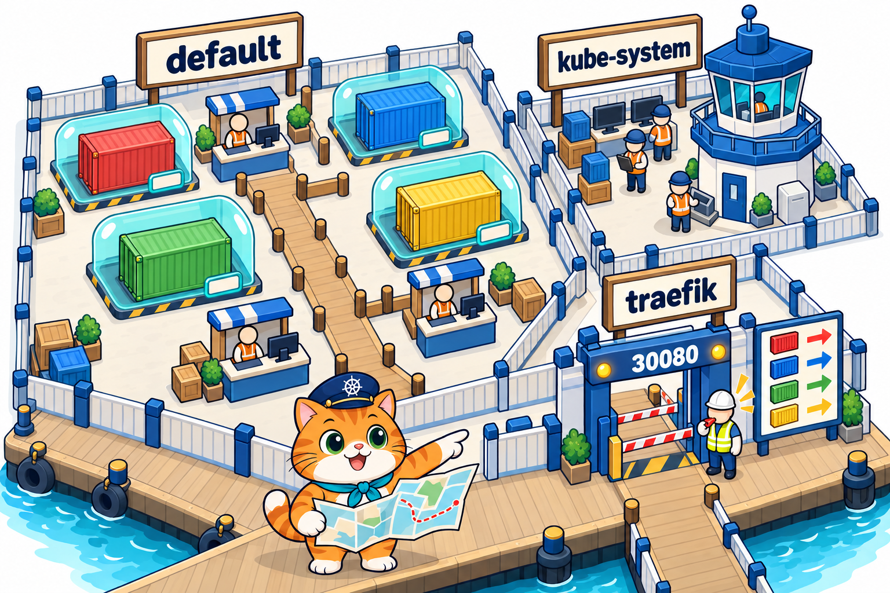
</p>

**Namespace** = **ห้อง / โซนแยก** ในคลัสเตอร์เดียวกัน object ทุกตัวที่เราสร้างมาตั้งแต่บทที่ 2 อยู่โซน `default` ([บทที่ 5 หัวข้อ 7](../../005_kubernetes_Service/01_Theory/README.md#7-เรียกด้วยชื่อ-dns-ในคลัสเตอร์)) บทนี้เป็นครั้งแรกที่เราสร้างโซนใหม่ ผลจริงใน LAB 1

```text
$ kubectl get namespaces
NAME                 STATUS   AGE
default              Active   54s      ← ของเรา (Pod, Service, Ingress ของร้าน)
...
kube-system          Active   54s      ← ระบบของคลัสเตอร์ (coredns, kube-proxy, ...)
local-path-storage   Active   50s      ← คนงานชุดหมีเหลือง (บทที่ 7)
traefik              Active   20s      ← ใหม่: Helm สร้างให้ด้วย --create-namespace
```

- `kubectl` ดูโซน **`default` เสมอ** ถ้าไม่บอก จะดูโซนอื่นต้องเติม **`-n <ชื่อโซน>`** หรือ `-A` (ทุกโซน)
- ดังนั้นหลังติดตั้ง Traefik `kubectl get pods` ได้ `No resources found in default namespace.` ทั้งที่ยามรันอยู่ ต้องใช้ `kubectl get pods -n traefik`
- คำสั่ง `helm` ก็เหมือนกัน: `helm list -n traefik`, `helm uninstall traefik -n traefik`

แยกโซนทำไม: ของระบบ (ยาม, DNS) ไม่ปนกับของร้าน ลบหรือดูทีละโซนได้ ชื่อซ้ำกันข้ามโซนก็ได้

**Ingress กับ Service ที่ป้ายชี้ต้องอยู่โซนเดียวกัน** (ป้ายใน `default` ชี้ได้แค่บูธใน `default`) ส่วนยาม Traefik อยู่โซน `traefik` แต่อ่านป้ายได้ทุกโซน

> **ประโยคเดียวที่ต้องจำ:** `No resources found in default namespace.` แปลว่า **ไม่มีในโซน `default`** ไม่ได้แปลว่าไม่มีในคลัสเตอร์ ลองเติม `-n <โซน>` หรือ `-A` ก่อนสรุป

---

## 6. อ่าน YAML ของ Ingress ทีละบรรทัด

<p align="center">
  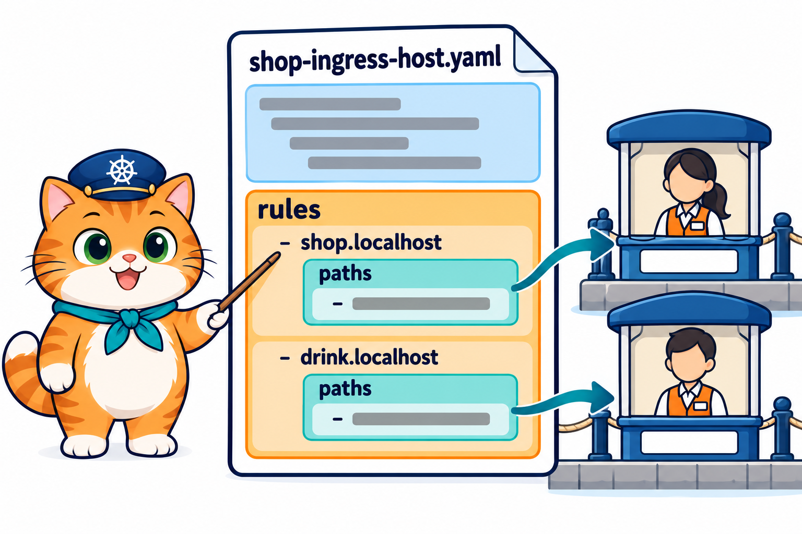
</p>

### 6.1 ทบทวน YAML และสิ่งใหม่ของบทนี้

YAML ของบทนี้ใช้กฎเดิมจาก [บทที่ 2 หัวข้อ 5](../../002_kubernetes_pod/01_Theory/README.md#5-yaml-ฉบับเข้าใจง่าย)

- `key: value` = ค่าเดี่ยว / เยื้องเข้า = **เป็นลูก** / เยื้องเท่ากัน = **เป็นพี่น้อง**
- `- ` (ขีด + เว้นวรรค) = รายการ 1 ชิ้น **ขีด 1 อัน = 1 ชิ้น** (list ของ map แบบ `containers`)
- `---` คั่นหลาย object ในไฟล์เดียว ([บทที่ 6 หัวข้อ 7](../../006_kubernetes_ConfigMap_Secret/01_Theory/README.md#7-ใช้-configmap-เป็นไฟล์)) ใช้ใน `menu-app.yaml` (Deployment + Service)

สิ่งใหม่ของ YAML บทนี้: **list ซ้อน list 2 ชั้น** `rules:` เป็น list (ขีด 1 อัน = **ชื่อร้าน 1 ชื่อ**) และในแต่ละชิ้นมี `paths:` เป็น list อีกชั้น (ขีด 1 อัน = **ทางเดิน 1 ทาง**) อ่านโดยดูว่าขีดแต่ละอันเยื้องอยู่ใต้ใคร

### 6.2 ไล่ไฟล์จริงจาก LAB 2

ไฟล์ `02_LAB/labs/lab02-host/shop-ingress-host.yaml`

```yaml
# LAB 2: Ingress แยกตามชื่อ (host) — ชื่อไหนไป Service ไหน
apiVersion: networking.k8s.io/v1   # Ingress อยู่กลุ่ม networking.k8s.io
kind: Ingress
metadata:
  name: shop-host
spec:
  ingressClassName: traefik        # ให้ยามประตู Traefik เป็นคนอ่านป้ายนี้
  rules:
    - host: shop.localhost         # ลูกค้าพิมพ์ http://shop.localhost:30080
      http:
        paths:
          - path: /
            pathType: Prefix       # ทุก path ที่ขึ้นต้นด้วย /
            backend:
              service:
                name: menu         # → Service menu
                port:
                  number: 80
    - host: drink.localhost        # ลูกค้าพิมพ์ http://drink.localhost:30080
      http:
        paths:
          - path: /
            pathType: Prefix
            backend:
              service:
                name: drink        # → Service drink
                port:
                  number: 80
```

อ่านทีละบรรทัด

| บรรทัด | ความหมาย |
|---|---|
| `apiVersion: networking.k8s.io/v1` | Ingress อยู่กลุ่ม **`networking.k8s.io`** (ไม่ใช่ `v1` แบบ Service หรือ `apps/v1` แบบ Deployment) |
| `kind: Ingress` | ขอสร้าง **ป้ายผังทางเข้า** (I ตัวใหญ่) |
| `metadata:` → `name: shop-host` | ชื่อป้าย ใช้ตอน `get` / `describe` / `delete` ไม่เกี่ยวกับชื่อร้านที่ลูกค้าพิมพ์ |
| `spec:` → `ingressClassName: traefik` | ยามคนไหนอ่านป้ายนี้ = ชื่อใน `kubectl get ingressclass` (หัวข้อ 3) |
| `  rules:` | **list ของกฎ** ขีด 1 อัน = ชื่อร้าน 1 ชื่อ ไฟล์นี้มี 2 ขีด |
| `    - host: shop.localhost` | กฎข้อนี้ใช้กับคำขอที่ **ชื่อ** เป็น `shop.localhost` (เขียนชื่ออย่างเดียว ไม่มี `http://` ไม่มี port) |
| `      http:` → `paths:` | กฎแบบ HTTP มี **list ของทางเดิน** อีกชั้น (ขีดที่เยื้องลึกกว่า) |
| `        - path: /` + `pathType: Prefix` | ทางเดินที่ **ขึ้นต้นด้วย `/`** = ทุก path (หัวข้อ 9) |
| `          backend:` → `service:` | ส่งต่อไปที่ **Service** (บูธ) |
| `  name: menu` + `port:` → `number: 80` | Service ชื่อ `menu` ที่ **port 80 ของ Service** (`port` ไม่ใช่ `targetPort`) |
| `    - host: drink.localhost` ... `name: drink` | กฎข้อที่ 2 โครงเหมือนกันทุกบรรทัด ต่างแค่ชื่อร้านและชื่อบูธ |

แปลทั้งไฟล์เป็นประโยคเดียว: **"ป้ายชื่อ `shop-host` ให้ยาม Traefik อ่าน: ใครมาด้วยชื่อ `shop.localhost` ส่งไปบูธ `menu` port 80, ใครมาด้วยชื่อ `drink.localhost` ส่งไปบูธ `drink` port 80 ไม่ว่าจะเดินทางไหน"**

- ไฟล์นี้ **ไม่มีเลข `30080`** เลย ประตูเป็นเรื่องของยาม (`traefik-values.yaml` หัวข้อ 4) ป้ายบอกแค่ "ชื่อไหน ไปบูธไหน"
- `number: 80` คือ `port` ของ Service `menu` ใน `menu-app.yaml` (`port: 80` → `targetPort: 80`) แบบ [บทที่ 5 หัวข้อ 4](../../005_kubernetes_Service/01_Theory/README.md#4-ที่อยู่-3-แบบ-และ-port-4-ตัว-ศัพท์ที่ต้องแยกให้ออก)

วางป้ายคู่กับ Service `menu` ใน `menu-app.yaml` ให้เห็นว่าป้าย **ชี้ไปที่บูธด้วยค่าไหน** **วงสีเดียวกัน = ค่าที่ต้องตรงกัน**

<p align="center">
  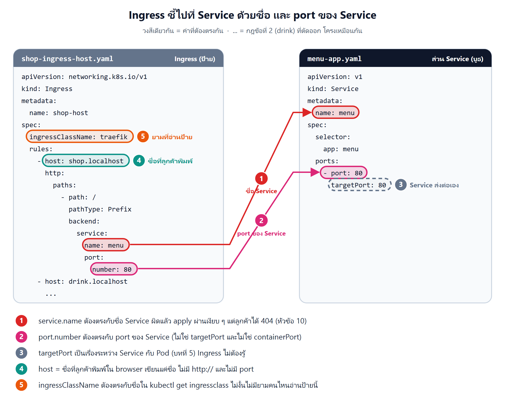
</p>

- **① `service.name` ต้องตรงกับชื่อ Service** พิมพ์ผิดแล้ว apply ผ่านเงียบ ๆ แต่ลูกค้าได้ 404 (หัวข้อ 10)
- **② `port.number` ต้องตรงกับ `port` ของ Service** ไม่ใช่ `targetPort` และไม่ใช่ `containerPort`
- **③ `targetPort`** เป็นเรื่องระหว่าง Service กับ Pod (บทที่ 5) ป้ายไม่ต้องรู้
- **④ `host`** คือชื่อที่ลูกค้าพิมพ์ใน browser
- **⑤ `ingressClassName`** ต้องตรงกับชื่อใน `kubectl get ingressclass` ไม่งั้นไม่มียามคนไหนอ่านป้ายนี้ (หัวข้อ 3)

### 6.3 ผิดบ่อย แก้ง่าย

| ผิด | ถูก | เพราะ |
|---|---|---|
| `apiVersion: v1` หรือ `networking.k8s.io/v1beta1` | `apiVersion: networking.k8s.io/v1` | Ingress ไม่อยู่กลุ่มหลัก ส่วน `v1beta1` เป็นรุ่นเก่าที่ถูกถอดไปแล้ว apply ไม่ผ่าน |
| ลืมบรรทัด `pathType` | ใส่ `pathType: Prefix` (หรือ `Exact`) | ใน `v1` ทุกทางเดินต้องมี `pathType` apply ไม่ผ่าน |
| `serviceName: menu` + `servicePort: 80` | `service:` → `name: menu` + `port:` → `number: 80` | เป็นรูปแบบของรุ่นเก่า ใน `v1` ต้องซ้อนใต้ `service` |
| `port: 80` (ไม่มี `number`) | `port:` แล้ว `number: 80` บรรทัดถัดไป | `port` ต้องเป็น map ที่มี `number` (หรือ `name`) apply ไม่ผ่าน |
| `host: shop.localhost:30080` | `host: shop.localhost` | host เป็นชื่ออย่างเดียว ห้ามมี port หรือ `http://` |
| `number: 3000` (port ของ container) | `number: 80` (port ของ Service) | ป้ายชี้ไปที่ **บูธ** ต้องใช้ `port` ของ Service ส่วน `3000` เป็นเรื่องของบูธกับกล่อง (`targetPort`) |

> **⚠️ กับดัก:** แถวบน ๆ apply ไม่ผ่าน เห็นทันที แต่ **ชื่อ Service ผิด** apply ผ่านเงียบ ๆ แล้วได้ 404 (หัวข้อ 10) และแถวสุดท้ายเป็นความสับสนที่เจอบ่อยที่สุดในร้านน้องส้ม ที่ Service ใช้ `port: 80` → `targetPort: 3000`

---

## 7. เส้นทางของคำขอ ตั้งแต่ browser จนถึง Pod

<p align="center">
  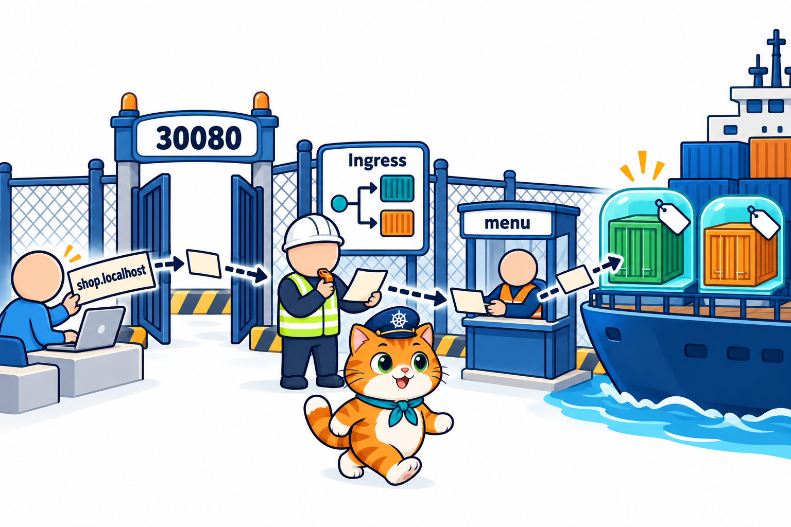
</p>

พิมพ์ `http://shop.localhost:30080` แล้วคำขอเดินทางแบบนี้

1. **browser / curl** ส่งไปที่เครื่องตัวเอง port `30080` (หัวข้อ 8) พร้อมบอกชื่อที่พิมพ์ไว้ในบรรทัด **`Host:`** ของคำขอ
2. k8s-lab map `30080` เข้า Node → **Service `traefik`** แบบ NodePort (`80:30080`) ของยาม
3. **Pod Traefik** (ยาม) อ่าน `Host` และ path → เทียบกับป้าย Ingress ทุกแผ่น → เจอกฎ `shop.localhost` → `/` → `menu:80`
4. ยามส่งต่อไปบูธ **Service `menu`** โดยใช้ **กระดานรายชื่อ** (Endpoints) ของบูธเลือก Pod ที่พร้อม
5. **Pod `menu-...`** ตอบกลับ ย้อนทางเดิมไปถึง browser

### ผลจริงจาก whoami

LAB 2 ใช้ image `traefik/whoami:v1.11.0` ที่ **ตอบกลับว่าตัวเองคือใคร และได้คำขอหน้าตาแบบไหน** จึงเห็นเส้นทางทุกช่วง (ตัดบรรทัด `IP:`, `RemoteAddr`, `User-Agent` และบางบรรทัด `X-Forwarded-` ออก)

```text
$ curl http://shop.localhost:30080
Name: menu                                       ← --name menu ใน args ของ Deployment
Hostname: menu-c9cff5587-zltqk                   ← Pod ที่รับ
GET / HTTP/1.1                                   ← path ที่ Pod ได้รับ
Host: shop.localhost:30080                       ← ชื่อที่ลูกค้าพิมพ์ ยามใช้บรรทัดนี้เลือกกฎ
X-Forwarded-For: 172.19.0.2
X-Forwarded-Host: shop.localhost:30080
X-Forwarded-Port: 30080
X-Forwarded-Server: traefik-5f58d5c648-bnsq2     ← ยามที่ส่งต่อ = Pod Traefik ใน LAB 1
```

- **`Host: shop.localhost:30080`** = สิ่งที่ยามอ่าน กฎเขียน `host: shop.localhost` (ไม่มี port) ยามเทียบแค่ **ชื่อ**
- **`X-Forwarded-...`** = บรรทัดที่ **ยามเติมให้** ก่อนส่งต่อ บอก Pod ว่าลูกค้าตัวจริงมาด้วยชื่ออะไร port ไหน และ `X-Forwarded-Server` บอกชื่อยาม = `traefik-5f58d5c648-bnsq2` ตรงกับ `get pods -n traefik`
- **`X-Forwarded-For: 172.19.0.2`** = คำขอเข้ามาทางเรือที่มี IP นี้ ซึ่งคือ `lab-control-plane` (INTERNAL-IP ใน LAB 0) เพราะ k8s-lab map port ไว้ที่ Node นั้น แล้ว NodePort ส่งต่อไปที่ Pod ของยาม ([บทที่ 5 หัวข้อ 11](../../005_kubernetes_Service/01_Theory/README.md#11-nodeport-ประตูบนทุก-node))
- `curl` ซ้ำได้ `Hostname: menu-c9cff5587-9br8c` อีกตัว = กระจายไปทั้ง 2 Pod ของบูธ `menu` เหมือนบทที่ 5

ป้ายชี้ไปที่ Service แต่ยามดู **รายชื่อ Pod ของ Service** แล้วส่งไปที่ Pod เอง เห็นได้ใน `describe ingress` (LAB 2)

```text
$ kubectl describe ingress shop-host
Rules:
  Host             Path  Backends
  ----             ----  --------
  shop.localhost
                   /   menu:80 (10.244.1.2:80,10.244.2.3:80)      ← Service:port (IP:port ของ Pod 2 ตัว)
  drink.localhost
                   /   drink:80 (10.244.2.4:80)
```

ในวงเล็บคือ **Endpoints** ของบูธ ([บทที่ 5 หัวข้อ 8](../../005_kubernetes_Service/01_Theory/README.md#8-service-หา-pod-จากป้าย)) ถ้า selector ของบูธผิดจนรายชื่อว่าง ยามก็ไม่มีใครให้ส่ง

> **เคล็ดลับ:** อยากรู้ว่าคำขอเดินทางผิดตรงไหน ให้ใช้ whoami หรือ `describe ingress` ไล่ตามลำดับ **ประตู (svc traefik) → ยาม (pod traefik) → ป้าย (ingress) → บูธ (svc) → กล่อง (pod)**

---

## 8. แยกตามชื่อ (host)

<p align="center">
  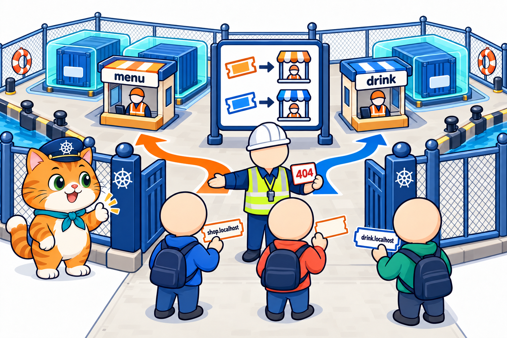
</p>

LAB 2 ใช้แอป 2 ตัว (`menu-app.yaml` 2 Pod, `drink-app.yaml` 1 Pod) ทั้งคู่เป็น Service **ClusterIP** แล้วติดป้าย `shop-ingress-host.yaml` (หัวข้อ 6)

```text
$ kubectl get ingress
NAME        CLASS     HOSTS                            ADDRESS   PORTS   AGE
shop-host   traefik   shop.localhost,drink.localhost             80      5s
```

- `CLASS` = ยามคนไหนอ่าน / `HOSTS` = ชื่อร้านทุกชื่อบนป้าย / `PORTS 80` = กฎแบบ HTTP / `ADDRESS` ว่างไม่ใช่ error (บน kind ยามไม่ได้รายงานที่อยู่กลับมา เราเข้าทาง `30080` อยู่แล้ว)

ยิง 3 ชื่อ ผ่านประตูเดียวกัน (ย่อเหลือบรรทัดที่สอน)

```text
$ curl http://shop.localhost:30080       → Name: menu    Hostname: menu-c9cff5587-zltqk
$ curl http://shop.localhost:30080       → Name: menu    Hostname: menu-c9cff5587-9br8c
$ curl http://drink.localhost:30080      → Name: drink   Hostname: drink-74897b75fc-kflcq
$ curl http://localhost:30080
404 page not found                       ← ชื่อ localhost ไม่มีบนป้าย
```

- **ประตูเดียว port เดียว** แต่ได้คนละแอป เพราะ `Host` ต่างกัน
- ชื่อที่ **ไม่มีบนป้าย** (`localhost`) ยามตอบ `404 page not found` เอง ไม่ส่งไปบูธไหน
- เปิดใน browser ก็ได้ผลเดียวกัน: [shop.localhost](../02_LAB/images/screenshots/20261018_lab2_01-shop-host.png) · [drink.localhost](../02_LAB/images/screenshots/20261018_lab2_02-drink-host.png)

### ทำไม `*.localhost` ใช้ได้โดยไม่ต้องตั้ง DNS

ปกติชื่อเว็บต้องมี **DNS** แปลชื่อเป็น IP (เหมือนสมุดรายชื่อท่า [บทที่ 5 หัวข้อ 7](../../005_kubernetes_Service/01_Theory/README.md#7-เรียกด้วยชื่อ-dns-ในคลัสเตอร์) แต่เป็นของอินเทอร์เน็ต) แต่ชื่อที่ลงท้าย **`.localhost`** เป็นชื่อพิเศษที่ browser รุ่นใหม่และ `curl` ส่งเข้า **เครื่องตัวเอง** (`127.0.0.1`) ทันที

- `shop.localhost`, `drink.localhost`, `kitchen.localhost` จึงไปถึง `localhost:30080` เหมือนกันหมด
- ต่างกันแค่บรรทัด `Host:` ที่ติดไปกับคำขอ ซึ่งเป็นสิ่งเดียวที่ยามใช้แยก
- งานจริงใช้ชื่อโดเมนจริง (เช่น `shop.example.com`) ที่ตั้ง DNS ชี้มาที่ประตูของคลัสเตอร์ หลักการเดียวกัน

> **ประโยคเดียวที่ต้องจำ:** Ingress แยกลูกค้าจาก **ชื่อในบรรทัด `Host:`** ไม่ใช่จาก IP หรือ port ทุกชื่อเข้าประตู `30080` บานเดียวกัน

---

## 9. แยกตามทางเดิน (path) และ pathType

<p align="center">
  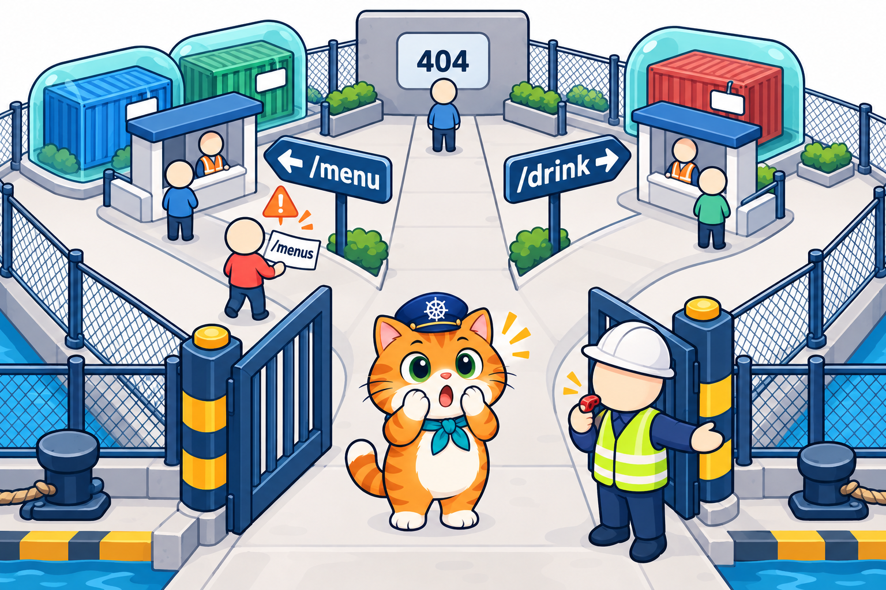
</p>

LAB 3 ใช้ **ชื่อเดียว** `shop.localhost` แต่แยกด้วย **ทางเดิน (path)** ไฟล์ `02_LAB/labs/lab03-path/shop-ingress-path.yaml` (ตัดหัวไฟล์และ backend ของ drink ออก)

```yaml
spec:
  ingressClassName: traefik
  rules:
    - host: shop.localhost
      http:
        paths:
          - path: /menu            # /menu, /menu/today, ... → Service menu
            pathType: Prefix
            backend:
              service:
                name: menu
                port:
                  number: 80
          - path: /drink           # /drink, /drink/cold, ... → Service drink
            pathType: Prefix
            backend: ...           # service drink port 80
```

- ครั้งนี้ `rules` มี **ขีดเดียว** (ชื่อเดียว) แต่ `paths` ข้างในมี **2 ขีด** (2 ทางเดิน) = list ชั้นในของหัวข้อ 6.1
- `describe ingress shop-path` แสดงเป็น `/menu   menu:80 (...)` และ `/drink   drink:80 (...)` ใต้ host เดียวกัน

### pathType: Prefix กับ Exact

- **`Prefix`** = path ที่ **ขึ้นต้นด้วย** ค่าที่เขียน ตามสเปกของ Kubernetes เทียบ **ทีละส่วน** ที่คั่นด้วย `/` เช่น `/menu` ตรงกับ `/menu` และ `/menu/today` แต่ **ไม่ตรง** กับ `/menus`
- **`Exact`** = ต้องตรง **ทุกตัวอักษร** `/menu` ตรงกับ `/menu` เท่านั้น ไม่รวม `/menu/today` (บทนี้ไม่ได้ใช้)
- ทางเดินที่เปิดไปบน path ที่ **ไม่มีกฎ** = ไม่มีบูธ ยามตอบ 404

ผลจริงใน LAB 3 เทียบกับสิ่งที่สเปกบอก

| คำขอ | สเปก Kubernetes (`Prefix`) | ผลจริงบน Traefik | `GET` ที่ Pod ได้รับ |
|---|---|---|---|
| `/menu` | menu | `Name: menu` | `GET /menu` |
| `/menu/today` | menu | `Name: menu` | `GET /menu/today` |
| `/drink` | drink | `Name: drink` | `GET /drink` |
| `/` | ไม่มีกฎ | `404 page not found` | – |
| **`/menus`** | **ไม่มีกฎ** (`menus` ≠ `menu`) | **`Name: menu`** ⚠️ | `GET /menus` |

- Pod ได้ **path เต็มตามที่ลูกค้าพิมพ์** (`GET /menu/today`) ยามไม่ได้ตัด `/menu` ออก แอปจริงที่อยู่หลัง path แบบนี้ต้องรู้ว่าตัวเองอยู่ใต้ `/menu`
- `/` ได้ 404 เพราะป้ายนี้ไม่มีทางเดิน `/` (ต่างจาก LAB 2 ที่ใช้ `path: /` รับทุกทาง)

### ⚠️ กับดัก: `/menus` ถูกส่งไป menu

ตามสเปก `Prefix` เทียบ **ทีละส่วนของ path** `/menus` มีส่วนเดียวคือ `menus` ไม่เท่ากับ `menu` จึงไม่ควรตรงกฎ แต่ Traefik ตีความ `Prefix` เป็น **"ข้อความขึ้นต้นด้วย `/menu`"** ซึ่ง `/menus` ก็ขึ้นต้นด้วย `/menu` เหมือนกัน

```text
$ curl http://shop.localhost:30080/menus
Name: menu
Hostname: menu-c9cff5587-zltqk
GET /menus HTTP/1.1          ← ควรเป็น 404 ตามสเปก แต่ Traefik ส่งไป menu
```

- Ingress Controller แต่ละยี่ห้อ **ตีความรายละเอียดไม่เหมือนกันทุกจุด** ป้ายเดียวกันย้ายไปใช้ยามยี่ห้ออื่นอาจได้ผลต่างจากนี้
- ป้องกันง่าย ๆ: **ตั้ง path ไม่ให้ขึ้นต้นซ้ำกัน** เช่น ใช้ `/menu` คู่กับ `/drink` ได้ แต่อย่าใช้ `/menu` คู่กับ `/menus` หรือ `/menu-admin` ที่ต้องไปคนละบูธ
- ถ้าต้องการตรงตัวจริง ๆ ใช้ `pathType: Exact`

> **⚠️ กับดัก:** อย่าเชื่อแค่ YAML ว่า "path นี้ไม่ตรงกฎแน่ ๆ" ให้ **`curl` ทดสอบจริงบนยามที่ใช้** โดยเฉพาะ path ที่ขึ้นต้นเหมือนกัน และดูบรรทัด `Name:` / `GET` จาก whoami ว่าไปถึงใคร

---

## 10. กับดัก: ป้ายชี้ไปบูธที่ไม่มีอยู่จริง

<p align="center">
  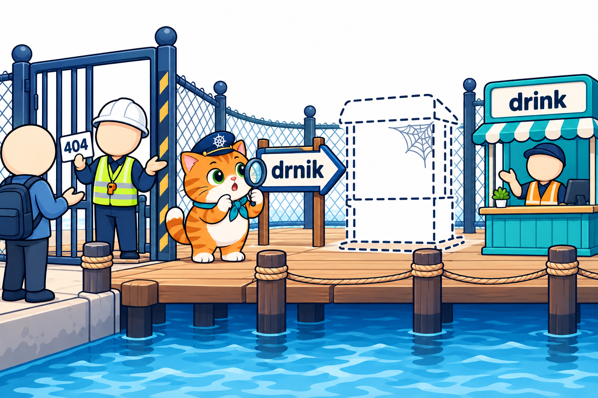
</p>

LAB 3 apply `shop-ingress-typo.yaml` ที่พิมพ์ชื่อ Service สลับตัวอักษร

```yaml
    - host: typo.localhost
      http:
        paths:
          - path: /
            pathType: Prefix
            backend:
              service:
                name: drnik        # ← พิมพ์ผิด (ที่ถูกคือ drink)
```

ผลจริงใน LAB 3: apply ผ่าน `get ingress` ก็ดูปกติ

```text
$ kubectl apply -f labs/lab03-path/shop-ingress-typo.yaml
ingress.networking.k8s.io/shop-typo created

$ kubectl get ingress
NAME        CLASS     HOSTS            ADDRESS   PORTS   AGE
shop-path   traefik   shop.localhost             80      10s
shop-typo   traefik   typo.localhost             80      5s      ← ไม่มีอะไรบอกว่าผิด

$ curl http://typo.localhost:30080
404 page not found
```

`404` เหมือนกับ "ไม่มีกฎ" ทุกตัวอักษร ต้องดู `describe` จึงจะเห็นสาเหตุ

```text
$ kubectl describe ingress shop-typo
Rules:
  Host            Path  Backends
  ----            ----  --------
  typo.localhost
                  /   drnik:80 (<error: services "drnik" not found>)     ← ไม่มีบูธชื่อนี้

$ kubectl get svc
NAME         TYPE        CLUSTER-IP    EXTERNAL-IP   PORT(S)   AGE
drink        ClusterIP   10.96.5.128   <none>        80/TCP    42s     ← ชื่อที่ถูกคือ drink
...
```

- Kubernetes **ไม่ตรวจ** ตอน apply ว่า Service ที่ป้ายชี้มีอยู่จริงไหม (Service อาจถูกสร้างทีหลังก็ได้) ป้ายจึงถูกสร้างเงียบ ๆ
- `Events: <none>` ไม่มีคำเตือน สิ่งเดียวที่บอกคือวงเล็บหลังชื่อ backend ใน `describe ingress`
- แก้: แก้ชื่อในไฟล์ให้ตรงกับ `kubectl get svc` แล้ว `kubectl apply` ทับได้เลย (Ingress แก้แล้ว apply ซ้ำได้ ต่างจาก PVC ในบทที่ 7)

### เทียบกับกับดักของบทที่ 5

เหมือน **selector พิมพ์ผิดแล้ว Endpoints ว่าง** ใน [บทที่ 5 หัวข้อ 9](../../005_kubernetes_Service/01_Theory/README.md#9-กับดัก-selector-พิมพ์ผิด-แล้ว-endpoints-ว่าง) ทุกอย่าง: apply ผ่าน ไม่มี error ต้องดู `describe` ต่างกันแค่ว่าขาดตรงไหน

- **วงเล็บมี `<error: services ... not found>`** = **ป้ายผิด** (ชื่อบูธบนป้ายไม่มีอยู่จริง) → เทียบ `name:` กับ `kubectl get svc`
- **วงเล็บว่าง / มีบูธแต่ไม่มี IP ของ Pod** = **บูธผิด** (selector ของ Service ไม่ตรงป้ายของ Pod หรือ Pod ยังไม่พร้อม) → ไล่ 3 ขั้นของบทที่ 5
- **วงเล็บมี IP ครบ** แต่ยัง 404 → ดู host / path ที่พิมพ์ ว่าตรงกฎไหม (หัวข้อ 8–9)

> **⚠️ กับดัก:** Ingress ที่ชื่อ Service ผิด **apply ผ่าน ไม่มี Events ได้ 404 เหมือนไม่มีกฎ** เจอ 404 ทั้งที่มั่นใจว่าเขียนกฎไว้แล้ว ให้ `kubectl describe ingress <ชื่อ>` ดูวงเล็บหลัง backend เป็นอย่างแรก

---

## 11. ทุกบูธอยู่ข้างใน มีประตูเดียว

<p align="center">
  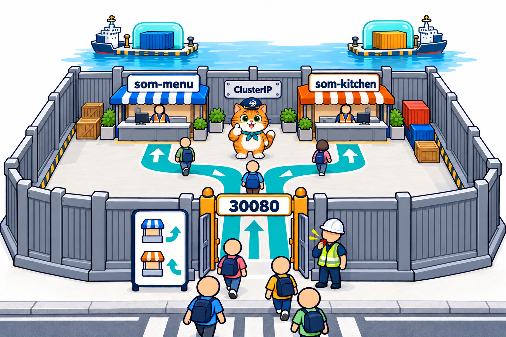
</p>

ใน LAB 4 ร้านน้องส้มมี 2 บริการ แต่ **ไม่มี Service ไหนเป็น NodePort เลย** ผลจริงใน LAB 4

```text
$ kubectl get svc
NAME          TYPE        CLUSTER-IP      EXTERNAL-IP   PORT(S)   AGE
kubernetes    ClusterIP   10.96.0.1       <none>        443/TCP   2m52s
som-kitchen   ClusterIP   10.96.176.59    <none>        80/TCP    5s
som-menu      ClusterIP   10.96.215.207   <none>        80/TCP    5s      ← ไม่มี :30080 แล้ว

```

- Service ของร้านเป็น **ClusterIP** ([บทที่ 5 หัวข้อ 10](../../005_kubernetes_Service/01_Theory/README.md#10-clusterip-ที่อยู่ภายในคลัสเตอร์)) = บูธที่ **อยู่ข้างในท่า** คนนอกเดินมาถึงตรงไม่ได้
- คนนอกเข้าได้ทาง **ประตู `30080` ของยาม** เท่านั้น (Service `traefik` แบบ NodePort `80:30080` ใน LAB 1 หัวข้อ 4) แล้วยามพาไปบูธตามป้าย
- `som-menu.yaml` บทนี้ **ลบ `type: NodePort` และ `nodePort: 30080`** ออกจาก Service ของบทที่ 5–7 (comment ในไฟล์เขียนว่า `ClusterIP (ค่าเริ่มต้น) ไม่มี nodePort แล้ว`)

ทำไมแบบนี้ดีกว่า

- **ปลอดภัยกว่า:** มีทางเข้าทางเดียวให้เฝ้า แอปไหนไม่ได้อยู่บนป้าย คนนอกก็เข้าไม่ถึง
- **จัดการง่าย:** เพิ่มแอปใหม่ = เพิ่มกฎบนป้าย ไม่ต้องหาเลข port ว่าง และไม่ติดว่า k8s-lab map ออกมาแค่ 3 เลข
- **แบ่งหน้าที่ชัด:** ยามดูแล "ใครเข้าทางไหน" ส่วนบูธยังทำงานเดิมของบทที่ 5 คือกระจายลูกค้าไป Pod ที่พร้อม (`describe ingress` LAB 4: `som-menu:80 (10.244.1.5:3000,10.244.1.6:3000)` = 2 สาขา)

> **ประโยคเดียวที่ต้องจำ:** ใช้ Ingress แล้ว **แอปเป็น ClusterIP ทั้งหมด** มีแค่ Service ของ Ingress Controller ตัวเดียวที่เปิดออกนอกคลัสเตอร์

---

## 12. อ่าน YAML ร้านน้องส้มทั้งชุด

<p align="center">
  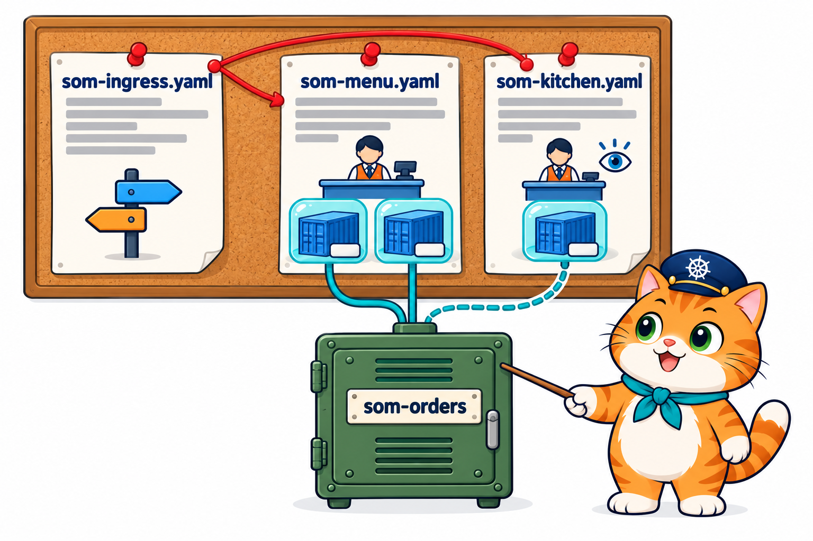
</p>

LAB 4 ใช้ 4 ไฟล์ใน `02_LAB/som-menu/k8s/` apply ทีละไฟล์ **ใบขอ → หน้าร้าน → ครัว → ป้าย**

```text
$ kubectl apply -f som-menu/k8s/som-orders-pvc.yaml   → persistentvolumeclaim/som-orders created
$ kubectl apply -f som-menu/k8s/som-menu.yaml         → deployment.apps/som-menu created + service/som-menu created
$ kubectl apply -f som-menu/k8s/som-kitchen.yaml      → deployment.apps/som-kitchen created + service/som-kitchen created
$ kubectl apply -f som-menu/k8s/som-ingress.yaml      → ingress.networking.k8s.io/som-shop created
```

(ผลแต่ละคำสั่งย่อมาไว้ท้ายบรรทัด) `som-orders-pvc.yaml` คือ PVC 100Mi ตัวเดิมจาก[บทที่ 7](../../007_kubernetes_PersistentVolume/01_Theory/README.md#4-อ่าน-yaml-ของ-pvc-ทีละบรรทัด)

### 12.1 โครงของทั้งชุด

```yaml
# som-ingress.yaml — ป้ายผังทางเข้า (Ingress som-shop)
rules:
  - host: shop.localhost      → Service som-menu:80
  - host: kitchen.localhost   → Service som-kitchen:80
# som-menu.yaml — หน้าร้าน
Deployment som-menu     replicas: 2   image: som-menu:1.0   APP_MODE=shop      PVC som-orders (เขียนได้)
Service    som-menu     ClusterIP     port 80 → targetPort 3000
# som-kitchen.yaml — ครัว
Deployment som-kitchen  replicas: 1   image: som-menu:1.0   APP_MODE=kitchen   PVC som-orders (readOnly)
Service    som-kitchen  ClusterIP     port 80 → targetPort 3000
```

(เป็นโครงย่อเพื่ออ่านภาพรวม ไม่ใช่ YAML ที่ apply ได้)

### 12.2 ป้ายของร้าน: som-ingress.yaml

```yaml
# LAB 4: ป้ายผังทางเข้าร้านน้องส้ม — ประตูเดียว (30080) สองชื่อ
apiVersion: networking.k8s.io/v1
kind: Ingress
metadata:
  name: som-shop
spec:
  ingressClassName: traefik
  rules:
    - host: shop.localhost         # ลูกค้า → หน้าร้าน
      http: ...                    # path: / แบบ Prefix → Service som-menu port 80 (โครงเดียวกับข้างล่าง)
    - host: kitchen.localhost      # พ่อครัว → ครัว
      http:
        paths:
          - path: /
            pathType: Prefix
            backend:
              service:
                name: som-kitchen
                port:
                  number: 80
```

(ย่อกฎข้อแรกด้วย `...`) โครงเหมือน `shop-ingress-host.yaml` (หัวข้อ 6) ทุกบรรทัด ต่างแค่ชื่อร้าน (`kitchen.localhost`) และชื่อบูธ (`som-menu`, `som-kitchen`)

### 12.3 image เดียว 2 หน้าที่ และครัวอ่านอย่างเดียว

เปิดดูเฉพาะส่วนที่ต่างกันของ 2 Deployment (ตัดส่วนที่เหมือนกันออก)

```yaml
# som-menu.yaml (หน้าร้าน replicas: 2)         # som-kitchen.yaml (ครัว replicas: 1)
          image: som-menu:1.0                             image: som-menu:1.0             # image เดียวกับหน้าร้าน
          env:                                            env:
            - name: APP_MODE                                - name: APP_MODE              # ← บทที่ 6 หัวข้อ 4
              value: shop                                     value: kitchen
          volumeMounts:                                   volumeMounts:
            - name: orders                                  - name: orders
              mountPath: /data                                mountPath: /data
                                                              readOnly: true            # ← ใหม่
      volumes:                                        volumes:
        - name: orders                                  - name: orders
          persistentVolumeClaim:                          persistentVolumeClaim:
            claimName: som-orders                           claimName: som-orders       # ← บทที่ 7 หัวข้อ 5
```

(วางข้างกันเพื่ออ่านเทียบ comment ที่มี `←` เพิ่มเพื่ออ่านคู่บทนี้)

- **image เดียว 2 หน้าที่:** `server.js` อ่าน `APP_MODE` จาก env ([บทที่ 6 หัวข้อ 4](../../006_kubernetes_ConfigMap_Secret/01_Theory/README.md#4-ใช้-configmap-เป็น-env-configmapkeyref-และ-envfrom)) `shop` = หน้าร้านที่กดสั่งได้ / `kitchen` = หน้าครัวที่แสดงออเดอร์ทั้งหมด build ครั้งเดียวใช้ได้ 2 แบบ
- **สมุดเล่มเดียวกัน:** ทั้งสองเสียบ PVC `som-orders` ที่ `/data` หน้าร้านเขียน ครัวอ่าน ([บทที่ 7 หัวข้อ 5](../../007_kubernetes_PersistentVolume/01_Theory/README.md#5-ต่อ-pvc-เข้า-pod))
- **`readOnly: true`** = mount แบบ **อ่านอย่างเดียว** ครัวเขียนสมุดไม่ได้ แม้แอปจะพลาดก็เขียนทับไม่ได้
- ทุก Pod อยู่ `lab-worker` (`get pods -o wide` LAB 4: `som-kitchen-5d9554b67f-d652k`, `som-menu-5dd6f4658f-5pdb4`, `som-menu-5dd6f4658f-c59zh`) เพราะ PVC แบบ RWO ผูกกับเรือลำเดียว ([บทที่ 7 หัวข้อ 8](../../007_kubernetes_PersistentVolume/01_Theory/README.md#8-accessmodes-ใครเขียนได้บ้าง))

แอปกันไว้อีกชั้น ถ้ามีคนส่งออเดอร์มาที่ครัว (`02_LAB/som-menu/app/server.js`)

```js
    if (APP_MODE === "kitchen") {                          // ครัวไม่รับออเดอร์ ให้สั่งที่หน้าร้าน
      res.writeHead(403, { "content-type": "text/plain; charset=utf-8" });
      return res.end("ครัวรับออเดอร์เองไม่ได้ สั่งที่หน้าร้าน shop.localhost\n");
    }
```

### 12.4 ผลจริงใน LAB 4

```text
$ curl -d menu=tuna http://shop.localhost:30080/order
รับออเดอร์ #1 อาหารเม็ดสูตรปลาทูน่า โดย som-menu-5dd6f4658f-c59zh
$ curl -d menu=saba http://shop.localhost:30080/order
รับออเดอร์ #2 อาหารเปียกปลาซาบะ โดย som-menu-5dd6f4658f-5pdb4
...   (chicken เป็น #3)
$ curl -d menu=tuna http://kitchen.localhost:30080/order
ครัวรับออเดอร์เองไม่ได้ สั่งที่หน้าร้าน shop.localhost        ← ครัวตอบ 403
$ curl http://kitchen.localhost:30080/api/orders
{"pod":"som-kitchen-5d9554b67f-d652k","total":3}               ← ครัวอ่านสมุดเล่มเดียวกัน เห็นครบ 3
$ curl http://localhost:30080
404 page not found
```

- ประตู `30080` บานเดียว: `shop.localhost` ไปหน้าร้าน 2 สาขา, `kitchen.localhost` ไปครัว ภาพหน้าจอจริง: [หน้าร้าน](../02_LAB/images/screenshots/20261018_lab4_01-shop.png) · [ครัว](../02_LAB/images/screenshots/20261018_lab4_02-kitchen.png)

### ⚠️ กับดัก: ลบป้าย แอปยังรัน แต่ลูกค้าเข้าไม่ได้

```text
$ kubectl delete -f som-menu/k8s/som-ingress.yaml
ingress.networking.k8s.io "som-shop" deleted from default namespace
$ curl http://shop.localhost:30080/api/orders
404 page not found                                   ← Pod ยัง Running ครบ แต่ไม่มีป้ายแล้ว

$ kubectl apply -f som-menu/k8s/som-ingress.yaml
$ curl http://shop.localhost:30080/api/orders
{"pod":"som-menu-5dd6f4658f-c59zh","total":3}        ← ติดป้ายกลับ ใช้ได้ทันที ยอดยัง 3
```

ป้ายกับร้าน **อายุไม่ผูกกัน** ลบ Ingress = ลบแค่ "ทางเข้า" Deployment / Service / PVC ไม่ถูกแตะ และติดป้ายกลับเมื่อไรก็ใช้ได้ทันที ถ้าเจอ 404 ทั้งที่ `get pods` ปกติ ให้ดู `kubectl get ingress` ก่อน

เก็บกวาดท้าย LAB 4 ลบ Ingress → ครัว → หน้าร้าน → **PVC เป็นอย่างสุดท้าย** (แบบบทที่ 7) แล้ว `helm uninstall traefik -n traefik` ปิดยามกับประตูทั้งชุด

แปลทั้งชุดเป็นประโยคเดียว: **"ร้านน้องส้มมีประตูเดียว `30080` ของยาม Traefik ป้าย `som-shop` ส่ง `shop.localhost` ไปหน้าร้าน 2 สาขา และ `kitchen.localhost` ไปครัว ทั้งคู่ใช้ image เดียวกันต่างกันที่ `APP_MODE` และเปิดสมุด `som-orders` เล่มเดียวกัน หน้าร้านเขียน ครัวอ่านอย่างเดียว"**

---

## 13. ปูทางบทถัดไป

<p align="center">
  
</p>

ร้านน้องส้มตอนนี้เข้าด้วยชื่อร้านผ่านประตูเดียวแล้ว แต่ LAB 4 ก็เห็นภาระที่เพิ่มขึ้น

- ทั้งร้านมี **4 ไฟล์** (PVC, หน้าร้าน, ครัว, ป้าย) ติดตั้งต้อง apply **ทีละไฟล์ตามลำดับ** และเก็บกวาดก็ต้องลบทีละไฟล์ในลำดับที่ถูก
- ค่าที่อยากเปลี่ยนตามที่ติดตั้ง (ชื่อร้านใน `host`, จำนวนสาขา, ขนาดสมุด) **ฝังอยู่ในหลายไฟล์** ย้ายไปเครื่องทดสอบ / เครื่องจริงต้องแก้ทีละจุด
- แต่ตอนติดตั้ง Traefik เราสั่ง **`helm install` คำสั่งเดียว** ได้ของหลายชิ้น ปรับค่าด้วย values file และ `helm uninstall` ลบครบ
- → **Helm (บทที่ 9)** ทำ **chart ของร้านน้องส้มเอง** ติดตั้ง / ลบ / อัปเกรดทั้งร้านในคำสั่งเดียว และเปลี่ยนค่าตามสภาพแวดล้อมด้วย values
- ส่วนการเปิดร้านแบบ **HTTPS** (ใบรับรอง) และ **Gateway API** ที่ต่อยอดจาก Ingress เป็นเรื่องที่จะได้เจอต่อไป

---

## 14. สรุปและคำถามทบทวน

<p align="center">
  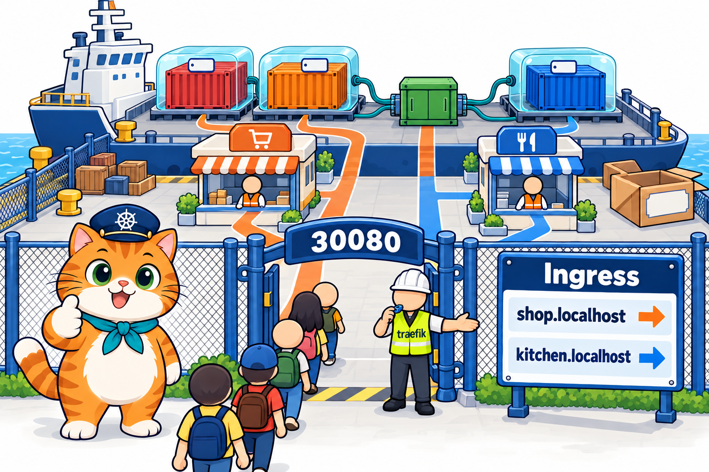
</p>

### สรุป

1. **Ingress** = กฎการเข้าเว็บ "host / path ไหน → Service ไหน port ไหน" ให้หลายแอปใช้ **ประตูเดียว** แยกด้วยชื่อแทนเลข port
2. Ingress เป็นแค่ **ป้าย** ต้องมี **Ingress Controller** (ยาม) อ่านและรับคำขอจริง ไม่มียาม = ไม่มีใครรับ / มียามแต่ไม่มีกฎ = `404 page not found`
3. **IngressClass** บอกว่ายามคนไหนอ่านป้าย บทนี้คือ `traefik (default)` อ้างด้วย `ingressClassName: traefik`
4. **Helm** ติดตั้งของชุดใหญ่จาก **chart** ใน **repo** ปรับค่าด้วย **values file** ได้ **release** ที่ `helm list` / `helm uninstall` ทั้งชุด
5. **Namespace** = โซนแยก `kubectl` ดู `default` เสมอ ของโซนอื่นต้องใช้ `-n traefik` หรือ `-A`
6. YAML ของ Ingress: `networking.k8s.io/v1`, list 2 ชั้น `rules` (host) → `paths` (path) ทุก path ต้องมี `pathType` และ `backend.service.port.number` เป็น **port ของ Service**
7. ยามแยกด้วยบรรทัด **`Host:`** และ path ของคำขอ ชื่อ `*.localhost` ส่งเข้าเครื่องตัวเองโดยไม่ต้องตั้ง DNS ชื่อที่ไม่มีบนป้าย = 404
8. `Prefix` ตามสเปกเทียบทีละส่วนของ path แต่ **Traefik ส่ง `/menus` ไป `/menu`** จึงตั้ง path ไม่ให้ขึ้นต้นซ้ำ และทดสอบด้วย `curl` จริง
9. ชื่อ Service ผิด apply ผ่านแต่ 404 ดู `describe ingress` หา `<error: services "..." not found>` / ลบ Ingress = ลูกค้าเข้าไม่ได้แม้ Pod ยังรัน
10. ใช้ Ingress แล้วแอปเป็น **ClusterIP** หมด มีแค่ยามที่เป็น NodePort ส่วนการติดตั้งร้านหลายไฟล์ในคำสั่งเดียว → บทหน้า **Helm chart ของร้านเอง**

### คำถามทบทวน

**1. อ่าน Ingress นี้แล้วตอบ: คำขอ `http://kitchen.localhost:30080/` ไปที่ Service ไหน port ไหน และ `http://shop.localhost:30080/order` ล่ะ**

```yaml
spec:
  rules:
    - host: shop.localhost
      http:
        paths:
          - path: /
            pathType: Prefix
            backend:
              service:
                name: som-menu
                port:
                  number: 80
    - host: kitchen.localhost
      http:
        paths:
          - path: /
            pathType: Prefix
            backend:
              service:
                name: som-kitchen
                port:
                  number: 80
```

<details>
<summary>แนวคำตอบ</summary>

`kitchen.localhost/` ไป Service `som-kitchen` port 80 (แล้ว Service ส่งต่อไป `targetPort` 3000 ของ Pod ครัว) ส่วน `shop.localhost/order` ไป Service `som-menu` port 80 เพราะ `path: /` แบบ `Prefix` รับทุก path ที่ขึ้นต้นด้วย `/` ใช้ประตู `30080` เดียวกันทั้งคู่
</details>

**2. Ingress นี้ผิดกี่จุด อะไรบ้าง**

```text
apiVersion: v1
kind: Ingress
metadata:
  name: shop
spec:
  rules:
    - host: shop.localhost:30080
      http:
        paths:
          - path: /
            backend:
              service:
                name: som-menu
                port: 3000
```

<details>
<summary>แนวคำตอบ</summary>

1. `apiVersion: v1` ต้องเป็น `networking.k8s.io/v1`
2. `host` ห้ามมี port ต้องเป็น `shop.localhost`
3. ขาด `pathType` (เช่น `pathType: Prefix`)
4. `port: 3000` ผิดทั้งรูปแบบและค่า ต้องเป็น `port:` → `number: 80` (port ของ Service `som-menu` ไม่ใช่ port ของ container)
</details>

**3. เพื่อน apply Ingress แล้ว `curl http://typo.localhost:30080` ได้ `404 page not found` และ `describe` ได้แบบนี้ สาเหตุคืออะไร แก้อย่างไร**

```text
  typo.localhost
                  /   drnik:80 (<error: services "drnik" not found>)
```

<details>
<summary>แนวคำตอบ</summary>

ป้ายชี้ไป Service ชื่อ `drnik` ที่ไม่มีอยู่จริง (พิมพ์สลับตัวอักษร ที่ถูกคือ `drink`) Kubernetes ไม่ตรวจตอน apply จึงผ่าน แก้ `backend.service.name` ให้ตรงกับชื่อใน `kubectl get svc` แล้ว `kubectl apply` ทับ (LAB 3)
</details>

**4. ใน LAB 3 ป้ายมีแค่ `/menu` กับ `/drink` แบบ `Prefix` ทำไม `curl http://shop.localhost:30080/menus` ได้ `Name: menu` ทั้งที่สเปกบอกว่าไม่ควรตรง และควรตั้ง path อย่างไร**

<details>
<summary>แนวคำตอบ</summary>

สเปก Kubernetes เทียบ `Prefix` ทีละส่วนของ path (`menus` ≠ `menu`) แต่ Traefik ตีความเป็นข้อความขึ้นต้นด้วย `/menu` จึงส่ง `/menus` ไป menu ด้วย ควรตั้ง path ที่ไปคนละบูธไม่ให้ขึ้นต้นซ้ำกัน หรือใช้ `pathType: Exact` เมื่อต้องการตรงตัว และทดสอบด้วย `curl` บนยามที่ใช้จริง
</details>

**5. LAB 4 สั่ง `kubectl delete -f som-menu/k8s/som-ingress.yaml` แล้ว `curl http://shop.localhost:30080/api/orders` ได้ 404 ทั้งที่ `kubectl get pods` ยัง `Running` ครบ เพราะอะไร ออเดอร์หายไหม**

<details>
<summary>แนวคำตอบ</summary>

ลบแค่ป้าย ยามจึงไม่มีกฎของ `shop.localhost` แล้ว ตอบ 404 เอง Deployment / Service / PVC ไม่ถูกแตะ ออเดอร์ไม่หาย apply ป้ายกลับก็ได้ `{"pod":"som-menu-5dd6f4658f-c59zh","total":3}` เหมือนเดิม
</details>

**6. เพื่อนอีกคน apply Ingress, Deployment, Service ครบในคลัสเตอร์ใหม่ `get ingress` เห็นป้ายปกติ แต่ `curl http://shop.localhost:30080` ต่อไม่ติดเลย (ไม่ใช่ 404) ควรตรวจอะไรก่อน**

<details>
<summary>แนวคำตอบ</summary>

ตรวจว่ามี **ยาม** หรือยัง: `kubectl get pods -n traefik` (ต้องมีและ `1/1`), `kubectl get svc -n traefik` (ต้องเป็น `80:30080`) และ `kubectl get ingressclass` ถ้าไม่มี = ยังไม่ได้ติดตั้ง Ingress Controller ป้ายจึงไม่มีใครอ่าน ต้อง `helm install` ตาม LAB 1 ก่อน (ถ้ายามยัง `0/1` จะได้ `Connection reset by peer` แบบตอนทดลอง LAB 1)
</details>

**7. หลังติดตั้ง Traefik ใน LAB 1 คำสั่ง `kubectl get pods` ได้ `No resources found in default namespace.` แปลว่าติดตั้งไม่สำเร็จใช่ไหม**

<details>
<summary>แนวคำตอบ</summary>

ไม่ใช่ Traefik อยู่ namespace `traefik` (จาก `--namespace traefik --create-namespace`) แต่ `kubectl` ดู `default` ถ้าไม่ระบุ ต้องใช้ `kubectl get pods -n traefik` จึงเห็น `traefik-5f58d5c648-bnsq2`
</details>

**8. ทำไมใน LAB 4 Service `som-menu` และ `som-kitchen` เป็น ClusterIP ทั้งคู่ แต่ลูกค้าจาก browser ยังเข้าได้ และได้ประโยชน์อะไร**

<details>
<summary>แนวคำตอบ</summary>

ลูกค้าเข้าทาง Service `traefik` ที่เป็น NodePort `80:30080` ตัวเดียว แล้วยามส่งต่อเข้าไปหา Service ClusterIP ข้างในตามป้าย ประโยชน์: มีทางเข้าทางเดียวให้เฝ้า แอปที่ไม่อยู่บนป้ายเข้าจากนอกไม่ได้ และเพิ่มแอปแค่เพิ่มกฎ ไม่ต้องหาเลข port ใหม่
</details>

**9. ครัวใน `som-kitchen.yaml` ใช้ image เดียวกับหน้าร้าน ทำไมถึงแสดงหน้าครัวและสั่งอาหารไม่ได้ และถ้าแอปครัวพยายามเขียนไฟล์ใน `/data` จะเกิดอะไร**

<details>
<summary>แนวคำตอบ</summary>

env `APP_MODE: kitchen` ทำให้ `server.js` แสดงหน้าครัวและตอบ 403 `ครัวรับออเดอร์เองไม่ได้ ...` เมื่อมีคนสั่ง และ volume `orders` ถูก mount ด้วย `readOnly: true` ถ้าเขียนไฟล์ใน `/data` จะเขียนไม่ได้ สมุด `som-orders` จึงมีแต่หน้าร้านที่เขียน
</details>

---

## เอกสารอ้างอิง

- Kubernetes Docs: [Ingress](https://kubernetes.io/docs/concepts/services-networking/ingress/) · [Ingress Controllers](https://kubernetes.io/docs/concepts/services-networking/ingress-controllers/) · [IngressClass](https://kubernetes.io/docs/concepts/services-networking/ingress/#ingress-class) · [Namespaces](https://kubernetes.io/docs/concepts/overview/working-with-objects/namespaces/)
- Traefik: [Kubernetes Ingress provider](https://doc.traefik.io/traefik/providers/kubernetes-ingress/) · [Traefik Helm chart](https://github.com/traefik/traefik-helm-chart) · whoami: [traefik/whoami](https://github.com/traefik/whoami)
- Helm Docs: [Quickstart](https://helm.sh/docs/intro/quickstart/) · [Using Helm](https://helm.sh/docs/intro/using_helm/)

> ภาพประกอบในโฟลเดอร์ [`images/`](images/) สร้างด้วย AI เพื่อการเรียนการสอน (prompt อยู่ใน [`images/imagegen-prompts.md`](images/imagegen-prompts.md)) ผลลัพธ์คำสั่งมาจาก LAB จริงบน kind v0.33.0 / Kubernetes v1.37.0 / Helm v4.3.0 / Traefik chart 42.0.0 (Traefik v3.7.14) ทดลอง 18 ต.ค. 2569 ชื่อ Pod, IP และเวลาในเครื่องผู้เรียนจะต่างกัน
