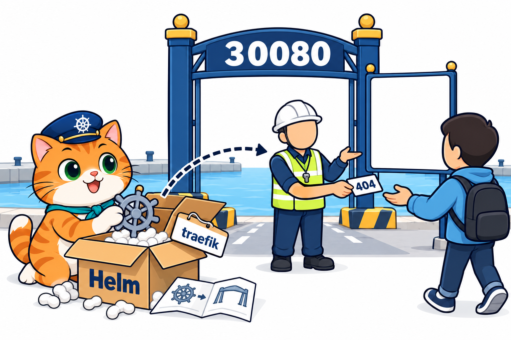
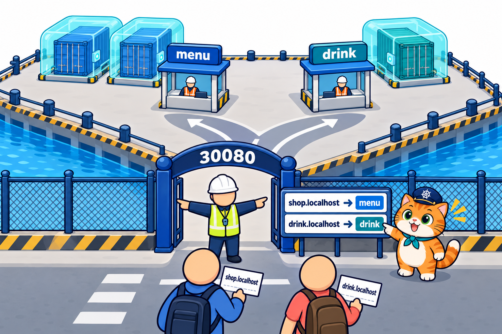
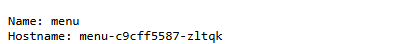
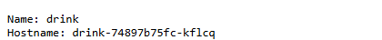
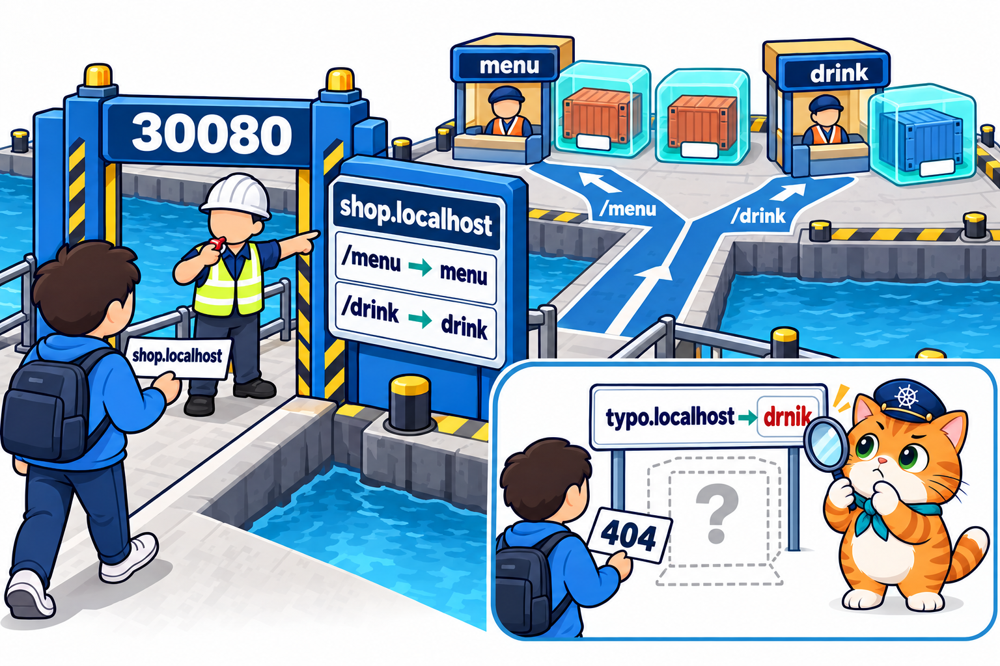
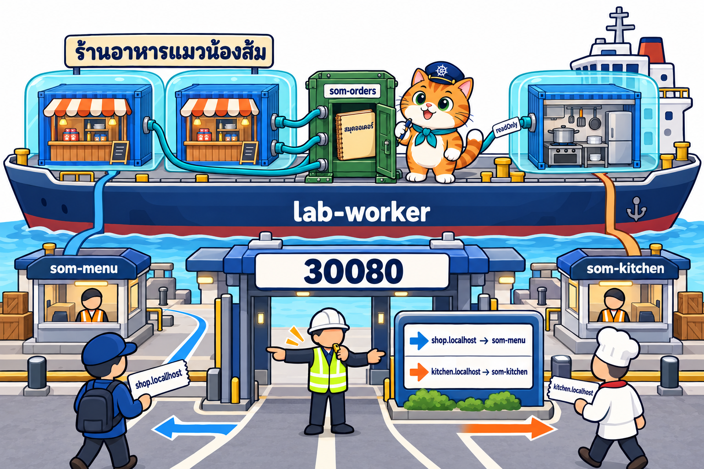
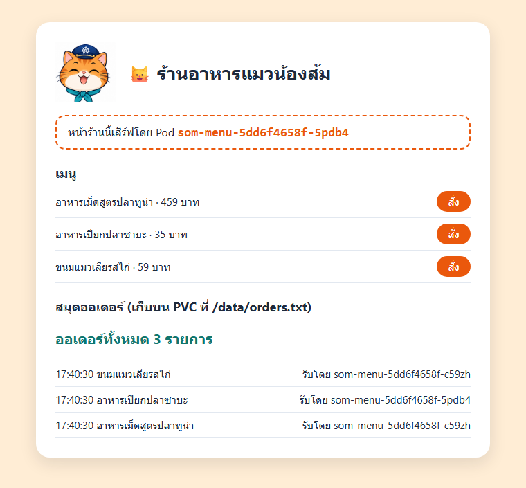
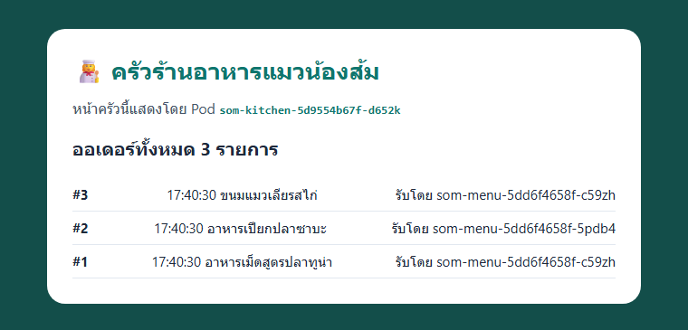
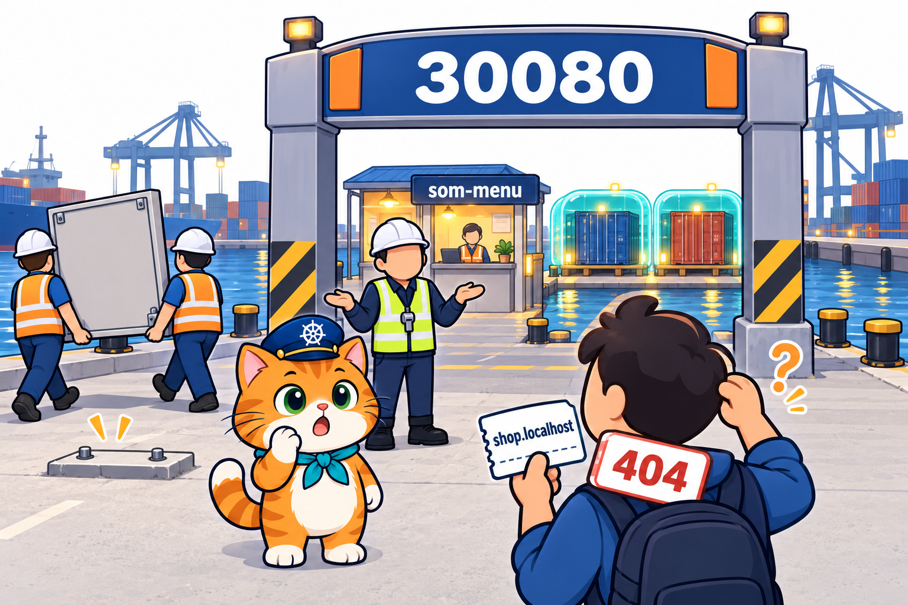

# LAB บทที่ 8: Kubernetes Ingress — ประตูใหญ่บานเดียว หลายร้าน

> **รายวิชา:** Software Development Tools and Environments (DevTools)
> **หัวข้อ:** ปฏิบัติการ Kubernetes Ingress — ติดตั้ง Ingress Controller (Traefik) ด้วย Helm, แยกทางลูกค้าตามชื่อ (host) และตามทางเดิน (path) ผ่านประตู `30080` บานเดียว, ป้ายที่ชี้ไป Service ที่ไม่มีอยู่จริง และร้านน้องส้มที่หน้าร้านกับครัวใช้ประตูเดียวกันคนละชื่อ
> **ผลลัพธ์การเรียนรู้ที่เกี่ยวข้อง:** CLO-5, CLO-6
> **ทฤษฎีประกอบ:** [01_Theory/README.md](../01_Theory/README.md)

---

## บทนำ

ทุก LAB ทำ **ใน container `k8s-lab`** (image `tuchsanai/devtools-kind:2569_1` มี kubectl, kind, helm, k9s และ Docker ข้างในครบ) บทที่ 5–7 เปิดร้านน้องส้มให้ลูกค้าเข้าด้วย Service แบบ **NodePort** ซึ่ง **แอปทุกตัวต้องมี nodePort ของตัวเอง** (`30080`, `30081`, ...) มีแอปกี่ตัวก็ต้องเปิดประตูและจำหมายเลขเท่านั้น บทนี้ใช้ **Ingress** ให้ทั้งคลัสเตอร์มี **ประตูใหญ่บานเดียว `30080`** แล้วแยกทางลูกค้าด้วย **ชื่อ (host)** เช่น `shop.localhost`, `drink.localhost` และ **ทางเดิน (path)** เช่น `/menu`, `/drink` ตั้งแต่ติดตั้ง "ยามประตูใหญ่" **Traefik** ด้วย **Helm**, ติดป้ายแยกตามชื่อ, แยกตามทางเดิน จนถึง **"ร้านอาหารแมวน้องส้ม"** ที่หน้าร้าน 2 สาขาและครัวใช้ประตูเดียวกันคนละชื่อ และอ่านสมุดออเดอร์บน PVC เล่มเดียวกัน (บทที่ 7)

> บล็อก **Expected output** คือผลที่ควรเห็นหลังรันคำสั่ง (ไม่ต้องพิมพ์ตาม) มาจากการทดลองจริงเมื่อ 18 ต.ค. 2569 (kind v0.33.0, kubectl v1.37.1, Kubernetes v1.37.0, Helm v4.3.0, Traefik chart 42.0.0 = Traefik v3.7.14) **ชื่อ Pod และ IP ถูกสุ่มทุกครั้ง** (เช่น `menu-c9cff5587-zltqk`, `traefik-5f58d5c648-bnsq2`, `10.244.1.2`) ค่าในเครื่องนักศึกษาจะต่างไป เป็นเรื่องปกติ

| สัญลักษณ์ | รันที่ไหน |
|---|---|
| 🖥️ | Terminal/PowerShell บนเครื่องนักศึกษา |
| 🐧 | SSH session ใน k8s-lab (prompt `root@k8s-lab`) |
| 🌐 | browser บนเครื่องนักศึกษา |

### กติกา

- ทำงานในโฟลเดอร์ `/workspace/DevTools/05_kubernetes/008_kubernetes_Ingress/02_LAB` และ **ลบ Ingress, Deployment, Service และ PVC ของตัวเองทุกครั้งที่จบ LAB** ยกเว้น **Traefik** ที่ติดตั้งใน LAB 1 ใช้ต่อทั้งบท ลบตอนจบบท (ท้าย LAB 4)
- **ชื่อ Pod ในเครื่องแต่ละคนไม่เหมือนกัน** คำสั่งที่มี `# ← เปลี่ยนเป็นชื่อ Pod ของตัวเอง` ให้แทนด้วยชื่อที่เห็นจาก `kubectl get pods` ในเครื่องตัวเอง
- **ชื่อที่ลงท้ายด้วย `.localhost`** (`shop.localhost`, `drink.localhost`, `kitchen.localhost`) **ใช้ได้เลย ไม่ต้องตั้ง DNS หรือแก้ไฟล์ hosts** เพราะทั้ง browser และ `curl` ส่งชื่อ `*.localhost` เข้าเครื่องตัวเองให้อัตโนมัติ บทนี้ไม่ต้องใช้ VS Code เปิดเว็บจาก browser ตรง ๆ แบบบทที่ 5–7

## สารบัญ LAB

| LAB | ชื่อ | เวลาโดยประมาณ | ความยาก |
|:---:|---|:---:|:---:|
| 0 | [เตรียมสภาพแวดล้อม (Setup)](#lab-0-เตรียมสภาพแวดล้อม-setup) (container `k8s-lab` ที่เปิด port NodePort + คลัสเตอร์ + git clone) | 20–30 นาที | ⭐ |
| 1 | [ติดตั้ง Ingress Controller (Traefik) ด้วย Helm](#lab-1-ติดตั้ง-ingress-controller-traefik-ด้วย-helm) | 25 นาที | ⭐⭐ |
| 2 | [แยกทางตามชื่อ (host)](#lab-2-แยกทางตามชื่อ-host) | 25 นาที | ⭐⭐⭐ |
| 3 | [แยกทางตามทางเดิน (path)](#lab-3-แยกทางตามทางเดิน-path) | 25 นาที | ⭐⭐⭐ |
| 4 | [LAB สุดท้าย: ร้านน้องส้มกับครัว ประตูเดียวสองชื่อ](#lab-4-lab-สุดท้าย-ร้านน้องส้มกับครัว-ประตูเดียวสองชื่อ) | 45–60 นาที | ⭐⭐⭐⭐⭐ |
| – | [เก็บกวาดหลังจบบท](#เก็บกวาดหลังจบบท) · [สรุปคำสั่งในบทนี้](#สรุปคำสั่งในบทนี้) | | |

รวมประมาณ 2.5–3 ชั่วโมง (เครื่องช้าหรือเน็ตช้าอาจนานกว่านี้ เพราะต้องดึง image `traefik`, `traefik/whoami` และ `node` จาก Docker Hub)

### สารบัญรูปภาพ

| รูปที่ | เรื่อง | รูปที่ | เรื่อง |
|:---:|---|:---:|---|
| 1 | [LAB 0 Setup container และคลัสเตอร์](#fig-1) | 7 | [LAB 3 ชื่อเดียว แยกทางเดิน /menu และ /drink](#fig-7) |
| 2 | [LAB 0 git clone](#fig-2) | 8 | [LAB 4 ประตูเดียวสองชื่อ หน้าร้านกับครัว](#fig-8) |
| 3 | [LAB 1 แกะกล่อง Helm ได้ยามประตูใหญ่ Traefik](#fig-3) | 9 | [ภาพหน้าจอจริง: หน้าร้าน shop.localhost](#fig-9) |
| 4 | [LAB 2 ป้ายผังแยกตามชื่อร้าน](#fig-4) | 10 | [ภาพหน้าจอจริง: หน้าครัว kitchen.localhost](#fig-10) |
| 5 | [ภาพหน้าจอจริง: shop.localhost ได้แอป menu](#fig-5) | 11 | [LAB 4 ถอดป้ายผัง = ลูกค้าได้ 404](#fig-11) |
| 6 | [ภาพหน้าจอจริง: drink.localhost ได้แอป drink](#fig-6) | | |

### โครงสร้างไฟล์ LAB

```text
02_LAB/
├── README.md                     ← เอกสารนี้
├── images/                       ← ภาพประกอบ + screenshots/ ภาพหน้าจอจริง
├── labs/
│   ├── lab01-controller/traefik-values.yaml                     ← ใช้ใน LAB 1 (ค่าตั้งค่าตอน helm install)
│   ├── lab02-host/{menu-app,drink-app,shop-ingress-host}.yaml   ← ใช้ใน LAB 2 (menu-app, drink-app ใช้ต่อใน LAB 3)
│   └── lab03-path/{shop-ingress-path,shop-ingress-typo}.yaml    ← ใช้ใน LAB 3
└── som-menu/
    ├── app/                      ← เว็บ Node.js (server.js + Dockerfile) image เดียว เป็นหน้าร้านหรือครัวตาม env APP_MODE
    └── k8s/{som-orders-pvc,som-menu,som-kitchen,som-ingress}.yaml
```

---

## LAB 0: เตรียมสภาพแวดล้อม (Setup)

**เป้าหมาย:** สร้าง container `k8s-lab` **ที่เปิด port NodePort `30080–30082` ออกมาถึงเครื่องนักศึกษา** และคลัสเตอร์ kind ชื่อ `lab` (1 control-plane + 2 worker) แล้วดึงไฟล์ LAB มาไว้ใน container (รายละเอียดของแต่ละคำสั่งดูได้จาก [LAB บทที่ 1](../../001_kubernetes-introduction/02_LAB/readme.md))

**ต้องมี:** Docker Desktop (Linux containers, RAM อย่างน้อย 4 GB) และ SSH client

> **ถ้ายังมี container `k8s-lab` จากบทที่ 5–7:** container นั้นสร้างด้วย `-p 30080-30082:30080-30082` แล้ว ใช้ต่อได้เลย 🖥️ `docker start k8s-lab` แล้วข้ามไปข้อ 2 (SSH) ถ้าคลัสเตอร์ยังอยู่ก็ข้าม `k8s-up` ได้ แต่ให้ตรวจว่า `kubectl get svc` เหลือแค่ Service `kubernetes` (ไม่มี Service จากบทก่อนที่จอง nodePort `30080` ค้างอยู่ เพราะบทนี้ประตู `30080` เป็นของ Traefik) ถ้าเป็น container ที่สร้าง **ก่อนบทที่ 5** (ไม่มี `-p 30080-30082:30080-30082`) ให้ลบทิ้งด้วย 🖥️ `docker rm -f k8s-lab` แล้วสร้างใหม่ตามขั้นที่ 1 (ถ้ามีงานของตัวเองเก็บไว้ใน container ให้คัดลอกออกมาก่อน)

### ขั้นที่ 1: Setup container และคลัสเตอร์

<p align="center" id="fig-1">
  <br>
  <em><b>รูปที่ 1</b> LAB0 ขั้นที่ 1: (1) docker run สร้าง container k8s-lab (2) ssh -p 2223 เข้าไปข้างใน (3) รัน k8s-up สร้าง kind cluster ชื่อ lab ได้ 3 node Ready (control-plane 1 ตัว + worker 2 ตัว)</em>
</p>

**1) สร้าง container** 🖥️ **บนเครื่องนักศึกษา** (image ประมาณ 1.5 GB ครั้งแรกใช้เวลาหลายนาที)

```bash
docker pull tuchsanai/devtools-kind:2569_1
```

```bash
docker run -dit --name k8s-lab --hostname k8s-lab --privileged -p 2223:22 -p 8889:8888 -p 30080-30082:30080-30082 tuchsanai/devtools-kind:2569_1
```

- `--privileged` ให้รัน Docker ซ้อนใน container ได้ (kind ต้องใช้) **ขาดไม่ได้**
- `-p 2223:22` เปิดทาง SSH เข้า container ผ่าน port `2223`
- `-p 8889:8888` เปิด JupyterLab ที่ `http://localhost:8889/lab` (ทางเลือก)
- `-p 30080-30082:30080-30082` เปิด port `30080`, `30081`, `30082` ของ container ออกมาที่เครื่องนักศึกษา (แบบบทที่ 5) บทนี้ใช้แค่ **`30080`** บานเดียว เป็นประตูใหญ่ของ Traefik ให้ browser เปิด `http://shop.localhost:30080` ได้

หลัง `docker run` **รอสัก 5–10 วินาที** ให้ container เริ่ม sshd และ dockerd ข้างในให้เสร็จก่อน

**2) SSH เข้า container** 🖥️ ครั้งแรกพิมพ์ `yes` แล้วใส่รหัสผ่าน `passwd`

```bash
ssh -p 2223 root@localhost
```

**3) สร้างและตรวจคลัสเตอร์** 🐧 **ใน SSH session ของ k8s-lab** (prompt `root@k8s-lab:~#`)

```bash
time k8s-up
```

**Expected output** (ตัดเฉพาะส่วนสำคัญ)

<pre>
...
[k8s-up] cluster 'lab' พร้อมใช้งาน (kubectl context: kind-lab)
...
  NodePort ที่ map ออก host: 30080 30081 30082

real	0m29.166s
</pre>

`k8s-up` สร้างคลัสเตอร์ใช้เวลาราว 30 วินาที – 1 นาที บรรทัด **`NodePort ที่ map ออก host: 30080 30081 30082`** = port ของ Node ที่ต่อออกมาถึง container `k8s-lab` และเครื่องนักศึกษา บทนี้ Traefik จะยืนเฝ้า `30080`

```bash
kubectl get nodes
```

**Expected output**

<pre>
NAME                STATUS   ROLES           AGE   VERSION
lab-control-plane   Ready    control-plane   23s   v1.37.0
lab-worker          Ready    &lt;none&gt;          13s   v1.37.0
lab-worker2         Ready    &lt;none&gt;          13s   v1.37.0
</pre>

```bash
kubectl get pods -A
```

**Expected output**

<pre>
NAMESPACE            NAME                                        READY   STATUS    RESTARTS   AGE
kube-system          coredns-559f6c778d-mwrhv                    1/1     Running   0          23s
kube-system          coredns-559f6c778d-zfwlz                    1/1     Running   0          23s
kube-system          etcd-lab-control-plane                      1/1     Running   0          30s
kube-system          kindnet-8tkvm                               1/1     Running   0          23s
kube-system          kindnet-b48wf                               1/1     Running   0          23s
kube-system          kindnet-rd5zt                               1/1     Running   0          24s
kube-system          kube-apiserver-lab-control-plane            1/1     Running   0          32s
kube-system          kube-controller-manager-lab-control-plane   1/1     Running   0          30s
kube-system          kube-proxy-8vx4h                            1/1     Running   0          24s
kube-system          kube-proxy-k979f                            1/1     Running   0          23s
kube-system          kube-proxy-nbvms                            1/1     Running   0          23s
kube-system          kube-scheduler-lab-control-plane            1/1     Running   0          32s
local-path-storage   local-path-provisioner-75f7fc7dc5-h2gqq     1/1     Running   0          23s
</pre>

ถ้า Pod บางตัวยังเป็น `0/1` ให้รอสัก 10 วินาที แล้วสั่งซ้ำ สังเกตว่า **ยังไม่มี Ingress Controller ในรายการ** (kind ไม่ได้ติดตั้งมาให้ LAB 1 จะติดตั้งเอง) Pod ระบบที่บทนี้ได้ใช้คือ **`kube-proxy`** (พาคำขอที่เข้าประตู NodePort `30080` ไปถึง Pod ของ Traefik แบบบทที่ 5) และ **`local-path-provisioner`** (สร้างที่เก็บให้ PVC สมุดออเดอร์ใน LAB 4 แบบบทที่ 7)

> **✅ ผ่านเมื่อ:** node 3 ตัว `Ready` และ Pod ระบบทุกตัวเป็น `1/1 Running`

### ขั้นที่ 2: git clone ไฟล์ LAB

<p align="center" id="fig-2">
  <br>
  <em><b>รูปที่ 2</b> LAB0 ขั้นที่ 2: git clone ดึง repo DevTools มาไว้ที่ /workspace/DevTools ใน k8s-lab แล้ว cd ลงไปจนถึงโฟลเดอร์ 02_LAB ของบทที่ 8 ที่มี labs และ som-menu</em>
</p>

🐧 **ใน SSH session ของ k8s-lab**

```bash
cd /workspace
```

```bash
git clone https://github.com/Tuchsanai/DevTools.git
```

ถ้าเคย clone ไว้แล้วใน container นี้ จะขึ้นว่า `already exists` ให้ `cd DevTools` แล้ว `git pull` แทน จากนั้น `cd /workspace`

```bash
cd DevTools/05_kubernetes/008_kubernetes_Ingress/02_LAB
```

> **✅ ผ่านเมื่อ:** prompt เป็น `root@k8s-lab:/workspace/DevTools/05_kubernetes/008_kubernetes_Ingress/02_LAB#` ทุกคำสั่งที่อ้าง `labs/...` หรือ `som-menu/...` ต้องรันจากโฟลเดอร์นี้

---

## LAB 1: ติดตั้ง Ingress Controller (Traefik) ด้วย Helm

<p align="center" id="fig-3">
  <br>
  <em><b>รูปที่ 3</b> LAB1: น้องส้มแกะกล่องชุดประกอบสำเร็จรูป Helm ป้าย traefik ได้ยามประตูใหญ่ (เสื้อสะท้อนแสงสีเหลืองมะนาว หมวกกันน็อกสีขาว ถือนกหวีด) ไปยืนเฝ้าประตูใหญ่บานเดียวหมายเลข 30080 แต่ป้ายผังทางเข้าข้างประตูยังว่างเปล่า ลูกค้าที่มาถึงจึงได้ป้าย 404 กลับไป</em>
</p>

**เป้าหมาย:** ติดตั้ง **Ingress Controller** = "ยามประตูใหญ่" ที่ยืนเฝ้าประตู `30080` คอยอ่าน **ป้ายผังทางเข้า (Ingress)** แล้วพาลูกค้าไปบูธ Service ที่ถูกต้อง ป้าย Ingress เฉย ๆ ไม่ทำอะไรเลยถ้าไม่มียามอ่าน และ kind ไม่ได้ติดตั้งยามมาให้ บทนี้ใช้ **Traefik** เป็นยาม (ไม่ใช้ ingress-nginx ที่เคยนิยม เพราะโปรเจกต์ ingress-nginx เลิกพัฒนาแล้วตั้งแต่ต้นปี 2026)

Traefik ประกอบด้วย YAML หลายชิ้น (Deployment, Service, IngressClass, สิทธิ์อ่าน Ingress ฯลฯ) แทนที่จะเขียนเองทีละไฟล์ เราติดตั้งด้วย **Helm** = **ตัวติดตั้งชุดสำเร็จรูป** ของ Kubernetes (คล้าย `apt` หรือ `npm` แต่ติดตั้งลงคลัสเตอร์)

- **repo** = แหล่งรวมชุดสำเร็จรูป (เช่น `https://traefik.github.io/charts`)
- **chart** = **กล่องชุดประกอบ** 1 กล่อง ข้างในมี YAML ทุกชิ้นที่ต้องใช้ (เช่น chart `traefik` ใน repo `traefik` เรียกว่า `traefik/traefik`)
- **release** = ชุดที่แกะติดตั้งแล้วในคลัสเตอร์ 1 ชุด ตั้งชื่อเองได้ (บทนี้ชื่อ `traefik`)
- ค่าที่อยากปรับ ใส่ใน **ไฟล์ values** แล้วส่งด้วย `-f` ไม่ต้องแก้ YAML ในกล่อง

🐧 **ใน SSH session ของ k8s-lab** (ทุกขั้นใน LAB 1–4)

### ขั้นที่ 1: ตรวจ Helm

```bash
helm version
```

**Expected output**

<pre>
version.BuildInfo{Version:"v4.3.0", GitCommit:"bec5b06ed841fe5269972d864d5177944fd5970f", GitTreeState:"clean", GoVersion:"go1.27.1", KubeClientVersion:"v1.37"}
</pre>

Helm `v4.3.0` ติดตั้งมาใน k8s-lab แล้ว ไม่ต้องติดตั้งเพิ่ม

### ขั้นที่ 2: ไฟล์ค่าตั้งค่า Traefik

ไฟล์ `labs/lab01-controller/traefik-values.yaml`

```yaml
# LAB 1: ค่าตั้งค่าตอนติดตั้ง Traefik (Ingress Controller) ด้วย Helm
# Traefik คือ "ยามประตูใหญ่" รับลูกค้าทุกคนที่ port 30080 แล้วส่งต่อตามป้าย Ingress
service:
  spec:
    type: NodePort             # เปิดประตูบนทุก Node (บทที่ 5) — kind ของแล็บ map 30080 ออกมาถึงเครื่องเรา
ports:
  web:                         # ประตู http
    nodePort: 30080            # ลูกค้าเข้าที่ http://<ชื่อ>.localhost:30080
  websecure:                   # ประตู https — บทนี้ยังไม่ใช้ ปิดไว้
    expose:
      default: false
```

ทำงานอย่างไร

- ไฟล์นี้ **ไม่ใช่ object ของ Kubernetes** (ไม่มี `apiVersion`, `kind`) แต่เป็น **ค่าที่ส่งให้ chart** ตอน `helm install -f` Helm เอาค่าเหล่านี้ไปเติมลง YAML ในกล่องก่อนสร้างจริง
- **`service.spec.type: NodePort`** = Service ของ Traefik เป็นแบบ NodePort (บทที่ 5) นี่คือ **ประตูใหญ่บานเดียว** ของทั้งบท
- **`ports.web.nodePort: 30080`** = ประตู http ของ Traefik ใช้หมายเลข `30080` (หมายเลขเดียวกับร้านน้องส้มในบทที่ 5–7 แต่คราวนี้เป็นของยาม ไม่ใช่ของแอป)
- **`ports.websecure.expose.default: false`** = ไม่เปิดประตู https บทนี้ใช้ http อย่างเดียว

### ขั้นที่ 3: เพิ่ม repo ของ Traefik

```bash
helm repo add traefik https://traefik.github.io/charts
```

**Expected output**

<pre>
"traefik" has been added to your repositories
</pre>

ตั้งชื่อ repo ในเครื่องเราว่า `traefik` ชี้ไปที่ `https://traefik.github.io/charts` ดึงรายการ chart ล่าสุดจาก repo

```bash
helm repo update
```

**Expected output**

<pre>
Hang tight while we grab the latest from your chart repositories...
...Successfully got an update from the "traefik" chart repository
Update Complete. ⎈Happy Helming!⎈
</pre>

### ขั้นที่ 4: ติดตั้ง Traefik

```bash
helm install traefik traefik/traefik --namespace traefik --create-namespace -f labs/lab01-controller/traefik-values.yaml
```

- `traefik` (ตัวแรก) = ชื่อ **release** ที่ตั้งเอง
- `traefik/traefik` = chart `traefik` จาก repo `traefik`
- `--namespace traefik --create-namespace` = ติดตั้งลง **namespace `traefik`** สร้างให้ถ้ายังไม่มี (namespace อธิบายในขั้นที่ 5)
- `-f labs/lab01-controller/traefik-values.yaml` = ใช้ค่าจากไฟล์ในขั้นที่ 2

**Expected output**

<pre>
NAME: traefik
LAST DEPLOYED: Sun Oct 18 17:38:08 2026
NAMESPACE: traefik
STATUS: deployed
REVISION: 1
DESCRIPTION: Install complete
TEST SUITE: None
NOTES:
traefik with docker.io/traefik:v3.7.14 has been deployed successfully on traefik namespace!
</pre>

`STATUS: deployed` = Helm ส่ง YAML ทุกชิ้นในกล่องให้คลัสเตอร์แล้ว (Traefik `v3.7.14`) ดูรายการ release ใน namespace `traefik`

```bash
helm list -n traefik
```

**Expected output**

<pre>
NAME   	NAMESPACE	REVISION	UPDATED                                	STATUS  	CHART         	APP VERSION
traefik	traefik  	1       	2026-10-18 17:38:08.284563894 +0700 +07	deployed	traefik-42.0.0	v3.7.14
</pre>

release `traefik` จาก chart `traefik-42.0.0` (กล่องรุ่น 42.0.0) ข้างในเป็นแอป Traefik `v3.7.14`

### ขั้นที่ 5: ดูของที่ Helm สร้าง (namespace)

**namespace** = **ห้องแยก** ในคลัสเตอร์ ของที่เราสร้างตั้งแต่บทที่ 2 อยู่ห้อง **`default`** ทั้งหมด (`kubectl get pods` เฉย ๆ = ดูห้อง `default`) ส่วน Traefik ถูกติดตั้งในห้อง **`traefik`** ต้องเติม **`-n traefik`** ถึงจะเห็น รอสัก 20 วินาที

```bash
kubectl get pods -n traefik
```

**Expected output**

<pre>
NAME                       READY   STATUS    RESTARTS   AGE
traefik-5f58d5c648-bnsq2   0/1     Running   0          20s
</pre>

Pod ของยาม Traefik ยังเป็น `0/1` (ครั้งแรกต้องดึง image `traefik` และรอให้พร้อม) ดูอย่างอื่นไปก่อน

```bash
kubectl get svc -n traefik
```

**Expected output**

<pre>
NAME      TYPE       CLUSTER-IP     EXTERNAL-IP   PORT(S)        AGE
traefik   NodePort   10.96.31.255   &lt;none&gt;        80:30080/TCP   20s
</pre>

**ประตูใหญ่** = Service `traefik` แบบ `NodePort` เปิด **`80:30080/TCP`** (port `80` ของ Service ↔ ประตู `30080` บนทุก Node) ตามไฟล์ values

```bash
kubectl get ingressclass
```

**Expected output**

<pre>
NAME                CONTROLLER                      PARAMETERS   AGE
traefik (default)   traefik.io/ingress-controller   &lt;none&gt;       20s
</pre>

**IngressClass** = ประเภทของยาม ชื่อ `traefik` และเป็น **`(default)`** ป้าย Ingress ที่เขียน `ingressClassName: traefik` จะให้ยาม Traefik เป็นคนอ่าน (IngressClass ไม่อยู่ใน namespace ใด จึงไม่ต้องใส่ `-n`)

```bash
kubectl get namespaces
```

**Expected output**

<pre>
NAME                 STATUS   AGE
default              Active   54s
kube-node-lease      Active   54s
kube-public          Active   54s
kube-system          Active   54s
local-path-storage   Active   50s
traefik              Active   20s
</pre>

มีห้อง **`traefik`** เพิ่มมา (สร้างโดย `--create-namespace`) ห้อง `kube-system` และ `local-path-storage` คือห้องของ Pod ระบบที่เห็นใน LAB 0 ด้วย `kubectl get pods -A` (`-A` = ทุกห้อง)

```bash
kubectl get pods
```

**Expected output**

<pre>
No resources found in default namespace.
</pre>

ห้อง `default` ยังว่าง เพราะ Traefik อยู่ห้อง `traefik` ถ้าลืม `-n traefik` จะหา Pod ของ Traefik ไม่เจอ

### ขั้นที่ 6: ลองเข้าประตู 30080

**รอจน `kubectl get pods -n traefik` เป็น `1/1`** (ในการทดลองใช้ราว 50 วินาทีหลัง `helm install`) ถ้ายัง `0/1` ให้รอสัก 10 วินาที แล้วสั่งซ้ำ ถ้า curl ตอนที่ยัง `0/1` จะต่อไม่ติด

```bash
kubectl get pods -n traefik
```

**Expected output**

<pre>
NAME                       READY   STATUS    RESTARTS   AGE
traefik-5f58d5c648-bnsq2   1/1     Running   0          50s
</pre>

```bash
curl http://localhost:30080
```

**Expected output**

<pre>
404 page not found
</pre>

```bash
curl http://shop.localhost:30080
```

**Expected output**

<pre>
404 page not found
</pre>

คำตอบ **`404 page not found`** มาจาก **Traefik เอง** = ยามมาเฝ้าประตู `30080` แล้ว แต่ **ป้ายผังยังว่าง** ไม่ว่าลูกค้าบอกชื่ออะไรมา (`localhost` หรือ `shop.localhost`) ยามก็ไม่รู้จะพาไปไหน `shop.localhost` ใช้ได้ทันทีเพราะ curl ส่งชื่อ `*.localhost` เข้าเครื่องตัวเองให้เอง

**ไม่ต้องลบ Traefik** ยามคนนี้ใช้ต่อใน LAB 2–4 ลบตอนจบบท (ท้าย LAB 4)

### สิ่งที่เห็น

- **Helm** ติดตั้งชุดสำเร็จรูปได้ในคำสั่งเดียว: เพิ่ม **repo** → เลือก **chart** → ติดตั้งเป็น **release** ปรับค่าด้วยไฟล์ values (`-f`) แทนการแก้ YAML ในกล่อง
- Traefik อยู่ **namespace `traefik`** ต้องใช้ `-n traefik` ถึงจะเห็น `kubectl get pods` เฉย ๆ ดูแค่ห้อง `default`
- ประตูใหญ่ = Service แบบ NodePort **`80:30080`** ของ Traefik ตัวเดียว + IngressClass **`traefik (default)`**
- ยังไม่มีป้าย Ingress ทุกชื่อจึงได้ **`404 page not found`** จาก Traefik

> **🤔 คำถามชวนคิด:** ขั้นที่ 6 ได้ `404 page not found` ทั้งที่ยังไม่มีแอปเลย ถ้ายังไม่ได้ติดตั้ง Traefik (ไม่มีใครเฝ้าประตู `30080`) คิดว่า curl จะได้คำตอบแบบเดียวกันหรือไม่ คำตอบ 404 นี้บอกอะไรเรา

---

## LAB 2: แยกทางตามชื่อ (host)

<p align="center" id="fig-4">
  <br>
  <em><b>รูปที่ 4</b> LAB2: ลูกค้า 2 คนเข้าประตูใหญ่ 30080 บานเดียวกัน ยามอ่านป้ายผังทางเข้า 2 แถว shop.localhost → menu และ drink.localhost → drink แล้วชี้ลูกค้าที่ถือตั๋ว shop.localhost ไปบูธ menu (กล่อง Pod 2 กล่อง) และลูกค้าที่ถือตั๋ว drink.localhost ไปบูธ drink (กล่อง Pod 1 กล่อง) บูธทั้งสองอยู่ข้างในท่า ไม่มีประตูของตัวเอง</em>
</p>

**เป้าหมาย:** เปิดแอป 2 ตัว (`menu` 2 Pod, `drink` 1 Pod) ที่มี **Service แบบ ClusterIP** (บูธข้างในท่า ไม่มีประตูของตัวเอง) แล้วติด **ป้าย Ingress** ให้ยาม Traefik พาลูกค้าไปตาม **ชื่อที่พิมพ์ในช่อง URL (host)**: `shop.localhost` → แอป `menu`, `drink.localhost` → แอป `drink` ทั้งคู่เข้าทางประตู `30080` บานเดียวกัน

แอปใน LAB 2–3 ใช้ image **`traefik/whoami:v1.11.0`** เป็นเว็บเล็ก ๆ ที่ตอบกลับเป็นข้อความว่า **ตัวเองชื่ออะไร** (`Name`), **Pod ไหนตอบ** (`Hostname`) และ **คำขอที่ได้รับหน้าตาอย่างไร** (`GET /...`, `Host`) เหมาะสำหรับดูว่ายามพาเราไปที่ไหน

### ขั้นที่ 1: เปิดแอป menu และ drink

ไฟล์ `labs/lab02-host/menu-app.yaml`

```yaml
# LAB 2, 3: แอป "menu" 2 Pod + Service แบบ ClusterIP (ไม่เปิด NodePort เอง — ให้ Ingress พาลูกค้ามา)
# image whoami ตอบกลับว่า Pod ไหนรับ และได้คำขอหน้าตาแบบไหน (path, Host)
apiVersion: apps/v1
kind: Deployment
metadata:
  name: menu
spec:
  replicas: 2
  selector:
    matchLabels:
      app: menu
  template:
    metadata:
      labels:
        app: menu
    spec:
      containers:
        - name: whoami
          image: traefik/whoami:v1.11.0
          args: ["--name", "menu"]   # บรรทัดแรกของคำตอบจะเป็น Name: menu
          ports:
            - containerPort: 80
---
apiVersion: v1
kind: Service
metadata:
  name: menu
spec:
  selector:
    app: menu
  ports:
    - port: 80
      targetPort: 80
```

ทำงานอย่างไร

- ไฟล์เดียวมี 2 object คั่นด้วย `---`: **Deployment `menu`** 2 Pod และ **Service `menu`**
- **`args: ["--name", "menu"]`** = บอกแอป whoami ให้ตอบบรรทัดแรกว่า `Name: menu` จะได้รู้ว่ามาถึงแอปไหน
- Service **ไม่มี `type`** = **ClusterIP** (ค่าเริ่มต้น บทที่ 5) เข้าได้จากในคลัสเตอร์เท่านั้น **ไม่มี nodePort** ลูกค้าข้างนอกจะเข้าผ่านยาม Traefik ที่ประตู `30080` แทน

ไฟล์ `labs/lab02-host/drink-app.yaml`

```yaml
# LAB 2, 3: แอป "drink" 1 Pod + Service แบบ ClusterIP (ไม่เปิด NodePort เอง — ให้ Ingress พาลูกค้ามา)
# image whoami ตอบกลับว่า Pod ไหนรับ และได้คำขอหน้าตาแบบไหน (path, Host)
apiVersion: apps/v1
kind: Deployment
metadata:
  name: drink
spec:
  replicas: 1
  selector:
    matchLabels:
      app: drink
  template:
    metadata:
      labels:
        app: drink
    spec:
      containers:
        - name: whoami
          image: traefik/whoami:v1.11.0
          args: ["--name", "drink"]   # บรรทัดแรกของคำตอบจะเป็น Name: drink
          ports:
            - containerPort: 80
---
apiVersion: v1
kind: Service
metadata:
  name: drink
spec:
  selector:
    app: drink
  ports:
    - port: 80
      targetPort: 80
```

ทำงานอย่างไร

- เหมือน `menu-app.yaml` ทุกอย่าง ต่างแค่ชื่อเป็น **`drink`** (ชื่อ Deployment, ป้าย `app`, ชื่อ Service, `--name`) และ **`replicas: 1`**

```bash
kubectl apply -f labs/lab02-host/menu-app.yaml
```

**Expected output**

<pre>
deployment.apps/menu created
service/menu created
</pre>

```bash
kubectl apply -f labs/lab02-host/drink-app.yaml
```

**Expected output**

<pre>
deployment.apps/drink created
service/drink created
</pre>

รอสัก 15 วินาที

```bash
kubectl get pods
```

**Expected output**

<pre>
NAME                     READY   STATUS    RESTARTS   AGE
drink-74897b75fc-kflcq   1/1     Running   0          15s
menu-c9cff5587-9br8c     1/1     Running   0          15s
menu-c9cff5587-zltqk     1/1     Running   0          15s
</pre>

```bash
kubectl get svc
```

**Expected output**

<pre>
NAME         TYPE        CLUSTER-IP    EXTERNAL-IP   PORT(S)   AGE
drink        ClusterIP   10.96.5.128   &lt;none&gt;        80/TCP    15s
kubernetes   ClusterIP   10.96.0.1     &lt;none&gt;        443/TCP   108s
menu         ClusterIP   10.96.53.89   &lt;none&gt;        80/TCP    15s
</pre>

Service `menu` และ `drink` เป็น **`ClusterIP`** ช่อง `PORT(S)` มีแค่ `80/TCP` **ไม่มี `:30xxx`** = ยังไม่มีทางเข้าจากนอกคลัสเตอร์

### ขั้นที่ 2: ติดป้าย Ingress แยกตามชื่อ

ไฟล์ `labs/lab02-host/shop-ingress-host.yaml`

```yaml
# LAB 2: Ingress แยกตามชื่อ (host) — ชื่อไหนไป Service ไหน
apiVersion: networking.k8s.io/v1   # Ingress อยู่กลุ่ม networking.k8s.io
kind: Ingress
metadata:
  name: shop-host
spec:
  ingressClassName: traefik        # ให้ยามประตู Traefik เป็นคนอ่านป้ายนี้
  rules:
    - host: shop.localhost         # ลูกค้าพิมพ์ http://shop.localhost:30080
      http:
        paths:
          - path: /
            pathType: Prefix       # ทุก path ที่ขึ้นต้นด้วย /
            backend:
              service:
                name: menu         # → Service menu
                port:
                  number: 80
    - host: drink.localhost        # ลูกค้าพิมพ์ http://drink.localhost:30080
      http:
        paths:
          - path: /
            pathType: Prefix
            backend:
              service:
                name: drink        # → Service drink
                port:
                  number: 80
```

ทำงานอย่างไร

- **`apiVersion: networking.k8s.io/v1`** + **`kind: Ingress`** = **ป้ายผังทางเข้า** (Ingress อยู่กลุ่ม `networking.k8s.io` ไม่ใช่ `v1` เฉย ๆ แบบ Pod/Service หรือ `apps/v1` แบบ Deployment)
- **`ingressClassName: traefik`** = ให้ยามประเภท `traefik` (IngressClass จาก LAB 1) เป็นคนอ่านป้ายนี้
- **`rules`** = รายการกฎ แต่ละกฎขึ้นต้นด้วย **`host`** = **ชื่อที่ลูกค้าพิมพ์ในช่อง URL** ป้ายนี้มี 2 กฎ: `shop.localhost` และ `drink.localhost`
- **`paths`** → **`path: /`** + **`pathType: Prefix`** = ทุกทางเดินที่ขึ้นต้นด้วย `/` (= ทุกหน้าของชื่อนั้น) LAB 3 จะแยกทางเดินจริง
- **`backend.service.name`** + **`port.number`** = ส่งลูกค้าไปบูธ Service ไหน port อะไร (port ของ **Service** คือ `80` ไม่ใช่ port ของ container)

```bash
kubectl apply -f labs/lab02-host/shop-ingress-host.yaml
```

**Expected output**

<pre>
ingress.networking.k8s.io/shop-host created
</pre>

รอสัก 5 วินาที

```bash
kubectl get ingress
```

**Expected output**

<pre>
NAME        CLASS     HOSTS                            ADDRESS   PORTS   AGE
shop-host   traefik   shop.localhost,drink.localhost             80      5s
</pre>

- **`CLASS traefik`** = ยาม Traefik รับป้ายนี้ไปอ่าน
- **`HOSTS`** = ชื่อทั้ง 2 ชื่อบนป้าย
- ช่อง `ADDRESS` ว่างเป็นเรื่องปกติในแล็บนี้ ลูกค้าเข้าทางประตู `30080`

```bash
kubectl describe ingress shop-host
```

**Expected output**

<pre>
Name:             shop-host
Labels:           &lt;none&gt;
Namespace:        default
Address:          
Ingress Class:    traefik
Default backend:  &lt;default&gt;
Rules:
  Host             Path  Backends
  ----             ----  --------
  shop.localhost   
                   /   menu:80 (10.244.1.2:80,10.244.2.3:80)
  drink.localhost  
                   /   drink:80 (10.244.2.4:80)
Annotations:       &lt;none&gt;
Events:            &lt;none&gt;
</pre>

ส่วน **`Rules`** อ่านป้ายเป็นตาราง: ชื่อ `shop.localhost` ทางเดิน `/` → Service **`menu:80`** ซึ่งมี Pod อยู่ 2 ตัว (`10.244.1.2:80,10.244.2.3:80` = IP ของ Pod `menu` ทั้งสอง) และ `drink.localhost` → **`drink:80`** มี Pod 1 ตัว ถ้าในวงเล็บมี IP แปลว่าป้ายชี้ไปบูธที่มีอยู่จริงและมี Pod พร้อมรับ

### ขั้นที่ 3: ทดสอบด้วย curl

พิมพ์คำสั่งนี้ซ้ำ 2 ครั้ง

```bash
curl http://shop.localhost:30080
```

**Expected output** (ตัดเฉพาะส่วนสำคัญ)

<pre>
Name: menu
Hostname: menu-c9cff5587-zltqk
...
GET / HTTP/1.1
Host: shop.localhost:30080
...
X-Forwarded-Host: shop.localhost:30080
...
X-Forwarded-Server: traefik-5f58d5c648-bnsq2
...

Name: menu
Hostname: menu-c9cff5587-9br8c
...
GET / HTTP/1.1
Host: shop.localhost:30080
...
X-Forwarded-Host: shop.localhost:30080
...
X-Forwarded-Server: traefik-5f58d5c648-bnsq2
...
</pre>

- **`Name: menu`** = ยามพาไปแอป `menu` ตามป้าย และ **`Hostname`** สลับเป็น Pod `menu` คนละตัว (Service กระจายลูกค้าแบบบทที่ 5)
- **`Host: shop.localhost:30080`** = ชื่อที่ curl ส่งไปกับคำขอ **ยามใช้บรรทัดนี้ตัดสินว่าจะพาไปไหน** (ประตูเดียวกัน แต่ชื่อต่างกัน)
- **`X-Forwarded-Host`** และ **`X-Forwarded-Server: traefik-5f58d5c648-bnsq2`** = หัวคำขอที่ Traefik เติมให้ บอกแอปว่าลูกค้าพิมพ์ชื่ออะไรมา และยาม Pod ไหนเป็นคนพามา

```bash
curl http://drink.localhost:30080
```

**Expected output** (ตัดเฉพาะส่วนสำคัญ)

<pre>
Name: drink
Hostname: drink-74897b75fc-kflcq
...
GET / HTTP/1.1
Host: drink.localhost:30080
...
X-Forwarded-Host: drink.localhost:30080
...
X-Forwarded-Server: traefik-5f58d5c648-bnsq2
...
</pre>

**ประตูเดียวกัน (`30080`) แต่ชื่อ `drink.localhost`** ยามพาไปแอป `drink` แทน ลองชื่อที่ไม่มีบนป้าย

```bash
curl http://localhost:30080
```

**Expected output**

<pre>
404 page not found
</pre>

ป้ายมีแค่ `shop.localhost` และ `drink.localhost` ชื่อ `localhost` เฉย ๆ ไม่มีกฎ ยามจึงตอบ `404`

### ขั้นที่ 4: เปิดด้วย browser

🌐 เปิด browser บนเครื่องนักศึกษา ไปที่ `http://shop.localhost:30080` (browser ส่งชื่อ `*.localhost` เข้าเครื่องตัวเองให้อัตโนมัติ ไม่ต้องแก้ไฟล์ hosts)

<p align="center" id="fig-5">
  <br>
  <em><b>รูปที่ 5</b> ภาพหน้าจอจริงจากการทดลอง: เปิด http://shop.localhost:30080 ได้คำตอบจาก whoami บรรทัดแรก Name: menu เสิร์ฟโดย Pod menu-c9cff5587-zltqk (ครอปเหลือ 2 บรรทัดแรก ทดสอบ 18 ต.ค. 2569 ด้วย Chrome จริงบนเครื่อง host ตอนถ่าย container ทดลอง map port 30080 ไปที่ port อื่นของ host นักศึกษาเปิด http://shop.localhost:30080 ตรง ๆ หน้าเว็บที่เห็นเหมือนกัน)</em>
</p>

แล้วเปิด `http://drink.localhost:30080`

<p align="center" id="fig-6">
  <br>
  <em><b>รูปที่ 6</b> ภาพหน้าจอจริงจากการทดลอง: เปิด http://drink.localhost:30080 ประตูเดียวกันแต่ชื่อต่างกัน ได้ Name: drink เสิร์ฟโดย Pod drink-74897b75fc-kflcq (ครอปเหลือ 2 บรรทัดแรก ทดสอบ 18 ต.ค. 2569 ด้วย Chrome จริงบนเครื่อง host ตอนถ่าย container ทดลอง map port 30080 ไปที่ port อื่นของ host นักศึกษาเปิด http://drink.localhost:30080 ตรง ๆ หน้าเว็บที่เห็นเหมือนกัน)</em>
</p>

ในหน้าเว็บมีบรรทัดอื่นต่อลงไปเหมือนผลของ curl ดูแค่ 2 บรรทัดแรกก็พอ (ชื่อ Pod ที่เห็นอาจต่างไป)

### ขั้นที่ 5: ลบเฉพาะป้าย Ingress

```bash
kubectl delete -f labs/lab02-host/shop-ingress-host.yaml
```

**Expected output**

<pre>
ingress.networking.k8s.io "shop-host" deleted from default namespace
</pre>

```bash
kubectl get ingress
```

**Expected output**

<pre>
No resources found in default namespace.
</pre>

**เก็บแอป `menu` และ `drink` ไว้** (ไม่ต้องลบ Deployment และ Service) LAB 3 ใช้ต่อ

### สิ่งที่เห็น

- แอปที่มี Service แบบ **ClusterIP** (ไม่มี nodePort) เข้าจากนอกคลัสเตอร์ได้ผ่าน **ป้าย Ingress** + ยาม Traefik ที่ประตู `30080` บานเดียว
- ป้ายแยกทางด้วย **`host`** = ชื่อในช่อง URL ที่ส่งมากับคำขอเป็น `Host: ...` ประตูเดียวกันแต่ชื่อต่างกันไปคนละแอป
- `kubectl describe ingress` แสดงกฎเป็นตาราง พร้อม **IP ของ Pod** ที่อยู่หลัง Service แต่ละตัว ส่วนชื่อที่ไม่มีบนป้ายได้ `404`
- ยามยังส่งต่อให้ Service กระจายไปทุก Pod (`Hostname` ของ `menu` สลับกัน)

> **🤔 คำถามชวนคิด:** ถ้าร้านจะเปิดแอปที่ 3 ชื่อ `cake` ให้ลูกค้าเข้าที่ `http://cake.localhost:30080` ต้องสร้างหรือแก้ไฟล์อะไรบ้าง และต้องเปิด nodePort หมายเลขใหม่หรือไม่ (เทียบกับบทที่ 5 ที่แอปทุกตัวต้องมี nodePort ของตัวเอง)

---

## LAB 3: แยกทางตามทางเดิน (path)

<p align="center" id="fig-7">
  <br>
  <em><b>รูปที่ 7</b> LAB3: ลูกค้าถือตั๋วชื่อเดียว shop.localhost เข้าประตู 30080 ป้ายผังมี 2 แถว /menu → menu และ /drink → drink ข้างในท่าทางเดินแยกเป็น 2 เส้นไปบูธ menu (กล่อง Pod 2 กล่อง) และบูธ drink (กล่อง Pod 1 กล่อง) มุมขวาล่าง ป้าย typo.localhost → drnik ชี้ไปที่ว่างเปล่าที่ไม่มีบูธ ลูกค้าได้ 404 น้องส้มส่องแว่นขยายดูคำว่า drnik</em>
</p>

**เป้าหมาย:** ใช้ **ชื่อเดียว** `shop.localhost` แต่แยกลูกค้าตาม **ทางเดิน (path)**: `/menu` → แอป `menu`, `/drink` → แอป `drink` ดูว่า `pathType: Prefix` จับ path แบบไหนบ้าง แล้วลองป้ายที่ **พิมพ์ชื่อ Service ผิด**

### ขั้นที่ 1: ตรวจว่าแอปจาก LAB 2 ยังอยู่

```bash
kubectl get pods
```

**Expected output**

<pre>
NAME                     READY   STATUS    RESTARTS   AGE
drink-74897b75fc-kflcq   1/1     Running   0          32s
menu-c9cff5587-9br8c     1/1     Running   0          32s
menu-c9cff5587-zltqk     1/1     Running   0          32s
</pre>

ถ้าไม่เห็นแอป (เช่น เผลอลบไปแล้ว) ให้ apply `labs/lab02-host/menu-app.yaml` และ `labs/lab02-host/drink-app.yaml` ใหม่ตาม LAB 2 ขั้นที่ 1

### ขั้นที่ 2: ติดป้าย Ingress แยกตามทางเดิน

ไฟล์ `labs/lab03-path/shop-ingress-path.yaml`

```yaml
# LAB 3: Ingress แยกตามทางเดิน (path) — ชื่อเดียว shop.localhost แต่ /menu กับ /drink ไปคนละ Service
apiVersion: networking.k8s.io/v1
kind: Ingress
metadata:
  name: shop-path
spec:
  ingressClassName: traefik
  rules:
    - host: shop.localhost
      http:
        paths:
          - path: /menu            # /menu, /menu/today, ... → Service menu
            pathType: Prefix
            backend:
              service:
                name: menu
                port:
                  number: 80
          - path: /drink           # /drink, /drink/cold, ... → Service drink
            pathType: Prefix
            backend:
              service:
                name: drink
                port:
                  number: 80
```

ทำงานอย่างไร

- **กฎเดียว** `host: shop.localhost` แต่ใต้ **`paths`** มี **2 ทางเดิน**
- **`path: /menu`** + **`pathType: Prefix`** = path ที่ขึ้นต้นด้วย `/menu` (เช่น `/menu`, `/menu/today`) → Service `menu`
- **`path: /drink`** + `Prefix` → Service `drink`
- **ไม่มี `path: /`** ในป้ายนี้ = หน้าแรก `http://shop.localhost:30080/` ไม่มีกฎรองรับ

```bash
kubectl apply -f labs/lab03-path/shop-ingress-path.yaml
```

**Expected output**

<pre>
ingress.networking.k8s.io/shop-path created
</pre>

รอสัก 5 วินาที

```bash
kubectl get ingress
```

**Expected output**

<pre>
NAME        CLASS     HOSTS            ADDRESS   PORTS   AGE
shop-path   traefik   shop.localhost             80      5s
</pre>

```bash
kubectl describe ingress shop-path
```

**Expected output**

<pre>
Name:             shop-path
Labels:           &lt;none&gt;
Namespace:        default
Address:          
Ingress Class:    traefik
Default backend:  &lt;default&gt;
Rules:
  Host            Path  Backends
  ----            ----  --------
  shop.localhost  
                  /menu    menu:80 (10.244.1.2:80,10.244.2.3:80)
                  /drink   drink:80 (10.244.2.4:80)
Annotations:      &lt;none&gt;
Events:           &lt;none&gt;
</pre>

ชื่อ `shop.localhost` ชื่อเดียว มี 2 แถวในคอลัมน์ **`Path`**: `/menu` → `menu:80` (Pod 2 ตัว) และ `/drink` → `drink:80` (Pod 1 ตัว)

### ขั้นที่ 3: ทดสอบแต่ละทางเดิน

```bash
curl http://shop.localhost:30080/menu
```

**Expected output** (ตัดเฉพาะส่วนสำคัญ)

<pre>
Name: menu
Hostname: menu-c9cff5587-zltqk
...
GET /menu HTTP/1.1
Host: shop.localhost:30080
...
X-Forwarded-Host: shop.localhost:30080
...
X-Forwarded-Server: traefik-5f58d5c648-bnsq2
...
</pre>

`/menu` → แอป `menu` ทางเดินที่ลึกลงไปก็ยังขึ้นต้นด้วย `/menu`

```bash
curl http://shop.localhost:30080/menu/today
```

**Expected output** (ตัดเฉพาะส่วนสำคัญ)

<pre>
Name: menu
Hostname: menu-c9cff5587-9br8c
...
GET /menu/today HTTP/1.1
Host: shop.localhost:30080
...
X-Forwarded-Host: shop.localhost:30080
...
X-Forwarded-Server: traefik-5f58d5c648-bnsq2
...
</pre>

- `/menu/today` ขึ้นต้นด้วย `/menu` จึงไปแอป `menu` ตาม **`Prefix`**
- บรรทัด **`GET /menu/today`** = แอปได้รับ **path เต็ม** (Ingress ไม่ตัด `/menu` ออกให้) แอปจริงที่อยู่ใต้ทางเดินจึงต้องรู้ว่าตัวเองอยู่ที่ `/menu`

```bash
curl http://shop.localhost:30080/drink
```

**Expected output** (ตัดเฉพาะส่วนสำคัญ)

<pre>
Name: drink
Hostname: drink-74897b75fc-kflcq
...
GET /drink HTTP/1.1
Host: shop.localhost:30080
...
X-Forwarded-Host: shop.localhost:30080
...
X-Forwarded-Server: traefik-5f58d5c648-bnsq2
...
</pre>

**ชื่อเดียวกัน (`Host: shop.localhost:30080`)** แต่ทางเดิน `/drink` ไปแอป `drink` ลองหน้าแรก

```bash
curl http://shop.localhost:30080/
```

**Expected output**

<pre>
404 page not found
</pre>

ป้ายนี้ไม่มีกฎ `path: /` หน้าแรกจึงได้ `404` (ต่างจาก LAB 2 ที่ใช้ `path: /` จับทุกหน้า) ลอง path ที่ขึ้นต้นคล้าย `/menu`

```bash
curl http://shop.localhost:30080/menus
```

**Expected output** (ตัดเฉพาะส่วนสำคัญ)

<pre>
Name: menu
Hostname: menu-c9cff5587-zltqk
...
GET /menus HTTP/1.1
Host: shop.localhost:30080
...
X-Forwarded-Host: shop.localhost:30080
...
X-Forwarded-Server: traefik-5f58d5c648-bnsq2
...
</pre>

> **⚠️ `/menus` ก็ถูกส่งไปแอป `menu` ด้วย** ทั้งที่ตามสเปกของ Kubernetes `pathType: Prefix` ของ `/menu` ควรจับแค่ `/menu` และ `/menu/...` (เทียบทีละช่องที่คั่นด้วย `/`) ไม่ควรจับ `/menus` แต่ยาม Traefik ที่เราใช้ส่งไปให้ **แต่ละ Ingress Controller ตีความรายละเอียดต่างกันได้** จึงควรตั้ง path อย่าให้ขึ้นต้นซ้ำกัน (เช่น ไม่มีทั้ง `/menu` และ `/menus` สำหรับคนละแอป) และทดสอบกับยามที่ใช้จริงเสมอ

### ขั้นที่ 4: ป้ายที่พิมพ์ชื่อ Service ผิด

ไฟล์ `labs/lab03-path/shop-ingress-typo.yaml`

```yaml
# LAB 3: Ingress ที่พิมพ์ชื่อ Service ผิด — ป้ายชี้ไปบูธที่ไม่มีอยู่จริง
apiVersion: networking.k8s.io/v1
kind: Ingress
metadata:
  name: shop-typo
spec:
  ingressClassName: traefik
  rules:
    - host: typo.localhost
      http:
        paths:
          - path: /
            pathType: Prefix
            backend:
              service:
                name: drnik        # ← พิมพ์ผิด (ที่ถูกคือ drink)
                port:
                  number: 80
```

ทำงานอย่างไร

- ป้ายชื่อ `typo.localhost` ทุกทางเดิน (`/`) → Service **`drnik`** ซึ่ง **พิมพ์ผิด** (ที่ถูกคือ `drink`) ไม่มีบูธชื่อนี้อยู่จริง

```bash
kubectl apply -f labs/lab03-path/shop-ingress-typo.yaml
```

**Expected output**

<pre>
ingress.networking.k8s.io/shop-typo created
</pre>

**สร้างผ่าน!** ไม่มี error เลย รอสัก 5 วินาที

```bash
kubectl get ingress
```

**Expected output**

<pre>
NAME        CLASS     HOSTS            ADDRESS   PORTS   AGE
shop-path   traefik   shop.localhost             80      10s
shop-typo   traefik   typo.localhost             80      5s
</pre>

`get ingress` ก็ดูปกติ ไม่บอกว่ามีอะไรผิด ต้องดูรายละเอียด

```bash
kubectl describe ingress shop-typo
```

**Expected output**

<pre>
Name:             shop-typo
Labels:           &lt;none&gt;
Namespace:        default
Address:          
Ingress Class:    traefik
Default backend:  &lt;default&gt;
Rules:
  Host            Path  Backends
  ----            ----  --------
  typo.localhost  
                  /   drnik:80 (&lt;error: services "drnik" not found&gt;)
Annotations:      &lt;none&gt;
Events:           &lt;none&gt;
</pre>

ในวงเล็บที่ปกติเป็น IP ของ Pod กลายเป็น **`<error: services "drnik" not found>`** = ป้ายชี้ไปบูธที่ไม่มีอยู่จริง

```bash
curl http://typo.localhost:30080
```

**Expected output**

<pre>
404 page not found
</pre>

ยามไม่มีที่ให้ส่ง ลูกค้าได้ `404` ตรวจรายชื่อบูธที่มีจริง

```bash
kubectl get svc
```

**Expected output**

<pre>
NAME         TYPE        CLUSTER-IP    EXTERNAL-IP   PORT(S)   AGE
drink        ClusterIP   10.96.5.128   &lt;none&gt;        80/TCP    42s
kubernetes   ClusterIP   10.96.0.1     &lt;none&gt;        443/TCP   2m15s
menu         ClusterIP   10.96.53.89   &lt;none&gt;        80/TCP    42s
</pre>

มี `drink` แต่ **ไม่มี `drnik`**

> **⚠️ Kubernetes ไม่ตรวจว่า Service ที่ป้าย Ingress อ้างถึงมีอยู่จริง** `kubectl apply` และ `kubectl get ingress` ผ่านปกติ เห็นปัญหาได้จาก `kubectl describe ingress` (`<error: services "..." not found>`) หรือจากลูกค้าที่ได้ `404` เท่านั้น ทุกครั้งที่ติดป้ายใหม่ให้ `describe` ดูว่าในวงเล็บเป็น IP ของ Pod

### ขั้นที่ 5: ลบทุกอย่างของ LAB 2–3

ลบป้าย Ingress ทั้ง 2 ป้าย แล้วลบแอป `menu` และ `drink` (Traefik เก็บไว้)

```bash
kubectl delete -f labs/lab03-path/shop-ingress-typo.yaml
```

**Expected output**

<pre>
ingress.networking.k8s.io "shop-typo" deleted from default namespace
</pre>

```bash
kubectl delete -f labs/lab03-path/shop-ingress-path.yaml
```

**Expected output**

<pre>
ingress.networking.k8s.io "shop-path" deleted from default namespace
</pre>

```bash
kubectl delete -f labs/lab02-host/menu-app.yaml
```

**Expected output**

<pre>
deployment.apps "menu" deleted from default namespace
service "menu" deleted from default namespace
</pre>

```bash
kubectl delete -f labs/lab02-host/drink-app.yaml
```

**Expected output**

<pre>
deployment.apps "drink" deleted from default namespace
service "drink" deleted from default namespace
</pre>

รอสัก 5 วินาที แล้วตรวจ

```bash
kubectl get ingress
```

**Expected output**

<pre>
No resources found in default namespace.
</pre>

```bash
kubectl get pods
```

**Expected output**

<pre>
No resources found in default namespace.
</pre>

### สิ่งที่เห็น

- ชื่อเดียว (`host`) แยกลูกค้าได้หลายแอปด้วย **`paths`** แต่ละทางเดินชี้ไปคนละ Service
- **`pathType: Prefix`** จับทุก path ที่ขึ้นต้นด้วยค่านั้น (`/menu`, `/menu/today`) แอปได้รับ path เต็ม และ path ที่ไม่มีกฎ (`/`) ได้ `404`
- รายละเอียดการจับ path ขึ้นกับ Ingress Controller: Traefik ส่ง `/menus` ไป `menu` ด้วย จึงไม่ควรตั้ง path ที่ขึ้นต้นซ้ำกัน
- ป้ายที่ชี้ไป Service ที่ไม่มี (`drnik`) **apply ผ่าน** เห็นได้จาก `describe` (`<error: services "drnik" not found>`) และลูกค้าได้ `404`

> **🤔 คำถามชวนคิด:** ถ้าเพิ่มกฎที่ 3 `path: /` → Service `menu` ลงในป้าย `shop-path` แล้วลูกค้าเข้า `/drink` ยามจะเลือกกฎไหน ระหว่าง `/` (ที่ทุก path ขึ้นต้นด้วย) กับ `/drink` (คิดว่ากฎที่ "เจาะจงกว่า" ควรชนะหรือไม่ เพราะอะไร)

---

## LAB 4: LAB สุดท้าย: ร้านน้องส้มกับครัว ประตูเดียวสองชื่อ

<p align="center" id="fig-8">
  <br>
  <em><b>รูปที่ 8</b> LAB สุดท้าย: ประตูใหญ่ 30080 บานเดียว ป้ายผังมี 2 ชื่อ ลูกค้าที่ถือตั๋ว shop.localhost ถูกชี้ไปบูธ som-menu ไปหน้าร้านอาหารแมวน้องส้ม 2 สาขา ส่วนพ่อครัวที่ถือตั๋ว kitchen.localhost ถูกชี้ไปบูธ som-kitchen ไปครัว ทั้ง 3 กล่องอยู่บนเรือ lab-worker และต่อท่อเข้าล็อกเกอร์สีเขียว som-orders ที่มีสมุดออเดอร์เล่มเดียว ท่อของครัวมีป้าย readOnly (ครัวอ่านได้อย่างเดียว)</em>
</p>

**เป้าหมาย:** เปิดร้านน้องส้มที่ใช้ **ประตู `30080` บานเดียว สองชื่อ**: ลูกค้าเข้า **`shop.localhost`** ได้ **หน้าร้าน** 2 สาขา (สั่งอาหารได้) ส่วนพ่อครัวเข้า **`kitchen.localhost`** ได้ **หน้าครัว** ที่อ่านสมุดออเดอร์บน PVC เล่มเดียวกัน (บทที่ 7) แต่รับออเดอร์เองไม่ได้ Service ทุกตัวเป็น **ClusterIP** มีแค่ Traefik ที่เปิด NodePort แล้วลองถอดป้ายดูว่าเกิดอะไรขึ้น

**ไม่ต้องใช้ VS Code** ทุกคำสั่งพิมพ์ใน 🐧 **SSH session ของ k8s-lab** ส่วนหน้าเว็บเปิดด้วย 🌐 browser บนเครื่องนักศึกษาที่ `http://shop.localhost:30080` และ `http://kitchen.localhost:30080`

แอป (`som-menu/app/server.js`) เป็น **image เดียว** ที่ทำงานได้ 2 แบบ เลือกด้วย env **`APP_MODE`**

```js
const APP_MODE = process.env.APP_MODE || "shop";        // shop หรือ kitchen
// ... POST /order ...
    if (APP_MODE === "kitchen") {                          // ครัวไม่รับออเดอร์ ให้สั่งที่หน้าร้าน
      res.writeHead(403, { "content-type": "text/plain; charset=utf-8" });
```

- **`APP_MODE=shop`** = **หน้าร้าน** แบบบทที่ 7: มีปุ่ม **สั่ง** ทุกออเดอร์เขียนต่อท้ายสมุด **`/data/orders.txt`** บน PVC สั่งด้วย `curl -d menu=<เมนู>` เมนู **`tuna`**, **`saba`**, **`chicken`**
- **`APP_MODE=kitchen`** = **หน้าครัว**: แสดงออเดอร์ทั้งหมดจากสมุดเล่มเดียวกัน ใหม่สุดอยู่บน **refresh เองทุก 5 วินาที** ถ้ามีคนส่งออเดอร์มาที่ครัว (`POST /order`) ตอบ **403** พร้อมข้อความให้ไปสั่งที่หน้าร้าน
- ทั้งสองแบบมี **`/api/orders`** บอกจำนวนออเดอร์ทั้งหมดในสมุด (`total`) และ Pod ที่ตอบ

### ขั้นที่ 1: build image ของร้าน

```bash
cd som-menu/app
```

```bash
docker build -t som-menu:1.0 .
```

**Expected output** (ตัดเฉพาะส่วนสำคัญ ครั้งแรกต้องดึง `node:22-alpine` อาจใช้เวลาหลายสิบวินาที)

<pre>
...
#9 naming to docker.io/library/som-menu:1.0 done
#9 unpacking to docker.io/library/som-menu:1.0 0.1s done
#9 DONE 0.2s
</pre>

ชื่อ `som-menu:1.0` ซ้ำกับบทที่ 5–7 แต่เป็นโค้ดใหม่ของบทนี้ build ทับได้เลย กลับไปที่โฟลเดอร์ `02_LAB`

```bash
cd ../..
```

### ขั้นที่ 2: นำ image เข้าคลัสเตอร์

```bash
kind load docker-image som-menu:1.0 --name lab
```

**Expected output**

<pre>
Image: "som-menu:1.0" with ID "sha256:46869790b5a0f23dc567d31bace881ab96ede90f2925528bb12328013bb4afb4" not yet present on node "lab-worker2", loading...
Image: "som-menu:1.0" with ID "sha256:46869790b5a0f23dc567d31bace881ab96ede90f2925528bb12328013bb4afb4" not yet present on node "lab-control-plane", loading...
Image: "som-menu:1.0" with ID "sha256:46869790b5a0f23dc567d31bace881ab96ede90f2925528bb12328013bb4afb4" not yet present on node "lab-worker", loading...
</pre>

ส่ง image เข้าทุก node (ลำดับ node อาจต่างจากนี้)

### ขั้นที่ 3: อ่านไฟล์ YAML ทั้ง 4 ไฟล์

**ไฟล์ที่ 1** `som-menu/k8s/som-orders-pvc.yaml`

```yaml
# LAB 4: สมุดออเดอร์ของร้าน (บทที่ 7) — หน้าร้านเขียน ครัวอ่าน เล่มเดียวกัน
apiVersion: v1
kind: PersistentVolumeClaim
metadata:
  name: som-orders
spec:
  accessModes:
    - ReadWriteOnce
  resources:
    requests:
      storage: 100Mi
```

ทำงานอย่างไร

- ใบขอ **`som-orders`** ขนาด `100Mi` เหมือนบทที่ 7 ทุกอย่าง เป็นสมุดออเดอร์ที่ **หน้าร้านเขียน ครัวอ่าน**

**ไฟล์ที่ 2** `som-menu/k8s/som-menu.yaml`

```yaml
# LAB 4: หน้าร้านน้องส้ม 2 สาขา + Service แบบ ClusterIP (เข้าจากนอกคลัสเตอร์ผ่าน Ingress เท่านั้น)
apiVersion: apps/v1
kind: Deployment
metadata:
  name: som-menu
spec:
  replicas: 2
  selector:
    matchLabels:
      app: som-menu
  template:
    metadata:
      labels:
        app: som-menu
    spec:
      containers:
        - name: web
          image: som-menu:1.0
          imagePullPolicy: IfNotPresent   # ใช้ image ที่ kind load ไว้บน node
          env:
            - name: APP_MODE
              value: shop                 # ทำงานเป็นหน้าร้าน
          ports:
            - containerPort: 3000
          volumeMounts:
            - name: orders
              mountPath: /data            # เขียนสมุดออเดอร์ที่ /data/orders.txt
          readinessProbe:
            httpGet:
              path: /api/health
              port: 3000
            periodSeconds: 5
      volumes:
        - name: orders
          persistentVolumeClaim:
            claimName: som-orders
---
apiVersion: v1
kind: Service
metadata:
  name: som-menu
spec:
  selector:
    app: som-menu
  ports:
    - port: 80                            # ClusterIP (ค่าเริ่มต้น) ไม่มี nodePort แล้ว
      targetPort: 3000
```

ทำงานอย่างไร

- **Deployment `som-menu`** หน้าร้าน 2 สาขา **`env APP_MODE: shop`** ใช้ PVC `som-orders` ที่ `/data` (เขียนสมุดได้) และ `readinessProbe` แบบบทที่ 4–7
- **Service `som-menu`** อยู่ไฟล์เดียวกัน (คั่นด้วย `---`) **ไม่มี `type` และไม่มี `nodePort`** แล้ว (บทที่ 7 เป็น NodePort `30080`) เพราะตอนนี้ประตู `30080` เป็นของยาม Traefik บูธนี้อยู่ข้างในท่า

**ไฟล์ที่ 3** `som-menu/k8s/som-kitchen.yaml`

```yaml
# LAB 4: ครัวน้องส้ม 1 Pod — image เดียวกับหน้าร้าน แต่ APP_MODE=kitchen และอ่านสมุดออเดอร์อย่างเดียว
apiVersion: apps/v1
kind: Deployment
metadata:
  name: som-kitchen
spec:
  replicas: 1
  selector:
    matchLabels:
      app: som-kitchen
  template:
    metadata:
      labels:
        app: som-kitchen
    spec:
      containers:
        - name: web
          image: som-menu:1.0             # image เดียวกับหน้าร้าน
          imagePullPolicy: IfNotPresent
          env:
            - name: APP_MODE
              value: kitchen              # ทำงานเป็นครัว
          ports:
            - containerPort: 3000
          volumeMounts:
            - name: orders
              mountPath: /data
              readOnly: true              # ครัวอ่านสมุดได้ แต่เขียนไม่ได้
          readinessProbe:
            httpGet:
              path: /api/health
              port: 3000
            periodSeconds: 5
      volumes:
        - name: orders
          persistentVolumeClaim:
            claimName: som-orders         # PVC เดียวกับหน้าร้าน
---
apiVersion: v1
kind: Service
metadata:
  name: som-kitchen
spec:
  selector:
    app: som-kitchen
  ports:
    - port: 80
      targetPort: 3000
```

ทำงานอย่างไร

- **Deployment `som-kitchen`** ครัว 1 Pod ใช้ **image เดียวกับหน้าร้าน** (`som-menu:1.0`) ต่างกันแค่ **`APP_MODE: kitchen`**
- ใช้ PVC **`som-orders` ตัวเดียวกับหน้าร้าน** = อ่านสมุดเล่มเดียวกัน และ **`readOnly: true`** = mount แบบ **อ่านอย่างเดียว** ครัวเขียนสมุดไม่ได้แม้โค้ดจะพยายามเขียน
- **Service `som-kitchen`** แบบ ClusterIP (ไม่มี `type`) port `80` → `3000`

**ไฟล์ที่ 4** `som-menu/k8s/som-ingress.yaml`

```yaml
# LAB 4: ป้ายผังทางเข้าร้านน้องส้ม — ประตูเดียว (30080) สองชื่อ
apiVersion: networking.k8s.io/v1
kind: Ingress
metadata:
  name: som-shop
spec:
  ingressClassName: traefik
  rules:
    - host: shop.localhost         # ลูกค้า → หน้าร้าน
      http:
        paths:
          - path: /
            pathType: Prefix
            backend:
              service:
                name: som-menu
                port:
                  number: 80
    - host: kitchen.localhost      # พ่อครัว → ครัว
      http:
        paths:
          - path: /
            pathType: Prefix
            backend:
              service:
                name: som-kitchen
                port:
                  number: 80
```

ทำงานอย่างไร

- ป้าย **`som-shop`** แยกตามชื่อแบบ LAB 2: **`shop.localhost`** → Service `som-menu` (หน้าร้าน), **`kitchen.localhost`** → Service `som-kitchen` (ครัว) ทุกทางเดิน (`path: /`)

### ขั้นที่ 4: เปิดร้าน (apply ทีละไฟล์)

apply PVC **ก่อน** แอป และติดป้ายเป็นอย่างสุดท้าย

```bash
kubectl apply -f som-menu/k8s/som-orders-pvc.yaml
```

**Expected output**

<pre>
persistentvolumeclaim/som-orders created
</pre>

```bash
kubectl apply -f som-menu/k8s/som-menu.yaml
```

**Expected output**

<pre>
deployment.apps/som-menu created
service/som-menu created
</pre>

```bash
kubectl apply -f som-menu/k8s/som-kitchen.yaml
```

**Expected output**

<pre>
deployment.apps/som-kitchen created
service/som-kitchen created
</pre>

```bash
kubectl apply -f som-menu/k8s/som-ingress.yaml
```

**Expected output**

<pre>
ingress.networking.k8s.io/som-shop created
</pre>

```bash
kubectl rollout status deployment/som-menu
```

**Expected output**

<pre>
Waiting for deployment "som-menu" rollout to finish: 0 of 2 updated replicas are available...
Waiting for deployment "som-menu" rollout to finish: 1 of 2 updated replicas are available...
deployment "som-menu" successfully rolled out
</pre>

```bash
kubectl rollout status deployment/som-kitchen
```

**Expected output**

<pre>
deployment "som-kitchen" successfully rolled out
</pre>

```bash
kubectl get pods -o wide
```

**Expected output**

<pre>
NAME                           READY   STATUS    RESTARTS   AGE   IP           NODE         NOMINATED NODE   READINESS GATES
som-kitchen-5d9554b67f-d652k   1/1     Running   0          5s    10.244.1.4   lab-worker   &lt;none&gt;           &lt;none&gt;
som-menu-5dd6f4658f-5pdb4      1/1     Running   0          5s    10.244.1.5   lab-worker   &lt;none&gt;           &lt;none&gt;
som-menu-5dd6f4658f-c59zh      1/1     Running   0          5s    10.244.1.6   lab-worker   &lt;none&gt;           &lt;none&gt;
</pre>

**ทั้ง 3 Pod (หน้าร้าน 2 + ครัว 1) อยู่ `lab-worker`** (ในเครื่องนักศึกษาอาจเป็น `lab-worker2` ทั้งหมด) เพราะทุกตัวใช้ PVC `som-orders` แบบ ReadWriteOnce + local-path ที่อยู่บน Node เดียว (บทที่ 7)

```bash
kubectl get svc
```

**Expected output**

<pre>
NAME          TYPE        CLUSTER-IP      EXTERNAL-IP   PORT(S)   AGE
kubernetes    ClusterIP   10.96.0.1       &lt;none&gt;        443/TCP   2m52s
som-kitchen   ClusterIP   10.96.176.59    &lt;none&gt;        80/TCP    5s
som-menu      ClusterIP   10.96.215.207   &lt;none&gt;        80/TCP    5s
</pre>

**Service ทุกตัวเป็น `ClusterIP`** ไม่มี `:30080` แบบบทที่ 7 ประตูเดียวที่เปิดออกนอกคลัสเตอร์คือ Service `traefik` ในห้อง `traefik` (LAB 1)

```bash
kubectl get ingress
```

**Expected output**

<pre>
NAME       CLASS     HOSTS                              ADDRESS   PORTS   AGE
som-shop   traefik   shop.localhost,kitchen.localhost             80      5s
</pre>

```bash
kubectl describe ingress som-shop
```

**Expected output**

<pre>
Name:             som-shop
Labels:           &lt;none&gt;
Namespace:        default
Address:          
Ingress Class:    traefik
Default backend:  &lt;default&gt;
Rules:
  Host               Path  Backends
  ----               ----  --------
  shop.localhost     
                     /   som-menu:80 (10.244.1.5:3000,10.244.1.6:3000)
  kitchen.localhost  
                     /   som-kitchen:80 (10.244.1.4:3000)
Annotations:         &lt;none&gt;
Events:              &lt;none&gt;
</pre>

- `shop.localhost` → **`som-menu:80`** มี Pod หน้าร้าน 2 ตัว (`10.244.1.5`, `10.244.1.6` ตรงกับ `get pods -o wide`)
- `kitchen.localhost` → **`som-kitchen:80`** มี Pod ครัว 1 ตัว (`10.244.1.4`)
- ในวงเล็บเป็น port **`3000`** ของ Pod (`targetPort`) ส่วน `:80` คือ port ของ Service ที่เขียนบนป้าย

### ขั้นที่ 5: สั่งที่หน้าร้าน ดูที่ครัว

`curl -d menu=<เมนู> <url>` = ส่งข้อมูล `menu=<เมนู>` ไปแบบ **POST** (เหมือนกดปุ่ม **สั่ง** บนหน้าเว็บ) สั่ง 3 เมนูที่ **หน้าร้าน `shop.localhost`**

```bash
curl -d menu=tuna http://shop.localhost:30080/order
```

**Expected output**

<pre>
รับออเดอร์ #1 อาหารเม็ดสูตรปลาทูน่า โดย som-menu-5dd6f4658f-c59zh
</pre>

```bash
curl -d menu=saba http://shop.localhost:30080/order
```

**Expected output**

<pre>
รับออเดอร์ #2 อาหารเปียกปลาซาบะ โดย som-menu-5dd6f4658f-5pdb4
</pre>

```bash
curl -d menu=chicken http://shop.localhost:30080/order
```

**Expected output**

<pre>
รับออเดอร์ #3 ขนมแมวเลียรสไก่ โดย som-menu-5dd6f4658f-c59zh
</pre>

ออเดอร์ถูกรับโดยหน้าร้านทั้ง 2 สาขาสลับกัน เลขออเดอร์ต่อกัน `#1` `#2` `#3` เพราะเขียนลงสมุดเล่มเดียว ลองส่งออเดอร์ไปที่ **ครัว** แทน

```bash
curl -d menu=tuna http://kitchen.localhost:30080/order
```

**Expected output**

<pre>
ครัวรับออเดอร์เองไม่ได้ สั่งที่หน้าร้าน shop.localhost
</pre>

**ประตูเดียวกัน (`30080`) แต่ชื่อ `kitchen.localhost`** ยามพาไปครัว ครัวตอบรหัส **403** (ห้าม) พร้อมข้อความนี้ ออเดอร์ไม่ถูกเขียนลงสมุด ดูยอดในสมุดจากฝั่งครัว

```bash
curl http://kitchen.localhost:30080/api/orders
```

**Expected output**

<pre>
{"pod":"som-kitchen-5d9554b67f-d652k","total":3}
</pre>

Pod ครัว `som-kitchen-5d9554b67f-d652k` เห็น **`total: 3`** = อ่านสมุดเล่มเดียวกับที่หน้าร้านเขียน (และออเดอร์ที่ส่งมาที่ครัวไม่ถูกนับ) ลองชื่อที่ไม่มีบนป้าย

```bash
curl http://localhost:30080
```

**Expected output**

<pre>
404 page not found
</pre>

### ขั้นที่ 6: เปิดหน้าร้านและหน้าครัวด้วย browser

🌐 เปิด browser บนเครื่องนักศึกษา ไปที่ `http://shop.localhost:30080`

<p align="center" id="fig-9">
  <br>
  <em><b>รูปที่ 9</b> ภาพหน้าจอจริงจากการทดลอง: เปิด http://shop.localhost:30080 ได้หน้าร้านอาหารแมวน้องส้ม เสิร์ฟโดย Pod som-menu-5dd6f4658f-5pdb4 สมุดออเดอร์ (เก็บบน PVC ที่ /data/orders.txt) บอก ออเดอร์ทั้งหมด 3 รายการ รับโดย som-menu-5dd6f4658f-c59zh 2 รายการ และ som-menu-5dd6f4658f-5pdb4 1 รายการ (ทดสอบ 18 ต.ค. 2569 ด้วย Chrome จริงบนเครื่อง host ตอนถ่าย container ทดลอง map port 30080 ไปที่ port อื่นของ host นักศึกษาเปิด http://shop.localhost:30080 ตรง ๆ หน้าเว็บที่เห็นเหมือนกัน)</em>
</p>

หน้าร้านกดปุ่ม **สั่ง** ได้ (ชื่อ Pod ที่เห็นอาจต่างไป เพราะ Service สุ่มสาขาให้) แล้วเปิดแท็บใหม่ไปที่ `http://kitchen.localhost:30080`

<p align="center" id="fig-10">
  <br>
  <em><b>รูปที่ 10</b> ภาพหน้าจอจริงจากการทดลอง: เปิด http://kitchen.localhost:30080 ประตูเดียวกันแต่คนละชื่อ ได้หน้าครัวร้านอาหารแมวน้องส้ม แสดงโดย Pod som-kitchen-5d9554b67f-d652k เห็นออเดอร์ทั้งหมด 3 รายการ #3 ถึง #1 ที่หน้าร้านทั้ง 2 สาขา (som-menu-5dd6f4658f-c59zh และ som-menu-5dd6f4658f-5pdb4) เขียนลงสมุดเล่มเดียวกัน (ทดสอบ 18 ต.ค. 2569 ด้วย Chrome จริงบนเครื่อง host ตอนถ่าย container ทดลอง map port 30080 ไปที่ port อื่นของ host นักศึกษาเปิด http://kitchen.localhost:30080 ตรง ๆ หน้าเว็บที่เห็นเหมือนกัน)</em>
</p>

หน้าครัว **ไม่มีปุ่มสั่ง** มีแต่รายการออเดอร์ (ใหม่สุดอยู่บน) และ **refresh เองทุก 5 วินาที** ออเดอร์ใหม่ที่หน้าร้านจะขึ้นที่ครัวเอง

### ขั้นที่ 7: ดู log ของครัว

```bash
kubectl logs som-kitchen-5d9554b67f-d652k   # ← เปลี่ยนเป็นชื่อ Pod ของตัวเอง
```

**Expected output**

<pre>
ร้านอาหารแมวน้องส้ม เปิดครัว som-kitchen-5d9554b67f-d652k ที่ port 3000 สมุดออเดอร์มีอยู่แล้ว 0 รายการ
</pre>

ครัวพิมพ์ log **ครั้งเดียวตอนเริ่ม** (ตอนนั้นสมุดยังว่าง จึงเป็น `0 รายการ` และเป็น `เปิดครัว` ไม่ใช่ `เปิดสาขา` เพราะ `APP_MODE=kitchen`) ส่วนหน้าครัวและ `/api/orders` อ่านสมุดใหม่ทุกครั้ง จึงเห็น 3 รายการ

### ขั้นที่ 8: ถอดป้าย Ingress ออก

<p align="center" id="fig-11">
  <br>
  <em><b>รูปที่ 11</b> LAB4: คนงานยกป้ายผังทางเข้าออกไปจากข้างประตู 30080 ยามยักไหล่ ลูกค้าที่ถือตั๋ว shop.localhost ได้ป้าย 404 ทั้งที่ข้างในท่าบูธ som-menu และหน้าร้าน 2 สาขายังเปิดไฟทำงานอยู่ น้องส้มทำหน้าแปลกใจ</em>
</p>

ถอดเฉพาะป้าย (ไม่แตะแอป)

```bash
kubectl delete -f som-menu/k8s/som-ingress.yaml
```

**Expected output**

<pre>
ingress.networking.k8s.io "som-shop" deleted from default namespace
</pre>

รอสัก 3 วินาที

```bash
curl http://shop.localhost:30080/api/orders
```

**Expected output**

<pre>
404 page not found
</pre>

ร้านยังเปิดอยู่ข้างใน (Pod และ Service ไม่ได้ถูกลบ) แต่ **ไม่มีป้าย ยามไม่รู้จะพาไปไหน** ลูกค้าข้างนอกจึงได้ `404` ติดป้ายกลับ

```bash
kubectl apply -f som-menu/k8s/som-ingress.yaml
```

**Expected output**

<pre>
ingress.networking.k8s.io/som-shop created
</pre>

รอสัก 5 วินาที

```bash
curl http://shop.localhost:30080/api/orders
```

**Expected output**

<pre>
{"pod":"som-menu-5dd6f4658f-c59zh","total":3}
</pre>

ป้ายกลับมา ลูกค้าเข้าได้อีกครั้ง และ **`total: 3` ออเดอร์ไม่หาย** เพราะถอดแค่ป้าย ร้านและสมุดบน PVC ไม่ได้ถูกแตะ

### ขั้นที่ 9: เก็บกวาด (PVC และ Traefik เป็นอย่างสุดท้าย)

ลบป้าย แล้วลบครัวและหน้าร้าน

```bash
kubectl delete -f som-menu/k8s/som-ingress.yaml
```

**Expected output**

<pre>
ingress.networking.k8s.io "som-shop" deleted from default namespace
</pre>

```bash
kubectl delete -f som-menu/k8s/som-kitchen.yaml
```

**Expected output**

<pre>
deployment.apps "som-kitchen" deleted from default namespace
service "som-kitchen" deleted from default namespace
</pre>

```bash
kubectl delete -f som-menu/k8s/som-menu.yaml
```

**Expected output**

<pre>
deployment.apps "som-menu" deleted from default namespace
service "som-menu" deleted from default namespace
</pre>

> **⚠️ คำสั่งถัดไปลบ PVC = สมุดออเดอร์ทั้ง 3 รายการหายถาวร** (บทที่ 7) ไม่มีถังขยะให้กู้คืน ใน LAB นี้ลบได้เพราะจบบทแล้ว

```bash
kubectl delete -f som-menu/k8s/som-orders-pvc.yaml
```

**Expected output**

<pre>
persistentvolumeclaim "som-orders" deleted from default namespace
</pre>

คำสั่งค้างราว 5 วินาที เพราะ `pvc-protection` รอให้ Pod ที่ยังใช้ PVC อยู่ปิดเสร็จก่อน (บทที่ 7) รอสัก 8 วินาที แล้วตรวจ

```bash
kubectl get pods
```

**Expected output**

<pre>
No resources found in default namespace.
</pre>

```bash
kubectl get pvc
```

**Expected output**

<pre>
No resources found in default namespace.
</pre>

ห้อง `default` ว่างแล้ว สุดท้าย **ถอนการติดตั้ง Traefik** ที่ใช้มาตั้งแต่ LAB 1

```bash
helm uninstall traefik -n traefik
```

**Expected output**

<pre>
release "traefik" uninstalled
</pre>

Helm ลบทุกชิ้นที่ release `traefik` สร้างไว้ (Deployment, Service NodePort `30080`, IngressClass ฯลฯ) ในคำสั่งเดียว รอสัก 10 วินาที

```bash
kubectl get pods -n traefik
```

**Expected output**

<pre>
No resources found in traefik namespace.
</pre>

```bash
kubectl get ingressclass
```

**Expected output**

<pre>
No resources found
</pre>

ไม่มี Pod ของยามและไม่มี IngressClass เหลือ (ห้อง `traefik` ที่ `--create-namespace` สร้างไว้ยังอยู่แต่ว่างเปล่า Helm ไม่ลบห้องให้ ปล่อยไว้ได้)

### สิ่งที่เห็น

- **ประตู `30080` บานเดียว สองชื่อ:** `shop.localhost` → หน้าร้าน 2 สาขา, `kitchen.localhost` → ครัว Service ทุกตัวเป็น **ClusterIP** มีแค่ Traefik ที่เปิด NodePort
- **image เดียว ทำได้ 2 หน้าที่** ด้วย env `APP_MODE` และครัวอ่านสมุดบน PVC เล่มเดียวกับหน้าร้านแบบ **`readOnly: true`** ส่งออเดอร์มาที่ครัวได้ **403**
- **ถอดป้าย Ingress = ลูกค้าได้ `404`** แม้ Pod และ Service ยังทำงาน ติดป้ายกลับก็เข้าได้ทันทีและข้อมูลไม่หาย (ป้ายเป็นแค่ "ทางเข้า" ไม่ใช่ตัวร้าน)
- ของที่ติดตั้งด้วย Helm ลบด้วย **`helm uninstall`** คำสั่งเดียว ลบ Pod, Service และ IngressClass ของยามไปพร้อมกัน

### คำถามท้าย LAB 4

1. ถ้าอยากย้ายครัวไปอยู่ที่ `http://shop.localhost:30080/kitchen` (ชื่อเดียวกับหน้าร้าน แยกด้วยทางเดินแบบ LAB 3) แทน `kitchen.localhost` ต้องแก้ `som-ingress.yaml` อย่างไร และจาก LAB 3 แอปครัวจะได้รับคำขอเป็น path อะไร หน้าครัวใน `server.js` ที่ตอบหน้าเว็บเฉพาะ `/` จะยังแสดงได้หรือไม่
2. ขั้นที่ 8 ถอดป้ายแล้วลูกค้าได้ `404` ถ้าเปลี่ยนเป็น **เก็บป้ายไว้ แต่ `helm uninstall traefik`** (ป้ายยังอยู่ แต่ไม่มียามอ่าน) คิดว่า `kubectl get ingress` ยังเห็นป้าย `som-shop` หรือไม่ และ curl ไปที่ `shop.localhost:30080` จะได้ `404 page not found` แบบเดิมหรือได้ผลแบบอื่น เพราะอะไร

---

## เก็บกวาดหลังจบบท

🐧 **ใน SSH session ของ k8s-lab** ขั้นที่ 9 ของ LAB 4 ตรวจด้วย `kubectl get pods`, `kubectl get pvc`, `kubectl get pods -n traefik` และ `kubectl get ingressclass` ไปแล้วว่าไม่มีอะไรเหลือ (รวมถึง `helm uninstall traefik -n traefik`)

ถ้ายังเห็นของที่สร้างใน LAB ค้างอยู่ ให้ลบตามชื่อด้วย `kubectl delete ingress <ชื่อ>`, `kubectl delete deploy <ชื่อ>`, `kubectl delete svc <ชื่อ>` หรือ `kubectl delete pvc <ชื่อ>` (ห้ามลบ Service `kubernetes` ของระบบ) **ลบ PVC เป็นอย่างสุดท้ายเสมอ** และถ้า `helm list -n traefik` ยังเห็น release `traefik` ให้ลบด้วย `helm uninstall traefik -n traefik`

คลัสเตอร์ `lab` เก็บไว้ใช้ต่อในบทถัดไปได้ ถ้าต้องการคืนทรัพยากรเครื่อง ให้ลบคลัสเตอร์ด้วย `k8s-down` (ทางเลือก, image ที่ `kind load` ไว้และของทุกอย่างในคลัสเตอร์จะหายไปด้วย) จากนั้นออกจาก SSH ด้วย `exit`

🖥️ **บนเครื่องนักศึกษา** (ทางเลือก) หยุด container เพื่อคืน RAM/CPU แล้วเปิดใหม่ครั้งหน้าด้วย `docker start k8s-lab` (คลัสเตอร์, ไฟล์ใน `/workspace` และ port `30080–30082` ที่ map ไว้ยังอยู่)

```bash
docker stop k8s-lab
```

---

## สรุปคำสั่งในบทนี้

**Helm**

| คำสั่ง | ใช้ทำอะไร |
|---|---|
| `helm version` | ดูรุ่นของ Helm |
| `helm repo add <ชื่อ> <url>` | เพิ่มแหล่งรวมชุดสำเร็จรูป (repo) ตั้งชื่อในเครื่องเรา |
| `helm repo update` | ดึงรายการ chart ล่าสุดจากทุก repo |
| `helm install <release> <repo>/<chart> -n <namespace> --create-namespace -f <ไฟล์ values>` | ติดตั้ง chart เป็น release ลง namespace (สร้างให้ถ้ายังไม่มี) ใช้ค่าจากไฟล์ values (บทนี้เขียน `--namespace` เต็ม ๆ ได้เหมือนกัน) |
| `helm list -n <namespace>` | รายการ release ใน namespace: รุ่น chart, `STATUS`, `APP VERSION` |
| `helm uninstall <release> -n <namespace>` | ถอนการติดตั้ง ลบทุกชิ้นที่ release สร้าง |

**สร้าง / ลบ**

| คำสั่ง | ใช้ทำอะไร |
|---|---|
| `kubectl apply -f <ไฟล์>` | สร้าง/อัปเดต Ingress, Deployment, Service หรือ PVC ตามไฟล์ (ไฟล์ที่มี `---` สร้างได้หลาย object) |
| `kubectl delete -f <ไฟล์>` | ลบทุกอย่างที่อยู่ในไฟล์ (ไฟล์ Ingress = ถอดป้าย แอปยังทำงาน, ไฟล์ PVC = ข้อมูลหาย ลบเป็นอย่างสุดท้าย) |

**ดู Ingress**

| คำสั่ง | ใช้ทำอะไร |
|---|---|
| `kubectl get ingress` | รายการป้าย Ingress: `CLASS` (ยามที่อ่าน), `HOSTS` (ชื่อบนป้าย) |
| `kubectl describe ingress <ชื่อ>` | ดูกฎเป็นตาราง Host / Path → Service พร้อม IP ของ Pod หรือ `<error: services "..." not found>` ถ้าชื่อ Service ผิด |
| `kubectl get ingressclass` | รายการประเภทยาม (Ingress Controller) ตัวไหน `(default)` |

**namespace**

| คำสั่ง | ใช้ทำอะไร |
|---|---|
| `kubectl get namespaces` | รายการห้อง (namespace) ในคลัสเตอร์ |
| `kubectl get pods -n <ชื่อ>` | ดู Pod ในห้องอื่นที่ไม่ใช่ `default` (เช่น `-n traefik`) ใช้ `-n` กับ `get svc` ได้เหมือนกัน |
| `kubectl get pods -A` | ดู Pod ทุกห้อง |

**ดูแอป**

| คำสั่ง | ใช้ทำอะไร |
|---|---|
| `kubectl get pods` / `kubectl get pods -o wide` | รายการ Pod / พร้อม IP และ Node ที่อยู่ |
| `kubectl get svc` | รายการ Service: `ClusterIP` (ไม่มี `:30xxx`) หรือ `NodePort` |
| `kubectl logs <ชื่อ Pod>` | ดูสิ่งที่แอปพิมพ์ออกมา (ตอนเปิดครัวใน LAB 4) |
| `kubectl rollout status deployment/<ชื่อ>` | รอดู Pod ของ Deployment พร้อมจนเสร็จ |

**ทดสอบผ่านประตู 30080**

| คำสั่ง | ใช้ทำอะไร |
|---|---|
| `curl http://<ชื่อ>.localhost:30080/<path>` | ส่งคำขอพร้อมชื่อ (host) และทางเดิน (path) ให้ยาม Traefik พาไปตามป้าย (ไม่มีกฎรองรับ = `404 page not found`) |
| `curl -d menu=<เมนู> http://shop.localhost:30080/order` | สั่งอาหาร (POST) ที่หน้าร้าน เมนู `tuna`, `saba`, `chicken` (ส่งไป `kitchen.localhost` ได้ 403) |
| `curl http://<ชื่อ>.localhost:30080/api/orders` | ดูจำนวนออเดอร์ทั้งหมดในสมุด (`total`) และ Pod ที่ตอบ |
| 🌐 `http://shop.localhost:30080` / `http://kitchen.localhost:30080` | เปิดหน้าร้าน / หน้าครัวด้วย browser บนเครื่องนักศึกษา (ชื่อ `*.localhost` ไม่ต้องแก้ไฟล์ hosts) |

**คลัสเตอร์และ image**

| คำสั่ง | ใช้ทำอะไร |
|---|---|
| `k8s-up` / `k8s-down` | สร้าง / ลบคลัสเตอร์ kind ชื่อ `lab` |
| `docker build -t <ชื่อ:tag> .` | build image |
| `kind load docker-image <image> --name lab` | ส่ง image เข้าทุก node ของคลัสเตอร์ |
