# บทที่ 9: Helm Chart — ร้านน้องส้มในกล่องเดียว

> **รายวิชา:** Software Development Tools and Environments (DevTools) · **CLO-5, CLO-6**
> **บทก่อนหน้า:** [บทที่ 8 Kubernetes Ingress](../../008_kubernetes_Ingress/01_Theory/README.md) · **LAB ของบทนี้:** [02_LAB](../02_LAB/README.md)

อ่านบทนี้จบแล้วควรทำได้ 4 อย่าง

1. อธิบายได้ว่า **chart / template / values / release** คืออะไร และ Helm เติมค่าลงแม่พิมพ์จนได้ YAML ธรรมดาได้อย่างไร
2. **อ่าน template ที่มี `{{ }}` ออกทุกบรรทัด** เติมค่าด้วยมือได้ว่าจะได้ YAML หน้าตาแบบไหน
3. ใช้ `helm install / upgrade / history / rollback / uninstall` กับร้านทั้งร้าน และอ่าน `helm status` / `helm get values` แล้ว **บอกได้ว่าค่าไหนถูกใช้จริง**
4. บอกได้ว่า Helm **ไม่ได้ช่วยอะไร** (บอก deployed ทั้งที่ Pod พัง, uninstall ลบสมุดออเดอร์, ยังต้องพิมพ์คำสั่งเอง) ก่อนไปบทถัดไป

## สารบัญ

1. [เริ่มเรื่อง: ร้านมีหลายไฟล์ หลายสภาพแวดล้อม](#1-เริ่มเรื่อง-ร้านมีหลายไฟล์-หลายสภาพแวดล้อม)
2. [ทำไมต้อง Helm](#2-ทำไมต้อง-helm)
3. [ศัพท์ 4 คำ: chart, template, values, release](#3-ศัพท์-4-คำ-chart-template-values-release)
4. [โครงโฟลเดอร์ของ chart](#4-โครงโฟลเดอร์ของ-chart)
5. [template ทำงานอย่างไร](#5-template-ทำงานอย่างไร)
6. [ภาษา template ฉบับเข้าใจง่าย](#6-ภาษา-template-ฉบับเข้าใจง่าย)
7. [อ่าน template ของ hello ทีละบรรทัด](#7-อ่าน-template-ของ-hello-ทีละบรรทัด)
8. [ติดตั้งและดู release](#8-ติดตั้งและดู-release)
9. [เปลี่ยนค่า: ใบสั่งค่าซ้อนกันหลายชั้น](#9-เปลี่ยนค่า-ใบสั่งค่าซ้อนกันหลายชั้น)
10. [กับดัก values 2 ชั้น](#10-กับดัก-values-2-ชั้น)
11. [upgrade, history, rollback: สมุดของทั้งร้าน](#11-upgrade-history-rollback-สมุดของทั้งร้าน)
12. [กับดัก: Helm บอก deployed แต่แอปยังไม่พร้อม](#12-กับดัก-helm-บอก-deployed-แต่แอปยังไม่พร้อม)
13. [chart พัง: จับได้ก่อนติดตั้ง](#13-chart-พัง-จับได้ก่อนติดตั้ง)
14. [if และ else: เปิด-ปิดส่วนของร้าน](#14-if-และ-else-เปิด-ปิดส่วนของร้าน)
15. [อ่าน chart ร้านน้องส้มทั้งชุด](#15-อ่าน-chart-ร้านน้องส้มทั้งชุด)
16. [ร้านเดียว หลายสภาพแวดล้อม](#16-ร้านเดียว-หลายสภาพแวดล้อม)
17. [กับดัก: uninstall ลบสมุดออเดอร์ด้วย](#17-กับดัก-uninstall-ลบสมุดออเดอร์ด้วย)
18. [ปูทางบทถัดไป สรุป และคำถามทบทวน](#18-ปูทางบทถัดไป-สรุป-และคำถามทบทวน)

---

## 1. เริ่มเรื่อง: ร้านมีหลายไฟล์ หลายสภาพแวดล้อม

<p align="center">
  
</p>

ในบทที่ 8 ร้านน้องส้มเปิดด้วยชื่อร้านผ่านประตูเดียวแล้ว แต่ LAB 4 ทิ้งภาระไว้ ([บทที่ 8 หัวข้อ 13](../../008_kubernetes_Ingress/01_Theory/README.md#13-ปูทางบทถัดไป))

- ทั้งร้านมี **4 ไฟล์** (PVC, หน้าร้าน, ครัว, ป้าย) ต้อง `kubectl apply` **ทีละไฟล์ตามลำดับ** และลบทีละไฟล์ในลำดับที่ถูก
- ค่าที่อยากเปลี่ยน (ชื่อร้าน, จำนวนสาขา, ขนาดสมุด) **ฝังอยู่หลายไฟล์** อยากมีร้านทดลอง (dev) คู่กับร้านจริง (prod) ต้องก๊อปไฟล์ทั้งชุดแล้วไล่แก้ทีละจุด
- แต่ตอนติดตั้ง Traefik เราใช้ `helm install` **คำสั่งเดียว** ได้ของหลายชิ้น ([บทที่ 8 หัวข้อ 4](../../008_kubernetes_Ingress/01_Theory/README.md#4-helm-ติดตั้งของชุดใหญ่ในคำสั่งเดียว))

> "บทที่แล้วเราซื้อกล่องชุดประกอบของคนอื่นมาใช้ คราวนี้ **ทำกล่องของร้านเราเอง** ใส่แม่พิมพ์ทุกแผ่นไว้ในกล่อง จะเปิดร้านทดลองหรือร้านจริง ก็แค่ยื่นใบสั่งค่าคนละใบให้ช่างประกอบ" — กัปตันบอก

ทบทวนอุปมาท่าเรือ แล้วเพิ่มตัวละครใหม่

<p align="center">
  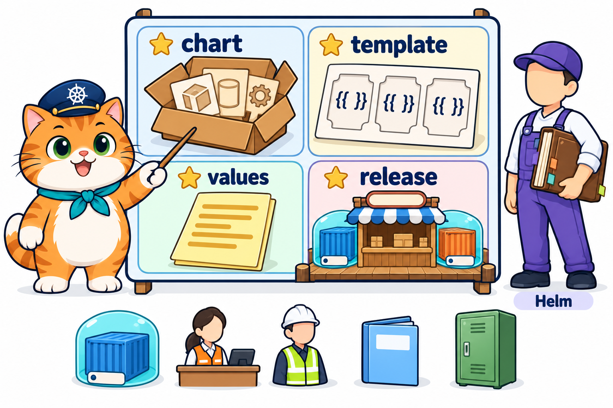
</p>

- **Pod** = กล่องโปร่งห่อตู้ มีป้าย IP / **Deployment** = ผู้จัดการลูกเรือชุดขาว ถือ **สมุดรุ่นเล่มเล็ก** (บันทึกแค่ Deployment ของตัวเอง บทที่ 4)
- **Service** = พนักงานต้อนรับเสื้อกั๊กส้มที่บูธ / **ConfigMap** = แฟ้มคู่มือสีฟ้า / **PVC / PV** = ใบขอเช่าล็อกเกอร์ / ล็อกเกอร์เหล็กสีเขียว / **Ingress Controller** = ยามประตูใหญ่ `30080` / **Ingress** = ป้ายผังทางเข้า
- ใหม่: **chart** = **กล่องชุดประกอบของร้าน** (กล่องกระดาษสีน้ำตาล ป้าย `som-shop 0.1.0`) ข้างในมีแม่พิมพ์หลายแผ่น
- ใหม่: **template** = **แผ่นแม่พิมพ์ที่มีช่องว่าง `{{ }}`** / **values** = **ใบสั่งค่าสีเหลือง** เติมลงช่องว่าง (dev / prod = ใบสั่งคนละใบ)
- ใหม่: **release** = **ร้านที่ประกอบเสร็จจากกล่อง** มีป้ายชื่อ (`som-dev`, `som-prod`) / `helm package` = ปิดกล่องเป็นพัสดุ `.tgz`
- ใหม่: **Helm** = **ช่างประกอบ** (คนเรือไม่มีหน้า ชุดหมีสีม่วง) ถือ **สมุดบันทึก revision เล่มใหญ่ของทั้งร้าน**

> **ขอบเขตบทนี้:** **เขียน chart เอง** อ่าน template, เปลี่ยนค่าด้วย values, upgrade / rollback และ package เท่านั้น เรื่องต่อไปนี้ไม่อยู่ในบท: chart ที่พึ่ง chart อื่น (dependency / subchart) ใช้กับระบบใหญ่ที่ประกอบจากหลายชิ้น · ไฟล์ `_helpers.tpl` เก็บชิ้น template ที่ใช้ซ้ำ ใช้เมื่อ chart ใหญ่ขึ้น · chart repository / OCI registry เป็นที่ฝาก chart ให้คนอื่นดึง (แบบ `helm repo add` ของ Traefik) · hooks ใช้สั่งงานก่อน/หลังติดตั้ง เช่น ย้ายฐานข้อมูล

---

## 2. ทำไมต้อง Helm

<p align="center">
  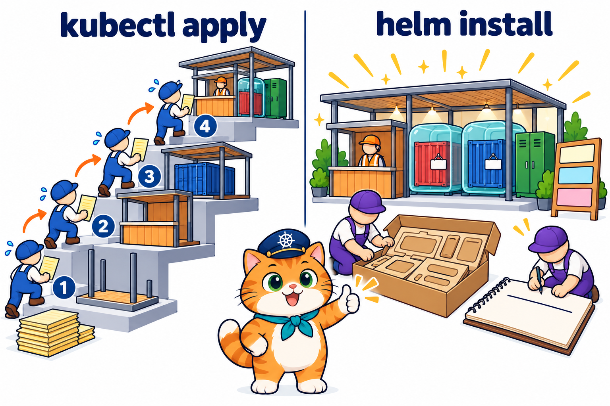
</p>

ย้อนดู LAB 4 ของบทที่ 6–8 ที่เราติดตั้งร้านน้องส้มด้วย `kubectl apply` เจอปัญหาซ้ำ ๆ 4 ข้อ

1. **ติดตั้งทีละไฟล์ตามลำดับ** ใบขอเช่าล็อกเกอร์ → หน้าร้าน → ครัว → ป้าย ถ้าสลับลำดับก็เจอกับดัก "Pod มาก่อน ConfigMap" ([บทที่ 6 หัวข้อ 5](../../006_kubernetes_ConfigMap_Secret/01_Theory/README.md#5-กับดัก-pod-มาก่อน-configmap))
2. **ลบทีละไฟล์** และต้องจำว่าเคยสร้างอะไรไว้บ้าง ลืมชิ้นไหนก็ค้างอยู่ในคลัสเตอร์
3. **ค่าเดียวกันซ้ำหลายไฟล์** ชื่อ `som-menu` อยู่ทั้งใน Deployment, Service และ backend ของ Ingress อยากได้ร้านที่สองชื่อไม่ชน ต้องก๊อปทั้งชุดแล้วแก้ทุกจุด
4. **ไม่มีประวัติของทั้งร้าน** `kubectl rollout history` จำได้แค่ Deployment ตัวเดียว ([บทที่ 4 หัวข้อ 9](../../004_kubernetes_Deployment/01_Theory/README.md#9-ติดตามการเปลี่ยนรุ่น-rollout-status-และ-history)) แก้ ConfigMap หรือป้ายแล้วพัง ย้อนกลับไม่ได้

**Helm** แก้ทั้ง 4 ข้อ โดยมองทั้งร้านเป็น **ของชิ้นเดียว** ผลจริงใน LAB 4 ที่ติดตั้งร้านทั้งร้าน (ConfigMap, PVC, 2 Service, 2 Deployment, Ingress) ด้วยคำสั่งเดียว

```text
$ helm install som som-menu/chart/som-shop
STATUS: deployed
NOTES:
ร้าน som (ร้านอาหารแมวน้องส้ม) เปิดแล้ว
  หน้าร้าน 2 สาขา: http://shop.localhost:30080
  ครัว: http://kitchen.localhost:30080
```

| | `kubectl apply` หลายไฟล์ (บทที่ 6–8) | `helm install` chart เดียว (บทนี้) |
|---|---|---|
| ติดตั้งทั้งร้าน | apply ทีละไฟล์ เรียงลำดับเอง | **คำสั่งเดียว** Helm เรียงลำดับชนิด object ให้ |
| ลบทั้งร้าน | delete ทีละไฟล์ | `helm uninstall <ชื่อ>` ลบทุกชิ้นที่ตัวเองสร้าง |
| ค่าที่ต่างกัน (ชื่อ, สาขา, host) | แก้ในไฟล์หลายจุด | เขียนครั้งเดียวใน **values** แม่พิมพ์ดึงไปใช้ |
| ร้านที่ 2 จากชุดเดียวกัน | ก๊อปไฟล์ทั้งชุด แก้ชื่อทุกจุด | ติดตั้งซ้ำด้วยชื่อใหม่ + ใบสั่งค่าอีกใบ (หัวข้อ 16) |
| ประวัติ / ย้อนกลับ | ต่อ Deployment เท่านั้น | **revision ของทั้งร้าน** `helm history` / `helm rollback` (หัวข้อ 11) |

> **ประโยคเดียวที่ต้องจำ:** Helm ไม่ได้มาแทน Kubernetes object ใด ๆ สุดท้าย Helm ก็ส่ง **YAML ธรรมดา** ชุดเดิมเข้าคลัสเตอร์ แค่ **สร้างให้จากแม่พิมพ์** และ **จดว่าส่งอะไรไปบ้าง**

---

## 3. ศัพท์ 4 คำ: chart, template, values, release

<p align="center">
  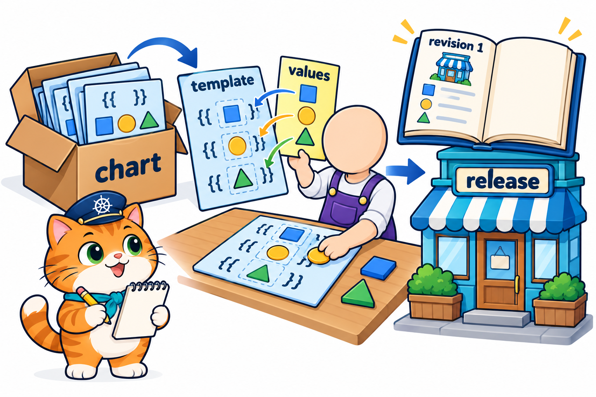
</p>

บทที่ 8 รู้จัก chart / values / release แบบ "คนใช้" แล้ว บทนี้เป็น "คนทำกล่อง" จึงเพิ่มคำที่ 4 คือ **template** และคำประกอบ **revision**

| คำ | ความหมาย | ในบทนี้ | ในอุปมา |
|---|---|---|---|
| **chart** | โฟลเดอร์ (หรือไฟล์ `.tgz`) ที่มีแม่พิมพ์ + ค่าเริ่มต้นของแอปหนึ่งชุด | `charts/hello`, `som-menu/chart/som-shop` | กล่องชุดประกอบ |
| **template** | ไฟล์ YAML ที่มี **ช่องว่าง `{{ }}`** อยู่ใน `templates/` | `deployment.yaml`, `menu.yaml`, ... | แผ่นแม่พิมพ์ |
| **values** | ค่าที่เติมลงช่อง: ค่าเริ่มต้นใน `values.yaml` + ค่าที่ส่งตอนติดตั้ง | `values.yaml`, `values-big.yaml`, `--set ...` | ใบสั่งค่าสีเหลือง |
| **release** | ของที่ติดตั้งแล้ว 1 ชุดจาก chart มี **ชื่อของตัวเอง** | `hello`, `som`, `som-dev`, `som-prod` | ร้านที่ประกอบเสร็จ มีป้ายชื่อ |
| **revision** | เลขรุ่นของ release เพิ่มทุกครั้งที่ install / upgrade / rollback | `hello` revision 1 → 7 ใน LAB 1–3 | หน้าในสมุดของช่างประกอบ |

- **chart 1 กล่อง → ประกอบได้หลาย release** เหมือนแม่พิมพ์ของ Deployment ปั๊มได้หลาย Pod (LAB 5: `som-shop` กล่องเดียว ได้ทั้ง `som-dev` และ `som-prod`)
- **template + values = YAML ธรรมดา** ที่ส่งเข้าคลัสเตอร์ (หัวข้อ 5) / ชื่อ release ตั้งเองตอน `helm install <ชื่อ release> <chart>` แล้วใช้อ้างในทุกคำสั่งหลังจากนั้น

---

## 4. โครงโฟลเดอร์ของ chart

<p align="center">
  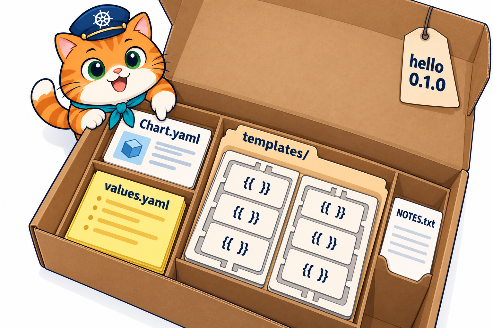
</p>

chart แรกของบท `02_LAB/charts/hello/` เป็นแอป whoami ตัวเดิมจากบทที่ 8 (ตอบกลับว่าตัวเองชื่ออะไร)

```text
charts/hello/
├── Chart.yaml              ← บัตรประจำตัวของกล่อง: ชื่อ เวอร์ชัน
├── values.yaml             ← ใบสั่งค่าเริ่มต้น
└── templates/              ← แผ่นแม่พิมพ์ทุกแผ่น
    ├── deployment.yaml
    ├── service.yaml
    └── NOTES.txt           ← ข้อความที่แสดงหลังติดตั้ง
```

- ชื่อ `Chart.yaml`, `values.yaml`, `templates/` **ต้องสะกดตรงนี้** (C ใหญ่) ทุกไฟล์ใน `templates/` ถูกเติมค่า ไฟล์ `.yaml` กลายเป็น object ส่วน `NOTES.txt` กลายเป็นข้อความ ไม่ถูกส่งเข้าคลัสเตอร์

### อ่าน Chart.yaml ทีละบรรทัด

ไฟล์ `02_LAB/charts/hello/Chart.yaml`

```yaml
# LAB 1–3: บัตรประจำตัวของ chart — ชื่อ เวอร์ชันของ chart และเวอร์ชันของแอปข้างใน
apiVersion: v2                 # รูปแบบ chart ของ Helm 3 ขึ้นไป
name: hello                    # ชื่อ chart
description: แอปทักทายเล็ก ๆ สำหรับหัดเขียน Helm chart
type: application
version: 0.1.0                 # เวอร์ชันของ "กล่อง" chart (แก้ template แล้วเพิ่มเลขนี้)
appVersion: "1.11.0"           # เวอร์ชันของแอปข้างใน (image traefik/whoami)
```

- `apiVersion: v2` = รูปแบบของ **ไฟล์ chart** (ไม่ใช่ apiVersion ของ Kubernetes) Helm 3 และ Helm 4 ที่ LAB ใช้อ่านรูปแบบนี้
- `name` = ชื่อกล่อง / `type: application` = chart ที่ติดตั้งแอปได้ (อีกแบบคือ `library` ไม่ใช้ในบทนี้)
- **`version: 0.1.0`** = เวอร์ชันของ **กล่อง** แก้แม่พิมพ์เมื่อไรควรเพิ่มเลขนี้ / **`appVersion: "1.11.0"`** = เวอร์ชันของ **แอปข้างใน** เป็นข้อมูลให้คนอ่าน Helm ไม่ได้เอาไปตั้ง image ให้
- สองเลขนี้โผล่ใน `helm list` (LAB 1) เป็น `CHART hello-0.1.0` และ `APP VERSION 1.11.0` เหมือน `traefik-42.0.0` กับ `v3.7.14` ในบทที่ 8

### values.yaml ของ hello

```yaml
# LAB 1–3: ค่าเริ่มต้นของ chart hello — template ดึงค่าจากไฟล์นี้ด้วย {{ .Values.<ชื่อ> }}
replicas: 2                    # จำนวน Pod
message: hello-v1              # ข้อความที่แอปตอบ (บรรทัด Name: ของ whoami)
image:
  repository: traefik/whoami
  tag: v1.11.0
service:
  nodePort: 30081              # ประตูของ chart นี้ (30080 เป็นของ Traefik)
```

- เป็นแค่ข้อมูล **ไม่มี `apiVersion` / `kind`** เหมือน `traefik-values.yaml` ของบทที่ 8 key ตั้งชื่ออะไรก็ได้ คนเขียน chart เป็นคนกำหนด
- `nodePort: 30081` = ประตูของ hello เพราะ `30080` เป็นของยาม Traefik ที่ติดตั้งไว้ใน LAB 0 แล้ว

---

## 5. template ทำงานอย่างไร

<p align="center">
  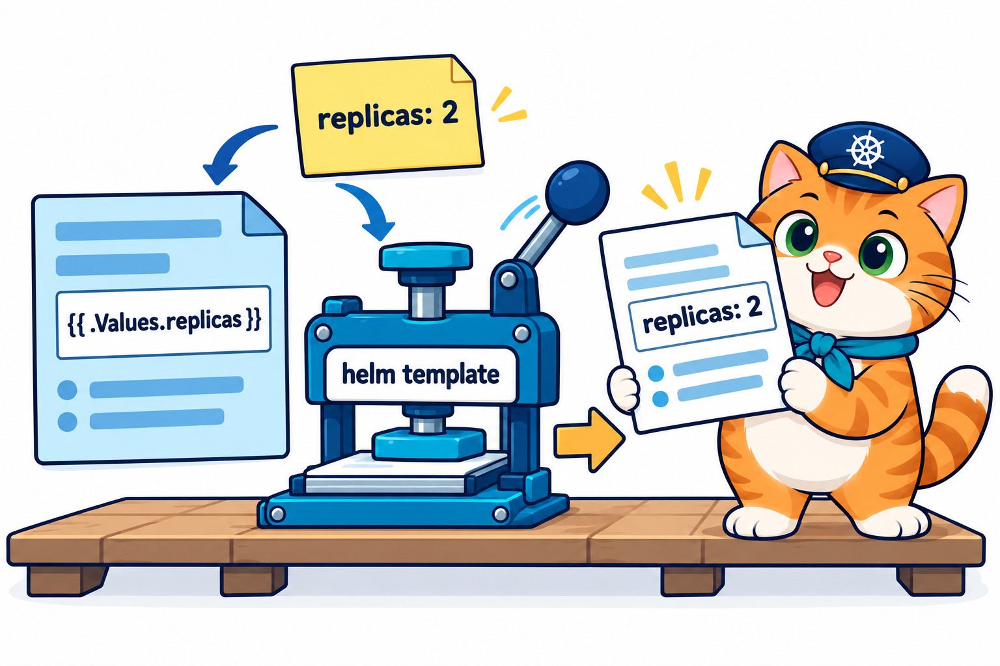
</p>

Helm ทำงานเป็น 2 จังหวะ

1. **เติมค่า (render)** อ่าน template ทุกแผ่น หยิบค่าจาก values มาเติมลงช่อง `{{ }}` ได้ YAML ธรรมดา
2. **ส่งเข้าคลัสเตอร์** (เฉพาะ `helm install` / `upgrade`) แล้วจดลงสมุดว่าส่งอะไรไป

**`helm template`** ทำแค่จังหวะที่ 1 แล้วพิมพ์ผลออกจอ **ไม่แตะคลัสเตอร์** จึงใช้ดูก่อนติดตั้งได้ทุกครั้ง ผลจริงใน LAB 1 วางเทียบกับแม่พิมพ์

```text
แม่พิมพ์ templates/deployment.yaml                                 ผล helm template hello charts/hello
  name: {{ .Release.Name }}                                    →    name: hello
  replicas: {{ .Values.replicas }}                             →    replicas: 2
  image: "{{ .Values.image.repository }}:{{ .Values.image.tag }}"  →    image: "traefik/whoami:v1.11.0"
  args: ["--name", {{ .Values.message | quote }}]              →    args: ["--name", "hello-v1"]
```

(ยกมาเฉพาะบรรทัดที่มีช่อง ตัด comment ท้ายบรรทัดออก) ผลเต็มจาก LAB 1 มีหน้าตาแบบนี้

```text
$ helm template hello charts/hello
---
# Source: hello/templates/service.yaml          ← มาจากแม่พิมพ์แผ่นไหน
# LAB 1–3: แม่พิมพ์ Service แบบ NodePort (บทที่ 5)
apiVersion: v1
...
# Source: hello/templates/deployment.yaml
...
  replicas: 2     # จาก values.yaml              ← ช่องหายไป เหลือแต่ค่า
```

- **ส่วนที่ไม่อยู่ในช่องถูกคัดลอกตรง ๆ** ทั้ง `apiVersion`, `kind` และ comment `#` (comment ท้ายบรรทัดเลื่อนชิดเข้ามาเพราะช่องยาวกว่าค่า) / `---` คั่น object และ `# Source:` บอกว่ามาจากไฟล์ไหน
- **Service ออกมาก่อน Deployment** ทั้งที่ชื่อไฟล์เรียงกลับกัน เพราะ Helm เรียงตามชนิด object ให้ (ConfigMap, PVC, Service มาก่อน Deployment) ปัญหาข้อ 1 ของหัวข้อ 2 จึงหายไป
- อยากดูแผ่นเดียวใช้ `--show-only` เช่น `helm template hello charts/hello --show-only templates/service.yaml`

> **ประโยคเดียวที่ต้องจำ:** `helm install` = **`helm template` + ส่งเข้าคลัสเตอร์ + จดสมุด** ถ้าอยากรู้ว่า Helm จะส่งอะไร ให้ `helm template` ดูก่อนเสมอ

---

## 6. ภาษา template ฉบับเข้าใจง่าย

<p align="center">
  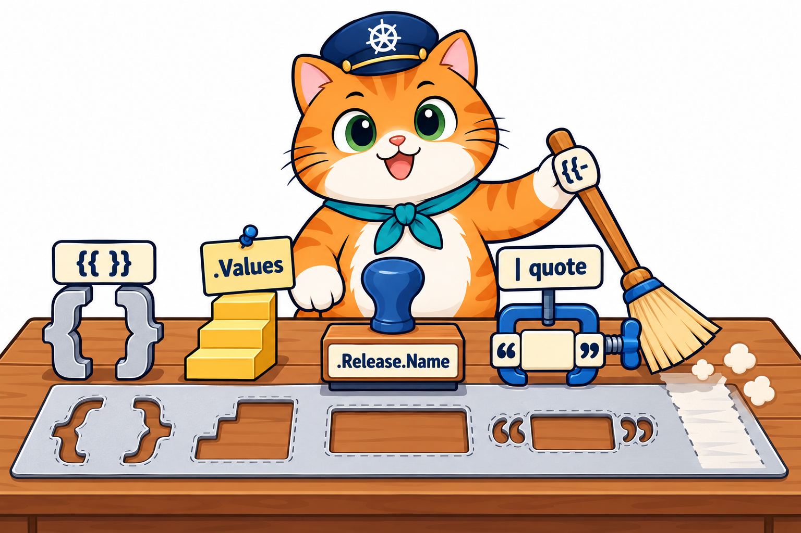
</p>

template ของ Helm ใช้ภาษา **Go template** ซึ่งนักศึกษาไม่เคยเห็นมาก่อน แต่ LAB ใช้แค่ 5 อย่างนี้

### 6.1 `{{ }}` คือช่องว่างบนแม่พิมพ์

- อะไรที่อยู่ระหว่าง `{{` กับ `}}` = **คำสั่งให้ Helm เติมค่า** อะไรที่อยู่นอกช่อง = คัดลอกตามเดิม
- ช่องอยู่กลางบรรทัดได้ หลายช่องในบรรทัดเดียวก็ได้ เช่น `"{{ .Values.image.repository }}:{{ .Values.image.tag }}"` = 2 ช่องต่อด้วย `:` (เว้นวรรคหลัง `{{` และก่อน `}}` เพื่อให้อ่านง่าย)

### 6.2 `.Values.x.y` เดินตามการเยื้องของ values.yaml

ทบทวน YAML จาก [บทที่ 2 หัวข้อ 5](../../002_kubernetes_pod/01_Theory/README.md#5-yaml-ฉบับเข้าใจง่าย)

- `key: value` = ค่าเดี่ยว / เยื้องเข้า = **เป็นลูก** / เยื้องเท่ากัน = **เป็นพี่น้อง** / ตัวพิมพ์เล็ก-ใหญ่ต่างกัน (`replicas` ≠ `Replicas`) และเยื้องด้วยเว้นวรรคเท่านั้น

สิ่งใหม่ของ YAML บทนี้: **อ่านการเยื้องเป็น "เส้นทาง" ที่คั่นด้วยจุด** ลงไปทีละชั้นเหมือนเดินลงบันได (values.yaml ของ hello เปลี่ยน comment เป็นเส้นทาง)

```yaml
replicas: 2            # .Values.replicas          → 2
image:                 # .Values.image             → (map ทั้งก้อน)
  repository: traefik/whoami   # .Values.image.repository → traefik/whoami
  tag: v1.11.0         # .Values.image.tag         → v1.11.0
service:
  nodePort: 30081      # .Values.service.nodePort  → 30081
```

- `.Values` = **ใบสั่งค่าทั้งใบ** (values.yaml รวมกับค่าที่ส่งตอนติดตั้ง หัวข้อ 9) จุดหน้าสุดแปลว่า "เริ่มจากของทั้งหมดที่ Helm ส่งให้แม่พิมพ์" / จุดถัดไปแต่ละจุด = **ลงไปอีก 1 ชั้นของการเยื้อง** `tag` เยื้องอยู่ใต้ `image` จึงเขียน `.Values.image.tag`
- ถ้าเส้นทางไม่มีจริง (พิมพ์ผิด) Helm **เติมค่าว่างแบบเงียบ ๆ** ไม่ฟ้อง (กับดักหัวข้อ 10)

### 6.3 `.Release.Name` ชื่อร้านที่ตั้งตอนติดตั้ง

- `.Release` = ข้อมูลของ release ที่ Helm ใส่ให้เอง ไม่ต้องเขียนใน values / `.Release.Name` = ชื่อที่พิมพ์ใน `helm install <ชื่อ>` ติดตั้ง `helm install hello ...` ก็ได้ `hello` / `helm install som-dev ...` ก็ได้ `som-dev`
- chart ร้านน้องส้มใช้เป็น **คำนำหน้าชื่อ object ทุกตัว** (`{{ .Release.Name }}-menu`) ติดตั้งหลายร้านจึงไม่ชนกัน (หัวข้อ 16)

### 6.4 `| quote` ท่อของ template

- `{{ .Values.message | quote }}` = เอาค่า `hello-v1` **ส่งต่อ** ให้ฟังก์ชัน `quote` ซึ่งครอบด้วย `" "` ได้ `"hello-v1"`
- `|` ตรงนี้คือ **ท่อของ template** ทำงานตอน Helm เติมค่า **ไม่ใช่ท่อของ shell** แบบ `kubectl get pods | grep` (คนละโลกกัน แค่ใช้เครื่องหมายเดียวกัน)
- ทำไมต้อง quote: YAML เดาชนิดค่าเอง ข้อความอย่าง `1.0`, `true`, ค่าว่าง จะกลายเป็นตัวเลข / boolean / null แต่ `args` และ `data` ของ ConfigMap ต้องเป็น **ข้อความ** ผลจริงใน LAB 4: `SHOP_ENV: {{ .Values.shop.env | quote }}` ที่ค่าเป็นว่าง ได้ `SHOP_ENV: ""` (ข้อความว่าง ถูกต้อง) ถ้าไม่ quote จะเหลือ `SHOP_ENV:` ซึ่ง YAML อ่านเป็น null

### 6.5 `{{-` ตัดช่องว่างด้านซ้าย

- `{{- ... }}` = **ลบเว้นวรรคและขึ้นบรรทัดใหม่ทางซ้าย** ของช่องทิ้ง / `{{ ... -}}` = ลบทางขวา
- ใช้กับคำสั่งที่ไม่ได้เติมค่า เช่น `{{- if ... }}` / `{{- end }}` (หัวข้อ 14) ถ้าไม่มี `-` บรรทัดของคำสั่งจะเหลือเป็นบรรทัดว่างใน YAML ที่ได้ (บรรทัดว่างไม่ทำให้ YAML ผิด แค่อ่านยาก)

> **⚠️ กับดัก:** comment `#` **ในไฟล์ template** ที่มีคำว่า `{{ ... }}` ก็ถูก Helm อ่านเป็นช่องด้วย เพราะ Helm อ่าน template **ก่อน** YAML (สำหรับ Helm, `#` ไม่ใช่ comment) ตอนเตรียม LAB เขียน comment ที่มี `{{ }}` ว่าง ๆ แล้ว `helm lint` / `helm install` ล้มด้วย `missing value for command` จึงเขียนใน template ว่า **"ช่องวงเล็บปีกกาคู่"** แทน ส่วน `values.yaml` ไม่ใช่ template เขียน `{{ .Values.<ชื่อ> }}` ใน comment ได้ (บรรทัดแรกของ values.yaml ใน hello)

---

## 7. อ่าน template ของ hello ทีละบรรทัด

<p align="center">
  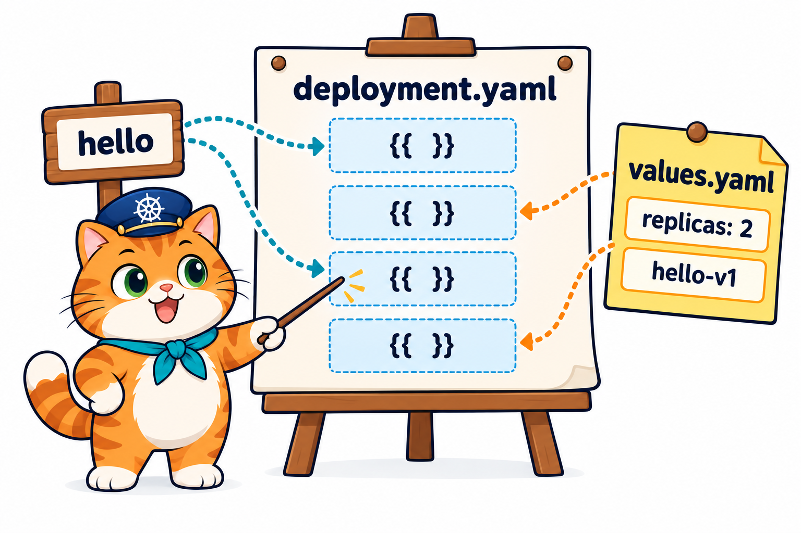
</p>

ไฟล์ `02_LAB/charts/hello/templates/deployment.yaml` (Deployment ธรรมดาแบบบทที่ 4 ที่บางค่ากลายเป็นช่อง)

```yaml
# LAB 1–3: แม่พิมพ์ Deployment — ช่องวงเล็บปีกกาคู่จะถูกเติมค่าตอน helm install / helm template
apiVersion: apps/v1
kind: Deployment
metadata:
  name: {{ .Release.Name }}            # ชื่อ release ที่ตั้งตอน helm install เช่น hello
spec:
  replicas: {{ .Values.replicas }}     # จาก values.yaml
  selector:
    matchLabels:
      app: {{ .Release.Name }}
  template:
    metadata:
      labels:
        app: {{ .Release.Name }}
    spec:
      containers:
        - name: whoami
          image: "{{ .Values.image.repository }}:{{ .Values.image.tag }}"
          args: ["--name", {{ .Values.message | quote }}]   # quote = ใส่ "" ให้เป็นข้อความ
          ports:
            - containerPort: 80
```

| บรรทัด | ความหมาย |
|---|---|
| `apiVersion` / `kind` / `metadata:` | ไม่มีช่อง คัดลอกตรง ๆ = Deployment ของบทที่ 4 |
| `name: {{ .Release.Name }}` | ชื่อ Deployment = **ชื่อ release** → `hello` |
| `replicas: {{ .Values.replicas }}` | จำนวน Pod จาก values → `2` |
| `matchLabels:` → `app: {{ .Release.Name }}` | ป้ายที่ผู้จัดการใช้นับ Pod → `app: hello` |
| `labels:` → `app: {{ .Release.Name }}` | ป้ายที่ติดบน Pod ใช้ **ช่องเดียวกัน** จึงตรงกับ selector เสมอ ไม่มีวันพิมพ์ไม่ตรง |
| `image: "{{ ... }}:{{ ... }}"` | 2 ช่องต่อด้วย `:` ครอบ `" "` เอง → `"traefik/whoami:v1.11.0"` |
| `args: ["--name", {{ .Values.message \| quote }}]` | list แบบย่อ `[ ]` ช่องที่ 2 ใส่ `" "` ด้วย quote → `["--name", "hello-v1"]` = whoami ตอบ `Name: hello-v1` |
| `containerPort: 80` | ไม่มีช่อง ค่าตายตัวของ whoami |

แปลทั้งไฟล์เป็นประโยคเดียว: **"Deployment ชื่อเดียวกับ release มี Pod ตามจำนวน `replicas` ใช้ image whoami ตามเวอร์ชันใน values และตอบกลับด้วยข้อความ `message`"**

### service.yaml และ NOTES.txt

```yaml
# LAB 1–3: แม่พิมพ์ Service แบบ NodePort (บทที่ 5)
...
  name: {{ .Release.Name }}
spec:
  type: NodePort
  selector:
    app: {{ .Release.Name }}
  ports:
    - port: 80
      targetPort: 80
      nodePort: {{ .Values.service.nodePort }}
```

- `selector: app: {{ .Release.Name }}` ใช้ช่องเดียวกับป้ายของ Pod ใน deployment.yaml บูธจึงหา Pod เจอเสมอ ([บทที่ 5 หัวข้อ 10](../../005_kubernetes_Service/01_Theory/README.md#10-nodeport-ประตูบนทุก-node)) / `nodePort` มาจาก `.Values.service.nodePort` → `30081`

`templates/NOTES.txt` เป็นข้อความธรรมดาที่มีช่องได้เหมือนกัน บรรทัดแรก `ติดตั้ง {{ .Release.Name }} แล้ว: {{ .Values.replicas }} Pod ตอบว่า {{ .Values.message }}` ได้เป็น `ติดตั้ง hello แล้ว: 2 Pod ตอบว่า hello-v1` ท้ายผล `helm install` (หัวข้อ 8) = คู่มือสั้น ๆ ที่คนเขียน chart ฝากไว้ให้คนติดตั้ง

### ผิดบ่อย แก้ง่าย

| ผิด | ถูก | เพราะ |
|---|---|---|
| `{{ .values.replicas }}` | `{{ .Values.replicas }}` | `Values` / `Release` ขึ้นต้นตัวใหญ่ ตัวเล็ก Helm หาไม่เจอและฟ้อง error |
| `{{ .Values.replicas }` | `{{ .Values.replicas }}` | ขาด `}` ตัวปิด → `parse error ... unexpected "}"` (LAB 3 หัวข้อ 13) |
| `{{ .Values.replica }}` | `{{ .Values.replicas }}` | เส้นทางไม่มีจริง ได้ **ค่าว่างเงียบ ๆ** ไม่ฟ้อง ต้องดูผล `helm template` |
| `args: ["--name", {{ .Values.message }}]` เมื่อ message = `1.0` | `{{ .Values.message \| quote }}` | ไม่ quote ได้ตัวเลข `1.0` แต่ `args` ต้องเป็นข้อความ |
| comment `# ใช้ {{ .Release.Name }}` ในไฟล์ template | `# ใช้ช่องวงเล็บปีกกาคู่` | Helm อ่าน `{{ }}` ใน comment ด้วย (หัวข้อ 6) |

> **⚠️ กับดัก:** แถวที่ 3 **ไม่มี error** ได้ YAML ที่มีค่าว่าง (เช่น `replicas:` ว่าง) แล้ว Kubernetes ใช้ค่าตั้งต้นแทน ทุกครั้งที่แก้ template ให้ `helm template ... --show-only <ไฟล์>` แล้วอ่านบรรทัดที่แก้ด้วยตา

---

## 8. ติดตั้งและดู release

<p align="center">
  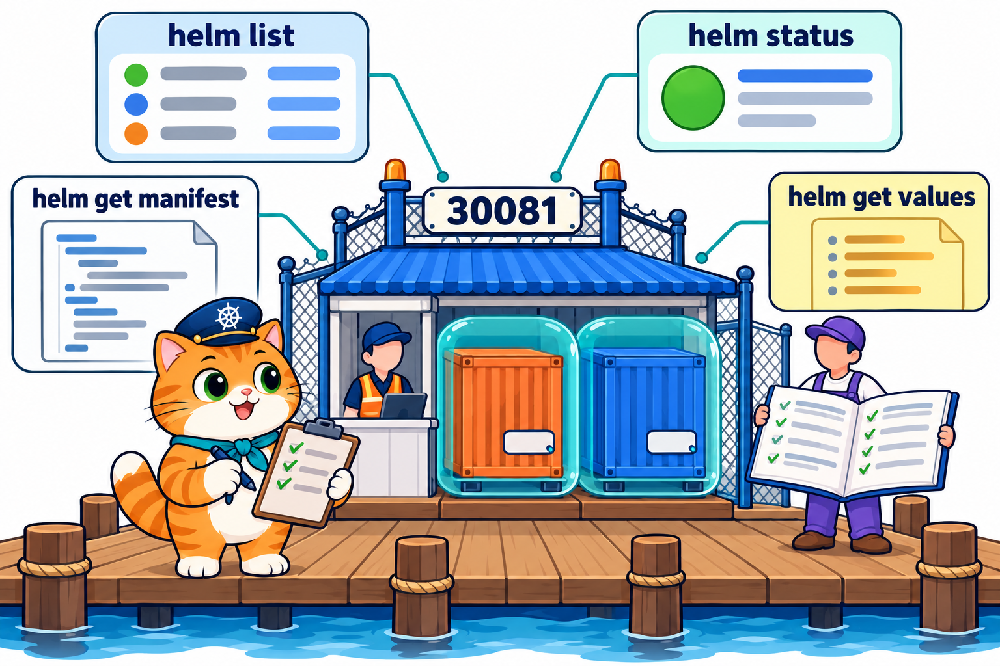
</p>

ลำดับใน LAB 1: **ตรวจ → ดูก่อน → ติดตั้ง → ตรวจผล**

```text
$ helm lint charts/hello
==> Linting charts/hello
[INFO] Chart.yaml: icon is recommended          ← แค่คำแนะนำ (ไม่มีรูปไอคอน) ไม่ใช่ error
1 chart(s) linted, 0 chart(s) failed
$ helm install hello charts/hello
NAMESPACE: default
STATUS: deployed
REVISION: 1
NOTES:
ติดตั้ง hello แล้ว: 2 Pod ตอบว่า hello-v1        ← NOTES.txt ที่เติมค่าแล้ว
ลองเรียก: curl http://localhost:30081
```

- `helm lint <chart>` = ตรวจกล่องว่าโครงถูกและแม่พิมพ์เติมค่าได้ (หัวข้อ 13)
- `helm install <ชื่อ release> <chart>` = chart เป็น **path ของโฟลเดอร์** ก็ได้ (`charts/hello`) ไม่ต้อง `helm repo add` แบบ Traefik / ไม่ใส่ `-n` = ลง namespace `default`

ของที่ Helm สร้างเป็น object ธรรมดา `kubectl` เห็นตามปกติ ชื่อ Pod 3 ท่อนแบบ [บทที่ 4 หัวข้อ 5](../../004_kubernetes_Deployment/01_Theory/README.md#5-ชื่อ-pod-3-ท่อน-และเจ้าของ-2-ชั้น)

```text
$ kubectl get pods
NAME                     READY   STATUS    RESTARTS   AGE
hello-777646d47c-4mtqb   1/1     Running   0          10s
hello-777646d47c-j8z7x   1/1     Running   0          10s
$ curl http://localhost:30081                    ← Service hello แบบ NodePort 80:30081/TCP
Name: hello-v1                                   ← ค่า message จาก values.yaml
Hostname: hello-777646d47c-j8z7x
```

### คำสั่งดู release

```text
$ helm status hello
STATUS: deployed
REVISION: 1
RESOURCES:
==> v1/Service ...  ==> v1/Deployment ...  ==> v1/Pod(related) ...    ← object ทุกชิ้นของร้าน (ย่อไว้)
$ helm get values hello
USER-SUPPLIED VALUES:
null                                             ← ยังไม่ได้ส่งค่าเพิ่มเลย ใช้ values.yaml ล้วน
$ helm get values hello --all
COMPUTED VALUES:
image: ...   message: hello-v1   replicas: 2   service: ...     ← ค่าที่ใช้จริงทั้งหมด (ย่อเป็นบรรทัดเดียว)
```

- **`helm list`** = ร้านทั้งหมดใน namespace (ชื่อ, revision, STATUS, CHART) / `helm list -A` = ทุก namespace
- **`helm status <ชื่อ>`** = สถานะล่าสุด + object ทุกชิ้นของร้านในหน้าเดียว + NOTES
- **`helm get manifest <ชื่อ>`** = YAML ที่ Helm **ส่งเข้าคลัสเตอร์จริง** (ผลเหมือน `helm template` ของรอบนั้น) / **`helm get notes <ชื่อ>`** = NOTES ซ้ำอีกรอบ
- **`helm get values <ชื่อ>`** = ค่าที่ **เราส่งเพิ่ม** ตอนติดตั้ง/อัปเกรด / `--all` = ค่าที่ใช้จริงทั้งหมด (values.yaml รวมกับที่ส่งเพิ่ม)

Helm จำทั้งหมดนี้ได้เพราะ **เก็บประวัติ release ไว้ในคลัสเตอร์** เป็น Secret ใน namespace ของ release (1 revision = 1 Secret ชื่อขึ้นต้นด้วย `sh.helm.release.v1.`) เครื่องไหนต่อคลัสเตอร์นี้ก็เห็นประวัติเดียวกัน ท้าย LAB 3 `helm uninstall hello` ลบทั้งร้านในคำสั่งเดียว `kubectl get all` เหลือแต่ `service/kubernetes` ของระบบ

---

## 9. เปลี่ยนค่า: ใบสั่งค่าซ้อนกันหลายชั้น

<p align="center">
  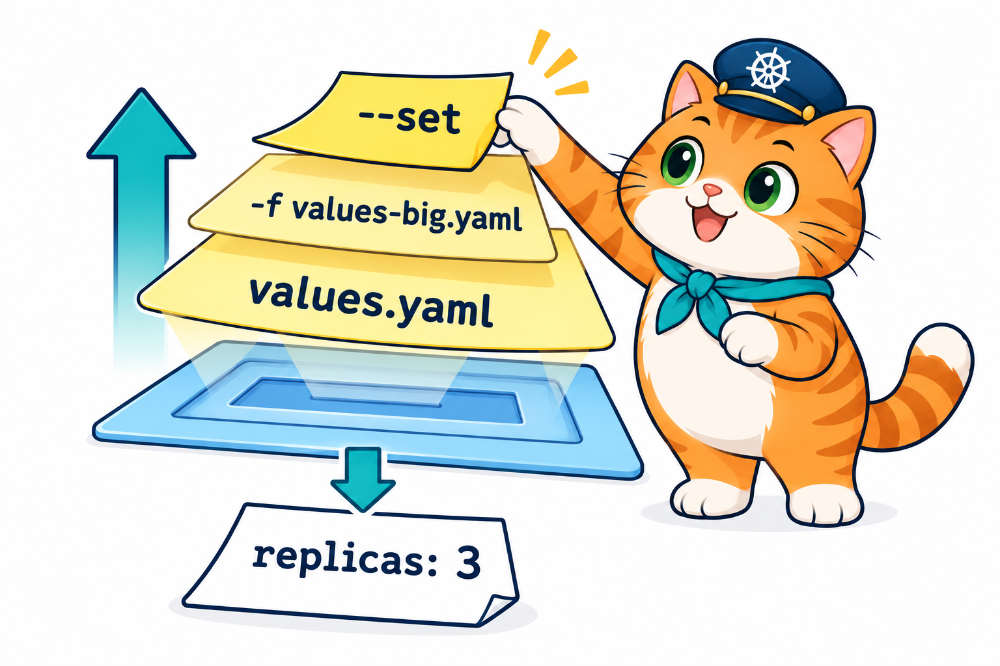
</p>

ไม่ต้องแก้ `values.yaml` ในกล่อง ส่งใบสั่งค่าเพิ่มตอน `install` / `upgrade` ได้ 2 แบบ

- **`--set key=value`** = เขียนค่าในคำสั่ง ใช้จุดลงชั้นแบบเดียวกับ `.Values` เช่น `--set image.tag=v9.9.9`, `--set menu.replicas=4`
- **`-f <ไฟล์>`** (หรือ `--values`) = ใบสั่งค่าเป็นไฟล์ **เขียนเฉพาะค่าที่อยากเปลี่ยน** ที่เหลือใช้ของ values.yaml

ไฟล์ `02_LAB/labs/lab02-values/values-big.yaml`

```yaml
# LAB 2: ใบสั่งค่าใหม่ — เขียนเฉพาะค่าที่อยากเปลี่ยน ที่เหลือใช้จาก values.yaml ของ chart
replicas: 3
message: hello-big
```

ถ้ามีค่าเดียวกันหลายที่ **ชั้นบนชนะ** (แผ่นใสที่วางทับทีหลังบังแผ่นล่าง): **`values.yaml` ในกล่อง** (ล่างสุด) **< `-f ไฟล์`** (หลาย `-f` ไฟล์หลังชนะ) **< `--set`** (บนสุด) ส่วน key ที่ชั้นบนไม่ได้เขียน **ยังใช้ของชั้นล่าง** เช่น values-big ไม่มี `image` จึงยังได้ `traefik/whoami:v1.11.0`

### ผลจริงใน LAB 2

```text
$ helm upgrade hello charts/hello --set message=hello-set
REVISION: 2
NOTES:
ติดตั้ง hello แล้ว: 2 Pod ตอบว่า hello-set
$ helm get values hello
USER-SUPPLIED VALUES:
message: hello-set
```

- `helm upgrade <ชื่อ> <chart>` = เติมค่าใหม่แล้ว **ส่ง YAML ชุดใหม่ทับ** release เดิม revision เพิ่มเป็น 2 / Deployment เห็นแม่พิมพ์ Pod เปลี่ยน (`args`) จึงทำ rolling update ให้เอง (บทที่ 4) Pod ใหม่ `hello-66676c9b4-...` ตอบ `Name: hello-set`

ก่อนใช้ไฟล์ ดูผลก่อนด้วย `helm template` (ไม่แตะคลัสเตอร์)

```text
$ helm template hello charts/hello -f labs/lab02-values/values-big.yaml --show-only templates/deployment.yaml
...
  replicas: 3     # จาก values.yaml
...
          args: ["--name", "hello-big"]   # quote = ใส่ "" ให้เป็นข้อความ
$ helm upgrade hello charts/hello -f labs/lab02-values/values-big.yaml
REVISION: 3
NOTES:
ติดตั้ง hello แล้ว: 3 Pod ตอบว่า hello-big
$ kubectl get pods
hello-666758866b-5fpgm   1/1     Running   0          10s      ← 3 Pod (ย่อเหลือแถวเดียว)
```

- comment ยังเขียนว่า `# จาก values.yaml` แต่ค่า `3` มาจาก values-big เพราะ comment เป็นแค่ข้อความที่ถูกคัดลอก (หัวข้อ 5) / revision 3 มีแค่ `-f values-big.yaml` ค่า `message=hello-set` ของ revision 2 **หายไป** แทนที่ด้วย `hello-big` (เรื่องนี้คือกับดักหัวข้อ 10)

> **เคล็ดลับ:** `--set` สะดวกตอนทดลอง แต่ค่าหายไปกับประวัติคำสั่งใน terminal งานจริงให้ **เก็บค่าของแต่ละร้านเป็นไฟล์** (`values-dev.yaml`, `values-prod.yaml` หัวข้อ 16) เก็บใน git ได้ ให้เพื่อนตรวจได้ และส่ง `-f` ไฟล์เดิมทุกครั้งที่ upgrade

---

## 10. กับดัก values 2 ชั้น

<p align="center">
  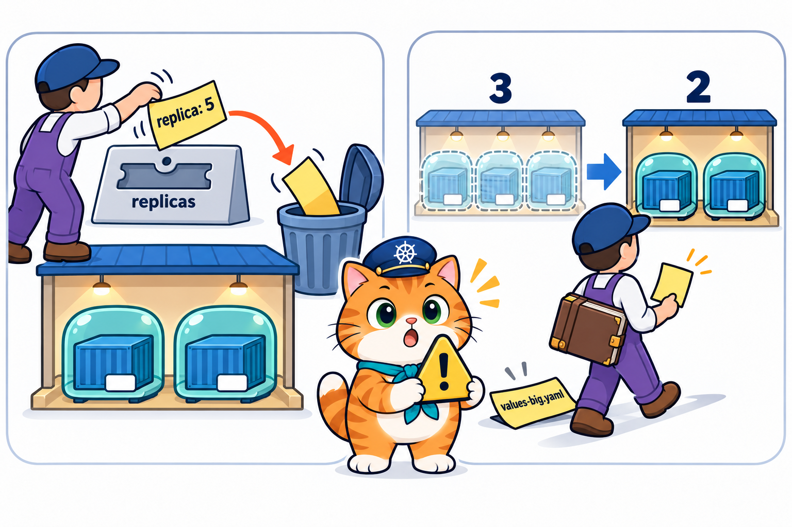
</p>

ต่อจาก revision 3 (`hello-big` 3 Pod) LAB 2 ส่งใบสั่งค่าที่พิมพ์ key ผิด `02_LAB/labs/lab02-values/values-typo.yaml`

```yaml
# LAB 2: ใบสั่งค่าที่พิมพ์ key ผิด — Helm ไม่ฟ้อง แต่ค่าไม่ถูกใช้เลย
replica: 5                     # ← พิมพ์ผิด (ที่ถูกคือ replicas)
```

ผลจริง: ผ่านทุกขั้น ไม่มีคำเตือน

```text
$ helm upgrade hello charts/hello -f labs/lab02-values/values-typo.yaml
Release "hello" has been upgraded. Happy Helming!
STATUS: deployed
REVISION: 4
NOTES:
ติดตั้ง hello แล้ว: 2 Pod ตอบว่า hello-v1           ← ไม่ใช่ 5 และไม่ใช่ hello-big!
$ kubectl get deploy hello
hello   2/2     2            2           42s
$ curl http://localhost:30081                      → Name: hello-v1   Hostname: hello-777646d47c-b42rx
$ helm get values hello
USER-SUPPLIED VALUES:
replica: 5
```

ผลนี้มี **กับดัก 2 ชั้นซ้อนกัน**

### ชั้นที่ 1: key ผิด ไม่ฟ้อง ไม่ใช้

- template อ่าน `.Values.replicas` แต่ใบสั่งเขียน `replica` (ไม่มี s) = **ค่าคนละช่อง** Helm ไม่รู้ว่าเราตั้งใจพิมพ์อะไร จึงไม่ฟ้อง
- `replica: 5` ถูกเก็บไว้ใน `helm get values` แต่ **ไม่มีแม่พิมพ์แผ่นไหนหยิบไปใช้** `replicas` จึงตกไปใช้ค่าเริ่มต้น `2` / เหมือน key ผิดใน `traefik-values.yaml` ของบทที่ 8 (หัวข้อ 4 เคล็ดลับ) chart ใหญ่บางตัวมีไฟล์ `values.schema.json` ไว้ตรวจชื่อ key แต่ไม่อยู่ในบทนี้

### ชั้นที่ 2: upgrade ไม่จำค่าเดิม

- revision 3 ใช้ `-f values-big.yaml` (3 Pod, `hello-big`) แต่ revision 4 ส่งแค่ `-f values-typo.yaml`
- **`helm upgrade` ใช้เฉพาะค่าที่ส่งในรอบนั้น** รวมกับ values.yaml ของกล่อง ค่าที่เคยส่งในรอบก่อน **ไม่ถูกนำมาด้วย** จึงกลับไปเป็น `hello-v1` / 2 Pod
- ชื่อ Pod `hello-777646d47c-b42rx` มีท่อนกลาง **`777646d47c` ตรงกับ revision 1** (LAB 1) แม่พิมพ์ Pod กลับมาเหมือนรุ่นแรกเป๊ะ Deployment จึงปลุก ReplicaSet เดิมขึ้นมาแบบ [บทที่ 4 หัวข้อ 10](../../004_kubernetes_Deployment/01_Theory/README.md#10-ย้อนกลับด้วย-rollout-undo)
- มีตัวเลือก `--reuse-values` ให้ใช้ค่าของรอบก่อนต่อ แต่ทำให้ไม่รู้ว่าค่าจริงมาจากไหน บทนี้จึง **ส่ง `-f` ไฟล์ครบทุกครั้ง** แทน

### วิธีป้องกัน

- **ก่อน upgrade:** `helm template <ชื่อ> <chart> -f <ไฟล์> --show-only templates/<แผ่น>.yaml` ดูว่าค่าลงช่องจริงไหม / **หลัง upgrade:** `helm get values <ชื่อ>` ดูว่ารอบนี้ส่งอะไรไป และอ่าน NOTES (ถ้า chart แสดงค่าสำคัญไว้แบบ hello ก็เห็นทันทีว่า `2 Pod ตอบว่า hello-v1`)
- **ทุกครั้ง:** เก็บค่าของร้านเป็นไฟล์เดียว แล้วส่ง `-f` ไฟล์นั้นทุกครั้ง ไม่ส่งแค่ค่าที่เปลี่ยน

> **⚠️ กับดัก:** `Release "hello" has been upgraded` + `STATUS: deployed` **ไม่ได้แปลว่าค่าของเราถูกใช้** แปลแค่ว่า Helm ส่ง YAML สำเร็จ ค่าที่ใช้จริงต้องดูจาก `helm get values --all`, `helm get manifest` หรือ NOTES

---

## 11. upgrade, history, rollback: สมุดของทั้งร้าน

<p align="center">
  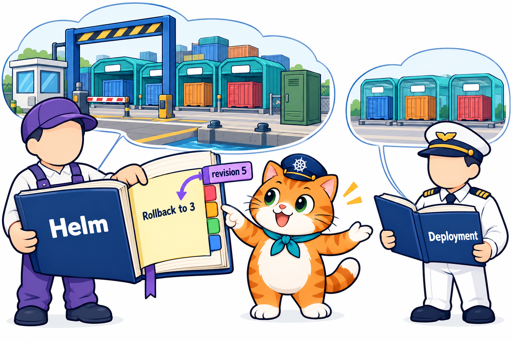
</p>

ทุก `install` / `upgrade` / `rollback` = หน้าใหม่ในสมุดของช่างประกอบ ผลจริงใน LAB 3 หลัง revision 4

```text
$ helm history hello
REVISION  UPDATED                   STATUS      CHART        APP VERSION  DESCRIPTION
1         Sun Oct 18 20:19:01 2026  superseded  hello-0.1.0  1.11.0       Install complete
2         Sun Oct 18 20:19:12 2026  superseded  hello-0.1.0  1.11.0       Upgrade complete
3         Sun Oct 18 20:19:22 2026  superseded  hello-0.1.0  1.11.0       Upgrade complete
4         Sun Oct 18 20:19:33 2026  deployed    hello-0.1.0  1.11.0       Upgrade complete
```

- `STATUS` **`deployed`** = หน้าที่ใช้อยู่ตอนนี้ (มีหน้าเดียว) / **`superseded`** = หน้าเก่าที่ถูกแทนแล้ว / `DESCRIPTION` บอกว่าหน้านั้นเกิดจากอะไร (`Install complete`, `Upgrade complete`, `Rollback to N`)

อยากกลับไปเป็นร้าน `hello-big` 3 Pod ของ revision 3

```text
$ helm rollback hello 3
Rollback was a success! Happy Helming!
$ helm history hello
...
4         Sun Oct 18 20:19:33 2026  superseded  hello-0.1.0  1.11.0       Upgrade complete
5         Sun Oct 18 20:19:51 2026  deployed    hello-0.1.0  1.11.0       Rollback to 3      ← หน้าใหม่
```

- `helm rollback <ชื่อ> <revision>` = เอา **ค่าและ YAML ของหน้านั้น** มาส่งใหม่ ได้ **revision 5** ที่ `DESCRIPTION` เขียน `Rollback to 3` ไม่ได้ลบหน้า 4 ทิ้ง / `helm get values` ได้ `message: hello-big` / `replicas: 3` กลับมาครบ และ Pod 3 ตัว (`hello-666758866b-c84tg`, ...) ใช้ ReplicaSet ท่อนกลาง `666758866b` เดียวกับ revision 3

### revision ของ Helm กับ revision ของ Deployment

ทั้งสองเรียกว่า revision และ rollback ได้ทั้งคู่ แต่เป็น **สมุดคนละเล่ม** (ผู้จัดการลูกเรือถือเล่มเล็ก ช่างประกอบถือเล่มใหญ่)

| | revision ของ Deployment (บทที่ 4) | revision ของ Helm (บทนี้) |
|---|---|---|
| ครอบคลุม | แม่พิมพ์ Pod ของ Deployment **ตัวเดียว** | **ทุก object ของร้าน** (Deployment, Service, ConfigMap, Ingress, PVC) + values |
| เพิ่มเลขเมื่อ | แม่พิมพ์ Pod เปลี่ยน (scale ไม่นับ) | ทุก `install` / `upgrade` / `rollback` แม้ค่าไม่เปลี่ยน |
| ดูประวัติ / ย้อนกลับ | `kubectl rollout history` / `undo` | `helm history` / `helm rollback <ชื่อ> <revision>` |
| ย้อนกลับแล้วได้ | เลขใหม่ ใช้ ReplicaSet เดิม | เลขใหม่ `Rollback to N` |
| เก็บไว้ที่ | ReplicaSet เก่าที่ scale เป็น 0 | Secret ของ Helm ในคลัสเตอร์ (หัวข้อ 8) |

- สองเล่มทำงาน **ซ้อนกัน**: `helm upgrade` / `rollback` ส่ง Deployment ใหม่ → ผู้จัดการทำ rolling update และจดสมุดเล่มเล็กของตัวเองอีกที / ใช้ Helm แล้วให้ย้อนด้วย **`helm rollback`** เสมอ ถ้าไป `kubectl rollout undo` เอง สมุดของ Helm จะไม่รู้เรื่อง และ upgrade ครั้งหน้าจะทับกลับ (คล้าย "ไฟล์ชนะ" ของบทที่ 4)

> **ประโยคเดียวที่ต้องจำ:** rollback **ไม่ได้ย้อนเวลา** แต่ **ส่งของหน้าเก่าซ้ำเป็นหน้าใหม่** เลข revision จึงเพิ่มขึ้นเสมอ

---

## 12. กับดัก: Helm บอก deployed แต่แอปยังไม่พร้อม

<p align="center">
  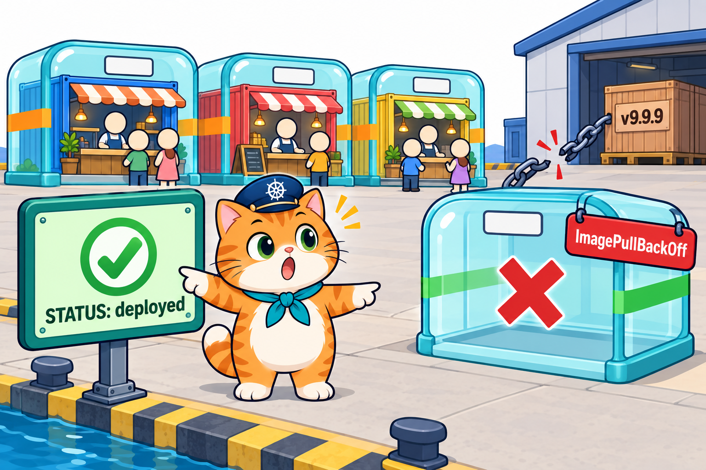
</p>

LAB 3 อัปเกรดด้วย image tag ที่ไม่มีอยู่จริง

```text
$ helm upgrade hello charts/hello -f labs/lab02-values/values-big.yaml --set image.tag=v9.9.9
STATUS: deployed
REVISION: 6
```

สังเกตว่าส่ง `-f values-big.yaml` ซ้ำด้วย (บทเรียนจากหัวข้อ 10) แล้ว `--set` เปลี่ยนแค่ `image.tag` จากนั้น 25 วินาที

```text
$ helm status hello
STATUS: deployed                                         ← Helm ยังบอกว่าสำเร็จ
REVISION: 6
RESOURCES:
==> v1/Deployment
NAME    READY   UP-TO-DATE   AVAILABLE   AGE
hello   3/3     1            3           85s             ← รุ่นใหม่มีแค่ 1 ตัว และยังไม่พร้อม
==> v1/Pod(related)
NAME                     READY   STATUS             RESTARTS   AGE
hello-666758866b-c84tg   1/1     Running            0          34s     ← รุ่นเก่า 3 ตัว (ย่อเหลือแถวเดียว)
hello-b54867b64-xp74m    0/1     ImagePullBackOff   0          25s     ← ดึง image v9.9.9 ไม่ได้
$ curl http://localhost:30081      → Name: hello-big   Hostname: hello-666758866b-spszb   ← ร้านยังเปิดด้วย Pod รุ่นเก่า
```

ทำไม Helm บอก `deployed`

- งานของ Helm จบที่ **ส่ง YAML ให้ Kubernetes และ Kubernetes รับไว้** (Deployment ถูกแก้สำเร็จ) Helm ไม่ได้รอดูว่า Pod ขึ้นได้จริงไหม
- ส่วน Pod ดึง image ไม่ได้เป็นงานของคลัสเตอร์ที่เกิด **หลัง** จากนั้น ([บทที่ 4 หัวข้อ 11](../../004_kubernetes_Deployment/01_Theory/README.md#11-อัปเดตพัง-แต่ร้านไม่ปิด)) / ร้านยังเปิดเพราะ **rolling update** ไม่ปิด Pod เก่าจนกว่า Pod ใหม่จะพร้อม (`UP-TO-DATE 1` แต่ `AVAILABLE 3` เป็นของรุ่นเก่า)

แก้ด้วย rollback ไปหน้าที่ดีล่าสุด

```text
$ helm rollback hello 5
$ kubectl get pods                       ← เหลือ hello-666758866b-... 3 ตัว Pod ที่ ImagePullBackOff หายไป
$ helm history hello
...
6         Sun Oct 18 20:20:01 2026  superseded  hello-0.1.0  1.11.0       Upgrade complete
7         Sun Oct 18 20:20:26 2026  deployed    hello-0.1.0  1.11.0       Rollback to 5
```

- rollback ไป **5** (หน้าที่เป็น `hello-big` ใช้ได้) ได้หน้าใหม่ **7** ส่วนหน้า 6 ที่พังยังอยู่ในสมุดให้ย้อนดูได้ว่าเคยทำอะไร / มีตัวเลือก `helm upgrade --wait` ให้ Helm **รอจนของพร้อม** ก่อนบอกผล ถ้าไม่พร้อมภายในเวลาที่กำหนดจะขึ้นสถานะ `failed` แทน (LAB ไม่ได้ใช้ จึงเห็น `deployed` ตามจริงของค่าเริ่มต้น)

> **⚠️ กับดัก:** `STATUS: deployed` = **Helm ส่งของถึงแล้ว** ไม่ใช่ **ร้านใช้ได้** หลัง upgrade ทุกครั้งให้ดู `kubectl get pods` (หรือส่วน `Pod(related)` ใน `helm status`) และ `curl` ร้านจริงเอง

---

## 13. chart พัง: จับได้ก่อนติดตั้ง

<p align="center">
  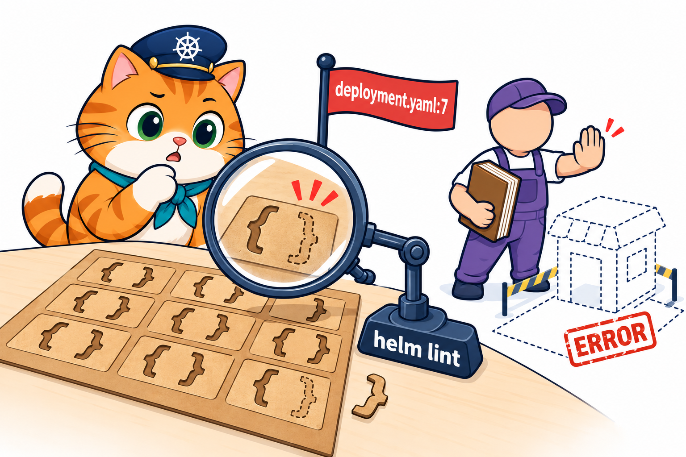
</p>

chart `02_LAB/charts/hello-broken/` เหมือน hello ทุกอย่าง ยกเว้นบรรทัดเดียวใน `templates/deployment.yaml`

```yaml
spec:
  replicas: {{ .Values.replicas }     # ← พิมพ์ผิด: ขาด } ตัวปิด 1 ตัว
```

ผลจริงใน LAB 3

```text
$ helm lint charts/hello-broken
==> Linting charts/hello-broken
[INFO] Chart.yaml: icon is recommended
[ERROR] templates/: parse error at (hello-broken/templates/deployment.yaml:7): unexpected "}" in operand
Error: 1 chart(s) linted, 1 chart(s) failed
$ helm install hello-broken charts/hello-broken
Error: INSTALLATION FAILED: parse error at (hello-broken/templates/deployment.yaml:7): unexpected "}" in operand
$ helm list                               ← มีแค่ hello (revision 7) ไม่มี hello-broken
```

อ่าน error ทีละท่อน

- `parse error` = Helm **อ่านแม่พิมพ์ไม่ออก** (ยังไม่ถึงขั้นเติมค่า ยังไม่ถึง YAML)
- `(hello-broken/templates/deployment.yaml:7)` = **ไฟล์ : บรรทัด** นับจากบรรทัดแรก (comment) บรรทัด 7 คือ `replicas:` พอดี / `unexpected "}" in operand` = เจอ `}` ตัวเดียวที่ไม่ครบคู่ `}}`
- `helm install` ล้มด้วยข้อความเดียวกัน และ **ไม่มีอะไรถูกสร้าง** ทั้ง Deployment และ Service ที่ไม่ผิด เพราะ Helm เติมค่า **ทุกแผ่นให้ผ่านก่อน** แล้วจึงส่งเข้าคลัสเตอร์ ต่างจาก `kubectl apply -f` ทีละไฟล์ที่ไฟล์ก่อนหน้าถูกสร้างไปแล้ว

ลำดับการตรวจที่ใช้ในบทนี้ จากเร็วไปช้า

1. **`helm lint <chart>`** = ตรวจโครงกล่อง + แม่พิมพ์อ่านออก + YAML ที่ได้มีรูปแบบถูก
2. **`helm template ... --show-only <แผ่น>`** = ดูค่าที่ลงช่องด้วยตา (จับ key ผิดที่ lint ไม่จับ หัวข้อ 10)
3. **`helm install` / `upgrade`** = Kubernetes ตรวจอีกชั้น เช่น field ผิดชนิด แล้วจึงดู Pod เอง (หัวข้อ 12)

> **เคล็ดลับ:** error ของ Helm บอก **ชื่อไฟล์:เลขบรรทัด** ของแม่พิมพ์เสมอ เปิดไฟล์นั้นไปที่บรรทัดนั้นก่อน แล้วนับ `{{` กับ `}}` ให้ครบคู่

---

## 14. if และ else: เปิด-ปิดส่วนของร้าน

<p align="center">
  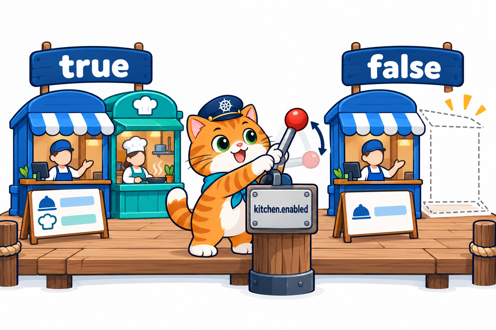
</p>

ร้านทดลองไม่ต้องมีครัว แต่ร้านจริงต้องมี chart `som-shop` จึงมีสวิตช์ `kitchen.enabled: true` ใน values.yaml (หัวข้อ 15)

`{{- if <เงื่อนไข> }} ... {{- end }}` = **ใส่ส่วนนี้ลง YAML เฉพาะเมื่อเงื่อนไขเป็นจริง** chart นี้ใช้ 3 ที่

**1. ครอบทั้งไฟล์** `templates/kitchen.yaml` (ตัดตรงกลางออก บรรทัด `...` และ comment ท้ายบรรทัดเพิ่มเพื่ออ่านคู่บทนี้)

```yaml
# LAB 4–5: ครัว — สร้างเฉพาะเมื่อ kitchen.enabled เป็น true (if ... end ครอบทั้งไฟล์)
{{- if .Values.kitchen.enabled }}
apiVersion: apps/v1
kind: Deployment
...                      # Deployment <release>-kitchen --- Service <release>-kitchen
{{- end }}
```

ปิดครัว = ไม่มีทั้ง Deployment และ Service ของครัวเลย (ไฟล์เหลือแค่ comment)

**2. ครอบแถวเดียวในป้าย** `templates/ingress.yaml` (ตัดหัวไฟล์ออก)

```yaml
  rules:
    - host: {{ .Values.ingress.shopHost }}
      http: ...                  # path: / → Service <release>-menu port 80
    {{- if .Values.kitchen.enabled }}
    - host: {{ .Values.ingress.kitchenHost }}
      http: ...                  # path: / → Service <release>-kitchen port 80
    {{- end }}
```

(ย่อ `http:` ด้วย `...` และ comment เพิ่มเพื่ออ่านคู่บทนี้ โครงเต็มเหมือน `som-ingress.yaml` บทที่ 8) แถวครัวของ list `rules` มีเฉพาะเมื่อเปิดครัว

**3. if / else ใน NOTES.txt**

```text
ร้าน {{ .Release.Name }} ({{ .Values.shop.name }}) เปิดแล้ว
  หน้าร้าน {{ .Values.menu.replicas }} สาขา: http://{{ .Values.ingress.shopHost }}:30080
{{- if .Values.kitchen.enabled }}
  ครัว: http://{{ .Values.ingress.kitchenHost }}:30080
{{- else }}
  ร้านนี้ไม่มีครัว
{{- end }}
```

- `{{- else }}` = ส่วนที่ใช้เมื่อเงื่อนไข **ไม่จริง** / ทุก `if` ต้องปิดด้วย `end` เสมอ (ลืม = parse error แบบหัวข้อ 13)
- ค่าที่นับเป็น "ไม่จริง": `false`, `0`, ข้อความว่าง `""` และ key ที่ไม่มี / `{{-` ทำให้บรรทัดของ `if` / `else` / `end` ไม่เหลือเป็นบรรทัดว่าง (หัวข้อ 6.5)

### ผลจริงใน LAB 5: ร้าน dev ปิดครัว

```text
$ helm template som-dev som-menu/chart/som-shop -f som-menu/values-dev.yaml --show-only templates/ingress.yaml
  rules:
    - host: shop-dev.localhost    ← มีแถวเดียว (backend som-dev-menu) ไม่มีแถวครัว

$ helm install som-dev som-menu/chart/som-shop -f som-menu/values-dev.yaml
NOTES:
ร้าน som-dev (ร้านน้องส้ม สาขาทดลอง) เปิดแล้ว
  หน้าร้าน 1 สาขา: http://shop-dev.localhost:30080
  ร้านนี้ไม่มีครัว                         ← มาจาก else

$ curl http://kitchen-dev.localhost:30080
404 page not found                        ← ไม่มีกฎของชื่อนี้บนป้ายไหนเลย ยามตอบ 404 (บทที่ 8)
```

`kubectl get pods` มีแค่ `som-dev-menu-bb669d6dd-vj5db` ไม่มี `som-dev-kitchen-...` (หัวข้อ 16)

> **ประโยคเดียวที่ต้องจำ:** `if` ใน template ตัดสิน **ตอน Helm เติมค่า** ส่วนที่เงื่อนไขไม่จริง **ไม่ถูกส่งเข้าคลัสเตอร์เลย** ไม่ใช่สร้างแล้วปิดไว้

---

## 15. อ่าน chart ร้านน้องส้มทั้งชุด

<p align="center">
  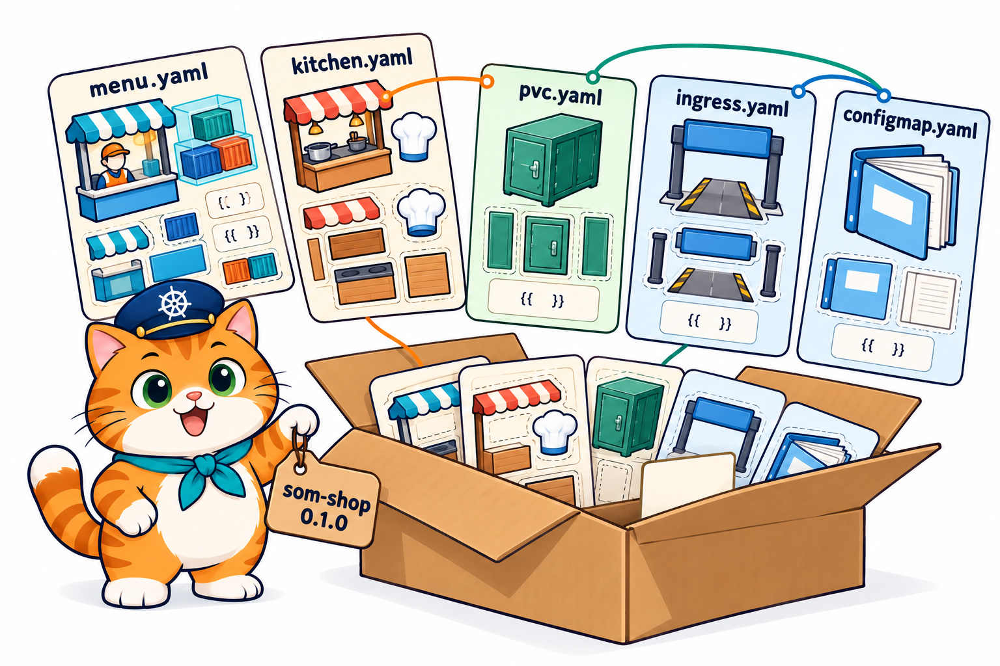
</p>

LAB 4 เอาร้าน 4 ไฟล์ของบทที่ 8 (+ ConfigMap แบบบทที่ 6) มาใส่กล่องเดียว `02_LAB/som-menu/chart/som-shop/` ก่อนติดตั้ง build image `som-menu:1.0` แล้ว `kind load` เข้า Node แบบบทที่ 4

### 15.1 โครงของทั้งกล่อง

```text
som-menu/chart/som-shop/
├── Chart.yaml              name: som-shop   version: 0.1.0   appVersion: "1.0"
├── values.yaml             ค่าเริ่มต้นของร้าน (15.2)
└── templates/
    ├── configmap.yaml      ConfigMap   <release>-config    SHOP_NAME, SHOP_ENV        ← บทที่ 6
    ├── pvc.yaml            PVC         <release>-orders    storage.size               ← บทที่ 7
    ├── menu.yaml           Deployment + Service  <release>-menu     menu.replicas     ← บทที่ 4–5
    ├── kitchen.yaml        Deployment + Service  <release>-kitchen  (ถ้า kitchen.enabled)  ← หัวข้อ 14
    ├── ingress.yaml        Ingress     <release>           shopHost, kitchenHost      ← บทที่ 8
    └── NOTES.txt           ข้อความหลังติดตั้ง (หัวข้อ 14)
```

(เป็นโครงย่อเพื่ออ่านภาพรวม `<release>` = ชื่อ release) แม่พิมพ์ 5 แผ่น + NOTES.txt ได้ object 7 ชิ้น = ร้าน 6 ชิ้นของบทที่ 8 + ConfigMap

### 15.2 values.yaml ทีละส่วน

```yaml
# LAB 4–5: ค่าเริ่มต้นของร้าน — แต่ละร้าน (release) เปลี่ยนเฉพาะค่าที่ต่างด้วย -f values-<ชื่อ>.yaml
shop:
  name: "ร้านอาหารแมวน้องส้ม"   # ชื่อร้านบนหน้าเว็บ (ไป ConfigMap → env SHOP_NAME)
  env: ""                        # ป้ายสภาพแวดล้อม เช่น dev / prod (ว่าง = ไม่แสดง)
image:
  repository: som-menu
  tag: "1.0"
menu:
  replicas: 2                    # จำนวนสาขาหน้าร้าน
kitchen:
  enabled: true                  # มีครัวไหม (false = ไม่สร้างครัวเลย)
storage:
  size: 100Mi                    # ขนาดสมุดออเดอร์ (PVC บทที่ 7)
ingress:
  shopHost: shop.localhost       # ชื่อเข้าหน้าร้าน (บทที่ 8)
  kitchenHost: kitchen.localhost # ชื่อเข้าครัว (ใช้เมื่อ kitchen.enabled เป็น true)
```

- จัดกลุ่มตาม **ส่วนของร้าน** (`shop`, `image`, `menu`, `kitchen`, `storage`, `ingress`) เส้นทางจึงอ่านรู้เรื่อง เช่น `.Values.menu.replicas`, `.Values.ingress.shopHost`
- `tag: "1.0"` ใส่ `" "` ไว้ ไม่งั้น YAML อ่านเป็นตัวเลข `1` จุด `0` (หัวข้อ 6.4) / **ค่าที่เคยฝังหลายไฟล์ในบทที่ 8 มารวมที่นี่ที่เดียว** (ปัญหาข้อ 3 ของหัวข้อ 2)

### 15.3 configmap.yaml และ pvc.yaml

- `configmap.yaml` = ConfigMap ชื่อ `{{ .Release.Name }}-config` มี `data:` 2 key คือ `SHOP_NAME: {{ .Values.shop.name | quote }}` และ `SHOP_ENV: {{ .Values.shop.env | quote }}` (quote เพราะ `data` ต้องเป็นข้อความ หัวข้อ 6.4)
- `pvc.yaml` = PVC ชื่อ `{{ .Release.Name }}-orders` แบบ `ReadWriteOnce` ขนาด `storage: {{ .Values.storage.size }}` = **1 release = 1 สมุด** (`som-orders`, `som-dev-orders`, `som-prod-orders`)

### 15.4 menu.yaml ส่วนที่เป็นช่อง

เทียบกับ `som-menu.yaml` ของบทที่ 8 โครงเหมือนกันทุกบรรทัด ต่างแค่ค่าที่กลายเป็นช่อง (ตัดส่วนที่ไม่มีช่องและ Service ท้ายไฟล์ออก)

```yaml
# LAB 4–5: หน้าร้าน (Deployment + Service ClusterIP) — เหมือน som-menu.yaml บทที่ 8 แต่ค่าที่เปลี่ยนได้กลายเป็นช่องวงเล็บปีกกาคู่
apiVersion: apps/v1
kind: Deployment
metadata:
  name: {{ .Release.Name }}-menu                       # ← หัวข้อ 6.3 (บทที่ 8 เขียน som-menu)
spec:
  replicas: {{ .Values.menu.replicas }}
  selector:
    matchLabels:
      app: {{ .Release.Name }}-menu
  template:
    ...
          image: "{{ .Values.image.repository }}:{{ .Values.image.tag }}"
          imagePullPolicy: IfNotPresent
          env:
            - name: APP_MODE
              value: shop
          envFrom:
            - configMapRef:
                name: {{ .Release.Name }}-config   # SHOP_NAME, SHOP_ENV
          ...
      volumes:
        - name: orders
          persistentVolumeClaim:
            claimName: {{ .Release.Name }}-orders      # ← บทที่ 7 หัวข้อ 5
---
# Service <release>-menu   ClusterIP   port 80 → targetPort 3000   (ย่อ)
```

(comment ที่มี `←` และบรรทัด Service ย่อ เพิ่มเพื่ออ่านคู่บทนี้)

- **ชื่อทุกตัวขึ้นต้นด้วย `{{ .Release.Name }}`** และ **ชื่อที่อ้างถึงกัน** ใช้สูตรเดียวกัน: `envFrom` → `-config`, `claimName` → `-orders`, Service selector → `-menu`, Ingress backend → `-menu` จึงตรงกันเองทุกร้าน
- `envFrom` = เอาทุก key ของ ConfigMap เป็น env ([บทที่ 6 หัวข้อ 4](../../006_kubernetes_ConfigMap_Secret/01_Theory/README.md#4-ใช้-configmap-เป็น-env-configmapkeyref-และ-envfrom)) `server.js` อ่าน `SHOP_ENV` ไปแสดงป้าย dev / prod ข้างชื่อร้าน
- `claimName` → สมุดของร้านนี้ ([บทที่ 7 หัวข้อ 5](../../007_kubernetes_PersistentVolume/01_Theory/README.md#5-ต่อ-pvc-เข้า-pod)) / `kitchen.yaml` โครงเดียวกัน แต่ `APP_MODE: kitchen`, `replicas: 1` ตายตัว และ mount `readOnly: true` แบบบทที่ 8

### 15.5 ผลจริงใน LAB 4

ติดตั้งชื่อ release `som` ชื่อ object จึงออกมาเป็น `som-menu`, `som-kitchen`, `som-orders` **ตรงกับบทที่ 8 พอดี**

```text
$ helm install som som-menu/chart/som-shop          ← ผล NOTES ดูหัวข้อ 2
$ kubectl get deploy,svc,ingress,pvc,configmap
deployment.apps/som-kitchen   1/1     1            1           20s
deployment.apps/som-menu      2/2     2            2           20s
service/som-kitchen   ClusterIP   10.96.100.234   <none>        80/TCP    20s
service/som-menu      ClusterIP   10.96.4.241     <none>        80/TCP    20s
ingress.networking.k8s.io/som   traefik   shop.localhost,kitchen.localhost             80      20s
persistentvolumeclaim/som-orders   Bound    pvc-b62564ee-d86c-4e0f-9f3b-4b9178edd243   100Mi   ...
configmap/som-config         2      20s

$ curl -d menu=tuna http://shop.localhost:30080/order
รับออเดอร์ #1 อาหารเม็ดสูตรปลาทูน่า โดย som-menu-75bc4c8df8-qrl9q
...   (saba เป็น #2 โดย som-menu-75bc4c8df8-vhzfb อีกสาขา)
$ curl http://kitchen.localhost:30080/api/orders
{"pod":"som-kitchen-77c658b484-hcw7b","total":2}          ← ครัวอ่านสมุดเล่มเดียวกัน
```

(ตัดหัวตาราง และแถว `kubernetes` / `kube-root-ca.crt` ที่เป็นของระบบออก) ภาพหน้าจอจริง: [หน้าร้าน](../02_LAB/images/screenshots/20261018_lab4_01-som-shop.png) · [ครัว](../02_LAB/images/screenshots/20261018_lab4_02-som-kitchen.png)

- Pod ทั้ง 3 อยู่ `lab-worker2` เครื่องเดียว เพราะ PVC แบบ RWO ผูกกับเรือลำเดียว (บทที่ 7) / Helm สร้าง ConfigMap และ PVC **ก่อน** Deployment เอง (หัวข้อ 5) จึงไม่เจอกับดัก "Pod มาก่อน ConfigMap"

แปลทั้งกล่องเป็นประโยคเดียว: **"กล่อง `som-shop` ประกอบร้านชื่อ `<release>` ได้ ConfigMap ชื่อร้าน, สมุดออเดอร์ 1 เล่ม, หน้าร้านตามจำนวนสาขา, ครัว (ถ้าเปิด) และป้ายทางเข้าตามชื่อ host ใน values ทุกชิ้นตั้งชื่อขึ้นต้นด้วยชื่อร้านและอ้างถึงกันเอง"**

---

## 16. ร้านเดียว หลายสภาพแวดล้อม

<p align="center">
  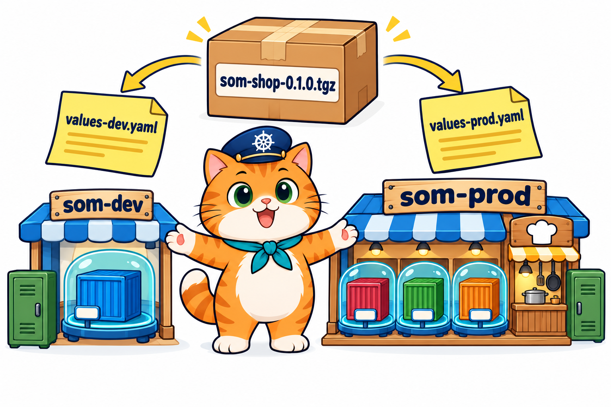
</p>

### ปิดกล่องเป็นพัสดุ: helm package

ท้าย LAB 4 ปิดกล่องเป็นไฟล์เดียว พร้อมส่งต่อให้คนอื่นหรือเก็บเป็นรุ่น

```text
$ helm package som-menu/chart/som-shop
Successfully packaged chart and saved it to: .../02_LAB/som-shop-0.1.0.tgz
```

- ชื่อไฟล์ = `<name>-<version>.tgz` จาก Chart.yaml แก้แม่พิมพ์แล้วเพิ่ม `version` เป็น `0.1.1` ก็ได้พัสดุใหม่คนละไฟล์ (รุ่นเก่ายังอยู่) / `.tgz` = โฟลเดอร์ chart ที่บีบอัดไว้ `helm install` / `upgrade` ใช้ได้เหมือนโฟลเดอร์ (งานจริงมักฝากไว้ใน chart repository แบบของ Traefik ซึ่งไม่อยู่ในบทนี้)

### ใบสั่งค่า 2 ใบ

ไฟล์ `02_LAB/som-menu/values-dev.yaml` (ร้านทดลอง) และ `values-prod.yaml` (ร้านจริง) โครง key เดียวกับ values.yaml ของกล่อง (หัวข้อ 15.2) แต่เขียนเฉพาะค่าที่ต่าง (prod มี `ingress.kitchenHost: kitchen.localhost` เพิ่ม)

| ค่า | `values-dev.yaml` | `values-prod.yaml` | ไปที่ |
|---|---|---|---|
| `shop.name` | `ร้านน้องส้ม สาขาทดลอง` | `ร้านอาหารแมวน้องส้ม` | ConfigMap → `SHOP_NAME` |
| `shop.env` | `dev` | `prod` | ConfigMap → `SHOP_ENV` (ป้ายบนหน้าเว็บ) |
| `menu.replicas` | `1` | `3` | Deployment หน้าร้าน |
| `kitchen.enabled` | `false` | `true` | kitchen.yaml, แถวครัวใน ingress.yaml |
| `ingress.shopHost` | `shop-dev.localhost` | `shop.localhost` | ป้ายผังทางเข้า |
| `storage.size` | ไม่เขียน → `100Mi` | ไม่เขียน → `100Mi` | PVC |

### ติดตั้ง 2 ร้านจาก chart เดียว (LAB 5)

```text
$ helm install som-dev som-menu/chart/som-shop -f som-menu/values-dev.yaml       ← จากโฟลเดอร์
$ helm install som-prod som-shop-0.1.0.tgz -f som-menu/values-prod.yaml          ← จากพัสดุ
  หน้าร้าน 3 สาขา: http://shop.localhost:30080                                  ← บรรทัดหนึ่งของ NOTES
$ helm list
NAME      NAMESPACE  REVISION  ...  STATUS    CHART           APP VERSION
som-dev   default    1         ...  deployed  som-shop-0.1.0  1.0
som-prod  default    1         ...  deployed  som-shop-0.1.0  1.0       ← chart เดียวกัน 2 ร้าน

$ kubectl get pods
som-dev-menu-bb669d6dd-vj5db        1/1     Running   0          26s     ← dev 1 สาขา ไม่มีครัว
som-prod-kitchen-76448fd97b-hn52r   1/1     Running   0          26s
som-prod-menu-9557cc95d-qlln2       1/1     Running   0          26s     ← prod 3 สาขา (ย่อเหลือแถวเดียว)
$ kubectl get pvc
som-dev-orders    Bound    pvc-8787635e-db69-4502-8227-07d23cd9819f   100Mi      ...
som-prod-orders   Bound    pvc-86323ee6-d2b5-4fdb-afd3-9432406def33   100Mi      ...
```

- **ชื่อไม่ชน** เพราะทุก object ขึ้นต้นด้วยชื่อ release (`som-dev-...`, `som-prod-...`) ส่วน Ingress `som-dev` กับ `som-prod` ใช้ host ต่างกัน (Helm ไม่ตรวจ host ซ้ำให้ ต้องตั้งใน values เอง) / **สมุดแยกเล่ม** ออเดอร์ของร้านทดลองไม่ปนกับร้านจริง

```text
$ curl -d menu=saba http://shop-dev.localhost:30080/order
รับออเดอร์ #1 อาหารเปียกปลาซาบะ โดย som-dev-menu-bb669d6dd-vj5db
$ curl -d menu=tuna http://shop.localhost:30080/order
รับออเดอร์ #1 อาหารเม็ดสูตรปลาทูน่า โดย som-prod-menu-9557cc95d-qlln2      ← เริ่ม #1 ของเล่มตัวเอง
...   (chicken เป็น #2 ของร้าน prod / ร้าน dev ได้ total 1)
$ curl http://kitchen.localhost:30080/api/orders
{"pod":"som-prod-kitchen-76448fd97b-hn52r","total":2}
```

ภาพหน้าจอจริง ป้าย `dev` / `prod` ข้างชื่อร้านมาจาก `SHOP_ENV`: [ร้าน dev](../02_LAB/images/screenshots/20261018_lab5_01-shop-dev.png) · [ร้าน prod](../02_LAB/images/screenshots/20261018_lab5_02-shop-prod.png)

### upgrade และ rollback ร้านจริง ออเดอร์ไม่หาย

```text
$ helm upgrade som-prod som-shop-0.1.0.tgz -f som-menu/values-prod.yaml --set menu.replicas=4
REVISION: 2
  หน้าร้าน 4 สาขา: http://shop.localhost:30080
$ kubectl get deploy
som-prod-menu      4/4     4            4           43s
$ helm rollback som-prod 1
$ kubectl get deploy
som-dev-menu       1/1     1            1           53s       ← ร้าน dev ไม่ถูกแตะ
som-prod-menu      3/3     3            3           53s
$ curl http://kitchen.localhost:30080/api/orders
{"pod":"som-prod-kitchen-76448fd97b-hn52r","total":2}          ← ออเดอร์ 2 รายการยังอยู่
```

- upgrade ส่ง `-f values-prod.yaml` ซ้ำทุกครั้ง แล้ว `--set` แค่ค่าที่เปลี่ยน (บทเรียนหัวข้อ 10)
- rollback ร้านหนึ่ง **ไม่กระทบอีกร้าน** สมุดของแต่ละ release แยกกัน / PVC ไม่ได้เปลี่ยนใน upgrade / rollback จึงไม่ถูกสร้างใหม่ ออเดอร์จึงยัง `total 2`

---

## 17. กับดัก: uninstall ลบสมุดออเดอร์ด้วย

<p align="center">
  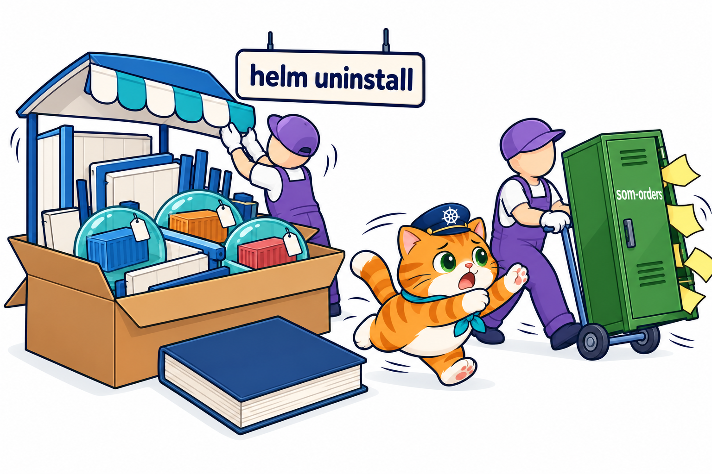
</p>

`helm uninstall` ลบ **ทุกชิ้นที่แม่พิมพ์สร้าง** รวม PVC ด้วย ผลจริงท้าย LAB 4

```text
$ helm uninstall som
release "som" uninstalled
$ kubectl get pvc
som-orders   Terminating   pvc-b62564ee-d86c-4e0f-9f3b-4b9178edd243   100Mi      ...
$ kubectl get pvc
No resources found in default namespace.                  ← 8 วินาทีต่อมา สมุดหายทั้งเล่ม
```

- ใบขอเช่า (PVC) ถูกลบ → ล็อกเกอร์ (PV) ของ StorageClass `standard` ถูกลบตาม ออเดอร์ 2 รายการหายถาวร ([บทที่ 7 หัวข้อ 9](../../007_kubernetes_PersistentVolume/01_Theory/README.md#9-ลบอะไรแล้วข้อมูลหาย))
- ท้าย LAB 5 uninstall `som-dev` และ `som-prod` ก็ได้ `No resources found` เหมือนกัน / ในบทที่ 7–8 เราลบ PVC **เป็นอย่างสุดท้ายด้วยมือ** และเลือกเองได้ว่าจะไม่ลบ แต่ Helm มองว่า PVC เป็น **ชิ้นหนึ่งของร้าน** เหมือน Deployment ไม่มีคำเตือนพิเศษ

### งานจริงป้องกันอย่างไร

ถ้าอยากให้ Helm **ไม่ลบ** ชิ้นไหน ใส่ annotation นี้ในแม่พิมพ์ของชิ้นนั้น (ไม่ได้อยู่ในไฟล์ LAB)

```yaml
metadata:
  name: {{ .Release.Name }}-orders
  annotations:
    "helm.sh/resource-policy": keep    # uninstall แล้ว PVC นี้ยังอยู่
```

- หรือ **แยก PVC ออกจาก chart** สร้างเองครั้งเดียว แล้วให้ chart อ้างชื่อผ่าน values (`claimName`) อย่างเดียว / ไม่ว่าแบบไหน ข้อมูลสำคัญควรมี **สำเนาสำรอง** อยู่นอกคลัสเตอร์เสมอ (หัวข้อ 18)

> **⚠️ กับดัก:** ห้ามคิดว่า `helm uninstall` = "ปิดร้านชั่วคราว" มันคือ **รื้อร้านทั้งร้าน รวมสมุดออเดอร์** ถ้าแค่อยากหยุดรับลูกค้า ใช้ `helm upgrade ... --set menu.replicas=0` แทน (Pod หายแต่ PVC อยู่)

---

## 18. ปูทางบทถัดไป สรุป และคำถามทบทวน

### ปูทางบทถัดไป

<p align="center">
  
</p>

ร้านน้องส้มอยู่ในกล่องเดียวแล้ว ติดตั้ง / อัปเกรด / ย้อนกลับ / ลบ ทั้งร้านในคำสั่งเดียว แต่ LAB 4–5 ก็เห็นสิ่งที่ Helm ไม่ได้ทำให้

- **ยังทำมือทุกขั้น** น้องส้มต้อง `docker build` image, `kind load` และพิมพ์ `helm upgrade` พร้อม tag ใหม่เอง พิมพ์ผิดก็ได้ `v9.9.9` แบบ LAB 3 → การ build และ deploy อัตโนมัติ (**CI/CD**) จะได้เจอในบทหลัง ๆ
- **ไม่มีใครดูแลตอนกลางคืน** สมุดออเดอร์มีเล่มเดียว `helm uninstall` พลาดครั้งเดียวก็หายหมด (หัวข้อ 17) อยากให้มี **งานรอบกลางคืน** สำรองสมุดออเดอร์ทุกคืนแล้วจบงาน ไม่ใช่แอปที่รันค้างตลอดแบบ Deployment
- → **Job / CronJob (บทที่ 10)** = งานที่รันจนเสร็จแล้วหยุด และงานที่รันตามเวลาที่ตั้งไว้ (เช่น ทุกคืน) ใส่เป็นแม่พิมพ์อีกแผ่นใน chart ได้ด้วย

### สรุป

<p align="center">
  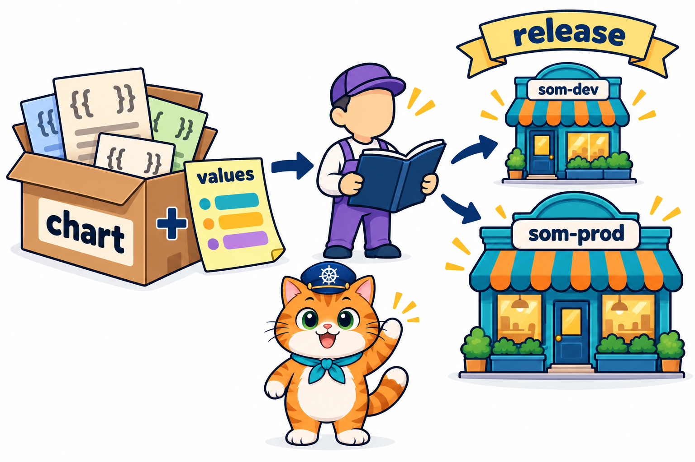
</p>

1. **Helm** ติดตั้งทั้งร้านเป็นชิ้นเดียว: **chart** (กล่อง) มี **template** (แม่พิมพ์) + **values** (ใบสั่งค่า) ติดตั้งแล้วได้ **release** ที่มี **revision**
2. chart = `Chart.yaml` (`version` ของกล่อง ≠ `appVersion` ของแอป) + `values.yaml` + `templates/` (+ `NOTES.txt`)
3. **template + values = YAML ธรรมดา** `helm template` ดูผลได้โดยไม่แตะคลัสเตอร์ `helm install` = template + ส่ง + จดสมุด
4. ภาษา template: `{{ }}` = ช่อง, `.Values.a.b` เดินตามการเยื้อง, `.Release.Name` = ชื่อ release, `| quote` = ครอบ `" "`, `{{-` = ตัดช่องว่าง (comment ที่มี `{{ }}` ก็ถูกอ่าน)
5. ดู release: `helm list`, `status`, `get manifest`, `get notes`, `get values [--all]` ประวัติเก็บเป็น Secret ในคลัสเตอร์
6. ค่าซ้อนกัน: `values.yaml` < `-f ไฟล์` < `--set` เก็บค่าของแต่ละร้านเป็นไฟล์
7. กับดัก values: **key ผิดไม่ฟ้องไม่ใช้** และ **upgrade ใช้เฉพาะค่าที่ส่งรอบนั้น** → `helm template` ก่อน, `helm get values` หลัง, ส่ง `-f` ครบทุกครั้ง
8. revision ของ Helm ครอบทั้งร้าน rollback ได้ **เลขใหม่** (`Rollback to 3`) ต่างจากสมุดของ Deployment ที่ครอบตัวเดียว
9. **`deployed` ≠ แอปใช้ได้** ต้องดู Pod เอง / template พังถูกจับที่ `helm lint` พร้อม **ไฟล์:บรรทัด** และไม่มีอะไรถูกสร้าง
10. `if / else / end` เปิด-ปิดส่วนของร้าน / ชื่อ object ขึ้นต้นด้วย `.Release.Name` จึงติดตั้ง dev + prod จาก chart (หรือ `.tgz`) เดียวได้ไม่ชน สมุดแยกเล่ม
11. **`helm uninstall` ลบ PVC ด้วย** ใช้ `helm.sh/resource-policy: keep` หรือแยก PVC และต้องมีสำเนาสำรอง → บทหน้า **Job / CronJob** ทำงานรอบกลางคืน

### คำถามทบทวน

**1. ติดตั้ง `helm install som-dev som-menu/chart/som-shop -f som-menu/values-dev.yaml` แม่พิมพ์ 3 บรรทัดนี้ใน menu.yaml จะได้ YAML อะไร**

```yaml
  name: {{ .Release.Name }}-menu
  replicas: {{ .Values.menu.replicas }}
            claimName: {{ .Release.Name }}-orders
```

<details>
<summary>แนวคำตอบ</summary>

`name: som-dev-menu`, `replicas: 1` (values-dev ทับค่าเริ่มต้น 2), `claimName: som-dev-orders` ชื่อมาจากชื่อ release `som-dev` ส่วนจำนวนมาจากใบสั่งค่า dev
</details>

**2. แม่พิมพ์นี้ผิดกี่จุด อะไรบ้าง (values.yaml เหมือนของ hello)**

```text
# ชื่อ Deployment คือ {{ .Release.Name }}
metadata:
  name: {{ .Release.Name }}
spec:
  replicas: {{ .values.replicas }}
      containers:
        - name: whoami
          image: "{{ .Values.repository }}:{{ .Values.image.tag }"
```

<details>
<summary>แนวคำตอบ</summary>

1. comment บรรทัดแรกมี `{{ }}` Helm อ่านเป็นช่องด้วย ควรเขียนว่า "ช่องวงเล็บปีกกาคู่"
2. `.values` ต้องเป็น `.Values` (V ใหญ่)
3. `.Values.repository` ต้องเป็น `.Values.image.repository` (เยื้องอยู่ใต้ `image`) ถ้าไม่แก้จะได้ค่าว่างเงียบ ๆ
4. `{{ .Values.image.tag }` ขาด `}` ตัวปิด → `parse error ... unexpected "}"`
</details>

**3. ใบสั่งค่านี้ตั้งใจให้ hello ใช้ image `v2.0.0` และ 4 Pod ติดตั้งผ่านแต่ได้ `v1.11.0` และ 2 Pod เพราะอะไร**

```yaml
replica: 4
image:
tag: v2.0.0
```

<details>
<summary>แนวคำตอบ</summary>

`replica` พิมพ์ผิด (ต้องเป็น `replicas`) และ `tag` ไม่ได้เยื้องเข้าใต้ `image` จึงกลายเป็น key ชั้นบนสุด `.Values.tag` ที่ไม่มีแม่พิมพ์ไหนใช้ Helm ไม่ฟ้องทั้งคู่ ค่าจริงจึงเป็นค่าเริ่มต้น ตรวจได้ด้วย `helm template ... -f <ไฟล์>` ก่อนติดตั้ง
</details>

**4. อ่าน `helm history` นี้แล้วบอกว่า revision 5 และ 7 เกิดจากอะไร ตอนนี้ร้านใช้ค่าของหน้าไหน**

```text
REVISION  STATUS      DESCRIPTION
4         superseded  Upgrade complete
5         superseded  Rollback to 3
6         superseded  Upgrade complete
7         deployed    Rollback to 5
```

<details>
<summary>แนวคำตอบ</summary>

revision 5 = `helm rollback hello 3` (ส่งค่าของหน้า 3 ซ้ำ) revision 7 = `helm rollback hello 5` หลังหน้า 6 พัง ตอนนี้ `deployed` คือ 7 ซึ่งมีค่าเหมือนหน้า 5 = หน้า 3 (`hello-big` 3 Pod) rollback ไม่ลบหน้าเก่า แต่เพิ่มหน้าใหม่เสมอ
</details>

**5. `helm upgrade` ขึ้น `STATUS: deployed` แต่ `helm status` มี Pod `hello-b54867b64-xp74m 0/1 ImagePullBackOff` เกิดอะไรขึ้น ลูกค้ายังเข้าร้านได้ไหม แก้อย่างไร**

<details>
<summary>แนวคำตอบ</summary>

image tag ที่ส่ง (`v9.9.9`) ไม่มีอยู่จริง Helm ส่ง YAML ให้ Kubernetes สำเร็จจึงบอก `deployed` แต่ Pod ใหม่ดึง image ไม่ได้ ลูกค้ายังเข้าได้เพราะ rolling update เก็บ Pod เก่า 3 ตัวไว้ แก้ด้วย `helm rollback hello <หน้าที่ดีล่าสุด>` แล้วดู `kubectl get pods` ยืนยัน
</details>

**6. ร้าน hello อยู่ที่ revision 3 (`-f values-big.yaml` → 3 Pod `hello-big`) แล้วเพื่อนสั่ง `helm upgrade hello charts/hello --set message=hi` ผลคือกี่ Pod ตอบอะไร และควรสั่งอย่างไร**

<details>
<summary>แนวคำตอบ</summary>

2 Pod ตอบ `Name: hi` เพราะ upgrade ใช้เฉพาะค่าที่ส่งรอบนั้น (`message=hi`) รวมกับ values.yaml ค่า `replicas: 3` ของ values-big ไม่ถูกนำมาด้วย ควรสั่ง `helm upgrade hello charts/hello -f labs/lab02-values/values-big.yaml --set message=hi`
</details>

**7. `helm lint` ได้ `[ERROR] templates/: parse error at (hello-broken/templates/deployment.yaml:7): unexpected "}" in operand` บอกอะไรบ้าง ถ้าสั่ง `helm install` ต่อเลยจะมี Service ถูกสร้างไหม**

<details>
<summary>แนวคำตอบ</summary>

ผิดที่ไฟล์ `templates/deployment.yaml` บรรทัด 7 เจอ `}` ไม่ครบคู่ (ช่องขาด `}`) `helm install` ล้มด้วย `INSTALLATION FAILED` ข้อความเดียวกัน และไม่สร้างอะไรเลยแม้ service.yaml จะถูก เพราะ Helm เติมค่าทุกแผ่นให้ผ่านก่อนส่งเข้าคลัสเตอร์
</details>

**8. ร้าน `som-dev` ใช้ `kitchen.enabled: false` จะมี object ของครัวอะไรบ้าง และทำไม `curl http://kitchen-dev.localhost:30080` ได้ `404 page not found`**

<details>
<summary>แนวคำตอบ</summary>

ไม่มีเลย `if` ครอบทั้ง kitchen.yaml จึงไม่มี Deployment / Service ของครัว และแถวครัวใน ingress.yaml ก็ถูกตัดออก ป้ายของ som-dev มีแค่ `shop-dev.localhost` ชื่อ `kitchen-dev.localhost` ไม่อยู่บนป้ายไหน ยาม Traefik จึงตอบ 404 เอง
</details>

**9. เพื่อนอยากปิดร้านจริงชั่วคราวช่วงซ่อมระบบ เลยสั่ง `helm uninstall som-prod` เกิดอะไรกับออเดอร์ และควรทำอย่างไรแทน**

<details>
<summary>แนวคำตอบ</summary>

PVC `som-prod-orders` ถูกลบไปกับร้าน (เห็น `Terminating` แล้วหายใน LAB 4) PV ถูกลบตาม ออเดอร์หายถาวร ถ้าแค่หยุดรับลูกค้าให้ `helm upgrade som-prod ... -f values-prod.yaml --set menu.replicas=0` ระยะยาวใส่ `helm.sh/resource-policy: keep` หรือแยก PVC ออกจาก chart และสำรองข้อมูล
</details>

**10. ทำไมติดตั้ง `som-dev` และ `som-prod` จาก chart เดียวกันใน namespace เดียวกันได้ ชื่อไม่ชน และออเดอร์ไม่ปนกัน**

<details>
<summary>แนวคำตอบ</summary>

ทุกแม่พิมพ์ตั้งชื่อ object ขึ้นต้นด้วย `{{ .Release.Name }}` จึงได้ `som-dev-menu` / `som-prod-menu` และ PVC `som-dev-orders` / `som-prod-orders` คนละเล่ม ส่วน host บนป้ายต่างกันตาม values (`shop-dev.localhost` / `shop.localhost`)
</details>

---

## เอกสารอ้างอิง

- Helm Docs: [Charts](https://helm.sh/docs/topics/charts/) · [Chart Template Guide](https://helm.sh/docs/chart_template_guide/getting_started/) · [Values Files](https://helm.sh/docs/chart_template_guide/values_files/) · [Flow Control (if/else)](https://helm.sh/docs/chart_template_guide/control_structures/)
- Helm Commands: [helm upgrade](https://helm.sh/docs/helm/helm_upgrade/) · [helm rollback](https://helm.sh/docs/helm/helm_rollback/) · [helm history](https://helm.sh/docs/helm/helm_history/) · [helm package](https://helm.sh/docs/helm/helm_package/)
- Helm Best Practices: [Chart Best Practices](https://helm.sh/docs/chart_best_practices/) · [Tell Helm not to uninstall a resource](https://helm.sh/docs/howto/charts_tips_and_tricks/#tell-helm-not-to-uninstall-a-resource)

> ภาพประกอบในโฟลเดอร์ [`images/`](images/) สร้างด้วย AI เพื่อการเรียนการสอน (prompt อยู่ใน [`images/imagegen-prompts.md`](images/imagegen-prompts.md)) ผลลัพธ์คำสั่งมาจาก LAB จริงบน kind v0.33.0 / Kubernetes v1.37.0 / Helm v4.3.0 / Traefik v3.7.14 (ติดตั้งใน LAB 0) ทดลอง 18 ต.ค. 2569 ชื่อ Pod, IP และเวลาในเครื่องผู้เรียนจะต่างกัน
