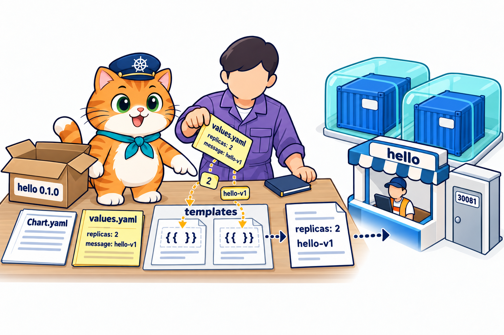
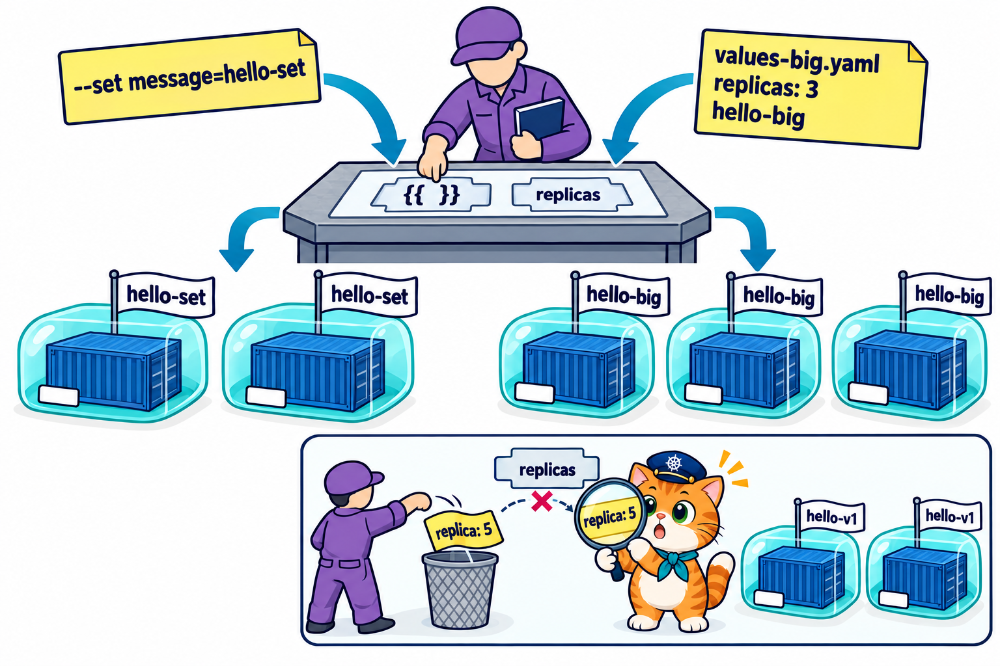
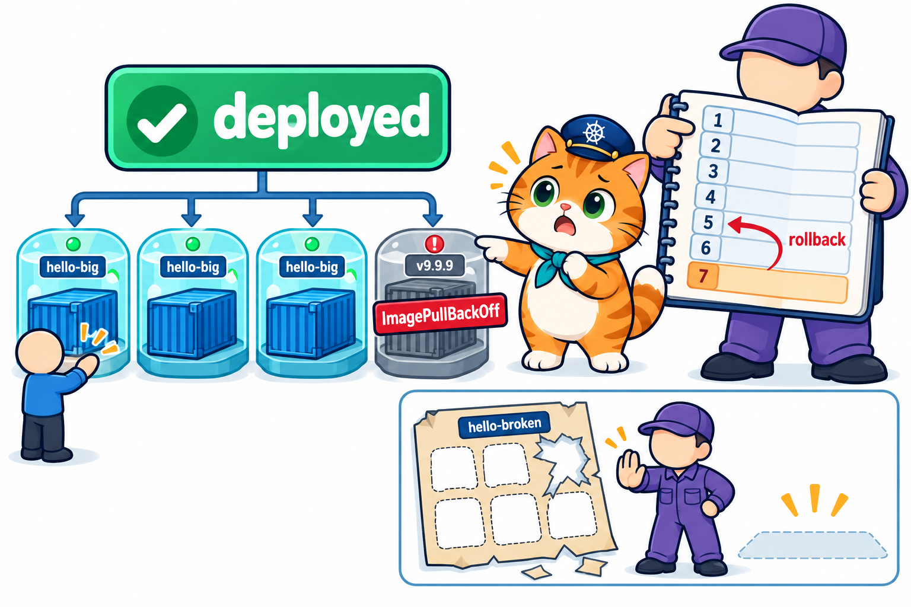
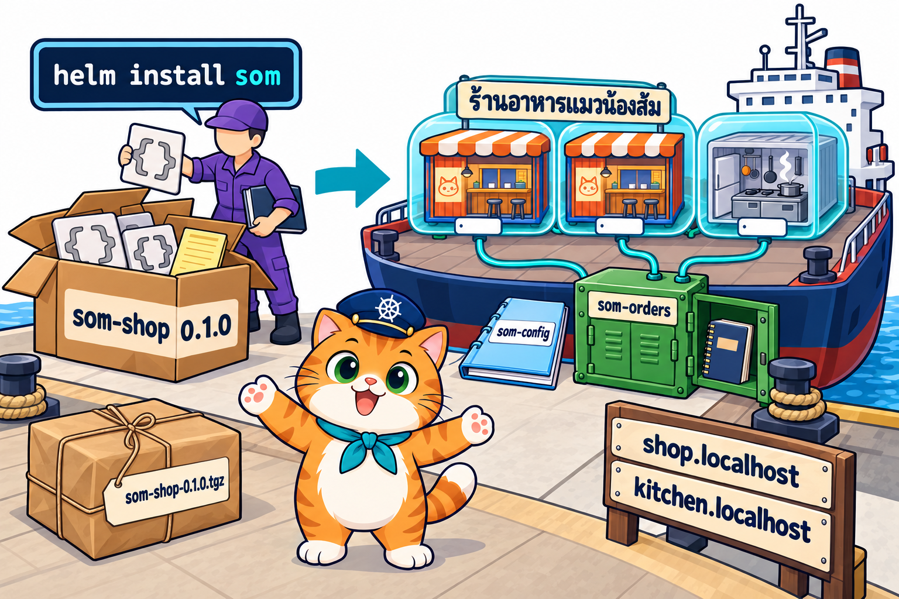
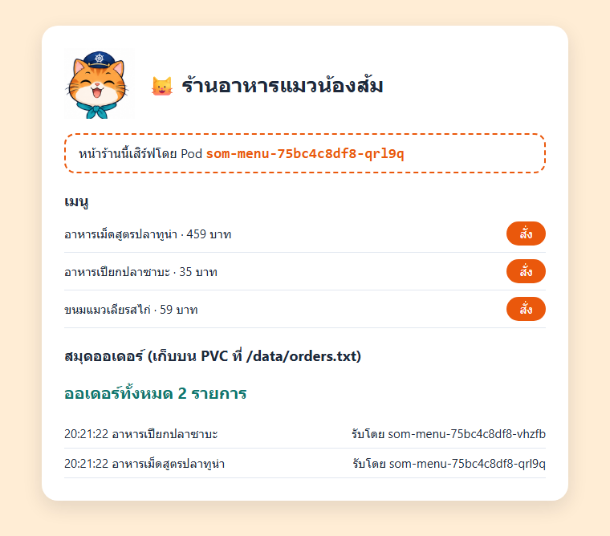
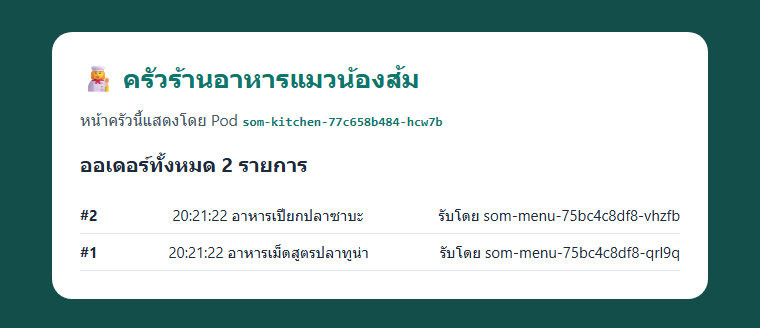
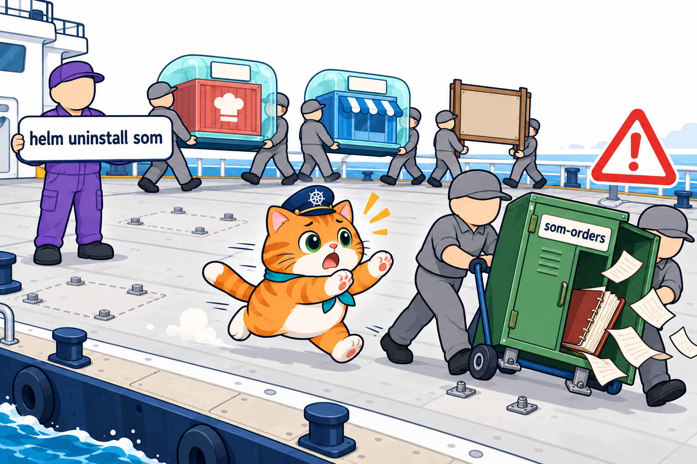
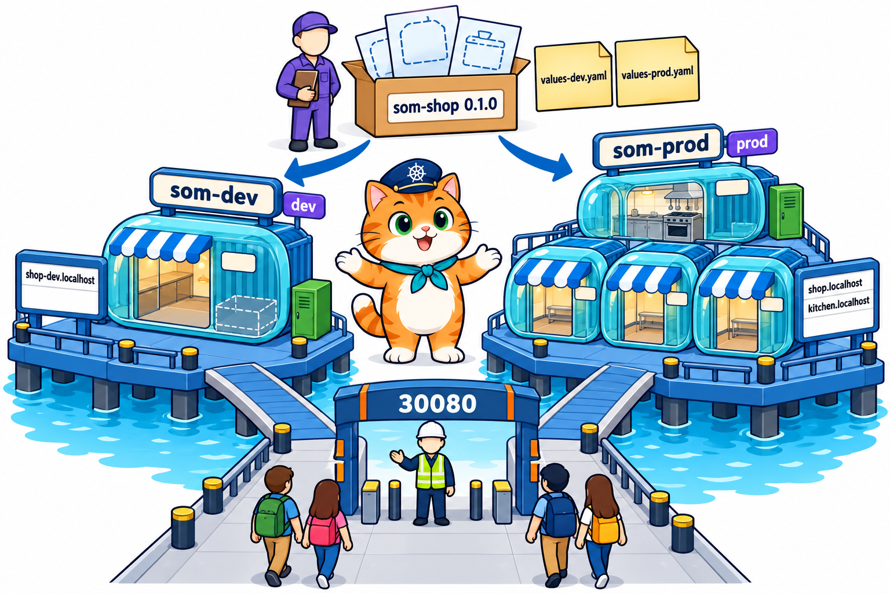
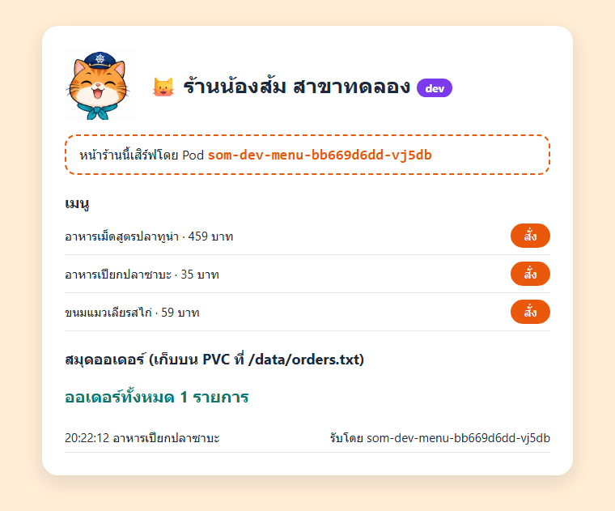
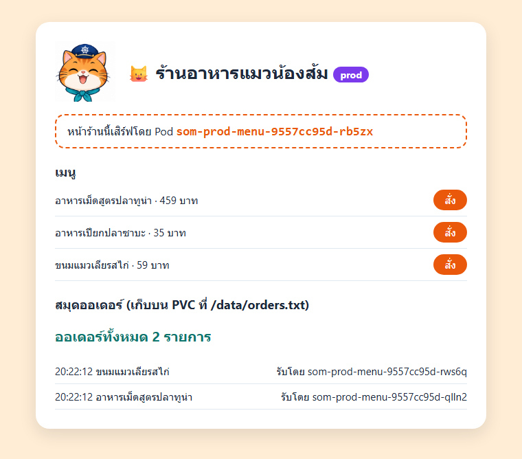

# LAB บทที่ 9: Helm Chart — ร้านน้องส้มในกล่องเดียว

> **รายวิชา:** Software Development Tools and Environments (DevTools)
> **หัวข้อ:** ปฏิบัติการ Helm Chart — เขียน chart เองตั้งแต่ศูนย์ (`Chart.yaml`, `values.yaml`, `templates/`), ตรวจและดู YAML ก่อนติดตั้งจริง, เปลี่ยนค่าด้วย values, อัปเกรดและย้อนกลับทั้งชุดด้วย revision, chart ที่พิมพ์ผิด และร้านน้องส้มทั้งร้าน (ConfigMap + PVC + หน้าร้าน + ครัว + Ingress) ในกล่องเดียว เปิดได้ 2 ร้าน dev / prod จาก chart เดียว
> **ผลลัพธ์การเรียนรู้ที่เกี่ยวข้อง:** CLO-5, CLO-6
> **ทฤษฎีประกอบ:** [01_Theory/README.md](../01_Theory/README.md)

---

## บทนำ

ทุก LAB ทำ **ใน container `k8s-lab`** (image `tuchsanai/devtools-kind:2569_1` มี kubectl, kind, helm, k9s และ Docker ข้างในครบ) บทที่ 8 ใช้ **Helm** ติดตั้ง Traefik ซึ่งเป็น **chart ของคนอื่น** ส่วนร้านน้องส้มของเราเองยังต้อง `kubectl apply` **4 ไฟล์ทีละไฟล์ตามลำดับ** (PVC → หน้าร้าน → ครัว → ป้าย Ingress) และตอนเลิกก็ต้อง `kubectl delete` ทีละไฟล์ ถ้าอยากเปิดร้านที่ 2 (เช่น ร้านทดลองเล็ก ๆ) ต้องคัดลอกทั้ง 4 ไฟล์แล้วไล่แก้ชื่อทุกจุดไม่ให้ชนกัน บทนี้เรา **เขียน chart เอง** = จับ YAML ทั้งร้านใส่ **กล่องชุดประกอบ** กล่องเดียว ส่วนที่ต่างกันในแต่ละร้านเว้นเป็น **ช่องว่าง `{{ }}`** แล้วเติมค่าจาก **ใบสั่งค่า (values)** ตั้งแต่ chart เล็กที่สุด `hello`, การเปลี่ยนค่า, การอัปเกรดและย้อนกลับทั้งชุด จนถึง **"ร้านอาหารแมวน้องส้ม"** ที่ติดตั้ง/ถอนได้ด้วยคำสั่งเดียว และเปิด 2 ร้าน (dev / prod) จาก chart เดียวกัน

> บล็อก **Expected output** คือผลที่ควรเห็นหลังรันคำสั่ง (ไม่ต้องพิมพ์ตาม) มาจากการทดลองจริงเมื่อ 18 ต.ค. 2569 (kind v0.33.0, kubectl v1.37.1, Kubernetes v1.37.0, Helm v4.3.0, Traefik chart 42.0.0) **ชื่อ Pod, IP และเวลาถูกสุ่ม/เปลี่ยนทุกครั้ง** (เช่น `hello-777646d47c-j8z7x`, `som-prod-menu-9557cc95d-qlln2`, `10.244.1.2`) ค่าในเครื่องนักศึกษาจะต่างไป เป็นเรื่องปกติ

| สัญลักษณ์ | รันที่ไหน |
|---|---|
| 🖥️ | Terminal/PowerShell บนเครื่องนักศึกษา |
| 🐧 | SSH session ใน k8s-lab (prompt `root@k8s-lab`) |
| 🌐 | browser บนเครื่องนักศึกษา |

### กติกา

- ทำงานในโฟลเดอร์ `/workspace/DevTools/05_kubernetes/009_kubernetes_Helm/02_LAB` และ **ถอน release ของตัวเองด้วย `helm uninstall` ทุกครั้งที่จบ LAB ที่ใช้ release นั้น** (release `hello` ใช้ต่อกันใน LAB 1–3 ถอนท้าย LAB 3) ยกเว้น **Traefik** ที่ติดตั้งใน LAB 0 ใช้ต่อทั้งบท ถอนตอนจบบท (ท้าย LAB 5)
- **ชื่อ Pod ในเครื่องแต่ละคนไม่เหมือนกัน** ส่วนท้ายของชื่อ Pod ถูกสุ่ม (เช่น `-j8z7x`) ให้ดูชื่อจาก `kubectl get pods` ในเครื่องตัวเองเสมอ ชื่อ `*.localhost` (`shop.localhost`, `kitchen.localhost`, `shop-dev.localhost`) ใช้ได้เลย ไม่ต้องตั้ง DNS หรือแก้ไฟล์ hosts (แบบบทที่ 8) บทนี้ไม่ต้องใช้ VS Code
- **⚠️ `helm uninstall` ลบทุกอย่างที่ chart สร้าง รวมถึง PVC** ถ้า chart เป็นคนสร้าง PVC สมุดออเดอร์ (LAB 4–5) ถอน release = **ข้อมูลในสมุดหายถาวร** (บทที่ 7) ไม่มีถังขยะให้กู้คืน

## สารบัญ LAB

| LAB | ชื่อ | เวลาโดยประมาณ | ความยาก |
|:---:|---|:---:|:---:|
| 0 | [เตรียมสภาพแวดล้อม (Setup)](#lab-0-เตรียมสภาพแวดล้อม-setup) (container `k8s-lab` + คลัสเตอร์ + git clone + ติดตั้ง Traefik) | 25–35 นาที | ⭐ |
| 1 | [Chart แรกที่เขียนเอง](#lab-1-chart-แรกที่เขียนเอง) | 30 นาที | ⭐⭐ |
| 2 | [เปลี่ยนค่าด้วย values](#lab-2-เปลี่ยนค่าด้วย-values) | 30 นาที | ⭐⭐⭐ |
| 3 | [อัปเกรด ย้อนกลับ และ chart พัง](#lab-3-อัปเกรด-ย้อนกลับ-และ-chart-พัง) | 30 นาที | ⭐⭐⭐ |
| 4 | [Chart ของร้านน้องส้ม](#lab-4-chart-ของร้านน้องส้ม) | 40 นาที | ⭐⭐⭐⭐ |
| 5 | [LAB สุดท้าย: chart เดียว เปิด 2 ร้าน (dev / prod)](#lab-5-lab-สุดท้าย-chart-เดียว-เปิด-2-ร้าน-dev--prod) | 50–60 นาที | ⭐⭐⭐⭐⭐ |
| – | [เก็บกวาดหลังจบบท](#เก็บกวาดหลังจบบท) · [สรุปคำสั่งในบทนี้](#สรุปคำสั่งในบทนี้) | | |

รวมประมาณ 3.5–4 ชั่วโมง (เครื่องช้าหรือเน็ตช้าอาจนานกว่านี้ เพราะต้องดึง image `traefik`, `traefik/whoami` และ `node` จาก Docker Hub)

### สารบัญรูปภาพ

| รูปที่ | เรื่อง | รูปที่ | เรื่อง |
|:---:|---|:---:|---|
| 1 | [LAB 0 Setup container และคลัสเตอร์](#fig-1) | 7 | [ภาพหน้าจอจริง: หน้าร้านของ release som](#fig-7) |
| 2 | [LAB 0 git clone](#fig-2) | 8 | [ภาพหน้าจอจริง: หน้าครัวของ release som](#fig-8) |
| 3 | [LAB 1 กล่อง chart แรก แม่พิมพ์ + ใบสั่งค่า = YAML จริง](#fig-3) | 9 | [LAB 4 helm uninstall รื้อล็อกเกอร์สมุดออเดอร์ไปด้วย](#fig-9) |
| 4 | [LAB 2 ใบสั่งค่าต่างกัน ได้ผลต่างกัน และใบสั่งที่เขียนผิดช่อง](#fig-4) | 10 | [LAB 5 กล่องเดียว ใบสั่งค่า 2 ใบ ได้ 2 ร้าน](#fig-10) |
| 5 | [LAB 3 สมุด revision, rollback และแม่พิมพ์ฉีกขาด](#fig-5) | 11 | [ภาพหน้าจอจริง: ร้าน dev (shop-dev.localhost)](#fig-11) |
| 6 | [LAB 4 กล่อง som-shop กล่องเดียวได้ทั้งร้าน](#fig-6) | 12 | [ภาพหน้าจอจริง: ร้าน prod (shop.localhost)](#fig-12) |

### โครงสร้างไฟล์ LAB

```text
02_LAB/
├── README.md                     ← เอกสารนี้
├── images/                       ← ภาพประกอบ + screenshots/ ภาพหน้าจอจริง
├── labs/
│   ├── lab00-traefik/traefik-values.yaml              ← ใช้ใน LAB 0 (ค่าตั้งค่า Traefik เหมือนบทที่ 8)
│   └── lab02-values/{values-big,values-typo}.yaml     ← ใช้ใน LAB 2–3 (ใบสั่งค่าของ chart hello)
├── charts/
│   ├── hello/                    ← chart แรก (LAB 1–3): Chart.yaml, values.yaml, templates/
│   └── hello-broken/             ← สำเนาของ hello ที่แม่พิมพ์พิมพ์ผิด (LAB 3)
└── som-menu/
    ├── app/                      ← เว็บ Node.js (server.js + Dockerfile) หน้าร้าน/ครัวตาม env APP_MODE ป้าย dev/prod ตาม env SHOP_ENV
    ├── chart/som-shop/           ← chart ของทั้งร้าน (LAB 4–5)
    └── values-{dev,prod}.yaml    ← ใบสั่งค่าของร้าน dev / prod (LAB 5)
```

---

## LAB 0: เตรียมสภาพแวดล้อม (Setup)

**เป้าหมาย:** สร้าง container `k8s-lab` **ที่เปิด port NodePort `30080–30082` ออกมาถึงเครื่องนักศึกษา** และคลัสเตอร์ kind ชื่อ `lab` (1 control-plane + 2 worker) ดึงไฟล์ LAB มาไว้ใน container แล้ว **ติดตั้ง Traefik (ยามประตูใหญ่) ด้วย Helm แบบบทที่ 8** ไว้ใช้ใน LAB 4–5 (รายละเอียดของแต่ละคำสั่งดูได้จาก [LAB บทที่ 1](../../001_kubernetes-introduction/02_LAB/readme.md) และ [LAB บทที่ 8](../../008_kubernetes_Ingress/02_LAB/README.md))

**ต้องมี:** Docker Desktop (Linux containers, RAM อย่างน้อย 4 GB) และ SSH client

> **ถ้ายังมี container `k8s-lab` จากบทที่ 5–8:** container นั้นสร้างด้วย `-p 30080-30082:30080-30082` แล้ว ใช้ต่อได้เลย 🖥️ `docker start k8s-lab` แล้วข้ามไปข้อ 2 (SSH) ถ้าคลัสเตอร์ยังอยู่ก็ข้าม `k8s-up` ได้ แต่ให้ตรวจว่า `helm list -A` **ว่าง** (ไม่มี release `traefik` ค้างจากบทที่ 8 ถ้ามีให้ `helm uninstall traefik -n traefik` ก่อน) และ `kubectl get svc` เหลือแค่ Service `kubernetes` ถ้าเป็น container ที่สร้าง **ก่อนบทที่ 5** (ไม่มี `-p 30080-30082:30080-30082`) ให้ลบทิ้งด้วย 🖥️ `docker rm -f k8s-lab` แล้วสร้างใหม่ตามขั้นที่ 1 (ถ้ามีงานของตัวเองเก็บไว้ใน container ให้คัดลอกออกมาก่อน)

### ขั้นที่ 1: Setup container และคลัสเตอร์

<p align="center" id="fig-1">
  <br>
  <em><b>รูปที่ 1</b> LAB0 ขั้นที่ 1: (1) docker run สร้าง container k8s-lab (2) ssh -p 2223 เข้าไปข้างใน (3) รัน k8s-up สร้าง kind cluster ชื่อ lab ได้ 3 node Ready (control-plane 1 ตัว + worker 2 ตัว)</em>
</p>

**1) สร้าง container** 🖥️ **บนเครื่องนักศึกษา** (image ประมาณ 1.5 GB ครั้งแรกใช้เวลาหลายนาที)

```bash
docker pull tuchsanai/devtools-kind:2569_1
```

```bash
docker run -dit --name k8s-lab --hostname k8s-lab --privileged -p 2223:22 -p 8889:8888 -p 30080-30082:30080-30082 tuchsanai/devtools-kind:2569_1
```

- `--privileged` ให้รัน Docker ซ้อนใน container ได้ (kind ต้องใช้) **ขาดไม่ได้**
- `-p 2223:22` เปิดทาง SSH เข้า container ผ่าน port `2223`
- `-p 8889:8888` เปิด JupyterLab ที่ `http://localhost:8889/lab` (ทางเลือก)
- `-p 30080-30082:30080-30082` เปิด port `30080`, `30081`, `30082` ของ container ออกมาที่เครื่องนักศึกษา บทนี้ใช้ **`30080`** เป็นประตูใหญ่ของ Traefik (ร้านน้องส้มใน LAB 4–5) และ **`30081`** เป็นประตู NodePort ของ chart `hello` (LAB 1–3)

หลัง `docker run` **รอสัก 5–10 วินาที** ให้ container เริ่ม sshd และ dockerd ข้างในให้เสร็จก่อน

**2) SSH เข้า container** 🖥️ ครั้งแรกพิมพ์ `yes` แล้วใส่รหัสผ่าน `passwd`

```bash
ssh -p 2223 root@localhost
```

**3) สร้างและตรวจคลัสเตอร์** 🐧 **ใน SSH session ของ k8s-lab** (prompt `root@k8s-lab:~#`)

```bash
time k8s-up
```

**Expected output** (ตัดเฉพาะส่วนสำคัญ)

<pre>
...
[k8s-up] cluster 'lab' พร้อมใช้งาน (kubectl context: kind-lab)
...
  NodePort ที่ map ออก host: 30080 30081 30082

real	0m33.214s
</pre>

`k8s-up` สร้างคลัสเตอร์ใช้เวลาราว 30 วินาที – 1 นาที บรรทัด **`NodePort ที่ map ออก host: 30080 30081 30082`** = port ของ Node ที่ต่อออกมาถึง container `k8s-lab` และเครื่องนักศึกษา

```bash
kubectl get nodes
```

**Expected output**

<pre>
NAME                STATUS   ROLES           AGE   VERSION
lab-control-plane   Ready    control-plane   27s   v1.37.0
lab-worker          Ready    &lt;none&gt;          12s   v1.37.0
lab-worker2         Ready    &lt;none&gt;          12s   v1.37.0
</pre>

```bash
kubectl get pods -A
```

**Expected output**

<pre>
NAMESPACE            NAME                                        READY   STATUS    RESTARTS   AGE
kube-system          coredns-559f6c778d-9w5k7                    1/1     Running   0          27s
kube-system          coredns-559f6c778d-hxltq                    1/1     Running   0          27s
kube-system          etcd-lab-control-plane                      1/1     Running   0          35s
kube-system          kindnet-cnwgm                               1/1     Running   0          27s
kube-system          kindnet-h5ghw                               1/1     Running   0          22s
kube-system          kindnet-ns74z                               1/1     Running   0          22s
kube-system          kube-apiserver-lab-control-plane            1/1     Running   0          35s
kube-system          kube-controller-manager-lab-control-plane   1/1     Running   0          35s
kube-system          kube-proxy-59z2d                            1/1     Running   0          22s
kube-system          kube-proxy-85tx7                            1/1     Running   0          27s
kube-system          kube-proxy-h8mlm                            1/1     Running   0          22s
kube-system          kube-scheduler-lab-control-plane            1/1     Running   0          35s
local-path-storage   local-path-provisioner-75f7fc7dc5-7mzjm     1/1     Running   0          27s
</pre>

ถ้า Pod บางตัวยังเป็น `0/1` ให้รอสัก 10 วินาที แล้วสั่งซ้ำ Pod ระบบที่บทนี้ได้ใช้คือ **`kube-controller-manager`** (มี controller ของ Deployment/ReplicaSet ที่สร้าง Pod ตาม YAML ที่ Helm ส่งมา และสร้าง ReplicaSet ใหม่ทุกครั้งที่ `helm upgrade` เปลี่ยนแม่พิมพ์ Pod แบบบทที่ 4) และ **`local-path-provisioner`** (สร้างที่เก็บให้ PVC สมุดออเดอร์ที่ chart สร้างใน LAB 4–5 แบบบทที่ 7) สังเกตว่า **Helm ไม่มี Pod ในคลัสเตอร์** Helm เป็นแค่โปรแกรมบนเครื่องเรา (ใน k8s-lab) ที่เติมค่าลงแม่พิมพ์แล้วส่ง YAML ไปให้คลัสเตอร์

> **✅ ผ่านเมื่อ:** node 3 ตัว `Ready` และ Pod ระบบทุกตัวเป็น `1/1 Running`

### ขั้นที่ 2: git clone ไฟล์ LAB

<p align="center" id="fig-2">
  <br>
  <em><b>รูปที่ 2</b> LAB0 ขั้นที่ 2: git clone ดึง repo DevTools มาไว้ที่ /workspace/DevTools ใน k8s-lab แล้ว cd ลงไปจนถึงโฟลเดอร์ 02_LAB ของบทที่ 9 ที่มี charts, labs และ som-menu</em>
</p>

🐧 **ใน SSH session ของ k8s-lab**

```bash
cd /workspace
```

```bash
git clone https://github.com/Tuchsanai/DevTools.git
```

ถ้าเคย clone ไว้แล้วใน container นี้ จะขึ้นว่า `already exists` ให้ `cd DevTools` แล้ว `git pull` แทน จากนั้น `cd /workspace`

```bash
cd DevTools/05_kubernetes/009_kubernetes_Helm/02_LAB
```

> **✅ ผ่านเมื่อ:** prompt เป็น `root@k8s-lab:/workspace/DevTools/05_kubernetes/009_kubernetes_Helm/02_LAB#` ทุกคำสั่งที่อ้าง `charts/...`, `labs/...` หรือ `som-menu/...` ต้องรันจากโฟลเดอร์นี้

### ขั้นที่ 3: ติดตั้ง Traefik (ยามประตูใหญ่) ด้วย Helm

ร้านน้องส้มใน LAB 4–5 มี **ป้าย Ingress** อยู่ในกล่อง chart ด้วย ป้ายต้องมี **ยามประตูใหญ่ Traefik** คอยอ่าน (บทที่ 8) จึงติดตั้งไว้ก่อนตั้งแต่ตอนนี้ ขั้นนี้เหมือน LAB 1 ของบทที่ 8 แบบย่อ ตรวจรุ่นของ Helm ก่อน

```bash
helm version
```

**Expected output**

<pre>
version.BuildInfo{Version:"v4.3.0", GitCommit:"bec5b06ed841fe5269972d864d5177944fd5970f", GitTreeState:"clean", GoVersion:"go1.27.1", KubeClientVersion:"v1.37"}
</pre>

ไฟล์ `labs/lab00-traefik/traefik-values.yaml`

```yaml
# LAB 0: ติดตั้ง Traefik (Ingress Controller) เหมือนบทที่ 8 — ใช้ใน LAB 4–5
# Traefik คือ "ยามประตูใหญ่" รับลูกค้าทุกคนที่ port 30080 แล้วส่งต่อตามป้าย Ingress
service:
  spec:
    type: NodePort             # เปิดประตูบนทุก Node (บทที่ 5) — kind ของแล็บ map 30080 ออกมาถึงเครื่องเรา
ports:
  web:                         # ประตู http
    nodePort: 30080            # ลูกค้าเข้าที่ http://<ชื่อ>.localhost:30080
  websecure:                   # ประตู https — บทนี้ยังไม่ใช้ ปิดไว้
    expose:
      default: false
```

ทำงานอย่างไร

- ไฟล์นี้คือ **ใบสั่งค่า (values)** ของ chart `traefik` แบบเดียวกับบทที่ 8 (ต่างแค่ comment บรรทัดแรก) **ไม่ใช่ object ของ Kubernetes** (ไม่มี `apiVersion`, `kind`) Helm เอาค่าเหล่านี้ไปเติมลงแม่พิมพ์ในกล่องของ Traefik ก่อนสร้างจริง
- **`service.spec.type: NodePort`** + **`ports.web.nodePort: 30080`** = ประตูใหญ่บานเดียว `30080` ของยาม ส่วน **`websecure.expose.default: false`** = ไม่เปิดประตู https
- LAB 1–4 ของบทนี้เราจะ **เขียนใบสั่งค่าและกล่อง chart ของเราเอง** แบบเดียวกับที่คนทำ chart `traefik` เขียนไว้ให้เรา

เพิ่ม repo ของ Traefik แล้วดึงรายการ chart ล่าสุด

```bash
helm repo add traefik https://traefik.github.io/charts
```

**Expected output**

<pre>
"traefik" has been added to your repositories
</pre>

```bash
helm repo update
```

**Expected output**

<pre>
Hang tight while we grab the latest from your chart repositories...
...Successfully got an update from the "traefik" chart repository
Update Complete. ⎈Happy Helming!⎈
</pre>

ถ้าเคย `helm repo add traefik` ไว้แล้วในบทที่ 8 (container เดิม) จะขึ้นว่า `already exists` ข้ามไป `helm repo update` ได้เลย ติดตั้ง Traefik ลง namespace `traefik`

```bash
helm install traefik traefik/traefik --namespace traefik --create-namespace -f labs/lab00-traefik/traefik-values.yaml
```

**Expected output**

<pre>
NAME: traefik
LAST DEPLOYED: Sun Oct 18 20:18:02 2026
NAMESPACE: traefik
STATUS: deployed
REVISION: 1
DESCRIPTION: Install complete
TEST SUITE: None
NOTES:
traefik with docker.io/traefik:v3.7.14 has been deployed successfully on traefik namespace!
</pre>

`STATUS: deployed` และ `REVISION: 1` = release `traefik` ติดตั้งแล้วเป็นรอบที่ 1 (เลข revision คือเรื่องหลักของ LAB 3) **รอสัก 50 วินาที** (ครั้งแรกต้องดึง image `traefik`) แล้วดู Pod ของยามในห้อง `traefik`

```bash
kubectl get pods -n traefik
```

**Expected output**

<pre>
NAME                       READY   STATUS    RESTARTS   AGE
traefik-5f58d5c648-7qn64   1/1     Running   0          50s
</pre>

ถ้ายัง `0/1` ให้รอสัก 10 วินาที แล้วสั่งซ้ำ เมื่อ `1/1` แล้วลองเข้าประตู `30080`

```bash
curl http://localhost:30080
```

**Expected output**

<pre>
404 page not found
</pre>

**`404 page not found`** มาจาก Traefik เอง = ยามมาเฝ้าประตู `30080` แล้ว แต่ยังไม่มีป้าย Ingress (เหมือนบทที่ 8 LAB 1) **ไม่ต้องลบ Traefik** ใช้ต่อใน LAB 4–5 ถอนตอนจบบท

> **✅ ผ่านเมื่อ:** `kubectl get pods -n traefik` เป็น `1/1 Running` และ `curl http://localhost:30080` ได้ `404 page not found`

---

## LAB 1: Chart แรกที่เขียนเอง

<p align="center" id="fig-3">
  <br>
  <em><b>รูปที่ 3</b> LAB1: กล่องชุดประกอบ hello 0.1.0 เปิดออก ข้างในมีบัตรประจำตัว Chart.yaml, ใบสั่งค่าสีเหลือง values.yaml (replicas: 2, message: hello-v1) และแม่พิมพ์ใน templates ที่มีช่องว่าง {{ }} ช่างประกอบชุดหมีสีม่วง (Helm) เทค่าจากใบสั่งลงช่องว่าง ได้ YAML จริงที่เขียนว่า replicas: 2 และ hello-v1 แล้วคลัสเตอร์สร้างบูธ hello ที่มีประตูของตัวเองหมายเลข 30081 กับกล่อง Pod 2 กล่อง</em>
</p>

**เป้าหมาย:** เขียน chart ที่เล็กที่สุด ชื่อ **`hello`** (แอป whoami 2 Pod + Service แบบ NodePort `30081`) อ่านไฟล์ทุกไฟล์ในกล่อง ตรวจด้วย `helm lint` ดู YAML ที่ Helm เติมค่าแล้วด้วย `helm template` **ก่อน** ติดตั้งจริง จากนั้น `helm install` และดูว่า Helm จำอะไรไว้เกี่ยวกับ release บ้าง

คำศัพท์ 4 คำของบทนี้ (เทียบกับท่าเรือของน้องส้ม)

- **chart** = **กล่องชุดประกอบ** 1 กล่อง ข้างในมีบัตรประจำตัว (`Chart.yaml`), ใบสั่งค่าเริ่มต้น (`values.yaml`) และแม่พิมพ์ (`templates/`)
- **template** = **แผ่นแม่พิมพ์** = ไฟล์ YAML ที่เว้น **ช่องว่าง `{{ ... }}`** ไว้ตรงค่าที่เปลี่ยนได้
- **values** = **ใบสั่งค่า** ที่เอาไปเติมลงช่องว่าง (`values.yaml` ในกล่อง = ค่าเริ่มต้น เปลี่ยนได้ตอนติดตั้ง LAB 2)
- **release** = **ร้านที่ประกอบเสร็จ** จากกล่อง 1 ชุด มีชื่อของตัวเอง (`hello`) และ Helm (**ช่างประกอบ**) จดทุกครั้งที่ประกอบ/แก้ไว้ใน **สมุดบันทึก revision**

🐧 **ใน SSH session ของ k8s-lab** (ทุกขั้นใน LAB 1–5)

### ขั้นที่ 1: โครงโฟลเดอร์ของ chart

chart คือ **โฟลเดอร์** ที่มีไฟล์ตามชื่อที่ Helm กำหนด chart `hello` มีหน้าตาแบบนี้

```text
charts/hello/
├── Chart.yaml            ← บัตรประจำตัวของ chart: ชื่อ, เวอร์ชันของกล่อง, เวอร์ชันของแอป
├── values.yaml           ← ใบสั่งค่าเริ่มต้น (ค่าที่จะเติมลงช่องว่าง)
└── templates/            ← แม่พิมพ์ทุกแผ่น Helm อ่านทุกไฟล์ในโฟลเดอร์นี้
    ├── deployment.yaml   ← แม่พิมพ์ Deployment (บทที่ 4)
    ├── service.yaml      ← แม่พิมพ์ Service แบบ NodePort (บทที่ 5)
    └── NOTES.txt         ← ข้อความที่ Helm พิมพ์ให้ดูหลังติดตั้ง (ไม่ได้สร้าง object)
```

- ชื่อ **`Chart.yaml`**, **`values.yaml`** และ **`templates/`** ต้องสะกดตามนี้ (ตัวพิมพ์ใหญ่-เล็กด้วย) Helm ถึงจะหาเจอ
- ไฟล์ใน `templates/` ตั้งชื่ออะไรก็ได้ 1 ไฟล์มีได้หลาย object (คั่นด้วย `---` แบบบทที่ 8) ยกเว้น `NOTES.txt` ที่เป็นชื่อพิเศษ

### ขั้นที่ 2: บัตรประจำตัวและใบสั่งค่าเริ่มต้น

ไฟล์ `charts/hello/Chart.yaml`

```yaml
# LAB 1–3: บัตรประจำตัวของ chart — ชื่อ เวอร์ชันของ chart และเวอร์ชันของแอปข้างใน
apiVersion: v2                 # รูปแบบ chart ของ Helm 3 ขึ้นไป
name: hello                    # ชื่อ chart
description: แอปทักทายเล็ก ๆ สำหรับหัดเขียน Helm chart
type: application
version: 0.1.0                 # เวอร์ชันของ "กล่อง" chart (แก้ template แล้วเพิ่มเลขนี้)
appVersion: "1.11.0"           # เวอร์ชันของแอปข้างใน (image traefik/whoami)
```

ทำงานอย่างไร

- **`apiVersion: v2`** = รูปแบบไฟล์ chart ของ Helm 3 ขึ้นไป (คนละเรื่องกับ `apiVersion` ของ object Kubernetes อย่าง `apps/v1`)
- **`name: hello`** = ชื่อ chart ตรงกับชื่อโฟลเดอร์ จะเห็นใน `helm list` ช่อง `CHART` เป็น **`hello-0.1.0`** (ชื่อ + `version`)
- **`version: 0.1.0`** = เวอร์ชันของ **กล่อง** (แก้แม่พิมพ์เมื่อไรควรเพิ่มเลขนี้) ส่วน **`appVersion: "1.11.0"`** = เวอร์ชันของ **แอปข้างใน** (image `traefik/whoami:v1.11.0`) เห็นในช่อง `APP VERSION` เป็นแค่ป้ายบอก Helm ไม่ได้เอาไปใช้เลือก image
- **`type: application`** = chart ที่ติดตั้งเป็นแอปได้ และ `description` = คำอธิบายสั้น ๆ

ไฟล์ `charts/hello/values.yaml`

```yaml
# LAB 1–3: ค่าเริ่มต้นของ chart hello — template ดึงค่าจากไฟล์นี้ด้วย {{ .Values.<ชื่อ> }}
replicas: 2                    # จำนวน Pod
message: hello-v1              # ข้อความที่แอปตอบ (บรรทัด Name: ของ whoami)
image:
  repository: traefik/whoami
  tag: v1.11.0
service:
  nodePort: 30081              # ประตูของ chart นี้ (30080 เป็นของ Traefik)
```

ทำงานอย่างไร

- **ใบสั่งค่าเริ่มต้น** ของกล่อง ไม่ใช่ object ของ Kubernetes (ไม่มี `apiVersion`, `kind`) ตั้งชื่อ key เองได้ตามใจ
- key ซ้อนกันเป็นชั้น: `image:` → `repository:` ในแม่พิมพ์อ้างเป็น **`.Values.image.repository`** (คั่นแต่ละชั้นด้วยจุด) และ `service.nodePort` อ้างเป็น **`.Values.service.nodePort`**
- **`nodePort: 30081`** เพราะประตู `30080` เป็นของยาม Traefik แล้ว (LAB 0) ถ้า 2 Service ขอ nodePort เดียวกัน ตัวหลังจะสร้างไม่ได้ (บทที่ 5)

### ขั้นที่ 3: แม่พิมพ์ใน templates/

ไฟล์ `charts/hello/templates/deployment.yaml`

```yaml
# LAB 1–3: แม่พิมพ์ Deployment — ช่องวงเล็บปีกกาคู่จะถูกเติมค่าตอน helm install / helm template
apiVersion: apps/v1
kind: Deployment
metadata:
  name: {{ .Release.Name }}            # ชื่อ release ที่ตั้งตอน helm install เช่น hello
spec:
  replicas: {{ .Values.replicas }}     # จาก values.yaml
  selector:
    matchLabels:
      app: {{ .Release.Name }}
  template:
    metadata:
      labels:
        app: {{ .Release.Name }}
    spec:
      containers:
        - name: whoami
          image: "{{ .Values.image.repository }}:{{ .Values.image.tag }}"
          args: ["--name", {{ .Values.message | quote }}]   # quote = ใส่ "" ให้เป็นข้อความ
          ports:
            - containerPort: 80
```

ทำงานอย่างไร

- โครงคือ **Deployment แบบบทที่ 4** + แอป whoami แบบบทที่ 8 ต่างกันตรงที่ค่าที่เปลี่ยนได้กลายเป็น **ช่องว่าง `{{ ... }}`** ไฟล์นี้จึง **`kubectl apply` ตรง ๆ ไม่ได้** ต้องให้ Helm เติมค่าก่อน
- **`{{ .Release.Name }}`** = **ชื่อ release** ที่เราตั้งตอน `helm install <ชื่อ release> ...` (LAB นี้คือ `hello`) ใช้เป็นทั้งชื่อ Deployment, ป้าย `app` และ `selector` ถ้าติดตั้งกล่องเดียวกันเป็นชื่ออื่น ชื่อ object ก็เปลี่ยนตาม ไม่ชนกัน (LAB 5 ใช้เรื่องนี้)
- **`{{ .Values.replicas }}`** = ค่า `replicas` จากใบสั่งค่า (ค่าเริ่มต้น `2`)
- **`"{{ .Values.image.repository }}:{{ .Values.image.tag }}"`** = เอา 2 ค่ามาต่อกันได้ **`traefik/whoami:v1.11.0`** (ครอบด้วย `""` ไว้ทั้งก้อน)
- **`{{ .Values.message | quote }}`** = ส่งค่า `message` ผ่าน **ท่อ `|`** ให้ฟังก์ชัน **`quote`** ครอบด้วย `""` ได้ **`"hello-v1"`** กันไม่ให้ YAML อ่านค่าผิดชนิด (เช่น ข้อความ `true` หรือ `1.0` จะถูกอ่านเป็น boolean/ตัวเลข ถ้าไม่ครอบ `""`) ท่อ `|` ตรงนี้เป็นของภาษาแม่พิมพ์ ไม่ใช่ท่อของ shell

ไฟล์ `charts/hello/templates/service.yaml`

```yaml
# LAB 1–3: แม่พิมพ์ Service แบบ NodePort (บทที่ 5)
apiVersion: v1
kind: Service
metadata:
  name: {{ .Release.Name }}
spec:
  type: NodePort
  selector:
    app: {{ .Release.Name }}
  ports:
    - port: 80
      targetPort: 80
      nodePort: {{ .Values.service.nodePort }}
```

ทำงานอย่างไร

- **Service แบบ NodePort** (บทที่ 5) ชื่อและ `selector` ใช้ **`{{ .Release.Name }}`** ตัวเดียวกับ Deployment Service จึงหา Pod ของ release เดียวกันเจอเสมอ
- **`nodePort: {{ .Values.service.nodePort }}`** = ประตูหมายเลข `30081` จากใบสั่งค่า

ไฟล์ `charts/hello/templates/NOTES.txt`

```text
ติดตั้ง {{ .Release.Name }} แล้ว: {{ .Values.replicas }} Pod ตอบว่า {{ .Values.message }}
ลองเรียก: curl http://localhost:{{ .Values.service.nodePort }}
```

ทำงานอย่างไร

- **`NOTES.txt`** = **ข้อความถึงคนติดตั้ง** Helm เติมค่าลงช่องว่างแบบเดียวกับแม่พิมพ์อื่น แล้วพิมพ์ต่อท้ายผลของ `helm install` / `helm upgrade` (และดูซ้ำได้ด้วย `helm get notes`) **ไม่ได้สร้าง object ใดในคลัสเตอร์**
- ใช้บอกวิธีเข้าแอป เช่น `curl http://localhost:30081` ซึ่งหมายเลขประตูก็มาจากใบสั่งค่า ถ้าเปลี่ยน `service.nodePort` ข้อความก็เปลี่ยนตาม

> **⚠️ comment `#` ในไฟล์แม่พิมพ์ไม่ได้ซ่อนอะไรจาก Helm** Helm อ่านทั้งไฟล์ **รวมบรรทัด comment** เพื่อหาช่องว่าง `{{ }}` ก่อน แล้วถึงจะกลายเป็น YAML ถ้าเขียน `{{ ... }}` ไว้ใน comment Helm จะพยายามแปลงช่องนั้นด้วย และถ้าเขียนไม่ครบ/ผิดรูปแบบจะ **parse error ทั้ง chart** ตอนเตรียม LAB นี้เจอมาแล้วจริง ๆ comment บรรทัดแรกของ `deployment.yaml` จึงเขียนว่า **"ช่องวงเล็บปีกกาคู่"** แทนการพิมพ์ `{{ }}` (ส่วน `values.yaml` ไม่ใช่แม่พิมพ์ จึงเขียน `{{ .Values.<ชื่อ> }}` ใน comment ได้) และ comment ในแม่พิมพ์จะ **ติดไปอยู่ใน YAML ผลลัพธ์ด้วย** (เห็นในขั้นที่ 5)

### ขั้นที่ 4: ตรวจ chart ด้วย helm lint

```bash
helm lint charts/hello
```

**Expected output**

<pre>
==&gt; Linting charts/hello
[INFO] Chart.yaml: icon is recommended

1 chart(s) linted, 0 chart(s) failed
</pre>

**`helm lint`** = ตรวจกล่องก่อนใช้: โครงโฟลเดอร์ครบไหม, `Chart.yaml` ถูกไหม, แม่พิมพ์ทุกแผ่นแปลงได้ไหม **`0 chart(s) failed`** = ผ่าน ส่วน `[INFO] Chart.yaml: icon is recommended` เป็นแค่คำแนะนำ (chart ที่จะแจกคนอื่นควรมีไอคอน) ไม่ใช่ error

### ขั้นที่ 5: ดู YAML ที่เติมค่าแล้วด้วย helm template

```bash
helm template hello charts/hello
```

**Expected output**

<pre>
---
# Source: hello/templates/service.yaml
# LAB 1–3: แม่พิมพ์ Service แบบ NodePort (บทที่ 5)
apiVersion: v1
kind: Service
metadata:
  name: hello
spec:
  type: NodePort
  selector:
    app: hello
  ports:
    - port: 80
      targetPort: 80
      nodePort: 30081

---
# Source: hello/templates/deployment.yaml
# LAB 1–3: แม่พิมพ์ Deployment — ช่องวงเล็บปีกกาคู่จะถูกเติมค่าตอน helm install / helm template
apiVersion: apps/v1
kind: Deployment
metadata:
  name: hello            # ชื่อ release ที่ตั้งตอน helm install เช่น hello
spec:
  replicas: 2     # จาก values.yaml
  selector:
    matchLabels:
      app: hello
  template:
    metadata:
      labels:
        app: hello
    spec:
      containers:
        - name: whoami
          image: "traefik/whoami:v1.11.0"
          args: ["--name", "hello-v1"]   # quote = ใส่ "" ให้เป็นข้อความ
          ports:
            - containerPort: 80
</pre>

- **`helm template <ชื่อ release> <chart>`** = ให้ช่างประกอบ **เติมค่าลงแม่พิมพ์แล้วพิมพ์ YAML ออกมาดูเฉย ๆ ไม่ส่งให้คลัสเตอร์** ใช้ตรวจก่อนติดตั้งจริงได้ทุกครั้ง
- ช่องว่างกลายเป็นค่าจริงหมดแล้ว: **`name: hello`**, **`replicas: 2`**, **`image: "traefik/whoami:v1.11.0"`**, **`args: ["--name", "hello-v1"]`** (มี `""` จาก `quote`) และ **`nodePort: 30081`**
- บรรทัด **`# Source: hello/templates/...`** = Helm บอกว่าแต่ละก้อนมาจากแม่พิมพ์แผ่นไหน แต่ละก้อนคั่นด้วย `---` และ comment ของเราก็ติดมาด้วย (Helm เรียง Service ก่อน Deployment เอง ตามชนิดของ object)

ถ้าอยากดูแค่แผ่นเดียว ใช้ **`--show-only`**

```bash
helm template hello charts/hello --show-only templates/service.yaml
```

**Expected output**

<pre>
---
# Source: hello/templates/service.yaml
# LAB 1–3: แม่พิมพ์ Service แบบ NodePort (บทที่ 5)
apiVersion: v1
kind: Service
metadata:
  name: hello
spec:
  type: NodePort
  selector:
    app: hello
  ports:
    - port: 80
      targetPort: 80
      nodePort: 30081
</pre>

`--show-only templates/service.yaml` = แสดงเฉพาะผลจากแม่พิมพ์ `service.yaml` (เขียน path ตามที่อยู่ในกล่อง ขึ้นต้นด้วย `templates/`) สะดวกเวลา chart มีหลายแผ่นแล้วอยากดูแผ่นเดียว (LAB 4–5 ใช้บ่อย)

### ขั้นที่ 6: ติดตั้งด้วย helm install

```bash
helm install hello charts/hello
```

**Expected output**

<pre>
NAME: hello
LAST DEPLOYED: Sun Oct 18 20:19:01 2026
NAMESPACE: default
STATUS: deployed
REVISION: 1
DESCRIPTION: Install complete
TEST SUITE: None
NOTES:
ติดตั้ง hello แล้ว: 2 Pod ตอบว่า hello-v1
ลองเรียก: curl http://localhost:30081
</pre>

- **`helm install hello charts/hello`** = ประกอบกล่องจากโฟลเดอร์ `charts/hello` เป็น release ชื่อ **`hello`** (ต่างจาก Traefik ที่ใช้ `traefik/traefik` = chart จาก repo) ไม่ใส่ `-n` = ลง namespace **`default`**
- **`REVISION: 1`** = บรรทัดแรกในสมุดบันทึกของ release นี้ และส่วน **`NOTES:`** คือ `NOTES.txt` ที่เติมค่าแล้ว: `2 Pod ตอบว่า hello-v1` และวิธีเรียก `curl http://localhost:30081`

```bash
helm list
```

**Expected output**

<pre>
NAME 	NAMESPACE	REVISION	UPDATED                                	STATUS  	CHART      	APP VERSION
hello	default  	1       	2026-10-18 20:19:01.756995468 +0700 +07	deployed	hello-0.1.0	1.11.0     
</pre>

**`helm list`** (ไม่ใส่ `-n` = ห้อง `default`) เห็น release `hello` อยู่ **`REVISION 1`**, `STATUS deployed`, `CHART hello-0.1.0` และ `APP VERSION 1.11.0` ตรงกับ `Chart.yaml` (release `traefik` อยู่ห้อง `traefik` จึงไม่ขึ้นที่นี่) รอสัก 10 วินาที

```bash
kubectl get pods
```

**Expected output**

<pre>
NAME                     READY   STATUS    RESTARTS   AGE
hello-777646d47c-4mtqb   1/1     Running   0          10s
hello-777646d47c-j8z7x   1/1     Running   0          10s
</pre>

```bash
kubectl get svc
```

**Expected output**

<pre>
NAME         TYPE        CLUSTER-IP    EXTERNAL-IP   PORT(S)        AGE
hello        NodePort    10.96.99.77   &lt;none&gt;        80:30081/TCP   10s
kubernetes   ClusterIP   10.96.0.1     &lt;none&gt;        443/TCP        105s
</pre>

ของที่ Helm สร้างเป็น **Deployment, ReplicaSet, Pod และ Service ธรรมดา** แบบบทที่ 4–5 ทุกอย่าง (`kubectl` ดูได้ตามปกติ) Pod 2 ตัวชื่อขึ้นต้นด้วย `hello-` และ Service `hello` เป็น `NodePort` **`80:30081/TCP`** ตามใบสั่งค่า

### ขั้นที่ 7: ทดสอบด้วย curl

พิมพ์คำสั่งนี้ซ้ำ 2 ครั้ง

```bash
curl http://localhost:30081
```

**Expected output** (ตัดเฉพาะส่วนสำคัญ)

<pre>
Name: hello-v1
Hostname: hello-777646d47c-j8z7x
...

Name: hello-v1
Hostname: hello-777646d47c-j8z7x
...
</pre>

**`Name: hello-v1`** = ค่า `message` จาก `values.yaml` ที่ถูกเติมลง `args` ของ whoami ส่วน `Hostname` คือ Pod ที่ตอบ Service สุ่ม Pod ให้ จึงอาจได้ Pod เดิมทั้ง 2 ครั้งแบบในการทดลอง (ได้ `hello-777646d47c-j8z7x` ทั้งสองครั้ง) หรือสลับกันก็ได้

### ขั้นที่ 8: ดูสิ่งที่ Helm จำไว้

```bash
helm status hello
```

**Expected output**

<pre>
NAME: hello
LAST DEPLOYED: Sun Oct 18 20:19:01 2026
NAMESPACE: default
STATUS: deployed
REVISION: 1
DESCRIPTION: Install complete
RESOURCES:
==&gt; v1/Service
NAME    TYPE       CLUSTER-IP    EXTERNAL-IP   PORT(S)        AGE
hello   NodePort   10.96.99.77   &lt;none&gt;        80:30081/TCP   11s

==&gt; v1/Deployment
NAME    READY   UP-TO-DATE   AVAILABLE   AGE
hello   2/2     2            2           11s

==&gt; v1/Pod(related)
NAME                     READY   STATUS    RESTARTS   AGE
hello-777646d47c-4mtqb   1/1     Running   0          11s
hello-777646d47c-j8z7x   1/1     Running   0          11s


TEST SUITE: None
NOTES:
ติดตั้ง hello แล้ว: 2 Pod ตอบว่า hello-v1
ลองเรียก: curl http://localhost:30081
</pre>

**`helm status`** = สรุป release: รอบล่าสุด (`REVISION: 1`) สถานะ และ **`RESOURCES`** = ของทุกชิ้นที่ release นี้สร้าง (Service, Deployment และ Pod ที่เกี่ยวข้อง) พร้อม `NOTES` ดูทีเดียวเห็นทั้งร้าน

```bash
helm get manifest hello
```

**Expected output**

<pre>
---
# Source: hello/templates/service.yaml
# LAB 1–3: แม่พิมพ์ Service แบบ NodePort (บทที่ 5)
apiVersion: v1
kind: Service
metadata:
  name: hello
spec:
  type: NodePort
  selector:
    app: hello
  ports:
    - port: 80
      targetPort: 80
      nodePort: 30081

---
# Source: hello/templates/deployment.yaml
# LAB 1–3: แม่พิมพ์ Deployment — ช่องวงเล็บปีกกาคู่จะถูกเติมค่าตอน helm install / helm template
apiVersion: apps/v1
kind: Deployment
metadata:
  name: hello            # ชื่อ release ที่ตั้งตอน helm install เช่น hello
spec:
  replicas: 2     # จาก values.yaml
  selector:
    matchLabels:
      app: hello
  template:
    metadata:
      labels:
        app: hello
    spec:
      containers:
        - name: whoami
          image: "traefik/whoami:v1.11.0"
          args: ["--name", "hello-v1"]   # quote = ใส่ "" ให้เป็นข้อความ
          ports:
            - containerPort: 80
</pre>

**`helm get manifest`** = YAML **ที่ Helm ส่งให้คลัสเตอร์จริง** ในรอบล่าสุด หน้าตาเหมือน `helm template` ในขั้นที่ 5 ทุกตัวอักษร ต่างกันที่ `helm template` ดูได้ **ก่อน** ติดตั้ง ส่วน `get manifest` ดูย้อนหลังว่า **ติดตั้งอะไรไปแล้ว** Helm เก็บสิ่งนี้ไว้ในคลัสเตอร์ทุก revision (LAB 3 ใช้ย้อนกลับ)

```bash
helm get notes hello
```

**Expected output**

<pre>
NOTES:
ติดตั้ง hello แล้ว: 2 Pod ตอบว่า hello-v1
ลองเรียก: curl http://localhost:30081
</pre>

`helm get notes` = เรียก `NOTES.txt` ที่เติมค่าแล้วของ release ขึ้นมาดูซ้ำ (ลืมวิธีเข้าแอปก็ดูได้)

**เก็บ release `hello` ไว้** (ไม่ต้อง uninstall) LAB 2 ใช้ต่อ

### สิ่งที่เห็น

- chart = โฟลเดอร์ที่มี **`Chart.yaml`** (บัตรประจำตัว), **`values.yaml`** (ใบสั่งค่าเริ่มต้น) และ **`templates/`** (แม่พิมพ์ที่มีช่องว่าง `{{ }}` + `NOTES.txt`)
- ช่องว่างที่ใช้บ่อย: **`{{ .Release.Name }}`** (ชื่อ release), **`{{ .Values.<key> }}`** (ค่าจากใบสั่ง), **`| quote`** (ครอบ `""`) และ comment ในแม่พิมพ์ก็ถูก Helm อ่านด้วย
- **ตรวจก่อนติดตั้ง:** `helm lint` (กล่องถูกไหม) และ `helm template [--show-only]` (YAML ที่เติมค่าแล้วหน้าตาเป็นอย่างไร) โดยไม่แตะคลัสเตอร์
- `helm install` สร้าง object ธรรมดาที่ `kubectl` ดูได้ และ Helm จำ release ไว้: `helm list`, `helm status`, `helm get manifest`, `helm get notes`

> **🤔 คำถามชวนคิด:** ถ้าสั่ง `helm install hello2 charts/hello` อีกรอบ (ชื่อ release ใหม่ ใบสั่งค่าเดิม) Deployment จะชื่ออะไร จะชนกับของ `hello` ไหม และมีค่าไหนใน `values.yaml` ที่ทำให้ติดตั้งไม่สำเร็จ (ลองนึกถึงประตู NodePort)

---

## LAB 2: เปลี่ยนค่าด้วย values

<p align="center" id="fig-4">
  <br>
  <em><b>รูปที่ 4</b> LAB2: แม่พิมพ์แผ่นเดียวกันบนโต๊ะของช่างประกอบ ใบสั่งค่าสีเหลือง --set message=hello-set ได้กล่อง Pod 2 กล่องติดธง hello-set ส่วนใบสั่ง values-big.yaml (replicas: 3, hello-big) ได้กล่อง Pod 3 กล่องติดธง hello-big มุมล่างขวา ใบสั่งที่เขียน replica: 5 ไม่ตรงช่อง replicas ของแม่พิมพ์ ช่างโยนทิ้งถังขยะ ได้ค่าเริ่มต้น 2 กล่อง hello-v1 น้องส้มส่องแว่นขยายดูคำว่า replica</em>
</p>

**เป้าหมาย:** เปลี่ยนค่าของ release `hello` **โดยไม่แตะไฟล์ในกล่อง** ด้วย 2 วิธี: **`--set <key>=<ค่า>`** (พิมพ์ในคำสั่ง) และ **`-f <ไฟล์ values>`** (ใบสั่งค่าเป็นไฟล์) ด้วยคำสั่ง **`helm upgrade`** ดูค่าที่ release ใช้อยู่ด้วย `helm get values` แล้วเจอ **กับดัก 2 ชั้น** ของใบสั่งค่าที่พิมพ์ key ผิด

### ขั้นที่ 1: release ใช้ค่าอะไรอยู่

```bash
helm get values hello
```

**Expected output**

<pre>
USER-SUPPLIED VALUES:
null
</pre>

**`USER-SUPPLIED VALUES`** = ค่าที่ **เราส่งเอง** ตอนติดตั้ง/อัปเกรด **`null`** = ยังไม่ได้ส่งค่าเองเลย (LAB 1 ใช้ค่าเริ่มต้นในกล่องล้วน ๆ) ถ้าอยากเห็นค่าที่ใช้จริงทั้งหมด เติม `--all`

```bash
helm get values hello --all
```

**Expected output**

<pre>
COMPUTED VALUES:
image:
  repository: traefik/whoami
  tag: v1.11.0
message: hello-v1
replicas: 2
service:
  nodePort: 30081
</pre>

**`COMPUTED VALUES`** = ค่าที่ Helm **ใช้จริง** = ค่าเริ่มต้นจาก `values.yaml` ในกล่อง **ทับด้วย** ค่าที่เราส่งเอง (ตอนนี้ไม่มี จึงเท่ากับ `values.yaml` ทุกค่า เรียงตามตัวอักษร)

### ขั้นที่ 2: เปลี่ยนค่าเดียวด้วย --set

```bash
helm upgrade hello charts/hello --set message=hello-set
```

**Expected output**

<pre>
Release "hello" has been upgraded. Happy Helming!
NAME: hello
LAST DEPLOYED: Sun Oct 18 20:19:12 2026
NAMESPACE: default
STATUS: deployed
REVISION: 2
DESCRIPTION: Upgrade complete
TEST SUITE: None
NOTES:
ติดตั้ง hello แล้ว: 2 Pod ตอบว่า hello-set
ลองเรียก: curl http://localhost:30081
</pre>

- **`helm upgrade <release> <chart>`** = ประกอบ release เดิมใหม่จากกล่อง (กล่องเดิมหรือกล่องรุ่นใหม่ก็ได้) Helm เทียบ YAML ใหม่กับของเดิมแล้วส่งเฉพาะส่วนที่เปลี่ยนให้คลัสเตอร์
- **`--set message=hello-set`** = เขียนทับค่า `message` แค่ค่าเดียว (ค่าซ้อนชั้นเขียนด้วยจุด เช่น `--set image.tag=v9.9.9` ใน LAB 3)
- ได้ **`REVISION: 2`** และ NOTES เปลี่ยนเป็น `2 Pod ตอบว่า hello-set` ทันที

รอสัก 10 วินาที

```bash
kubectl get pods
```

**Expected output**

<pre>
NAME                    READY   STATUS    RESTARTS   AGE
hello-66676c9b4-sghjx   1/1     Running   0          10s
hello-66676c9b4-z7rsv   1/1     Running   0          9s
</pre>

**ชื่อ Pod เปลี่ยนทั้งชุด** (`hello-777646d47c-...` → `hello-66676c9b4-...`) เพราะ `message` อยู่ใน `args` ของแม่พิมพ์ Pod เมื่อแม่พิมพ์ Pod เปลี่ยน Deployment จึงทำ **rolling update** สร้าง ReplicaSet ใหม่แทนที่ทีละตัว แบบบทที่ 4 (Helm แค่ส่ง YAML ใหม่ ที่เหลือ Deployment ทำเอง)

```bash
curl http://localhost:30081
```

**Expected output** (ตัดเฉพาะส่วนสำคัญ)

<pre>
Name: hello-set
Hostname: hello-66676c9b4-sghjx
...
</pre>

```bash
helm get values hello
```

**Expected output**

<pre>
USER-SUPPLIED VALUES:
message: hello-set
</pre>

ตอนนี้ `USER-SUPPLIED VALUES` มี **`message: hello-set`** = Helm จดไว้ว่ารอบนี้เราส่งค่าอะไรมา

### ขั้นที่ 3: เปลี่ยนหลายค่าด้วยไฟล์ values (-f)

ไฟล์ `labs/lab02-values/values-big.yaml`

```yaml
# LAB 2: ใบสั่งค่าใหม่ — เขียนเฉพาะค่าที่อยากเปลี่ยน ที่เหลือใช้จาก values.yaml ของ chart
replicas: 3
message: hello-big
```

ทำงานอย่างไร

- **ใบสั่งค่าใบใหม่** เขียน **เฉพาะค่าที่อยากเปลี่ยน** (`replicas: 3`, `message: hello-big`) ค่าที่ไม่ได้เขียน (`image`, `service.nodePort`) ใช้จาก `values.yaml` ในกล่องเหมือนเดิม
- ชื่อ key ต้องสะกดตรงกับที่แม่พิมพ์อ้าง (`.Values.replicas`, `.Values.message`) ไฟล์นี้ใช้ได้กับ `helm template`, `helm install` และ `helm upgrade` ด้วย `-f`

ดู YAML ที่จะได้ **ก่อนติดตั้งจริง** (ไม่แตะคลัสเตอร์)

```bash
helm template hello charts/hello -f labs/lab02-values/values-big.yaml --show-only templates/deployment.yaml
```

**Expected output**

<pre>
---
# Source: hello/templates/deployment.yaml
# LAB 1–3: แม่พิมพ์ Deployment — ช่องวงเล็บปีกกาคู่จะถูกเติมค่าตอน helm install / helm template
apiVersion: apps/v1
kind: Deployment
metadata:
  name: hello            # ชื่อ release ที่ตั้งตอน helm install เช่น hello
spec:
  replicas: 3     # จาก values.yaml
  selector:
    matchLabels:
      app: hello
  template:
    metadata:
      labels:
        app: hello
    spec:
      containers:
        - name: whoami
          image: "traefik/whoami:v1.11.0"
          args: ["--name", "hello-big"]   # quote = ใส่ "" ให้เป็นข้อความ
          ports:
            - containerPort: 80
</pre>

แม่พิมพ์เดิม ใบสั่งค่าใหม่ ได้ **`replicas: 3`** และ **`"hello-big"`** ถ้าตรงตามที่ต้องการค่อยอัปเกรดจริง

```bash
helm upgrade hello charts/hello -f labs/lab02-values/values-big.yaml
```

**Expected output**

<pre>
Release "hello" has been upgraded. Happy Helming!
NAME: hello
LAST DEPLOYED: Sun Oct 18 20:19:22 2026
NAMESPACE: default
STATUS: deployed
REVISION: 3
DESCRIPTION: Upgrade complete
TEST SUITE: None
NOTES:
ติดตั้ง hello แล้ว: 3 Pod ตอบว่า hello-big
ลองเรียก: curl http://localhost:30081
</pre>

`REVISION: 3` และ NOTES บอก `3 Pod ตอบว่า hello-big` รอสัก 10 วินาที

```bash
kubectl get pods
```

**Expected output**

<pre>
NAME                     READY   STATUS    RESTARTS   AGE
hello-666758866b-5fpgm   1/1     Running   0          10s
hello-666758866b-hmc5k   1/1     Running   0          8s
hello-666758866b-ndw5q   1/1     Running   0          9s
</pre>

Pod ใหม่ 3 ตัว (`hello-666758866b-...`) ทั้งจำนวนและข้อความเปลี่ยนในการอัปเกรดครั้งเดียว

```bash
curl http://localhost:30081
```

**Expected output** (ตัดเฉพาะส่วนสำคัญ)

<pre>
Name: hello-big
Hostname: hello-666758866b-5fpgm
...
</pre>

```bash
helm get values hello
```

**Expected output**

<pre>
USER-SUPPLIED VALUES:
message: hello-big
replicas: 3
</pre>

**สังเกต:** `message: hello-set` จากรอบที่แล้ว **ไม่อยู่แล้ว** แทนที่ด้วยค่าในไฟล์ `values-big.yaml` ทั้งชุด (`message: hello-big`, `replicas: 3`) จำเรื่องนี้ไว้ ขั้นถัดไปจะเป็นกับดัก

### ขั้นที่ 4: ใบสั่งค่าที่พิมพ์ key ผิด

ไฟล์ `labs/lab02-values/values-typo.yaml`

```yaml
# LAB 2: ใบสั่งค่าที่พิมพ์ key ผิด — Helm ไม่ฟ้อง แต่ค่าไม่ถูกใช้เลย
replica: 5                     # ← พิมพ์ผิด (ที่ถูกคือ replicas)
```

ทำงานอย่างไร

- ตั้งใจจะขอ 5 Pod แต่พิมพ์ key เป็น **`replica`** (ขาด `s`) ซึ่ง **ไม่มีแม่พิมพ์แผ่นไหนอ้างถึง** (แม่พิมพ์ใช้ `.Values.replicas`)

```bash
helm upgrade hello charts/hello -f labs/lab02-values/values-typo.yaml
```

**Expected output**

<pre>
Release "hello" has been upgraded. Happy Helming!
NAME: hello
LAST DEPLOYED: Sun Oct 18 20:19:33 2026
NAMESPACE: default
STATUS: deployed
REVISION: 4
DESCRIPTION: Upgrade complete
TEST SUITE: None
NOTES:
ติดตั้ง hello แล้ว: 2 Pod ตอบว่า hello-v1
ลองเรียก: curl http://localhost:30081
</pre>

**อัปเกรดผ่าน ไม่มี error เลย** แต่ NOTES บอก **`2 Pod ตอบว่า hello-v1`** ไม่ใช่ 5 Pod และข้อความกลับเป็น `hello-v1` รอสัก 10 วินาที

```bash
kubectl get deploy hello
```

**Expected output**

<pre>
NAME    READY   UP-TO-DATE   AVAILABLE   AGE
hello   2/2     2            2           42s
</pre>

```bash
curl http://localhost:30081
```

**Expected output** (ตัดเฉพาะส่วนสำคัญ)

<pre>
Name: hello-v1
Hostname: hello-777646d47c-b42rx
...
</pre>

ได้ **`2/2`** และ **`Name: hello-v1`** = กลับไปเป็น **ค่าเริ่มต้นของกล่องทั้งหมด** สังเกตชื่อ Pod `hello-777646d47c-...` ตรงกับ LAB 1 (แม่พิมพ์ Pod เหมือน LAB 1 ทุกตัวอักษร Deployment จึงได้ชื่อ ReplicaSet เดิม แบบบทที่ 4)

```bash
helm get values hello
```

**Expected output**

<pre>
USER-SUPPLIED VALUES:
replica: 5
</pre>

Helm จด **`replica: 5`** ไว้ตามที่เราส่ง แต่ไม่มีแม่พิมพ์ไหนใช้

> **⚠️ กับดัก 2 ชั้นของใบสั่งค่า**
> 1. **key ผิด Helm ไม่ฟ้อง** (`replica` แทน `replicas`) ค่าที่พิมพ์ผิดถูกเก็บไว้เฉย ๆ แต่ไม่ถูกใช้ ต้องตรวจเองด้วย `helm template ... -f <ไฟล์>` ก่อนอัปเกรดทุกครั้ง หรือดู NOTES / `kubectl get deploy` หลังอัปเกรด
> 2. **`helm upgrade` ใช้เฉพาะค่าที่ส่งมาในรอบนั้น** + ค่าเริ่มต้นในกล่อง **ค่าที่เคยส่งในรอบก่อน (`hello-big`, 3 Pod) หายหมด** ร้านจึงหดจาก 3 Pod เหลือ 2 และข้อความกลับเป็น `hello-v1` ทั้งที่ใบสั่งรอบนี้ไม่ได้พูดถึงเลย (Helm มี option `--reuse-values` ให้ใช้ค่ารอบก่อนต่อ แต่ทำให้ไม่รู้ว่าค่าจริงมาจากไหน) **วิธีที่แนะนำ:** เก็บทุกค่าของร้านไว้ใน **ไฟล์ values ไฟล์เดียว** แล้ว **ส่งไฟล์เดิมทุกครั้ง** ที่ `helm upgrade` (LAB 3 และ LAB 5 ทำแบบนี้)

**เก็บ release `hello` ไว้** LAB 3 ใช้ต่อ (ตอนนี้อยู่ revision 4)

### สิ่งที่เห็น

- เปลี่ยนค่าได้โดยไม่แตะกล่อง: **`--set <key>=<ค่า>`** (ค่าเดียว พิมพ์ในคำสั่ง) และ **`-f <ไฟล์ values>`** (หลายค่า เก็บเป็นไฟล์) ใช้ได้ทั้ง `helm template`, `helm install` และ `helm upgrade`
- **`helm get values`** = ค่าที่เราส่งเอง (`null` = ไม่ได้ส่ง) และ **`--all`** = ค่าที่ใช้จริง (ค่าเริ่มต้นทับด้วยค่าที่ส่ง)
- `helm upgrade` ที่เปลี่ยนแม่พิมพ์ Pod ทำให้ Deployment **rolling update** แบบบทที่ 4 ได้ Pod ชุดใหม่ และทุกครั้งที่ upgrade ได้ **revision ใหม่**
- **key พิมพ์ผิด Helm ไม่ฟ้อง** และ **upgrade รอบใหม่ไม่จำค่าที่ส่งในรอบก่อน** → เก็บค่าไว้ในไฟล์เดียวแล้วส่งไฟล์เดิมทุกครั้ง

> **🤔 คำถามชวนคิด:** ถ้าสั่ง `helm upgrade hello charts/hello -f labs/lab02-values/values-big.yaml --set message=hello-both` คิดว่าร้านจะมีกี่ Pod และตอบว่าอะไร (`--set` กับ `-f` ส่งค่า `message` มาทั้งคู่ ตัวไหนน่าจะชนะ) แล้วจะใช้คำสั่งไหนตรวจคำตอบโดยไม่ต้องอัปเกรดจริง

---

## LAB 3: อัปเกรด ย้อนกลับ และ chart พัง

<p align="center" id="fig-5">
  <br>
  <em><b>รูปที่ 5</b> LAB3: ช่างประกอบชุดหมีสีม่วงถือสมุดบันทึก revision 7 บรรทัด ลูกศร rollback ชี้กลับไปบรรทัด 5 (บรรทัด 7 ที่ไฮไลต์คือรอบ Rollback to 5) ด้านซ้ายกระดานสถานะติดป้ายเขียว deployed แต่ข้างล่างมีกล่อง Pod hello-big ทำงาน 3 กล่องกับกล่องสีเทา v9.9.9 ติดป้ายแดง ImagePullBackOff มุมล่างขวา แม่พิมพ์ hello-broken ฉีกขาด ช่างยกมือห้าม ไม่ยอมประกอบ จึงไม่มีอะไรถูกสร้าง</em>
</p>

**เป้าหมาย:** ใช้ **สมุดบันทึก revision** ของ Helm: ดูประวัติด้วย `helm history` แล้ว **ย้อนกลับทั้งชุด** ด้วย `helm rollback` (คล้าย `kubectl rollout undo` บทที่ 4 แต่ย้อนได้ทุกชิ้นใน release พร้อมกันรวมถึงค่าใน values) ลองอัปเกรดเป็น image ที่ไม่มีอยู่จริง ดูว่า Helm บอกว่าอย่างไร และลอง chart ที่ **แม่พิมพ์พิมพ์ผิด**

### ขั้นที่ 1: ดูประวัติของ release

```bash
helm history hello
```

**Expected output**

<pre>
REVISION	UPDATED                 	STATUS    	CHART      	APP VERSION	DESCRIPTION     
1       	Sun Oct 18 20:19:01 2026	superseded	hello-0.1.0	1.11.0     	Install complete
2       	Sun Oct 18 20:19:12 2026	superseded	hello-0.1.0	1.11.0     	Upgrade complete
3       	Sun Oct 18 20:19:22 2026	superseded	hello-0.1.0	1.11.0     	Upgrade complete
4       	Sun Oct 18 20:19:33 2026	deployed  	hello-0.1.0	1.11.0     	Upgrade complete
</pre>

ทุกครั้งที่ install / upgrade ได้ **revision** ใหม่ 1 บรรทัด: 1 = `helm install` (LAB 1), 2 = `--set message=hello-set`, 3 = `values-big.yaml`, 4 = `values-typo.yaml` บรรทัดล่าสุดเป็น **`deployed`** (ที่ใช้อยู่) ที่เหลือเป็น **`superseded`** (ถูกแทนที่แล้ว) Helm เก็บ YAML และค่าของทุก revision ไว้ในคลัสเตอร์ จึงย้อนไปรอบไหนก็ได้

### ขั้นที่ 2: ย้อนกลับไป revision 3

revision 4 (key พิมพ์ผิด) ทำร้านหดเหลือ 2 Pod ย้อนกลับไปรอบที่ 3 ที่ยังเป็น `hello-big` 3 Pod

```bash
helm rollback hello 3
```

**Expected output**

<pre>
Rollback was a success! Happy Helming!
</pre>

**`helm rollback <release> <revision>`** = ให้ช่างเปิดสมุดไปที่บรรทัดนั้น แล้วประกอบร้านตาม YAML และค่าของรอบนั้นทั้งชุด รอสัก 10 วินาที

```bash
kubectl get pods
```

**Expected output**

<pre>
NAME                     READY   STATUS    RESTARTS   AGE
hello-666758866b-c84tg   1/1     Running   0          9s
hello-666758866b-lp8g2   1/1     Running   0          10s
hello-666758866b-spszb   1/1     Running   0          10s
</pre>

```bash
curl http://localhost:30081
```

**Expected output** (ตัดเฉพาะส่วนสำคัญ)

<pre>
Name: hello-big
Hostname: hello-666758866b-c84tg
...
</pre>

กลับมาเป็น **3 Pod ตอบว่า `hello-big`** ชื่อ Pod ขึ้นต้น `hello-666758866b-` เหมือน revision 3 ใน LAB 2 (แม่พิมพ์ Pod เดียวกัน จึงใช้ ReplicaSet เดิมแบบบทที่ 4) ดูประวัติอีกครั้ง

```bash
helm history hello
```

**Expected output**

<pre>
REVISION	UPDATED                 	STATUS    	CHART      	APP VERSION	DESCRIPTION     
1       	Sun Oct 18 20:19:01 2026	superseded	hello-0.1.0	1.11.0     	Install complete
2       	Sun Oct 18 20:19:12 2026	superseded	hello-0.1.0	1.11.0     	Upgrade complete
3       	Sun Oct 18 20:19:22 2026	superseded	hello-0.1.0	1.11.0     	Upgrade complete
4       	Sun Oct 18 20:19:33 2026	superseded	hello-0.1.0	1.11.0     	Upgrade complete
5       	Sun Oct 18 20:19:51 2026	deployed  	hello-0.1.0	1.11.0     	Rollback to 3   
</pre>

**rollback ไม่ได้ลบบรรทัด 4** แต่เพิ่ม **revision 5 `Rollback to 3`** (เลข revision เดินหน้าอย่างเดียว ไม่ย้อน เหมือน `REVISION` ของ `kubectl rollout history` ในบทที่ 4) ประวัติทั้งหมดจึงยังอยู่ครบ

```bash
helm get values hello
```

**Expected output**

<pre>
USER-SUPPLIED VALUES:
message: hello-big
replicas: 3
</pre>

ค่าที่ส่งเองก็ย้อนกลับมาเป็นของ revision 3 ด้วย (`hello-big`, `3`) = rollback ย้อนทั้ง YAML และใบสั่งค่า

### ขั้นที่ 3: อัปเกรดเป็น image ที่ไม่มีอยู่จริง

ลองเปลี่ยน tag ของ image เป็น `v9.9.9` (ไม่มี tag นี้บน Docker Hub) **ส่งไฟล์ `values-big.yaml` ไปด้วยทุกครั้ง** ตามบทเรียนจาก LAB 2 ไม่งั้นร้านจะหดกลับเป็น 2 Pod `hello-v1`

```bash
helm upgrade hello charts/hello -f labs/lab02-values/values-big.yaml --set image.tag=v9.9.9
```

**Expected output**

<pre>
Release "hello" has been upgraded. Happy Helming!
NAME: hello
LAST DEPLOYED: Sun Oct 18 20:20:01 2026
NAMESPACE: default
STATUS: deployed
REVISION: 6
DESCRIPTION: Upgrade complete
TEST SUITE: None
NOTES:
ติดตั้ง hello แล้ว: 3 Pod ตอบว่า hello-big
ลองเรียก: curl http://localhost:30081
</pre>

`--set image.tag=v9.9.9` = เขียนทับค่าซ้อนชั้น `image.tag` (เขียนด้วยจุด) ผ่านทันที ได้ **`STATUS: deployed`** และ `REVISION: 6` **รอสัก 25 วินาที** แล้วดูสถานะ

```bash
helm status hello
```

**Expected output**

<pre>
NAME: hello
LAST DEPLOYED: Sun Oct 18 20:20:01 2026
NAMESPACE: default
STATUS: deployed
REVISION: 6
DESCRIPTION: Upgrade complete
RESOURCES:
==&gt; v1/Service
NAME    TYPE       CLUSTER-IP    EXTERNAL-IP   PORT(S)        AGE
hello   NodePort   10.96.99.77   &lt;none&gt;        80:30081/TCP   85s

==&gt; v1/Deployment
NAME    READY   UP-TO-DATE   AVAILABLE   AGE
hello   3/3     1            3           85s

==&gt; v1/Pod(related)
NAME                     READY   STATUS             RESTARTS   AGE
hello-666758866b-c84tg   1/1     Running            0          34s
hello-666758866b-lp8g2   1/1     Running            0          35s
hello-666758866b-spszb   1/1     Running            0          35s
hello-b54867b64-xp74m    0/1     ImagePullBackOff   0          25s


TEST SUITE: None
NOTES:
ติดตั้ง hello แล้ว: 3 Pod ตอบว่า hello-big
ลองเรียก: curl http://localhost:30081
</pre>

> **⚠️ `STATUS: deployed` ไม่ได้แปลว่าแอปใช้ได้** Pod ใหม่ `hello-b54867b64-xp74m` ติด **`ImagePullBackOff`** (ดึง image `traefik/whoami:v9.9.9` ไม่ได้ แบบบทที่ 2–4) แต่ Helm ยังบอก `deployed` เพราะ `helm upgrade` แค่ **ส่ง YAML ให้คลัสเตอร์รับไว้สำเร็จ** แล้วก็จบ **ไม่รอดูว่า Pod ขึ้นได้จริงหรือไม่** หลังอัปเกรดทุกครั้งต้องดู Pod เองด้วย `kubectl get pods` (หรือส่วน `RESOURCES` ของ `helm status`)

```bash
kubectl get pods
```

**Expected output**

<pre>
NAME                     READY   STATUS             RESTARTS   AGE
hello-666758866b-c84tg   1/1     Running            0          34s
hello-666758866b-lp8g2   1/1     Running            0          35s
hello-666758866b-spszb   1/1     Running            0          35s
hello-b54867b64-xp74m    0/1     ImagePullBackOff   0          25s
</pre>

```bash
curl http://localhost:30081
```

**Expected output** (ตัดเฉพาะส่วนสำคัญ)

<pre>
Name: hello-big
Hostname: hello-666758866b-spszb
...
</pre>

**ร้านยังเปิดอยู่** ลูกค้ายังได้ `hello-big` จาก Pod เดิม 3 ตัว เพราะ Deployment ทำ **rolling update** (บทที่ 4): สร้าง Pod ใหม่เพิ่ม 1 ตัวก่อน (`UP-TO-DATE 1` ใน `helm status`) ถ้าตัวใหม่ไม่พร้อมก็ยังไม่ลบตัวเก่า ร้านไม่ล่ม แต่การอัปเกรดค้างอยู่ตรงนี้ตลอดไป

### ขั้นที่ 4: ย้อนกลับไป revision 5

revision 5 (= ร้าน `hello-big` 3 Pod ที่ใช้ได้) คือรอบล่าสุดที่ดี

```bash
helm rollback hello 5
```

**Expected output**

<pre>
Rollback was a success! Happy Helming!
</pre>

รอสัก 10 วินาที

```bash
kubectl get pods
```

**Expected output**

<pre>
NAME                     READY   STATUS    RESTARTS   AGE
hello-666758866b-c84tg   1/1     Running   0          44s
hello-666758866b-lp8g2   1/1     Running   0          45s
hello-666758866b-spszb   1/1     Running   0          45s
</pre>

**Pod ที่ติด `ImagePullBackOff` หายไปแล้ว** เหลือ Pod เดิม 3 ตัวที่ทำงานมาตลอด (`AGE` ต่อเนื่อง ไม่ได้ถูกสร้างใหม่) เพราะแม่พิมพ์ Pod กลับไปเหมือนของที่ใช้อยู่ Deployment จึงแค่ทิ้ง ReplicaSet ที่พัง

```bash
helm history hello
```

**Expected output**

<pre>
REVISION	UPDATED                 	STATUS    	CHART      	APP VERSION	DESCRIPTION     
1       	Sun Oct 18 20:19:01 2026	superseded	hello-0.1.0	1.11.0     	Install complete
2       	Sun Oct 18 20:19:12 2026	superseded	hello-0.1.0	1.11.0     	Upgrade complete
3       	Sun Oct 18 20:19:22 2026	superseded	hello-0.1.0	1.11.0     	Upgrade complete
4       	Sun Oct 18 20:19:33 2026	superseded	hello-0.1.0	1.11.0     	Upgrade complete
5       	Sun Oct 18 20:19:51 2026	superseded	hello-0.1.0	1.11.0     	Rollback to 3   
6       	Sun Oct 18 20:20:01 2026	superseded	hello-0.1.0	1.11.0     	Upgrade complete
7       	Sun Oct 18 20:20:26 2026	deployed  	hello-0.1.0	1.11.0     	Rollback to 5   
</pre>

สมุดบันทึกครบ **7 บรรทัด**: 6 = อัปเกรดเป็น `v9.9.9` (พัง) และ **7 = `Rollback to 5`** ใครมาดูทีหลังก็รู้ว่าเกิดอะไรขึ้นกับร้านนี้บ้าง

### ขั้นที่ 5: chart ที่แม่พิมพ์พิมพ์ผิด

chart `charts/hello-broken/` เป็น **สำเนาของ `hello`** (`Chart.yaml` เปลี่ยนชื่อเป็น `hello-broken`, `values.yaml` และ `templates/service.yaml` เหมือน `hello` ทุกค่า, ไม่มี `NOTES.txt`) ต่างกันที่แม่พิมพ์ Deployment

ไฟล์ `charts/hello-broken/templates/deployment.yaml`

```yaml
# LAB 3: แม่พิมพ์ที่พิมพ์ผิด — helm lint และ helm install จะฟ้องก่อนสร้างอะไรเลย
apiVersion: apps/v1
kind: Deployment
metadata:
  name: {{ .Release.Name }}            # ชื่อ release ที่ตั้งตอน helm install เช่น hello
spec:
  replicas: {{ .Values.replicas }     # ← พิมพ์ผิด: ขาด } ตัวปิด 1 ตัว
  selector:
    matchLabels:
      app: {{ .Release.Name }}
  template:
    metadata:
      labels:
        app: {{ .Release.Name }}
    spec:
      containers:
        - name: whoami
          image: "{{ .Values.image.repository }}:{{ .Values.image.tag }}"
          args: ["--name", {{ .Values.message | quote }}]   # quote = ใส่ "" ให้เป็นข้อความ
          ports:
            - containerPort: 80
```

ทำงานอย่างไร

- บรรทัดที่ 7 **`{{ .Values.replicas }`** ขาดวงเล็บปีกกาปิด `}` ไป 1 ตัว = ช่องว่างที่ปิดไม่ครบ Helm แปลงแม่พิมพ์แผ่นนี้ไม่ได้

```bash
helm lint charts/hello-broken
```

**Expected output**

<pre>
==&gt; Linting charts/hello-broken
[INFO] Chart.yaml: icon is recommended
[ERROR] templates/: parse error at (hello-broken/templates/deployment.yaml:7): unexpected "}" in operand

Error: 1 chart(s) linted, 1 chart(s) failed
</pre>

`helm lint` บอก **ไฟล์และบรรทัด** ที่พัง: **`hello-broken/templates/deployment.yaml:7`** `unexpected "}" in operand` (เจอ `}` ตัวเดียวในที่ที่ต้องเป็น `}}`) และ **`1 chart(s) failed`** ลองติดตั้งดื้อ ๆ

```bash
helm install hello-broken charts/hello-broken
```

**Expected output**

<pre>
Error: INSTALLATION FAILED: parse error at (hello-broken/templates/deployment.yaml:7): unexpected "}" in operand
</pre>

**`INSTALLATION FAILED`** ด้วย error เดียวกับ `helm lint` Helm ต้องแปลงแม่พิมพ์ **ทุกแผ่นให้สำเร็จก่อน** ถึงจะส่งอะไรให้คลัสเตอร์ แผ่นเดียวพังก็ **ไม่สร้างอะไรเลย** (ไม่มี Service ครึ่ง ๆ กลาง ๆ ค้างไว้)

```bash
helm list
```

**Expected output**

<pre>
NAME 	NAMESPACE	REVISION	UPDATED                                	STATUS  	CHART      	APP VERSION
hello	default  	7       	2026-10-18 20:20:26.653659441 +0700 +07	deployed	hello-0.1.0	1.11.0     
</pre>

มีแค่ `hello` (revision 7) **ไม่มี release `hello-broken`** = ไม่มีอะไรต้องตามลบ

> **⚠️ แม่พิมพ์พิมพ์ผิด (`{{` `}}` ไม่ครบ) จับได้ตั้งแต่ `helm lint`** ไม่ต้องรอติดตั้ง แต่ **ค่าผิด** (image ที่ไม่มีอยู่จริงในขั้นที่ 3, key ผิดใน LAB 2) `helm lint` จับไม่ได้ ต้องดู Pod เองหลังอัปเกรด

### ขั้นที่ 6: ถอน release hello

```bash
helm uninstall hello
```

**Expected output**

<pre>
release "hello" uninstalled
</pre>

`helm uninstall` = ลบ **ทุกชิ้น** ที่ release สร้าง (Deployment, ReplicaSet, Pod, Service) ในคำสั่งเดียว ไม่ต้องจำว่าเคยสร้างอะไรไปบ้าง รอสัก 5 วินาที

```bash
kubectl get all
```

**Expected output**

<pre>
NAME                 TYPE        CLUSTER-IP   EXTERNAL-IP   PORT(S)   AGE
service/kubernetes   ClusterIP   10.96.0.1    &lt;none&gt;        443/TCP   3m17s
</pre>

**`kubectl get all`** = ดู Pod, Service, Deployment, ReplicaSet ในห้อง `default` ทีเดียว เหลือแค่ Service `kubernetes` ของระบบ

```bash
helm list
```

**Expected output**

<pre>
NAME	NAMESPACE	REVISION	UPDATED	STATUS	CHART	APP VERSION
</pre>

ไม่มี release ในห้อง `default` แล้ว (สมุดบันทึก revision ของ `hello` ถูกลบไปพร้อมกัน)

### สิ่งที่เห็น

- **`helm history`** = สมุดบันทึก revision ของ release ทุก install / upgrade / rollback ได้บรรทัดใหม่ เลขเดินหน้าอย่างเดียว
- **`helm rollback <release> <revision>`** ย้อน **ทั้ง YAML และค่า** ของทั้ง release กลับไปเป็นรอบนั้น โดยเพิ่ม revision ใหม่ (`Rollback to N`)
- **`STATUS: deployed` ≠ แอปใช้ได้** Helm ไม่รอดูว่า Pod ขึ้นได้ image ผิดจึงได้ `deployed` + Pod `ImagePullBackOff` ร้านยังเปิดเพราะ rolling update ของ Deployment
- แม่พิมพ์ที่ `{{ }}` ไม่ครบ: **`helm lint`** บอกไฟล์และบรรทัด และ `helm install` ล้มโดย **ไม่สร้างอะไรเลย**

> **🤔 คำถามชวนคิด:** ขั้นที่ 4 ย้อนกลับด้วย `helm rollback hello 5` ถ้าเปลี่ยนเป็นแก้ปัญหาด้วย `kubectl rollout undo deployment/hello` (บทที่ 4) แทน Pod จะกลับมาใช้ได้เหมือนกันไหม แล้ว `helm history` และ `helm get values` จะยังบอกความจริงเกี่ยวกับร้านอยู่หรือไม่

---

## LAB 4: Chart ของร้านน้องส้ม

<p align="center" id="fig-6">
  <br>
  <em><b>รูปที่ 6</b> LAB4: ช่างประกอบชุดหมีสีม่วงเปิดกล่อง som-shop 0.1.0 ด้วยคำสั่งเดียว helm install som ได้ทั้งร้านบนเรือลำเดียว: แฟ้มคู่มือสีฟ้า som-config (ConfigMap), ล็อกเกอร์เหล็กสีเขียว som-orders ที่มีสมุดออเดอร์ (PVC), หน้าร้าน 2 สาขาใต้ป้ายร้านอาหารแมวน้องส้ม, ครัว 1 กล่อง และป้ายผังทางเข้า shop.localhost กับ kitchen.localhost มุมล่างซ้ายคือกล่องเดียวกันที่ถูกห่อเป็นพัสดุ som-shop-0.1.0.tgz</em>
</p>

**เป้าหมาย:** จับร้านน้องส้มทั้งร้านจากบทที่ 6–8 (ConfigMap ค่าตั้งค่าร้าน, PVC สมุดออเดอร์, หน้าร้าน 2 สาขา, ครัว, ป้าย Ingress) ใส่ **กล่อง chart `som-shop`** กล่องเดียว ติดตั้งทั้งร้านด้วย **`helm install` คำสั่งเดียว** (บทที่ 8 ต้อง `kubectl apply` 4 ไฟล์ทีละไฟล์) ปิดกล่องเป็นพัสดุ `.tgz` ด้วย `helm package` และดูว่า `helm uninstall` ทำอะไรกับสมุดออเดอร์

**ไม่ต้องใช้ VS Code** ทุกคำสั่งพิมพ์ใน 🐧 **SSH session ของ k8s-lab** ส่วนหน้าเว็บเปิดด้วย 🌐 browser บนเครื่องนักศึกษาที่ `http://shop.localhost:30080` และ `http://kitchen.localhost:30080` (ผ่านยาม Traefik จาก LAB 0)

### ขั้นที่ 1: โครงของกล่อง som-shop

```text
som-menu/chart/som-shop/
├── Chart.yaml               ← บัตรประจำตัว: ชื่อ som-shop เวอร์ชัน 0.1.0 แอป 1.0
├── values.yaml              ← ใบสั่งค่าเริ่มต้นของร้าน
└── templates/
    ├── configmap.yaml       ← ค่าตั้งค่าร้าน (บทที่ 6)
    ├── pvc.yaml             ← สมุดออเดอร์ (บทที่ 7)
    ├── menu.yaml            ← หน้าร้าน Deployment + Service (บทที่ 4–5)
    ├── kitchen.yaml         ← ครัว Deployment + Service (บทที่ 8) สร้างเฉพาะเมื่อเปิดครัว
    ├── ingress.yaml         ← ป้ายผังทางเข้า (บทที่ 8)
    └── NOTES.txt            ← บอก URL ของร้านหลังติดตั้ง
```

เทียบกับบทที่ 8: ไฟล์ `som-orders-pvc.yaml`, `som-menu.yaml`, `som-kitchen.yaml`, `som-ingress.yaml` ที่ต้อง apply ทีละไฟล์ กลายเป็นแม่พิมพ์ในกล่องเดียว + เพิ่ม ConfigMap สำหรับชื่อร้านและป้าย dev/prod

### ขั้นที่ 2: บัตรประจำตัวและใบสั่งค่าเริ่มต้นของร้าน

ไฟล์ `som-menu/chart/som-shop/Chart.yaml`

```yaml
# LAB 4–5: chart ของร้านอาหารแมวน้องส้มทั้งร้าน — หน้าร้าน ครัว สมุดออเดอร์ และป้ายทางเข้า
apiVersion: v2
name: som-shop
description: ร้านอาหารแมวน้องส้ม (หน้าร้าน + ครัว + สมุดออเดอร์ + Ingress) ในกล่องเดียว
type: application
version: 0.1.0                 # เวอร์ชันของ chart
appVersion: "1.0"              # เวอร์ชันของแอป som-menu
```

ทำงานอย่างไร

- chart ชื่อ **`som-shop`** กล่องรุ่น **`0.1.0`** (`helm package` ใช้ 2 ค่านี้ตั้งชื่อไฟล์ `som-shop-0.1.0.tgz` ในขั้นที่ 8) แอปข้างในรุ่น **`1.0`** = image `som-menu:1.0`

ไฟล์ `som-menu/chart/som-shop/values.yaml`

```yaml
# LAB 4–5: ค่าเริ่มต้นของร้าน — แต่ละร้าน (release) เปลี่ยนเฉพาะค่าที่ต่างด้วย -f values-<ชื่อ>.yaml
shop:
  name: "ร้านอาหารแมวน้องส้ม"   # ชื่อร้านบนหน้าเว็บ (ไป ConfigMap → env SHOP_NAME)
  env: ""                        # ป้ายสภาพแวดล้อม เช่น dev / prod (ว่าง = ไม่แสดง)
image:
  repository: som-menu
  tag: "1.0"
menu:
  replicas: 2                    # จำนวนสาขาหน้าร้าน
kitchen:
  enabled: true                  # มีครัวไหม (false = ไม่สร้างครัวเลย)
storage:
  size: 100Mi                    # ขนาดสมุดออเดอร์ (PVC บทที่ 7)
ingress:
  shopHost: shop.localhost       # ชื่อเข้าหน้าร้าน (บทที่ 8)
  kitchenHost: kitchen.localhost # ชื่อเข้าครัว (ใช้เมื่อ kitchen.enabled เป็น true)
```

ทำงานอย่างไร

- จัด key เป็นกลุ่มตามส่วนของร้าน: **`shop`** (ชื่อร้าน, ป้าย), **`image`**, **`menu`** (จำนวนสาขา), **`kitchen`** (เปิดครัวไหม), **`storage`** (ขนาดสมุด), **`ingress`** (ชื่อที่ลูกค้าพิมพ์)
- ค่าเริ่มต้นนี้ = ร้านแบบบทที่ 8 (หน้าร้าน 2 สาขา + ครัว, `shop.localhost` / `kitchen.localhost`) **ร้านที่ต่างไปเขียนใบสั่งค่าเฉพาะส่วนที่ต่าง** (LAB 5)
- **`kitchen.enabled: true`** เป็นค่า **จริง/เท็จ (boolean)** แม่พิมพ์ใช้ตัดสินว่าจะสร้างครัวหรือไม่ และ **`shop.env: ""`** = ข้อความว่าง (หน้าเว็บไม่แสดงป้าย)

### ขั้นที่ 3: แม่พิมพ์ของร้านทั้ง 6 แผ่น

ไฟล์ `som-menu/chart/som-shop/templates/configmap.yaml`

```yaml
# LAB 4–5: ค่าตั้งค่าร้าน (บทที่ 6) — ชื่อ object ขึ้นต้นด้วยชื่อ release จะได้ติดตั้งหลายร้านได้ไม่ชนกัน
apiVersion: v1
kind: ConfigMap
metadata:
  name: {{ .Release.Name }}-config
data:
  SHOP_NAME: {{ .Values.shop.name | quote }}
  SHOP_ENV: {{ .Values.shop.env | quote }}
```

ทำงานอย่างไร

- **ConfigMap** (บทที่ 6) = **แฟ้มคู่มือ** ของร้าน เก็บ 2 ค่า: **`SHOP_NAME`** (ชื่อร้านบนหน้าเว็บ) และ **`SHOP_ENV`** (ป้าย `dev` / `prod`)
- ชื่อ **`{{ .Release.Name }}-config`** = ขึ้นต้นด้วยชื่อ release (release `som` ได้ `som-config`) **ทุกแม่พิมพ์ของร้านตั้งชื่อแบบนี้** ติดตั้งกล่องเดียวกันหลายร้านได้ไม่ชนกัน
- **`| quote`** จำเป็นมากตรงนี้ เพราะ `data` ของ ConfigMap ต้องเป็นข้อความเสมอ ถ้าไม่ครอบ `""` ค่าว่าง `SHOP_ENV` จะกลายเป็น `null` ไม่ใช่ข้อความ

ไฟล์ `som-menu/chart/som-shop/templates/pvc.yaml`

```yaml
# LAB 4–5: สมุดออเดอร์ของร้านนี้ (บทที่ 7) — 1 release = 1 สมุด
apiVersion: v1
kind: PersistentVolumeClaim
metadata:
  name: {{ .Release.Name }}-orders
spec:
  accessModes:
    - ReadWriteOnce
  resources:
    requests:
      storage: {{ .Values.storage.size }}
```

ทำงานอย่างไร

- **PVC** (บทที่ 7) = **ใบขอเช่าล็อกเกอร์** สมุดออเดอร์ ชื่อ **`{{ .Release.Name }}-orders`** (release `som` ได้ `som-orders` ชื่อเดียวกับบทที่ 7–8) ขนาดจาก `storage.size`
- **1 release = 1 สมุด** ร้านที่ติดตั้งจากกล่องเดียวกันแต่ชื่อ release ต่างกันจะได้สมุดคนละเล่ม (LAB 5) และเพราะ **chart เป็นคนสร้าง PVC นี้** เวลา `helm uninstall` PVC ก็ถูกลบด้วย (ขั้นที่ 9)

ไฟล์ `som-menu/chart/som-shop/templates/menu.yaml`

```yaml
# LAB 4–5: หน้าร้าน (Deployment + Service ClusterIP) — เหมือน som-menu.yaml บทที่ 8 แต่ค่าที่เปลี่ยนได้กลายเป็นช่องวงเล็บปีกกาคู่
apiVersion: apps/v1
kind: Deployment
metadata:
  name: {{ .Release.Name }}-menu
spec:
  replicas: {{ .Values.menu.replicas }}
  selector:
    matchLabels:
      app: {{ .Release.Name }}-menu
  template:
    metadata:
      labels:
        app: {{ .Release.Name }}-menu
    spec:
      containers:
        - name: web
          image: "{{ .Values.image.repository }}:{{ .Values.image.tag }}"
          imagePullPolicy: IfNotPresent
          env:
            - name: APP_MODE
              value: shop
          envFrom:
            - configMapRef:
                name: {{ .Release.Name }}-config   # SHOP_NAME, SHOP_ENV
          ports:
            - containerPort: 3000
          volumeMounts:
            - name: orders
              mountPath: /data
          readinessProbe:
            httpGet:
              path: /api/health
              port: 3000
            periodSeconds: 5
      volumes:
        - name: orders
          persistentVolumeClaim:
            claimName: {{ .Release.Name }}-orders
---
apiVersion: v1
kind: Service
metadata:
  name: {{ .Release.Name }}-menu
spec:
  selector:
    app: {{ .Release.Name }}-menu
  ports:
    - port: 80
      targetPort: 3000
```

ทำงานอย่างไร

- คือ **`som-menu.yaml` ของบทที่ 8** (Deployment หน้าร้าน + Service ClusterIP ในไฟล์เดียว คั่นด้วย `---`) ที่ค่าซึ่งเปลี่ยนได้กลายเป็นช่องว่าง: ชื่อ/ป้าย `app` = **`{{ .Release.Name }}-menu`**, `replicas` = **`{{ .Values.menu.replicas }}`**, image จาก `image.repository` + `image.tag`
- **`envFrom` → `configMapRef`** (บทที่ 6) = ดึง **ทุก key** ใน ConfigMap `<release>-config` มาเป็น env ของ container (`SHOP_NAME`, `SHOP_ENV`) ส่วน **`APP_MODE: shop`** ยังเขียนตายตัวเพราะไฟล์นี้เป็นหน้าร้านเสมอ
- **`claimName: {{ .Release.Name }}-orders`** = ใช้สมุดของ release ตัวเอง (PVC จาก `pvc.yaml`) ที่ `/data` และ `readinessProbe` แบบบทที่ 4–8

ไฟล์ `som-menu/chart/som-shop/templates/kitchen.yaml`

```yaml
# LAB 4–5: ครัว — สร้างเฉพาะเมื่อ kitchen.enabled เป็น true (if ... end ครอบทั้งไฟล์)
{{- if .Values.kitchen.enabled }}
apiVersion: apps/v1
kind: Deployment
metadata:
  name: {{ .Release.Name }}-kitchen
spec:
  replicas: 1
  selector:
    matchLabels:
      app: {{ .Release.Name }}-kitchen
  template:
    metadata:
      labels:
        app: {{ .Release.Name }}-kitchen
    spec:
      containers:
        - name: web
          image: "{{ .Values.image.repository }}:{{ .Values.image.tag }}"
          imagePullPolicy: IfNotPresent
          env:
            - name: APP_MODE
              value: kitchen
          envFrom:
            - configMapRef:
                name: {{ .Release.Name }}-config
          ports:
            - containerPort: 3000
          volumeMounts:
            - name: orders
              mountPath: /data
              readOnly: true
          readinessProbe:
            httpGet:
              path: /api/health
              port: 3000
            periodSeconds: 5
      volumes:
        - name: orders
          persistentVolumeClaim:
            claimName: {{ .Release.Name }}-orders
---
apiVersion: v1
kind: Service
metadata:
  name: {{ .Release.Name }}-kitchen
spec:
  selector:
    app: {{ .Release.Name }}-kitchen
  ports:
    - port: 80
      targetPort: 3000
{{- end }}
```

ทำงานอย่างไร

- คือ **`som-kitchen.yaml` ของบทที่ 8** (ครัว 1 Pod `APP_MODE: kitchen` + `readOnly: true` + Service) ที่ชื่อขึ้นต้นด้วย release และอ่าน ConfigMap ด้วย `envFrom` เหมือนหน้าร้าน (หน้าครัวจึงมีชื่อร้านและป้ายเดียวกัน)
- **`{{- if .Values.kitchen.enabled }}`** บรรทัดที่ 2 และ **`{{- end }}`** บรรทัดสุดท้าย **ครอบทั้งไฟล์** = ถ้า `kitchen.enabled` เป็น `true` ได้ Deployment + Service ของครัว ถ้า `false` **ไม่ได้อะไรเลย** (ทั้งไฟล์หายไปจากผล)
- ขีด **`-`** ใน `{{-` = ตัดช่องว่างและการขึ้นบรรทัดใหม่ **ก่อนหน้า** ช่องนั้นทิ้ง ไม่ให้เหลือบรรทัดว่างแปลก ๆ ใน YAML ผลลัพธ์

ไฟล์ `som-menu/chart/som-shop/templates/ingress.yaml`

```yaml
# LAB 4–5: ป้ายผังทางเข้าของร้านนี้ (บทที่ 8) — แถวครัวมีเฉพาะเมื่อเปิดครัว
apiVersion: networking.k8s.io/v1
kind: Ingress
metadata:
  name: {{ .Release.Name }}
spec:
  ingressClassName: traefik
  rules:
    - host: {{ .Values.ingress.shopHost }}
      http:
        paths:
          - path: /
            pathType: Prefix
            backend:
              service:
                name: {{ .Release.Name }}-menu
                port:
                  number: 80
    {{- if .Values.kitchen.enabled }}
    - host: {{ .Values.ingress.kitchenHost }}
      http:
        paths:
          - path: /
            pathType: Prefix
            backend:
              service:
                name: {{ .Release.Name }}-kitchen
                port:
                  number: 80
    {{- end }}
```

ทำงานอย่างไร

- คือ **`som-ingress.yaml` ของบทที่ 8** = **ป้ายผังทางเข้า** ชื่อ **`{{ .Release.Name }}`** ให้ยาม `traefik` (LAB 0) อ่าน ชื่อที่ลูกค้าพิมพ์มาจาก **`ingress.shopHost`** → Service `<release>-menu`
- แถว **`kitchenHost` → `<release>-kitchen`** อยู่ใน **`{{- if .Values.kitchen.enabled }}` ... `{{- end }}`** = ใช้ `if` **แค่บางส่วนของไฟล์** ได้ด้วย ร้านไม่มีครัวจะได้ป้ายแถวเดียว (ไม่มีป้ายชี้ไปบูธที่ไม่มีอยู่จริงแบบ `drnik` ในบทที่ 8)

ไฟล์ `som-menu/chart/som-shop/templates/NOTES.txt`

```text
ร้าน {{ .Release.Name }} ({{ .Values.shop.name }}) เปิดแล้ว
  หน้าร้าน {{ .Values.menu.replicas }} สาขา: http://{{ .Values.ingress.shopHost }}:30080
{{- if .Values.kitchen.enabled }}
  ครัว: http://{{ .Values.ingress.kitchenHost }}:30080
{{- else }}
  ร้านนี้ไม่มีครัว
{{- end }}
```

ทำงานอย่างไร

- บอกชื่อ release, ชื่อร้าน, จำนวนสาขา และ **URL ของหน้าร้าน** หลังติดตั้ง ใช้ **`{{- if ... }}` / `{{- else }}` / `{{- end }}`** เลือกพิมพ์ URL ของครัว หรือ `ร้านนี้ไม่มีครัว` (LAB 5)

### ขั้นที่ 4: แอปอ่านป้ายจาก env SHOP_ENV

แอป `som-menu/app/server.js` เหมือนบทที่ 8 (image เดียว เป็นหน้าร้านหรือครัวตาม env `APP_MODE` สมุดออเดอร์ที่ `/data/orders.txt`) เพิ่มแค่ป้ายสภาพแวดล้อมจาก env **`SHOP_ENV`** (ตัดเฉพาะบรรทัดที่เกี่ยวข้อง)

```js
const SHOP_ENV = process.env.SHOP_ENV || "";            // ป้ายสภาพแวดล้อม เช่น dev / prod (ว่าง = ไม่แสดง)
const ENV_BADGE = SHOP_ENV ? ` <span class="env">${SHOP_ENV}</span>` : "";
// ...
  <header><h1>🐱 ${SHOP_NAME}${ENV_BADGE}</h1></header>
```

- ถ้า `SHOP_ENV` มีค่า (เช่น `dev`) หน้าเว็บแสดง **ป้ายสีม่วง** ต่อท้ายชื่อร้าน ถ้าว่าง (ค่าเริ่มต้นของ chart) ไม่แสดง ชื่อร้าน `SHOP_NAME` ก็มาจาก env เช่นกัน ค่าทั้งสองไหลมาจาก **values → ConfigMap → env** โดยไม่ต้องแก้โค้ดหรือ build image ใหม่

### ขั้นที่ 5: build image และนำเข้าคลัสเตอร์

```bash
cd som-menu/app
```

```bash
docker build -t som-menu:1.0 .
```

**Expected output** (ตัดเฉพาะส่วนสำคัญ ครั้งแรกต้องดึง `node:22-alpine` อาจใช้เวลาหลายสิบวินาที)

<pre>
...
#9 naming to docker.io/library/som-menu:1.0 done
#9 unpacking to docker.io/library/som-menu:1.0 0.0s done
#9 DONE 0.2s
</pre>

ชื่อ `som-menu:1.0` ซ้ำกับบทที่ 5–8 แต่เป็นโค้ดของบทนี้ build ทับได้เลย กลับไปที่โฟลเดอร์ `02_LAB`

```bash
cd ../..
```

```bash
kind load docker-image som-menu:1.0 --name lab
```

**Expected output**

<pre>
Image: "som-menu:1.0" with ID "sha256:07e951af76dff21ba87e67eafe2180957b35719d668bd4566f11fb0908c450ef" not yet present on node "lab-control-plane", loading...
Image: "som-menu:1.0" with ID "sha256:07e951af76dff21ba87e67eafe2180957b35719d668bd4566f11fb0908c450ef" not yet present on node "lab-worker", loading...
Image: "som-menu:1.0" with ID "sha256:07e951af76dff21ba87e67eafe2180957b35719d668bd4566f11fb0908c450ef" not yet present on node "lab-worker2", loading...
</pre>

ส่ง image เข้าทุก node (ลำดับ node อาจต่างจากนี้) ค่า `image.repository: som-menu` + `image.tag: "1.0"` ใน `values.yaml` ชี้มาที่ image นี้

### ขั้นที่ 6: ตรวจกล่องก่อนติดตั้ง

```bash
helm lint som-menu/chart/som-shop
```

**Expected output**

<pre>
==&gt; Linting som-menu/chart/som-shop
[INFO] Chart.yaml: icon is recommended

1 chart(s) linted, 0 chart(s) failed
</pre>

แม่พิมพ์ทั้ง 6 แผ่นแปลงได้ ดู ConfigMap ที่จะได้ถ้าตั้งชื่อ release ว่า `som`

```bash
helm template som som-menu/chart/som-shop --show-only templates/configmap.yaml
```

**Expected output**

<pre>
---
# Source: som-shop/templates/configmap.yaml
# LAB 4–5: ค่าตั้งค่าร้าน (บทที่ 6) — ชื่อ object ขึ้นต้นด้วยชื่อ release จะได้ติดตั้งหลายร้านได้ไม่ชนกัน
apiVersion: v1
kind: ConfigMap
metadata:
  name: som-config
data:
  SHOP_NAME: "ร้านอาหารแมวน้องส้ม"
  SHOP_ENV: ""
</pre>

`name: som-config` (`som` + `-config`) และ **`SHOP_ENV: ""`** = ข้อความว่างที่ `quote` ครอบ `""` ให้ ร้านนี้จึงไม่มีป้าย ดูป้ายผังทางเข้า

```bash
helm template som som-menu/chart/som-shop --show-only templates/ingress.yaml
```

**Expected output**

<pre>
---
# Source: som-shop/templates/ingress.yaml
# LAB 4–5: ป้ายผังทางเข้าของร้านนี้ (บทที่ 8) — แถวครัวมีเฉพาะเมื่อเปิดครัว
apiVersion: networking.k8s.io/v1
kind: Ingress
metadata:
  name: som
spec:
  ingressClassName: traefik
  rules:
    - host: shop.localhost
      http:
        paths:
          - path: /
            pathType: Prefix
            backend:
              service:
                name: som-menu
                port:
                  number: 80
    - host: kitchen.localhost
      http:
        paths:
          - path: /
            pathType: Prefix
            backend:
              service:
                name: som-kitchen
                port:
                  number: 80
</pre>

ป้ายชื่อ **`som`** มี **2 แถว** เพราะค่าเริ่มต้น `kitchen.enabled: true`: `shop.localhost` → `som-menu` และ `kitchen.localhost` → `som-kitchen` **หน้าตาเหมือน `som-ingress.yaml` ของบทที่ 8** (ต่างแค่ชื่อป้าย) แต่ได้มาจากแม่พิมพ์ + ใบสั่งค่า

### ขั้นที่ 7: เปิดทั้งร้านด้วยคำสั่งเดียว

```bash
helm install som som-menu/chart/som-shop
```

**Expected output**

<pre>
NAME: som
LAST DEPLOYED: Sun Oct 18 20:21:02 2026
NAMESPACE: default
STATUS: deployed
REVISION: 1
DESCRIPTION: Install complete
TEST SUITE: None
NOTES:
ร้าน som (ร้านอาหารแมวน้องส้ม) เปิดแล้ว
  หน้าร้าน 2 สาขา: http://shop.localhost:30080
  ครัว: http://kitchen.localhost:30080
</pre>

**คำสั่งเดียว** ได้ทั้งร้าน และ NOTES บอก URL ของหน้าร้าน 2 สาขาและครัวให้เลย (บทที่ 8 ต้องจำลำดับ apply 4 ไฟล์ PVC ก่อน ป้ายสุดท้าย Helm เรียงลำดับการสร้างตามชนิด object ให้เอง) รอสัก 20 วินาที

```bash
helm list
```

**Expected output**

<pre>
NAME	NAMESPACE	REVISION	UPDATED                                	STATUS  	CHART         	APP VERSION
som 	default  	1       	2026-10-18 20:21:02.403623727 +0700 +07	deployed	som-shop-0.1.0	1.0        
</pre>

release **`som`** จาก chart **`som-shop-0.1.0`** แอปรุ่น `1.0` ดูทุกชิ้นของร้านในคำสั่งเดียว (คั่นชนิด object ด้วย `,` ไม่มีเว้นวรรค)

```bash
kubectl get deploy,svc,ingress,pvc,configmap
```

**Expected output**

<pre>
NAME                          READY   UP-TO-DATE   AVAILABLE   AGE
deployment.apps/som-kitchen   1/1     1            1           20s
deployment.apps/som-menu      2/2     2            2           20s

NAME                  TYPE        CLUSTER-IP      EXTERNAL-IP   PORT(S)   AGE
service/kubernetes    ClusterIP   10.96.0.1       &lt;none&gt;        443/TCP   3m56s
service/som-kitchen   ClusterIP   10.96.100.234   &lt;none&gt;        80/TCP    20s
service/som-menu      ClusterIP   10.96.4.241     &lt;none&gt;        80/TCP    20s

NAME                            CLASS     HOSTS                              ADDRESS   PORTS   AGE
ingress.networking.k8s.io/som   traefik   shop.localhost,kitchen.localhost             80      20s

NAME                               STATUS   VOLUME                                     CAPACITY   ACCESS MODES   STORAGECLASS   VOLUMEATTRIBUTESCLASS   AGE
persistentvolumeclaim/som-orders   Bound    pvc-b62564ee-d86c-4e0f-9f3b-4b9178edd243   100Mi      RWO            standard       &lt;unset&gt;                 20s

NAME                         DATA   AGE
configmap/kube-root-ca.crt   1      3m49s
configmap/som-config         2      20s
</pre>

- **Deployment** `som-menu` (2/2) และ `som-kitchen` (1/1), **Service** ClusterIP 2 ตัว, **Ingress** `som` (`shop.localhost,kitchen.localhost`), **PVC** `som-orders` `Bound` และ **ConfigMap** `som-config` (`DATA 2` = `SHOP_NAME`, `SHOP_ENV`)
- ทุกชิ้นชื่อขึ้นต้นด้วย **`som`** (ชื่อ release) ส่วน `kubernetes` และ `kube-root-ca.crt` เป็นของระบบ

```bash
kubectl get pods -o wide
```

**Expected output**

<pre>
NAME                           READY   STATUS    RESTARTS   AGE   IP            NODE          NOMINATED NODE   READINESS GATES
som-kitchen-77c658b484-hcw7b   1/1     Running   0          20s   10.244.1.9    lab-worker2   &lt;none&gt;           &lt;none&gt;
som-menu-75bc4c8df8-qrl9q      1/1     Running   0          20s   10.244.1.11   lab-worker2   &lt;none&gt;           &lt;none&gt;
som-menu-75bc4c8df8-vhzfb      1/1     Running   0          20s   10.244.1.10   lab-worker2   &lt;none&gt;           &lt;none&gt;
</pre>

**ทั้ง 3 Pod อยู่ `lab-worker2`** (ในเครื่องนักศึกษาอาจเป็น `lab-worker` ทั้งหมด) เพราะทุกตัวใช้ PVC `som-orders` แบบ ReadWriteOnce + local-path ที่อยู่บน Node เดียว (บทที่ 7) ของเดิมทุกอย่างทำงานเหมือนบทที่ 8 แค่ติดตั้งด้วยวิธีใหม่

### ขั้นที่ 8: สั่งที่หน้าร้าน ดูที่ครัว

`curl -d menu=<เมนู> <url>` = ส่งออเดอร์แบบ POST (เหมือนกดปุ่ม **สั่ง**) เมนู `tuna`, `saba`, `chicken`

```bash
curl -d menu=tuna http://shop.localhost:30080/order
```

**Expected output**

<pre>
รับออเดอร์ #1 อาหารเม็ดสูตรปลาทูน่า โดย som-menu-75bc4c8df8-qrl9q
</pre>

```bash
curl -d menu=saba http://shop.localhost:30080/order
```

**Expected output**

<pre>
รับออเดอร์ #2 อาหารเปียกปลาซาบะ โดย som-menu-75bc4c8df8-vhzfb
</pre>

หน้าร้าน 2 สาขารับออเดอร์สลับกัน เลขออเดอร์ต่อกัน `#1` `#2` เพราะเขียนลงสมุดเล่มเดียว ดูยอดจากฝั่งครัว

```bash
curl http://kitchen.localhost:30080/api/orders
```

**Expected output**

<pre>
{"pod":"som-kitchen-77c658b484-hcw7b","total":2}
</pre>

ครัว `som-kitchen-77c658b484-hcw7b` เห็น **`total: 2`** = อ่านสมุดเล่มเดียวกับหน้าร้าน

🌐 เปิด browser บนเครื่องนักศึกษา ไปที่ `http://shop.localhost:30080`

<p align="center" id="fig-7">
  <br>
  <em><b>รูปที่ 7</b> ภาพหน้าจอจริงจากการทดลอง: เปิด http://shop.localhost:30080 ได้หน้าร้านอาหารแมวน้องส้มของ release som (ไม่มีป้าย dev/prod เพราะ SHOP_ENV ว่าง) เสิร์ฟโดย Pod som-menu-75bc4c8df8-qrl9q สมุดออเดอร์บน PVC บอก ออเดอร์ทั้งหมด 2 รายการ รับโดย som-menu-75bc4c8df8-vhzfb และ som-menu-75bc4c8df8-qrl9q (ทดสอบ 18 ต.ค. 2569 ด้วย Chrome จริงบนเครื่อง host ตอนถ่าย container ทดลอง map port 30080 ไปที่ port อื่นของ host นักศึกษาเปิด http://shop.localhost:30080 ตรง ๆ หน้าเว็บที่เห็นเหมือนกัน)</em>
</p>

แล้วเปิดแท็บใหม่ไปที่ `http://kitchen.localhost:30080`

<p align="center" id="fig-8">
  <br>
  <em><b>รูปที่ 8</b> ภาพหน้าจอจริงจากการทดลอง: เปิด http://kitchen.localhost:30080 ได้หน้าครัวร้านอาหารแมวน้องส้ม แสดงโดย Pod som-kitchen-77c658b484-hcw7b เห็นออเดอร์ทั้งหมด 2 รายการ #2 และ #1 ที่หน้าร้านทั้ง 2 สาขาเขียนลงสมุดเล่มเดียวกัน (ทดสอบ 18 ต.ค. 2569 ด้วย Chrome จริงบนเครื่อง host ตอนถ่าย container ทดลอง map port 30080 ไปที่ port อื่นของ host นักศึกษาเปิด http://kitchen.localhost:30080 ตรง ๆ หน้าเว็บที่เห็นเหมือนกัน)</em>
</p>

หน้าตาเหมือนร้านในบทที่ 8 (ชื่อ Pod ที่เห็นอาจต่างไป) ทั้งที่คราวนี้ติดตั้งด้วยคำสั่งเดียว

### ขั้นที่ 9: ปิดกล่องเป็นพัสดุด้วย helm package

```bash
helm package som-menu/chart/som-shop
```

**Expected output**

<pre>
Successfully packaged chart and saved it to: /workspace/DevTools/05_kubernetes/009_kubernetes_Helm/02_LAB/som-shop-0.1.0.tgz
</pre>

**`helm package`** = ปิดกล่อง (ทั้งโฟลเดอร์ chart) เป็น **ไฟล์เดียว `.tgz`** ชื่อ **`<name>-<version>.tgz`** จาก `Chart.yaml` เอาไปส่งต่อ เก็บเป็นเวอร์ชัน หรืออัปโหลดขึ้น repo แบบ `https://traefik.github.io/charts` ได้ และ `helm install` / `helm upgrade` ติดตั้งจากไฟล์นี้ได้ตรง ๆ (LAB 5)

```bash
ls
```

**Expected output**

<pre>
charts
images
labs
som-menu
som-shop-0.1.0.tgz
</pre>

มีไฟล์ **`som-shop-0.1.0.tgz`** เพิ่มมาในโฟลเดอร์ `02_LAB` **เก็บไว้ใช้ใน LAB 5** (ในเครื่องนักศึกษาจะเห็น `README.md` ในรายการด้วย ตอนทดลองยังไม่มีไฟล์นี้)

### ขั้นที่ 10: ถอนร้านด้วย helm uninstall

<p align="center" id="fig-9">
  <br>
  <em><b>รูปที่ 9</b> LAB4: ช่างประกอบชุดหมีสีม่วงชูการ์ด helm uninstall som แล้วรื้อร้านทั้งร้าน คนงานชุดเทายกกล่องหน้าร้าน ครัว และป้ายผังออกไป และเข็นล็อกเกอร์เหล็กสีเขียว som-orders ที่มีสมุดออเดอร์ข้างในออกไปด้วย น้องส้มวิ่งตามด้วยความตกใจ ข้างล็อกเกอร์มีป้ายเตือนสามเหลี่ยมสีแดง</em>
</p>

> **⚠️ `helm uninstall` ลบ PVC ที่ chart สร้าง = สมุดออเดอร์หายถาวร** (บทที่ 7) คำสั่งถัดไปลบทั้งร้าน **รวมสมุดออเดอร์ 2 รายการ** ใน LAB นี้ลบได้เพราะทดลองเสร็จแล้ว ร้านจริงที่มีข้อมูลสำคัญ ต้องคิดก่อนว่าจะถอน release หรือไม่

```bash
helm uninstall som
```

**Expected output**

<pre>
release "som" uninstalled
</pre>

ตรวจ PVC ทันที

```bash
kubectl get pvc
```

**Expected output**

<pre>
NAME         STATUS        VOLUME                                     CAPACITY   ACCESS MODES   STORAGECLASS   VOLUMEATTRIBUTESCLASS   AGE
som-orders   Terminating   pvc-b62564ee-d86c-4e0f-9f3b-4b9178edd243   100Mi      RWO            standard       &lt;unset&gt;                 22s
</pre>

`som-orders` กำลัง **`Terminating`** (`pvc-protection` รอให้ Pod ที่ยังใช้อยู่ปิดก่อน แบบบทที่ 7) Helm ลบ PVC ไปพร้อมกับของอื่น เพราะ chart เป็นคนสร้าง รอสัก 8 วินาที

```bash
kubectl get pvc
```

**Expected output**

<pre>
No resources found in default namespace.
</pre>

```bash
kubectl get pods
```

**Expected output**

<pre>
No resources found in default namespace.
</pre>

ทั้งร้านหายในคำสั่งเดียว (บทที่ 8 ต้อง delete 4 ไฟล์ และต้องจำลบ PVC เป็นอย่างสุดท้าย) **สมุดออเดอร์ก็หายด้วย** ถ้าติดตั้ง `som` ใหม่จะได้สมุดเล่มใหม่ที่ว่างเปล่า

### สิ่งที่เห็น

- **chart `som-shop` กล่องเดียว** มีแม่พิมพ์ ConfigMap, PVC, หน้าร้าน, ครัว, Ingress และ NOTES ติดตั้งทั้งร้านด้วย **`helm install` คำสั่งเดียว** ถอนด้วย **`helm uninstall` คำสั่งเดียว**
- ทุก object ชื่อขึ้นต้นด้วย **`{{ .Release.Name }}`** และค่าไหลจาก **values → ConfigMap → env** (`envFrom` บทที่ 6) ไปถึงหน้าเว็บโดยไม่ต้องแก้โค้ด
- **`{{- if .Values.kitchen.enabled }}` ... `{{- end }}`** เลือกได้ว่าจะสร้างครัว (ทั้งไฟล์) และแถวครัวบนป้าย (บางส่วนของไฟล์) หรือไม่
- **`helm package`** ปิดกล่องเป็น `som-shop-0.1.0.tgz` และ **`helm uninstall` ลบ PVC ที่ chart สร้างด้วย** = ข้อมูลหาย

> **🤔 คำถามชวนคิด:** ถ้าอยากให้สมุดออเดอร์ **อยู่รอด** แม้ `helm uninstall som` จะแก้ chart อย่างไร (ลองคิดว่า ถ้าเอา `pvc.yaml` ออกจากกล่อง แล้วสร้าง PVC ด้วย `kubectl apply` แยกไว้ก่อน ให้แม่พิมพ์แค่อ้างชื่อ PVC นั้น จะได้อะไรและเสียอะไร)

---

## LAB 5: LAB สุดท้าย: chart เดียว เปิด 2 ร้าน (dev / prod)

<p align="center" id="fig-10">
  <br>
  <em><b>รูปที่ 10</b> LAB สุดท้าย: กล่อง som-shop 0.1.0 กล่องเดียวกับใบสั่งค่าสีเหลือง 2 ใบ values-dev.yaml และ values-prod.yaml ช่างประกอบชุดหมีสีม่วงประกอบได้ 2 ร้าน ร้าน som-dev ป้ายม่วง dev เป็นร้านเล็กหน้าร้าน 1 สาขา ไม่มีครัว ป้ายผัง shop-dev.localhost ส่วนร้าน som-prod ป้ายม่วง prod มีหน้าร้าน 3 สาขา + ครัว ป้ายผัง shop.localhost และ kitchen.localhost แต่ละร้านมีล็อกเกอร์สมุดออเดอร์ของตัวเอง ลูกค้าเข้าทั้งสองร้านผ่านประตูใหญ่ 30080 บานเดียวกัน</em>
</p>

**เป้าหมาย:** ใช้ **กล่อง `som-shop` กล่องเดียว** + **ใบสั่งค่า 2 ใบ** เปิด **2 ร้านพร้อมกัน**: ร้านทดลอง **`som-dev`** (เล็ก ไม่มีครัว) และร้านจริง **`som-prod`** (ติดตั้งจากกล่องพัสดุ `.tgz` ของ LAB 4) ดูว่าแต่ละร้านมีของแยกกันหมด (Pod, ป้าย, สมุด) อัปเกรดและย้อนกลับร้านจริงโดยที่สมุดออเดอร์ไม่หาย แล้วเก็บกวาดทั้งบท

แบบนี้คือเหตุผลหลักที่ทีมจริงใช้ Helm: **แม่พิมพ์ชุดเดียว** ใช้ได้ทุกสภาพแวดล้อม (ทดลอง / ใช้งานจริง) ต่างกันแค่ใบสั่งค่า ไม่ต้องคัดลอก YAML ไปแก้หลายชุด

### ขั้นที่ 1: ใบสั่งค่าของ 2 ร้าน

ไฟล์ `som-menu/values-dev.yaml`

```yaml
# LAB 5: ร้านทดลอง (dev) — สาขาเดียว ไม่มีครัว ใช้ชื่อ shop-dev.localhost
shop:
  name: "ร้านน้องส้ม สาขาทดลอง"
  env: dev
menu:
  replicas: 1
kitchen:
  enabled: false
ingress:
  shopHost: shop-dev.localhost
```

ไฟล์ `som-menu/values-prod.yaml`

```yaml
# LAB 5: ร้านจริง (prod) — 3 สาขา มีครัว ใช้ชื่อ shop.localhost / kitchen.localhost
shop:
  name: "ร้านอาหารแมวน้องส้ม"
  env: prod
menu:
  replicas: 3
kitchen:
  enabled: true
ingress:
  shopHost: shop.localhost
  kitchenHost: kitchen.localhost
```

ทำงานอย่างไร

- ทั้งสองไฟล์อยู่ **นอกกล่อง** (`som-menu/` ไม่ใช่ `som-menu/chart/som-shop/`) = ใบสั่งค่าของแต่ละร้าน แก้ได้โดยไม่แตะกล่อง เขียนเฉพาะ key ที่ต่างจาก `values.yaml` ในกล่อง (ไม่มี `image`, `storage` จึงใช้ค่าเริ่มต้น)
- `values-prod.yaml` เขียนค่าที่ซ้ำกับค่าเริ่มต้นไว้ด้วย (เช่น `kitchen.enabled: true`) เพื่อให้ **อ่านไฟล์เดียวรู้ทั้งร้าน** และใช้ส่งซ้ำทุกครั้งที่ `helm upgrade` (บทเรียนจาก LAB 2)

| ค่า | `values.yaml` (ค่าเริ่มต้นในกล่อง) | `values-dev.yaml` | `values-prod.yaml` |
|---|---|---|---|
| ชื่อร้าน `shop.name` | `ร้านอาหารแมวน้องส้ม` | `ร้านน้องส้ม สาขาทดลอง` | `ร้านอาหารแมวน้องส้ม` |
| ป้าย `shop.env` | (ว่าง ไม่แสดง) | `dev` | `prod` |
| สาขา `menu.replicas` | `2` | `1` | `3` |
| ครัว `kitchen.enabled` | `true` | `false` (ไม่มีครัว) | `true` |
| ชื่อหน้าร้าน `ingress.shopHost` | `shop.localhost` | `shop-dev.localhost` | `shop.localhost` |
| ชื่อครัว `ingress.kitchenHost` | `kitchen.localhost` | (ไม่ได้เขียน และไม่ถูกใช้เพราะไม่มีครัว) | `kitchen.localhost` |

### ขั้นที่ 2: ดูป้ายของร้าน dev ก่อนติดตั้ง

```bash
helm template som-dev som-menu/chart/som-shop -f som-menu/values-dev.yaml --show-only templates/ingress.yaml
```

**Expected output**

<pre>
---
# Source: som-shop/templates/ingress.yaml
# LAB 4–5: ป้ายผังทางเข้าของร้านนี้ (บทที่ 8) — แถวครัวมีเฉพาะเมื่อเปิดครัว
apiVersion: networking.k8s.io/v1
kind: Ingress
metadata:
  name: som-dev
spec:
  ingressClassName: traefik
  rules:
    - host: shop-dev.localhost
      http:
        paths:
          - path: /
            pathType: Prefix
            backend:
              service:
                name: som-dev-menu
                port:
                  number: 80
</pre>

ป้ายชื่อ **`som-dev`** มี **แถวเดียว** `shop-dev.localhost` → `som-dev-menu` **ไม่มีแถว kitchen** เพราะ `kitchen.enabled: false` ทำให้ `{{- if }}` ข้ามส่วนนั้นไป (เทียบกับ LAB 4 ขั้นที่ 6 ที่มี 2 แถว)

### ขั้นที่ 3: เปิด 2 ร้านจากกล่องเดียว

ร้าน dev ติดตั้งจาก **โฟลเดอร์** chart

```bash
helm install som-dev som-menu/chart/som-shop -f som-menu/values-dev.yaml
```

**Expected output**

<pre>
NAME: som-dev
LAST DEPLOYED: Sun Oct 18 20:21:46 2026
NAMESPACE: default
STATUS: deployed
REVISION: 1
DESCRIPTION: Install complete
TEST SUITE: None
NOTES:
ร้าน som-dev (ร้านน้องส้ม สาขาทดลอง) เปิดแล้ว
  หน้าร้าน 1 สาขา: http://shop-dev.localhost:30080
  ร้านนี้ไม่มีครัว
</pre>

NOTES เลือกพิมพ์ **`ร้านนี้ไม่มีครัว`** (ส่วน `{{- else }}` ของ `NOTES.txt`) และ URL เป็น `shop-dev.localhost` ร้าน prod ติดตั้งจาก **กล่องพัสดุ `som-shop-0.1.0.tgz`** ที่ปิดไว้ใน LAB 4

```bash
helm install som-prod som-shop-0.1.0.tgz -f som-menu/values-prod.yaml
```

**Expected output**

<pre>
NAME: som-prod
LAST DEPLOYED: Sun Oct 18 20:21:46 2026
NAMESPACE: default
STATUS: deployed
REVISION: 1
DESCRIPTION: Install complete
TEST SUITE: None
NOTES:
ร้าน som-prod (ร้านอาหารแมวน้องส้ม) เปิดแล้ว
  หน้าร้าน 3 สาขา: http://shop.localhost:30080
  ครัว: http://kitchen.localhost:30080
</pre>

`helm install` รับได้ทั้งโฟลเดอร์ chart, ไฟล์ `.tgz` และ chart จาก repo (`traefik/traefik`) ร้านนี้ได้ **3 สาขา + ครัว** รอสัก 25 วินาที

```bash
helm list
```

**Expected output**

<pre>
NAME    	NAMESPACE	REVISION	UPDATED                                	STATUS  	CHART         	APP VERSION
som-dev 	default  	1       	2026-10-18 20:21:46.677878122 +0700 +07	deployed	som-shop-0.1.0	1.0        
som-prod	default  	1       	2026-10-18 20:21:46.851197824 +0700 +07	deployed	som-shop-0.1.0	1.0        
</pre>

**2 release จาก chart เดียวกัน `som-shop-0.1.0`** แต่ละร้านมีสมุดบันทึก revision ของตัวเอง (ทั้งคู่ `REVISION 1`)

```bash
kubectl get pods
```

**Expected output**

<pre>
NAME                                READY   STATUS    RESTARTS   AGE
som-dev-menu-bb669d6dd-vj5db        1/1     Running   0          26s
som-prod-kitchen-76448fd97b-hn52r   1/1     Running   0          26s
som-prod-menu-9557cc95d-qlln2       1/1     Running   0          26s
som-prod-menu-9557cc95d-rb5zx       1/1     Running   0          26s
som-prod-menu-9557cc95d-rws6q       1/1     Running   0          26s
</pre>

ชื่อ Pod ขึ้นต้นด้วย **`som-dev-`** (หน้าร้าน 1 ตัว ไม่มีครัว) และ **`som-prod-`** (หน้าร้าน 3 + ครัว 1) เพราะทุกแม่พิมพ์ตั้งชื่อด้วย `{{ .Release.Name }}-...` ร้านอยู่ห้อง `default` ด้วยกันโดยไม่ชนกัน

```bash
kubectl get ingress
```

**Expected output**

<pre>
NAME       CLASS     HOSTS                              ADDRESS   PORTS   AGE
som-dev    traefik   shop-dev.localhost                           80      26s
som-prod   traefik   shop.localhost,kitchen.localhost             80      26s
</pre>

ป้าย 2 ป้ายของ 2 ร้าน ยาม Traefik ตัวเดียว (LAB 0) อ่านทั้งคู่ที่ประตู `30080` บานเดียว

```bash
kubectl get pvc
```

**Expected output**

<pre>
NAME              STATUS   VOLUME                                     CAPACITY   ACCESS MODES   STORAGECLASS   VOLUMEATTRIBUTESCLASS   AGE
som-dev-orders    Bound    pvc-8787635e-db69-4502-8227-07d23cd9819f   100Mi      RWO            standard       &lt;unset&gt;                 26s
som-prod-orders   Bound    pvc-86323ee6-d2b5-4fdb-afd3-9432406def33   100Mi      RWO            standard       &lt;unset&gt;                 26s
</pre>

**สมุดออเดอร์ 2 เล่ม** `som-dev-orders` และ `som-prod-orders` (1 release = 1 สมุด) ออเดอร์ของร้านหนึ่งจึงไม่ไปปนอีกร้าน

### ขั้นที่ 4: สั่งอาหารที่ทั้ง 2 ร้าน

สั่ง 1 ออเดอร์ที่ร้าน **dev**

```bash
curl -d menu=saba http://shop-dev.localhost:30080/order
```

**Expected output**

<pre>
รับออเดอร์ #1 อาหารเปียกปลาซาบะ โดย som-dev-menu-bb669d6dd-vj5db
</pre>

สั่ง 2 ออเดอร์ที่ร้าน **prod**

```bash
curl -d menu=tuna http://shop.localhost:30080/order
```

**Expected output**

<pre>
รับออเดอร์ #1 อาหารเม็ดสูตรปลาทูน่า โดย som-prod-menu-9557cc95d-qlln2
</pre>

```bash
curl -d menu=chicken http://shop.localhost:30080/order
```

**Expected output**

<pre>
รับออเดอร์ #2 ขนมแมวเลียรสไก่ โดย som-prod-menu-9557cc95d-rws6q
</pre>

ทั้งสองร้านเริ่มที่ **`#1`** ของตัวเอง เพราะเขียนลงสมุดคนละเล่ม ดูยอดของแต่ละร้าน

```bash
curl http://shop-dev.localhost:30080/api/orders
```

**Expected output**

<pre>
{"pod":"som-dev-menu-bb669d6dd-vj5db","total":1}
</pre>

```bash
curl http://kitchen.localhost:30080/api/orders
```

**Expected output**

<pre>
{"pod":"som-prod-kitchen-76448fd97b-hn52r","total":2}
</pre>

ร้าน dev **`total: 1`** ครัวของร้าน prod (`som-prod-kitchen-...`) **`total: 2`** ลองหาครัวของร้าน dev

```bash
curl http://kitchen-dev.localhost:30080
```

**Expected output**

<pre>
404 page not found
</pre>

ไม่มีป้ายชื่อ `kitchen-dev.localhost` (ร้าน dev ไม่มีครัวและไม่มีแถวครัวบนป้าย) ยามจึงตอบ **`404`**

🌐 เปิด browser บนเครื่องนักศึกษา ไปที่ `http://shop-dev.localhost:30080`

<p align="center" id="fig-11">
  <br>
  <em><b>รูปที่ 11</b> ภาพหน้าจอจริงจากการทดลอง: เปิด http://shop-dev.localhost:30080 ได้หน้าร้านของ release som-dev ชื่อร้าน ร้านน้องส้ม สาขาทดลอง ต่อท้ายด้วยป้ายสีม่วง dev (จาก SHOP_NAME และ SHOP_ENV ใน values-dev.yaml ผ่าน ConfigMap) เสิร์ฟโดย Pod som-dev-menu-bb669d6dd-vj5db สมุดออเดอร์ของร้านนี้มี 1 รายการ (ทดสอบ 18 ต.ค. 2569 ด้วย Chrome จริงบนเครื่อง host ตอนถ่าย container ทดลอง map port 30080 ไปที่ port อื่นของ host นักศึกษาเปิด http://shop-dev.localhost:30080 ตรง ๆ หน้าเว็บที่เห็นเหมือนกัน)</em>
</p>

แล้วเปิดแท็บใหม่ไปที่ `http://shop.localhost:30080`

<p align="center" id="fig-12">
  <br>
  <em><b>รูปที่ 12</b> ภาพหน้าจอจริงจากการทดลอง: เปิด http://shop.localhost:30080 ได้หน้าร้านของ release som-prod ชื่อร้านอาหารแมวน้องส้ม ป้ายสีม่วง prod เสิร์ฟโดย Pod som-prod-menu-9557cc95d-rb5zx สมุดออเดอร์ของร้านนี้มี 2 รายการ รับโดย som-prod-menu-9557cc95d-rws6q และ som-prod-menu-9557cc95d-qlln2 (ทดสอบ 18 ต.ค. 2569 ด้วย Chrome จริงบนเครื่อง host ตอนถ่าย container ทดลอง map port 30080 ไปที่ port อื่นของ host นักศึกษาเปิด http://shop.localhost:30080 ตรง ๆ หน้าเว็บที่เห็นเหมือนกัน)</em>
</p>

**image เดียวกัน (`som-menu:1.0`) แม่พิมพ์เดียวกัน** แต่ชื่อร้าน ป้าย จำนวนสาขา และจำนวนออเดอร์ต่างกันตามใบสั่งค่าและสมุดของแต่ละ release

### ขั้นที่ 5: อัปเกรดร้าน prod แล้วย้อนกลับ

ช่วงลูกค้าเยอะ เพิ่มหน้าร้าน prod เป็น 4 สาขา **ส่ง `values-prod.yaml` ไปด้วย** แล้วเขียนทับเฉพาะ `menu.replicas`

```bash
helm upgrade som-prod som-shop-0.1.0.tgz -f som-menu/values-prod.yaml --set menu.replicas=4
```

**Expected output**

<pre>
Release "som-prod" has been upgraded. Happy Helming!
NAME: som-prod
LAST DEPLOYED: Sun Oct 18 20:22:14 2026
NAMESPACE: default
STATUS: deployed
REVISION: 2
DESCRIPTION: Upgrade complete
TEST SUITE: None
NOTES:
ร้าน som-prod (ร้านอาหารแมวน้องส้ม) เปิดแล้ว
  หน้าร้าน 4 สาขา: http://shop.localhost:30080
  ครัว: http://kitchen.localhost:30080
</pre>

`REVISION: 2` และ NOTES บอก `หน้าร้าน 4 สาขา` (ค่าจาก `--set` ทับค่า `3` ในไฟล์) รอสัก 15 วินาที

```bash
kubectl get deploy
```

**Expected output**

<pre>
NAME               READY   UP-TO-DATE   AVAILABLE   AGE
som-dev-menu       1/1     1            1           43s
som-prod-kitchen   1/1     1            1           43s
som-prod-menu      4/4     4            4           43s
</pre>

`som-prod-menu` เป็น **`4/4`** ส่วน `som-dev-menu` ไม่ถูกแตะเลย (upgrade ทีละ release) ดูสมุดของร้าน prod

```bash
curl http://kitchen.localhost:30080/api/orders
```

**Expected output**

<pre>
{"pod":"som-prod-kitchen-76448fd97b-hn52r","total":2}
</pre>

**ยัง `total: 2`** `helm upgrade` แก้เฉพาะส่วนที่เปลี่ยน (จำนวน Pod) **PVC `som-prod-orders` ไม่ได้ถูกลบหรือสร้างใหม่** สมุดจึงอยู่รอดการอัปเกรด (ต่างจาก `helm uninstall` ใน LAB 4)

```bash
helm history som-prod
```

**Expected output**

<pre>
REVISION	UPDATED                 	STATUS    	CHART         	APP VERSION	DESCRIPTION     
1       	Sun Oct 18 20:21:46 2026	superseded	som-shop-0.1.0	1.0        	Install complete
2       	Sun Oct 18 20:22:14 2026	deployed  	som-shop-0.1.0	1.0        	Upgrade complete
</pre>

ช่วงลูกค้าเยอะผ่านไปแล้ว ย้อนร้าน prod กลับเป็น revision 1 (3 สาขา)

```bash
helm rollback som-prod 1
```

**Expected output**

<pre>
Rollback was a success! Happy Helming!
</pre>

รอสัก 10 วินาที

```bash
kubectl get deploy
```

**Expected output**

<pre>
NAME               READY   UP-TO-DATE   AVAILABLE   AGE
som-dev-menu       1/1     1            1           53s
som-prod-kitchen   1/1     1            1           53s
som-prod-menu      3/3     3            3           53s
</pre>

```bash
curl http://kitchen.localhost:30080/api/orders
```

**Expected output**

<pre>
{"pod":"som-prod-kitchen-76448fd97b-hn52r","total":2}
</pre>

กลับเป็น **`3/3`** และสมุดยัง **`total: 2`** rollback ย้อนจำนวนสาขาแต่ **ไม่ได้ย้อนข้อมูลในสมุด** (ข้อมูลอยู่บน PVC ไม่ได้อยู่ใน YAML) และร้าน prod ได้ revision ใหม่ (3 = `Rollback to 1`) เหมือน LAB 3

### ขั้นที่ 6: ถอนทั้ง 2 ร้าน

> **⚠️ สมุดออเดอร์ของทั้ง 2 ร้านจะหายถาวร** (`helm uninstall` ลบ PVC ที่ chart สร้าง แบบ LAB 4)

```bash
helm uninstall som-dev
```

**Expected output**

<pre>
release "som-dev" uninstalled
</pre>

```bash
helm uninstall som-prod
```

**Expected output**

<pre>
release "som-prod" uninstalled
</pre>

ถอนทีละร้าน ถอนร้านหนึ่งไม่กระทบอีกร้าน รอสัก 10 วินาที

```bash
kubectl get pods
```

**Expected output**

<pre>
No resources found in default namespace.
</pre>

```bash
kubectl get pvc
```

**Expected output**

<pre>
No resources found in default namespace.
</pre>

```bash
helm list
```

**Expected output**

<pre>
NAME	NAMESPACE	REVISION	UPDATED	STATUS	CHART	APP VERSION
</pre>

ห้อง `default` ว่าง ไม่มี Pod, PVC และ release เหลือ

### ขั้นที่ 7: เก็บกวาดทั้งบท (Traefik และกล่องพัสดุ)

ถอนยาม Traefik ที่ติดตั้งตั้งแต่ LAB 0

```bash
helm uninstall traefik -n traefik
```

**Expected output**

<pre>
release "traefik" uninstalled
</pre>

ลบกล่องพัสดุที่สร้างใน LAB 4 (ไฟล์ในโฟลเดอร์ `02_LAB` ไม่ใช่ของในคลัสเตอร์)

```bash
rm som-shop-0.1.0.tgz
```

ไม่มีข้อความตอบกลับ = ลบสำเร็จ ตรวจ release ใน **ทุก namespace**

```bash
helm list -A
```

**Expected output**

<pre>
NAME	NAMESPACE	REVISION	UPDATED	STATUS	CHART	APP VERSION
</pre>

**`helm list -A`** = ดู release ทุกห้อง (แบบ `kubectl get pods -A`) ว่าง = ไม่มี release ค้างในคลัสเตอร์ (ห้อง `traefik` ที่ `--create-namespace` สร้างไว้ยังอยู่แต่ว่างเปล่า ปล่อยไว้ได้)

### สิ่งที่เห็น

- **กล่องเดียว + ใบสั่งค่าคนละใบ = หลายร้าน** (`som-dev`, `som-prod`) ทุก object ชื่อขึ้นต้นด้วยชื่อ release จึงอยู่ห้องเดียวกันได้ ต่างกันได้ทั้งชื่อร้าน ป้าย จำนวนสาขา มีครัวหรือไม่ และชื่อบนป้าย Ingress
- **`helm install` รับไฟล์ `.tgz`** จาก `helm package` ได้ตรง ๆ และแต่ละ release มี **revision ของตัวเอง** upgrade / rollback ทีละร้าน
- **`helm upgrade` / `helm rollback` ไม่แตะข้อมูลบน PVC** (สมุดยัง `total: 2`) แต่ **`helm uninstall` ลบ PVC** ที่ chart สร้าง
- `helm list -A` ใช้ตรวจว่าไม่มี release ค้างในทุก namespace

### คำถามท้าย LAB 5

1. ถ้าจะเปิดร้านที่ 3 ชื่อ `som-test` ที่มีครัวด้วย โดยเขียน `values-test.yaml` แค่ `ingress.shopHost: shop-test.localhost` (ไม่ได้เขียน `kitchenHost`) แล้ว `helm install som-test ...` ขณะที่ `som-prod` ยังเปิดอยู่ ป้ายครัวของ `som-test` จะใช้ชื่ออะไร และจะเกิดปัญหาอะไรกับลูกค้าที่เข้า `kitchen.localhost` ควรแก้ใบสั่งค่าอย่างไร
2. ขั้นที่ 5 ส่ง `-f som-menu/values-prod.yaml` ไปพร้อม `--set menu.replicas=4` ถ้าลืมส่งไฟล์ (สั่งแค่ `helm upgrade som-prod som-shop-0.1.0.tgz --set menu.replicas=4`) จากเรื่องที่เห็นใน LAB 2 ร้าน prod จะเปลี่ยนไปอย่างไรบ้าง (ชื่อร้าน ป้าย prod และชื่อบนป้ายทางเข้า) และสมุดออเดอร์จะยังอยู่หรือไม่

---

## เก็บกวาดหลังจบบท

🐧 **ใน SSH session ของ k8s-lab** ขั้นที่ 6–7 ของ LAB 5 ถอน release ทั้งหมด (`som-dev`, `som-prod`, `traefik`) ลบ `som-shop-0.1.0.tgz` และตรวจด้วย `kubectl get pods`, `kubectl get pvc` และ `helm list -A` ไปแล้วว่าไม่มีอะไรเหลือ

ถ้า `helm list -A` ยังเห็น release ค้างอยู่ ให้ถอนด้วย `helm uninstall <release>` (เติม `-n <namespace>` ถ้าไม่ใช่ห้อง `default` เช่น `helm uninstall traefik -n traefik`) ถ้ายังเห็นของที่สร้างด้วยมือค้างอยู่ ให้ลบตามชื่อด้วย `kubectl delete deploy <ชื่อ>`, `kubectl delete svc <ชื่อ>` หรือ `kubectl delete pvc <ชื่อ>` (ห้ามลบ Service `kubernetes` ของระบบ) และถ้า `ls` ยังเห็น `som-shop-0.1.0.tgz` ให้ `rm som-shop-0.1.0.tgz`

คลัสเตอร์ `lab` เก็บไว้ใช้ต่อในบทถัดไปได้ ถ้าต้องการคืนทรัพยากรเครื่อง ให้ลบคลัสเตอร์ด้วย `k8s-down` (ทางเลือก, image ที่ `kind load` ไว้และของทุกอย่างในคลัสเตอร์จะหายไปด้วย) จากนั้นออกจาก SSH ด้วย `exit`

🖥️ **บนเครื่องนักศึกษา** (ทางเลือก) หยุด container เพื่อคืน RAM/CPU แล้วเปิดใหม่ครั้งหน้าด้วย `docker start k8s-lab` (คลัสเตอร์, ไฟล์ใน `/workspace` และ port `30080–30082` ที่ map ไว้ยังอยู่)

```bash
docker stop k8s-lab
```

---

## สรุปคำสั่งในบทนี้

**เขียน / ตรวจ chart**

| คำสั่ง | ใช้ทำอะไร |
|---|---|
| `helm lint <โฟลเดอร์ chart>` | ตรวจกล่อง chart: โครงไฟล์ และแม่พิมพ์ทุกแผ่นแปลงได้ไหม (บอกไฟล์และบรรทัดที่พัง) |
| `helm template <release> <chart>` | เติมค่าลงแม่พิมพ์แล้วพิมพ์ YAML ออกมาดู **ไม่แตะคลัสเตอร์** |
| `helm template <release> <chart> --show-only templates/<ไฟล์>` | ดูผลเฉพาะแม่พิมพ์แผ่นเดียว |
| `helm template <release> <chart> -f <ไฟล์ values>` | ดู YAML ที่จะได้จากใบสั่งค่าใหม่ ก่อนติดตั้ง/อัปเกรดจริง |
| `helm package <โฟลเดอร์ chart>` | ปิดกล่องเป็นไฟล์ `<name>-<version>.tgz` |

**ติดตั้ง / อัปเกรด / ถอน**

| คำสั่ง | ใช้ทำอะไร |
|---|---|
| `helm install <release> <chart>` | ติดตั้ง chart (โฟลเดอร์, ไฟล์ `.tgz` หรือ `<repo>/<chart>`) เป็น release ใหม่ ใช้ค่าเริ่มต้นในกล่อง |
| `helm install <release> <chart> -f <ไฟล์ values>` | ติดตั้งด้วยใบสั่งค่าของตัวเอง (เช่น `values-dev.yaml`) |
| `helm install <release> <repo>/<chart> -n <namespace> --create-namespace -f <ไฟล์ values>` | ติดตั้ง chart จาก repo ลง namespace อื่น (Traefik ใน LAB 0) |
| `helm upgrade <release> <chart> -f <ไฟล์ values>` | ประกอบ release เดิมใหม่ด้วยใบสั่งค่าในไฟล์ ได้ revision ใหม่ (**ส่งไฟล์เดิมทุกครั้ง**) |
| `helm upgrade <release> <chart> --set <key>=<ค่า>` | เขียนทับค่าเดียว (ค่าซ้อนชั้นใช้จุด เช่น `image.tag`, `menu.replicas`) ใช้ร่วมกับ `-f` ได้ |
| `helm uninstall <release>` | ถอน release ลบทุกชิ้นที่ chart สร้าง **รวม PVC (ข้อมูลหาย)** เติม `-n <namespace>` ถ้าไม่ใช่ห้อง `default` |

**ดู release**

| คำสั่ง | ใช้ทำอะไร |
|---|---|
| `helm list` / `helm list -A` | รายการ release ในห้อง `default` / ทุกห้อง: `REVISION`, `STATUS`, `CHART`, `APP VERSION` (`-n <namespace>` ดูห้องอื่น) |
| `helm status <release>` | สรุป release: revision ล่าสุด, `STATUS`, `RESOURCES` ทุกชิ้น และ NOTES (`deployed` ไม่ได้แปลว่า Pod ใช้ได้) |
| `helm history <release>` | สมุดบันทึก revision ทุกรอบ: install / upgrade / rollback |
| `helm get values <release>` | ค่าที่ **ส่งเอง** ในรอบล่าสุด (`null` = ไม่ได้ส่ง) |
| `helm get values <release> --all` | ค่าที่ **ใช้จริง** ทั้งหมด (ค่าเริ่มต้น + ค่าที่ส่ง) |
| `helm get manifest <release>` | YAML ที่ Helm ส่งให้คลัสเตอร์จริงในรอบล่าสุด |
| `helm get notes <release>` | ดู NOTES (ข้อความหลังติดตั้ง) ซ้ำ |

**ย้อนกลับ**

| คำสั่ง | ใช้ทำอะไร |
|---|---|
| `helm rollback <release> <revision>` | ย้อนทั้ง YAML และค่าของ release ไปเป็น revision นั้น ได้ revision ใหม่ `Rollback to N` (ไม่ย้อนข้อมูลบน PVC) |

**repo และรุ่นของ Helm**

| คำสั่ง | ใช้ทำอะไร |
|---|---|
| `helm version` | ดูรุ่นของ Helm |
| `helm repo add <ชื่อ> <url>` | เพิ่มแหล่งรวม chart (repo) ตั้งชื่อในเครื่องเรา |
| `helm repo update` | ดึงรายการ chart ล่าสุดจากทุก repo |

**kubectl ที่ใช้ในบทนี้**

| คำสั่ง | ใช้ทำอะไร |
|---|---|
| `kubectl get pods` / `kubectl get pods -o wide` | รายการ Pod / พร้อม IP และ Node (ชื่อขึ้นต้นด้วยชื่อ release) |
| `kubectl get pods -n <namespace>` / `kubectl get pods -A` | ดู Pod ห้องอื่น / ทุกห้อง |
| `kubectl get svc` / `kubectl get ingress` / `kubectl get pvc` | รายการ Service / ป้าย Ingress / PVC (`Terminating` ตอนถูกลบ) |
| `kubectl get deploy` / `kubectl get deploy <ชื่อ>` | รายการ Deployment: `READY` เช่น `4/4` |
| `kubectl get deploy,svc,ingress,pvc,configmap` | ดูหลายชนิดในคำสั่งเดียว (คั่นด้วย `,` ไม่เว้นวรรค) |
| `kubectl get all` | ดู Pod, Service, Deployment, ReplicaSet ในห้องทีเดียว |

**ทดสอบ**

| คำสั่ง | ใช้ทำอะไร |
|---|---|
| `curl http://localhost:30081` | เรียกแอป `hello` ผ่าน NodePort `30081` (LAB 1–3) ดู `Name:` และ `Hostname:` |
| `curl http://localhost:30080` / `curl http://<ชื่อ>.localhost:30080` | เข้าประตูใหญ่ของ Traefik ตามชื่อ (ไม่มีป้ายรองรับ = `404 page not found`) |
| `curl -d menu=<เมนู> http://<ชื่อ>.localhost:30080/order` | สั่งอาหาร (POST) ที่หน้าร้าน เมนู `tuna`, `saba`, `chicken` |
| `curl http://<ชื่อ>.localhost:30080/api/orders` | ดูจำนวนออเดอร์ในสมุดของร้านนั้น (`total`) และ Pod ที่ตอบ |
| 🌐 `http://shop.localhost:30080` / `http://shop-dev.localhost:30080` / `http://kitchen.localhost:30080` | เปิดหน้าร้าน prod / หน้าร้าน dev / หน้าครัว ด้วย browser บนเครื่องนักศึกษา |

**คลัสเตอร์และ image**

| คำสั่ง | ใช้ทำอะไร |
|---|---|
| `k8s-up` / `k8s-down` | สร้าง / ลบคลัสเตอร์ kind ชื่อ `lab` |
| `docker build -t <ชื่อ:tag> .` | build image |
| `kind load docker-image <image> --name lab` | ส่ง image เข้าทุก node ของคลัสเตอร์ |
| `ls` / `rm <ไฟล์>` | ดูไฟล์ในโฟลเดอร์ / ลบไฟล์ (เช่น `som-shop-0.1.0.tgz`) |
