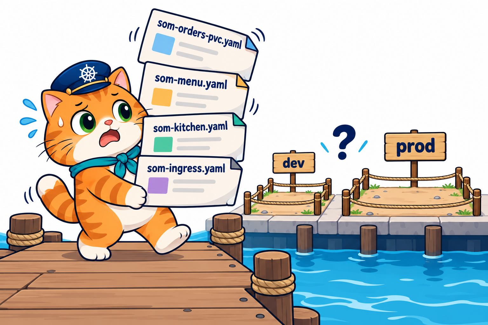

# บทที่ 9: Helm Chart — ร้านน้องส้มในกล่องเดียว

> **รายวิชา:** Software Development Tools and Environments (DevTools)
> **หัวข้อ:** เขียน Helm chart เอง (Chart.yaml / values.yaml / templates), ภาษา template เบื้องต้น, `helm lint` / `template` / `install` / `upgrade` / `history` / `rollback` / `package`, ลำดับความสำคัญของ values, if/else เปิด-ปิดส่วนของร้าน และ chart เดียวหลายสภาพแวดล้อม (dev / prod)
> **ผลลัพธ์การเรียนรู้ที่เกี่ยวข้อง:** CLO-5, CLO-6

<p align="center">
  <br>
  <em>บทที่แล้วร้านมีประตูใหญ่บานเดียวแล้ว แต่ทั้งร้านมี YAML หลายไฟล์ที่ต้อง apply และลบทีละไฟล์ จะเปิดร้านทดลองอีกร้านก็ต้องคัดลอกทุกไฟล์มาแก้ บทนี้น้องส้มรวมทั้งร้านไว้ในกล่องชุดประกอบ Helm chart กล่องเดียว</em>
</p>

## บทนี้เรียนอะไร

บทที่ 8 เราใช้ Helm ติดตั้ง Traefik ซึ่งเป็น chart ที่คนอื่นเขียนไว้ บทนี้เราจะ **เขียน chart เอง** โดยเริ่มจาก chart `hello` เล็ก ๆ เพื่อดูว่า template ที่มีช่อง `{{ }}` ถูกเติมค่าจาก values กลายเป็น YAML ธรรมดาได้อย่างไร จากนั้นลองเปลี่ยนค่า อัปเกรด ดูประวัติ ย้อนกลับ และเจอกับดักที่พบบ่อย สุดท้ายรวม **ร้านอาหารแมวน้องส้มทั้งร้าน** (ConfigMap, สมุดออเดอร์ PVC, หน้าร้าน, ครัว, Ingress) ไว้ใน chart `som-shop` แล้วใช้ chart เดียวกันเปิด **ร้านทดลอง `som-dev`** และ **ร้านจริง `som-prod`** ที่ต่างกันแค่ใบสั่งค่า

บทนี้ **ละเอียดกว่าบทก่อนราว 30%** ทั้งทฤษฎีและ LAB (มี LAB 0 + 5 LAB) เพราะภาษา template ของ Helm เป็นของใหม่ทั้งหมด

| ส่วน | เนื้อหา | ลิงก์ |
|---|---|---|
| 📖 **ทฤษฎี** | ทำไมต้อง Helm, chart / template / values / release, โครงโฟลเดอร์ chart, template กลายเป็น YAML อย่างไร, ภาษา template ฉบับเข้าใจง่าย, คำสั่งดู release, ลำดับความสำคัญของ values, กับดัก values, upgrade / history / rollback เทียบกับบท 4, deployed ≠ แอปใช้ได้, chart พัง, if/else, chart ร้านน้องส้ม, dev / prod, uninstall ลบ PVC (มีคำถามทบทวนพร้อมแนวคำตอบ) | [01_Theory/README.md](01_Theory/README.md) |
| 🧪 **ปฏิบัติการ** | LAB 0–5: สร้างคลัสเตอร์ + Traefik → chart แรกที่เขียนเอง → เปลี่ยนค่าด้วย values → อัปเกรด ย้อนกลับ และ chart พัง → chart ของร้านน้องส้ม → **LAB สุดท้าย: chart เดียว เปิด 2 ร้าน (dev / prod)** พร้อมสรุปคำสั่งท้ายบท | [02_LAB/README.md](02_LAB/README.md) |

## คำแนะนำในการเรียน

1. **อ่านทฤษฎีก่อน** อย่างน้อยหัวข้อ 1–8 แล้วเริ่ม LAB 0–1 ได้เลย
2. ก่อนทำ LAB 2–3 ให้อ่านหัวข้อ 9–13 (values, กับดัก values, upgrade / rollback, deployed ≠ ใช้ได้, chart พัง) และก่อน LAB 4–5 ให้อ่านหัวข้อ 14–17
3. ทำ LAB **ตามลำดับ** ใช้เวลารวมประมาณ 3.5–4 ชั่วโมง (Traefik ที่ติดตั้งใน LAB 0 ใช้ถึง LAB 5)
4. สังเกตสัญลักษณ์ในเอกสาร LAB ว่าคำสั่งรันที่ไหน: 🖥️ บนเครื่องนักศึกษา / 🐧 ใน SSH session ของ k8s-lab / 🌐 browser
5. ผลลัพธ์ในเอกสารมาจากการทดลองจริง (Kubernetes v1.37.0, Helm v4.3.0) แต่ **ชื่อ Pod และเวลาใน `helm history` ต่างกันทุกเครื่อง**
6. ลองตอบคำถามทบทวนด้วยตัวเองก่อนเปิดดูแนวคำตอบ

> **ขอบเขตของบทนี้:** เขียน chart ที่มี Chart.yaml, values.yaml, templates และ NOTES.txt ใช้ `{{ .Values }}`, `{{ .Release.Name }}`, `quote` และ `if/else` ไม่สอน subchart / dependency, `_helpers.tpl`, hooks หรือการเผยแพร่ chart ขึ้น repository ⚠️ **`helm uninstall` ลบ PVC ที่ chart สร้างด้วย = สมุดออเดอร์หาย** ส่วนงานที่รันเป็นรอบ ๆ (สำรองสมุดออเดอร์ทุกคืน) เป็น **เนื้อหาของบทถัดไป**

## สิ่งที่ต้องมีก่อนเริ่ม

- ผ่าน [บทที่ 8: Kubernetes Ingress](../008_kubernetes_Ingress/README.md) แล้ว ติดตั้ง Traefik ด้วย Helm และเปิดร้านด้วย `shop.localhost` / `kitchen.localhost` ได้
- เข้าใจ ConfigMap ([บทที่ 6](../006_kubernetes_ConfigMap_Secret/README.md)), PVC ([บทที่ 7](../007_kubernetes_PersistentVolume/README.md)) และ rollout / rollback ของ Deployment ([บทที่ 4](../004_kubernetes_Deployment/README.md))
- container **`k8s-lab`** ที่สร้างด้วย **`-p 30080-30082:30080-30082`** (LAB 0) ภายในมี `helm` ให้แล้ว
- เครื่องต่ออินเทอร์เน็ตได้ และ browser บนเครื่องนักศึกษา

## โครงสร้างโฟลเดอร์

```text
009_kubernetes_Helm/
├── README.md                         ← หน้านี้
├── 01_Theory/
│   ├── README.md                     ← เอกสารทฤษฎี
│   └── images/                       ← ภาพประกอบ (+ imagegen-prompts.md)
└── 02_LAB/
    ├── README.md                     ← คู่มือ LAB 0–5
    ├── images/                       ← ภาพประกอบ LAB + screenshots/ ภาพหน้าจอจริง
    ├── labs/
    │   ├── lab00-traefik/traefik-values.yaml
    │   └── lab02-values/             ← values-big.yaml, values-typo.yaml
    ├── charts/
    │   ├── hello/                    ← chart แรก (LAB 1–3): Chart.yaml, values.yaml, templates/
    │   └── hello-broken/             ← chart ที่แม่พิมพ์พิมพ์ผิด (LAB 3)
    └── som-menu/                     ← LAB 4–5 ร้านน้องส้มในกล่องเดียว
        ├── app/                      ← Node.js (server.js + Dockerfile) แสดงป้าย dev / prod
        ├── chart/som-shop/           ← chart ทั้งร้าน: ConfigMap, PVC, หน้าร้าน, ครัว, Ingress, NOTES
        ├── values-dev.yaml           ← ใบสั่งค่าร้านทดลอง
        └── values-prod.yaml          ← ใบสั่งค่าร้านจริง
```

ใน LAB 0 จะ `git clone` repo เข้า container แล้วทำงานที่ `/workspace/DevTools/05_kubernetes/009_kubernetes_Helm/02_LAB` ภายใน k8s-lab

## เริ่มเลย

👉 [อ่านทฤษฎี](01_Theory/README.md) → [ลงมือทำ LAB](02_LAB/README.md)
